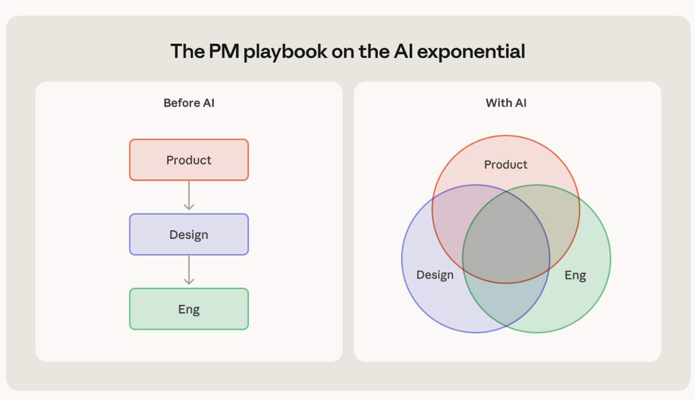
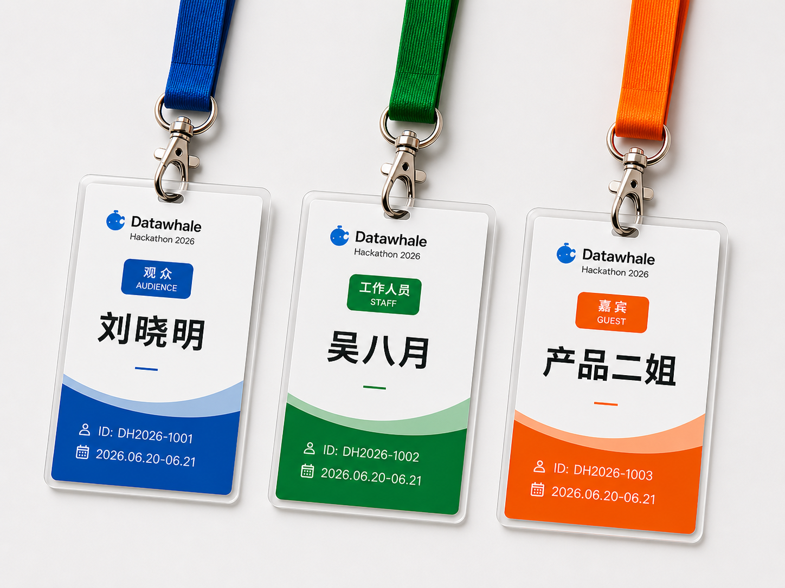
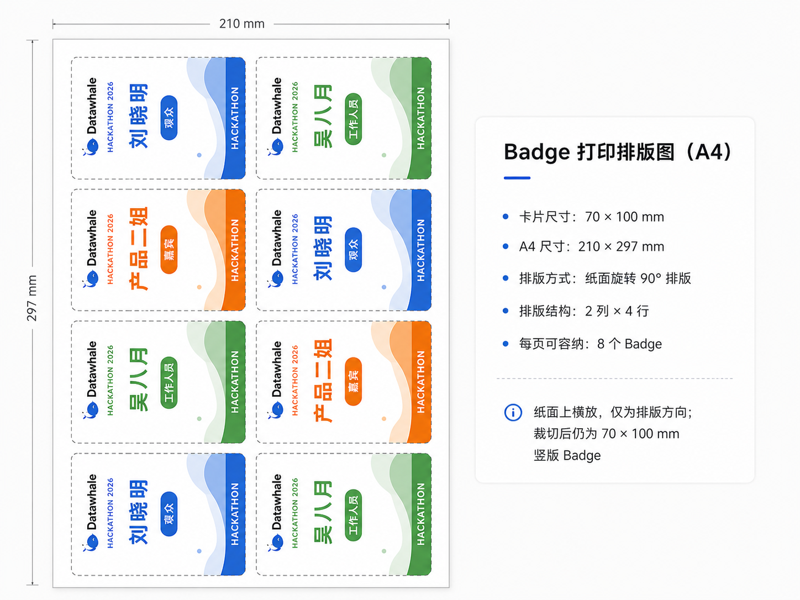
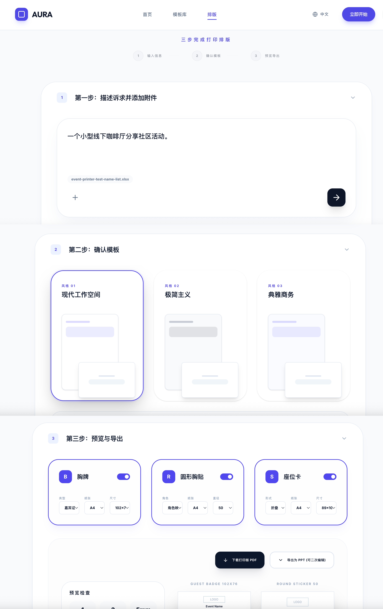
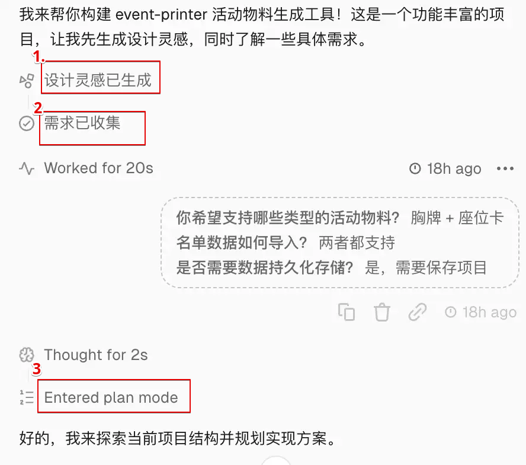

# 03 | 构建轮廓：don'tshowPRD,showthedemo

你好，我是产品二姐。

上一章我们看过了这两年 AI 产品演进的全景视图。这一章我们就开始正式上手。

我想你肯定在用 Vibe Coding，如果没有，那么打开任意一个 AI Coding 工具，试着输入一句话需求看看，比如“帮我做一个个人博客站点，色彩活泼，有亲和力”，这样你就完成了一次Vibe Coding。可以说，Vibe Coding 已经是当下产品经理要锻炼的基本功了。

不过，和所有工具一样，Vibe Coding 就像一把刀，只有用得好的人，才能真正发挥出它的威力。这一章我就会教你如何用好这把刀。

我会用 Vibe 的方式，和你一起完成从产品构思，到一句话构建粗糙的前端 Demo，再到把这个 Demo 完善成一个可以直接对外使用的产品，包括仓库环境配置、数据库搭建、后端接口对接，体验一个完整的 Vibe Coding 流程。

此外，在使用中，也需要你观察这些 AI Coding 工具是如何出色地完成这个任务的，我们又能从 AI Coding 工具中学习、借鉴点什么？

毕竟和其他 AI 工具相比，AI Coding 工具拥有以下四个“之最”：

- 最长的上下文管理

- 最安全的保障体系

- 最复杂的 Agent 协同

- 最灵活的 Re-Act 机制，以应对不同需求，如果你不知道 Re-Act 是什么，可以参看《成为AGI 产品经理》专栏里第 10 讲的内容。

可以说，AI Coding 工具是最顶端的 AI 产品。通过观察，能让我们迅速体会一个优秀的 AI 产品应该具备什么样的能力，为后面的第三、第四章做好铺垫。

## AI Coding 的低成本对软件开发的影响

在正式开始之前，我想先花一点时间来说说 Vibe Coding 给软件开发带来了哪些影响，和以前做产品的方式产生了哪些不同，这可以帮我们从旧的产品研发体系中跳脱出来，拥抱全新的、AI Native 的产品研发方式。

我们再次引用上一节课这张图，来展示一个互联网时代软件开发流程，与 AI 时代软件开发流程的区别。



通过这张图，我想和大家表达的是：

在调研、PRD 评审阶段，以前在构建产品 MVP 之前，我们要进行大量调研，论证 idea 是否成立，以避免后期消耗过多成本。

而现在，做产品的成本被 AI 无限降低，所以我们看到，我们论证 idea 的方式本身，就是把产品 Demo 做出来，甚至 Demo 就是你的 PRD。比如我们可以做若干个 Demo ，用 Demo 本身去验证这是否是“对的事情”，而不是停留在“思想假设”层面。

在功能打磨阶段，以前我们会和开发每周进行沟通、迭代。而现在，我们可以选择一个比较好的基座，构建出完善的前后端分离的架构，做好接口对接。并使用 Harness Engineering，以及各种 Skills 完成基本功能。

在上线、测试阶段，以前我们需要专门的 DevOps 同事来帮我们部署上线。现在我们同样可以使用 Skills 来完成线上部署。

可以说，这其中的每一步，都是用 Vibe Coding 的方式完成的。我们先来看第一步调研阶段。

## AI 时代的 PRD + 原型： 不是文字，是 Demo

假设你要做一个产品，第一个问题是：我应该用 Vibe Coding 做什么样的产品，我去哪里寻找用户的需求？

这里和你分享几个我常用的方法：

方法一：从自己的痛点出发。就是从自己身边的小事开始，可以是任何小众的痛点，比如有一个网站，它是一个专门解决“读者不知道该按什么顺序读系列小说”这一痛点的小众产品，收录了超过 1 万名作者、1.8 万 + 套丛书的阅读顺序，已经成为图书馆系统和书籍爱好者的标准参考工具。你看，这就是一个典型的“人群小、痛点真实、高频刚需”的产品。

方法二：在大数据中寻找。用 Semrush、SimilarWeb 这类 SEO 工具找到需求，比如Semrush 能让你看到用户都在 Google 上搜索什么，某个关键词是否被很多人搜索过，如果是，那就是一个被验证过的真实需求，而不是你自己的臆想。SimilarWeb 则让你看到竞品的流量来源和用户行为，了解市场上已经有谁在解决这个问题。进入 AI 时代，这套大数据逻辑依然成立，但是被观测的对象从搜索引擎转变到了 ChatGPT、Perplexity 上，在这两个工具里，也可以看到人们在 AI 问答引擎中的提问。

方法三：选择新赛道做产品。比如上一节课我们就讲过，AI 带来的新流量入口，也催生了 AISEO（GEO，生成引擎优化）这个赛道。因为这类赛道足够新，所有人都站在同一起跑线上，历史积累不是优势。如果你没有存量用户、没有历史数据，反而是选择新赛道的好时机。

方法四：如果你的需求来自公司甲方，或者你的上级，那么需求可能往往来自他们的“一句话需求”，你可以借助 AI 来扩展、完善这个需求。

方法五：如果你还没有选择到好的问题，那就不妨从复刻一个简单的工具类产品开始。

在这里，我会用我生活中真实发生的一个痛点举例。

大家在参加一些小型聚会、分享的时候，在门口报到处组织者会给你发一个来宾卡，可能是一个胸牌，也可能是贴纸。有时候，组织者还要为嘉宾席打印座位卡，标上这个人的名字、职位等。

这些座位卡和胸牌都是由打印店设计、排版好的。打印店会收到一个 Excel 版本的名单列表，先做好设计，这中间会和活动组织者反复确认，确认之后，做好排版，一个个把名字粘贴进去。大一点的打印社会有专门的设计人员做排版，小店里需要老板一个个做好，消耗很多人力。

那么我想是否可以输入一个列表，排版、设计就自动出来，像下图这样直接变成打印的胸牌、贴纸和座位卡呢。





有了这个 idea 后，就可以开始 Vibe 了。在 idea 还很模糊的阶段，我推荐你使用：Google AIStudio 或者 V0.App 这类 Vibe Coding 工具，而不是直接上手使用 Claude Code、Codex。

因为这个阶段你需要直观的页面来表达你的想法，而这两个工具产生的 Demo 是以交互类网页为主的，他们能让用户、甲方快速理解你的 idea ，做出下一步决策。

比如我使用 V0.App ，输入一段话：“做一个面向活动组织者、活动执行团队和打印店的活动物料生成工具，用户上传或者输入名单列表，就能快速生成可预览、可下载、可交付给打印流程的胸牌、座位卡等活动物料。”

等待数分钟后，V0.App 就帮我构建出了一个 Demo。



在完成几个版本之后，我把这个原型交互录了一个视频发给打印店的老板，以及经常组织活动的一些朋友，都是很快给出了回复。相比文字版的 PRD + 原型图，这样的 Demo 更快、更直观地得到了他们的讨论。我认为，这才是 AI 时代的 PRD。

而在 Claude 的官方博客里，也有一个类似的用 Demo 代替 PRD 的例子——Chime（美国金融科技公司）的 PM Dennis Yang 分享过他的工作流：先用 Markdown 写好 PRD ，然后打开

```
终端输入 claude，二十分钟后，PRD 变成一个可以跑起来的原型。接下来他把这个原型的
```

录屏丢到 Slack，团队讨论的问题从“这个需求说清楚了吗”变成了“这个交互能不能再改一下”，这个讨论质量就完全不同了。

这个故事说明了 Demo 作为 PRD 的核心价值：它把对话从“对规格的理解”拉到了“对产品的感受”。

如果你正在为一个 idea 写 PRD，或者已经有了一个 PRD 但需要更直观的表达，那么不妨按照我的方法，尝试一下。

## V0.App 是如何做到的？

现在，我们来复盘一下 V0.App 的执行过程。



你仔细看对话框，会发现在 V0.App 里完成了以下内容：

1. 设计灵感

2. 需求收集，这个过程会弹出一个对话框询问用户确认需求

3. 接着 V0.App 宣布进入 enter plan mode

你有没有想过，V0.App 是如何做到这个过程的，比如它在什么情况下会弹出对话框向你询问，对话框里的内容又是如何确定的呢？

对，是 Agent 自主发起的，而不是通过代码硬性控制的。这就是 AI Agent 类产品最典型的表现，没有固定流程，全部由 Agent 自主动态规划并发起。

Anthropic 在他们关于 Agent 自主性的研究报告里明确记录了这个模式：

- “Claude Code pauses to ask clarifying questions more than twice as often on complextasks compared to simple ones—and more frequently than humans interrupt it. Thisagent-initiated uncertainty recognition represents important built-in oversight.”— Anthropic Research: Measuring AI agent autonomy in practice

翻译过来就是：

- 在复杂任务中，Claude Code 主动暂停、向用户提问的频次，是简单任务的两倍以上，甚至比人类主动打断它的频率还要高。Anthropic 把这种“Agent 自己识别不确定性并主动提问”的行为，定义为一种重要的内置监督机制。

V0.App 的弹窗询问，本质上和这个机制是一样的：不是工程师提前写死了“在这个节点弹出对话框”，而是模型自己判断“我需要更多信息才能继续”。这也是未来我们能够用在自己的 AI 产品中的武器，至于如何应用实施，我们放在第四章的案例里介绍。

## 总结

到这里，你应该可以体验到 AI 时代诞生的全新的 PRD 格式了。

2000 年，Linux 创始人 Linus Torvalds 说过一句话：“Talk is cheap. Show me the code.”

这句俏皮话后来成了软件界的格言。它的意思是，谈论自己想做的或理论上可以做的软件开发工作很容易，但除非真正投入精力去验证，否则空谈毫无价值。

而现在，这个说法变成了“Code is cheap. Show me the revenue.”，意思是 Code 很便宜，但真正让别人付费很难。

虽然这一节还没有讲到付费，但“Code is cheap. Show me the demo.”，则是其中的第一步。希望这一步你已经跟着我走出来了。

不过，一切才刚刚开始，接下来我们继续用 Vibe Coding 完善这个 Demo，并结合 HarnessEngineering、Skills 等方式进一步打磨。

## 思考题

找一个你身边真实的痛点，或者你手头的一项任务，打开 V0.App 或者 Google AI Studio，输入一句话需求，生成一个 Demo。然后，把这个 Demo 的截图或录屏，发到社交媒体，或者发给一个真实的潜在客户，可能是你的领导、同事、未来的用户，收获反馈并调研竞品，看看你会有什么收获。

欢迎你在留言区和我交流。如果觉得有所收获，也可以把课程分享给更多的朋友一起学习。我们下节课见！
