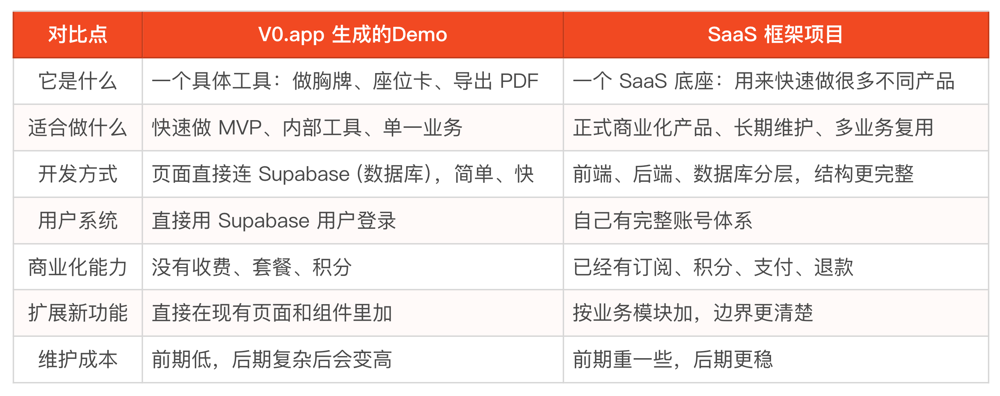

# 04 | 打磨细节：用Harness解放双手

你好，我是产品二姐。

上一讲，我们用 V0.App 做出了一个服务线下打印场景的“活动物料生成工具” Demo，我把录屏发给我的客户，比起文字，录屏可以得到更直观的回复。但这个 Demo 还停留在静态图纸层面，这一节课我们一起让它变得可用，把系统运转起来。

我们会用到两个非常重要的体系，它们会伴随着你的每一个产品诞生：一是基本的软件产品框架，即所有软件都可能会用到的用户、支付、订单体系，我会为你推荐几个成熟的框架，将我们在上一节课的 Demo 嵌入到这个框架中，让 AI 完成对接；当然如果你的系统中已经有这样的体系，那么直接对接就好，前提是要让已有的体系具备 Harness Engineering 能力，这正是我们要讲的第二个体系。

关于如何构建 Harness Engineering 体系，这节课我会给你推荐几个 Skill 来完成。 我会从产品经理的视角来深度讨论：为什么要有 Skill，它和提示词模板的区别是什么，为什么要有Harness Engineering ，如何用 Harness Engineering 让 Agent 能持续完成长时间的任务，实现无人值守。

学完之后，你就从一位只会展示的 Demo 版 PRD 产品经理，进化为一个初级的、全栈的 AIbuilder 式产品经理，有能力直接交付对外可用的产品。

让我们先开始第一步：把 Demo 展示的核心能力嵌入到框架之中，快速完成与产品配套的用户、支付、订单等体系。

## 把 Demo 的核心能力嵌入 SaaS 框架之中

很多同学在 Demo 得到客户确认后，就兴高采烈地以为任务完成了一大半。然而接下来的事情会让各位产品经理头疼：那就是 Demo 之后的配套体系用 AI Coding 工具做会越做越乱，这些体系包括：

- 能让用户用起来的功能：比如用户的注册、登录、用户的历史使用记录。

- 能让用户付费的功能：比如计费、支付、退款、订单、权益。

- 能推广产品的功能：比如产品的介绍、博客、产品指南等文档类的页面。

为什么 AI Coding 工具会越做越乱呢？这就好比你造房子只做了一个模型，然后就想在这个模型的基础上造房子，AI 只会觉得：你是想让这个模型越来越好，而不是真正施工做成房子。

正确的方法是，给 AI 一个好的架构，然后把模型放在架构旁边说：“你就照着这个模型的样子，在你的架构上搭房子”。

这个架构就是我们常说的 SaaS 框架，包含了刚刚说的用户、付费、推广等功能，只是它不具备业务属性，是所有商业产品的基础设施。

市场上已经有非常成熟的 SaaS 框架了，我个人推荐两个能力相似的产品：

https://shipany.ai/

https://shipfa.st/

还有刚出来不久的自带 Harness 的开源 SaaS 框架 velobase-harness。

在这门课中，我会使用自己基于过去两年经验沉淀的 SaaS 框架来讲解，目前这个框架还没有准备好对外开放，但不会影响你的学习进展。

V0.App 产生的 Demo 与 SaaS 框架和最核心区别就是：前者是单体架构的，后者是前后端分离的。打个比方，前者是一个工地临时工棚，后者拥有稳定的水电煤供应的房子，都能用，但基于后者做产品，更接近工业级别要求。

你也可以用一个简明的方法来对比这两种架构。我们把刚刚 V0.App 里的代码文件下载下来，再把 SaaS 框架的代码放在另外一个项目中，给 AI Coding 工具发出指令：阅读整个项目，总结一个 PRD 文档发给我看，你就能直观感受二者的区别了。

我把其核心差异列成表格，供你参考。



接下来看我们如何把 Demo 嵌入这个框架，这个嵌入过程需要我们从 V0.App 切到类似Codex、Claude Code 这类 Coding 工具。

我们以 SaaS 框架这个项目为基础，在项目下新增一个文件夹“reference”，把 Demo 对应的代码放在 /reference 文件夹里。告诉 Coding Agent：

```
这是一个 SaaS 框架，包含了用户，计费，支付管理等功能，现在我需要在这个框架里加入我自己的业务，具
```

这个步骤就是像我之前说的，把模型放在架构旁边说：“你就照着这个模型的样子，在架构上搭房子”。之后顺着这个方向，对话几轮，你就能得到一个有完整配套体系（用户、支付、订单、权益）的产品。

当然，如果你所在公司、团队已经有现有的 SaaS 框架，直接使用你们自己的框架就好。

在这个适配的过程中，你可能会发现一些问题，比如：

- 由于任务过长，执行到后面越来越难准确执行了。

- Agent 执行完之后，它中间的思索过程都是一次性的，没有沉淀。比如它为 A 任务会通读一遍代码，执行完成后，为了执行 B 任务，又要通读一遍代码，形成了巨大的 token 浪费。

这些问题在 Vibe Coding 过程中是非常普遍的。在 Anthropic 官方博客中就提到“当上下文越来越长时，Agent 就会有种紧迫感，导致执行质量潦草”。另外 Agent 确实会做一些重复的事情，甚至多个 Agent 会做同一件事情。

为了解决这个问题，就出现了大家早有耳闻的 Harness Engineering 与 Skill。

接下来我请大家吃一个“二合一”的套餐：使用 Skill 构建出项目完整的 Harness 体系。你看，这里既有 Harness Engineering，又有 Skill， 是不是“二合一”套餐呢？

## 给项目构建 Harness Engineering 体系

我们先直接使用起来看看效果，再回来介绍 Harness Engineering 与 Skill 的概念知识，理解会更深刻。

1. 首先，访问我自己开发的 book2skills.com ，搜索 Harness ，运行 npx 命令安装相关的 3个 Skill 。这是我自己打磨好的 3 个 Skill ，专门用于构建项目的 Harness Engineering。

- 注：book2skills.com 于 2026 年 8 月 7 日 -8 月 20 日期间会有短暂的维护时间，我们会尽快恢复。在此期间大家可以通过开源仓库 https://github.com/simbajigege/book2skills 下载、安装使用这里提到的 3 个 Harness Engineering skill

2. 然后，在刚刚的项目中输入：使用 3 个 Harness Engineering skill 为 <xxx 项目 > 构建harness 系统。

3. 等待若干分钟后，你会发现 Agent 创建了以下内容

```
AGENTS.md                    ← 目录文件，~100行
docs/
├── ARCHITECTURE.md          ← 模块划分、依赖关系
├── CONVENTIONS.md           ← 命名规则、代码风格
├── TECH_DECISIONS.md        ← 技术选型理由
├── QUALITY.md               ← 验收标准、完成定义
├── prd.md                   ← 产品需求文档、产品能力边界、默认用户流程
└── exec-plans/
   ├── active/              ← 当前进行中的计划（空目录，放 .gitkeep）
   ├── completed/           ← 已完成的计划（空目录，放 .gitkeep）
   ├── backlog.md           ← 待开发功能列表（已知需求，尚未排期）
   └── tech-debt-tracker.md ← 已知技术债务
init.sh：环境初始化脚本，验证项目可以正常启动
tasks.json：当前任务清单，agent 的工作指令来源
progress.md：人类可读的进度摘要，记录每次 session 的关键信息
```

看到这一堆词，你可能会有点迷茫。别急，如果你还记得我们在 01 讲里介绍 HarnessEngineering 的工厂车间画面，那么，在这里就可以对号入座了。

- 这里的 ARCHITECTURE.md、PRD.md 等文件就是车间介绍、工作制度、规范；

- Agent.md 就是车间地图工作制度、规范；

- exec-plans 就是数字大屏上的项目进度；

- init.sh、tasks.json、progress.md 就是可以在你发出下一个任务指令的时候，告诉 Agent：上一轮对话中 Agent 做了什么事情，这样当任务被中断，或者重新开始一个主题时，Agent可以迅速感知当前的任务进度和执行情况。

完成这一切之后，意味着我们的 Coding Agent 已经进入了 Harness Engineering 这个“场域”空间。

1. 接下来你可以和它共建、再优化你的 PRD.md 文档，并根据新的 PRD 重新构建 backlog。

2. 最后发出指令：依次完成 backlog 里的任务。

刚开始，Agent 会停下来让你赋予某某操作的权限，在保障安全的情况下，你依次进行授权。

几步操作下来，你就会发现 Agent 可以在非常长的时间里，不需要咨询你，自己就能完成backlog 里的所有任务。这样的工作方式可以让你从值守中解放出来。这就是 HarnessEngineering 的初衷：让 Agent 持续、可靠地完成超长时间任务。

那么为什么有了这三个 Harness Engineerings Skills，Codex 或者 Claude Code 就能做出这个 Harness Engineering 体系呢？

你可以打开电脑上的 .claude/skills 或 .Agent/skills 目录，看看这三个 skill.md 的内容，就能明白它做了哪几件事：

1. 扫描代码库，一次性生成结构化的知识文件。重点是 Agent.md 文档（在 Claude Code 里是 Claude.md ），它定义了 Agent 的“工作守则”，每次 Agent 执行任务时，会自动把它塞到本轮对话的上下文里。

2. 深度读懂代码，把隐性知识变成显式文档，比如架构说明文档、产品设计文档等。这可以保证 Agent 在执行任务的时候不必再扫描全库，定位代码位置。

3. 建立多轮对话管理。就是创建 tasks.json（任务清单）、progress.md（进度记录）、init.sh（环境初始化脚本）三个文件，帮助 Agent 每次做完 backlog 里的一个任务，可以自动移交到下一个任务。预防记忆爆炸，也避免在一轮对话里完成多个任务引起混乱。

不过，这里我们仅仅使用了三个 skill ，其实只完成了 Harness Engineering 的一半，另外一半是对代码进行评估、检查、完善。

后一半的环节最重要的是保持独立判断。在 Anthropic 的工程实验中发现：当 Agent 被要求评估自己的输出时，总是倾向于给出好评。这时候就需要把执行和评判分离到两个 Agent ，并把评估 Agent 调教得足够挑剔，才能得到可信的质量反馈。但是，引入评估 Agent 可能会引发过度测试，消耗大量 token。对于一个小型项目来说，略显多余；对于大型项目来说，可以适当引入。在这里我们就不赘述了。

最后我还想补充一点。

在 Codex、Claude Code 这类工具中，本身是自带 Harness Engineering 的，但今天还不太完善，所以我的经验是自己构建出来，会增强 Agent 约束。也许未来 Coding 工具的 Harness会越来越强，无需你额外做。尽管如此，这种显性的表达能帮助大家更好地理解 HarnessEngineering ，以后你可以让自己的产品也内嵌这样的 Harness Engineering 体系，增强Agent 的可靠性。

到这里，你完成了 Harness Engineering 的初体验。我想你肯定还有一个疑问没有解决，那就是这几个 Skills 是怎么做出来的呢？

接下来我们就一起来深度理解 Skill ，回答被很多朋友问到的问题。

1. 为什么有 Skill，Skill 不就是提示词模板吗？

2. 什么样的 Skill 才算好的 Skill？

3. 如何自己做出一个优秀的 Skill？

4. 如何把 Skill 用在自己的产品中？

我们一一来看。

## 聊聊 Skill

在 Anthropic 的官方文档里，列出了 Skill 的几项优势：

- 专业化：为特定领域任务定制能力

- 减少重复：一次创建，自动使用

- 组合能力：组合 Skills 以构建复杂工作流程

我第一次看到这几项的时候就在想，难道一个提示词模板不具备上面的优势吗？带着疑问我开始使用 Skill，才发现这三点并没有表现出 Skill 的特质。

如果仅从一轮对话中看，Skill 和提示词模板一样，就是作为上下文发给大语言模型，控制其更好的输出。但把 Skill 放在 Agent 的工作体系里，可就有两个本质的不同了。

第一个不同是提示词模板需要用户或者 workflow 开发者主动完成， Agent 是被动接受的；而Skill 则是被管理在 Agent 的记忆系统里的，何时调用 Skill 是由 Agent 自己决定。

打个比方，提示词模板就像是把 Agent 当做刚刚参加工作的见习医生，告诉它一定要照着这个做。而 Skill 是把 Agent 当经验丰富的医生来看：我一直在这里，用的时候随时来拿就行。

我们经常说大语言模型是一个超级智能，如果仅仅把它当做见习医生，那就是大材小用，而Skill 则是“人尽其才”：让 Agent 能自由使用资源、能力，不再遵循固定的 workflow 执行任务，能处理更灵活、复杂的工作。

第二个不同是 Skill 可以极其方便地进化，而固定在 workflow 中的提示词模板，每次改动都必须有开发人员亲自执行。

比如当你发现一个 Skill 的输出结果并不好，你就可以告诉 Claude Code 或者 Codex ： “这里做得不够好，你应该……，然后把我的想法抽象总结，加在 Skill 里”，它就可以马上完成进化。

还是刚刚医生的那个比方，Prompt 模板就像给见习医生的操作手册，要修改需要触动整个流程；而 Skill 是老医生随身携带，随时可以被完善的。

可以说 Skill 是 Agent 能力提升后的自然产物。那么，怎样才算一个好的 Skill 呢？

什么样的 Skill 才算好的 Skill？

在 Anthropic 的官方文档里，有非常详尽的描述，我强烈推荐大家直接阅读，这里仅做总结。

1. 简洁。SKILL.md 正文小于 500 行，不要过多解释。

2. 适当的自由度。假定完成某项任务必须这样做，那么，SKILL.md 要严格规定；假设可以在一定范围内自由处理，Skill 里可以指定大概流程；假定没有特定标准，则笼统说出你的诉求就好。

3. 写 Skill 要遵循 Claude 规定的格式，比如一定要有名称、描述、渐进式披露。

4. 可以提供示例、前后描述一致。

5. 列出检查清单。

6. 随时改进你的 Skill 。

知道好 Skill 的标准，意味着我们可以甄别好坏，也可以照着这个标准来写出自己的 Skill。

如何写 Skill？

写 Skill 有一个“ Skill 元祖”，就是 skill-creator skill，创建 Skill 的 Skill。

Anthropic 完全开放了这个 skill-creator，大家可以直接安装，之后发出创建 Skill 的指令时，Agent 就会调用这个 Skill。我一般有以下几种方法来创建自己的 Skill：

方法 1：依照我和 Agent 的对话记录创建 Skill。比如我在写这门课程的时候，会调研大量内容，所有动作都在 Claude Code 里展开，经过若干轮对话后，形成了我满意的调研内容。紧接着，我会告诉 Agent。

```
把上述对话抽象成一个调研方法论，并沉淀为 skill ，使我以后也能用它来做其他内容的调研。
```

方法 2：给 Agent 一本书，或者可靠的资料，让它把书中的方法提炼出来。book2skills.com的产品就是受此启发而形成的。而上述的 Harness Engineering Skill 就是综合了 OpenAI、Anthropic 官方所有关于 Harness Engineering 的文档产生的。

方法 3：在别人的 Skill 基础上改成自己想要的 Skill。 比如 YC CEO Garry Tan 的若干 Skill，如果第一次使用和你想要的效果接近，那么持续修改就好。

以上三种方法大家可以组合使用，随时构建自己的 Skill，比如写 PRD、PPT、用户访谈总结，做 UX 设计和竞品调研等等。

这些 Skill 不仅可以帮我们 Vibe Coding，也可以帮我们完成日常工作。更重要的是，我们还可以把 Skill 放在自己的产品中。

如何把 Skill 用在自己的产品中？

不过，把 Skill 用在自己的产品中，可不是简单把它当做提示词放进去。在前面的内容中，大家应该能体会到，Skill 其实是一种资源，能不能把 Skill 用好有三个前提：

- 要有一个能力非凡的大语言模型，与 Sonnet 4.6 能力相当或者更高。

- 要有一个可以主动调用 Skill 的 Agent，比如 Claude Code / Codex。

- 要有一个完善的 Harness Engineering 场域，比如 Claude Code / Codex 本身营造的场域。

第一个好解决，第二、三个听起来就不那么容易了，难道要我们自己构建一个 Claude Code吗？

别急，后面的课程我们会通过拆解 Claude Code 来理解如何管理这些 Skill，并应用在我们自己的 Agent 中，这里就不再详述。

好了，到这里，我们对 Harness Engineering 和 Skill 就有了基本的理解。

## 总结

我们再回到项目中，现在我们一起完成了以下任务：

1. 用 V0.App 这类工具完成了一个 Demo 式 PRD 的生成。

2. 在 Claude Code / Codex 里, 把这个 Demo 放在了一个 SaaS 框架里，配好了相应的用户、支付、订单、权益等配套体系。

3. 为了用无人值守方式完成接下来项目的维护、优化，我们使用 Skill 构建了项目的 HarnessEngineering 体系。

接下来，我们还可以使用不同的 Skill 持续完善这个项目，比如：

- 使用 web-design skill 完善用户体验；

- 使用 design skill 优化胸牌生成提示词；

- 使用 PDF skill 来完成排版 pdf 生成的相关代码。

那以上这些就留给大家做课后作业。

如果说上一节的 Demo 是初步完成了产品的设计，那么这一节就是完成了产品的开发，下一节课就是正式把项目发布、部署到服务器上，面向公众使用了。

## 课后题

课程里说 Skill 和提示词模板的本质区别是：提示词是见习医生的操作手册，Skill 是老医生随身携带的工具包，用的时候自己来取。现在亲手验证一下，找一件你经常重复做的事情，比如写周报、整理会议记录、写竞品对比，先用提示词模板来完成，再用同样的内容写成一个 Skill安装进 Claude Code，试一次。看看二者有什么区别，这样你对 Skill 的体会更深刻。

欢迎你在留言区和我交流。如果觉得有所收获，也可以把课程分享给更多的朋友一起学习。我们下节课见！
