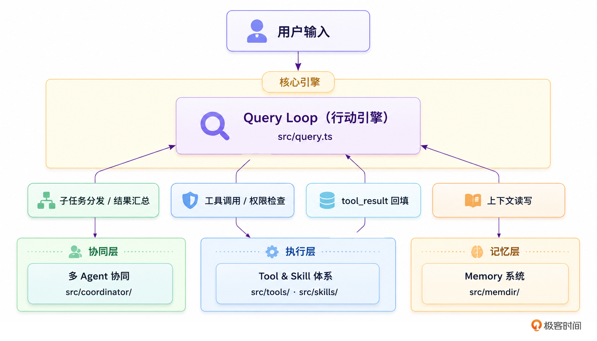
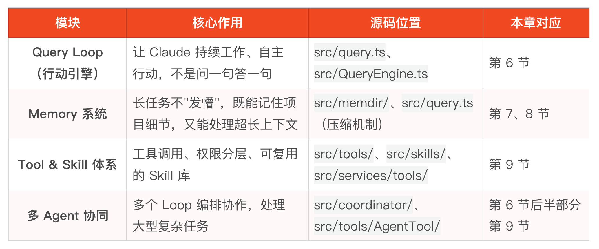
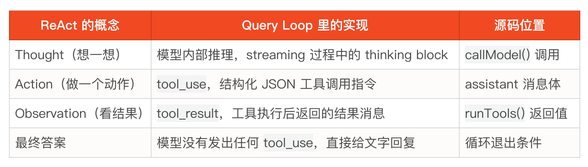
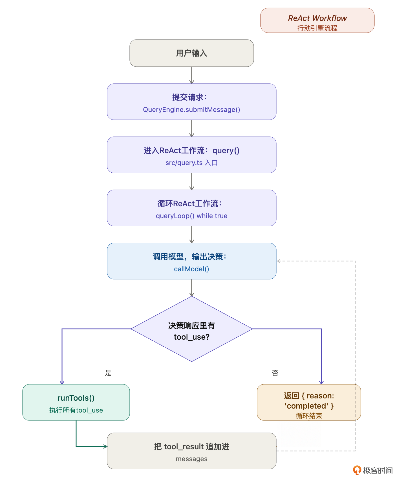
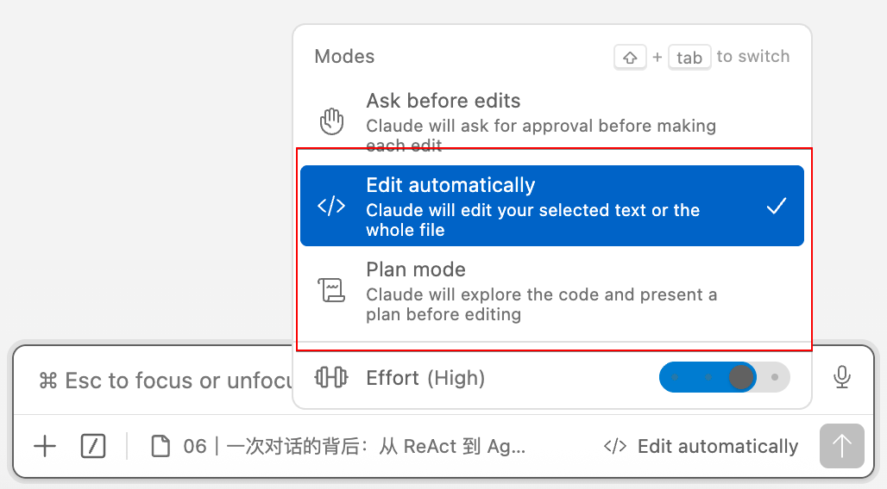

# 06 | Agent行动机制的进化：从ReAct到AgentLoop

你好，我是产品二姐。

上一章我们用 V0.App、Claude Code/Codex 这类工具亲自上手做了产品，侧重于使用 AI。

这一章开始，我们的内容会更侧重做 Agent 这类产品，拆开来就是如何构建 Agent 的行动、工具使用、记忆、多 Agent 协同这四大件。而在这个几方面最强的 Agent 就是 AI Coding 工具本身。众所周知，现在最强的 AI Coding 工具，就是 Claude Code。

恰好在不久前，也就是 2026 年 3 月 31 日，Claude Code 工程师的一次误操作，意外泄露了约 51.2 万行代码，共 1900 个文件，较为完整地展现了 Coding Agent 的核心设计逻辑，这几乎可以用来当做 Agent 开发者的最佳学习素材。

这一章我们就开启用 Agent 理解 Agent 的模式：用 Claude Code 解读 Claude Code 代码，学习如何科学构建 Agent。

听到代码，大家千万别担心，我会带着大家从产品经理的角度来理清代码：

- 首先，我们会从一个产品现象入手，看它背后的代码机制；

- 然后想想这个机制适用于什么业务场景，能不能搬到你自己的产品里；

- 最后，我会把每个机制总结成一个 Skill，让你的 Coding 工具可以使用这些 Skill，为你的产品中加入这些功能。

学完之后，你就拥有了一个强大的“兵器库”，为下一章的实战案例做好准备。

## 从 Claude Code 代码看产品全景

首先我们全景看 Claude Code 代码架构，Claude Code 的核心能力由“一个引擎加上三个部件”支撑。一个引擎即 Query Loop， 它的运行需要随时调用另外三个模块，即：

- 多 Agent 协同机制：比如什么时候 Claude Code 应该创建 SubAgent 或者并行 Agent 来完成任务。

- 记忆机制：比如什么时候该进行记忆压缩，如何抽取到合适的记忆等等。

- 任务执行机制： 比如如何管理好工具，何时应该执行那个工具，使用哪个 Skill。



这一章的六讲内容，就是围绕这四个模块展开的。我把这四个模块的核心作用和对应的章节用表格来展示，你可以参考。



这一节课，我们先从引擎——Query Loop 讲起。

## 产品现象：Agent 思考、调用工具、再思考

在使用 Claude Code 时，我们已经习惯了这样的操作：发出一个指令，然后 Agent thinking，自主查询所需代码，完成代码修改，直到任务完成。这背后的机制就是 Query Loop。

其实，Query Loop 就是 Re-Act 思想的工程化落地方式。如果你看过我的上一门课《成为AGI 产品经理》，应该还记得第 11 讲里自主工单小助手的例子——用户反馈“充电桩坏了，需要报修”时，Agent 的处理过程是这样的：

```
先思考Thought：用户说充电桩坏了，但我不知道是哪台桩、什么问题，需要先查一下。
再行动Action：查询工单系统，找出该用户绑定的充电桩编号。
再观察结果Observation：找到桩号 B-204，最近 24 小时有 3 次断连记录。
先思考Thought：频繁断连说明是通信故障，不是用户操作问题，需要派维护员现场处理。
再行动Action：创建维修工单，指派给距离最近的维护员张工。
再观察结果Observation：工单创建成功，预计 2 小时内响应。
→ 最终答案：已为您创建维修工单，维护员将在 2 小时内联系您处理。
```

这就是 ReAct， 它描述的是一种智能体的思考 - 行动模式：

```
想（Thought）→ 做（Action）→ 看结果（Observation）→ 继续想（Thought）→ ……→ 给答案
```

ReAct 就像人类一样，可以“见机行事”：行动一步、看结果、思考、再行动，也被很多开发者称为动态规划。

## 什么是 Query Loop？

这种“见机行事”的落地方式就是 Claude Code 代码中的 Query Loop。我把 ReAct 的概念和Query Loop 的实现，以及源码中对应的位置，列成了一张表，供你参考：



最小的 Query Loop 逻辑是这样的：

```
循环开始（while true）：
 调用模型
 如果模型没有发出 tool_use：
   返回最终回复，循环结束 → reason: 'completed'
 执行工具，拿到结果
 把 tool_result 追加进 messages
 继续下一轮
```

在 Claude Code 的源码里，这条链路对应的是：



这里面藏着一个很巧妙的设计决定：退出循环的条件，是模型没有发出工具调用。

为什么这样设计？因为有工具调用，就意味着模型认为它还需要更多信息或操作；没有工具调用，就意味着它认为已经可以直接给出答案了。你会发现：代码里没有任何一个函数是帮模型判断下一步该做什么，代码只做三件事：维护循环、执行工具、回填结果，而所有决策判断都交给模型。

我在第 4 讲聊 Skills 时提到的一个理念：把模型当做老医生，而不是见习医生。这里把判断都交给模型，也是在践行这个理念。

## 如何实现 Query Loop？

Query Loop 这个循环听起来不复杂，但要做到真正可靠，Claude Code 分四步。

第一步，LLM 发出工具调用指令

如果 LLM 返回要调用工具，会使用结构化语言发出工具调用指令，比如下面这样的 JSON 对象，指明了工具的名称、工具参数。

```json
{
 "type": "tool_use",
 "name": "read_file",
 "id": "tool_001",
 "input": { "path": "src/auth.ts" }
}
```

第二步，执行工具前的校验。

模型发出工具调用指令，不等于工具直接执行。中间还需要经过以下步骤：

- 找到对应工具

- 校验 input 参数格式

- 检查工具调用的权限

- 执行工具

- 把成功或错误包装成 tool_result 还给模型

比如你让 Claude Code 删除文件时，它会弹确认框，请求权限。这样的弹窗在校验工具权限过程中触发，关于具体的工具管理，我们在第 9 讲详细讲述，这里先埋个伏笔。

同时，类似工具返回的错误结果也应该告诉模型。文件不存在、搜索无结果、参数格式不对

```
——这些不是失败就停止，而是可以作为 tool_result（is_error: true）回填给模
```

型，让它自己修正下一步。

第三步，有效的上下文管理。

Query Loop 的每一轮循环，对话历史就加长一截，包括模型的思考、工具调用记录、工具返回结果，全部累积在一起。任务越长，messages 越大。最终会突破模型的上下文窗口限制。

所以 Claude Code 就引入了压缩机制。这个压缩机制会在上下文快满的时候自动触发，把旧的对话历史压缩成摘要，保留最近最关键的信息，让循环继续跑下去。这是专门针对长任务的工程投入。详细内容会在第 8 讲详细讲述。

第四步，退出工具调用。

没有工具调用就退出是正常结束，但产品里还需要更多退出路径。在 Claude Code 的

```
src/query/transitions.ts 里，定义了所有可能的终止原因，依次是：
```

- 正常完成

- 达到最大轮数上限

- 用户取消

- 工具执行遇到无法恢复的错误

- 上下文过长

- Hook 介入停止

可以说，这些条件是 Query Loop 的兜底和异常应对机制，否则意外遇到死循环就有可能把token 预算用光。

到这里，Query Loop 的基本结构你已经清楚了。如果只是单个循环，Claude Code 能做的事还是有限的。真正让它强大的，是多个 Loop 可以协同。Anthropic 在 2026 年整理了一份关于AI Agent 工作流的最佳实践，把生产级 Query Loop 归纳成三种模式：

- 顺序模式（Sequential）

- 并行模式（Parallel）

- 评估 - 优化模式（Evaluator-Optimizer）

这本质上是三种不同的 Agent 协同机制，我们放在后面的课程里讲。

## 如何把 Query Loop 用在自己的产品中？

好，现在回到产品经理的视角。理解了 Claude Code 的 Query Loop，接下来我们的问题就是：在什么样的场景中，我们可以使用 Query Loop？

在上一门课《成为 AGI 产品经理》第 10 讲里，我提到过一个判断标准：如果任务需要Agent 在执行过程中根据中间结果动态调整行动，那就适合用 Query Loop 来实现。

除此之外，就是避免在超大规模的任务中直接使用 Query Loop。举个例子，在 Claude Code里，我们会看到有两种工作模式，能很明确地体现出 Query Loop 的使用场景。



- 第一种场景是自动执行模式（edit automatically），这个模式下 Claude 全程用 QueryLoop，这适合任务清晰、风险可控的场景。

- 第二种场景是计划模式（plan mode）：这个模式下 Claude 先规划、再等你确认，才进入Query Loop 执行，适合不确定性高、影响范围大的任务。

所以，确切地说，在小规模、不确定性高的任务中，适合使用 Query Loop；在大规模，需要跨团队协同，影响范围大的任务，需要 plan 模式 + Query Loop 来完成。

比如，对于股票分析助手来说， 用户问：“全面分析一支股票”，这个全面是非常笼统的，需要plan 模式 + Query Loop 来完成；如果用户问“帮我查查某个新闻热点对 xx 股票有什么影响”，就可以直接用单纯 Query Loop 来完成。

产品经理就需要为不同场景确定该使用何种模式，通过意图识别或者前端操作来触发不同的模式。

如何实现 QueryLoop？

那么，如果你想在自己的产品里实现类似的 Query Loop，该如何和 Coding Agent 沟通呢？

这里有个简单的方法，你不必把 Query Loop 的思想给 Coding Agent 说一遍，而是直接使用

```
我从 Claude Code 源码里提炼出来的 Skill：query-loop-implementation。
```

这个 Skill 我已经开源放在 book2skills 中，大家直接安装使用即可。

```
你可以直接访问：https://book2skills.com/en/book/query-loop-implementation/ 获得。
或者直接使用指令安装：npx skills add simbajigege/book2skills/skills/query-loop-implem
开源地址是：https://github.com/simbajigege/book2skills/tree/main/skills/query-loop-
```

课后大家可以阅读这个 Skill 的内容，体会其中的思想，以便于我们后续使用。

## 总结

到这里，我们初步认识了 Claude Code 里的 Query Loop 机制，这个机制非常适合用在需要动态规划的场景。比如新一代的客服场景中，会要求 Agent 能及时查询订单、处理退款等功能。

实际上，Query Loop 的本质就是 Re-Act 工程化的体现。Query Loop 的实现要注意四件事：

- 工具调用要结构化。

- 工具执行前，要进行全面校验。

- 要有明确的 Query Loop 退出机制。

- 高效的上下文管理。

```
你可以在电脑上安装好 query-loop-implementation Skill，为第四章的实战案例做好准
```

备。

下一讲，我们继续拆 Claude Code，聊聊它是如何管理记忆、应对记忆爆炸的。

## 思考题

这一章主要是准备我们的兵器库，每节课我会提供若干 Skill，了解这些 skill 可以帮助你巩固

```
所学。所以请你安装 query-loop-implementation Skill，在 Claude Code 或者 Codex
```

里，指定这个 Skill，指定一个你日常遇到的任务比如订机票，让这个 Skill 帮你判断：这个任务适合纯 Query Loop 还是 Plan + Loop？帮你构思实现的方法。

欢迎你在留言区和我交流。如果觉得有所收获，也可以把课程分享给更多的朋友一起学习。我们下节课见！

参考资料

- Common workflow patterns for AI agents and when to use them

- Subagents in Claude Code

- Code Review for Claude Code
