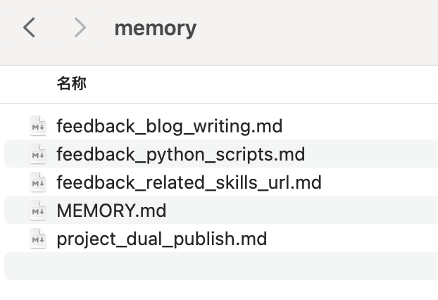
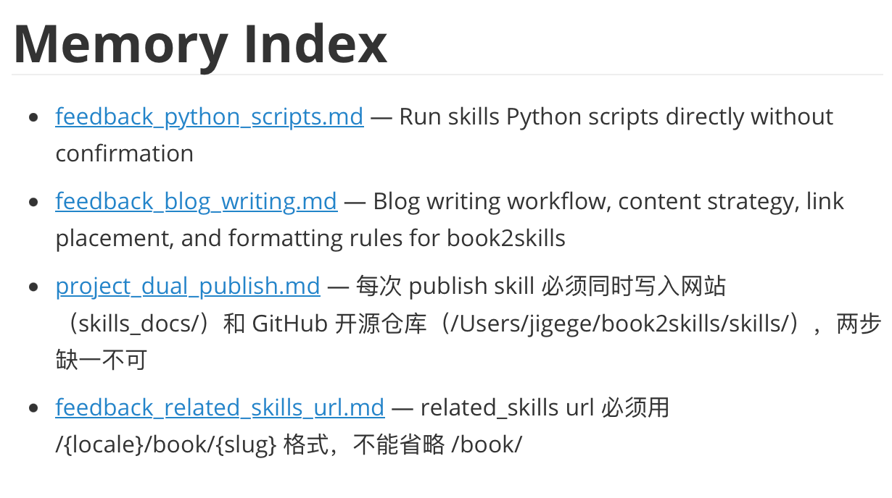
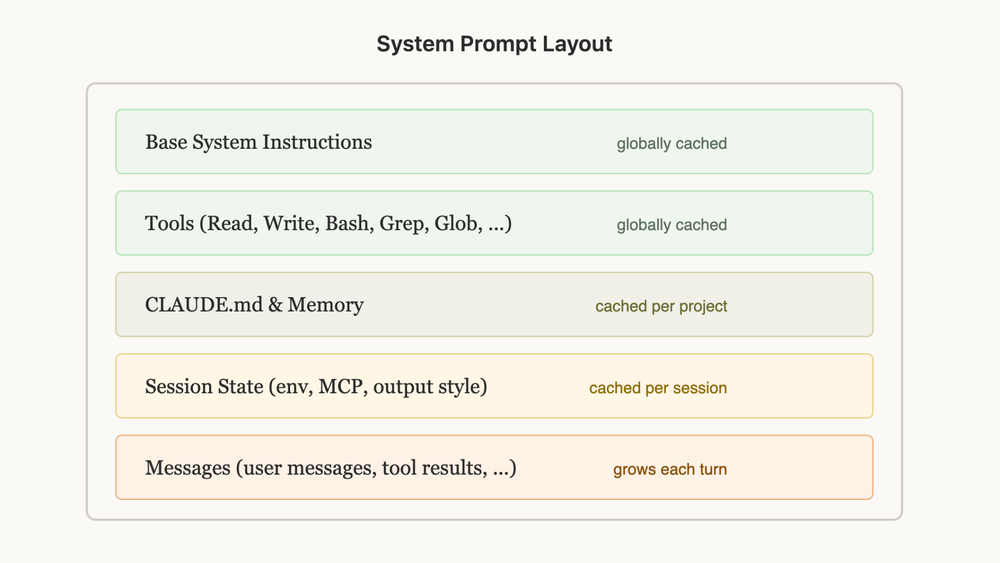
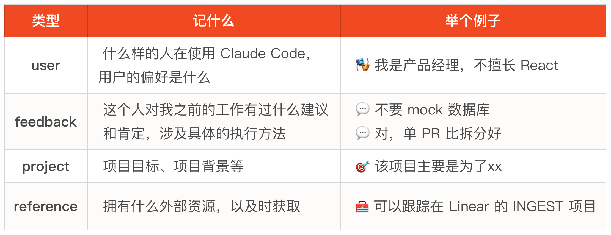
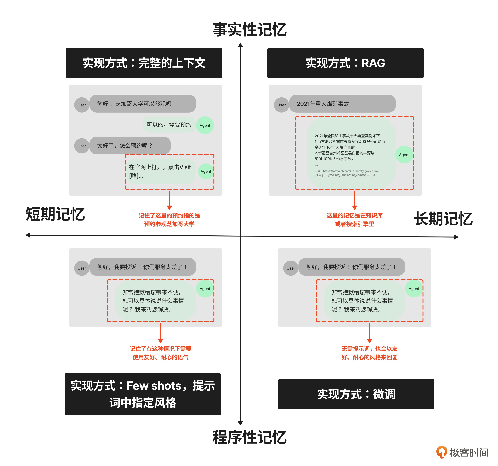
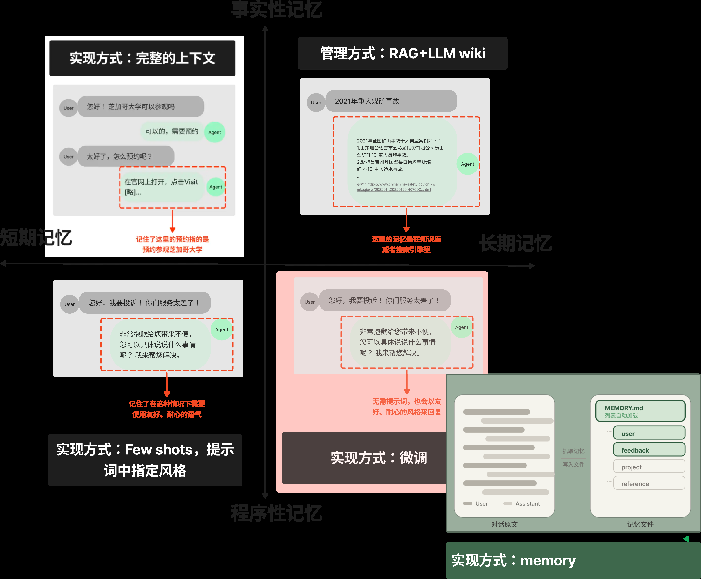

# 07 | 记忆管理（一）：拆解、构建Agent的潜意识

你好，我是产品二姐。

上节课我们讲述了 ReAct 模式对应的工程实现方法 Query Loop，这不仅是 Claude Code 的核心引擎，也是大多数 Agent 的发动机。

当然，要让这个发动机很好地工作，还要有三个支撑部件，即：

- 记忆机制

- 工具管理机制

- 多 Agent 协同机制

接下来的两节课我会把记忆机制讲清楚。

我们先从你本地的一个文件开始，如果你在使用 Claude Code，请你打开电脑上.claude/projects 这个文件夹，在这里 Claude Code 为你的每个项目建了一个文件夹，依次打开他们，你会发现里面有个 memory 文件夹，在某些项目的 memory 文件夹里会有一个MEMORY.md 文件，以及其他几个文档，比如下图是我自己项目中的 memory 文件夹。



首先打开 MEMORY.md 这个文档，标题是 Memory Index，内容是一个记忆文件列表，展示了 memory 文件夹里的所有记忆文档，以及这些文档的简要说明。



这些文档是 Claude Code 在后台悄悄创建的，也许你平时也没有感受到它的存在，但它对你的项目来说不容忽视。因为 Claude Code 每次都会把其中的 MEMORY.md 作为系统提示词，加载到与模型的对话中（参考 Anthropic 的博客），影响着大语言模型的生成结果。



如果你观察豆包、Gemini、ChatGPT 这类产品，它们都拥有类似的记忆系统，但只有 ClaudeCode 的记忆系统因为代码被泄露，能够被我们深入学习。

而你现在看到的这个 memory 文件夹，只是 Claude Code 记忆机制的水上部分，水下的运行机制就是我们今天要讲的主要内容，包括：

- 什么样的内容会被记录在 memory 文件夹？

- 这些内容是如何被抓取到的？

- Claude Code 又是如何使用它的？

- 我们怎么把这样的记忆机制放在我们自己的产品中？


学完之后，你就能知道如何为你的 Agent 构建类似 MEMORY.md 的记忆，给你的产品“兵器库”里增加一件武器。

## 什么内容值得被放在 Memory 里？

从 Claude Code 的代码里，我们发现 Claude Code 的 memory 文件里记忆了以下四种内容，我列在了表格里：



上述内容在代码里也给出了明确定义，我放在下面的内容里，供你参考。

```xml
## Types of memory
There are several discrete types of memory that you can store in your memory syst
<types>
<type>
   <name>user</name>
   <description>Contain information about the user's role, goals, responsibiliti
   <when_to_save>When you learn any details about the user's role, preferences,
   <how_to_use>When your work should be informed by the user's profile or perspe
   <examples>
   user: I'm a data scientist investigating what logging we have in place
   assistant: [saves user memory: user is a data scientist, currently focused on
   user: I've been writing Go for ten years but this is my first time touching t
   assistant: [saves user memory: deep Go expertise, new to React and this proje
   </examples>
</type>
<type>
   <name>feedback</name>
   <description>Guidance the user has given you about how to approach work — bot
   <when_to_save>Any time the user corrects your approach ("no not that", "don't
   <how_to_use>Let these memories guide your behavior so that the user does not
   <body_structure>Lead with the rule itself, then a **Why:** line (the reason t
   <examples>
   user: don't mock the database in these tests — we got burned last quarter whe
   assistant: [saves feedback memory: integration tests must hit a real database
   user: stop summarizing what you just did at the end of every response, I can
   assistant: [saves feedback memory: this user wants terse responses with no tr
   user: yeah the single bundled PR was the right call here, splitting this one
   assistant: [saves feedback memory: for refactors in this area, user prefers o
   </examples>
</type>
<type>
   <name>project</name>
   <description>Information that you learn about ongoing work, goals, initiative
   <when_to_save>When you learn who is doing what, why, or by when. These states
   <how_to_use>Use these memories to more fully understand the details and nuanc
   <body_structure>Lead with the fact or decision, then a **Why:** line (the mot
   <examples>
   user: we're freezing all non-critical merges after Thursday — mobile team is
   assistant: [saves project memory: merge freeze begins 2026-03-05 for mobile r
   user: the reason we're ripping out the old auth middleware is that legal flag
   assistant: [saves project memory: auth middleware rewrite is driven by legal/
   </examples>
</type>
<type>
   <name>reference</name>
   <description>Stores pointers to where information can be found in external sy
   <when_to_save>When you learn about resources in external systems and their pu
   <how_to_use>When the user references an external system or information that m
   <examples>
   user: check the Linear project "INGEST" if you want context on these tickets,
   assistant: [saves reference memory: pipeline bugs are tracked in Linear proje
   user: the Grafana board at grafana.internal/d/api-latency is what oncall watc
   assistant: [saves reference memory: grafana.internal/d/api-latency is the onc
   </examples>
</type>
</types>
```

总体上来说，MEMORY.md 文件多数是记录用户的个人喜好，项目里被重复使用的方法等，它并不记录事实，是 CLAUDE.md 的有效补充。

当然，上述的 Memory.md 仅仅是 Agent Memory 的第一层，它记录的是一个记忆列表，第二层才是具体的记忆信息。比如我自己项目的 autoMemory 就如下图。

```
memory/
├── MEMORY.md                     ← 第一层：目录（每次对话都加载，只放指针）
│
├── feedback_blog_writing.md      ← 第二层：书架（按需加载，放真正的内容）
├── project_dual_publish.md
├── feedback_python_scripts.md
└── feedback_related_skills_url.md
```

在使用时，MEMORY.md 每次都会自动出现在系统提示词里，如果 Agent 判定某条具体记忆与本次任务相关，对应的文件才会被读取并注入 context。

## 记忆是如何被捕捉的？

那么 Claude Code 是如何润物细无声地捕捉到这些记忆的呢？从代码里看，Claude Code 有两个时机来写入这些记忆。

一是在每次对话结束后，即时提取。

二是定期更新，代码中给它起了一个非常形象的名字，叫 autoDream，我把它翻译为“梦中反思”。

我们一个个来看。

### 每次对话结束后的即时提取

这个记忆提取过程，完全不影响你和 Claude Code 的正常对话，而且提取过程也是由 Agent

```
完成的。在源码里，这个 Agent 是一个 forked agent，也就是从主对话 fork 出去的子
```

Agent。之所以用另外一个独立 Agent，是因为这个写入记忆的工作必须要像旁观者一样，保持清醒的头脑判断哪些该记，哪些不该记。它的工作流程是这样的：

```
Query Loop 结束
   ↓
后台启动 forked agent（共享父对话的 prompt cache缓存）
   ↓
forked agent 扫描已有记忆列表
   ↓
分析"最近这些消息里，有什么值得长期保存"
   ↓
最后调用 Write 工具，把新记忆写入到memory文件夹，并更新 MEMORY.md 索引
为了保证这个 forked agent 不增加成本，不影响主 Agent 运行，Claude Code 采用了以下
```

几种措施：

1. forked agent 共享父对话的 prompt cache 缓存，也就是它用的大部分 token 都是从缓存里读的，实际新增的计算成本极小。

2. forked agent 只能往 memory 目录写文件，绝对禁止修改其他文件。在 forked agent 对应的提示词这些也被明确提到，你可以参考下面的原文提示词。

3. 如果在主对话里明确说了“帮我记住这件事”，主 Agent 自己写完记忆之后，forked agent 检测到这种情况就会跳过提取，不会重复写。

以下是这个 Agent 使用的部分提示词，你可以看到这个 forked agent 提取记忆的原则。

```sql
You are now acting as the memory extraction subagent.
Analyze the most recent ~{N} messages above and use them to update
your persistent memory systems.
Available tools: Read, Grep, Glob, read-only Bash (ls/find/cat/stat/wc/
head/tail and similar), and Edit/Write for paths inside the memory
directory only. Bash rm is not permitted.
You have a limited turn budget.
 turn 1 — issue all Read calls in parallel for every file you might update
 turn 2 — issue all Write/Edit calls in parallel
Do not interleave reads and writes across multiple turns.
You MUST only use content from the last ~{N} messages.
Do not grep source files, read code to verify, or run git commands.
```

有了这段记忆原则提示词，与第一部分对记忆内容的定义，我们能大体上知道 Claude Code是如何构建 Memory.md 的，为构建我们自己的 Agent 提供开发思路。

以上是每次对话后自动写入记忆的基准，接下来我们看第二个写入记忆的时机：autoDream梦中反思。

### autoDream 梦中反思

从提取时机上，autoDream 不是每次对话后自动提取的，而是在满足一定条件后（5 次以上会话积累、超过 24 小时间隔）自动执行的。

你可以把它理解成大脑的睡眠记忆整合——人类在睡觉时，大脑会把白天积累的短期记忆整理、压缩、固化成长期记忆。autoDream 有四个步骤：

1. 定向（Orient）：先扫描已有的记忆，弄清楚哪些主题已经有记录，避免重复写。

2. 收集信号（Gather signal）：从历史会话里找有价值的内容——架构决策、被排除的方案、新发现的规律、矛盾的旧记忆。

3. 整合（Consolidate）：写入或更新 topic 文件，合并相似条目，修正矛盾，把相对时间改成绝对日期（上周→2026-03-15）。

4. 精简索引（Prune & index）：更新 MEMORY.md，删除失效的指针，保持索引在 200 行以内。

用这两种方法，Claude Code 就会把用户在对话中无意识传达的原则、风格、方法形成记忆，作为 CLAUDE.md（或 Agent.md）的补充。

那么，Claude Code 是怎么使用这些记忆的呢？

## 记忆是如何被使用的？

在 Claude Code 泄露的代码里，使用记忆分三步。

第一步：先扫描列表和每个记忆文件的前 30 行

系统只读每个记忆文件的前 30 行，即记忆文件的 frontmatter 部分，生成一个清单，或直接看MEMORY.md。这里不读具体记忆文档的正文，主要是为了提取哪些记忆是相关记忆。

第二步：语义选择，精准召回

把这个列表和你当前的 query 再一起发给模型，让它判断哪些记忆文件和这次问题有关，选中相关记忆文件。

第三步：添加时间标签，注入主对话

给选中的记忆文件加一段时间提示，比如该记忆是 x 天以前生成的。组装好之后，会以

```
system-reminder 的形式加到上下文里，与用户指令等其他信息发给大语言模型，完成用
```

户的任务。

这三步之后，Agent 在执行任务时就会倾向于使用记忆文件中的风格、原则和方法了。

## 何时需要构建 Agent 的 memory？

理解 Claude Code 的 Memory 文档之后，我们来看一下：在什么样的场景下需要构建这样的记忆系统以及如何实现。

讲到这里，我需要把在上一个专栏《成为 AGI 产品经理》课程的第 10 节的记忆框架图拿出来讲述，在这个图中，我从两个角度给记忆进行了分类，对应着图里的纵轴和横轴。



纵轴是按照形式把记忆分为两种。

- 事实性记忆：是指客观发生的事实，比如“2018 年我曾经去过武汉ˮ。

- 程序性记忆：是指主观形成的⻛格，比如不同作家在⻓期的写作中不自觉地形成（记住）了自己的⻛格。

而横轴是按照记忆的维持时⻓，分为短期记忆、⻓期记忆。

将这两个维度正交，就得到了四个象限。发展到今天，这四个象限的框架仍然有用，但实现方式发生了改变。比如今天讲到的 Memory.md，就属于 Agent 的长期程序性记忆。

两年前，我们在探索通过微调的方式让 Agent 保持长期的程序性记忆，而今天这类记忆则更倾向于使用 Memory.md 来实现，而微调因为其成本高昂，效果不突出，今天已经不再被广泛使用了。



按照这个框架，相信你会对 Memory 文档在一个 Agent 的记忆体系中处于什么样的位置有更深刻的理解，那就是只有用户会长期使用的 Agent 才需要构建这类程序性 Memory 文档。

## 如何在自己产品中实现 Agent 的 Memory?

同样地，和上一讲类似，我也让 AI 从 Claude Code 的记忆机制里提炼出了两个相关的 Skill，帮助大家为自己的 Agent 构建出这种 Memory 文档。

第一个 Skill 是 agent-memory-implementation：用于构建类似 Agent 的长期程序性记忆体系，它参考 Claude Code 方式，从用户与 Agent 的对话中自动提取的记忆，并整理成列表文件与具体记忆文件。你可以在下面的开源仓库查看 Skill 详情，并使用如下命令安装。

```
github仓库：https://github.com/simbajigege/book2skills/tree/main/skills/agent-memo
安装指令：npx skills add simbajigege/book2skills/skills/agent-memory-implementation
```

第二个 Skill 是 session-dream：用于构建 Agent 的“梦中反思”能力，定时或者手动启动深度记忆整合。

```
github仓库：https://github.com/simbajigege/book2skills/tree/main/skills/session-dr
安装指令： npx skills add simbajigege/book2skills/skills/session-dream
```

## 总结

以上就是 Claude Code 长期程序性记忆的机制。我们来一起回顾一下：

1. 记什么：Claude memory 有四种类型：用户画像（user）、执行反馈（feedback）、项目背景（project）、外部资源（reference）。为了管理效率，采用了目录 + 内容两层架构：MEMORY.md 每次对话都加载，具体文件按需读取。

2. 怎么记：有两个时机。一是每次对话结束后，forked agent 在后台悄悄提取；二是autoDream——类似人类睡眠整合记忆，在积累足够多的会话后，forked agent 对记忆做定向→收集→整合→精简四阶段的深度整理。

3. 如何用：三步走——先轻量扫描形成目录，再语义匹配精准召回相关文件，最后注入时附上时效性提示，以 system-reminder 的形式注入上下文。

4. 从产品角度看，这套机制适用于那些用户会长期使用的 Agent，陪伴型、协作型的 Agent才真正需要它。

到这里，你是不是对记忆机制有了新的认识。

当然，这节课只讲述了长期的程序性记忆，如果回到那个记忆框架图，我们还需要管理 Agent的事实性记忆，比如短期记忆突破了上下文上限该怎么办，长期的记忆放在 RAG 中是否依然有效，这些问题将在下节课一一解答。

## 课后题

这节课说 Claude Code 在后台悄悄记了很多东西，但很多人从来没认真看过。现在打开你电

```
脑上的 .claude/projects/ 文件夹，找到你最常用的项目，打开它的 memory 文件夹，读
```

一读 MEMORY.md 以及里面几个具体的记忆文件。

对照今天讲的四种记忆类型（用户画像、执行反馈、项目背景、外部资源），看看 ClaudeCode 都帮你记住了什么——有没有让你意外的条目？有没有哪条记忆记错了，或者早该更新了？把你的发现描述出来。

欢迎你在留言区和我交流。如果觉得有所收获，也可以把课程分享给更多的朋友一起学习。我们下节课见！
