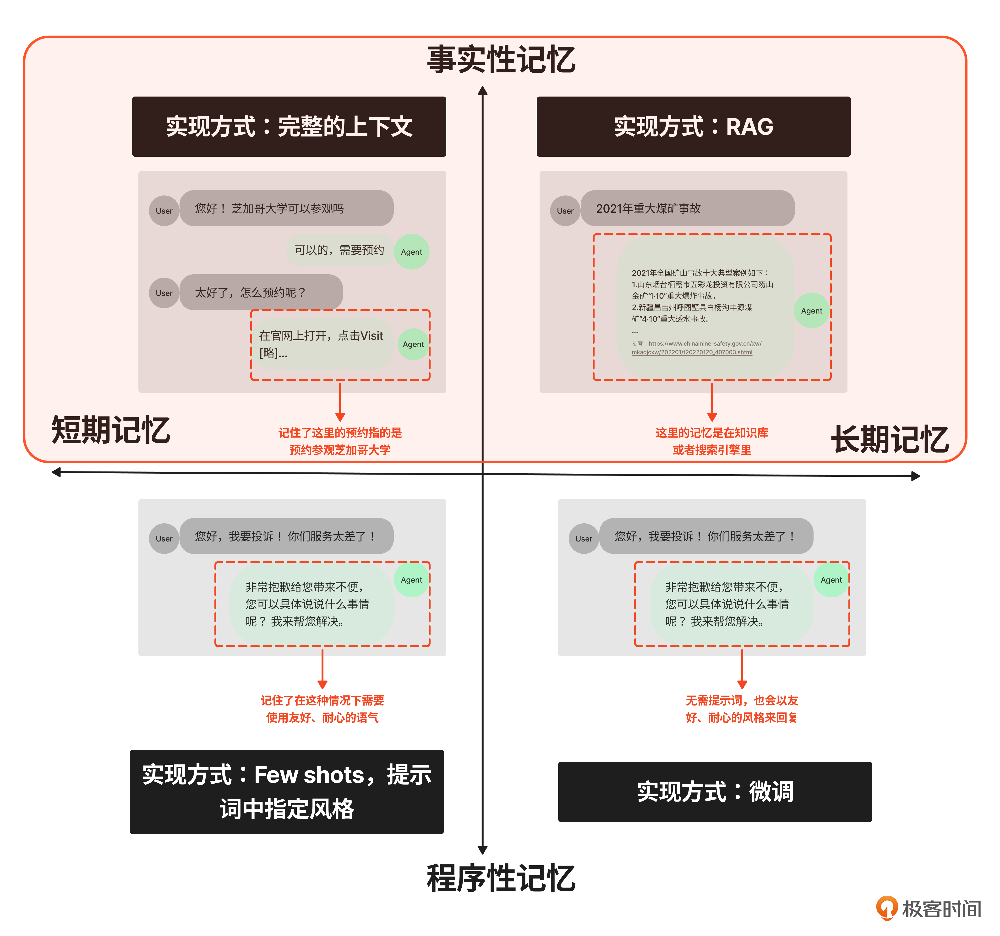
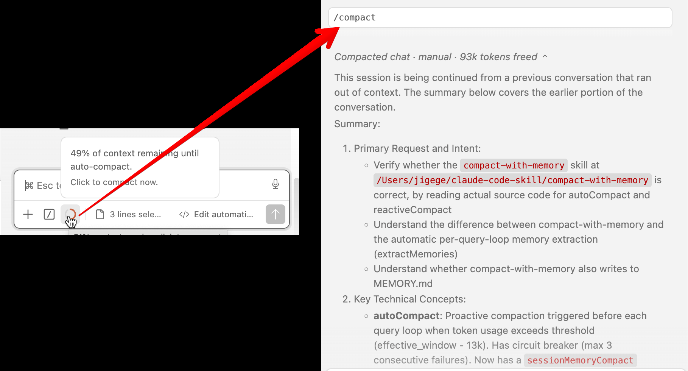
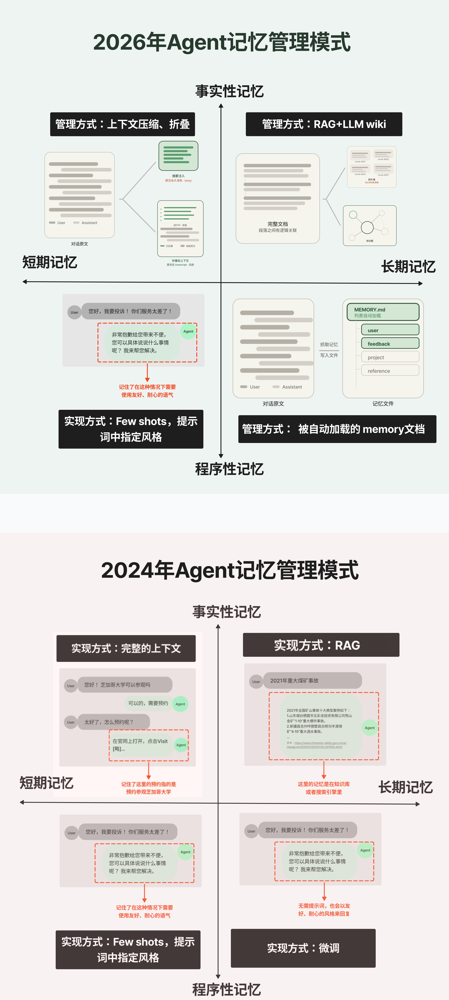

# 08 | 记忆管理（二）：事实性记忆的压缩术与盘活术

你好，我是产品二姐。

上节课我们搞清楚了 Claude Code 多次会话中产生的程序性记忆——它悄悄记住你是谁、你有哪些工作习惯，解决的是每次开新对话不用重新自我介绍的问题，对应记忆四象限里的长期程序性记忆管理。

这一节课，我们来填记忆四象限里另外两个格子。



第一个是短期事实性记忆管理：主要是指多轮对话中，对话历史越来越长，超出模型上下文窗口局限，发生记忆爆炸的问题如何应对。这里我们仍然会从 Claude Code 源代码里寻根问底，包含压缩短期上下文的两种方法。

第二个是长期事实性记忆管理：主要指 AI 产品需要随时引用大量外部知识来完成回答。在这两年中，主流解决方案是 RAG；但今天又有一个新方案诞生，那就是由 AI 大神，前 OpenAI合伙 人 Andrey Karparthy 提出的 LLM Wiki。它有效地弥补了 RAG 的先天缺陷，我会通过对比 RAG 的方式来讲述三个主题：

- 如何用 LLM Wiki 的方式管理知识库，保持知识库新鲜、有效。

- 如何让知识库能高效地被 Agent 使用起来。

- RAG 与 LLM Wiki 各自适用的场景。

如果你还不了解 RAG，可以参考我的上一个专栏《成为 AGI 产品经理》的 03 讲原理部分，08、09 讲实战部分。

学完这一讲，结合上一讲的长期程序性记忆，你就能掌握当下 Agent 记忆管理的主流做法，为自己的 Agent 产品选择合适的记忆构建方法。为我们在后面的实战课程打下基础。

我们首先看短期记忆管理。

## 短期事实记忆管理

这里的短期记忆主要指一个 Session 的内容。Session 就是：你和 Agent 每次新打开的一次对话，称为一个 Session；而你每次发一个问题，Agent 回答一次，称为一轮对话；也就是说一个 Session 会包含多轮对话。

为了保证模型有足够上下文，每轮对话我们都需要把一个 Session 里所有的对话历史都发给模型，而且还要加上系统提示词、程序性记忆（比如之前说的 Claude.md、Memory.md 等）、工具信息等等，长度就会超出模型的上下文窗口，这就会导致记忆爆炸，或者 01 讲提到的“上下文腐烂”问题。

为了解决这个问题，在 Claude Code 这类 Agent 的对话窗口里，当 Session 上下文超过一定程度，就会出现一个记忆容量指示（如下图），它提醒你这个 Session 中距离上下文上限还有多少，并且接近上限后 Claude Code 就会启动自动压缩。当然你也可以手动触发压缩，点击按钮或者输入指令 /compact，Claude Code 会把这次对话中核心内容做一个摘要，意味着这个 Session 的历史记录将使用这段摘要作为上下文传入大语言模型，而不是整个对话历史。



类似地，我们在开发 Agent 的过程中也会遇到这种上下文爆炸的情况。比如某些调研类的产品一次就要读 100 多篇文章，再加上一些工具调用、系统提示词，多轮对话后会积累，上下文很容易超出模型上限，因此，在设计长链路思考的 Agent 时，上下文压缩是一个必备能力。

另外一个需要压缩上下文的原因是，某些模型表现出“上下文焦虑”，即当它们接近自身认为的上下文极限时，就会过早地结束工作，你可以阅读 Anthropic 的博客来了解。

那 Claude Code 是如何应对这个问题的呢？它有两种解决方案：压缩与折叠。我用一个比喻来说明：

- 一是压缩摘要法：就是把对话压缩为摘要。假设对话原文是好多本书，那么摘要就是把所有书搬出去，换一本内容摘要大全放进来。原始消息消失，只剩摘要。

- 二是分类折叠法：相当于把对话原文进行主题分类，在分类卡片上写：这里有 3 本关于文件读取的书，当未来需要时再展开该主题的内容作为参考。和摘要法相比，这可以保留所有书。

接下来，我们更进一步，看看压缩摘要法的触发条件和详细解析。

在 Claude Code 里，以下三种情形下会触发自动压缩。

1. 手动触发

2. 自动触发：每次 Query Loop 开始之前，系统都会检查剩余 token 量，如果小于一定数量就会自动触发。

3. Query Loop 中触发：如果 loop 前检查剩余 token 量够，但过程中发现超出上下文窗口，也会自动触发。

当压缩被触发时，系统和上一节课的记忆提取过程一样，会启动一个 forked agent 通读当前的全部对话历史，生成结构化摘要，根据代码里的提示词，这个摘要会分以下 9 个部分：

```
Your task is to create a detailed summary of the conversation so far...
Your summary should include the following sections:
1. Primary Request and Intent    ← 用户所有明确意图
2. Key Technical Concepts        ← 涉及的技术概念和框架
3. Files and Code Sections       ← 查看/修改/新建的文件，含完整代码片段
4. Errors and fixes              ← 遇到的错误和修复方式（含用户反馈）
5. Problem Solving               ← 已解决的问题和进行中的调试
6. All user messages             ← 列出所有非工具调用的用户消息（完整）
7. Pending Tasks                 ← 被明确要求但尚未完成的任务
8. Current Work                  ← 摘要请求前正在做什么（含文件名和代码片段）
9. Optional Next Step            ← 下一步（必须与用户最近请求直接对应，附原文引用）
```

这里需要注意两点：

1. 对于上下文里的图片、pdf，目前只是做了标记，但并没有被放在摘要里。

```
生成摘要时，Agent 会先在 <analysis> 里打草稿推理，再在 <summary> 里输出正式内
容——最终只保留 <summary> 注入到新的上下文里，草稿推理直接丢掉。
```

在最终注入上下文中的内容里，Agent 会加上固定话术：“本次会话延续了之前上下文的对话，以下摘要涵盖了对话的前半部分，……”。

```
This session is being continued from a previous conversation that ran out of cont
The summary below covers the earlier portion of the conversation.
Summary:
1. Primary Request and Intent: ...
...（9节内容）
If you need specific details from before compaction (like exact code snippets,
error messages, or content you generated), read the full transcript at: <transcri
</transcript_path>
```

接下来看第二种方法：分类折叠法的原理。

这个方法在 Claude Code 的代码里还是实验性功能，但思想非常值得借鉴。和刚刚提到的压缩摘要法一样，分类折叠也在每次 Query Loop 开始前触发，当上下文用量接近约 90% 时，

```
系统就会派一个内部代号叫 marble_origami 的子 Agent 出来扫对话，判断哪些片段可以
```

安全折叠。

```
这个 marble_origami agent 会扫描整段对话，找出那些已经完结的子任务，比如“读文件
```

→ 确认函数签名 → 完成”这样一个小闭环，把这段对话折叠，替换成一行：

```xml
<collapsed id="xxxx">读取了 src/utils.ts，找到了 parseConfig 函数的签名
</collapsed id="xxxx">
```

每段折叠都有一个 risk 分数。risk 分数越高越不能折叠，那些还在进行中的、有未解决问题的，风险高，保留；已完成的小任务，风险低，先折叠。

在折叠法中，原始消息永远不会被删除，只是在发给大语言模型的上下文里，换成了占位符，需要细节时，Agent 再从 transcript 文件里翻回来。

对比这两种方法，前者实施起来比较简单，但当一个 Session 中混入多个主题，确实会引起信息遗漏、混乱。而后者相对克服了这个缺点。大家可以按需借鉴。

如何赋能自己的产品？

和之前一样，我把这两种处理超长上下文的方法提炼到了两个 Skill 里，这两个 skill 能帮助大家为自己的 Agent 初步构建出压缩记忆、折叠上下文的能力。在后续的案例实战中也会有应用，同时我也会及时改进这两个 Skill，你可以运行命令安装下载。

压缩摘要法 Skill — compact-memory-implementation

```
npx skills add simbajigege/book2skills/skills/compact-memory-implementation
```

分类折叠法 Skill — folded-memory-implementation

```
npx skills add simbajigege/book2skills/skills/folded-memory-implementation
```

在后面的实战中，我们会使用这两个 Skill 来管理 Agent 的短期记忆。

接下来，我们来看看这节课的第二个主题：长期事实性记忆。

## 长期事实性记忆：从 RAG 到 LLM Wiki

过去两年，长期事实性记忆依然是 RAG 为主。我想大家对 RAG 不陌生了，它的逻辑很直接：把文档切块、向量化、存入数据库，查询时检索相关块，让 LLM 基于这些块生成答案。但这也导致了 RAG 的三个先天缺陷。

一是 RAG 分块非常容易破坏语义关系。

假设有一篇 GPT-4 介绍文章，三段话如下：

- 第一段：GPT-4 是 OpenAI 推出的旗舰大语言模型，在推理和编码任务上领先同类产品。第二段：上下文窗口为 128k tokens，可以处理较长文档。第三段：定价为输入 0.03/1ktokens，输出 0.06/1k tokens。

RAG 在按段切块时，丢掉了段落之间的逻辑关系。比如在第二、三段中，并未出现 GPT-4 这个词，那么，这两个块就失去了和 GPT-4 这个主题的关联。那么当用户问 GPT-4 定价是多少的时候，系统可能会召回第一段 GPT-4 的块，也会召回第三段关于定价的块。如果此时知识库里同时还有 Claude、Gemini 的定价块，那么就会有一个主语，三个定价块，系统是搞不清楚哪个定价块是对应 GPT-4 的。尽管我们有若干方法来弥补类似的缺陷，但都不能从根本上解决问题。

二是 RAG 的语义召回可以做到用问题寻找问题，而用户的诉求是用问题寻找答案。

比如你问“哪个模型性价比最高”，RAG 去找和这句话语义最相似的文本，它会命中“哪个模型能力好，价格低”的这个问题；而真正的答案蕴藏在类似这样的话中：“Gemini Flash 每百万token 仅需 $0.10”。

但仅从语义匹配上来说，“哪个模型性价比最高”与“Gemini Flash 每百万 token 仅需 $0.10”是没有什么相似度的。当然这里的召回可以用 Query 重写等策略解决，但重写策略也无法穷尽所有问题。

三是 RAG 方法无法进行知识沉淀与保鲜。

比如知识库里保存了近三个月关于 GPT-4 定价的文章，前八份说 0.03/1k，最后两份说价格已经降到 0.02/1k。RAG 不知道这是矛盾，它只是把所有块一视同仁地放进向量数据库。

下次你问“GPT-4 定价是多少”，召回哪个块取决于检索的随机性。所以说，当新旧知识矛盾、冲突时，RAG 知识库目前没有很好的机制让知识库保鲜。

另外，RAG 也不利于知识沉淀，比如用户曾经做过一次深度分析：综合十份报告，实际使用

## 0.015–

成本在

- 0.025 区间。这个结论和引用内容其实可以很好地沉淀下来，但 RAG 中并没有

自动的机制让知识沉淀下来。

而 LLM Wiki 可以有效克服这三点缺陷。

LLM Wiki 是 Andrej Karpathy 在 2026 年 4 月通过 X 和 GitHub 公开的一套知识管理设计模式，它并非 Claude Code 内置的知识管理能力，但可以借助 Claude Code 完成。

从 Wiki 这个名字来看，你应该就可以初步理解了。Wiki 维基百科大家肯定都读过，它最主要的特点是：

- 一个页面，一个实体。每篇文章专注于一个清晰的对象——一个人物、一款产品、一个概念。

- 实体链接形成网络。比如当你在 GPT-4 页面看到 OpenAI，点进去能找到 Sam Altman，再点进去能找到 Scaling Law。

LLM Wiki 本质就是让 Agent 用 Wiki 的方式将知识库管理起来。下面我们用最简单的三步，走一遍 LLM Wiki 的搭建思路，看看它是如何从根本上避免了上述 RAG 的缺陷。

第一步：用 ClaudeCode 完成从原始文档到 Wiki 的转换。

在 ClaudeCode 启动一个项目，准备三样东西：

```
raw/ 文件夹：原始文档，只读，唯一事实来源。
wiki/ 文件夹：LLM 生成并维护的 Wiki 页面。
写一份 CLAUDE.md，告诉 LLM Wiki 的页面格式、命名规范、维护工作流。你可以直接采
```

- 用一个开源的 LLM wiki Claude.md。

```
然后把第一批文档扔进 raw/，给 Claude Code 下这条指令：
请阅读 raw/ 目录下的所有文档，按照 CLAUDE.md 的格式，在 wiki/ 下为每个核心概念生成一个页面，交
```

Claude Code 会通读文档，写摘要页、实体页、对比页——一份文档可能触及 10–15 个 Wiki页面，这些页面之间相互有引用，构建出完整的实体关系。这就降维解决了 RAG 的第一个缺陷。

第二步：让 ClaudeCode 顺藤摸瓜推理出答案，而不是用检索匹配到答案。

当用户有问题时，Claude Code 不是在原始文档里做向量检索，而是直接读 Wiki，独立思考，顺藤摸瓜，推理出答案，而不是用语义匹配到答案，就解决了 RAG 的第二个缺陷。

第三步：新文档进来，处理矛盾与更新。

```
当有了新文档，或者你生成的新知识，可以继续丢进 raw/，告诉 Claude Code 摄入。它会
```

读新文档，找出与现有 Wiki 页面的矛盾，标注它，更新相关页面，在操作日志里追记一条。这里解决的是 RAG 方案无法对知识库保鲜沉淀的问题。

这三步完成后，你就能体会到 LLM Wiki 的思想。但我们在这里借助 Claude Code 完成的，这就不能满足国内许多企业的诉求了。好消息是国内有腾讯的开源知识库 Agent 和 GitHub上一个 10K star 的项目 已经将这一思想采纳，但这一方法现在仍然没有成熟落地在企业的大规模知识管理中，还需要我们持续去探索。

明白了 LLM Wiki 的原理，对比 RAG，我们来列出二者的适用场景:

- RAG 适用的场景是：问答相对固定、问题独立、相互关联不大。比如以问答对为主要语料的场景。

- LLM Wiki 适用的场景是：需要跨文档综合、需要通过推理才能得到答案、知识需要持续演进、冲突追踪的场景。

## 总结

好了，以上就是今天关于 Agent 事实性记忆管理的内容，填了记忆四象限里的两个格子：短期事实性记忆和长期事实性记忆。

短期记忆管理主要是为了解决记忆爆炸的问题，Claude Code 给了两种解法：

- 压缩摘要法：上下文快满时，启动一个 forked agent 通读全部对话历史，生成包含 9 个部分的结构化摘要，替换掉原始对话注入新上下文。原始消息消失，留下的是精华。

- 分类折叠法：不删除原始消息，而是把已经完结的子任务折叠成占位符，需要细节时再从transcript 里翻回来。书没有烧掉，只是收进了箱子。

长期事实性记忆管理主要是指对 Agent 外挂知识库的管理。LLM Wiki 有效克服了 RAG 三个先天缺陷，让知识库形成网络，同时既能沉淀知识，又能保鲜知识内容。RAG 与 LLM-Wiki 二者各有所长，各有使用场景，供大家按需应用。

到这里，结合上一讲的程序性记忆，我们完整看到了这两年 Agent 的记忆管理方式的演进。我用新的一张图来表达这个变化，不禁要感慨 AI 演进的速度。



好了，这一讲就到这里。下一讲，我们离开记忆管理，看 Agent 的另外一个关键要素，也是每次 Query Loop 这个核心引擎用到的工具管理。

## 思考题

这节课我们讲了 LLM Wiki 的三步搭建思路——整理 raw 文件、让 Claude Code 转换成互相引用的 wiki 页，以及后续摄入新文档保鲜知识。

你可以参考 Youtube 视频 动手体验一下这个过程：找 3–5 篇你最近读过的资料，可以是行业报告、微信公众号文章、读书笔记，任意格式，新建一个文件夹，按照课程里的三步走：建好 raw/、写一份简单的 CLAUDE.md 规范格式，然后让 Claude Code 把它们转成 wiki 页面，互相引用。

欢迎你在留言区和我交流。如果觉得有所收获，也可以把课程分享给更多的朋友一起学习。我们下节课见！
