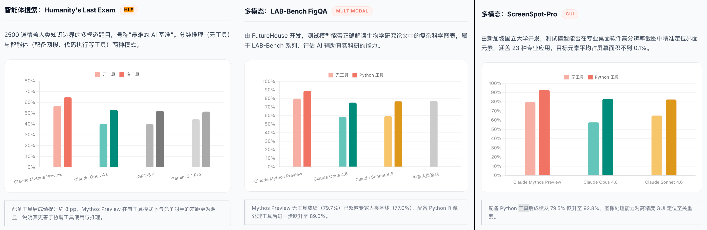
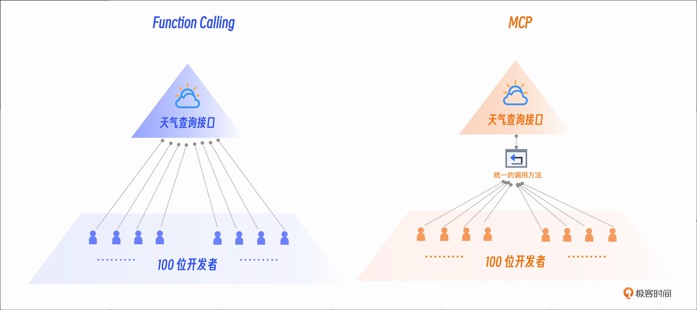
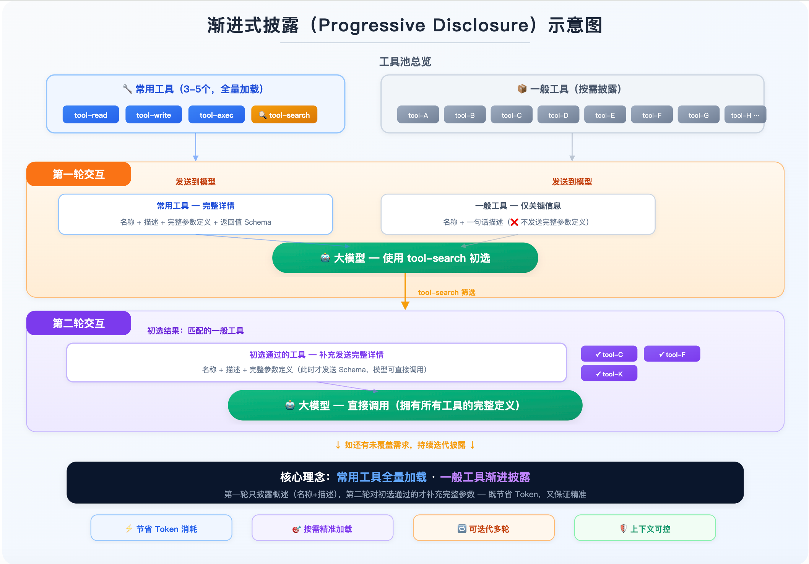
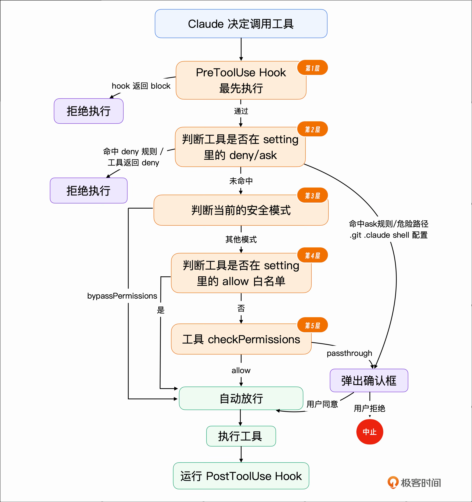
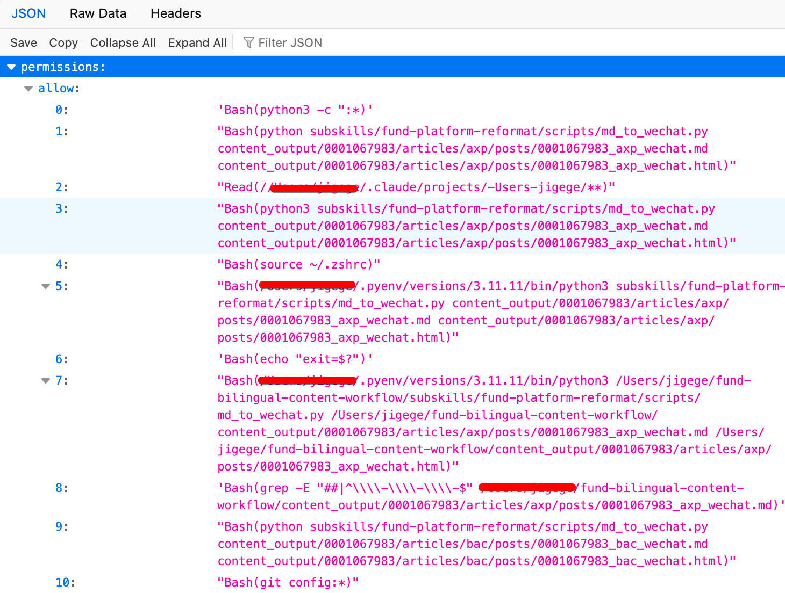
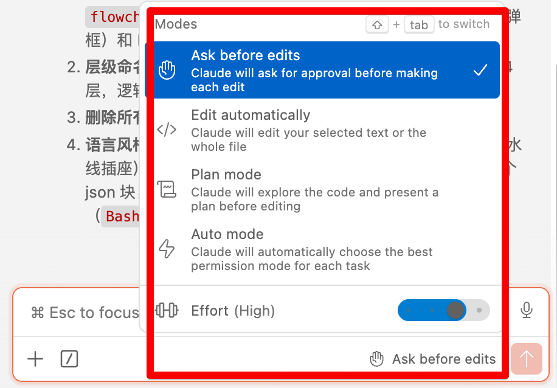

# 09 | 工具管理：让Agent高效、安全地使用工具

你好，我是产品二姐。

上节课，我们把 Agent 的记忆管理讲透了，程序性记忆让 Agent 记住用户习惯，上下文压缩让它在超长任务里顺畅运行，LLM Wiki 正在成为一种新型知识库。这节课，我们把注意力从Agent 的“记忆”转移到它的“手和脚”——工具管理。

2023 年 6 月，OpenAI 提出 Function Calling，这是工具定义的最初方式。2024 年，Anthropic 在此基础上衍生出 MCP，本质并没有变化。如果你想详细了解 Function Calling 的基础概念，可以参考我的上一个专栏《成为 AGI 产品经理》的第 3 讲和第 11 讲。

不过，随着模型能力的提升，工具调用的准确性在今天已经大大提高了。而且，从端到端的任务来看，使用工具能够很大程度上提升任务完成的质量。在 Anthropic 官方的模型评测结果中，他们对三类任务分别使用了有工具和无工具的对比测试，发现在有工具使用的情况下，模型的成绩会提升 12%～45%，可见工具使用的重要性。



除此之外，在第 6 讲我们也提到，工具调用也是 Agent Loop 这个核心引擎退出循环的条件。也就是说，大语言模型与工具要做双向匹配，才能让 Agent 正确执行任务。所以，一方面语言模型要变得更加聪明，另外一方面，工具描述也要符和业务诉求，才能被正确选中，这和RAG 中“检索召回”的道理是一致的。因此，我们很容易想到工具管理中要解决的两个问题：

1. 工具应该如何定义，才能让大语言模型理解？

2. 工具多了之后，Agent 应该如何检索、使用这些工具？

但和 RAG 中召回不同的是，工具使用要比 RAG 更危险，因为 Agent 能借助工具直接执行侵入性操作，比如写入、删除数据。所以，工具使用的另外一个问题就是：如何保障工具不被Agent 滥用？

以上三个问题的解决方法，我都会在这一节课说明。

学完这节课，你就会对 Agent 的工具有全面、系统的理解，从而在后面的实战案例中让 Agent安全、高效地使用工具，保障 Agent 的手脚能配合大脑，严谨地执行任务。

## 如何定义 Agent 工具？

对于一个 Agent 来说，会有内部工具和外部工具。

主流的 Agent 开发框架，比如 LangChain 都支持内建工具，外部工具主要的定义方式是MCP。无论内部工具，还是外部工具，定义的原则都是相同的，那就是：面向 Agent 来定义。我们先来看一个优秀的 MCP 应该如何定义，然后把同样的原则用在内部工具。

MCP 的全称是 Model Context Protocol，听起来很晦涩，但我们把 MCP 和最初的 FunctionCalling 定义放在一个例子里对比，你就能理解它的含义了。

假设国家气象局有一个查询天气的接口，有 100 个开发者想把它包装成工具给自己的 Agent调用。如果用 Function Calling 的方式，这 100 个开发者分别在代码里写一个工具，就会有100 种写法。而 MCP 的方式就是，让国家气象局统一写一个调用方法给所有人用。 很明显，后者是更为合理的。



那么，假设你所在企业内部有一个自建 CRM 系统，你想让 Agent 操作 CRM 系统里的数据，我们就要把原来 CRM 里的各种接口整合为 MCP，供 Agent 使用。

通常来说，一个 MCP 服务会包含多个原子工具，而一个工具对应一个接口或多个接口。在MCP 刚刚提出的时候，开发者往往简单地把接口和工具一一对应起来，这是一个误区。因为这样的原子工具是面向代码、数据表定义，而不是面向 Agent 定义的。

一个正确且简单的做法是：

首先，让 Claude Code 或者 Codex 使用 Anthropic 官方的 mcp-builder skill ，结合现有的API 以及数据库结构设计出 MCP server 的原型。如果你明确知道 Agent 需要执行哪些操作，可以把这些操作逐一列举出来，交给 Claude Code 去实现。如果你对所需操作尚不明确（比较模糊），则可以直接让 Coding Agent 自行分析并设计。

然后，你再来构建自然语言指令的评测集，进行评测，看看工具是否能被准确召回。

如此持续迭代反馈，就会沉淀出优秀的 MCP server。当然，在引导 Coding Agent 优化 MCPserver 的过程中，你可以记住以下几个原则，我会把这些原则对应到你熟悉的产品功能管理上，方便理解。

原则一： 命名要可发现。

在实践中，我们发现工具命名对工具选择准确率有显著影响， 比如 CRM MCP 的工具中，你可以命名为：

1. crm_customer_search

2. crm_order_search

3. crm_contact_search

而不是简单的 crm_search。这个原则就是信息架构在 Agent 工具设计上的体现，就像我们在设计软件导航菜单时，菜单名称要和对应的功能保持一致。

原则二：工具描述、字段定义要符合自然语言。

写工具描述要方便 Agent 理解，这一点和 API 设计有本质区别。好的工具描述至少要包含：这个工具做什么、不做什么、什么情况下调用、关键参数的含义。

比如我们要查询某个用户的国籍。设计 API 时，总会用 User ID 作为输入参数，返回字段中会有 countryCode（1 代表美国，86 代表中国……），所以 API 设计往往是面向表格查询定义的。而工具的设计中，我们会希望用 name 作为输入参数，返回字段中用 Country（枚举值是中国、美国……）。这种情况下，大语言模型就可以非常方便地理解返回结果，并传达给下游。

但是有很多情况下，工具或第三方 MCP 的设计对 Agent 并不友好。那么就需要我们加入一个补救措施，让 Agent 对工具返回的信息做进一步解释。把接口返回的响应内容，转换为自然语义。

举个例子，一个查询客户的接口返回如下内容：

```json
{  "id": "cust_8821hd",  "tier_code": 2,  "arr_cents": 4800000,  "churn_risk_scor
如果直接返回上述内容，Agent 是无法理解的，因为 Agent 无从知道 "tier_code":
2、"churn_risk_score": 0.73 代表什么意思，我们需要让 Agent 结合 schema 赋予每
```

个返回字段的意义，并进行信息重组。 比如应该把上述响应翻译为如下内容：

```json
{  "customer": {    "name": "张伟 / 远景科技",    "tier": "企业版",    "arr": "¥48,0
```

当然这种解释会额外消耗 token，但有些时候，我们使用的第三方 MCP 服务并不受我们控制，也只有通过这种方式补救。

好，工具准备好了，那么 Agent 该如何使用呢?

## 如何高效使用工具？

不管是内部工具还是外部的 MCP， Agent 都需要把所有的工具说明（工具名称、描述、参数定义等）全部发给大语言模型，才能让这些工具被大语言模型所了解并使用。

那么很容易想到：当工具很多的时候，会占用过多上下文，造成 token 浪费，且会对模型造成干扰。我们通常会参考 Anthropic 的以下做法来减轻这些问题。

当你遇到以下情况，就需要采取一定的措施了。

1. 工具定义消耗超过 1 万个 Token（大约 15K 汉字，或 8K 英文单词）

2. 遇到工具选择准确性问题，工具召回率较低

3. 构建具有多个服务器的 MCP 系统

4. 有十多个工具可用

具体的措施是：

首先，确定 3-5 个 Agent 常用工具，剩下的工具为一般工具。其中常用工具里可以有一个工具叫 tool-search：搜索工具的工具。

其次，和模型对话的第一轮，先把常用工具的详情，和一般工具的名称、描述等关键信息（不发送完整参数定义）发给模型，使用 ToolSearch 进行初选。

然后，在第二轮和模型的交互时，再把进入初选的工具详情发给模型，让模型直接使用。

这种第一轮只披露概述，第二轮披露详情的方式，就是典型的渐进式披露。我们把上述过程总结为两句话，就是常用工具全量加载，一般工具渐进披露。



这里值得说明一下， 渐进式披露是上下文管理中常见的手段。比如我们在第 7 讲提到先把memory.md 里的记忆列表发给模型，让模型选择记忆后再把选中的记忆详情发给大模型；还有在第 8 讲提到的折叠记忆法也是同样的道理；Skill 的选择也会用到。

这就像设计复杂 SaaS 产品，不会把所有功能都摆在首屏，而是分层级、按需展示。在长上下文场景中，你都可以把渐进式披露作为一种备选方案，适时使用。

解决了 Agent 工具过多的问题，下一个问题就是如何安全地使用。

## 如何安全地使用工具？

Agent 手里拿着读写、数据库操作这些工具，一个错误指令可能造成不可逆的损失。你在使用Claude Code 的时候，经常会被问到“你是否允许执行 xxx 指令”，这就是工具的安全机制在发挥作用。

Claude Code 的工具安全体系有 5 层判断，我用一个逻辑图来描述。



- Claude Code 的 5 层工具安全体系图

乍一看这个五层保障可能有点复杂，别急，我们一步步说。而且这五层安全保障体系的实施方法我已经总结为 Skill，放在这节课的末尾了，所以需要了解的时候，你随时拿来查阅就好。

### 第 1 层：判断工具前是否有强行拦截

这一层是为 Agent 定义的强行拦截器，优先级最高，通常把最危险的事情进行强行拦截。比如你可以强制定义，生产环境文件不允许 Agent 直接修改。这种拦截采用 hook 的方式实现。比

```
如下面这段 hook 代码的意思是：如果 Claude 要编辑 /prod/ 目录下的文件，直接拦截。
{
 "hooks": {
   "PreToolUse": [{
     "matcher": "FileEdit",
     "hooks": [{
       "type": "command",
       "command": "if [[ '$CLAUDE_TOOL_INPUT_PATH' == *'/prod/'* ]]; then echo '
     }]
   }]
 }
}
```

### 第 2 层：判断某操作是否被明确禁止。

比如禁止 A 工具操作某些文档。这个配置写在 settings.json 里。规则来源有三级，依次是：

```
用户级：写在 ~/.claude/settings.json 里，对你电脑上的所有项目都生效，是你个
```

- 人的全局默认配置。

```
项目级：写在 项目根目录/.claude/settings.json 里，只对当前这个项目生效，会随
```

- 仓库提交、被团队共享。

```
本地级：写在 项目根目录/.claude/settings.local.json 里，同样只对当前项目生
```

- 效，但属于你个人专属，不会提交到仓库。

优先级从大到小依次是：本地级 > 项目级 > 用户层级。

```
你打开 ~/.claude/settings.json，就能看到类似的设置：
```



### 第 3 层：判断当前的安全模式

安全模式是一个全局的总开关，控制 Claude Code 整体的行为风格。也就是大家在 ClaudeCode 里看到的工作模式。



这个设计逻辑很像软件产品里的工作模式，比如是否开启编辑模式。

如果是在 bypassPermissions 下，则自动执行。 在非 bypassPermissions 模式下放行，就会进入下一层判断。

### 第 4 层：判断工具是否在 setting 里的 allow 白名单

```
这里 Claude Code 会再回到 settings.json，看看这个工具是不是落在 permissions.allow
```

白名单里。命中白名单，就直接执行；没命中，就把最后的执行权交给工具自己，进入第 5层。

### 第 5 层：工具自身的安全属性

最内层就是每个工具自己的安全属性，这在定义工具的时候就确定了，Agent 以此来决定执行该工具前是否需要弹确认框。这就相当于软件系统里，如果是删除操作，必须要弹窗确认一样。

```
isReadOnly：标记这个工具是不是只读、不会改变任何状态。比如 GrepTool 这类搜索工
具是 true，可以直接执行。
isDestructive：标记这个工具的操作是不是不可逆。比如删除文件就是 true，执行前
```

- 会弹确认框。

```
isConcurrencySafe：标记这个工具能不能和其他工具并行执行。搜索类工具是
true，写入类工具是 false。
```

上面的这 5 层判断，Agent 都是在一个有人值守的环境里工作。 在 Claude Code 里，还有一种安全模式叫 Auto Mode，也就是让 AI 来判断安全，你可以简单了解。

### 自动安全模式：Auto Mode

Auto Mode 就是不让用户手动判断每个操作是否安全，而是让另一个 Agent B 来判断。

```
Claude Agent A（主 Agent）：我要执行 rm -rf ./build
 ↓
Claude Agent B（判断 Agent）：分析对话历史 + 这个命令 → 判断：safe / unsafe
 ↓
safe   → 自动执行，不打扰用户
unsafe → 弹确认框，并说明原因
```

为了防止 Auto Mode 滥用职权，Claude Code 里规定了一份硬编码黑名单，在 Auto Mode下，处于黑名单里的工具也必须要获得人的认可。另外，AutoMode 还有一个熔断机制（Circuit Breaker），那就是：如果用于判断的 Agent B 连续拒绝 3 次或总计拒绝 20 次后，说明此时不适合使用 AutoMode 模式，那么系统会自动回退到手动模式。

以上就是 Claude Code 给工具构建的安全保障体系。

接下来照例，我们把今天提到的工具打造、使用方法总结为 Skill。

## 如何用在自己的 Agent 中？

打造工具的 Skill 有两个，一个是 Anthropic 的 mcp-builder， 另一个是我参考 mcp-builder 和Claude Code 自建工具代码生成的 agent-tool-builder，方便大家在 LangChain 框架下构建Agent 时使用。安装指令是如下两个：

```
#安装指令
npx skills add https://github.com/anthropics/skills --skill mcp-builder
npx skills add simbajigege/book2skills/skills/agent-tool-builder
```

构建工具安全体系的 Skill 为：tool-permission-system，它主要参考 Claude Code 的五层安全权限体系，大家可以使用如下指令来安装。

```
#安装指令
npx skills add simbajigege/book2skills/skills/tool-permission-system
```

这些 Skill 会随着我们深入使用，持续迭代改进，大家也可以在此基础上调整出适合自己的Skill。

## 总结

到这里，我们就把 Agent 工具的定义、使用方式完整地走了一遍。

一是如何定义工具。无论是内建工具还是外部 MCP，定义的原则都是一句话：面向 Agent，而不是面向代码。具体来说，可以先用 mcp-builder skill 做出原型，再用评测集持续迭代，沉淀出好用的工具。

二是高效使用工具。也是一句话：常用工具全量加载，一般工具渐进披露。这套渐进披露方式，和我们在记忆管理、Skill 选择里看到的是同一个道理，也是常见的长上下文管理方式。

三是安全地使用工具。我们参考了 Claude Code 里的多层安全保障，包括：拦截器、安全模式、工具自定义属性等，然后了解了 Claude Code 中的自动安全模式，实际案例中，不是每个产品都需要这么多层保护，但 Claude Code 的这个安全体系是最全的，大家可以当做范例，适时采纳其中的某几个措施。

以上就是 Agent 的工具管理相关的内容，到目前为止，我们又为后面的 Agent 实战案例添加了一个武器。

## 思考题

这节课最后，给你留一道实践题。 就请你使用 mcp-builder skill，给一个你身边真实的 MCP做一次“体检”。

你可以挑一个你正在使用的 MCP / 工具，也可以打开任意一个公开的 MCP server，比如GitHub、Notion、高德地图的官方 MCP，使用 mcp-builder skill 评价这些 MCP server。

欢迎你在留言区和我交流。如果觉得有所收获，也可以把课程分享给更多的朋友一起学习。我们下节课见！

## 参考

1. mythos 模型评测结果： https://claudeleakage.com/zh/claude-mythos-preview-capability-report/

2. https://claude.com/blog/building-agents-that-reach-production-systems-with-mcp

3. https://www.anthropic.com/engineering/writing-tools-for-agents

4. https://modelcontextprotocol.io/docs/getting-started/intro
