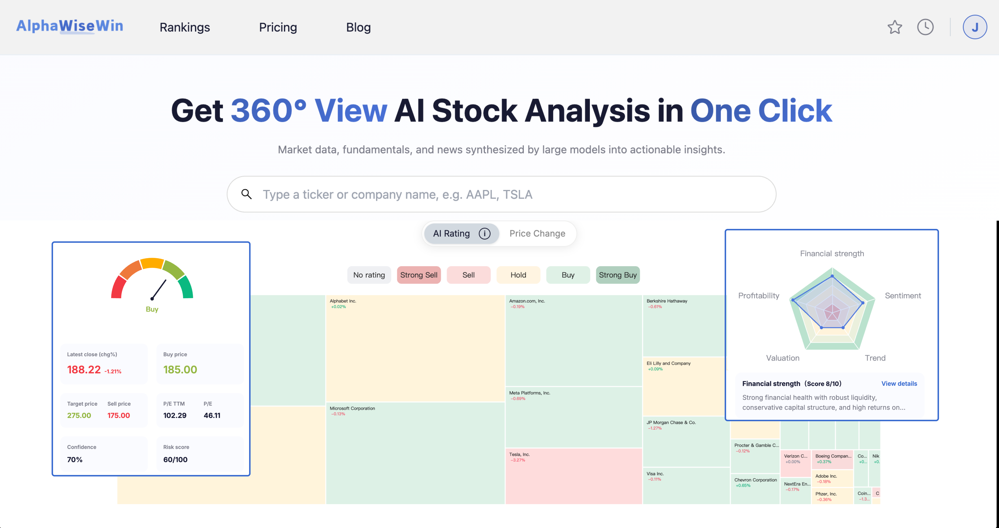
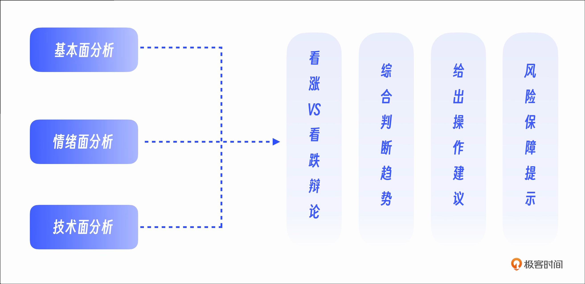
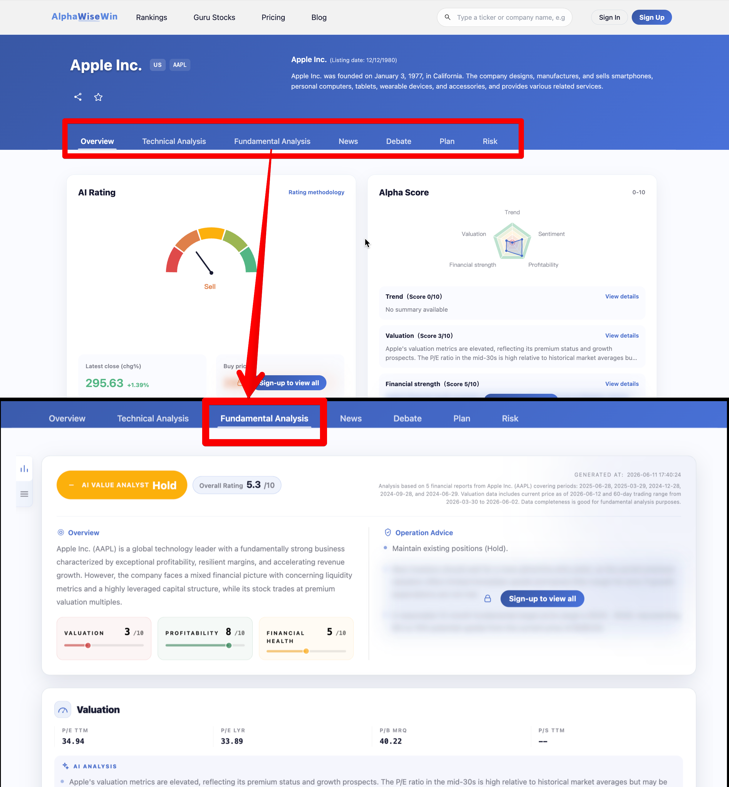
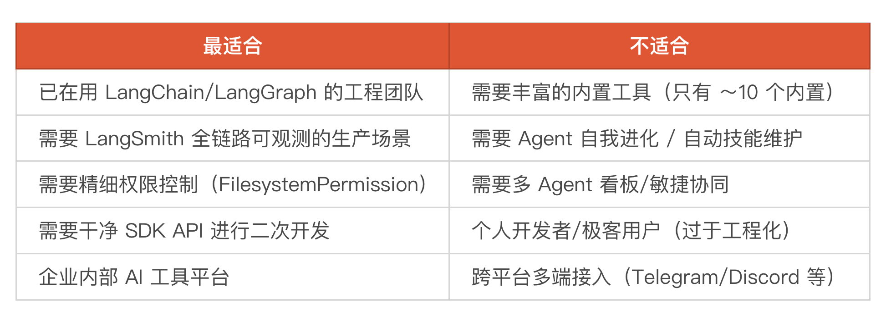
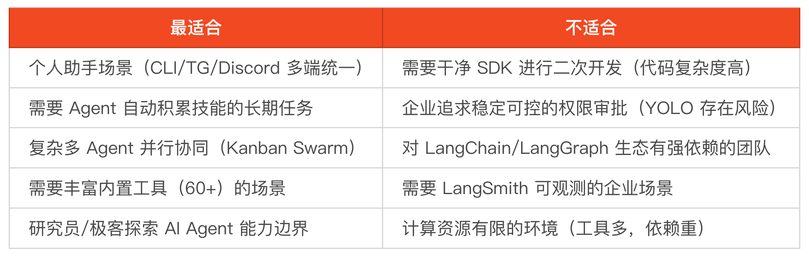
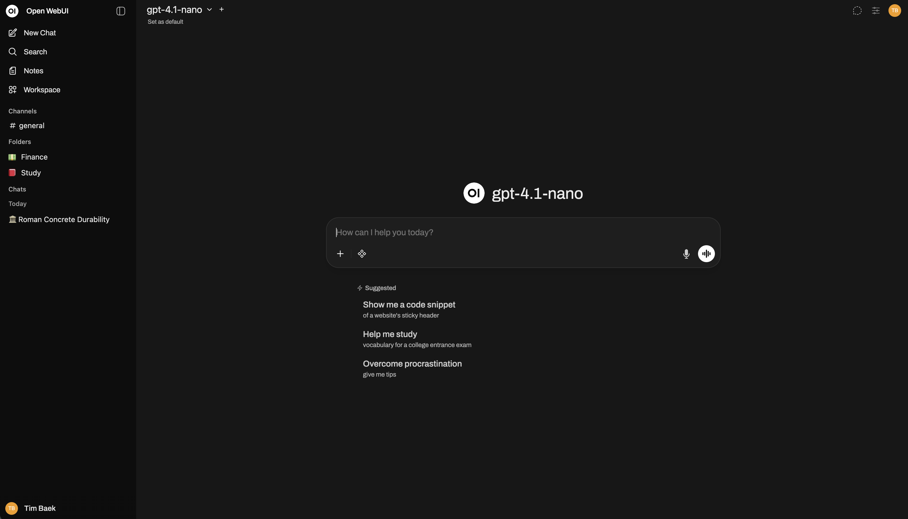
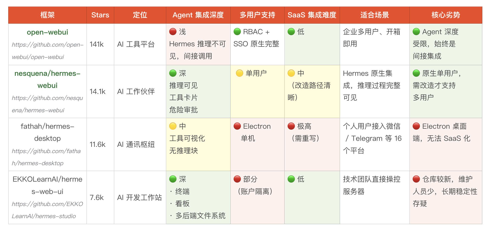

# 11 | 为AI股票工具装上Agent（一）：框架选型

你好，我是产品二姐。

上一章我们把 Agent 的四大件——行动、工具、记忆、多 Agent 协同，从头到尾拆了一遍，建好了认知框架和兵器库。我想，你肯定在摩拳擦掌，迫不及待地想要开始实战了吧。所以这一章，我就会用三个实战案例，带你一起从理论走进实践！

第一个案例是：将 AI 股票分析工具 AlphaWiseWin 升级为股票分析的 Agent。我们会把它从“固定 workflow 输出报告”升级成“可以对话的 Agent 产品”，完整走完 Agent 框架选型、架构设计、工具建设、记忆建设四个部分。

这个案例最适合在中大型公司做 AI 产品的或者正在准备面试这类公司的同学。比如在互联网公司的 AI 团队，或是传统企业的信息化部门里，一般都会有一个已经在跑的系统，而你的目标就是：给它加上能动态规划、能记忆、能调工具的 Agent 。

同时这也是体量最大的一个案例，我会花四节课来深入讲解。如果你要实际上手，每节课大概需要花一天时间完成。你可以先用碎片时间看完案例的全部内容，然后抽出整块时间来实践。实践后，你就能对任何领域的 Agent 建设做到心中有谱，并能看懂像豆包、腾讯 ima 这类 AI原生产品，到底是怎么运作的。从而轻松应对工作、面试中的任何问题。

而后面的两个案例更适合 OPC 一人公司、初创团队、独立开发者。我们会从小需求切入，做出一个能快速实现、真实有用的产品。不过我还是推荐你按顺序完成学习，因为后面两个案例会吸取第一个案例中的实践经验。

好，那就让我们先给出第一个案例的内容预告：

- 第一讲我们会完成 Agent 框架选型。上一章所说的四大能力并不是让我们从零手搓，而是选择在前人栽的树下乘凉，这里的树就是一些框架，它自带 Agent 的四大件，只是每个框架的四大件配置有所不同，我们就是要根据自己的需求选择最合适的那棵“树”。

- 第二讲我们会初步完成 Agent 框架与现有系统的融合，让用户能在现有系统中调起 Agent对话。具体包括两个系统的集成架构设计，以及在用户、计费等外围系统的融合。

- 第三讲开始进行 AI 业务融合，我们会将现有系统的能力转换为 Agent 可用的工具、让Agent 优先使用你们自己的工具完成任务。也就是赋予 Agent 个性化能力。

- 第四讲构建 Agent 记忆，让每个用户感觉到这个 Agent 是为自己而生。这一步至关重要，因为记忆能力是 AI 产品留住用户的关键要素，就像长期使用微信视频号的用户，打开抖音时会觉得陌生，所以即使二者功能相近，但彼此都抢不走对方的用户。AI 也是一样，如果Agent 能记住用户的喜好、聊天历史，那么用户就不容易流失。

让我们开始第一讲，学完之后，你能拿到三样东西：

1. 市场上主流的 Agent 框架

2. 评估任何 Agent 框架的方法

3. 根据评估结果，为自身业务选择合适框架的方法

## 案例介绍 --AlphaWiseWin

我们首先介绍一下案例背景。在正式介绍之前，二姐要非常郑重、严肃地提醒你：这个股票分析工具案例仅供学习，不构成投资建议；股票投资是高风险的财富管理方式，绝对不能仅依靠AI 的判断来操作，请你在学习案例的四节课中时刻牢记这一点。

- 注：这个产品的代码现在还没有开源, 从学习的角度，案例改造的方法都是通用的。大家可以看完整个案例后，使用自己所在公司的原有 SaaS 产品，或者任何一款开源 SaaS 工具来实践，比如开源 CRM 产品 https://github.com/twentyhq/twenty。

接下来，就让我带你一睹这个案例的风貌，它的首页长这个样子，产品名称叫AlphaWiseWin。



它核心的 AI 功能就是：用户输入股票名称或代码，系统就会跑一套固定的股票分析流水线（如下图）——基本面、情绪面、技术面三个 Agent 分头跑，结果汇总后交给辩论 Agent 做看涨看跌的辩论，给出综合判断趋势，最后给出操作建议和风险提示。



- 股票分析流水线

最后我们会将这些结果结构化，产出一份综合性的 AI 报告（如下图），点开每一个 tab，你会看到详细的分析。如果你还不清楚构建这类 AI 应用的方法，我在这里简单提示一下：这里我们采用的是成熟的 LangGraph 框架搭建的工作流，你可以参考极客时间《DeepSeek 应用开发实战》里的 24 讲和 25 讲，加上现在编程能力非常强的 Coding 工具，相信你一定可以理解、完成，我们在这里就不细讲了。



正如上一讲所说，这套流水线步骤提前写死，只能出固定的报告。但在实际阅读报告时，用户往往有进一步追问的诉求。比如他们会问：

- 你的历史分析结果准确率有多高？

- 帮我对比一下茅台和五粮液的财报。

- 帮我深入调研关于这个新闻的影响。

这些需求，不是固定的，就需要一个能做动态规划的 Agent。

与此同时，这个产品已经有了完整的 SaaS 底座，包括用户注册 / 登录、身份认证、订阅等级管理、积分计费、支付等功能，缺的只是一个能让用户“和它说话”的入口。

- 注：由于种种原因，alphawisewin.com 在 2026 年 8 月 7 日暂时下线，截图即可帮助大家理解案例背景。

这就是案例背景。接下来我们开始做第一步，为 Agent 选择一个合适的框架，包括两项：一是Agent 框架选择，主要考察框架里 Agent 四大件的配置、可扩展性等；二是前端对话框架的选择，主要考察前端对话式交互、对话管理、用户体系等。

## 如何评估 Agent 框架？

首先来看第一项：Agent 框架选择。选择前，我们要知道从哪些角度来评估 Agent 框架。

我的方法很简单：直接读源码，用一个提示词问清楚五件事。其中前四件事，就是第三章归纳出来的 Agent 四大件——Agent Loop、工具、记忆、多 Agent 协同，最后一件是看 Agent 开源框架的成熟度。

我们可以把任意一个 Agent 框架从 GitHub 仓库 fork 到本地，然后把代码丢给 Codex 或者Claude Code，搭配下面这个提示词，就能把一个框架的架构摸清楚：

```
请帮我从以下五个角度，分析这个开源 Agent 框架，每个角度给出具体的代码证据（文件路径 + 关键函数/
1. Agent Loop（行动循环）
  - 主循环在哪里？循环结构是什么（while/递归/事件驱动）？
  - 每轮循环做了哪几件事？顺序是什么？
  - 循环的退出条件有哪些（正常完成/迭代上限/用户中断/错误）？
  - 工具调用结果如何反馈回下一轮？
2. 工具系统
  - 工具如何定义和注册（函数装饰器/配置文件/类继承）？
  - 框架内置了哪些工具？是否支持自定义扩展？
  - 有没有工具分组/权限控制机制（比如危险工具需要用户确认）？
  - 多用户场景下，工具调用是否有隔离机制？
  - 是否支持skill
3. 记忆系统
  - 框架支持哪几层记忆（程序性/事实性/短期/长期）？
  - 跨会话的持久记忆如何实现（文件/数据库/向量库）？
  - 有没有上下文压缩机制？何时触发？怎么压缩？
  - 记忆内容由谁写入——开发者手写、用户配置，还是 Agent 自动提取？
  - 是否支持Agent自我进化
4. 多 Agent 协同
  - 是否支持主 Agent 动态派生 subagent？
  - 是否支持分布式 Agent 协同方式，即类似敏捷团队，有看板，成员 Agent 之间可以相互通讯？
  - subagent 和主 Agent 之间如何传递任务和结果？
  - 有没有共享任务清单或 Agent 之间直接通信的机制？
  - subagent 的上下文是独立的还是继承主 Agent 的？
5. 开源成熟度
  - 项目首次发布时间？当前版本号是多少？
  - 过去 30 天的 Commit 频率？最近一次 Commit 距今多久？
  - GitHub Star 数量及增速如何（数百 / 数千 / 万级）？
  - 核心 Contributor 数量？是否有商业公司或知名机构背书？
  - 文档完善度、测试覆盖、Issue 响应速度如何？
```

- 最后，请给出这个框架的定位总结，以及它最适合、最不适合的使用场景。

按照这个方式对市面上主流的 LangChain DeepAgent 与最新的 Hermes-Agent 框架进行调研后，得出二者分别适用的场景供你参考。不过这里要提醒你，这个表仅供短时间内参考，每个Agent 框架的进步都很快，在真正调研的时候，推荐你下载最新代码调研。

### Deep Agents：企业级 Agent SDK

定位：LangChain 生态的可插拔 Agent 脚手架，以 LangGraph 为底座，强调可观测性、生产部署、Middleware 可扩展性。



### Hermes-Agent：自主进化的 Agent 操作系统

定位：面向个人和团队的自主 Agent OS，强调自我进化、多平台接入、工具丰富度，更接近“会学习的数字员工”而非 SDK。



- 一句话区别：Deep Agents 是精心设计的 Agent 脚手架，适合工程师用来构建产品。Hermes-Agent 是自带学习能力和自主意识的 Agent 系统，适合让 AI 自主完成长期工作。最终我选择了 Hermes-Agent，核心原因是我们在这个产品上没有特别多的安全性约束，更希望它能自我进化，并同时有内置工具。具体我拆解如下：

1. 工具系统：Hermes 支持自建工具，同时也有预制的通用工具，比如 websearch、webextract。因为在 AlphaWiseWin，要回答用户的追问，不仅需要站内信息，还需要搜索站外信息，这些通用工具是必不可少的。

2. 工具管理：支持对工具权限进行配置。比如 Hermes 自建工具中有些可以对本地文件的操作，如果把这些工具开放给用户，意味着用户可以直接通过这些工具操作服务器上的文件，

- 这是极其危险的。那我们就可以通过配置将这些工具权限关掉。

3. 程序性记忆系统：支持三层记忆。AlphaWiseWin 的用户来自公开网络，不像企业内用户自带身份标签。我们希望通过记忆来沉淀出用户的投资喜好，让 Agent 更偏向 ta 的喜好进行分析。而 Hermes 的三层记忆就能满足这点，这三层记忆是：

a. Soul（灵魂文件）：系统级的固定人格和行为规范，每次会话都会注入，相当于 Agent 的“价值观”。

b. AGENTS.md：项目级的工作记忆，记录业务规则和约定，跨会话持久化。

c. User.md：用户级的个人记忆，Agent 自动写入学到的用户偏好，跨会话持久化。

4. 短期记忆管理：记忆中支持上下文自动压缩

Hermes 短期记忆的上下文压缩是自动的：当 prompt tokens 达到模型上下文的 50% 时触发，用辅助 LLM 生成摘要替换旧消息，会话可以无限延续。

5. 事实性长期记忆管理：支持接入外部知识库

Hermes RAG 不是原生支持的，但 AlphaWiseWin 的核心场景是对话式股票分析，不是知识库检索，这一块暂时不是刚需，后期可以通过接入外部工具补上。

6. 多 Agent 协同：subagent 机制完整

Hermes 支持主 Agent 动态派生 Subagent，Subagent 拥有独立的上下文窗口，完成任务后把结果回传主 Agent。对 AlphaWiseWin 的价值在于：当用户要做“对比三只股票”这类需要并行分析的任务时，主 Agent 可以派出多个 Subagent 同时跑，而不用自己撑着所有数据把上下文撑爆。

7. 具备自我进化的机制。我们希望 Agent 能在未来持续进化。不过这种进化权限只开放给管理员，而不开放给公开用户。

8. 支持 Skill。在股票分析中需要很多 Skill，比如可以从巴菲特推荐的书籍中提取出 Skill，供Agent 使用。

9. Hermes 的劣势是诞生时间较短，但是观察到它近期的更新频率非常快，同时我们也希望使用更加 AI 原生的 Agent 框架，所以最后决定使用 Hermes。

Hermes 工具齐全、记忆完整、多用户安全能力开箱可用，更贴近 AI 原生，而 AlphaWiseWin作为一个小产品，我们希望它能走得更快，而不是更稳。

## 前端选型——该给 Agent 配什么界面

Agent 框架选好了，还差一个与用户交互的合适方式，Hermes 支持 CLI 命令行式的交互，但这种方式并不适合普通用户。

既然已经选定了 Hermes 作为 Agent 框架，就要看看支持 Hermes Agent 框架的前端有哪些开源项目，这个前端项目需要能提供如类似下图的用户对话入口：



同样，我也有一套提示词来评估前端对话框架的能力。

```
请帮我从以下六个角度，分析这个对话式 Web UI 框架，给出各维度的具体功能情况：
1. 核心对话能力
  - 是否支持流式响应？使用 SSE、WebSocket 还是 Socket.IO？
  - 支持多模型切换吗？会话管理（搜索/置顶/归档/标签）能力如何？
  - 是否展示 Token/费用消耗？支持语音输入吗？
2. Agent 特有能力
  - 能否实时展示 Agent 的推理过程（thinking 块）？
  - 是否可视化工具调用（调用名称、参数、返回结果）？
  - 危险操作（删文件/执行命令）是否有用户确认卡片？
  - 是否支持持久化跨会话记忆？是否支持定时任务 Cron？
3. 用户与权限
  - 是否原生支持多用户？有角色权限（RBAC）吗？
  - 是否支持 SSO / OAuth2 / LDAP？
  - 与自研 JWT 用户体系的集成成本如何？
4. 文件与工作区
  - 是否有工作区文件浏览/编辑面板？
  - 是否支持 Web 终端（PTY）直接操控服务器？
  - 是否有 Git 状态感知？
5. 知识与搜索
  - 是否支持 RAG 知识库和文档上传？
  - 是否原生支持联网搜索？
6. 部署与扩展
  - 技术栈是什么（前后端框架、数据库）？
  - 是否支持 Docker / Kubernetes 部署？
  - 是否支持水平扩展（Redis 等）？
```

- 最后，请给出该框架的一句话定位总结，以及最适合和最不适合的使用场景。

最终，我总共查到了四个开源项目，并针对 AlphaWiseWin 的诉求列出这几个开源项目的对比表格，供你参考，具体使用的时候，你务必下载最新代码重新针对自己项目评估。



- 前端框架选型：四个项目对比

对于 AlphaWiseWin 来说，我们对前端交互的核心诉求有两个：

一是方便接入 AlphaWiseWin 既有的用户、计费系统。也就是说，用户登录主站AlphaWiseWin 后，可以直接与 Agent 对话；另外 Agent 对话过程中消耗的 token 数，要作为一项花销计入用户的费用。从这个角度讲，最合适的是 open-webui，它支持多租户、多用户体系，也非常成熟，有社区长期维护的保障。如果你的应用是服务企业，那么非常推荐你使用这个框架。但 open-webui 不能支持 AlphaWiseWin 的第二个诉求。

第二个诉求是支持用户能透明地看到 Agent 的行动过程——调用了什么工具、工具返回了什么、Agent 是如何推理的。这也是 Agent 对话的特点。从这一点上，nesquena/hermes-webui最合适，推理过程展示完整，集成最深。但它只支持单用户，不过好在我们可以对这个框架进行多用户改造，加上用户体系，包括用户相关的数据库、身份鉴权等等。

考虑到 AI Coding 让开发成本极速降低，我最后决定使用 open-webui 与 hermes-webui 两个选项都来尝试。在这门课中，我会选择更加通用的 open-webui 来作为示范讲解，这也是我们下节课的内容，而 hermes-webui 则类似，就不再详细讲解。

## 总结

最后让我们来总结一下。这节课我和你介绍了这个案例背景，更重要的是，希望你能收获以下三个更通用的方法，你可以举一反三，把这个方法用在自己的项目中。

1. 市面上主流的 Agent 框架对比。

2. Agent 框架如何评估，你可以用我的评估提示词，把框架的源码丢进去对照，适不适合一目了然。

3. 为自己的业务诉求匹配合适的 Agent 框架，如果不能满足你的全部诉求，还可以让 AI 给出改造建议。

这一节课，我们也为 AlphaWiseWin 的 Agent 升级确定了两个框架。 下一讲我们就来看，老系统和这两个新框架怎么集成起来。

## 思考题

这节课给了你两套“评估提示词”——一套评估 Agent 框架，一套评估前端对话 UI 框架。在下节课正式进入集成架构设计之前，我想请你先用两套提示词做一次真实调研。

操作步骤很简单：从 GitHub 搜一个你感兴趣的 Agent 框架（比如 CrewAI、AutoGen、LangGraph，或者你们公司正在用的某个 SDK），把代码 fork 到本地，扔给 Claude Code 或Codex，搭配课程里的五维度提示词跑一遍分析。然后对照分析结果，写下你的判断：这个框架最适合什么场景？最不适合什么场景？如果是 AlphaWiseWin 这个需求，你会选它吗？ 不需要写成完整报告，哪怕是三五条直觉感受也可以。

欢迎你在留言区和我交流。如果觉得有所收获，也可以把课程分享给更多的朋友一起学习。我们下节课见！
