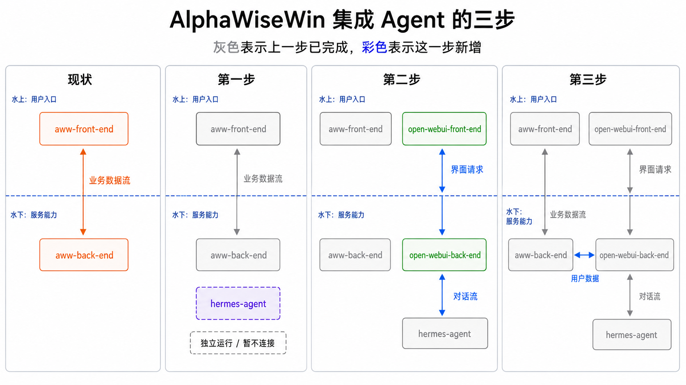
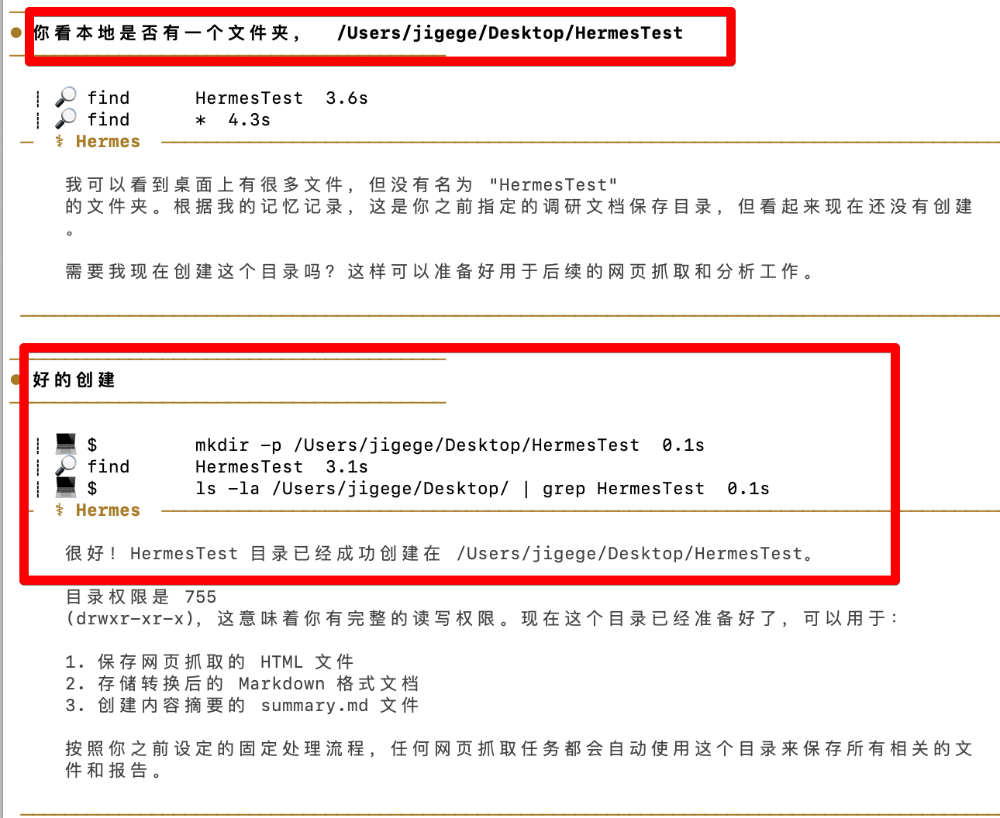
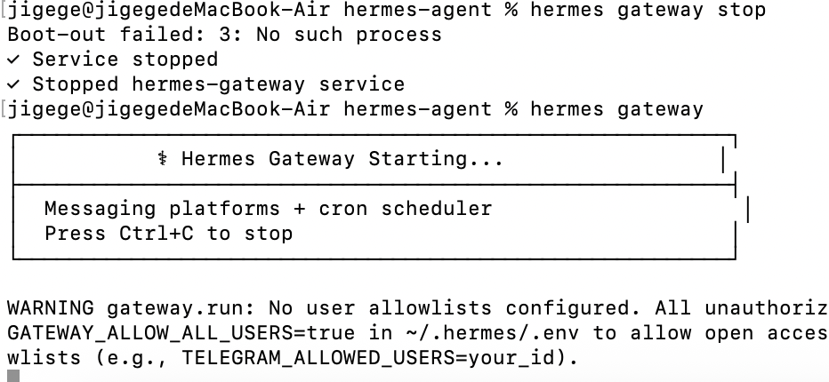
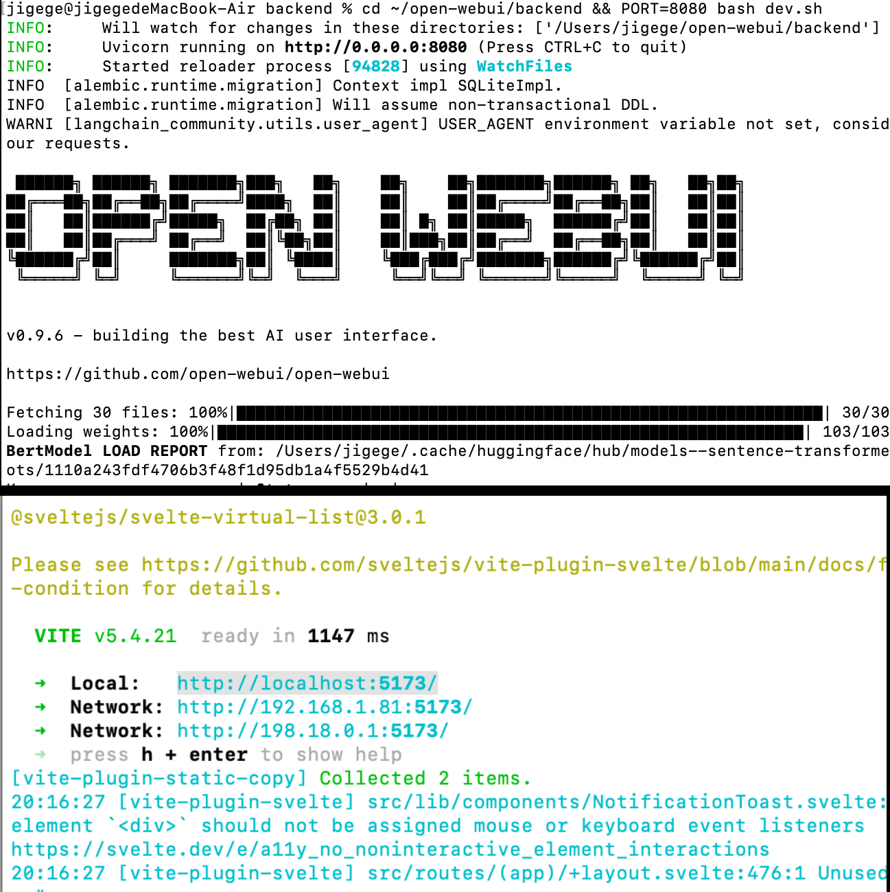
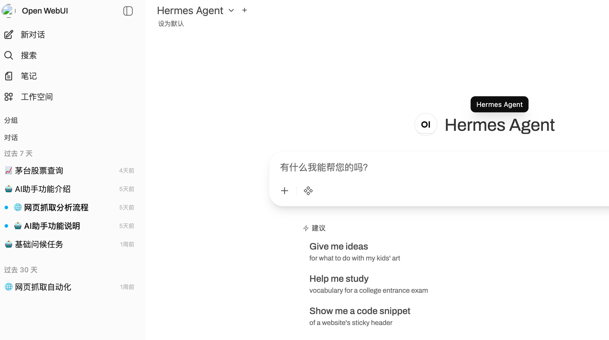
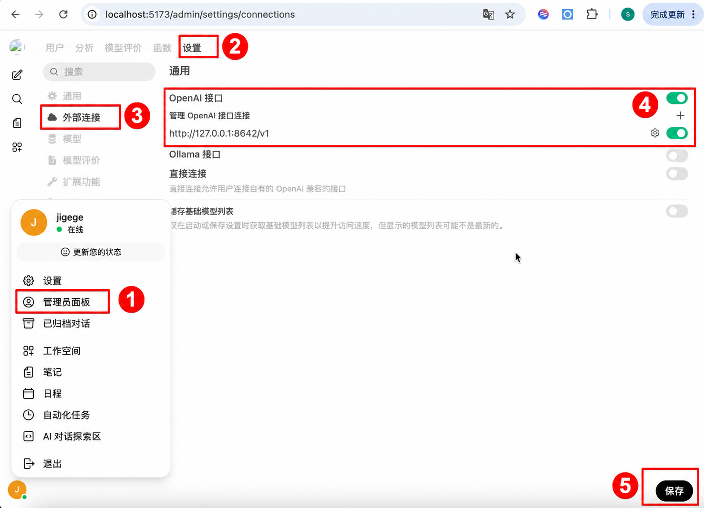
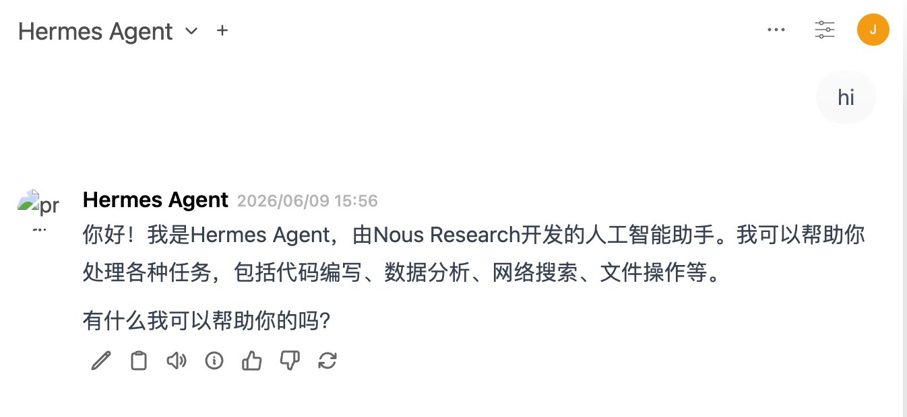
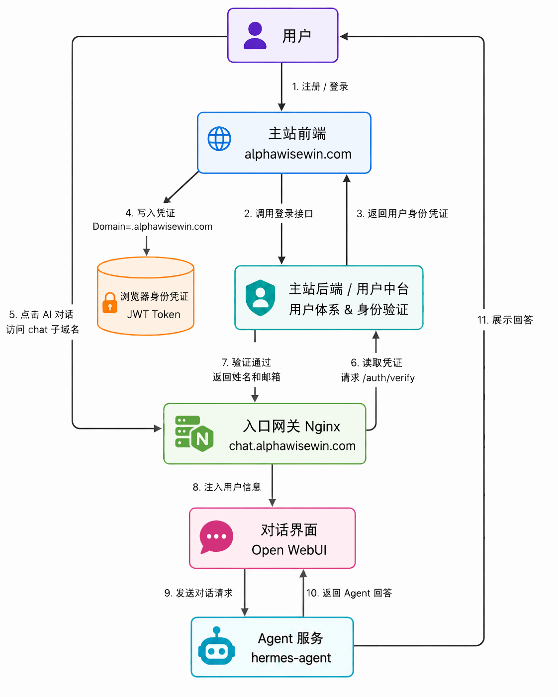

# 12 | 为AI股票分析工具装上Agent（二）：用户系统集成

你好，我是产品二姐。

上节课选型结束了，Agent 框架我们选了 Hermes Agent，对话界面选了 Open WebUI。接下来就要把 Hermes Agentt 和 Open WebUI 集成到 AlphaWiseWin 中。 这一节课我们先打通用户集成，也就是让 AlphaWiseWin 和 Open WebUI、Hermes Agent 共享一个用户体系，让用户从主站 AlphaWiseWin 登录后，进入 Open WebUI 对话界面不再需要登录。

这节课我会分三块讲：

- 首先，我们会做一个用户系统集成计划，带你了解用户系统集成的执行节奏。

- 然后，我会分三步，把用户系统集成进来，保证让用户从主站登录后，进入 Agent 对话界面不需要再次登录。

- 最后，我们再从架构师的角度，用数据流验证用户集成链路。

不过，更重要的是，我希望通过用户系统集成这个案例，讲述产品经理做多系统集成的通用方法。如果你从来没有完成过多个项目的集成，建议先通读一遍，充分理解后，再抽整块时间来实践。

学完之后，你就能对多系统集成的概念和方法有清晰的认知了，以后遇到任何复杂的系统集成，都会心中有谱。

## 计划：多系统集成的节奏

首先和你说明一点，我们看到的网站，虽然是一个域名，但背后对应着多个项目。比如，这个案例的升级中，AlphaWiseWin 本来是前后端分离设计的，对应两个项目：

- 前端：aww-front-end

- 后端：aww-back-end

在此基础上，我们要叠加上节课选定的两个框架。那么，升级后的 AlphaWiseWin 就需要四个项目的支持，但这个集成我们不是要一下子完成，而是按照下面这张图的节奏循序渐进。



具体来说，就是：

- 当前：AlphaWiseWin 前端和后端已经正常运行，前后端之间保持业务数据流通。

- 第一步：在不影响原系统的前提下，先把 Hermes Agent 在水下独立跑起来。

- 第二步：为 Hermes Agent 接上 Open WebUI 后端，打通对话链路。

- 第三步：让 Open WebUI 后端的用户体系与 AlphaWiseWin 的用户体系打通。

完成这几步之后，用户就能完成以下事情：

1. 打开 alphawisewin.com，注册账号，登录。

2. 此时再打开 chat.alphawisewin.com，就会看到用户已经登录。

3. 然后用户就可以开始与 Agent 聊天，指示 Agent 执行任务。

4. 如果用户退出 ai2alpha.cn 主站；再访问 chat.ai2alpha.cn，则会自动跳回登录页，需要重新登录。

核心要求就是：一套账号，同时使用 Agent 与 AlphaWiseWin 主站的内容。

接下来的步骤，你可以用自己手上已有的系统来代替 AlphaWiseWin，或者用你在 05 讲构建好的那个应用来完成。我讲解的时候，仍然采用 AlphaWiseWin，不同的项目可能会有不同的表现，但基本步骤是不变的，对于第一次做开发的同学，可以先通读全文，确认理解了步骤，然后再来跟着实践。

## 落地：三步完成用户集成

在开始之前，请你做两件事：

一是使用 04 讲提到的三个 Harness Engineering Skill 为四个项目构建出场域。

二是在 Claude Code/Codex 的全局记忆（CLAUDE.md/AGENT.md）里写入以下文字。

- 我是产品经理，不熟悉开发、运维指令。如果要给我终端命令或运维操作时，请先用通俗语言逐条解释每句命令

因为从这节课开始，我们有些任务需要 AI 指导你在 Terminal 执行部署指令，比如：本地连接云服务器，在云服务器上通过 bash 、vi 指令读写文件等。为了安全，我们不会把这些运维权限下放给 Coding Agent，而是由我们亲自来操作。但这些指令对于产品经理都是陌生的，所以我们要建立这条规则，它能让你在整个过程中知道自己在做什么，并习得相关知识。

完成这两项准备工作后，我们就可以正式按照刚刚的计划开始了。

第一步：把内核 Hermes Agent 在本地跑起来

我们要做三件事：

- 安装 Hermes

- 为 Hermes 配置大语言模型的 API key。

- 验证是否安装成功

Hermes Agent 的安装过程很简单，依照开源地址里的 README 执行，或者把下面 5 条命令交给 AI，让它帮你逐条执行。你可以问 AI 这五条指令的意义，我这里就不过多解释了。

```bash
git clone https://github.com/NousResearch/hermes-agent ~/hermes-agent
cd ~/hermes-agent
bash setup-hermes.sh
ln -sf ~/hermes-agent/venv/bin/hermes ~/.local/bin/hermes
echo 'export PATH="$HOME/.local/bin:$PATH"' >> ~/.zshrc && source ~/.zshrc
```

安装脚本会自动处理依赖，不需要手动安装。安装完成后，它会在你的电脑上创建两个目录：

```
一个放程序本身（~/hermes-agent/），一个放你的数据——配置文件、对话历史、记忆文
件（~/.hermes/）。两个目录分开，程序更新不影响数据。
```

接下来要配置大语言模型的 API Key。Hermes Agent 本身不绑定任何模型，需要你告诉它“用哪个接口、用什么模型”。我用的是 AWS Bedrock + DeepSeek V3。打开配置文件

```
~/.hermes/config.yaml，在顶部加入以下模型调用地址、API key 和模型 ID，这些信息
```

一般从你所购买的模型厂商账号和官网里获得。

```
model:
 provider: "custom"
 base_url: "你的 Bedrock OpenAI 兼容接口地址"
 api_key: "你的 API Key"
 default: "deepseek.v3-v1:0"
```

最后我们来验证一下，你在终端 Terminal 输入：

```
hermes -z "你好"
```

如果收到回复了，说明 LLM 连接正常，整个大脑转起来了。然后你可以继续和它交互，见证一下 Hermes 的厉害：

你可以输入：

```
你看本地是否有一个文件夹，/Users/<你的用户名>/Desktop/HermesTest
如果没有，那就让它创建一个，之后，你会发现它会在你的电脑上，通过一个指令 ~mkdir -
p 创建了一个文件夹。
```



你看，Hermes Agent 是不是自带行动能力？而且，它已经拥有操作本地电脑的能力。假设我们要把这个能力开放给所有用户，那意味着任何人都可以在你的服务器上增加、删除文件，可是有点危险的，不过这里我们先把这个问题放一放，到下节课来解决。

现在继续本节课的系统集成任务。刚刚我们是使用 Hermes Agent 的命令行 CLI 的方式对话的，如果你只是要把 Hermes 跑起来，它也是一个独立应用。但我们案例需要为它配上一个前端对话交互页面，就进入第二步。

第二步：接上界面，本地能对话

这一步也要完成三件事，我们逐一来看。

第一件事是：开启 Hermes Agent 的 API 模式。

为了能和外界对话，Hermes Agent 首先要把自己的能力通过 API 开放出来，Hermes Agent内部已经设置一个对外交互的窗口，地址是 http://127.0.0.1:8642/v1，我们需要把它打开，并为这个出口设置一个沟通密码。

```
完成这个任务只需要在 Hermes 的环境配置文档 ~/.hermes/.env 里加两行表示开启 API
```

模式，并配上密码。

```
# 开启API模式
API_SERVER_ENABLED=true
#配一个密码，使用python3 -c import secrets; print(secrets.token_urlsafe(32))生成
API_SERVER_KEY=my-local-key
```

然后在终端运行以下指令：

```
hermes gateway
```

当你看到下图，意味着这个出口已经可以对外访问了。



第二件事是：启动 Open WebUI 的前后端。

我们需要在本地起两个终端分别跑前后端：

```bash
# 终端 1：后端
cd ~/open-webui/backend && PORT=8080 bash dev.sh
# 终端 2：前端
cd ~/open-webui && npm run dev
```

你可以看到下图这样，就意味着启动成功了。



```
此时浏览器打开 http://localhost:5173 后，就看到了对话窗口，如果你是第一次进入
```

页面，就需要创建一个管理员账号，之后就不用登录了。



第三件事是：把 Hermes Agent 服务这个窗口地址和密码记在 Open WebUI 里。

```
浏览器打开 http://localhost:5173，进入 Settings →管理员面板 →外部连接 →OpenAI
```

接口，找到 OpenAI API 区域，添加一条连接就可以了。



```
保存后刷新模型列表，看到 hermes-agent 出现，给它发一条消息——Agent 回了，就说明
```

这条链路通了。



这时我们完成了第二步，下一步我们就集成已有的 AlphaWiseWin 系统。

第三步：本地验证“一套登录，无缝进入对话”

这一步的目标是：打通 AlphaWiseWin 与 Open WebUI 的账号体系，使用户登录AlphaWiseWin 后，直接使用 Open WebUI 与 Hermes Agent 完成对话。

假设未来在生产环境，我们会在一个新域名：chat.alphawisewin.com 中让用户对话，那么AlphaWiseWin 的前后端需要各做一个小改动。

在 Codex 或者 Claude Code 里，你只需要告诉 AI 打通账号体系即可，AI 会帮你做得很完整。不过为了更深刻地理解，我把这个过程用一个比喻来说明，方便你学习、理解。

你可以把 AlphaWiseWin 想象成一座大楼，用户输入用户名密码登录后，系统会发给他一张门卡（JWT Token）。原来，大楼只有主楼（alphawisewin.com），现在加了一栋附楼（chat.alphawisewin.com），我们要让同一张门卡也能进附楼。那我们要做三件事：

第一步：让门卡覆盖整栋大楼。

这一步在 AlphaWiseWin 前端完成。需要在前端配置里：把登录后写入门卡（JWT Token）的

```
域，从 alphawisewin.com 改成 .alphawisewin.com（前面加一个点），这样主楼和附
```

楼都能读到同一张卡。

第二步：在主楼保安室新开设一个窗口，用于验证附楼的请求。

在 AlphaWiseWin 后端项目里新增一个验证接口，专门用来回答门卫的问题——接收门卡、验证真伪、返回卡主的姓名和邮箱。

第三步：附楼门口装门卫（Nginx）。

这里 Nginx 全称其实是 Engine X，读作“engine-x”，它是一个运行在服务器上的软件，专门负责接收网络请求、决定把请求转发给谁。

把它配置在 Open WebUI 对应的域名 chat.alphawisewin.com 前面，让它拦下所有进附楼的请求，拿门卡去调用第二步的接口核实身份，核实通过后把用户姓名和邮箱贴在请求头上放行，Open WebUI 读到直接认出你是谁，不用重新登录。但 Nginx 只在生产环境里有，本地测试时没有 Nginx，我们就模拟跑一个脚本冒充门卫，做一模一样的事。

这时候如果我们要在本地测试，就需要在前两步的基础上，再打开 AlphaWiseWin 的前、后端和一个 Nginx 网关。

```bash
# 终端 1：AlphaWiseWin 后端
cd ~/aww-back-end && bash dev.sh
# 终端 2：AlphaWiseWin 前端
cd ~/aww-front-end && npm run dev
# 终端 3：本地 Nginx 代理（冒充门卫，占住 8080）
cd ~/open-webui && node scripts/local-auth-proxy.mjs
最后验证用这个方式验证一下：浏览器打开本地主站 http://localhost:3000，登录
```

AlphaWiseWin 的原有账号。登录成功后，按 F12 打开开发者工具，切到 Console 标签，粘贴这一行执行。

```
window.location.href = 'http://localhost:8080/local-auth?token=' + localStorage.g
```

这一行的作用是：模拟主站点击“AI 对话”按钮的跳转行为，把登录凭证带给本地代理验证，在生产环境是不需要这样做的。代理验证通过后，浏览器会自动跳转到 Open WebUI 的前端。

这样 Open WebUI 里显示的是你在主站注册的账号，说明初步完成了主站与聊天窗口的集成。

## 回顾：用 AI 进行多系统集成的通用方法

到这里，你可能有点懵，我们来梳理一下主站 AlphaWiseWin 与 Open WebUI 用户集成后的数据流。



从这张图看：前四步是原来主站 alphawisewin.com 的既有逻辑。从第五步开始：

```
用户打开到 chat.alphawisewin.com。
```

- 入口网关 Nginx 先拦住请求，读取浏览器里的 JWT Token，也就是门卡信息。

- 门卫 Nginx 调用主站后端的验证接口，确认这个用户是不是真的登录过。

- 主站后端验证通过后，把用户姓名、邮箱返回给门卫 Nginx。

- 门卫 Nginx 把用户信息写进请求头，再转交给 Open WebUI。

- 用户在 Open WebUI 输入问题，Open WebUI 把对话请求转给 Hermes Agent。

- Hermes Agent 返回回答，Open WebUI 再把回答展示给用户。

到这里，我们就完成了最基本的用户集成。

## 总结

最后我们来总结一下这节课的内容。我们总体介绍了这次用户系统集成的几个系统，分三步完成了用户集成，最后复盘检验用户集成后的数据流，确保是正确的。

以前，作为一名产品经理，我很少会想到一个 App 或者一个网站背后需要很多系统支撑，我会把产品当做一个整体来看。而今天，作为一名全栈产品经理，产品背后的多系统集成变成了一种常态。

在复杂系统中，如果你只告诉 AI 你要达到的业务目的，那么它很可能 “只见树木不见森林”。比如在这个案例中，如果你只告诉 AI， 我要增加一个 AI agent 聊天窗口，那它很有可能不会采用 Hermes 框架和 Open WebUI，而是直接自己手搓一个对话窗口，之后你需要不断地在此基础上打补丁。

那对于一个产品经理来说，怎么做系统集成呢？让我们把视野从单一的“用户集成”拔高来思考这个问题。我总结为三点：

1. 把握节奏，逐项叠加。比如这节课的三步就是先把要集成的 Hermes、Open WebUI 独立跑起来，然后再叠加主站。

2. 先收拾环境，再开干。比如我们会把四个项目都显性地构建好 Harness 系统，帮助 AI 和你一起完整理解项目。

3. 不懂就问，把 AI 当老师。比如在 CLAUDE.md 中你通过设定好你的能力，让 AI 带你理解每步含义。

遵循这个原则，你也可以把计费系统集成进来，保证用户在对话里消耗的 token 能计入费用中。在这里就不详细展开了，你可以在课后完成。

到这里，我们给 AlphaWiseWin 接上了一个 chat 入口，并能开始对话。下节课我们就要定制化改造 Hermes Agent 这个对话输出引擎了，首先我们会从工具改造开始。

## 课后题

这节课我们让用户能无缝进入 Agent 对话了。但现在有一个问题：用户每次对话消耗了多少token、花了多少钱，AlphaWiseWin 完全不知道。

```
课后试着把计费集成进来：Hermes Agent 每次返回的响应里，都带着一个 usage 字段，记
录了这次对话用了多少 prompt_tokens 和 completion_tokens。你的任务是：在 Open
```

WebUI 或 aww-back-end 里接收这个数据，把它写进用户的消费记录，让管理员能看到每个用户的累计 token 用量。

不需要做完整的计费系统，能把 token 用量存下来就算完成。可以让 Claude Code/Codex 帮

```
你找 usage 字段在哪里出现、怎么拿到它，你只需要告诉 AI “我想记录每次对话的 token 消
```

耗”。然后一步步完成，有了这个框架，相信后面的改造就更加坚实可靠！

欢迎你在留言区和我交流。如果觉得有所收获，也可以把课程分享给更多的朋友一起学习。我们下节课见！
