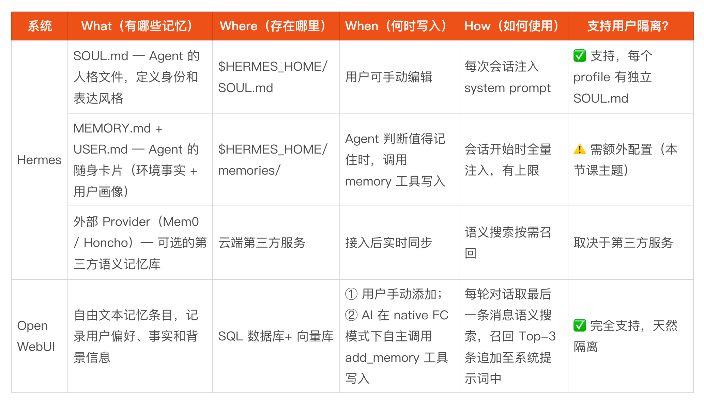
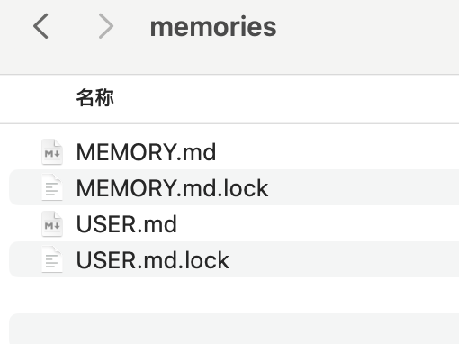
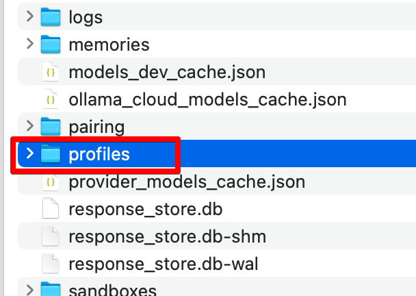
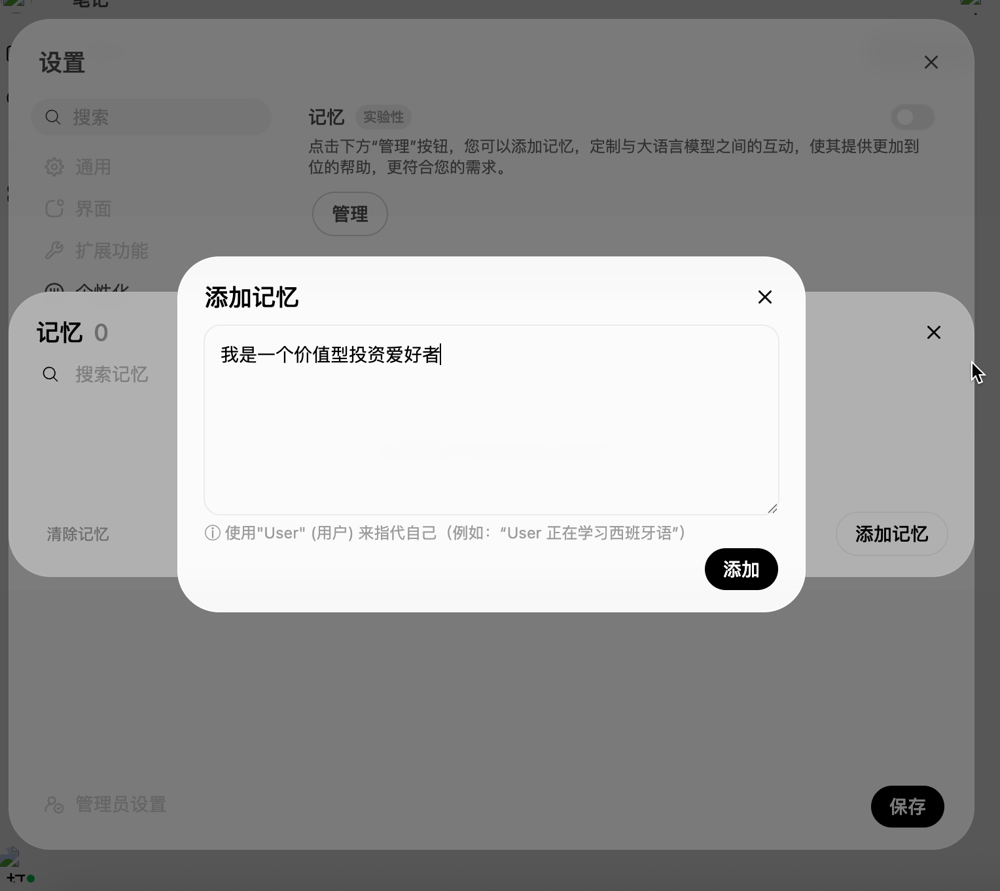
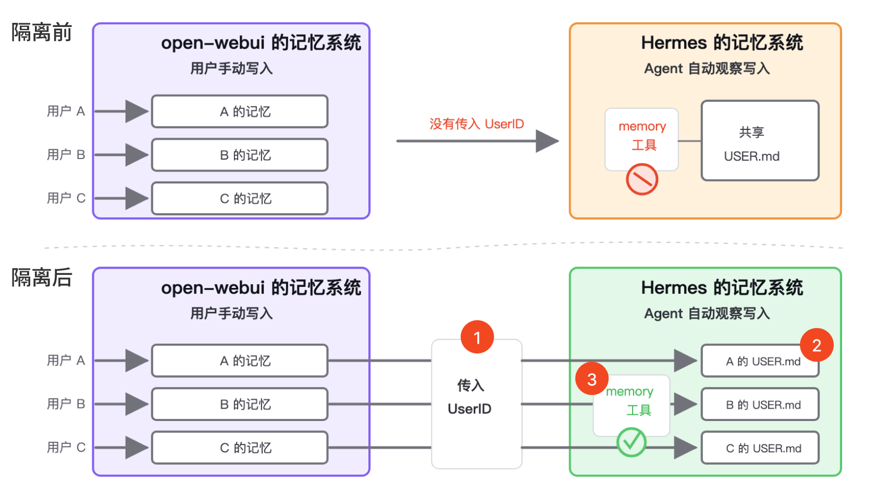
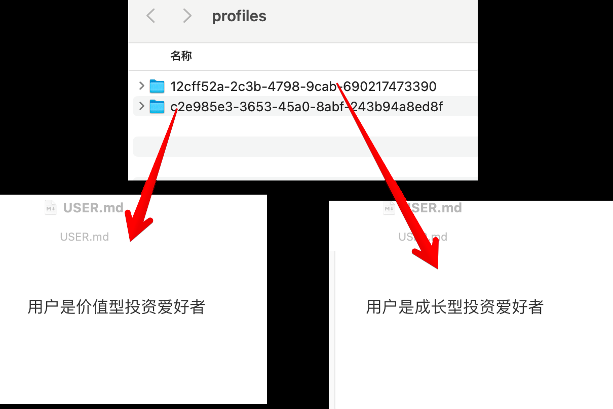
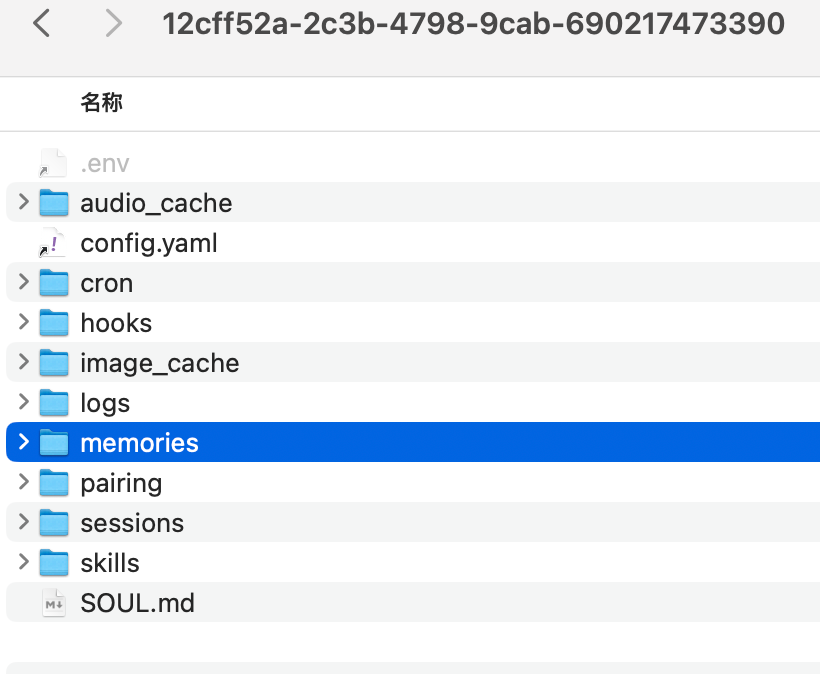
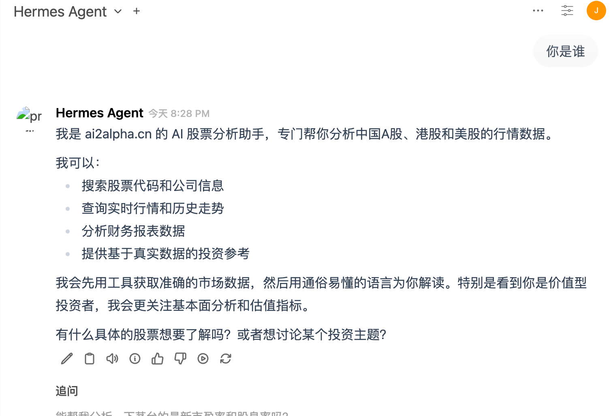
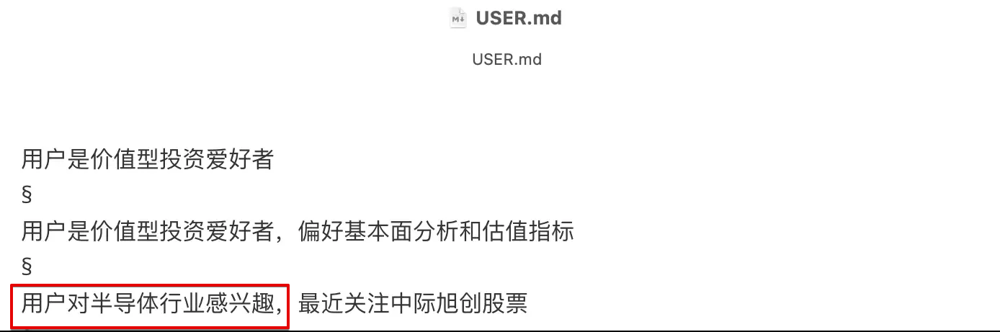
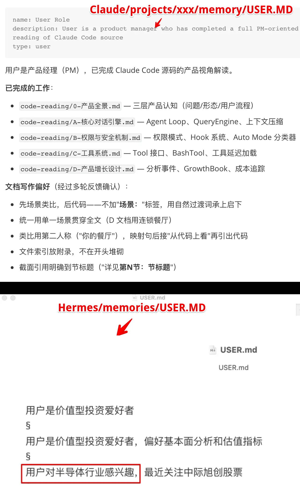

# 14 | 为AI股票分析工具装上Agent（四）：记忆管理

你好，我是产品二姐。

上节课，我们给 AlphaWiseWin 建好了工具箱——把危险工具禁掉，把股票分析能力以工具形式接入 Agent。但有一个工具我们主动禁掉了，那就是 memory 工具。不是不需要，而是有个前提没解决：如果多个用户共用一个 Agent，用户的个性化记忆是不能混在一起的。这节课，我们就来解决这个问题，也就是做好用户的记忆隔离。

为了表述方便，我们这节课的记忆特指程序性记忆，主要包括两项：

- 一是 Agent 自身的人格记忆，就像 Claude Code 里的 Claude.md；

- 二是从对话中沉淀下来的，与用户画像相关的记忆。

不包括短期记忆管理的上下文压缩、折叠，以及 RAG、LLM Wiki 这种外挂记忆库。 如果你对这些概念有点模糊了，推荐你温故而知新，回顾一下 07 和 08 两讲的记忆管理。

这类程序性记忆在我看来是 Agent 产品构建护城河的重要方法。它能让用户觉得“这个 Agent真懂我”，从而就更有可能会长久地留存在你的产品当中。所以它给 Agent 带来的复利效应要远高于功能本身。

那么，在 AlphaWiseWin 这个产品中要完成记忆构建，分三步走：

1. 先观察。现在 AlphaWiseWin 里同时集成了 Hermes Agent 和 Open WebUI ，两个系统各自有独立的记忆系统。在打通二者的记忆系统之前，首先要了解它们。结合之前 ClaudeCode 的记忆系统，你可以进行对比，从而更能体会不同场景下应该怎么设计记忆系统。

2. 动手做。了解之后，我们会让 AI 协助完成二者集成，实现多用户记忆隔离。

3. 业务化。最后我们要根据业务需要，在记忆系统中融入股票分析的业务场景，让用户感知到这是能读懂 ta 的股票分析师。

做完这三件事：你就可以为任何场景的 Agent 构建出专属的记忆体系，习得构建 Agent 护城河的能力。

接下来让我们看看 Hermes Agent 和 Open WebUI 各自的记忆系统是如何运作的。

## 先观察：两套记忆系统，分工合作

在这里，先教你一个拆解 Agent 记忆系统的方法，我们以 Claude Code 为例来说明，主要从以下五个维度来看：

1. What：有哪些记忆。Claude Code 的 memories 里会有 User、Feedback、project、reference。

2. Where：这些记忆存在哪里。Claude Code 会存在 /memories 里。

3. When：这些记忆是什么时候被写进去的。Claude Code 里是每次对话结束后即时提取，或者在“梦”中提取的。

4. How：这些记忆是如何被使用的。在 Claude Code 里，是采用渐进式披露来形成记忆的，那么在使用的时候首先把记忆的描述 + 文件名发给大模型，而后从中选出相关具体记忆。

5. 最后一项：它是否支持用户隔离。 这一点，我们在分析 Claude Code 时没有做，但今天会以 Hermes Agent 和 Open WebUI 为例补上。

有这个方法之后，你可以直接告诉 Codex 或 Claude Code：“从这五方面分析 Hermes Agent和 Open WebUI 的记忆机制”。在这里我列出来供你参考。



​接下来对照这个表格我来详细说明。

首先，Hermes Agent 的记忆分三层。

第一层：SOUL.md —— Agent 的人格。相当于 Claude Code 当中的 CLAUDE.md。这是Agent 的“价值观文件”，定义它的身份和默认行为风格，比如“你是一个专注于 A 股市场的分析助手，表达简洁直接，遇到不确定时要明确说出来”。这个文件由 Agent 开发者来写，每次会话都会注入。

```
现在请你打开 ~.hermes/SOUL.md，看看里面的内容，如果你没有更改过，它应该是这样
```

的：

- "You are Hermes Agent, an intelligent AI assistant created by Nous Research. You arehelpful, knowledgeable, and direct. You assist users with a wide range of tasks includinganswering questions, writing and editing code, analyzing information, creative work, andexecuting actions via your tools. You communicate clearly, admit uncertainty whenappropriate, and prioritize being genuinely useful over being verbose unless otherwisedirected below. Be targeted and efficient in your exploration and investigations."

第二层：MEMORY.md 和 USER.md —— Agent 自己维护的随身卡片。相当于 Claude Code当中的 memories。Hermes 的 memories，会包含以下两个文档：

```
USER.md 存的是用户画像，比如偏好成长股，厌恶高杠杆，提问习惯简短。
MEMORY.md 在 Hermes 的代码描述中，这个文档主要记录 Agent 学到的环境事实，这和
```

- Claude Code 中的 memory.md 仅作为 memory 索引可不一样。不过在本节课后面的步骤

```
中，我们会发现在 AlphaWiseWin 这个案例中，MEMORY.md 的内容和 USER.md 会重合，
```

- 因此我们暂不使用。在自己的案例中，你也可以对这个文档进行适度改造，甚至改造成和Claude Code 类似的作用。

这两个文件由 Agent 自主写入——每次对话结束后，Agent 就会调用 memory 工具读取上一个 session 的对话，总结出用户偏好写进 USER.md。下次会话开始时，这份记忆就会整体注入系统提示词。

```
现在请你打开 Hermes 里的 memories 文件夹：~.hermes/memories，看看现在 Hermes
```

记住了哪些内容，当然它可能是空的，不着急，我们后面会看到 Agent 会自动填上内容。



第三层：外部 Provider 的记忆。Hermes 还支持接入 Mem0、Honcho 这类第三方记忆服务，做语义搜索和更深层的用户建模。这一层是可选的，AlphaWiseWin 现阶段用不上，暂不展开。

拆解完 Hermes 的三层记忆，最后来看 Hermes 是否支持用户隔离。在设计 Hermes 上已经支

```
持，打开 ~/.hermes/ 文件夹，会发现一个 profiles 文件夹，这类似 Claude Code 里的
```

projects 文件夹，只是这个 profiles 就是用来存放每个用户的记忆的，而不是项目记忆的。



不过在默认情况下，Hermes 并没有把 profiles 暴露给外部系统。这节课要做的，正是把Open WebUI 的用户 ID 接进来，告诉 Hermes 当前请求是哪个用户的，让它自动切换到对应的 profile。集成之后，我们就会在 profiles 文件夹下，看到不同用户的记忆被存储在以用户 ID为名称的文件夹里。

以上就是 Hermes 的记忆系统，而 Open WebUI 自己也有一套记忆系统，相对来说会简单很多。

Open WebUI 的记忆主要是通过用户在页面手动添加的（如下图），所以它是天然支持用户隔离的。而且这里记忆的使用也很简单，即用户每次发消息时，系统都会从记忆库里搜出语义最相近的 3 条，附加到上下文里发给大模型。



在实际使用中，两套记忆都会注入同一个对话的上下文，互不干扰。Hermes 的记忆相当于Agent 自己记的“用户观察日记”，而 Open WebUI 的记忆是用户自己填的。搞清楚了这两套记忆系统，现在我们就来做用户隔离。

## 动手做：三步完成多用户记忆隔离

刚刚的调研中我们发现 Hermes 本来就有能力做用户隔离，而 Open WebUI 的记忆天然是用户隔离的。我们要做的是把 Hermes 接入到 Open WebUI 的用户体系上。

在让 AI 分析完二者的区别后，接下来你可以告诉 AI：把 Hermes 接入到 Open WebUI 的用户体系 。一般来说，Agent 可以直接完成这个任务，我在这里列出具体三步，让你在具体实践的时候做到心里有底。

这三步用下图表示就是这样的。



第一步：把 OpenWebUI 的用户标识传给 Hermes

Hermes 要知道“是哪个用户在对话”，才能切换到对应的记忆文件。Open WebUI 向 Hermes

```
Agent 发送对话请求时，遵循 OpenAI 的接口规范，请求体里有一个标准字段 user，专门用
```

于传递用户标识。这样，每次用户发消息，Hermes 都能从请求里拿到这个用户的 UUID。

第二步：Hermes gateway 读取 UUID，切换用户 profile

如之前所述，Hermes 本来就有 profile 系统，会为每个用户在 profile 下创建一个独立目录，

```
拥有自己的 MEMORY.md 和 USER.md：
~/.hermes/profiles/
   c2e985e3-.../          ← 用户 A 的目录
       memories/USER.md
   12cff52a-.../          ← 用户 B 的目录
       memories/USER.md
```

不过这个只开放给命令行用户，接下来我们把它暴露给外界。也就是在 Hermes 的

```
api_server.py 里新增一个辅助函数，把 Open WebUI 传来的 UUID 映射到对应的 profile
```

目录——目录不存在时，自动创建并初始化 SOUL.md：

```
_req_user_id = (request.headers.get("X-Hermes-User-Id", "")
               or body.get("user", "")).strip()
_user_home = _get_user_hermes_home(_req_user_id) if _req_user_id else None
```

然后每次启动记录记忆时，会把这个路径设置为当前请求的 hermes home，之后所有文件读写都会指向这个用户自己的目录。第三步：给 API Server 开放 memory 工具

做好用户隔离后，就是把 memory 工具打开。这一步和上一节课禁用工具的地方是一致的，在

```
config.yaml 里的 platform_toolsets 加上 memory 即可。
```

第四步：验证用户的记忆互不干扰

接下来做最后一步：验证。这个过程也很简单，你也可以指导 AI 带你验证。

本地启动 AlphaWiseWin 相关的所有服务后，用两个不同的用户登录，用户 A 输入“请记住我是价值型投资爱好者” ，用户 B 输入 “请记住我是成长型投资爱好者”。 然后在`/.hermes/profiles` 查看，你应该会看到两个文件夹，分别以用户 A、B 的 ID 命名，每个文件夹的 User.md 中已经记住了刚刚用户的输入。



当然，在验证过程中你可能会发现一些问题，比如并没有构建文件夹，或者 User.md 里并没有记录，你直接让 Codex 帮忙解决就好。

至此，AlphaWiseWin 的记忆就实现了用户隔离，用户 A 看不到用户 B 的记忆，反之亦然。不过，此时所有的记忆都不具备股票分析这个业务属性，接下来我们对这套记忆体系进行“业务化”改造。

## 业务化：让记忆融入股票分析场景

在业务化改造之前，我想请你打开一个用户的 profile 文件夹，你会看到这个子文件夹：



在这个文件夹里，有一整套针对这个用户的个性化资料，其中涉及记忆的是 memories 和

```
SOUL.md。此时我们打开 SOUL.md，会看到这里针对用户的 SOUL.md 的是一个通用的内
容，和之前我们在 ~.hermes/SOUL.md 里看到的一样。
```

- "You are Hermes Agent, an intelligent AI assistant created by Nous Research. You arehelpful, knowledgeable, and direct. You assist users with a wide range of tasks includinganswering questions, writing and editing code, analyzing information, creative work, andexecuting actions via your tools. You communicate clearly, admit uncertainty whenappropriate, and prioritize being genuinely useful over being verbose unless otherwisedirected below. Be targeted and efficient in your exploration and investigations."

因为我们在构建用户个性化的 SOUL.md 的时候，会把这个全局的 SOUL.md 原样继承过来。

另外你打开 /memories 文件夹下的 USER.md 是空的，MEMORY.md 也是空的。如果每次把这样的提示词发给大模型，是不足以让它得到很好的回答的。现在我们对两处地方做业务化的改造。

改动一：把新用户的 SOUL.md 业务化

```
如之前所说，Hermes 在为新用户初始化 profile 时，会把默认的 DEFAULT_SOUL_MD 写进
```

去。我们把这一步替换掉，写入 AlphaWiseWin 专属的版本，比如优先使用 AlphaWiseWin 自己的工具等等。

```
你是 alphawisewin 的 AI 股票分析助手，专注于中国A股、香港股市和美国股市的行情分析与数据解读。
```

- 你的能力范围：

```
- 搜索股票代码和公司信息（stock_search...工具）
- 查询实时行情、历史走势、财务报告数据
- 结合用户问题，调用工具获取真实数据后给出分析解读
```

- 你的行为原则：

```
- 数据优先：先调工具拿数据，再作分析，绝不凭空捏造价格或财务数字
- 清晰易懂：用普通投资者看得懂的语言解释，避免过度堆砌专业术语
- 客观中立：提供数据依据和分析框架，不做"一定涨/一定跌"的绝对判断
- 风险意识：涉及投资参考时，主动提示市场风险，投资者自行决策
```

修改之后，你可以简单测试一下，在对话框里问“你是谁”，会有如下图的回答，意味着修改生效。



改动二：把 User.md，Memory.md 记忆提取进行业务化

Hermes 的 memory 工具有一段“提取引导”，告诉 AI 什么情况下应该主动记忆在 User.md、Memory.md 中。

- 'user'：用户是谁 —— 姓名、职业、偏好、沟通风格、忌讳

- 'memory'：你自己的笔记 —— 环境事实、项目约定、工具规则、踩坑经验

我们在这段说明末尾追加股票专属的引导：

- 对于股票分析场景，也请主动保存：

```
* 用户偏好的市场：A股、港股或美股
* 投资风格或偏好，例如：“价值投资”“成长股”“短线交易”
* 用户经常关注的行业或股票
* 分析偏好，例如：“偏好基本面分析”“关注图表形态”
* 风险承受能力，例如：“保守型投资者”“能接受高波动”
改完之后，AI 在对话中就会主动感知：用户提到“我最近在关注半导体”，就会写进 USER.md
```

（如下图）。



你会发现这里的记忆结构和 Claude Code 里的 memories 不一样，在这里没有类似 name、description 的渐进式披露的结构（如下图）。而渐进式披露的方式是为了应对长记忆中的检索，如果用户画像不负责，那么就无需采用这种结构。



```
对于 MEMORY.md 的设计，我在设计引导 memory.md 的提示词时，发现在 AlphaWiseWin 这
个场景中，MEMORY.md 的初衷是“环境事实、项目约定、工具规则、踩坑经验” 对于股票分析
来说，都可以统一放在 Soul.md 中，因此暂时没有对 MEMORY.md 进行业务化改造。
```

至此，AlphaWiseWin 的记忆业务化初步完成了。

但这只是开始，用户的记忆应该提取到什么程度，什么细节，是否需要像 Claude Code 那样采用渐进式披露的方式提升效率？

我推荐的方式是由浅入深，按需改进，首先列出你最想被划在记忆中的内容，然后根据用户反馈来逐步增加，这是一个漫长的过程。 比如 AlphaWiseWin 可能会经历这样一个过程的改造：

1. 仅对 soul.md、user.md 进行业务改造。

2. 丰富个性化记忆，把 user.md 分化为投资理念.md、常用投资分析方法.md、常关注的股票.md 等等。

3. 加入渐进式披露的方法来提升记忆使用的效率。

## 总结

最后，让我们来总结一下。这节课，我们完成了实战案例 AlphaWiseWin Agent 建设中的最后一块拼图。

记忆本质上是用户切换 AI 产品的迁移成本——用户在 Agent 里积累的个人画像越丰富，ta 的迁移成本就越高，从这一点上讲，记忆能产生产品的复利效应，这是记忆比功能更有价值的地方！

这节课，我们走完了三步：

1. 观察了 Hermes 与 Open WebUI 两套记忆系统对比，加上 07 讲 Claude Code 的记忆建设，我们对 Agent 的记忆管理有了更深刻的认识。

2. 动手完成了记忆的多用户隔离，这是让记忆工具安全开启的必要条件。

3. 对通用记忆进行了业务化改造。但记忆的业务化绝对不是一次性的配置工作，而是一个由浅及深、持续打磨的过程。

到这里，我们初步体验了如何给一个固定 workflow 的 AI 产品 AlphaWiseWin 加上动态 Agent的过程，这四步是：

1. 框架选型：做 AI 产品的工程建设，先把框架摸透，复用已有能力。我们给出了常用的框架，也给出了一套框架能力的评估方法。

2. 系统集成：把已有系统和框架对接起来，我们以用户体系集成为例完成了这一步。

3. 工具建设：把已有系统的能力转换为 Agent 可用的工具。首先保证过滤掉 Agent 框架内嵌工具中的危险工具，然后将现有 AlphaWiseWin 的能力转换为 Agent 可用的工具。

4. 记忆建设：我们首先做了用户记忆隔离，然后将记忆进行业务化改造。逐步积累 Agent 产品的复利。

此刻，你再结合第二章的内容，是不是对 Agent 建设有了全面、完整的认识呢？

如果你跟着案例走了下来，我也想请你为自己鼓个掌。因为在这个案例之后，你再看任何Agent，我想你都能一眼看透，在庖丁解牛之后达到目无全牛的境界，能快速诊断并解决日常Agent 产品开发过程中的问题。

这个全面的案例的做法几乎可以被迁移到任何垂直行业，但这样的 Agent 需要你预先在行业上有深厚的积累，最终产生商业价值，因此 ta 能帮助职场中的同学应对企业场景中的 Agent 的开发。

当然，这个案例距离上线让用户使用还有一些工作要做，比如将 Open WebUI 的前端页面风格和主站 AlphaWiseWin 保持一致，对 AI 问答要进行全面的业务评测，关于前端的改造你使用 Vibe Coding，与主站保持一致即可，对于 AI 问答的评测，你可以参考我在《成为 AGI 产品经理》的第 2 讲和第 19 讲。

而对于个人开发者，独立团队，可以有更轻量化的产品。下节课开始，我们就会展示两个适合独立个体起步的产品。

## 课后题

这节课我们把 AlphaWiseWin 的记忆体系从通用模板一步步改造成了股票分析专属。现在请你来规划一遍自己的路径了。

选一个你正在做的或者感兴趣的 Agent 产品，试着思考你可以如何改进这个 Agent 的记忆系统，比如：

第一阶段（最小改动）：SOUL.md 里应该定义什么身份？在这个场景下，哪些用户信息最值得让 AI 主动提取记录——不需要用户说记住我，AI 自己就该感知到？

第二阶段（丰富分类）：随着记忆积累，USER.md 会越来越杂。你会把它拆成哪几个文件？是按主题拆，还是按别的维度？

第三阶段（提升效率）：如果用户记忆量很大，你觉得有没有必要加入像 Claude Code 那样的渐进式披露结构？什么量级开始值得做这个优化？

欢迎你在留言区和我交流。如果觉得有所收获，也可以把课程分享给更多的朋友一起学习。我们下节课见！
