# 17 | 选方向：找到真需求的三种方法

你好，我是产品二姐。

不知不觉这个专栏更新到了最后一章——商业化，也就是怎么让你的产品赚到钱。

机会总是留给有准备的人，我换一种更贴切的说法是：“赚钱的机会总是留给有准备的人”。实际上前面所有章节都在讲如何“准备”，而这一章讲的就是怎么抓住“赚钱的机会”。

不过，我们需要认清：机会是需要等待的，它并不一定在努力后就马上出现。换句话说：能不能做出产品是完全可控制的，但能不能把产品卖出去就不那么可控了。实际上，你看到的每一个商业故事背后，都隐藏着创始人长期的潜伏与失败。而我的方法就是：不断播下种子，在实践中等待机会，在等待机会的路上实践。

所以，这一章就是分享如何选择正确的种子播下去，最大可能地增加商业价值实现的概率。这也是我过去两年经过真实经验拷打后的一套方法，希望对你有所帮助。这套方法总共分四步：

- 第一步：选方向。就是找到一个真正可以付费的场景。我会分享三个帮你选择方向、确定需求的方法。

- 第二步：被看见。就是找到目标客户经常去的地方，我会详细讲述如何通过 SEO/GEO 的方法让你的产品被用户看见。

- 第三步：吸引力。就是吸引目标客户到你这里来，我会讲述如何通过 Skill 工作流，生产营销内容的方法。

- 第四步：卖出去。我会讲述 to C 用户的促单和增长方法，to B 客户产品预演展示方法，以及面向职场领导的高阶表达方法。

这四步会分 4 节课讲完，每一步都必不可少。

这一节讲的是第一步选方向。当我们在前面的内容中知道如何做产品之后，下一个问题就是：我到底该做什么？

你可能会遇到以下问题：

- 如果做自己需要的？会不会陷入自嗨。如果做别人需要的？身边人的反馈又太少，而且别人可能只是说说而已。如果跟风做热点？可能刚做完，热度就已经过去了。

但是，如果我在这三句话后面再加上三个条件，就能大大增加播种的成功概率，那就是：

- 做自己需要的，且会反复、长期需要的。做别人需要的，且会真实付费买单的。跟风做热点，且热度过后仍然会长期存在的。接下来我就按照这三个要求，分享如何找到真需求的方法。

## 做自己需要的，且会反复、长期需要的

在 OpenAI 创始人 Sam Altman 写的创业手册里，有这么一句话：

- 理想情况下，你本身就是目标用户。其次，你对目标用户非常了解。所以，如果你的产品来源于自身诉求，千万不要怀疑它的价值，你要相信这世界上一定有一群有同样诉求的人。但是，我们必须要注意：这个诉求是反复、长期存在的。如果不是这样，那等你做出来产品的时候，它就不会再被需要了。

所以，每冒出一个想法，都可以问自己几个问题：

- 我是为了赚钱而做它，还是它确实能解决我的问题？

- 未来半年，我还会需要它吗？

- 做出来之后，我自己会不会经常用？

- 随着我的使用，这个产品会不会越积累越有价值？

健身记录工具「训记 App」就是一个很好的从自身需要出发的例子，开发者自己就是健身爱好者，他把自己长期习得的科学健身方法与习惯用训记 App 管理起来，并通过公众号文章持续和健身爱好者建立链接。

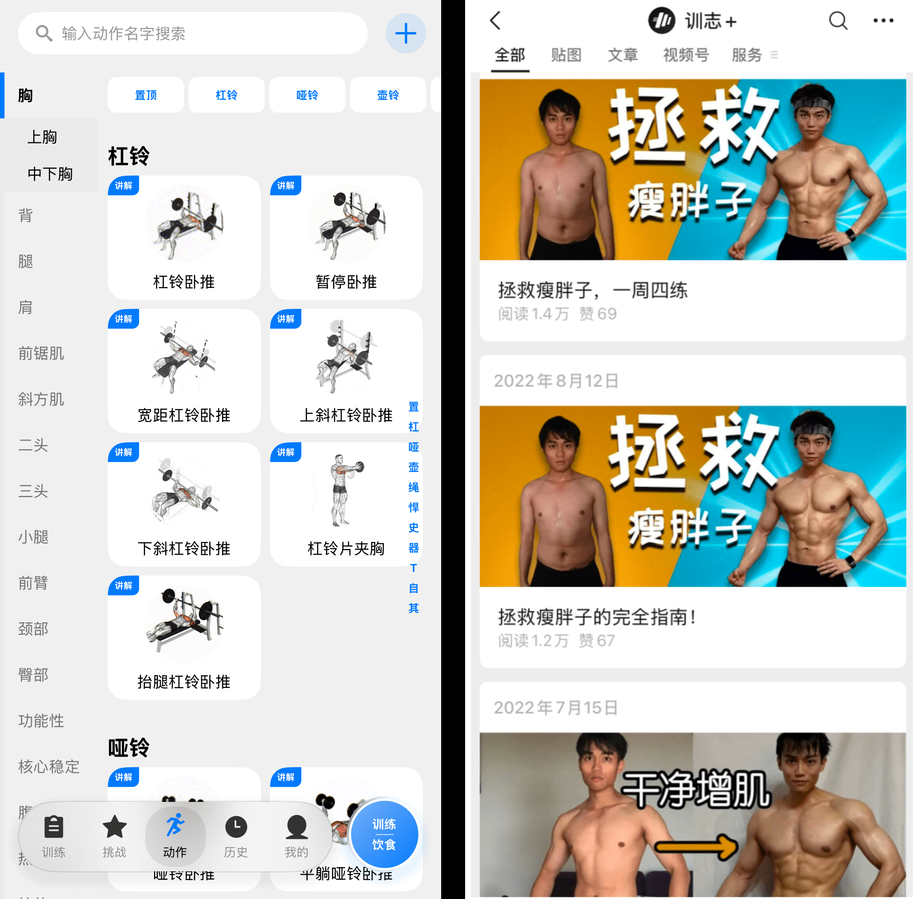

根据七麦数据，训记的月均收入大约在 6 万人民币左右（注：根据月均下载量 3800 左右，Pro 版一次性收费 88 元，按照 18% 左右的转化率计算可以核实）。

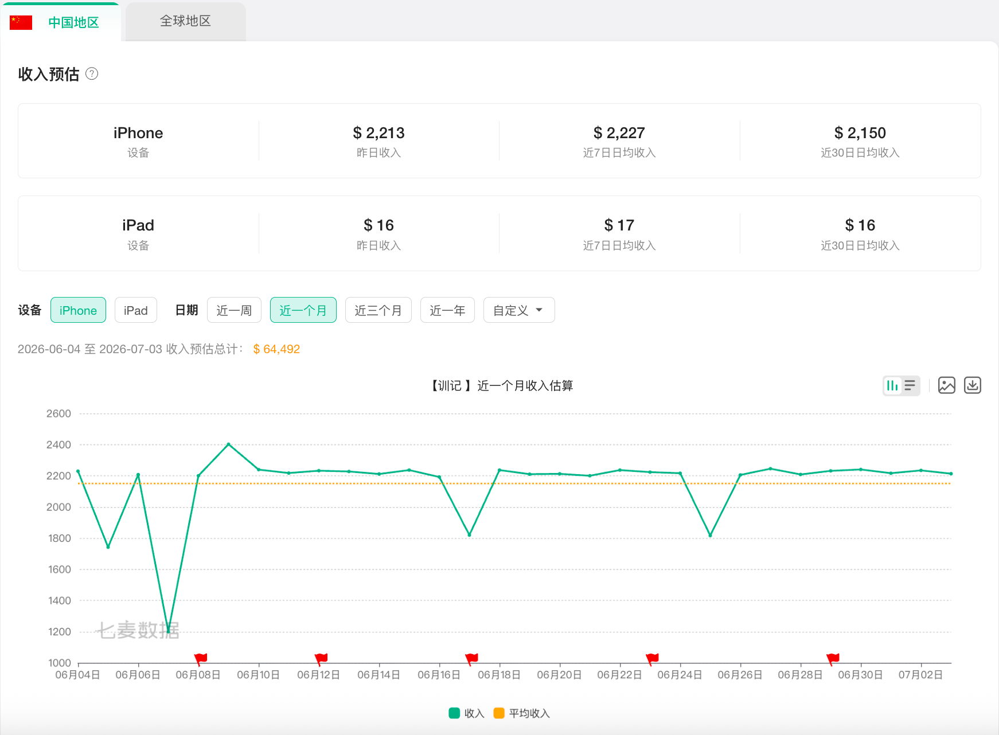

当我在公众号“训志 +”上追溯了训记的成长记录后，得出了几点训记商业化成功的要素：

一是长期。训记从 2019 年到现在，花了六年时间。如果不是发自内心需要，开发者是难以坚持如此之久的。

二是面向用户做内容。开发者在公众号上记录的多数是健身指南，而不是如何开发，用了什么框架与技术。这一点是刚刚起步的开发者容易陷入的误区，大家一定要注意。

三是增长。训记里有一个功能，就是健身教练可以在 App 里记录学员的健身进度。那么，教练为了记录进度会主动下载 App，而学员为了看进度，也会下载 App。一个教练带动十个学员，那么就是一比十的裂变。

四是价格。88 元买断，对于国人来说接受度比较高。

其中第一点和第二点靠的就是：这个需求开发者自己长期、反复需要。

当然，这个案例比较理想化。大多数情况下，我们从自身痛点出发挖掘出来的需求还要经过两层考验：

1. 市场上到底有多少人也会长期需要它；

2. 竞争对手多不多，你有没有可能打出差异化。

这里就要用到关键词分析。接下来我会以 AlphaWiseWin、book2skills 为例说明，如何通过大数据工具来判断这两点。

AlphaWiseWin 是 AI 股票分析工具，它要贴近的关键词可能是“AI 股票分析”“股票 Agent”这类找工具的关键词，但更可能是“英伟达股票分析”这类找个股分析的关键词。在这里，我们以“nvda stock”这个关键词为例说明。我会用到三个工具：

- Ahrefs 的关键词难度小工具

- Semrush：数据全面的 SEO 工具，可以对关键词、网站流量进行深度分析

- Google 搜索本身。

Ahrefs 的关键词难度小工具

如下图中的 traffic 就代表有多少人在搜索“nvda stock”。而 difficulty 代表：你要拿到搜索结果前十名的位置难度有多大。除此之外，你还可以看到你的竞争对手有哪些，深入研究下去，你还可以从竞品分析中收获可借鉴的地方，同时也评估自己是否能打出差异化。

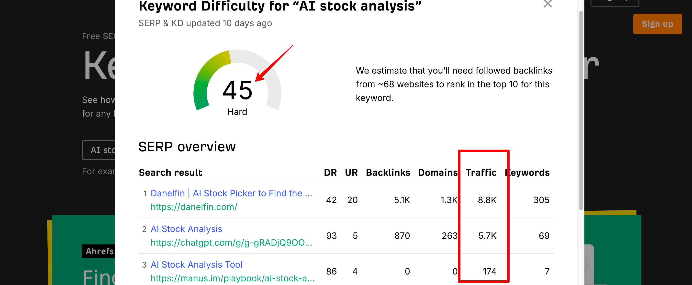

Semrush

和 Ahrefs 相比，Semrush 还有扩展、延伸关键词的数据，而且还根据 GEO 的概念，扩展出相似问题的流量。比如下图中，我们可以看到：

- “nvda stock”的搜索量高达 840 万。

- 但同样关键词难度高达 94%，甚至衍生关键词、衍生问题拿到排名的难度也很高。

- 再看竞争对手是雅虎财经这类超级网站。

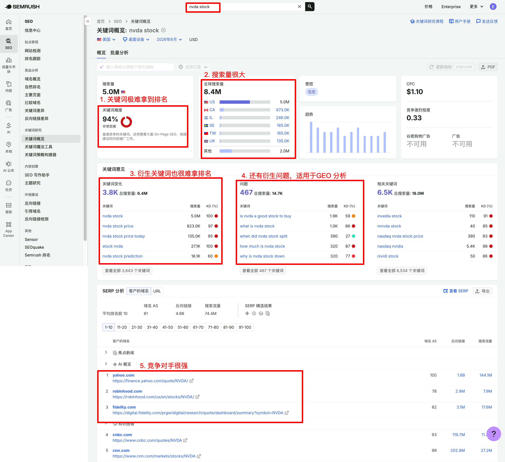

Google 本身

你可以在 Google 搜索同样的关键词，然后观察排名靠前的网站有哪些，以及每个网站的月访问量、域名创建时间等，以此判断竞争对手的强弱。

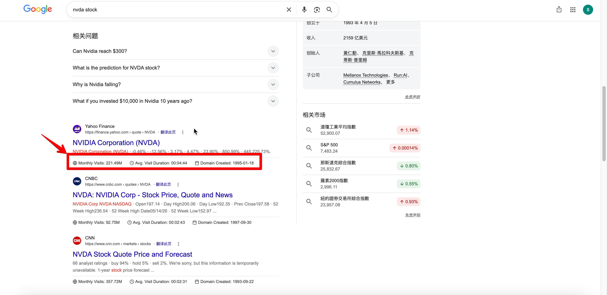

当然，你可能会发现三者的分析数据差别比较大，因为这些都是估计数据，实际当中你可以综合起来看。

通过上面的分析，尤其是 Semrush 的分析，我们看到：AlphaWiseWin 所对应的关键词热度很高，但同样竞争也很激烈，竞争对手也很强，可以说是一个红海市场，并不是一个好的播种对象。

而 book2skills 则不一样，即使是把巴菲特推荐过的经典财经书籍《Common Stocks andUncommon Profits》作为关键词，难度也没那么大。而且 Agent Skill 本身处在上升趋势里。所以更适合作为种子播种下去。

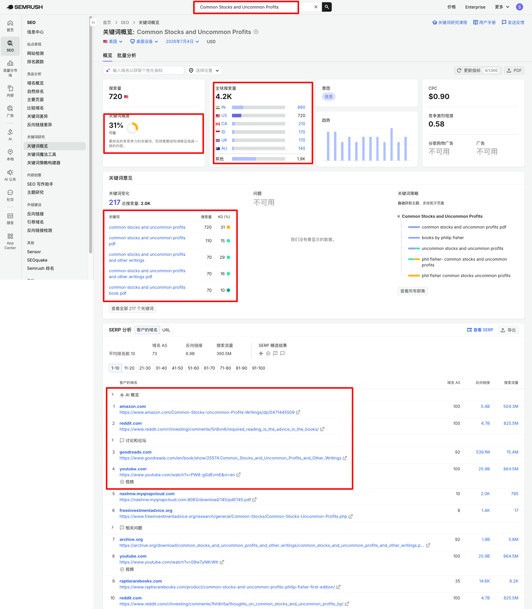

以上就是几个帮你判断自身需求值不值得做的方法：

- 一是这个需求长期、反复存在；

- 二是通过大数据工具分析，识别蓝海，更适合起步。

当然，如果你没有一个强烈的自身需求，那我推荐你使用下一种方法：找到别人需要的且会真实付费的。

## 做别人需要的，且会真实付费买单的

在这种情况下，我会通过三类信号看：

- 搜索信号。这类信号通过刚刚说的关键词分析可以顺藤摸瓜地寻找，就不再详述。

- 社交信号。比如在小红书中被疯狂留言的帖子，尤其是用户表达了强烈需要，而不是凑热闹的评论。

- 成交信号。这是最真实，但同时也是最难获得的信号。

我先讲一个身边的例子：一位朋友所在的公司面向海外投标，要准备数百份翻译材料，包括技术规格说明书，检验证书，类似下图这样。

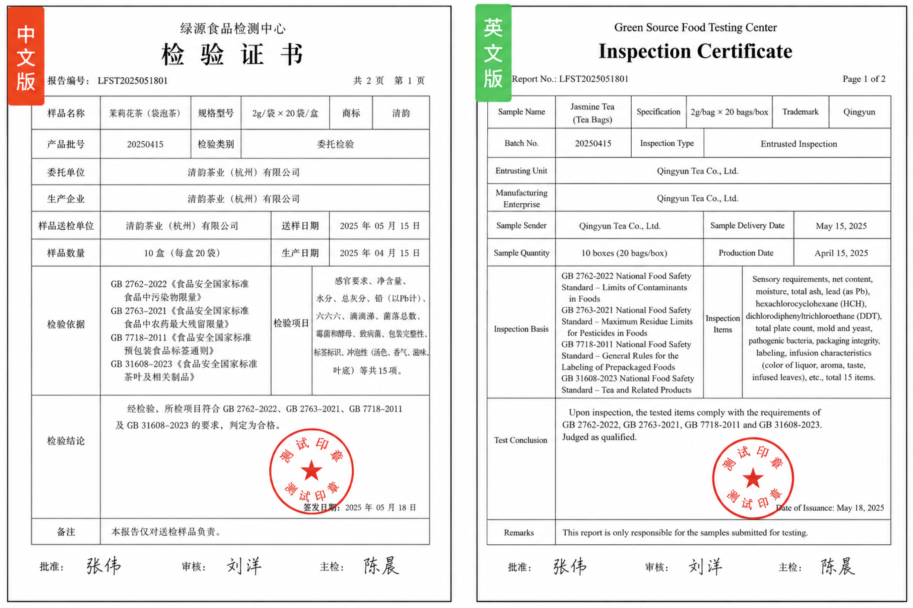

当时她在小红书上找到一些翻译软件，但这些工具要么无法完整保留原来排版，要么无法批量完成。后来在我的协助下，找到了一款海外的工具，一次性帮她完成了这个任务。之后，我的朋友便在小红书上发帖，把这个翻译效果发出来，结果当天就收获了很多评论。于是她开始在小红书上接单尝试。

此时她没有做任何开发工作，只是承担了翻译公司的角色，接到一些批量翻译的订单。这个案例简直是 AI 视频生成公司 HeyGen 的缩小版。所以你看，我的朋友抓住了 2 个差异化：保留原版，批量翻译，借助一个成熟软件的“壳”就完成了商业验证。

后来由于朋友时间不足，且 AI 技术进步飞速，translator 本身也是一个红海市场，她并没有选择自己研发。但这个故事却非常有意思，从开发者的角度，在产品出来之前，通过评论区的这种社交信号来观察用户的诉求，不失为验证真需求的办法。这就是我所说的社交信号。

接下来我们看最接近真付费需求的“成交信号”。这里我推荐几个平台，供大家验证，哪些需求有人在付费。

1. TrustMRR

这个网站是著名的独立开发者 Marc Louvion 开发的。当时开发者大神 Pieter Levels 有一个痛点，就是无法判断某些应用的真实收入。于是 Marc 就抓住这一点，他做了一个网站聚合站TrustMRR，要想在 TrustMRR 展示你的产品，就必须提供付费平台 Stripe 的 API key，保证TrustMRR 拿到的都是真实数据。所以你这里看到的都是真实付费诉求。

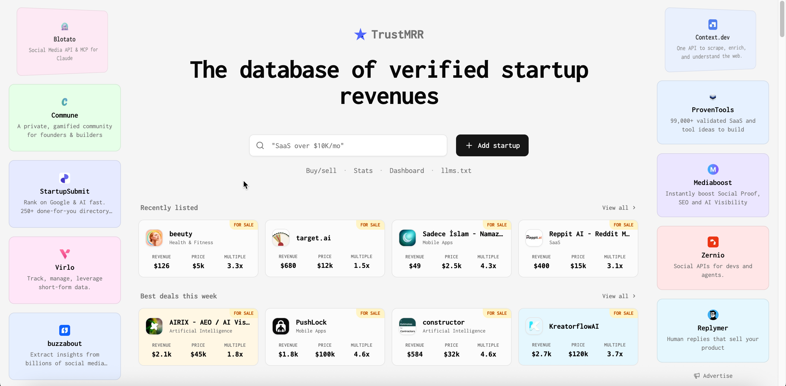

2. Starter Story

与 TrustMRR 类似，也可以看到应用的营业额。

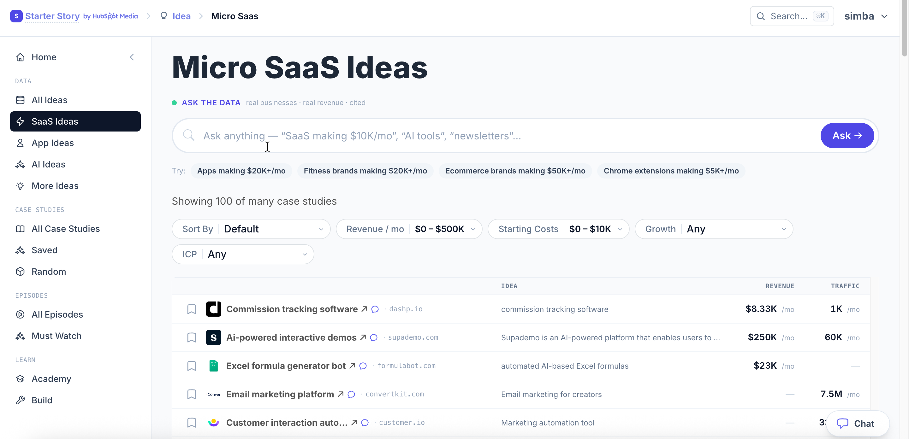

3. 七麦数据。

2013 年创新工场孵化的项目，主要监测移动端的 App 数据，比如前文提到的训记 App 数据，就是从这里获得的。

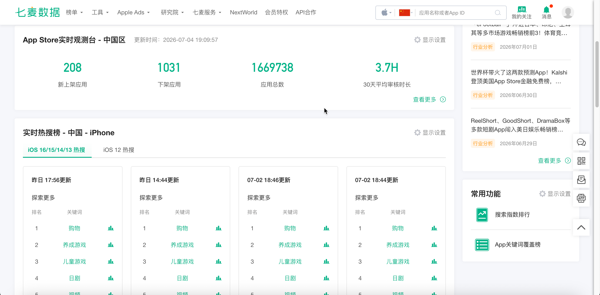

4. Sensor Tower。

可以追踪 App 的数据，但是免费版能看到的数据较少，供你参考。

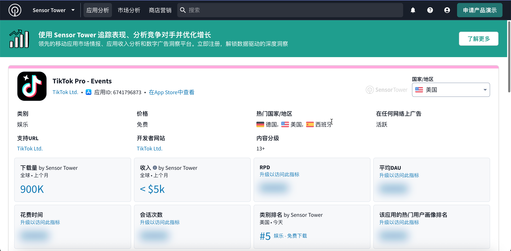

看这类网站多了之后，你就能慢慢训练自己识别出哪些需求有清晰付费人群。除此之外，我也推荐你时不时的像逛街一样去看看以下这些网站。

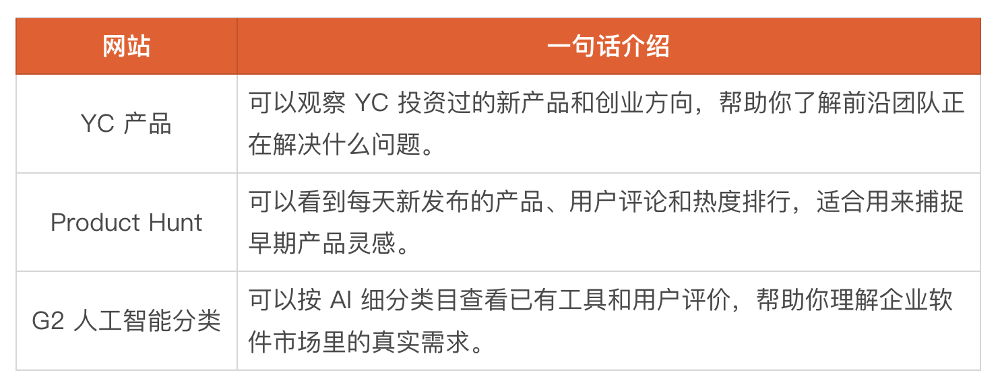

注：YC 产品、Product Hunt、G2 人工智能分类 链接

虽然这几个网站并不能体现付费诉求，但你可以从评论区，或者产品介绍中汲取养分，让自己在“随机漫步”中，产生灵感。

好，讲完了别人需要的，最后我们再聊一聊：到底要不要追随热点的问题。

## 跟风做热点，且热度过后仍然长期存在

我并不反对跟热点。不过你需要识别热点是一个事件，还是代表一种趋势。

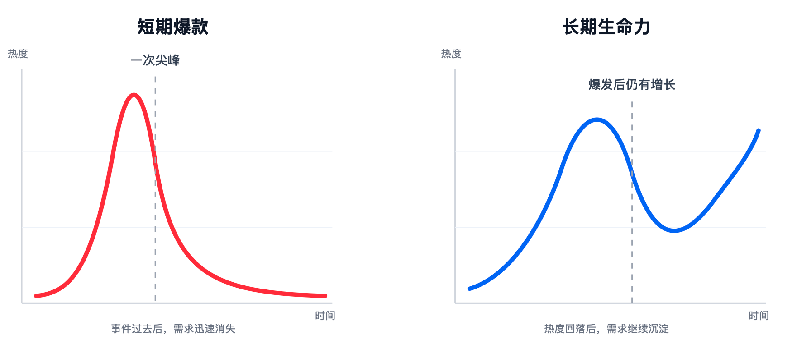

如果一直做事件性热点产品，每一次热点过后价值归零，是没有复利效应的，并且维持时间非常短，短到你还没做出来产品热点就已经过去了；而如果你做的是趋势性热点，热点过后确实会有回落，但接下来会进入正常成长期，就会有复利效应。

事件性热点是指事件本身不会对行业产生深远影响，比如 Claude Code 代码泄露，或者近期由于 Claude 通过极致手段禁止中国用户访问，我认为这都是事件。

而趋势性热点会对 AI 行业产生深远影响，比如 OpenClaw/Hermes 提供的开源框架，与之前的 Dify、LangGraph 这类静态工作流框架相比，让 Agent 的能力跨上了新的台阶；又比如Skills 作为一种标准，还远远没有渗透到各行各业，也是一种趋势。

也就是说，趋势性热点一般是抽象的，适用场景很广的；而事件性热点是非常具体的。

我们可以把上述的几个例子拉到 Google 趋势里来验证一下，就能清晰地看到 OpenClaw/Hermes /Agent Skills 的生命周期要长很多，虽然有短暂的下落期，但它的框架已经被行业使用，具有长期价值。

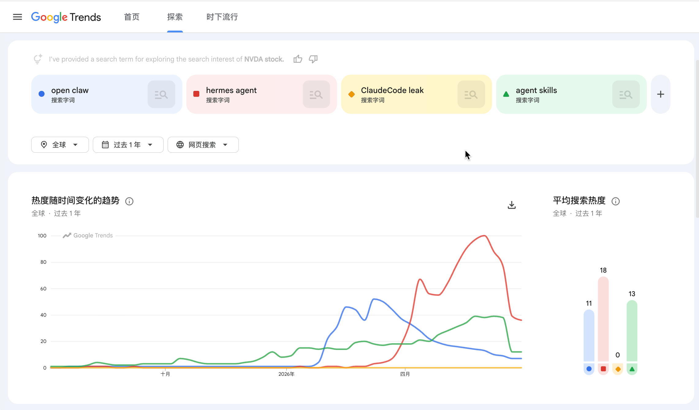

所以，对热点我的建议是：可以借势，但不要把产品根基建在一次性事件上，长期趋势才适合做你的资产。

如果你持续不断地通过以上三种方法广泛吸收，你大概率会找到合适的切入点。找到这个切入点之后，接下来就用最小成本去验证它。

## 最后，用最小验证把方向落地

验证的方式有非常多，你可以做一个在线的小应用，比如上节课的插件。除此之外还可以有以下几种方式：

1. 不发布产品，只在社交媒体或论坛上发效果展示。注意不是 Demo，是面向用户的效果展示。避免写成类似：“我用 Codex 半小时完成了 xxx”。这是开发或产品经理经常容易写的汇报体或炫耀体。但大家可以想想：你的受众是否关心你花了几小时？他们会因为崇拜你，而购买你的产品吗？所以，我更推荐以下标题，它们更加贴近用户诉求，比如：

- 1.翻译类软件可以写：完整保留翻译排版，太爱了

- 2.健身类软件可以写：重拾健身，你可以这样做计划

- 3.动画类产品可以写：如何做出活人感的动画

2. 先只做服务交付方，不做研发。类似上述我朋友提供翻译服务的方式。

3. 先依托垂直流量的平台做一个产品展示页，比如一些众筹网站，让感兴趣的用户留下联系方式。

这些方式中，最有价值的信号是：

- 是否有人愿意付费？

- 是否有人愿意留下联系方式？

- 是否有人愿意上传自己的材料？

这些需要用户花成本来完成，成本越高，则真需求的可能性越大。

## 总结

到这里，我就把找真需求的方法讲完了，尽管这一步我们还没有开始动手 coding，但对最后的结果至关重要，甚至是最重要的一步。

我们来总结一下今天讲三种方法：

- 第一，做自己需要的，且会反复、长期需要的；可以从自身出发，结合 Semrush、Ahrefs、Google 里的关键词分析得出市场空间和竞争格局，来确定要不要做。

- 第二，做别人需要的，且会真实付费买单的；我们通过几个体现真实付费数据的网站，可以调研出用户会为什么样的产品买单。

- 第三，跟风做热点，且热度过后仍然长期存在；我们通过区分抽象的趋势性热点还是具体的事件性热点，来判断热点是否值得做。

最后我们也简单讲述了几种验证需求的方式。

看完这一套方法后，你可以按照这个思路在日常生活中广泛涉猎。因为寻找需求不像是一次目的明确的旅程，而是在轻松的随机漫步中收获的惊喜与灵光一现。一旦你完成了这一步，那么接下来的商业路径就会清晰许多。

当然，你也需要做好心理准备，第一次的商业化之路总是充满艰辛与迷茫，尤其是初期你根本无法收集到足够的样本反馈。如果是这样，你不妨选择一个你眼下最看好的点子做起来，跟着我继续往前探索到下一讲，看看如何让这个点子被看见，让你收集到更多的样本反馈。

## 课后题

在 TrustMRR 找一个你喜欢的产品，拆解出关键词，在 Semrush、Ahrefs、Google 里分析这些关键词，并做竞品研究，看看这个产品是如何打出差异化的，如果是你做这个产品，你会怎么做呢？

欢迎你在留言区和我交流。如果觉得有所收获，也可以把课程分享给更多的朋友一起学习。我们下节课见！
