# 18 | 被看见：AI时代的流量逻辑GEO

你好，我是产品二姐。

上一讲我们找到了需求，在结尾我留了个问题：

- 在商业化初期，产品可能会因为不被人看到而无法收集足够的样本反馈。这一讲我们就着重讲讲怎么被看到这个问题。

如果你是独立开发者，那么你一定要做自媒体，让别人看到你的产品。你可以参考《成为 AGI产品经理》中的第 20 讲，来看我做自媒体的心得。当然，除了自媒体之外，你需要通过内容来赢得搜索引擎，以及像 ChatGPT/ 豆包这类 AI 问答工具的流量，我们称之为 GEO。

如果你还在职场，那么你需要配合市场部门的同事，为产品官网做好 GEO。2026 年 6 月 24号 arxiv 上发表了一篇论文，标题是《大语言模型如何在不同语言和市场中获取品牌声誉信息》，论文里研究者分析了 128 个品牌、12 个本土市场、13 种语言和 167551 条 URL 引用。

他们发现 AI 在回答品牌相关问题时，只有 14.3% 的引用来自品牌自有站点，85.7% 来自第三方站点。这说明官网 GEO 建设在 AI 时代还有很大提升空间，抢先做好品牌官网的 GEO 建设，很可能会拿到事半功倍的效果。

所以在这一讲，在众多“被看见”的方法里，我们就聚焦这个重要且未来会爆发更大潜能的方法——GEO。这个概念在前面的课程中多次提到，今天我将全面、系统地讲解。我会分享两部分：

1. GEO 的本质，以及它和 SEO 的关系，理解这一层才能在后面的方法中活学活用。

2. GEO 的方法，我会借用一组 skill 将 GEO 方法总结为三步，依次是满足基本技术要求、构建面向 AI 友好的内容、打造外部声誉，我会给你三张表供你后期参考。

学完之后你就可以从 GEO 角度对产品内容、品牌官网等做出基础诊断，并采用合理的方式解决，提升产品在 AI 问答工具中的被引用率。

接下来让我们开始吧。

## GEO/SEO 的本质

如第 16 讲所说，GEO 的本质就是让 AI 工具引用你的内容。而为了让 AI 引用，首先需要被搜索引擎搜到，也就是 SEO。因此 GEO 的出现绝不意味着 SEO 过时了，而是更重要了。接下来让我们首先理解这二者的本质，之后再看具体的操作方法就水到渠成了。

SEO 的本质是方便搜索引擎找到你。那么搜索引擎是怎么找内容的呢？我们以 Google 为例说明。

第一步：发现内容。Google 每天都会主动爬虫，发现大量网页内容，当然，开发者也可以主动把页面提交给 Google，告诉 Google：“嗨，我这里有个新内容，快来看看吧”。比如下图中，你可以在 Google Search Console 中输入一个网页，如果显示网址尚未收录，就可以点击请求编入索引。

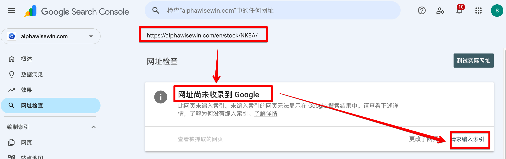

第二步：收录内容。当 Google 发现这是个有效网页后，就会扫描其中的内容，记录这个网页是关于什么的，关键词是什么，这些属性会被 Google 记录到自己的库里。不过这些属性可并不是 Google 使用大语言模型读懂后得出的，而是由开发者遵循 Google 的格式标准放在网站上的，比如网页源码中的 metadata，这些属性也可以通过 Chrome 插件 AI TDK 很方便地看到。因此 SEO 的第一步，就是让每个网页的属性都遵照这些标准来写。

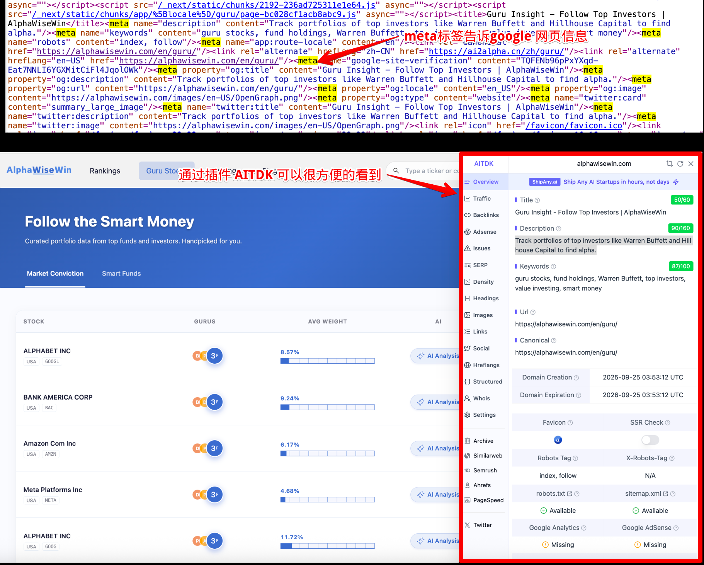

当网页（涵盖网页描述信息）被 Google 收录后，你的内容就有可能出现在搜索结果中了。

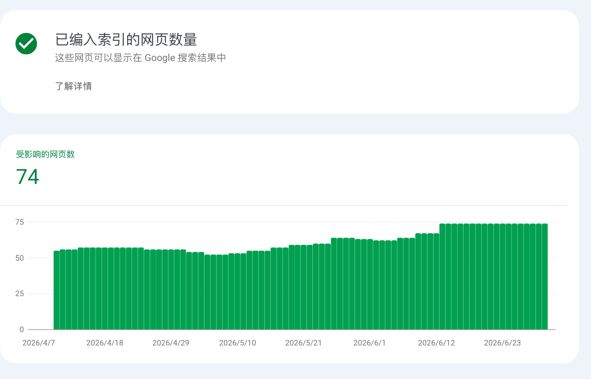

第三步：优中选优。Google 要把最优质的内容呈现给用户。它的判断标准有两个：

- 一是你的内容匹配用户诉求；

- 二是有高质量的内容引用了你的内容。在 SEO 分析工具 Semrush 中，我们可以看到内容被哪些网站引用了，这些网站的权威分数（Authority Score）越高，Google 会认为你的内容越好。

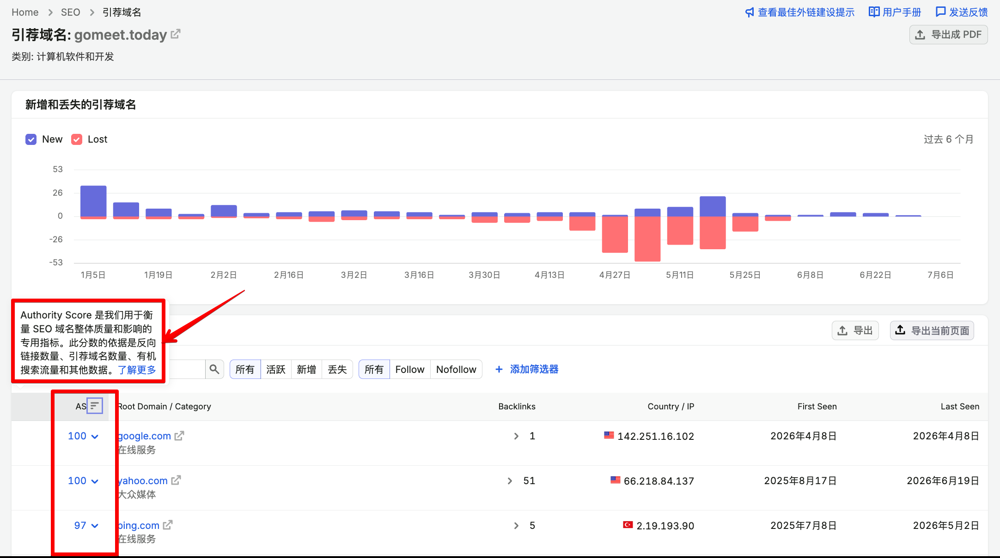

对应着搜索引擎的这三步，我们就不难得出 SEO 的目标，也是三条：

1. 让搜索引擎更快、更方便地收集到你的数据：需要你的网页遵循 Google 标准，结构清晰（比如标题明确、段落分明），爬虫能轻松找到核心内容。

2. 让搜索引擎更精准地把你的内容推荐给目标客户：这需要内容围绕目标客户的搜索关键字来做。

3. 让搜索引擎认为你的内容非常优质：这需要你的内容被优质的外部资源引荐，这就是为什么开发者经常要在 Reddit 这类权重高的网站上发帖推荐自己的应用，也有专职领英或者其他平台的编辑来承接这类内容。

最终，SEO 的目标就是让你的内容在你所需要的关键词中排到搜索结果的前 20 名。在这个基础之上，再谈 GEO 才是有效的，可以说 SEO 是初选赛，GEO 是复选赛。

到了复选赛，目的就是让你的内容被 AI 所引用。核心需要做到三点：

- 第一点：你的内容更适合 AI 阅读。在这里，渐进式披露的思想同样适用，也就是你的内容能像优秀 Skill 的写作那样有直白的标题与 Description 以及清晰的结构。当然，你也不妨参考极客时间课程的内容结构：分为鱼头、鱼身、鱼尾。鱼头预告全文会讲什么，讲完之后能

- 做到什么；鱼身结构清晰，按照预告脉络娓娓道来；鱼尾回顾总结，上升高度；同时你要避免结构不清晰，避免使用晦涩、模棱两可的语言。

- 第二点：你的内容匹配目标用户的问题。这里和 SEO 匹配关键词略有不同，可以更明确地把内容围绕目标用户的问题展开。比如 SEO 要求内容匹配“nvda 股票”这个关键词，而GEO 需要匹配的是“nvda 股票值不值得买？”“nvda 股票目前的估值如何？”这类问题。比如在下面这个网页中，就留出了专门的 FAQ 部分，来精准匹配到用户可能在 AI 工具里遇到的问题。

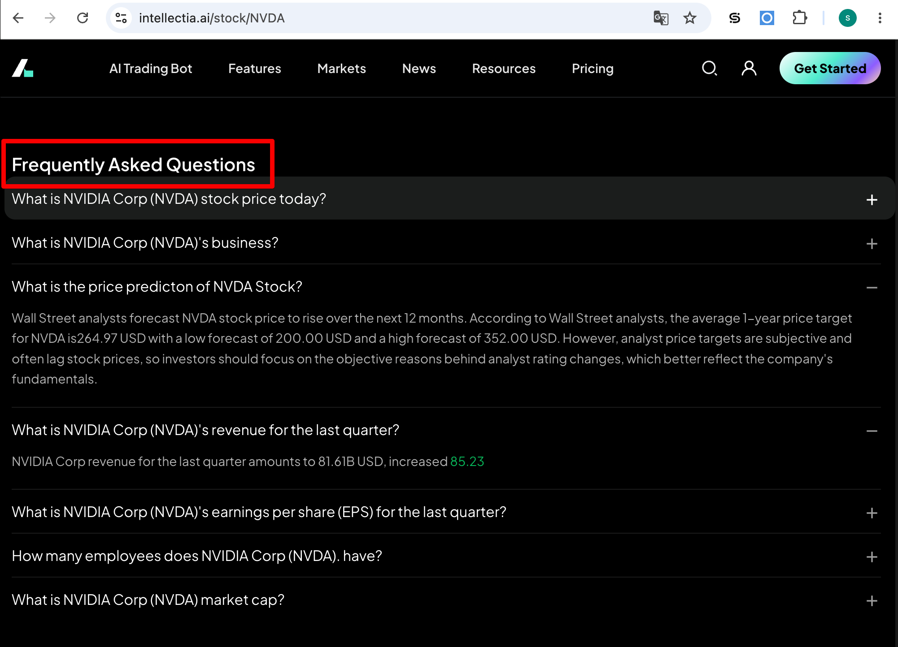

第三：你的内容是否可信。这一点很难通过短期技巧改进，我们只能通过不断地重复 SEO 和上述的 GEO 技巧，来积累权威指数。比如在 Semrush 里，可以看到，同样是股票类应用，即使满足了上述的 SEO/GEO 要求，Yahoo 财经、Nasdaq 这类权威网站的 AI 可见率依然会明显高于同类网站。

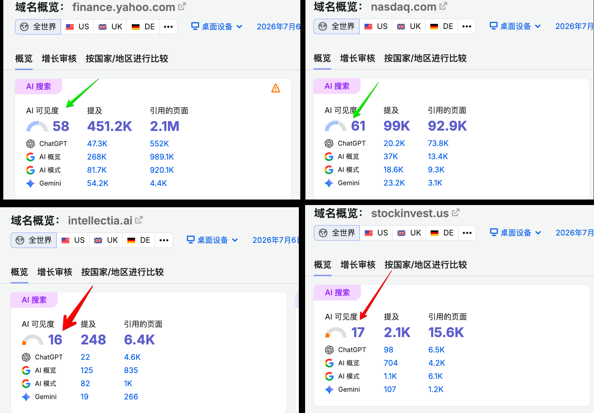

最后我们来看一组 GEO 做得好与不好的对比案例，感受更直观。

你可以在浏览器安装 AI TDK 这个 GEO 插件来观察，下图上方是全球某知名品牌的官网，网页结构不清晰，重要信息缺失，连最基本的 SEO 都没有做到，下方是宜家的官网，不管是对于 SEO，还是 GEO，都是极其友好的，尤其是它非常详实地展示了页面结构，并给出类似“选购 PAX 帕克思衣柜应该考虑什么”这类问题。

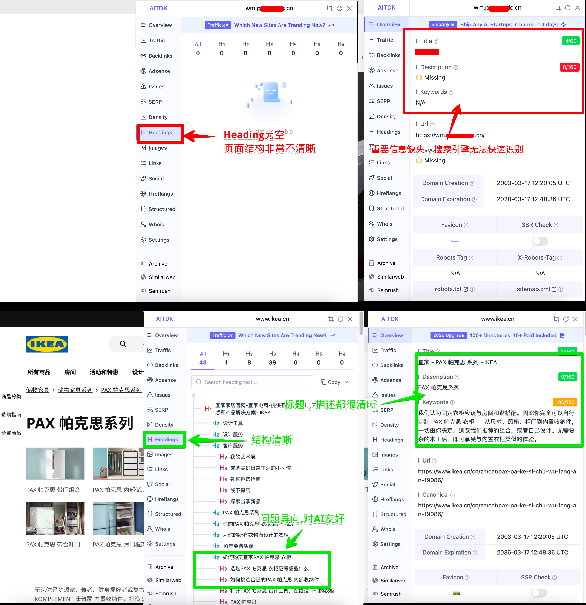

接下来让我们来做个实验，看看同样是国际大品牌，在豆包里搜索会有什么表现。我们在两次对话中分别输入以下两个问题：

- < 某品牌 > 洗衣机怎么选

- 宜家 PAX 帕克思怎么选

你会发现宜家官网的引用率要远高于松下官网，前五名引用的文章中四个都来自宜家官网；而对于松下，只有第一个网页来自松下官网，而且当我打开这个页面时，竟然是 404。豆包把松下官网排在第一，说明豆包在用户指定品牌时，会给官网非常高的权重，但因为内容不好，松下官网白白浪费了消费者品牌触达的机会，真的是非常可惜。

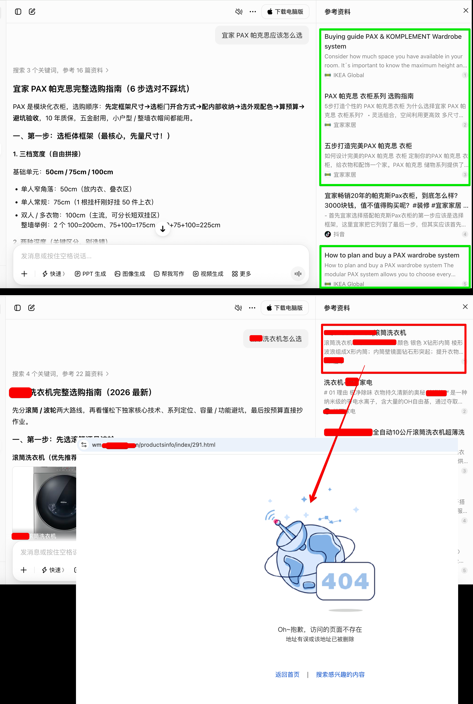

相信到这里，你应该理解了 SEO 和 GEO 的关系与本质，以及我们为什么要做 SEO、GEO。那么具体怎么操作呢？

## 如何做 GEO？

这里我借用一组开源的 GEO skills 完成对 GEO 实操方法的学习。你可以在本地安装这组skill，然后直接在 Codex 里问“这组 GEO skill 可以做什么”，不断追问，直到你完全理解为止。在这里我只做简单概括，按照 GEO 的要求我把方法同样也分成三部分：

- 第一层技术层：让 AI 爬虫能访问、能读取、能索引；

- 第二内容层：让 AI 能摘录、能引用、能回答问题；

- 第三外部声誉层：让 AI 相信你是一个真实、可信、被讨论的品牌。

1. 网站技术层：让 AI 爬虫能访问、能读取、能索引

这一层，如果你选对框架，事半功倍。你可以直接采用支持 SSR（即 Server-SideRendering，服务端渲染）的前端框架，比如 Next.js 来开发。服务端渲染是指用户打开网页后，无需在用户本地渲染，搜索引擎无需等待即可爬取页面内容。

除此之外就包括以下诉求，里面涉及到一些字段名称你不要发怵，它只是搜索引擎约定的标签名而已，你可以结合做这件事的目的来理解。

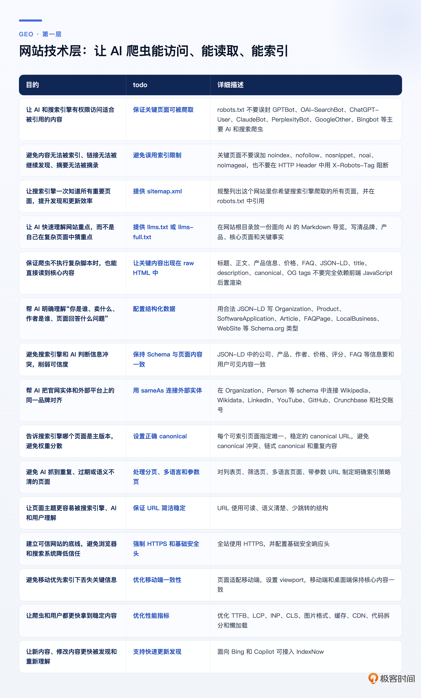

2. 内容结构层：让 AI 能摘录、能引用、能回答问题

具体来说，GEO 要求内容满足以下条件。

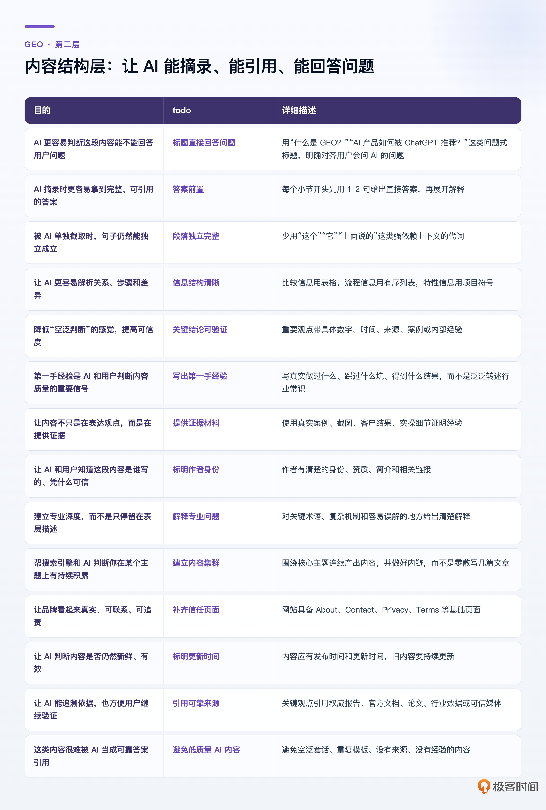

3. 外部信号层：让 AI 相信你是一个真实、可信、被讨论的品牌

刚刚提到可信度依赖于权威分数，官网本身自带品牌权威性，除此之外，在外部平台比如小红书、Reddit、YouTube、B 站等构建自己的品牌账号也是提高权威的方式。

所以 GEO 的第三层，是建立外部可信度。你可以从这些地方开始。

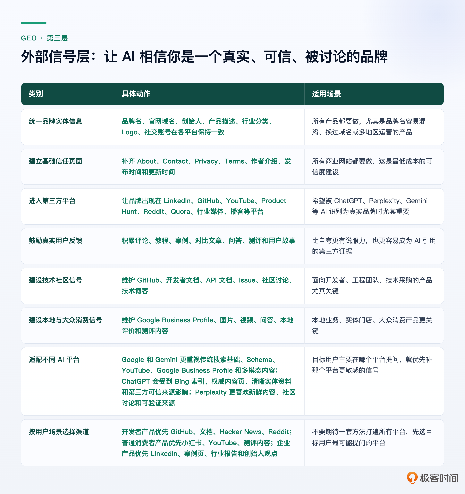

最后我再把前面所有的内容总结为一张 GEO 检查表，供你参考。

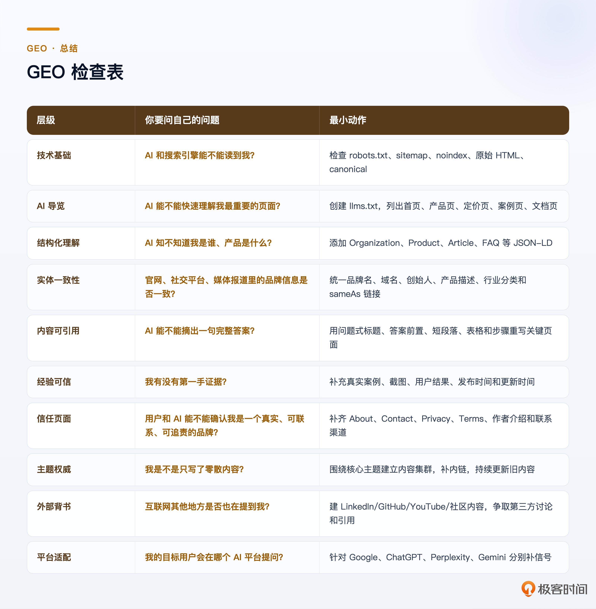

## 总结

这一讲我们讲了 AI 时代的流量逻辑：被看见，不再只是被用户刷到，也包括被 AI 答案引用。但 GEO 并不是一个短期流量技巧，而是一种新的必备的产品基础设施。因为未来不止有豆包、ChatGPT，每个平台都可能长出自己的 AI 搜索和 AI 推荐入口，比如小红书的点点，微信的搜一搜。

GEO 的出现看似为流量入口增加了一轮复赛，加大了难度，但也创造了新的机会：原来排在10 名之后的内容，通过更 AI 友好的内容，会更容易被 AI 问答工具所引用，从而提高品牌的触达率。

在具体做法上，我们拆成三层：

- 第一层是技术基础，保证你的内容能被爬取、索引、解析。

- 第二层是内容可引用，把产品营销内容写成 AI 能摘录的答案。

- 第三层是外部信号，让更多可信平台共同证明你是谁、你解决什么问题、你是否值得推荐。

现在我们已经看到了清晰的路径，其中第一步是纯技术层，而第二步就是内容建设了，我们能否利用 AI 来协助完成内容建设这一步呢？答案是可以的。

下一讲，我们就通过 Codex + Skills 工作流搭建一套营销内容生产工具，利用 AI 生产出高质量、AI 友好的内容。

## 课后题

选择你自己的产品，或者你的竞争对手，加上品牌名称分别问 DeepSeek、Gemini、豆包，记录有哪些网页被引用了，被引用的网页是否优质，你是否有可能做得比它更好？

然后用今天这张 GEO 检查表做一次自查，看看你现在最缺的是技术基础、内容可引用，还是外部可信信号？

欢迎你在留言区和我交流。如果觉得有所收获，也可以把课程分享给更多的朋友一起学习。

我们下节课见！
