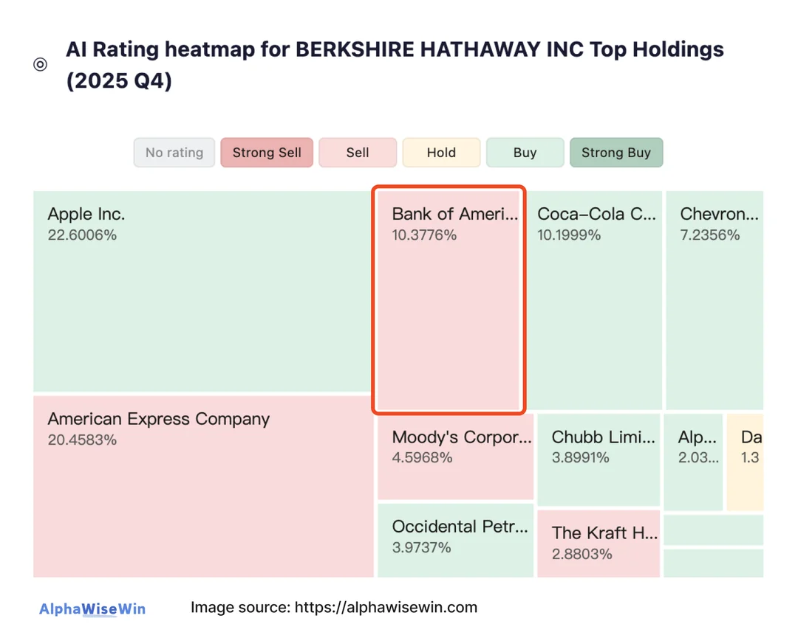
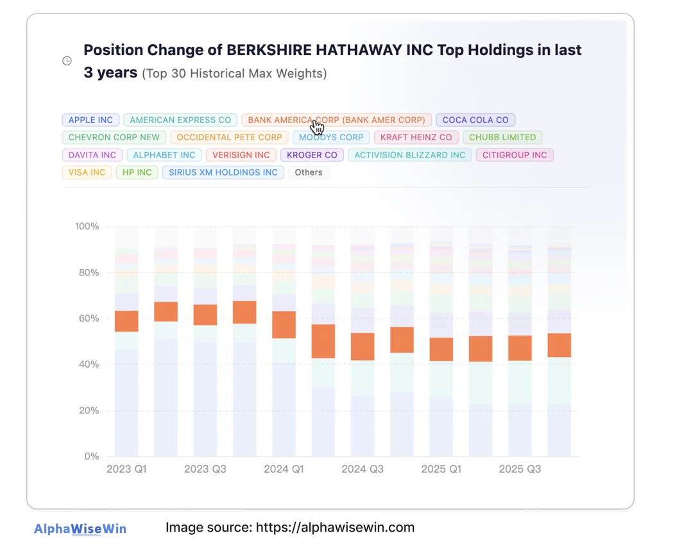
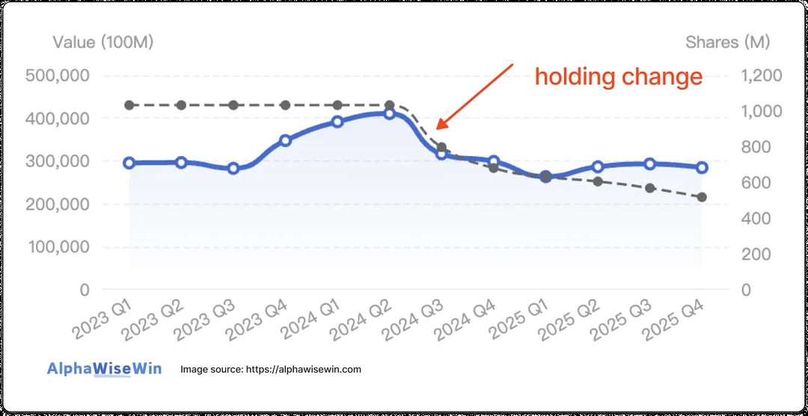
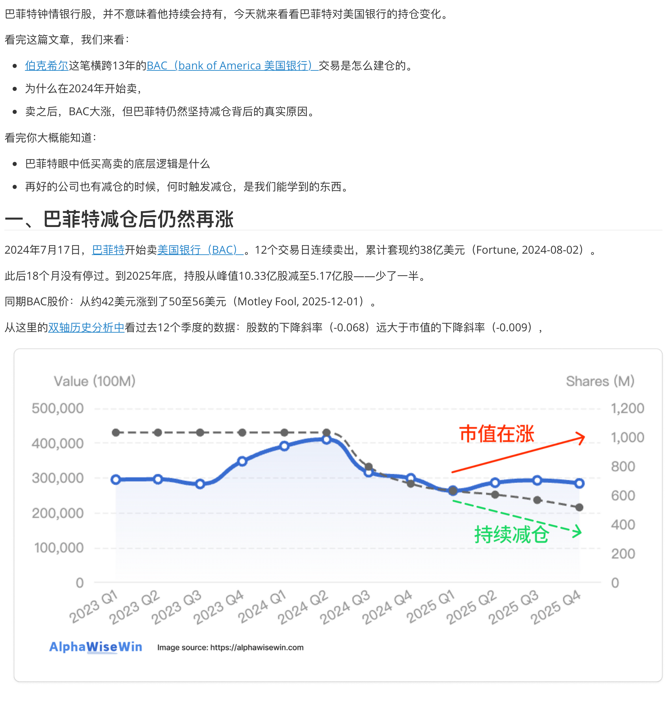
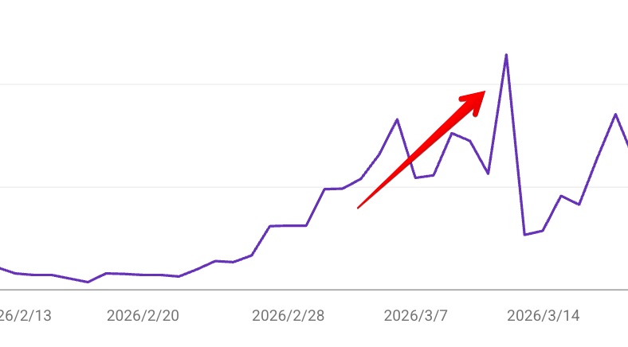
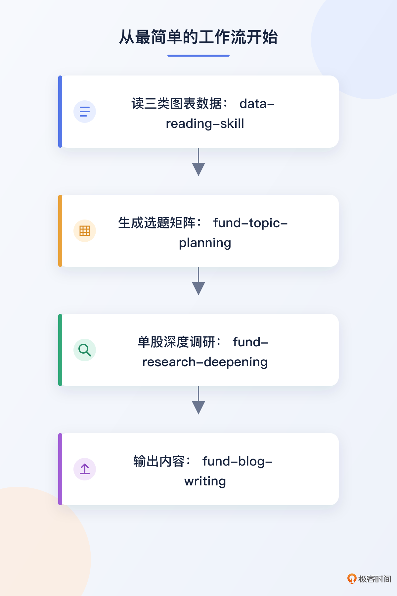
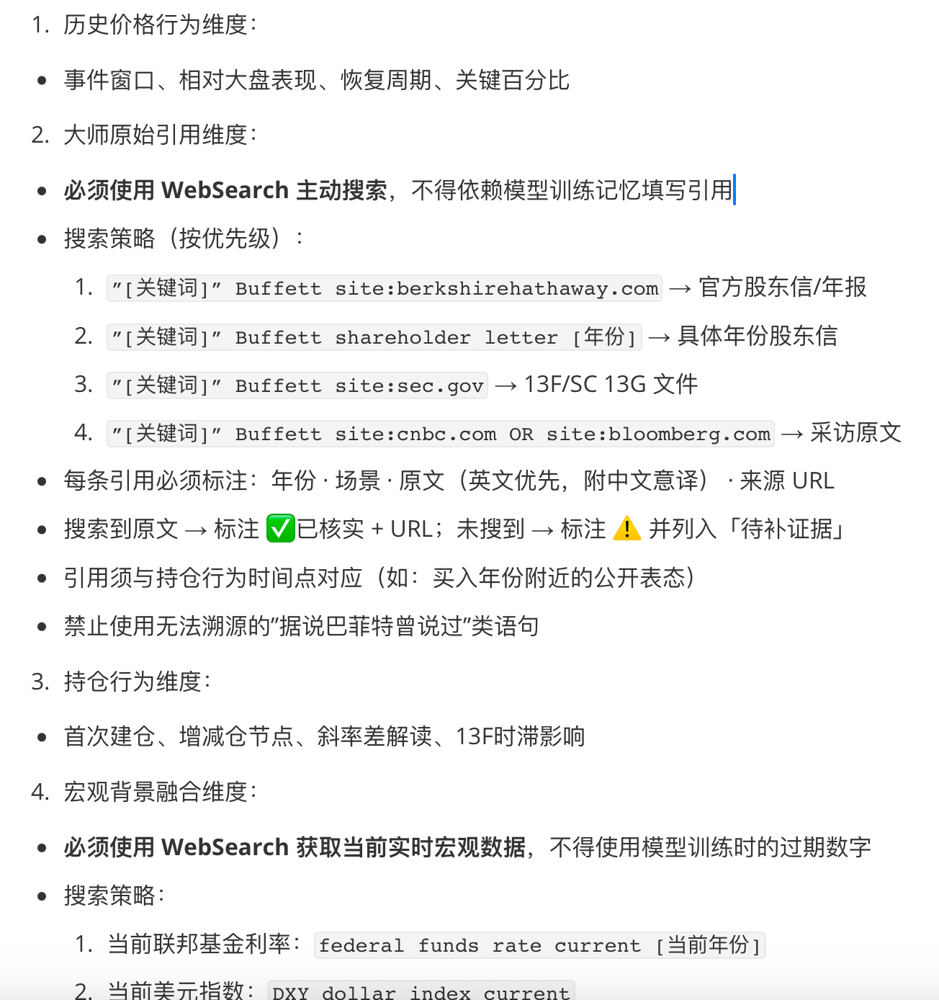
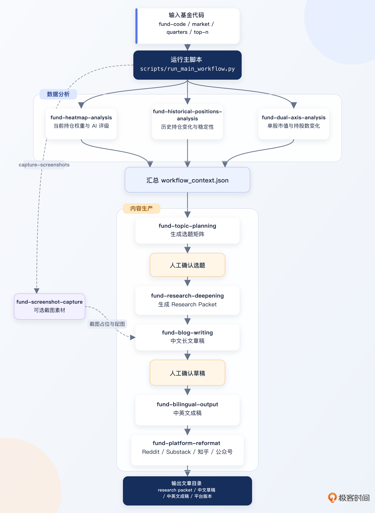

# 19 | 吸引Ta：用Skills工作流创作用户喜爱的内容

你好，我是产品二姐。

上一讲我们讲了 GEO，GEO 的第一层是技术基础，可以用代码解决。第二层是内容可引用，这需要持续的内容运营。二者最大的区别是：技术是围绕 AI 问答工具的要求展开的，而内容运营首先是创作用户喜欢的东西，其次才是面向 AI 友好的，大家千万不能舍本逐末。

明白这一原则之后，这节课我们来看如何借助 AI 提升内容创作的效率。我会讲两件事：

- 什么情况下，你需要使用 AI Skills 工作流来做内容的规模化生产。

- 如何来打造你的 Skills 工作流。

我会以 AlphaWiseWin 为案例，详细讲述以上两点。

你可能会问：为什么用 Skills 搭建工作流，而不是用 Coze、Dify 呢？它们之间最大的区别是，Agent Skill 的工作流可以用自然语言执行并完成进化。比如你可以用自然语言告诉他：这次执行流程时只需要跑第三到第五步；又比如当你觉得某一步的 Skill 不够好时，直接告诉Agent “帮我在这里改进这个 Skill”。

但用 Skill 搭建工作流，非常依赖一个能驾驭好 Skill 的 Agent（比如 Claude Code），在这一点上 Coze、Dify 的固定工作流就不必如此。而正是因为 Skill 工作流的灵活，所以它能在内容创作这个领域发挥长处。

这一讲学完之后，你能够初步为自己的产品做内容选题设计，并使用 Skills 工作流进行规模化的内容创作，写出用户喜爱的内容，进而提升产品流量。

接下来让我们开始吧。

## 面向用户构建内容选题矩阵

如果你做好了一个产品，想推广给你的目标客户，什么样的内容才能吸引他呢？

很多人陷入的误区是：夸奖我的产品多么多么好。但实际上，在你的产品尚未形成心智和品牌效应时，这样的宣传只能拉大你和用户的距离，这也是我曾经犯的错误。

此时，最有效的吸引客户的方式是：

- 把你的产品放在场景中，解决用户的实际问题。你可以想象一下，宜家的收纳小件放在衣柜这个场景里，和单独摆出来售卖，哪个效果更好？

- 让客户知道他的竞争对手、同行也在用你的产品。比如海尔看到美的电器用了你的产品，肯定会第一时间过来咨询你。因为同行和竞争对手是它最值得参考的标的。

这样，场景 x 同行的案例，就可以形成你的内容营销矩阵，还记得 15 讲的案例《内容驱动搭建 book2skills》里的矩阵吗？在内容营销上，你同样需要找到这种矩阵。只有形成了矩阵，你才有必要搭建一套 AI Skills 的工作流来完成规模化的内容生产。

反之，如果你的内容本身没有矩阵支撑，那就不适合。因为一个成熟的 AI 工作流需要靠同系列、但不同素材的持续打磨。如果它们不具备规模，还没等你打磨出好的工作流，就把素材用完了。比如我写这门课的初期，曾试着打磨 Skill，但后来放弃了，因为这门课里每一章的形态都不一样：

- 第一章需要大量调研

- 第二章是上手实践

- 第三章是代码解读

- 第四章是实战案例

- 第五章是商业化

每一讲的核心内容，都需要我频繁和 AI 交互，还没等我打磨好 Skill，素材就用完了。最后能抽象出 Skill 的，只有脑暴、大纲、个人风格适配和校对这四个环节。

接下来，我们就以第四章实战产品 AlphaWiseWin 为例，看看我是如何思考出这个矩阵，又是如何搭建内容生产工作流的。

在这里，我同样严肃郑重提醒大家：这个股票分析工具案例仅供学习，不构成投资建议；股票投资是高风险的财富管理方式，绝对不能仅依靠 AI 的判断来操作，请你在学习中时刻牢记这一点。

## 构建 AlphaWiseWin 的选题矩阵

在 AlphaWiseWin 的第一个核心功能——个股分析上线后，这些个股分析本身就是内容：我拿出市场关注的 30 支股票，作为公开内容让 Google 爬取，吸引到了第一批用户，也就是 15 讲所说的，AlphaWiseWin 本身就具备了自运营的能力。

但仅有自己的内容还不够，如上一讲所说，我还需要让更权威的网站来引用 AlphaWiseWin 的网页。这就需要专门为此生产出适合不同第三方平台（比如 Reddit、GitHub、知乎等）发布的内容，而且这些内容需要更丰富，俗称“软文”。

那什么样的内容会更受第三方平台用户的长期喜欢呢？我们观察到：“投资大师”的持仓往往备受关注，于是我们想到了下面这个点子：

- 把“投资大师”的持仓记录放到 AlphaWiseWin 里，作为评判“好公司”的标准，进行选股；然后引导用户使用 AlphaWiseWin 进行个股分析，找到“好价格”，进行交易。

这样，大师（或优质基金） ✖️ 个股就能构成一个矩阵，比如精选 20 支基金，看他的历史前十大重仓，那么就能构成 20 ✖️ 10 = 200 篇内容。有了这个想法驱动后，AlphaWiseWin 上线了大师选股：guruStocks。以巴菲特的伯克希尔哈撒韦基金为例，我们会收集以下数据：

一是当前持仓全景。它告诉我们这个基金现在重仓什么。比如下图中 Bank of America 占仓第三，10%，是重仓股，可以列为重点继续分析。



二是历史持仓变化。它告诉我们这个基金是不是长期持有某些股票，最近有没有明显增持或减持，整体风格是稳定还是频繁换仓。比如下图中 Bank of America 常年持仓稳定。



三是单只股票在这支基金的长期持仓收益变化。比如 Bank of America 在 2024 Q2 前，持仓（灰色虚线）不变，收益（蓝色实线）增加，在之后开始逐步减仓，然而收益在 2025 Q1 后仍有增加。说明大师在这支股票的判断上基本正确，但后期稍有偏差，因为持仓降低了，但收益还在增加，这时候就要深入研究大师减仓的原因，有可能是有更好的替代品，有可能是判断偏差。



有了这三项数据支撑，我们就能以此为出发点，讲出用户感兴趣的故事，比如下图的内容，大家可以去看。而图中内容的链接都指向了 AlphaWiseWin 的网站。这样，当你把内容发表在知乎、Reddit 这类高权重的网站，会增加 Google 对你的好感，如果有好多人通过这个内容链接到你产品站点，那就还会增加产品的好感度。



事实上，在经过两周的持续发布，我确实看到了流量有明显上升。



当你看到这里，应该就对内容矩阵应该如何设计，如何根据矩阵创作内容，有了初步的目标。接下来就让我们看看，上面这篇文章是如何通过 AI Skill 工作流来创作的。

## 如何做 Agent Skill 工作流？

用 AI Skill 搭内容生产工作流，同样按照循序渐进的方式。

第一步：先不着急构建工作流，而是直接使用 Claude 这类顶级 Agent 写内容。这个过程中，我会先把上述三类大师持仓信息发给 Claude，和它一起洞察可以写出什么样的文章，这个过程会花很多轮对话，直到 Claude 写出了你希望看到的内容。然后告诉 Claude：

- 把写文章的过程全部记录下来，观察我们经历了哪些步骤，我在什么节点给了你关键的提示，写出一个流程与操作步骤，后续我会把这个流程固定下来创作出好内容。这一步，我花了几个小时的时间。

第二步：构建粗略的内容生产流程。按照刚刚 Claude 写出来的流程，用最简单的方式，让Claude Code 为流程写一个入口 Skill，以及每个节点写出相应的子 Skill。类似 15 讲案例里提到的，《一本书读懂财报》的 Skill 里也会分主 Skill 和子 Skill。

比如针对 AlphaWiseWin 这个案例，我构建出来的第一版工作流长这个样子。



按照这个要求生成的主 Skill 的内容大概是这样的。

```
....主skill的介绍(略)
## Workflow
1. 运行数据解读`data-reading` skill，生成结构化分析结果。
2. 汇总为 `workflow_context.json`，作为内容阶段统一输入。
3. 用 `fund-topic-planning`（LLM直出）产出选题矩阵。
4. 用 `fund-research-deepening`（LLM直出）产出研究包（仅针对用户选定的选题）。
5. 用 `fund-blog-writing`（LLM直出）产出中文长文草稿（含截图占位）。
```

第三步：依次人工评测每个子 Skill 的能力并改进。

如果发现某个子 Skill 内容太多，就拆开来；如果某个子 Skill 不好用，就改提示词、改输入、改输出；如此反复，直到所有的节点都能稳定发挥为止。在这里，我把最终形成的 Skill 变化列出来供大家参考。

1. 把“读三类图表数据”拆成三个子 Skill：

- 持仓全景分析 Skill

- 历史持仓分析 Skill

- 单股双轴分析 Skill

```
选题计划的 Skill fund-topic-planning，为了要从数据中洞察出那些更吸引读者的选
```

- 题。经过反复迭代后，我和 AI 把这些选题原则从 5 个扩充为下面的 11 个原则。

- 从历史持仓与双轴数据中提取反直觉、吸引人或者是能引起共鸣的点：

```
- 大仓位 + 连续大幅减仓（操作节点）
- 持仓不动但市值持续萎缩
- 持仓不动但市值持续增长
- 增持但市值反跌（越买越亏）
- 市值一直在跌（与多数人共鸣）
- 减仓但市值跌幅小于减仓幅度（卖在高位）
- 新进/退出持仓（稀有信号）
- 核心仓位高度集中或长期稳定
- 相似股票却完全不一样的操作方法
- 相似股票却完全不一样的收益
- 相似股票持续使用同一种方法获得收益
单股深度调研这个 Skill：fund-research-deepening，严格规定了每一项调研都必须
```

- 使用 WebSearch 主动搜索，并且任何结论都要有出处。



```
写博客的这个 Skill （fund-blog-writing） 里增加了 GEO 友好的内容要求：结论写在
```

- 开头，内容结构完整、清晰。

```
增加了适配不同内容平台的 Skill fund-platform-reformat，将成稿改写为 Reddit /
```

- Substack / 知乎 / 公众号四个平台版本。

最终形成了如下工作流，并且每个 Skill 都距离最开始的版本有很大变化。



完成上述这个 Skill 工作流，我大概花了三天时间，并且还在持续迭代。听到这个时长，我想你应该理解为什么只有可规模化的内容矩阵才值得打造 Skills 工作流了吧。

## 总结

到这里我想大家能初步体会出，打造 AI Skill 工作流并不难，更多是有耐心与 AI 打磨。而我们需要为内容创作打造一个 AI Skills 工作流时，也必须满足两个要素：一是你需要设计一个内容矩阵，形成规模化效应；二是你要有良好的品味，知道用户喜欢什么样的内容，才能调教好Skill。

今天的内容创作侧重于文字，如果你想要做图片、视频类创作，这两个要素仍然重要。在这个过程中，你也需要使用多模态生成工具来帮助你完成。在这里我要特别提一下，目前视频、图片内容对 AI 问答工具来说不如文字友好，所以你需要在视频、图片创作完成后，在平台加上必要的文字说明，以增强 AI 问答工具对你内容的理解。

不过，当你的内容吸引到用户，并不意味着 ta 会马上购买，在营销理论里有一句话是：每次成单的背后会有 7 次用户触达，这意味着吸引——并且持续吸引，才能走到商业化促进成单的最后一步——购买。

下一讲，我们就进入最后一步：如何踢进商业化的临门一脚。无论是 to C 还是 to B，无论是职场人还是个人开发者，都有不一样的策略。

## 课后题

选择你自己的产品，或者一个你熟悉的产品，设计一个内容营销矩阵。

请你写清楚三点：

- 你的目标用户是谁；

- 你准备用哪两个维度组成内容矩阵，比如场景 × 行业、用户角色 × 痛点、案例 × 功能；

- 这个矩阵能否持续生产至少 30 篇内容，如果不能，说明它为什么不适合做成 Skill 工作流。

然后从这个矩阵里选出 3 个题目，判断哪一个最适合作为第一篇样稿。

欢迎你在留言区和我交流。如果觉得有所收获，也可以把课程分享给更多的朋友一起学习。

我们下节课见！
