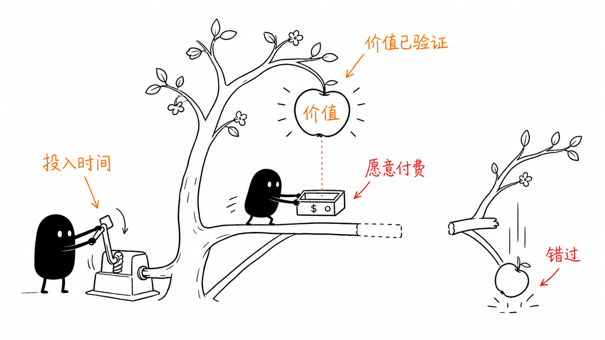
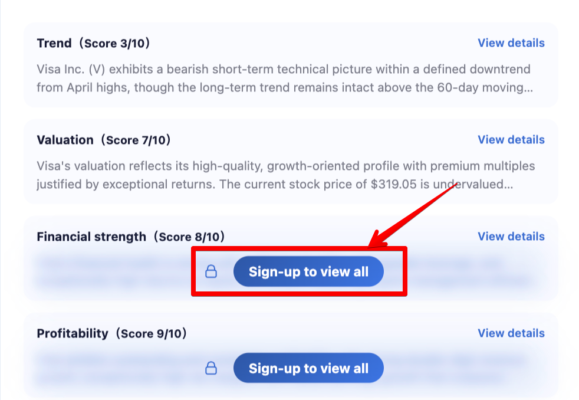
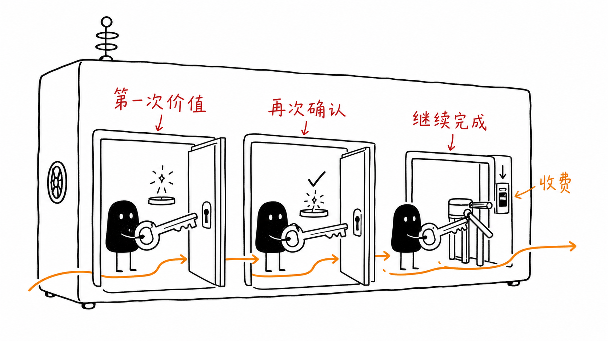
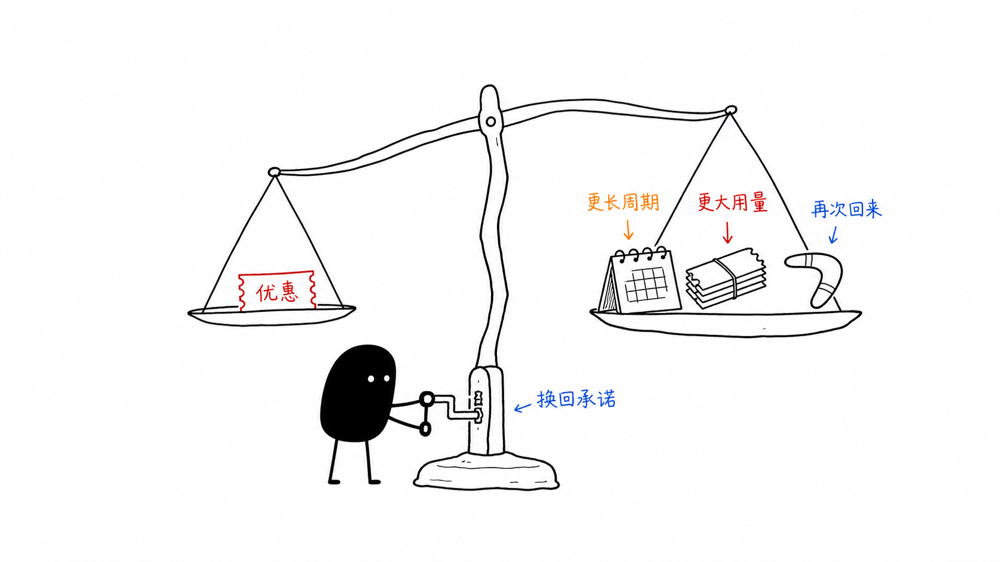
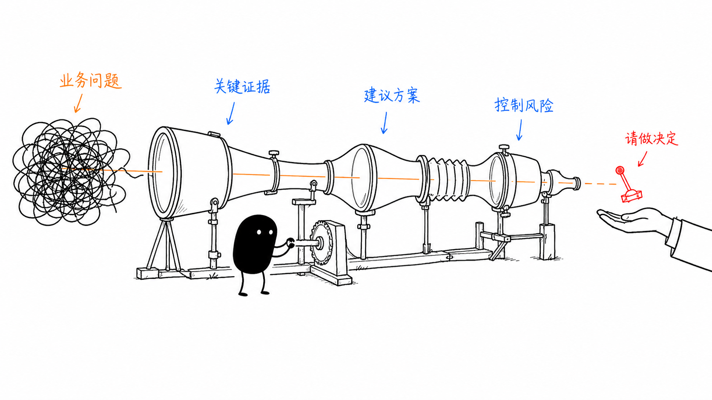
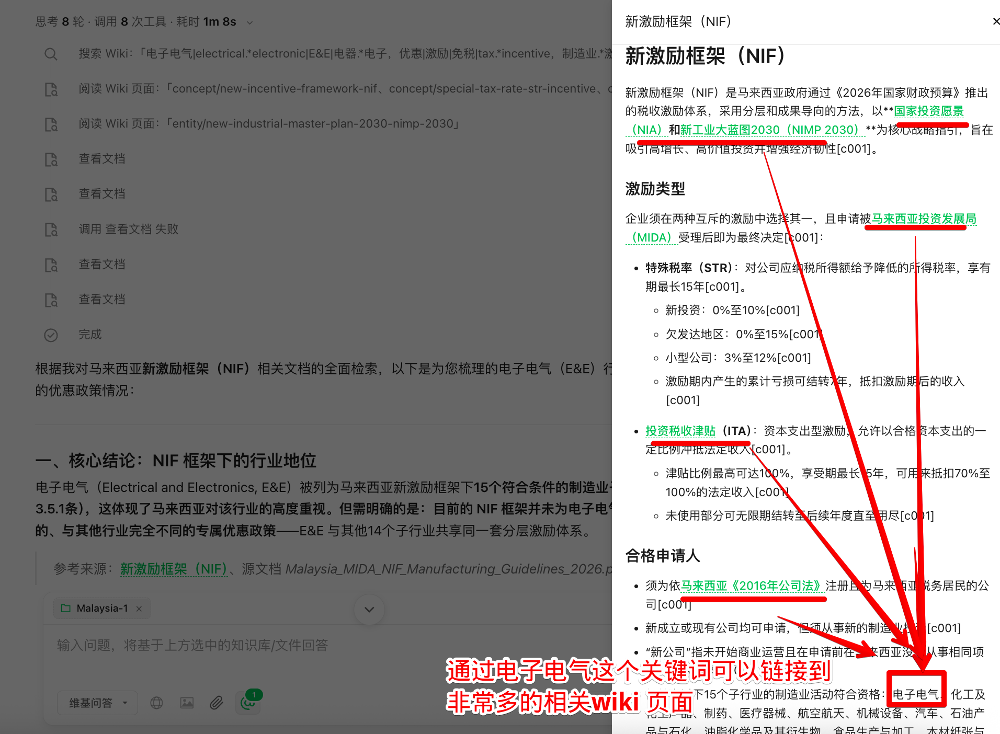
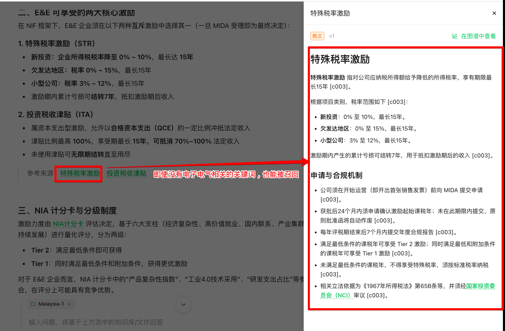
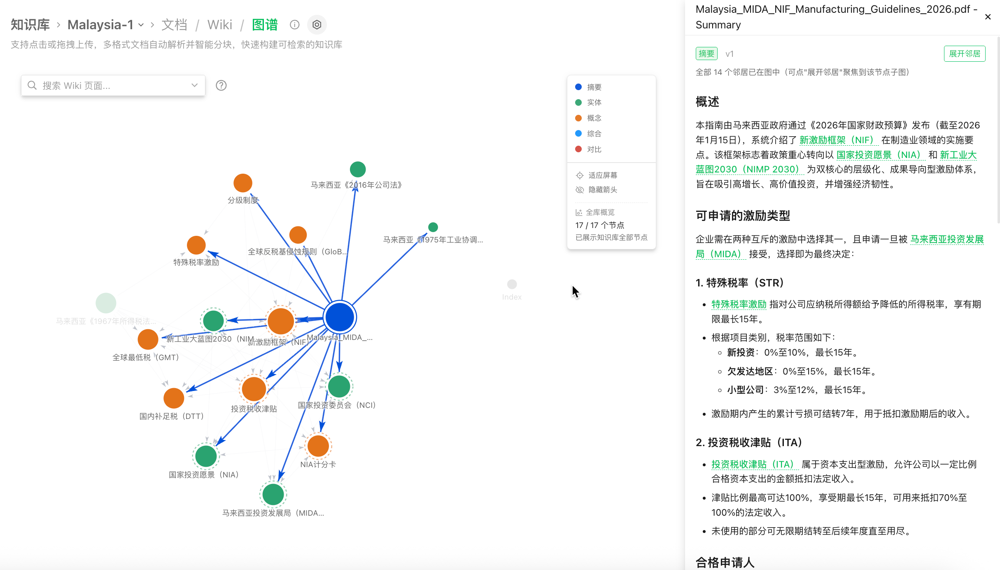
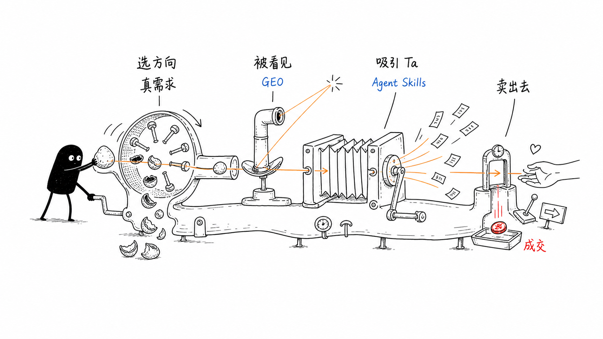

# 20 | 卖出去：AI产品的成单机会与面客表达

你好，我是产品二姐。

上一讲我们讲了如何用 Skills 工作流创作用户喜爱的内容，把产品推到更多潜在用户面前。但用户看到了，不等于会买；老板听到了，也不等于会给资源；客户看完 Demo，也不等于会签单。

这就像踢球，前面带球、传球、跑位都做得不错，最后临门一脚却踢偏了。对不同的情景来说，这一脚会发生在两个地方，这也是这一讲的重点内容：

- 如果你是个人开发者，或者职场中负责商业化的产品经理，通常是要把标准化的 SaaS 产品卖出去。那么你需要抓住用户最愿意付费的时刻，我会讲如何在产品中设置注册时刻、付费时刻、如何定价、促销。这里的重点不是做出有价值的产品，而是在传达价值后，不要错过那些用户付费的机会。

- 如果你是职场产品经理，你需要面向管理层 / 客户，把 AI 产品方案讲得有理有据，说服他为此安排资源，或者付费。我会用一个出海投资专家 Agent 的案例，拆解如何从业务问题、关键证据、建议方案、风险控制到资源诉求，完整讲清楚如何向上，或者面向客户要到资源或争取客户成单。

学完之后，你至少能带走两件事：

- 对外，你能重新检查自己的产品有没有错过成单机会；

- 对内，你能用一套更清晰的表达方式，向老板或客户争取下一步资源。

接下来让我们开始吧。

### 如何把标准化 SaaS 产品卖出去？

我曾经使用过一些产品，很明确地感受到在某些时刻我会愿意付费，但它却错过了向我收费的机会。

比如我多次使用 Google AI Studio 生产 demo，demo 的效果好于我直接使用 Claude 或Codex 的结果。如果在下载源码时它提醒我需要为源码按次付费，我是愿意的，因为那一刻，我已经付出了大约半小时时间调整，且下载这个动作已经代表了我对结果很满意。但 GoogleAI Studio 却直接送给了我，交易的机会就这样错过了。

我也曾使用 Genspark 生成深度研究报告，Genspark 每天会送我 100 积分。但因为生成深度报告本来就是低频的事情，所以当我的额度用完时，我完全能够承受等第二天积分重置后再来使用。可是如果 Genspark 不是每天赠送，而是额度用完必须付费，我想我也是会付费的。

你看，如此优秀的产品，都错过了那些本该收获的时刻。

如何掌握最佳付费时机，是多次实验方能获得的。比如在我个人开发的 AlphaWiseWin 中，我们就经历了以下过程。即使 AlphaWiseWin 称不上一个成熟的商业化产品，但这个过程切实让我们有以下收获：

把注册墙作为检验真实诉求的第一关。注册墙指的是类似下图中，只暴露出部分 AI 生成的内容，用户必须注册后才能查看全部内容。最初我们会担心这样会降低用户的停留时长，很多人放弃查看网页内容。但我们发现在上线注册墙前后，注册用户数大大增加了，且这一步增加了用户的停留时长，这就有助于增加 AlphaWiseWin 在 Google 的权重。所以，本质上注册墙是验证需求的第一个小门槛，如果客户因此而放弃注册，那证明产品对于用户来说价值极低。

1. AI 产品的免费次数不是越多越好，价值实现就可以设置付费墙。比注册墙更进一步的是付费墙，即用户免费额度用完之后，提醒用户付费的弹窗。AlphaWiseWin 最开始单个用户可以查看 10 次报告，后来改成 5 次，我们发现付费率没有任何变化。这是因为只要使用AlphaWiseWin 做完一支股票分析，用户就能看到全部效果。所以，只要你的产品价值已经被用户完整体验，用户也看到了效果，付费墙就在此时设置，而不是盲从免费 X 天，或者免费多少额度的惯例。付费墙也是一门实验科学，你可以参考这里的付费墙优化课程来详细了解。

2. 订阅收费非常诱人，但早期不妨尝试按量购买的方式。最早给 AlphaWiseWin 创收的不是订阅式付费，而是按量购买的方式。虽然订阅式收费在海外市场，尤其是北美市场是主流收费方式。而且订阅式收费确实非常诱人，意味着每月都可以从用户身上获得收益。但是 AI产品和传统 SaaS 最大的区别就是，AI 产品的边际成本并不随着用户量增加而减少，而是时刻与 token 消耗量挂钩，既然如此，按量收费可能是更合理的收费方式，而订阅收费更偏向于用便宜单价赢得客户忠实度的方式。比如按量收费你可以定价为 1 美元 / 份报告，而按月收费可以是 $20/ 月，可以最多看 40 份报告，单价是 0.5 美元 / 份报告。

实际上，除了我自己实践的案例，SaaS 产品还有诸多注册墙、付费墙、定价方法。在这里我总结三个原则给你。

原则一：在深层价值事件产生后收费。

我们一般会把用户付费前的过程拆成三个阶段：

- 第一次价值。用户第一次发现产品确实能解决问题。

- 价值强化。用户进一步确认这个结果不是偶然。

- 自然升级。用户想继续完成任务，需要使用更深一层的能力。

研究显示[参考文末 RevenueCat 2026 年的订阅应用报告]，50.6% 的付费发生在下载当天，生产力工具更高达 71.9%。这意味着产品需要尽快让用户完成 1-3 次核心任务，在用户享受到Aha moment 的那个时刻并得到稳定验证后，开启付费是最合适的。

具体来说，To C 的 AI 产品通常有三类价值事件适合收费：

- 交付结果，比如图片可以预览，但下载高清图收费；报告可以阅读前 50%，但阅读全文或者导出 PDF 收费；代码可以运行，但下载源码收费。

- 突破用量，比如用户可以免费体验几次，超过次数后购买额度，适合 AI 对话、文件解析、搜索和批量处理等产品。

- 使用高级能力，比如基础任务免费，更高准确率、高级模型、批量处理、长期趋势等能力收费。

不过，保存草稿、找回历史记录这类基础能力并不适合收费，因为这些内容是用户已经创造的内容，而不是产品新增的价值。如果连用户自己的成果都要付费才能拿回来，用户感受到的就不是升级，而是被产品绑架。

原则二：收费方式要符合用户使用产品的方式

找到收费点之后，还要决定按什么方式收费。订阅制适合长期、持续使用的产品，比如健身、语言学习、知识管理、数据监控。一次性购买适合任务边界清楚的工具，比如文件转换、图片处理。AI 搜索、报告生成、视频制作等产品，每次使用都会产生模型成本，也可以按次数或额度收费。

不过按量付费有一个局限就是用户的忠诚度难以维持，因此你可以在产品起步阶段按量付费，满足用户的尝鲜意愿，但在赢得第一批按量付费用户后，要持续做出让用户留存的价值点，比如记忆，你可以参考课程的 07、08、14 讲来看如何为自己的产品构建记忆系统。

原则三：促销要换回承诺，而不只是降低价格

有些用户已经认可产品，只是还在犹豫，这时可以用促销推动他做决定。在我看来，促销更像是一笔交换：公司给出优惠，同时换回用户更明确的承诺。比如：

- 年付优惠，换取更长的使用周期和更早的现金流。

- 额度包优惠，换取更大的使用量。

- 召回优惠，换取流失用户重新回来完成一次任务。

- 场景活动，推动用户在财报季、毕业季、开学季等具体时间完成一个高价值任务。

设计完收费和促销后，最后要看完整的数据，本质上是一个漏斗，依次是：

1. 有多少用户完成了核心任务并看到了付费墙。付费墙一般放在核心任务完成后，这个数据帮我们检查核心任务链路是否过长。

2. 看见后有多少人付费。这个数据帮我们判断是否为客户带来了匹配价值，比如定价是否过高或者需要促销？

3. 付费后又有多少人续费或退款。这个数据帮我们判断是否持续为客户带来了价值。

以上就是标准化 SaaS 产品不要错过付费时刻的三个方法：

- 按照价值事件设置收费点

- 让收费方式符合使用方式

- 再用促销换取更明确的用户承诺。

同时，付费漏斗本身也是产品反馈的体现，利用好漏斗数据，可以高效迭代你的产品。

说完了标准化 SaaS 产品，再看看职场中常见的场景，那就是如何说服管理层 / 客户，为你的AI 产品方案买单。

### AI 产品的向上 / 面客表达

这部分内容更适合 AI 产品研发阶段，或者定制化 AI 项目开发的场景。不管是面向管理层，还是客户，向这两类角色把你的 AI 产品方案“卖出去”是类似的，我会以面向管理层表达为例讲一个案例，然后在最后点出面向客户表达的微小差异。

在职场中，我曾经对向上管理嗤之以鼻，把向上管理简单理解为附和上司或是站队。直到有一次，我听到了一场精彩的向上汇报，短短十几分钟让我对向上管理产生了新的看法，那就是：“用事实、数据、观点影响管理层，拿到你想要的资源。”

我把这一套向上汇报思路总结成一句话模板就是：

- 当前【业务问题和量级】，通过【关键证据】已经证明由【关键原因】导致；所以我建议【做 / 不做什么】，预计能影响【经营指标】；主要风险是【风险】，我们准备通过【控制措施】降低；现在需要您决定【资源、优先级或是否进入下一阶段】；

以这样的开头切入，从具体问题出发，然后再展开后面的拔高环节，就能避免让管理者留下假、大、空的印象。

接下来我以一个案例来说明（相关数据已脱敏，供你参考）。这个案例的背景是：

- 公司的核心业务是为制造业出海企业提供国别分析，即从财、税、法、上下游产业链分析等角度，分析某个企业在哪个国家投资最为经济。这些分析包括海外选址、财税架构、法律合规和 ODI 备案等服务。公司业务部门有财务、法务、商务、合规四个部门，各部门从各自角度分析，最后统筹给出方案。现在他们正在做一个出海投资专家 Agent，主要服务于公司内员工问答，未来可能对外付费开放。目前最经常被用户问到的问题有两类：一是知识类问答：比如“马来西亚电子电气可以申请哪些投资优惠”二是案例匹配类问答：比如“电子电气、投资规模约 5000 万元，有哪些马来西亚案例可以参考”在新方案之前，他们主要使用 RAG知识库回答。针对这个案例，我会按照刚刚的一句话模板开头，然后逐项展开，未来你在自己的场景下套用这个框架即可。下面是案例的文字全文，在具体实践中，建议你图文并茂。

1. 一句话模板（第一页）

当前问题：当前出海投资专家知识库机器人在 30 个测试问题中，知识类问题的正确率只有60%，案例完整匹配率只有 40%；

主要原因有两个：一是知识库更新不彻底，旧政策依然保留；二是知识库被 RAG 方式切块后，切断了原有的实体关系。比如用户查询“马来西亚电子电气可以申请哪些投资优惠”，系统可能召回马来西亚的投资优惠，也可能召回越南的投资优惠。因为投资优惠的文本块中并没有体现出所属国家是哪个。

我建议做：目前初步尝试了 Karpathy 的 LLM Wiki 方案，围绕东南亚各国电子电气完成了小范围验证，知识类问题的正确率提升到 93.3%；所以我建议接下来在更多国家逐步应用这种方案，然后再尝试应用到案例匹配场景。

可能风险：这个过程中的可能风险有两个：

- 一是不如现有方案，我会保留原有的 RAG 方案与 LLM Wiki 并行运行来得出真实对比，必要时可以随时切回 RAG 方案。

- 二是 LLM Wiki 也有可能发生关系错位，比如将马来西亚的优惠政策链接到越南。我们会按国家逐个改进，保留从原始资料、Wiki 节点到最终答案的完整引用链，避免错位。

所需资源：最后有一个所需资源评估，需要你做决定。

2. 当前问题：知识类问题经常出现“国家串台”现象

我们从用户真实的历史查询中提取到 223 个知识类查询问题，正确率为 67%。错误原因主要有以下：

- 21% 的回答结果混入了其他国家的政策。

- 5% 的回答结果引用了已经失效的旧政策。

- 7% 的回答是属于幻觉，也就是召回正确，但是在组织答案的时候发生幻觉，这类错误主要发生在早期模型能力较低，通过换到更高等级模型后这类问题明显减少。

所以，我们主要看造成前两个问题的原因。

3. 关键原因：分块切断实体关系，知识库更新不彻底

对于第一类问题：回答结果混入了其他国家的政策。我们观察到政策文档被切片后，容易丢失政策所属国家。比如，“外商持股比例”“增值税优惠”“股息预提税”这些词会同时出现在马来西亚、越南等多个国家的政策中。RAG 按语义相似度召回时，就会同时拿回越南的准入条件、马来西亚的税收优惠，最后由模型拼成一个看似完整、实际“串台”的答案。

对于第二类问题：回答结果引用了已经失效的旧政策。主要是因为同一个国家的新旧政策里，也会出现几乎相同的表述。但是生效时间只写在文档标题或前几页，后面的内容被切成独立片段后，这些时效信息就丢失了，所以模型并不能判断哪个信息是最新的。

总结一下就是：RAG 在分块过程中，切断了实体关系和生效时间，导致目前的问题。

4. 建议方案：用 LLM Wiki 给每条知识补上身份和关系

如果短期解决这类问题，可以通过给 RAG 打补丁实现，比如在分块时绑定国家与生效时间。不过从长期看，各个政策还会绑定行业、地区、企业类型等，随着用户的深入使用，需要持续打补丁。

这时候我们希望用 Karpathy 提出的 LLM Wiki 思想来解决这个无穷补丁的问题，验证使用生产环境中东南亚国家政策咨询问题 121 个，基本解决了前面说的两个问题，准确率由 67% 提高到 95%（加上数据证明）。

那么为什么能达到这个效果呢？

我们以“电子电气行业在马来西亚有哪些特殊的优惠政策”这个问题为例，来查看 Agent 是如何溯源、最后解答问题的。这里我们使用的是腾讯开源框架 WeKnora。

首先，系统在收到问题后，会拆出“马来西亚，电子电气”这个关键词搜索 Wiki，搜到了下列Wiki 页（下图）。我们观察到这个 Wiki 和 RAG 的分块是完全不同的，Wiki 中有大量的引用，Agent 在看到这样的引用后，自然而然会打开追溯被引用的页面来回答问题，因此这一个关键词“电子电气”就能达到四两拨千斤的效果，而无需像 RAG 那样去精心生成检索关键词。

举个例子，比如我们在回答中能看到，即使是特殊税率激励这个 Wiki page，并没有切中“电子电气”这个关键词，也能被正确召回，且仅限于马来西亚的特殊税率，而不是其他国家的。所以，LLM Wiki 不需要无穷无尽地为文档打补丁、打标签。

那么这些 Wiki 是如何生成的呢，本质上是完全依赖于大模型的，比如我们将马来西亚税收优惠政策的 PDF 输入系统，就可以生成下列的图谱。

对比 RAG 和 LLM Wiki：RAG 是相似度匹配，而 LLM Wiki 是相关性链接。

而目前我们这次验证仅整理了东南亚国家的部分政策和法规与税收协定，未来还需要做以下工作：

- 铺开到更多的国家，目前只是东南亚国家。

- 扩展到另外一个常见问答场景——案例匹配，目前只验证过知识问答。

- 时刻保持新旧文档更新，目前 WeKnora 框架对这一部分支持不是很好，需要二次开发。

不过，在开始下一步之前，我们还需要控制一下风险。

5. 实施主要风险：知识连接越多，越要说明依据和边界

风险一：LLM Wiki 可以建立复杂关系，也可能建立错误关系。比如某项税收政策只适用于特定地区或企业类型，需要有明确指向。我们的措施是：在生成 Wiki 时单个国家单独生成，不混在一起。比如先把马来西亚作为样板国家，跑通 Wiki 生成、真实问答评测，验证稳定后，再按照业务咨询量和战略优先级逐步增加国家。最后在横向构建起国家与国家之间的对比关系，可以有效防止链接错误。

风险二：上量测试后，效果不如之前的 RAG。迁移初期，可以同一个问题同时交给两套系统回答，向用户展示两个答案，让用户来选择。如果反馈不如 RAG，则可以随时切回 RAG 模式。

6. 列出所需资源

如果继续沿着这个探索方向走，我们打算这样安排。

- 把当前验证上线到生产环境，接受真实考验。需要完成 RAG + LLM Wiki 并行回答。这部分需要 x 个开发同学、x 个业务专家，维持 x 天左右。

- 扩展到更多国家。按照一个国家 x 天，大概需要 x 天。

- 扩展到另外一个常见问答场景——案例匹配。产品团队先跑通验证。

- 案例匹配的难度在于，预计需要产品团队 x 天完成这个场景的验证。有的案例发生时间过早，需要准确引用原有政策，对案例数据需要做一些处理。

- 案例由多项因素决定，能否用现在的 LLM Wiki 生成逻辑，还有待验证。

最后需要你做一下决策。

到这里，我就从一个具体问题出发，提出解决方案、风险控制、资源诉求。这也是产品经理这个角色，在向上争取资源的最常见、最有效的方式。

在我过去的职业生涯中，我遇到过很多“互联网黑话”，比如把增加一个“按钮”讲成产品生死攸关的要素，这类诉求往往变成了假、大、空的皇帝新装。

而在今天，AI coding 让产品无穷繁荣但又充满竞争力，这样的黑话更不奏效。那些看上去“高大上”的词汇，对产品不是包装，而是为了保护脆弱内在的空壳。

在这里，我也和你分享 Y Combinator（全球最大的早期投资机构）的产品指导原则，那就是：make something that people really use --- 做出那些用户真正会使用的产品。

这一点，对于你的客户更是如此，我在过去两年，给多家企业做过咨询、项目开发。在有预算的前提下，我们往往能从以下几点打动他们：

- Demo 中的解决方案能切实解决问题。

- 和竞品对比效果明显胜出（不停留在通用问题的对比，而是客户自身问题上）

- 和大厂相比快速的、个性化的响应能力

这里同样没有高大上的辞藻，也没有故弄玄虚的学术语言。

## 总结

最后，我们来总结一下这一讲的内容，也是 AI 产品商业化里最后的一步：卖出去。

我用两句话来总结：

- 对标准化 SaaS 产品来说：不要在用户还没看见价值时急着收费，也不要在用户已经看见价值后假装大方。

- 对面向老板和客户的 AI 产品方案来说，从问题出发，一层层剥开，把技术表达翻译成业务表达，让对方知道为什么现在应该行动。

到这里，第五章串起来就是一条完整的商业化路径：

1. 选方向 —— 通过三个问题先找到真需求

2. 被看见—— 通过 GEO 让目标用户看见你

3. 吸引 Ta —— 通过 Agent Skills 规模化生产营销内容。

4. 卖出去 —— 抓住收费时机，用真实问题、数据打动管理层 / 客户收获资源。

今天，AI 的确让产品变得更容易做出来，但也让市场变得更拥挤。越是这样，越要回到最朴素的商业常识：做出真正有人用的东西，把价值讲清楚，并在对方需要的时候，给出一个可以成交的选择。

## 课后题

选择你自己的 AI 产品，或者一个你正在负责的 AI 功能，完成一次“成单机会检查”。

请你写清楚三点：

- 用户完成哪一个动作后，才算真正体验到了核心价值？

- 你准备在哪个时刻设置付费墙、注册墙、额度限制或升级入口？为什么这个时刻是合理的？

- 如果你要向老板或客户汇报这个产品，你会用哪一句话说明当前问题、关键证据、建议方案和所需资源？

欢迎你在留言区和我交流。如果觉得有所收获，也可以把课程分享给更多的朋友一起学习。

## 参考文章：

如何做出一个让用户付费的产品
