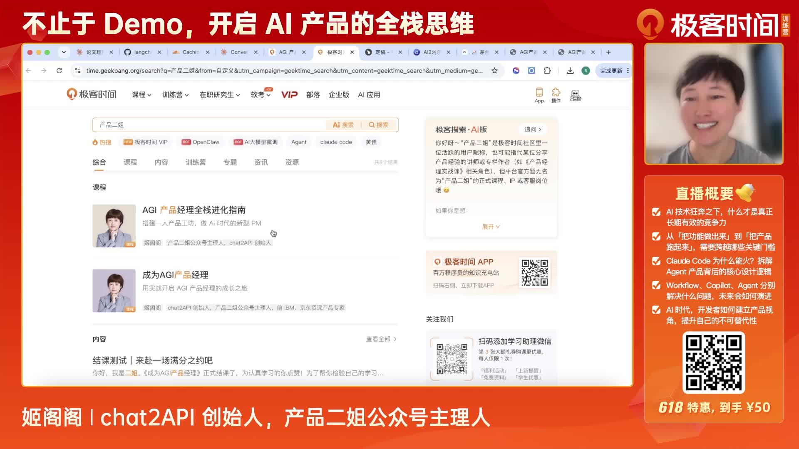
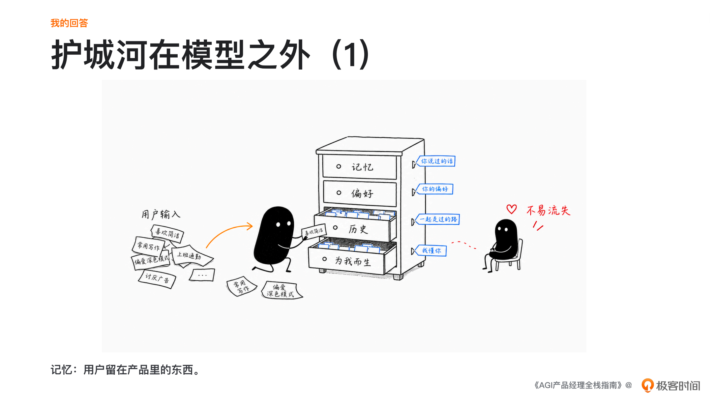
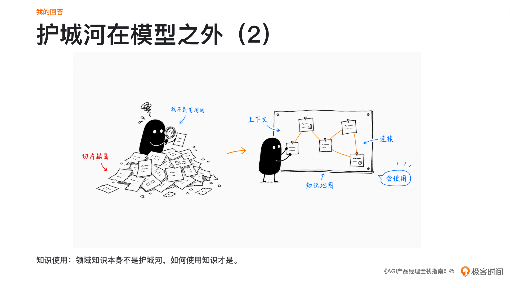
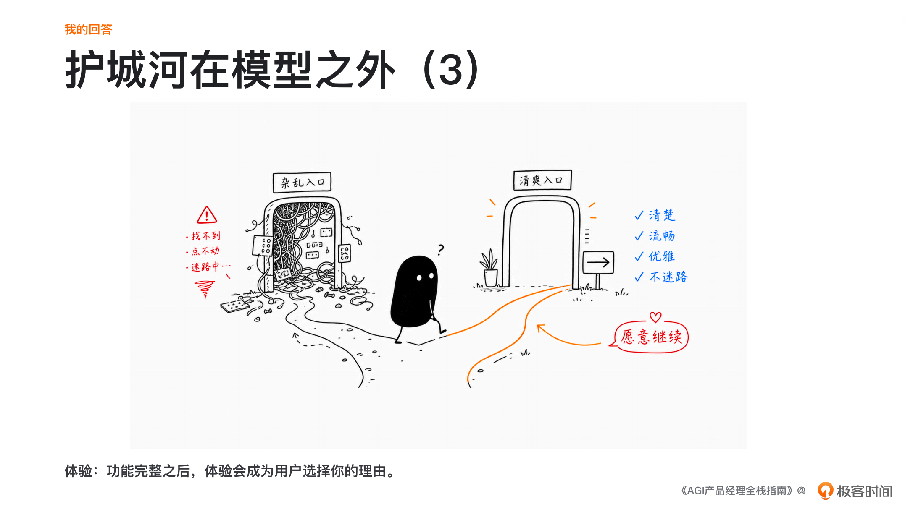
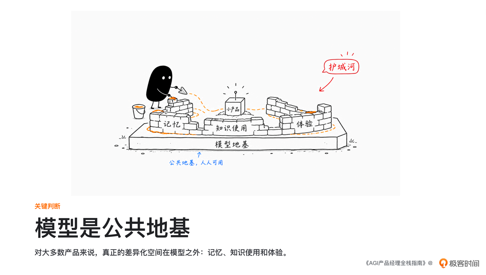
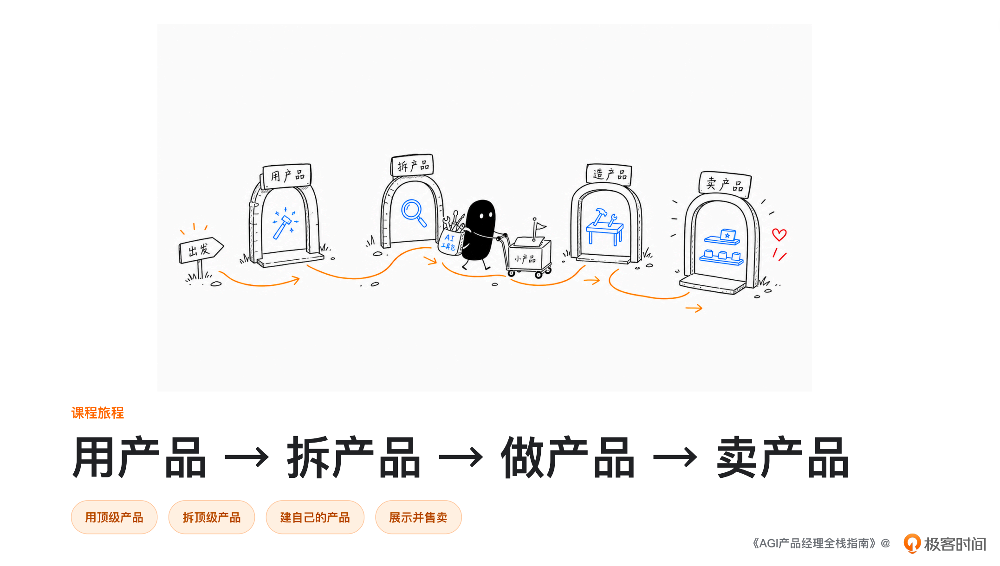
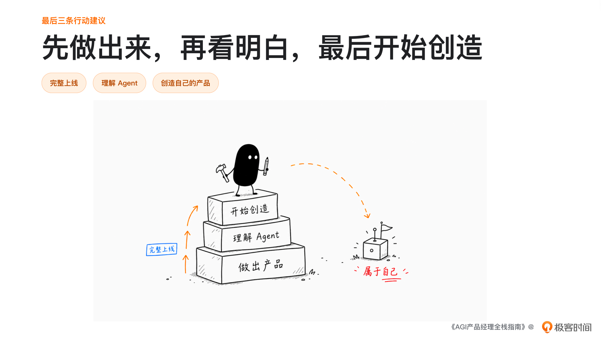

# 【直播回放】不止于Demo，开启AI产品的全栈思维

- 直播时间：2026 年 6 月 15 日

## 一、什么是全栈 AGI 产品经理

### 1.1 从 SuperApp 到全栈执行者

在 AI 时代之前，互联网的产品形态是 SuperApp —— 微信、抖音等平台聚合海量用户，用一个超级应用满足大多数人的需求。AI 时代到来后，很多人开始尝试用 AI 做各种工具，但大多数产品最终无人使用。

从经济学角度看，人类不会永远重复造轮子。当 idea 越来越多，需求被激发，就需要更多的executor（执行者） 去实现这些需求。这些执行者既是供应者，也是需求者。而全栈 AGI 产品经理，正是连接想法与落地的核心角色。

- 这里不是说开发不能做产品 —— 开发也可以成为全栈 AGI 产品经理，懂开发、懂产品，概念是相通的。

### 1.2 全链路能力

一个全栈 AI 产品经理，能够跑通产品的全链路：

想法 → 设计 → 开发联调 → 上线 → 留住用户

接下来的内容，也将顺着这条路径展开。

## 二、AI 产品的护城河是什么

### 2.1 一个值得深思的面试题

- 当模型的能力越来越强，私域知识和业务都能被模型内化，AI 产品的护城河是什么？

如果模型能力真的能覆盖一切，那全世界是不是只剩下 OpenAI、Anthropic、DeepSeek 这几家大模型公司？显然不是。我们用 AI Coding 工具的发展来类比：

- 早期 Claude Code 出现时，很多人认为 OpenAI 会被打败

- 但近期 OpenAI Codex 推出后，能力极强，甚至本次分享的文档都是由 Codex 完全生成

- Claude Code 的用户可能被 Codex 抢走

连 Anthropic 这样的顶级公司，护城河都不稳固。 那么，真正的护城河到底是什么？

### 2.2 护城河一：记忆

用户留在产品里的东西，才是真正的护城河。

举个例子：我是微信视频号的忠实用户，无数次打开抖音，但基本一分钟左右就关闭。不是因为抖音内容不好，而是因为我在视频号里留下的记忆、互动、关注关系远高于抖音。抖音"不懂我"，即使功能完全一样，我仍然愿意留在视频号。

反之亦然 —— 抖音的用户，微信也抢不走。

如果产品只是提供一次性工具，用户用完即走；但如果有记忆留存，用户就会留下。 豆包的记忆功能（开启 / 关闭）就是在构建护城河。记忆的迁移成本极高，这是产品最深的壁垒。

### 2.3 护城河二：知识的使用

领域知识本身不是护城河，如何使用知识才是。

把模型想象成一个图书馆 —— 没人调用，就毫无价值；有效利用起来，才有意义。

### RAG 的局限

过去两年我们对 RAG 非常熟悉，但它的适用范围已被大大缩窄。RAG 的致命缺点是"切片"—— 把整篇文档切成碎片，切断了内容块之间的内在联系。只有当每个块是独立、完整、精炼的时候，RAG 才有效。

RAG 最适合 FAQ —— 每个问题孤立、简短。但一旦问题变长、需要跨文档推理，RAG 就力不从心。

### LM Wiki：知识的新组织方式

GraphRAG / LM Wiki 是一种更好的方式。想象维基百科：你在一个文档里阅读时，会链接出N 个相关文档。把所有文档整理成相互引用的 Wiki，形成一张巨大的知识网络。

今天的 Agent 能力极强，可以"顺藤摸瓜"地把前因后果全部抓出来。保留这种关系链，就是 AI产品在知识使用上的护城河。

### 2.4 护城河三：体验

当功能完整之后，体验会成为用户选择你的理由。

很多开发者做完 APP 后，连熟悉业务的人都不知道该怎么操作 —— 繁杂的导航栏、混乱的交互。好的体验就像走进宜家：有清晰的导览、标志、布局和格局，让用户愿意在产品中"徜徉"。

### 2.5 总结：模型不是护城河

模型是公共地基、基础设施。 只要世界上存在两家以上相互竞争的模型公司，模型能力本身就不构成护城河。

真正构成护城河的，是：

- 记忆 —— 用户留在产品里的东西

- 知识的使用 —— 如何组织、调用、推理知识

- 体验 —— 让用户舒服、愿意留下

## 三、过去两年：模型层、工程层、产品层的演进

### 3.1 模型层的三维度进化

### （1）推理能力

以 Claude 的 Methuselah（或类似推理模型）为例，复杂推理和工程能力已经非常突出，能支撑 coding 这类复杂任务。但在科学研究方面仍有提升空间。

对于应用层开发者来说，现在的模型能力已经能解决大部分问题。

- 关于提示词评测：2024 年我们靠精细化提示词（CoT、角色扮演等）让模型按我们的思维走。但今天推理模型已将这些能力内化，提示词评测变成了"锦上添花"。

- 最简单的评测方法：用全世界最好的模型走一遍，如果用最简单的提示词能达到 90% 准确率，这个场景就成立。如果最好模型都做不到，那就是外围系统的问题。

### （2）代码能力

代码能力不只是写代码，而是重复了一种历史。

回顾 AI 发展史（1956 年至今），代码（Java、Python 等规则性语言）就是"昨天的 AI"。今天的 AI 与代码能力融合，其实是人工智能诞生初期两个派别 —— 符号主义与神经网络 —— 的再次融合。看清这一点，就会明白代码能力一定会被纳入 AI。

建议：直接体验 vibe coding 工具。

### （3）多模态

原生多模态的应用场景：

- OCR 的升级：传统 OCR 只能识别字，不理解语义环境，容易认错形近字。原生多模态能结合上下文，把错别字或易混淆的字识别正确。

- 图片理解：AI 已经可以理解图片内容。

- 注意：原生多模态今天仍不完善，即使 Methuselah 上线后，在评分标准中大概只有50%-60% 的分数。给一张详细截图让 AI 写代码，仍可能出错。补偿措施：先让 AI 根据图片生成 Markdown 文档，修改后再生成代码。

### 3.2 工程层的演进：从 Prompt 到 Harness

工程层经历了三个阶段：

阶段

- 说明

Harness 工程 的核心：像把孩子放进一个有清晰标志的图书馆，告诉他哪里查资料、哪里拿工具，让他在自由空间自主行动。Skill 之间可以相互编排、自我进化。

### 3.3 产品层：Agent 四大件的进化

Agent 的四大框架（2022 年诞生，至今不变）：

行动（Action）→ 记忆（Memory）→ 工具（Tools）→ 多 Agent 协同（Multi-Agent）

### （1）行动能力

今天能顺畅调用 Codex 编码，在 2023 年是不可想象的。

### （2）记忆

- 早期：超出 200 万字就"爆"了，总结都做不出来

- 后来：用微调强制模型记住（如客服要温和友好）

- 今天：Memory 文件、RAG、LM Wiki 并存，进化出更多方式

### （3）工具

- 早期：Function Calling，花无数提示词工程去调

- 今天：一句话就能调用工具

- 随着 Function Calling 普及，诞生了 MCP（Model Context Protocol）

- 多层安全体系：如 Claude Code / Codex 编辑文档前会询问用户是否允许

### （4）多 Agent 协同

- 早期：静态编排，像工业流水线，本质上只是 Workflow

- 今天：动态编排，能随取随用某些工具，这才是真正的 Agent

## 四、全栈 AI 产品经理的四步路径

### 4.1 第一步：用产品

先用顶级的 AI 产品 —— Codex、Claude Code 等 AI Coding 工具。在使用过程中思考：

- 它为什么能调起那么多工具？

- 记忆上下文为什么不会爆炸？（对话很长时会压缩）

- 使用工具前为什么会询问权限？

### 4.2 第二步：拆产品

用 Claude Code 去拆解顶级产品。任何 Agent 框架（LangChain 的 Deep Agent、Hermes、OpenClaw）都可以按"工具使用、记忆、多 Agent 协同"的框架去拆解。

### Claude Code 的两个巧思

巧思一：记忆的压缩折叠一般 Agent 的压缩：把前面 10 万字压缩成摘要，交给下一个 Agent。

Claude Code 的折叠法：像微信聊天的"引用"功能，基于引用拆开新话题。一次对话中有无数话题，Claude Code 把这些话题分类、打标签（如"做图"、"写文章"、"解决 bug"），不用时折叠，用时像树结构一样展开调取。

巧思二：LM Wiki 替代 RAG

当 RAG 召回不准确、无法逻辑推理时，不要怪 Agent —— Agent 本来就不是干这个的。试试 LM Wiki，把知识的关系链保留下来。

### 4.3 第三步：造产品

### 两种典型场景

场景 A：现有系统 + AI 升级

假设你有一个 CRM 系统，上面有固定的 Workflow（如客户录入）。到今天，固定 Workflow已不足以满足用户诉求 —— 用户希望像 Codex 一样动态规划、调用工具。

案例：股票分析工具

- 2023 年的产品：输入股票名称，输出完整分析报告

- 升级需求：用户看了茅台后追问"五粮液和泸州老窖对比一下" —— 现有 Workflow 没有这个功能

- 解决方案：基于 Hermes Agent 框架，把现有工具（如 stock search）转换成 Agent 可调用的工具，让 Agent 动态组合完成任务

- 同时建立用户记忆：价值投资爱好者？成长型？短线？长线？有了记忆，用户就会留下

场景 B：从零开始的小需求

没有现有系统，从一个小需求起步，逐步迭代。

### 造产品的三步

1. 造 Demo：没问题，新时代的"原型图"

2. 选框架：框架是毛坯房，Demo 是样板间模型，让 AI 把样板间搬到毛坯房里，做成真正能住的房子

3. 不一定非要用 AI：只要满足用户需求，就是好产品。第一次练习甚至可以造一个"丑房子"，难得的是开始

### 4.4 第四步：卖产品

对个人开发者尤为重要：

1. 需求从哪来：从大数据中"听用户的声音" —— 舆论分析、Reddit 抱怨、谷歌关键词搜索

2. 找到正确的客户：不能把产品放在隐蔽角落

3. 展示产品：用内容吸引客户，而不是拉客户送鸡蛋

4. 职场中的"卖"：通过高屋建瓴的向上汇报，让公司投入资源持续迭代，伴随产品成长

## 五、给 AI 创造者的三个建议

1. 先做出来：再丑、再不好，都是你的产品。你会体验全部过程，每个人都会经历，我现在仍然在经历。

2. 参照好产品：做出粗糙产品后，看看顶级 Agent 是怎么做的，重新思考如何在这个基础上做出真正属于自己的产品。

3. 成为全栈 AGI 产品经理：不用向开发提需求，拥有自己的价值。

视频配图来源：https://github.com/helloianneo/ian-xiaohei-illustrations

配图生成方式：安装小黑配图的 Skill 和 Codex，将写作思路和解说词用横杠线分割放在文档中，指定插小黑配图方法，让 Codex 生成图片，再编辑文档指定图片布局，生成 HTML 文档，反复操作两三次即可。

## 六、Q&A 精选

### Q1：模型评测是不是不需要了？

大大弱化，但仍需要。

- GPT 和 Anthropic 仍是断崖式领先

- 国内可选：DeepSeek、Kimi 等

- 评测不用做得那么重，搭好 Agent 框架后，换模型试几次，差别很明显

- 用最好的模型当标杆：如果最好模型都解决不了，就是外围系统的问题（提示词、工具描述、知识库、上下文管理）

### Q2：AI 时代的产品开发流程是什么？

现在没有固化流程，群雄逐鹿。 包括 Anthropic 内部协作也在不断变化。保持好心态，在尊重同事的基础上采用创新方式，不要只做流程上的棋子。

建议：先 Demo，再选技术框架，验证用户需求后再深入。

### Q3：Skill 是什么？所有业务都能封装成 Skill 吗？

Skill 不是提示词模板，而是能被 Agent 主动调起的能力单元。

- Skill 里面是原则，不是逻辑关系（不要写"如果 A 则 1，如果 B 则 2"）

- 要定义"为什么 A 是 1，B 是 2"，把原则说清楚，表象作为例子

- 不是所有项目都适合：如支付系统要求精确（20 块就是 20 块），用 Skill 不行

### Q4：没有编程基础能学吗？

可以。 我自己也没有代码能力，但一直浸泡在 vibe coding 里。起步慢一点，用自然语言跟 AI沟通，慢慢问"为什么这样写""这句话什么意思"。

建议：在 Codex 的 Agent MD 或 Claude 的 Cloud MD 里写："我是一个不懂编程的人，每次做事都帮我解释一下。"

### Q5：AI 产品经理如何选择方向？

- AI 客服：最容易入门

- AI 办公：除非是大厂（字节飞书、WPS 等有护城河的），否则小公司很难做

- 职场新人：优先选好氛围、好老板、能放手让你尝试的，而不是纠结方向

- 外包 / 外派解决方案：如果有直接做产品的机会，优先做产品

### Q6：如何评估 Agent 做得好不好？

Agent 的评判标准本身很松散：

- 最简单：帮你完成了，就是好

- 对比：Codex 的 A 方案 vs Claude Code 的 B 方案，A 优于 B 则 Codex 好

- 北极星指标：用户使用时间越长越好（acceptance）

- 结语：这条路非常困难，我过去两年也没有走出完美的路径，但方向已经非常清晰。希望分享给大家，让大家少走弯路。
