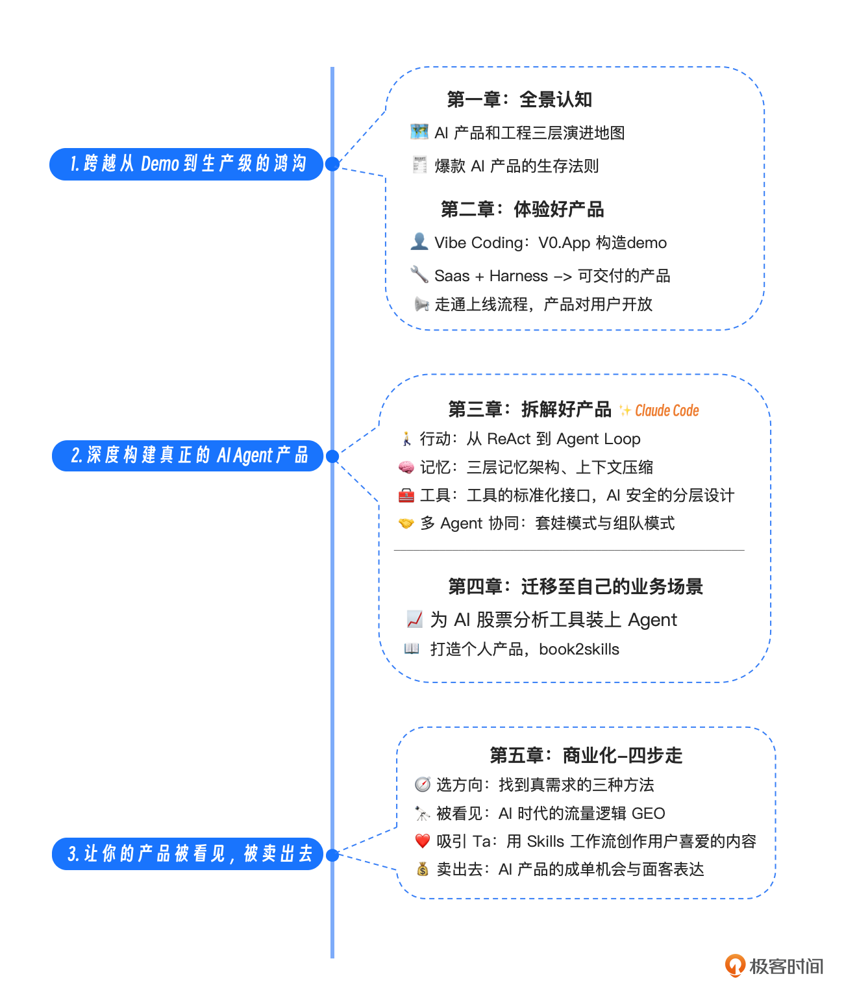
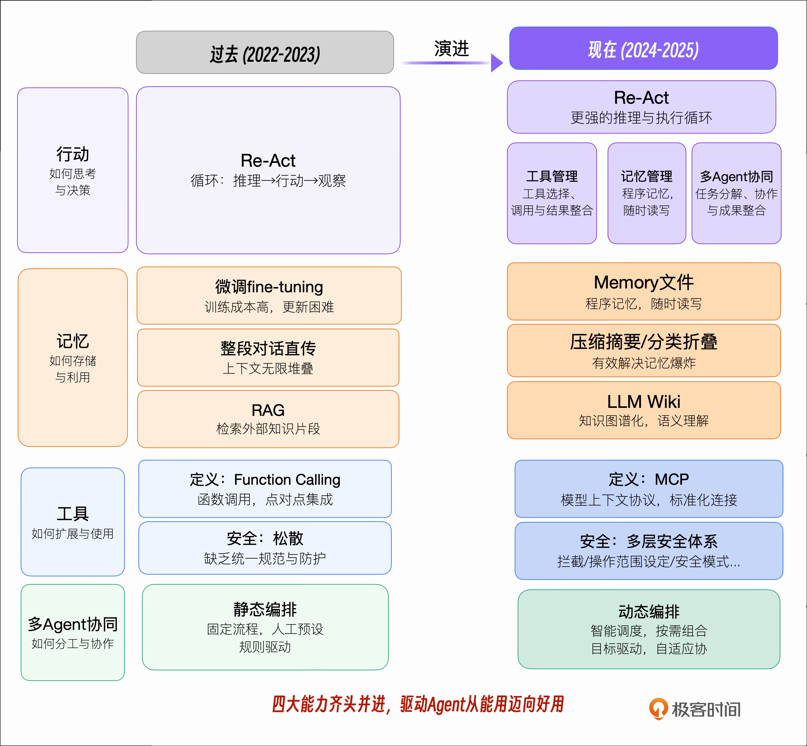

# 开篇词 | 2026年，开启AGI产品经理的全栈模式

你好，我叫姬阁阁，网名产品二姐。

如果你是《成为 AGI 产品经理》专栏的读者，那么，此刻我非常开心再次遇到你！如果你是新读者，那让我们在这里结识，一起走进二姐的 AI 产品“视界”！

两个月前，我收到国内某头部集团 HR 的消息。她说集团内部有超过 1000 名产品经理曾看过我的专栏，也收到很多好评。但现在 AI 变化太快，新名词一个接一个冒出来，比如 Skill、Harness Engineering、Memory 系统、Agent Loop，这些词让大家应接不暇。所以希望有一门课程，帮助大家系统地理解这些概念，并能有实际的应用案例参考，让大家把这些方法应用在实际工作中。

于是我试着去寻找资料看看能不能解决她的问题。然而我发现，这些资料散落在纷繁复杂、真真假假的内容中；而且更重要的是：大多数的内容都倾向于展示 Codex、Claude Code 这类顶尖 Agent 的能力，而对于如何构建一个真正的 AI Agent 却避而不谈。

于是我决定再来挑战一下自己，把过去两年的经验复盘精炼出来。形成这一门《AGI 产品经理全栈进化指南》。

如果你才刚刚接触 AI，我推荐你先通过上一个专栏《成为 AGI 产品经理》完成基本认知，这门课里也会多次引用其中的内容。如果你已经是一名 AI 玩家，不妨直接开始。

如果你是一线的产品经理或开发工程师，这门课会带你走向全栈的 AI builder 和商业推广负责人；如果你是管理者，这门课会让你从全局理解最前沿的 Agent 构建方法论，了解落地的实际难度，帮助你合理调配资源、制定战略规划。

## 我是谁

那这两年我做了些什么呢？

熟悉我的朋友知道，我在 2023 年 8 月裸辞，全身投入 AI。到 2024 年 7 月，我和技术合伙人做了若干企业项目，这些都总结在我上一个专栏中。

从 2024 年 7 月开始，我们开启了新的 AI 旅程。

旅程前半段是半创业阶段。当时我们的一个想法得到了某投资机构的认可，于是我们在他们的支持下，开始孵化自己的产品 chat2API，这是一款面向后端开发者，用自然语言编排 API 的产品，它的理念与今天我们熟悉的 MCP 非常类似。产品开发出来后，我们收获了几家付费企业客户。然而遗憾的是，最终因为 MCP 的诞生，chat2API 被更为权威的标准淹没了，我们的产品没有孵化成功。

这就开启了我们的后半段，全创业阶段。

2025 年 6 月，我们开始做自己的产品，这是一款股票分析工具。我和技术合伙人共同负责开发，从那时开始，Vibe Coding 成为我每天最重要的工作，同时还兼顾国内外的 SEO、产品社交媒体推广，这个产品最终完成了初步商业化，目前仍然持续在给我们带来收入。

今天我们仍然在持续做多个产品，同时也参与了多个企业项目，集中在 AI 知识库和 AI 营销两个方向。

这两段旅程加在一起，让我从一个纯粹的产品经理，蜕变为一个 CXO，这里的 X 代表着多职能：

- 比如：在开发的过程中，我越来越熟悉程序员的思维，从提需求的产品经理，变成了一个全栈的 AI 开发者。

- 又比如：我从纯粹的产品思维开始向商业思维转变，简单来说就是产品卖得好不好，不止依赖于产品本身有多好，更要看客户有多大程度需要它。

- 在面向企业时，我也变身为售前、销售，为客户提供一手、能落地的解决方案。

可以说，这个 CXO 能力也是当下 OPC 创业模式的必备能力，我认为在公司中的职场人也同样在向这个能力发展。顺着这个趋势，再结合大家的反馈，我定义了这门课的内容主线。接下来，就让我们一起来看看。

## 如何学：三段旅程，对应三个真实困境

这门课会带你走完三段旅程：

第一段：跨越从 Demo 到生产级的鸿沟

第一段，我会给大家一个全景回顾。看看过去两年，AI 产品的模型层、工程层、用户层各自发生了哪些演进，把那些平时你可能听到过的名词、概念串起来，带你发现这个演进过程中的内在规律，顺着这个趋势，你会更容易理解后面的内容。

然后我们就会直接动手，用三节课的时间，带你初步体验一次“从想法到上线”的全流程，我们依次会完成以下内容：

1. 把想法转换为 demo 去验证；

2. 使用一个框架完成前后端对接，并构建 Harness Engineering 让 Agent 自主、持续推进任务；

3. 完成应用的部署上线，对公众开放。

完成第一段旅程后，你就初步从一个提需求的产品经理，开始走向全栈的 AI builder。

不过，这个阶段构建的产品，不一定是一个 AI Agent 类的产品。大家平时看到的社交媒体大多止步于此，但对于这门课来讲，却仅仅是个开始。

第二段：深度构建真正的 AI Agent 产品

如果把 AI Agent 类产品比作车，上一段旅程是教你如何开世界上最豪的车，那么这一段旅程就是把这款豪车拆解，然后把其中的重要机制，拿出来为自己所用。这是一个 AI 产品经理最需要的内容，也是这门课的重头戏。

谈到 Agent，不得不说 Agent 的四大件——行动、记忆、工具、多 Agent 协同。尽管 AI 进步神速，但这四大件组成的框架却始终如一，只是框架里的内容变了，比如：

- 行动能力从论文中的 Re-Act 演变成了更为成熟的 Query Loop。

- 记忆管理在原来的提示词、微调、RAG，演变成了今天的上下文工程，记忆提取，LLMwiki 等。

- 工具使用从原来的 function calling 演变成了今天的 MCP、skills。

- 多 Agent 协同方式也逐渐沉淀出更为统一的模式。

我用一张图来概括这个演进路线，可以让大家感受一下。在学习了后面的详细内容之后，相信你对这张图理解得更透彻。

而这些演进并非凭空而来。2026 年 3 月底，Claude Code 代码的一次泄露，给出了构建 AIAgent 最好的学习素材。所以，我会把 Claude Code 作为主要解剖对象，看看这个全球顶级的 Coding Agent 是如何做出来的。学会这些，就相当于拿到了构建 Agent 的兵器库，未来遇到具体问题时，你就可以从这些兵器库里找到趁手的兵器，解决问题。

所以，接下来的第四章，我就会把这些兵器用在真实案例中，其中有我自己的产品，也有我在企业咨询过程中遇到的真实案例，看看我是如何从兵器库找到解决方法的，这些问题会包括：

- 金融分析助手怎么升级 Memory 系统和使用多种工具。

- AI 客服产品是如何做动态规划的。

- 投资研究的知识库是如何完成内容“保鲜”和“沉淀”的。

- ……

这一段结束后，你就可以把 Claude Code 这类 Agent 采用的基础框架和组件迁移到任何业务类的产品中了。

第三段：让你的产品被看见，被卖出去

最后一段旅程，我们就自然来到了产品价值兑现的领域：如何把你的产品卖出去。

可以说，过去两年的经历刷新了我对产品商业化的认知。正如之前所说：产品卖得好不好，先依赖于客户有多需要它，其次才是产品本身有多好。这就好比你在山顶，一瓶普通的纯净水可以卖 5 元，而在山脚，一瓶优质矿泉水也只能卖 2 元，原因就在于山顶人们更需要水。

在这种认知的引导下，我们会先从寻找需求入手。这一点上，国内和海外的确有很大不同，我会分别介绍我的个人经验供你参考。

找对需求的下一步是被更多人看见，在我的上一个专栏中曾提到，像 Perplexity 这种 AI 搜索产品将会是 AI 时代的流量入口。如今，针对 AI 搜索引擎优化，也就是 AISEO 或 GEO（生成引擎优化）已经成为共识。我会带大家认识 GEO 这种营销方式，以及我个人在产品推广上的技巧。

最后一步就是为自己的产品定一个合理的收费模式。我个人的感受是：订阅式收费仍然是海外主流的收费模式；而在国内，企业客户的定制化程度依然较高，只有少数企业跑出了标准定价的 SAAS 模式，另外个人开发者也可以通过私域、小红书这类平台实现变现。

## 2026 年，新的生存命题

到这里，我们就用一门课的时间，完整走过了我过去两年的路。

今天的 AI 的确对所有知识工作者、集体组织带来了巨大冲击，可能你过去几年的经验，都比不上 AI 的输出。但 AI 的另一面是：它同样可以成为你最有力的武器。

当前整个社会向 AI 转型的趋势已经确定，但我看到：在这个过程中，必然会出现分层。有些事会走在前面，有些事需要克服巨大的惯性完成转型，而恰恰是这种分层，孕育了无数的机会。 当我们在不断地向上探索，就意味着会有更多为别人带来价值的机会。

希望这门课，能让你在纷繁复杂、真真假假的声音中，助力你踏上新的台阶，开启 AI 产品经理的全栈之路，成为 AI 时代的“新”产品经理！
