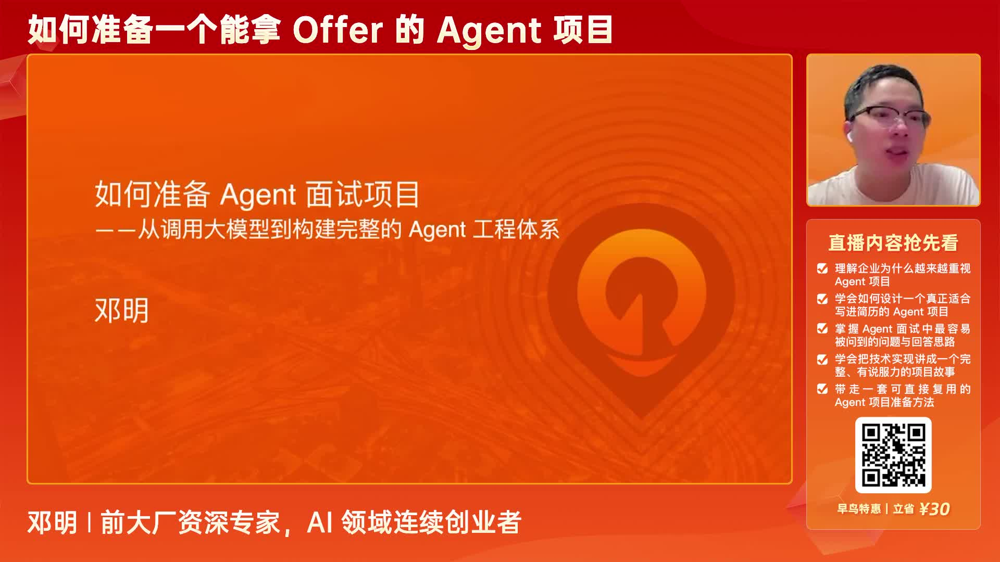
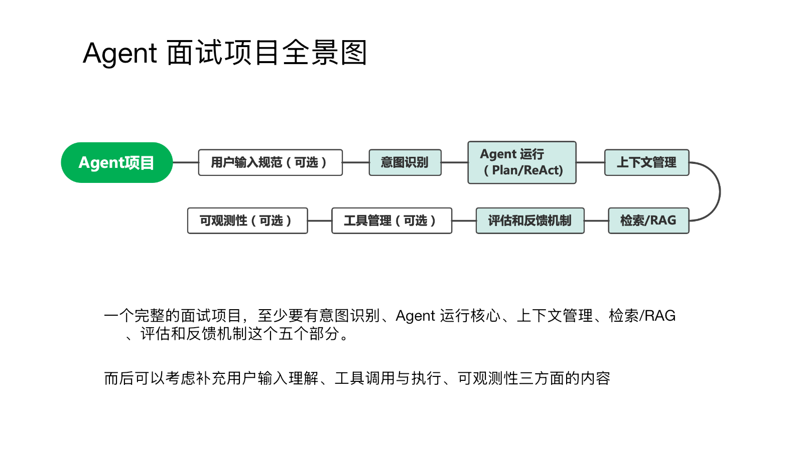
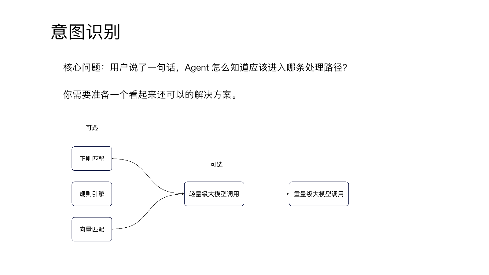
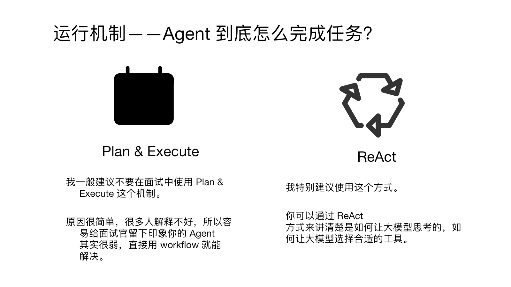
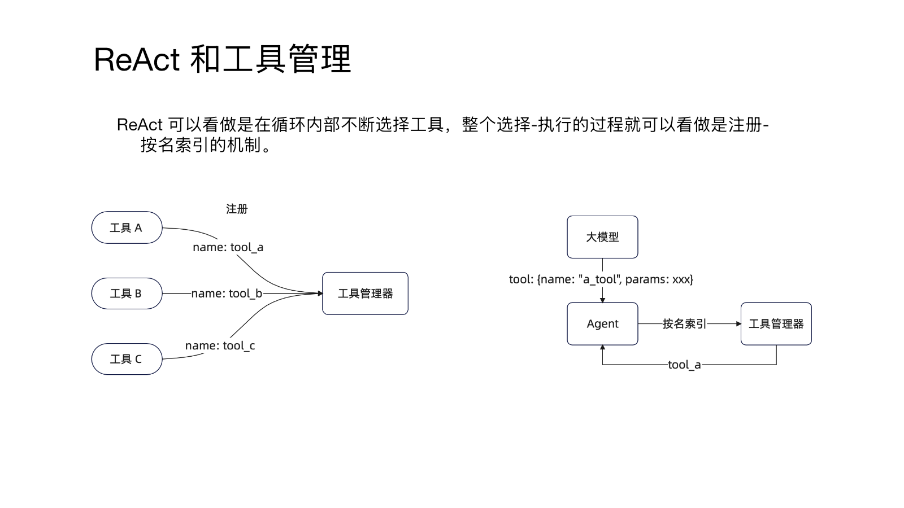
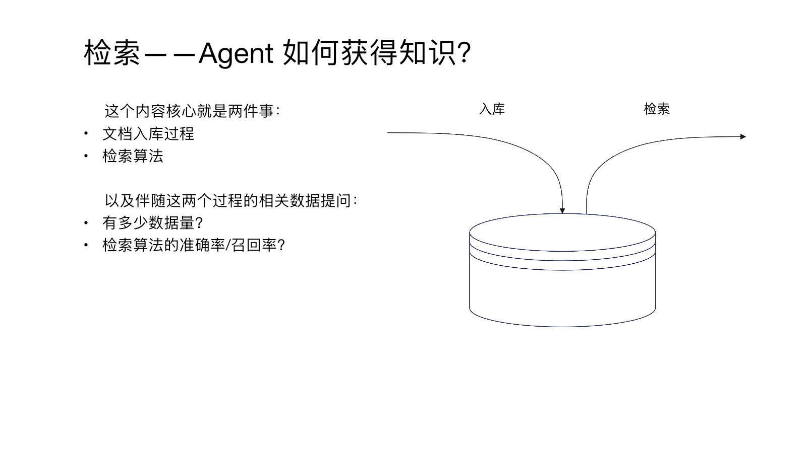

# 直播回放 | 从“做过Agent”到“值得录用”，你的简历还差什么？

你好，我是大明。今天我想聊聊简历怎么写，面试怎么准备这个话题。

一份好的简历，需要让招聘方迅速看清三件事：你适合什么岗位，你有什么竞争优势，你用哪些经历证明这些优势。

因此，写简历不能只是按时间罗列做过的工作。更有效的做法是：先明确求职目标，再筛选相关经历，最后围绕重点项目准备面试。

对于希望进入 Agent 应用开发方向的求职者，尤其需要回答一个问题：

除了把功能做出来，你还解决了哪些业务问题，让系统变得更可靠、更有效？

## 先确定求职目标，再动笔写简历

写简历之前，先明确三个问题：

- 目标岗位：后端工程师、Agent 应用工程师，还是负责项目落地的技术负责人？

- 目标层级：初级、中级、高级，还是团队负责人？

- 目标薪资与城市：你的预期，对应怎样的职责范围和能力要求？

这里的目标岗位，指的是职业方向，而不是某一家公司的具体职位名称。

例如，同样投递 Agent 相关岗位，有人主要负责工具接入和业务功能开发，有人负责复杂任务编排，还有人需要带团队完成从零到一的落地。三者需要展示的项目深度和责任范围并不相同。

简历的内容，应当围绕目标岗位需要的能力展开。目标越清晰，越容易判断哪些经历值得详细写，哪些内容可以压缩。

## 找到你的优势定位：Agent 能力与工程能力如何组合

直播中重点讨论了两种求职定位。

1. 以 Agent 经验为核心，以后端能力为支撑

这种定位适合已经深入参与 Agent 项目，希望继续从事相关开发工作的求职者。

简历需要重点体现：

- 理解 Agent 的任务执行流程；

- 能处理上下文管理、工具调用、任务编排等问题；

- 有评估、反馈和效果优化经验；

- 具备必要的后端开发与问题排查能力。

Agent 应用依然需要接口、存储、权限、消息处理和服务部署。模型能力之外，工程能力决定了系统能否稳定运行。

因此，项目介绍不能只停留在提示词和模型调用上，还应说明：出现超时、调用失败或并发请求时，系统如何处理。

2. 以后端经验为核心，以 Agent 能力拓展业务方向

这种定位适合传统后端经验较扎实，正在向 Agent 方向转型的求职者。

核心竞争力可以放在：

- 分布式系统设计；

- 高并发、高可用；

- 性能优化与故障排查；

- 复杂业务系统的工程实践。

Agent 项目则用于证明：你能够把原有的工程经验迁移到新的应用场景中。

对于实习生和应届生，不必追求覆盖整个系统。把一个真实参与的模块讲透，通常比声称自己掌握完整架构更有说服力。

此外，如果长期深耕某个行业，还可以形成更具体的定位：既理解业务，也知道如何用 Agent解决该业务中的问题。

## 项目经历要有主次，避免平均用力

项目经历是简历中最值得投入精力的部分。可以按“核心项目、辅助项目、补充项目”组织。

项目类型

- 主要作用内容重点

核心项目

- 证明最主要的竞争力，引导面试深入讨论业务背景、个人职责、技术难点、关键

辅助项目

- 补充核心项目没有充分体现的能力与目标岗位相关的另一类能力

补充项目

- 展示少量独特优势简短背景，以及最有价值的一两项贡献

例如，以 Agent 能力为主要优势，可以重点介绍一个 Agent 项目，再用后端项目证明工程基础。

如果主要优势是后端开发，则可以把有代表性的分布式系统项目放在首位，再用 Agent 项目补充转型能力。

补充项目不需要完整展开。假设你过去做过一次有价值的 Elasticsearch 检索优化，而核心项目没有涉及这项能力，就可以用简短篇幅保留这一亮点。

项目数量多，不等于竞争力强。面试官更需要看到能够深入讨论的代表性经历。

简历篇幅也应服务于这一目标：核心项目充分展开，辅助项目适度压缩，重复内容尽量删除。具体页数以岗位要求和投递习惯为准。

## Agent 项目的重点：从“实现功能”转向“解决问题”

直播中反复强调的一点是：Agent 项目的价值，不能只靠“搭建了一个系统”来证明。

“接入大模型”“支持工具调用”“实现知识库问答”可以交代项目功能，但这些描述还没有说明你的个人贡献。

更值得展开的是：

- 系统原来有什么问题？

- 你如何发现和定位问题？

- 为什么选择这个方案？

- 实施时遇到了哪些边界情况？

- 最终效果如何验证？

例如，“实现了多轮对话”只说明做了什么；“针对多轮对话中的指代混乱，引入人物与事件关系建模，并通过测试集验证回答一致性”，则进一步展示了解题过程。

准备核心项目时，可以参考直播中的“五二原则”：梳理大约五个可讨论的贡献点，其中重点打磨两个最有区分度的亮点。它是一种准备方法，不必机械凑数。

以下几个方向，可以结合实际项目选择。

1. 长任务执行优化

长任务的问题，往往来自多个环节的小错误不断累积，最终导致结果偏离目标。

可以重点讨论：

- 如何发现任务开始偏离目标；

- 如何保存中间状态；

- 如何在失败后恢复执行；

- 如何避免重复调用或反复尝试；

- 如何验证改进后的任务成功率。

例如，引入监督机制检查执行状态，在发现异常后暂停任务、修正方案，再从适当的位置继续执行。

面试时，仅说“增加了一个 Supervisor Agent”还不够，还需要说明：它检查什么、何时介入、如何与主流程协作，以及额外成本是否值得。

对于资深工程师，更应体现系统化思考：从问题分析、瓶颈定位，到方案设计、分阶段实施和结果验证，形成完整链路。

2. 上下文管理优化

上下文管理既涉及成本，也影响任务效果。

可以从两个角度切入：

一是减少无效信息。通过筛选、压缩和按需加载，在保证效果的前提下减少 Token 消耗。

二是围绕业务组织信息。例如，在涉及多人、多事件的对话场景中，对人物、事件及其关系进行建模，使系统能够找到当前任务真正需要的背景信息。

业务特点越清晰，越容易解释为什么采用这样的设计，也越容易体现你的判断和贡献。

3. 复杂任务的规划与恢复

复杂任务不仅需要生成计划，还需要处理执行中的变化。

假设任务包含 A、B、C、D、E 五个步骤，执行到 E 时失败，原因可能来自 C 产生的错误数据。此时需要判断：

- 应该从哪里恢复？

- 哪些步骤需要重新执行？

- 哪些中间结果可以继续使用？

- 用户修改需求后，计划如何调整？

这类问题可以体现任务编排、状态管理、依赖分析和容错设计能力。

面试重点应落在具体处理机制上，而不只是介绍使用了 Plan、ReAct 或某个框架。

4. 评估与反馈机制

要证明 Agent 效果有所改善，需要先说明如何判断“好”与“不好”。

可以根据业务选择指标，例如：

- 任务成功率；

- 答案正确性或相关性；

- 人工接管率；

- 用户满意度；

- 单次任务成本；

- 响应时间与执行时长。

评估方法可以包括人工标注、规则校验、用户反馈，以及 LLM-as-a-Judge，即使用大模型辅助评分。

如果使用模型评估，还应准备回答：评分标准如何制定，如何与人工判断校准，以及哪些情况需要人工复核。

评估的作用，是为优化提供依据。“模型给出了高分”本身，还不足以证明系统已经解决业务问题。

5. 可观测性与问题定位

评估关注“结果怎么样”，可观测性帮助回答“问题出在哪里”。

一个任务效果不好，可能是检索没有找到资料，也可能是上下文缺失、工具调用失败，或者某一步输出出现错误。

因此，可以结合日志、调用链和指标，记录关键执行过程，让问题能够被追踪和复现。

如果把这一点写进简历，应说明这些记录如何帮助你发现问题、缩小范围，并验证后续改动。

## 知识库和 RAG 项目，怎样写出区分度

知识库问答项目可以成为有价值的经历，但需要讲清楚实际难点。

如果只是导入文档、分块、向量检索，再调用模型生成回答，个人贡献容易显得单薄。更值得展开的是以下三类问题。

### 第一，数据结构是否复杂

文档可能包含跨章节引用、表格、图片、流程图或业务实体关系。

这些特点可能要求你采用不同的解析、分块和关联方式，而不能把所有内容当作普通文本处理。

### 第二，检索问题是否得到解决

可以讨论：

- 召回是否充分；

- 排序是否合理；

- 相关性和准确性是否改善；

- 压缩检索结果后，是否仍保留必要信息。

如果使用了指标，应交代测试集、评估方式和比较条件，使结果能够被理解。

### 第三，是否针对业务做了设计

例如，技术文档中的类图和流程图，可能需要保留结构关系；人物图片和场景图片，也可能需要不同的处理与检索路径。

项目亮点来自业务约束下的设计选择。使用了什么组件，可以作为背景；为什么这样设计、解决了什么问题，才是重点。

## 个人技能要从项目中提炼

写作时，可以先梳理项目经历，再提炼个人技能。这样更容易避免技能描述与项目证据脱节。

个人技能可以分为两部分：

- Agent 相关能力：任务编排、工具调用、上下文管理、检索、评估反馈等；

- 传统工程能力：后端开发、存储、分布式系统、性能优化和故障排查等。

少写没有解释空间的“熟悉”“精通”，多写能够被项目支撑的能力。

例如：

- 具备 Agent 应用开发经验，参与任务编排、上下文管理及效果评估，能够根据执行记录定位问题并验证优化效果。

或者：

- 具备后端系统开发经验，参与性能优化与线上故障排查，并有将相关工程能力应用于 Agent项目的实践。

技术栈也应与岗位和实际经验相符。写入框架、SDK 或编程语言之后，需要能够解释其用途、限制，以及自己完成了哪些工作。

AI 编程工具可以辅助开发，但简历中声称掌握的能力，仍需要本人能够调试、维护和说明。

## 资深工程师和负责人，要说明如何推动落地

对于资深工程师，仅列出若干功能通常不够，还需要体现：

- 如何主动发现问题；

- 如何分析根因、比较方案；

- 如何确定优先级和实施顺序；

- 如何协调资源并控制风险；

- 如何评估上线效果。

如果应聘团队负责人，还需要准备技术之外的问题：团队如何分工？项目如何拆阶段？进度如何跟踪？资源不足时如何取舍？业务方的预期如何管理？

“带团队从零到一落地”是一项需要充分展开的能力描述。它应当有实际职责和项目过程作为支撑。

## 投递时，先让对方看见匹配点

招聘沟通的第一句话，可以直接说明与岗位最相关的优势，再表达求职意愿。

例如：

- 5 年后端开发经验，参与过 Agent 项目的任务编排与评估优化。看到贵司正在招聘相关岗位，希望进一步沟通。

这比单独写“您好，我对贵公司的岗位很感兴趣”，提供了更多可供判断的信息。年限和经历应替换为本人实际情况。

简历投递后，也可以记录不同版本的反馈：

- 哪类岗位回复较多；

- 哪些项目容易引起追问；

- 哪些表述让面试官产生误解；

- 哪些问题自己还讲不清楚。

投递时间可以结合招聘活动安排，但不必把回复率归因于某一个时间规律。更值得持续调整的，是岗位匹配度、简历表达和面试准备。

## 让简历中的每个重点，都能经得起追问

简历写完后，围绕核心项目检查五个问题：

1. 业务背景：项目为什么要做，解决谁的问题？

2. 职责边界：你负责什么，与其他成员如何协作？

3. 技术判断：为什么选择这个方案，考虑过哪些替代方案？

4. 效果证据：结果如何验证，数据来自哪里？

5. 经验反思：方案还有什么限制，再做一次会如何改进？

准备面试的过程，就是把简历中的简短结论，展开成能够解释的事实、选择和结果。

最终，简历与面试应当围绕同一条主线展开：

我适合这个岗位，因为我在相关场景中承担过明确职责，解决过具体问题，也能够解释方案的效果与边界。

