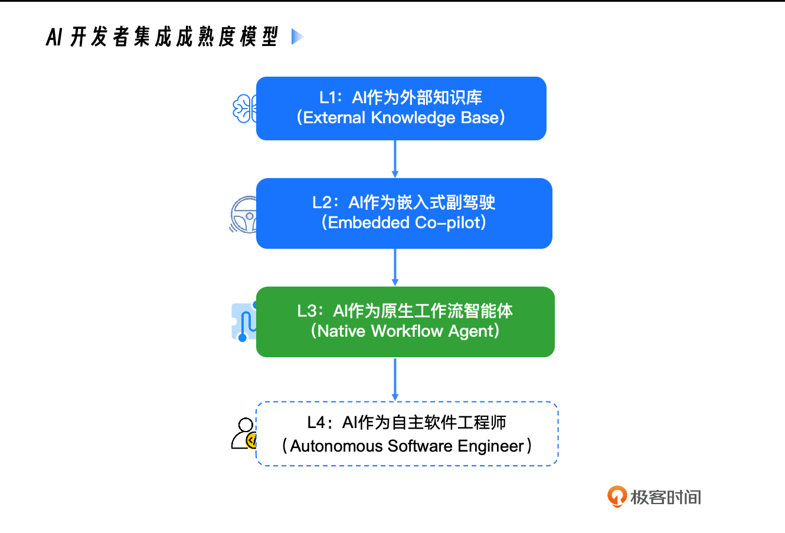
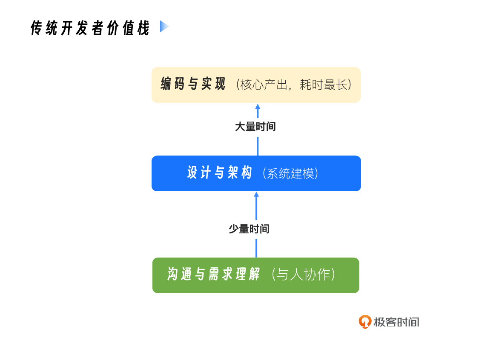
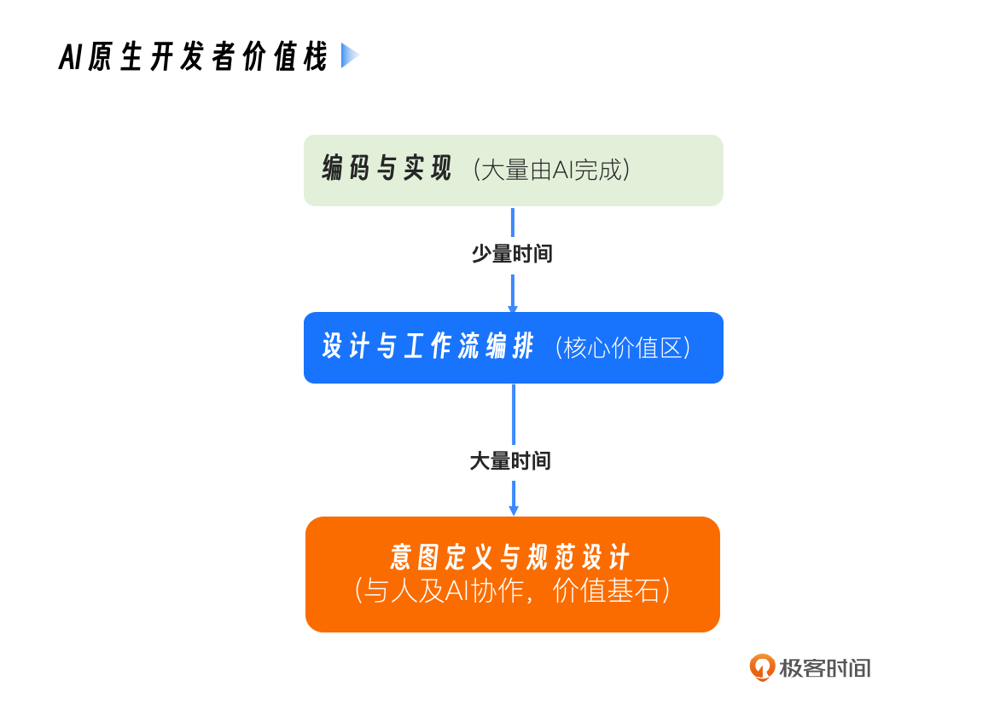

# 01 | 范式演进：从-人机协作-到-AI原生-，你的角色变了吗？

你好，我是 Tony Bai。

在开篇词里，我们共同描绘了一幅开发者在 AI 时代“双屏探戈”的生动画面，并提出了一个核心观点：我们正在经历一场从“人机协作”到“AI 原生”的深刻变革。

今天，我们先进入专栏的概念篇。作为我们专栏的第一讲，我不想再泛泛地谈论趋势，而是想邀请你和我一起，建立一个分析模型，来精确地度量这场变革的深度，并清晰地定位我们自身所处的位置。这个模型，我称之为“AI- 开发者集成成熟度模型”。

通过这个模型，我们将一起回答那个所有技术人都在内心深处反复追问的问题：在这场由 AI驱动的范式演进中，我们——软件工程师的角色，究竟在发生怎样的变化？

这个问题，不仅仅关乎效率，更关乎着我们未来五到十年的职业定位和核心价值。要回答这个关乎我们未来的核心问题，我们必须先看清自己脚下的路。我们首先就来看看，当前开发者普遍身处的这个“集成困境”到底是什么。

## 我们身处的“集成困境”

几乎所有开发者都感受到了 AI 带来的效率提升，但同时也普遍感到一种“用得不爽”的别扭感。这种别扭感的根源，在于我们当前的协作方式，正处于一个不上不下的尴尬阶段。

为了更清晰地解构这个问题，我将 AI 与开发者的集成关系，划分为四个成熟度等级（Level）。



这个模型清晰地展示了 AI 在软件工程中角色演进的路径。现在，让我们来看看我们大多数人正身处何处，以及我们的目标在哪里。

### Level 1：AI 作为外部知识库

这是最原始的协作模式，其典型代表就是网页版的 ChatGPT、Gemini 或 Claude 等。

在这个层级，AI 是一个与你的开发环境完全隔离的“远程顾问”。你需要手动将所有问题和代码上下文“搬运”到它的世界里，然后再将它的答案“搬运”回来。它的核心价值是信息检索和知识问答。

这个层级的核心痛点是极高的上下文摩擦力。每一次交互，你都需要扮演“人肉序列化器”的角色，将你大脑和 IDE 中的复杂情境，压缩成 AI 能够理解的文本提示。

### Level 2：AI 作为嵌入式副驾驶

这是目前最主流，也是演进最快的协作模式。其典型代表，不仅包括在 VS Code、JetBrains等传统 IDE 中大放异彩的各类 AI 插件（如 GitHub Copilot Chat），更包括像 Cursor 这样从头开始就围绕 AI 构建的“AI 原生 IDE”。

在这个层级，AI 被深度“嵌入”到了我们的驾驶舱（IDE）里。它能够“看到”你当前打开的文件，提供智能的代码补全，并在侧边栏与你进行上下文感知的对话。这相比于 Level 1 是一个质的飞跃，极大地降低了上下文切换的摩擦力。

但是，即便能力如此强大，这个“副驾驶”的角色依然有着其固有的三大局限性：

- 它仍然是一个“被动”的伙伴：它响应你的显式指令，或在你编码时提供建议。但它不会主动发起一个任务。比如，它不会在你修改了一个核心 API 后，主动提醒你：“嘿，这个 API 的

```
变更影响了 3 个下游模块，并且 docs/api.md 文档也过时了，需要我帮你更新吗？”
```

- 它的视野是“文件级”的：它对你当前打开的几个文件理解得非常透彻，但对于整个项目的宏

```
观架构、模块间的复杂依赖、Makefile 里定义的构建流程，甚至是 constitution.md
```

- 里约定的团队“宪法”，往往认知不足。它的上下文，更多地局限于“当前工作区”，而非“整个项目”。

- 它的行动空间是“受限”且“环境绑定”的： 这是最关键的局限。诚然，像 Cursor 这类先进的

```
AI 原生 IDE，已经可以通过其集成的终端执行本地命令，比如运行 go test 或 git
commit。然而，这些行动从根本上被绑定在了运行 IDE 的本地开发环境中。你无法指挥
```

- 它：“在远程的预生产服务器上执行这组集成测试”，或者“在我们的 CI/CD 流水线所使用的

- 那个标准 Docker 容器里，重新构建这个应用”。AI 的行动能力，被“囚禁”在了 IDE 的直接上下文里，它无法作为一个独立的、可被部署到任意目标环境（如服务器、CI Runner）的代理来执行任务。

Level 2 为我们提供了极其强大的编码增强能力，但它本质上仍未脱离“辅助开发者”的范畴，是我们许多人停留的“舒适区”和“局部最优解”。要实现真正的工作流自动化，我们就必须迈向下一个层级。

### Level 3：AI 作为原生工作流智能体

这，正是本专栏将要带你精通的核心领域。其典型代表，就是以 Claude Code 为首的命令行AI 智能体。

在这个层级，AI 的角色发生了根本性的转变。它不再仅仅是一个“副驾驶”，而是一个获得了“主动性”的工作流智能体。它能够：

```
感知全局：通过 @ 指令、CLAUDE.md 等机制，它可以理解整个项目的结构和规范。
```

- 规划行动：面对一个高层级的意图（例如“重构这个模块”），它能够自主地将任务分解为一系列具体步骤。

- 与环境交互：它能够主动地提议并执行读写文件、运行 Shell 命令等操作，与你的本地环境进行真实的交互。

在 Level 3，AI 与我们的对话，从“请告诉我怎么做”，变成了“我打算这么做，请批准”。开发者成为了“指挥家”与“审批者”，AI 则成为了那个能够将意图转化为一系列实际行动的“执行官”。这是 AI 真正成为可依赖的、生产级的、在专家监督下运行的开发伙伴的阶段。

值得一提的是，像 Cursor 和 GitHub Copilot 这样的 Level 2 工具也在快速进化，并推出了自己的“Agent 模式”。然而，与 Claude Code 这类真正的命令行原生代理相比，它们最核心的区别依然在于执行环境的受限：它们的“行动”被绑定在了运行 IDE 的本地开发环境里，而一个真正的命令行 Agent，则是一个可以被部署到任何目标环境（服务器、CI Runner、Docker 容器）中独立执行的“数字雇员”。

### Level 4：AI 作为自主软件工程师

这是我们正在迈向的未来，是 AI 在软件工程中角色的终极形态。在这个层级，AI 将能够独立地、端到端地完成从需求理解到部署上线的整个软件开发生命周期。

而这个未来的种子，已经埋藏在今天最先进的工具之中。类似 Claude Code 的“Headless 模式”或全自动模式（即无需人工授权的“YOLO 模式”），正是迈向 Level 4 的清晰信号。

然而，我们必须清醒地认识到，一个真正成熟的 Level 4 自主工程师，不仅要能执行，还要能处理高度的模糊性、进行战略性决策、以及从未知的失败中进行创造性恢复——这在通用软件工程领域仍是前沿的探索方向。今天我们看到的自主模式，在被清晰定义好的、边界明确的任务上表现出色，但在开放式、充满变数的真实项目中，仍然高度依赖人类的智慧来设定初始框架和处理异常。

这正是 Level 3 的精通，对于迈向 Level 4 至关重要的原因。

### 本专栏的定位：精通 L3，触及 L4

那么，我们这个专栏，在这张成熟度地图上，究竟要带你走向何方？

我们的核心使命，是让你成为一名 Level 3 的工程师。你将系统性地学会如何构建、管理和优化可靠的、有人类智慧监督的 AI 原生工作流。这是你在今天就能落地应用，并获得巨大生产力回报的核心技能。

但我们的视野不止于此。本专栏更深远的目标，是为你搭建一座通往 Level 4 的坚实桥梁。你会发现，当我们深入学习如何编写可被机器精确理解的规范（spec.md）、如何定义项目中不可逾越的架构“宪法”（constitution.md），以及如何将我们的最佳实践封装为可被 AI 调用的工具（自定义指令 /MCP 服务器）时，我们实际上就是在为 Level 4 的到来做最核心的准备。

我将这种关系总结为“赛道理论”：

- 精通 Level 3，就是在为 AI 建造一条安全、清晰的“F1 赛道”。

- 规范（Specs）是赛道的“导航地图”，告诉 AI 终点在哪里，必须经过哪些检查点。

- 宪法（Constitution）和安全配置是赛道的“护栏”，防止 AI 冲出危险区域。

- 自定义工具和自动化测试是赛道的“维修站”和“监控系统”，确保 AI 在遇到问题时有标准化的解决方案。

- 触及 Level 4，就是在这条精心建造的赛道上，开启“自动驾驶模式”（即无人值守的 YOLO模式），并信任它能够安全、高效地跑完全程。

没有一条设计精良的“赛道”，任何所谓的“自动驾驶”都只会导致混乱和灾难。因此，在本专栏的进阶和实战部分，我们将专门讲解如何利用 Headless 模式，将 Claude Code 集成到自动化脚本和 CI/CD 流水线中。你将学到的，不仅仅是“按下自动驾驶按钮”，更是如何设计一个足够健壮的系统，让你能够放心地按下那个按钮。

所以，我们再明确一下本专栏的定位：立足于当下最有价值的 Level 3 人机协同范式，同时以前瞻性的视角，为你揭示并实践通往 Level 4 自主开发的路径。

## 价值的倒转：开发者核心价值栈的演进

理解了集成成熟度的演进，我们就可以更深刻地回答那个核心问题：我们的角色和价值，究竟在发生怎样的变化？

答案是：一场深刻的“价值倒转”。

### 传统开发模式下的价值栈

在没有 AI 或 AI 处于 L1/L2 的时代，一个软件工程师的价值栈，就像一个金字塔。



从图中我们看到：

- 基石是“编码与实现”：在这个传统模式下，我们花费了绝大部分时间（可能是 70-80%）将设计和需求转化为具体的、可运行的代码。代码编写能力是我们价值的核心和基础。

- 中间层是“设计与架构”：我们花费一部分时间进行系统设计、模块划分。

- 顶层是“沟通与需求理解”：我们花费少量时间与产品、团队成员沟通，澄清需求。

这个价值栈的特点是，离机器越近、越具体的工作，占据了我们越多的时间，也构成了我们价值的核心壁垒。

### AI 原生开发模式下的价值栈

而当 AI Agent 深度融入工作流（Level 3），这个金字塔发生了惊人的倒转。



我们看到：

- 基石变成了“意图定义与规范设计”：AI 极大地压缩了从清晰指令到代码实现的时间。因此，我们最高价值的工作，变成了向上游移动，去定义那个“清晰的指令”。这包括与产品经理一起，将模糊的业务想法，雕琢成一份逻辑严密、可被 AI 精确执行的规范（Specification）。

- 中间层是“设计与工作流编排”：我们的设计能力变得更加重要。我们不仅要设计软件架构，还要设计人机协作的工作流。如何将团队的最佳实践封装成 AI 可以调用的工具？如何设计自动化流程来保证质量？这成为了新的核心价值区。

- 顶层是“编码与实现”：编码本身并没有消失，但它更多地变成了一种“监督与验收”的工作。我们编写少量的、关键的核心代码，并花费更多时间审查、测试和优化 AI 生成的代码。

这场“价值倒转”，正是我们开发者角色三重转变的根本原因。它不是让我们被取代，而是推动我们“向上游走”，去从事那些更贴近业务、更考验系统性思维和创造力的工作。

```
从代码的“生产者”到规范的“设计者”：你的核心产出，将从 .go 文件，变为那份能够生成
无数正确 .go 文件的 .spec.md。
```

2. 从任务的“执行者”到工作流的“指挥家”：你的核心技能，将从“如何实现一个功能”，变为“如何设计一个能让 AI 自动实现功能的流程”。

3. 从被动的“修复者”到主动的“治理者”：你的核心价值，将从“修复一个 Bug”，变为“设计一个能让 AI 在开发阶段就避免这类 Bug 的质量体系”，并成为 AI 所有高风险操作的最终“审批人”。

## 本讲小结

好了，今天我们一起进行了一次深入的思辨之旅。我们并没有急于学习某个具体的命令或工具，而是首先在开篇词的基础上，继续深入，并尝试建立一个清晰的认知框架。

首先，我们引入了“AI- 开发者集成成熟度模型”，将 AI 协作划分为四个层级。这帮助我们清晰地定位了当前主流实践（Level 2）的局限性，并明确了本专栏“精通 L3，触及 L4”的精准定位。

接着，我们提出了“开发者核心价值栈倒转”模型。这个模型深刻地揭示了，在 AI 原生时代，开发者的价值核心正从底层的“编码实现”，向上游的“意图定义”和“流程设计”迁移。

最后，我们基于“价值倒转”模型，重新诠释了开发者的三重角色转变：规范设计师、工作流指挥家和质量治理者。这为我们指明了在 AI 时代持续提升个人价值的清晰路径。

请记住，这场范式演进的核心，不是用 AI 替代我们，而是用 AI 放大我们的工程思想和架构能力。我们正在从“与机器对话”的工匠，进化为“设计人机协作系统”的工程师。理解了这一点，你就抓住了 AI 原生时代开发者自我进化的钥匙。

下一讲，我们将正式进入这套新方法论的技术核心：规范驱动开发（Spec-Driven

```
Development）。我将带你详细了解 spec.md、plan.md、tasks.md 这“三驾马车”是如何
```

协同工作，将一个模糊的想法，一步步精确地“编译”成高质量的软件系统的。

## 思考题

请你对照今天我们学习的“AI- 开发者集成成熟度模型”，回答下列问题：

1. 你目前在日常工作中，与 AI 的协作主要处于哪个层级（Level 1, 2, 还是已经开始探索Level 3）？

2. 对照“开发者核心价值 *”，你感觉自己当前花费时间最多的，是“编码与实现”“设计与架构”，还是“沟通与需求理解”？你认为这个分布合理吗？

欢迎你在评论区分享你的现状和思考，这是我们共同迈向 AI 原生开发的第一步。
