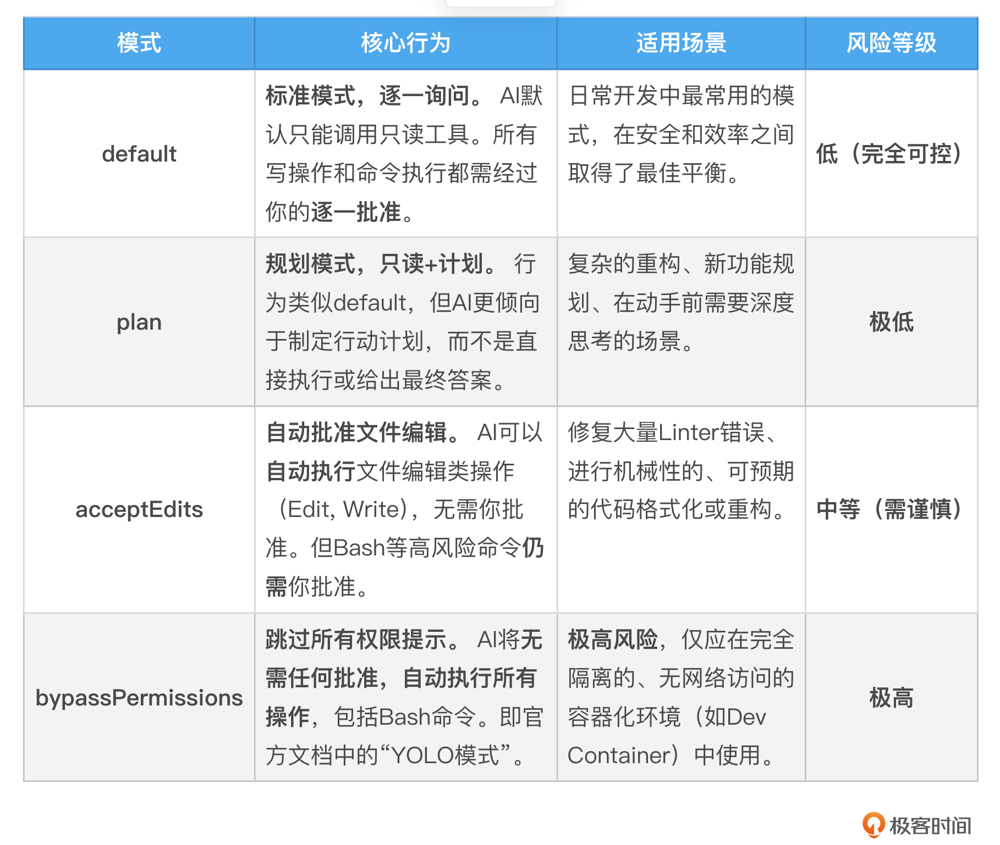
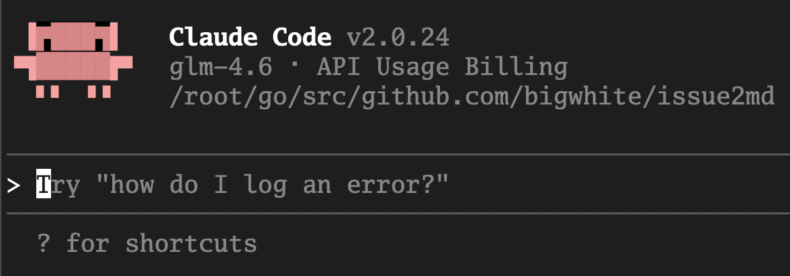
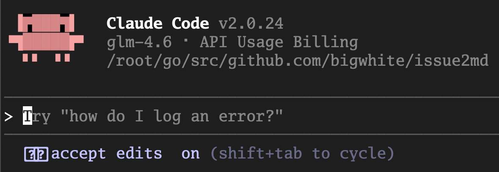
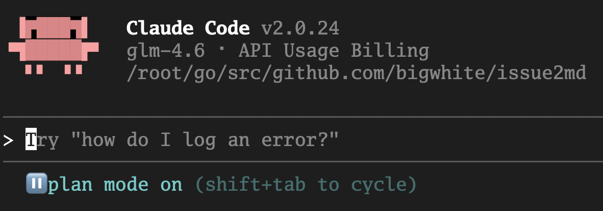
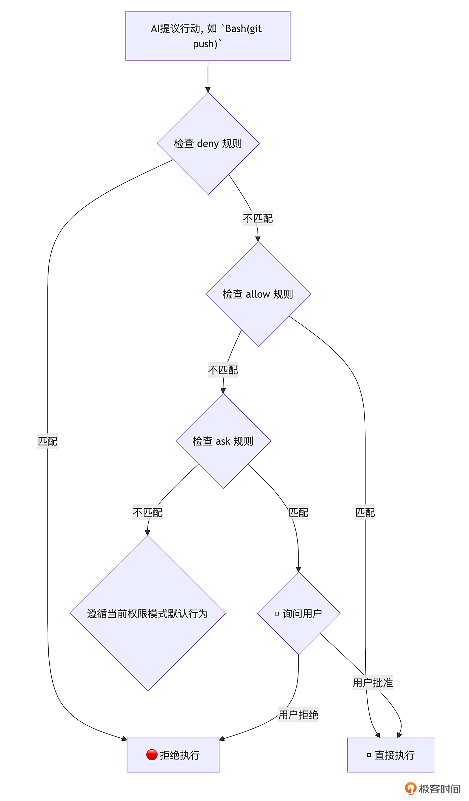
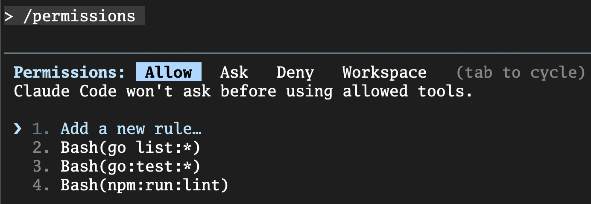
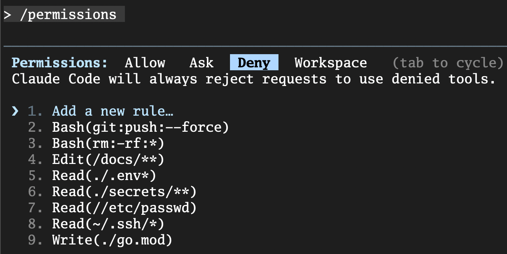
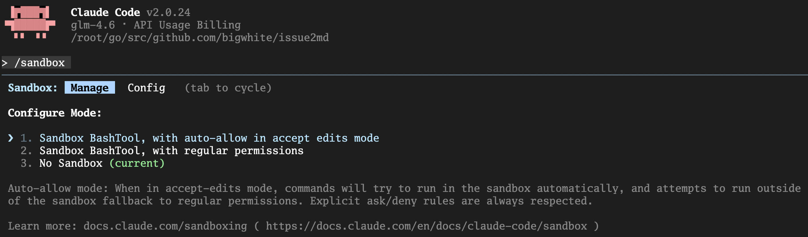
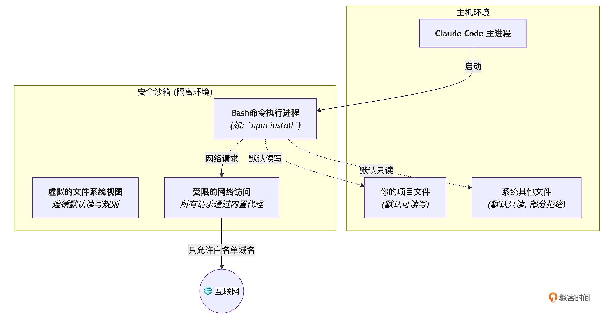

# 09 | 安全基石（上）：用权限控制与沙箱为AI戴上“安全镣铐”

你好，我是 Tony Bai。

欢迎来到我们专栏的进阶篇。从这一讲开始，我们将从“如何使用 AI”，迈向“如何驾驭 AI”的更高阶领域。

在前面的基础篇，我们已经为 AI 伙伴装备了“眼睛”（上下文注入）、“长期记忆”

```
（CLAUDE.md）和“快捷指令”（Slash Commands）。现在，它已经非常聪明，并且蓄势待
```

发。但随之而来的，是一个所有严肃工程师都必须面对的灵魂拷问：我真的能信任一个 AI，让它在我的电脑上、在我的项目里，自由地读写文件、执行命令吗？

```
如果它误解了我的指令“清理一下临时文件”，而去执行了 rm -rf / 怎么办？如果它在分析代
码时不小心读取了 .env 文件，并将我的生产环境密钥泄露到它的训练数据中怎么办？这些合
```

理的担忧，正是阻碍许多开发者将 AI Agent 从一个“有趣的玩具”升级为“核心生产力工具”的最后一道心理防线。

今天这一讲，我们的核心目标，就是彻底拆除这道防线。我们将深入 Claude Code 设计的“安全哲学”，系统性地学习如何为这个强大的 AI Agent，戴上一副量身定制、坚不可摧的“安全镣铐”——那就是其精密的权限体系（Permissions）和强大的沙箱机制（Sandboxing）。学完之后，你将有足够的信心和能力，去构建一个既强大又绝对可控的 AI 原生开发环境。

## AI Agent 的核心风险：信任，一个必须解决的技术问题

在讨论解决方案之前，我们必须首先对风险本身有一个清醒的认知。AI Agent 的核心风险，并不仅仅来自于科幻电影里的“AI 觉醒”或恶意攻击，更多的是来自于其工作原理带来的不确定性和意图的偏差。

- 指令的模糊性：人类语言天然存在模糊性。你对同事说“把这个功能上线吧”，他知道这意味着“运行测试、构建镜像、推送到 Staging、观察监控”，而不会真的直接操作生产环境。但AI Agent 可能会对“上线”这个词，做出最直接、也最危险的字面解释。

- 上下文的局限性：尽管我们尽力提供上下文，但 AI 的“世界观”永远是片面的。它可能知道

```
要修改 a.go，但不知道这个文件正被一个关键的生产服务所依赖，任何一点微小的改动都
```

- 可能引发雪崩。

- 统计的随机性：大模型的本质是基于概率生成内容。即便在相同的输入下，它的输出也可能存在细微的差异。这种随机性在带来创造力的同时，也引入了不可预测的风险。

正因为这些风险的存在，我们对 AI Agent 的“信任”，绝不能建立在“它很聪明，不会犯错”的主观期待之上，而必须建立在一套“即便它犯错，也无法造成破坏”的客观技术保障体系之上。Claude Code 的整个安全哲学，就建立在这样一种务实而审慎的思想之上：默认不信任，逐步授权，全程监督。它通过权限体系与沙箱机制这两大支柱来实现这一点。

## 第一大支柱：权限体系——精细到命令级的“立法”

Claude Code 的权限体系，是其安全模型的第一道、也是最重要的一道防线。它不像传统的用户权限那样粗放（管理员 / 普通用户），而是构建了一套极其精细的、针对 AI 工具（Tool）的授权模型。

在深入细节之前，我们首先要理解其核心的权限设计哲学，它建立在三个核心原则之上：

1. 默认最小权限：默认情况下，AI 是“只读”的，就像一个只能观察、不能动手的顾问。

2. 显式授权：任何可能改变你系统状态的操作（写文件、执行命令），都必须经过你的明确批准。

3. 用户主权：最终的控制权永远在你手中。你可以选择单次批准，也可以通过配置，将你信任的、安全的操作设置为自动批准。

正是基于这套哲学，Claude Code 构建了一套由“宏观模式”和“微观规则”组成的、强大而灵活的权限体系。

### 四大权限模式：宏观上设定你的信任级别

首先，Claude Code 为你预设了四种核心权限模式（Permission Modes），让你可以在不同场景下，快速切换整体的安全级别。



```
【重要】default 模式是我们最常用的。它在安全和效率之间取得了最佳平衡，既不像
plan 模式那样完全只说不做，也不像 acceptEdits 那样自动修改文件，而是将每一个
```

- 高风险决策都交由你来把控。

```
你可以通过 Shift+Tab 快捷键在启动的 Claude Code 会话中循环，在 default、plan 和
acceptEdits 模式间切换：
```







```
也可以在 settings.json 中设置 defaultMode 为上面四种模式中的一种。
```

### 权限规则（Permission Rules）：微观上为 AI 的行为“立法”

```
四大模式提供了宏观的控制，而真正的精髓，在于你可以通过 settings.json 文件，制定
```

细致入微的权限规则。这些规则，就是你为 AI 设定的在这个项目中必须遵守的“法律条文”。

### 规则的决策流程

```
规则的决策流程非常清晰：deny 拥有最高否决权，其次是 allow，最后是 ask 和当前权限
```

模式的默认行为。



### 配置的层次与生效

```
正如我们在前面基础篇 04 讲提到的，settings.json 文件存在于多个层级（企业、用户、
```

项目），并遵循高优先级覆盖低优先级的原则。这意味着，你可以在项目级的

```
./.claude/settings.json 中为团队设定一套标准权限，而团队成员也可以在自己的
~/.claude/settings.json 中添加个人化的、更严格的规则。
```

如何查看生效的规则？

在你配置完规则后，如何确认它们已经正确生效了呢？最直接的方法就是使用

```
/permissions 这个内置的 Slash Command。
> /permissions
这个命令会打开一个交互式的界面，清晰地列出当前所有生效的 allow、deny、ask 等规
```

则，这是你调试和验证权限配置的“神器”。





现在，让我们来看几个核心工具的规则实践：

```
Read/Edit/Write：控制文件访问，你可以使用类似 .gitignore 的语法，精确地控制 AI
```

能读写哪些文件。这是保护项目敏感信息、防止 AI 意外破坏核心配置的第一道铁索。

```json
{
 "permissions": {
   "deny": [
     "Read(./.env*)",       // 禁止读取任何.env文件
     "Read(./secrets/**)",    // 禁止读取secrets目录下的所有文件
     "Read(~/.ssh/*)",       // 禁止读取用户ssh密钥
     "Read(//etc/passwd)",     // 禁止读取系统敏感文件
     "Write(./go.mod)",       // 禁止修改go.mod文件
     "Edit(/docs/**)"        // 禁止编辑docs目录下的文件 (相对于settings.json位置)
   ]
 }
}
【重要】Read/Edit 规则的路径模式非常讲究：
path 或 ./path：相对于当前工作目录。例如：Read(*.env) 会匹配当前目录下
的.env文件。
/path：取决于定义规则的 settings.json 文件的位置。例如：如果规则定义在项目级
的 ./.claude/settings.json 中，Deny(Read(/config/**)) 会禁止读取项目根
```

- 目录下的 config 文件夹。

```
~/path：相对于用户主目录。例如：Deny(Read(~/.ssh/id_rsa)) 会禁止 AI 读取你
```

- 的 SSH 私钥。

```
//path：文件系统的绝对路径。例如：Deny(Read(//etc/passwd)) 会禁止 AI 读取
系统的密码文件 /etc/passwd。请务必区分，错误的路径模式可能会导致你的安全规则失
```

- 效！

```
Bash：控制命令执行 Bash 工具是 AI 能力最强的“武器”，也是风险最高的。Claude Code 为
```

其设计了基于前缀匹配的规则。

```json
{
 "permissions": {
   "allow": [
     "Bash(go:test:*)",      // 总是允许执行 `go test` 及其任何子命令
     "Bash(npm:run:lint)"    // 总是允许执行 `npm run lint`
   ],
   "ask": [
     "Bash(git:commit:*)"   // 执行 `git commit` 时总是询问
   ],
   "deny": [
     "Bash(rm:-rf:*)",       // 绝对禁止 `rm -rf`
     "Bash(git:push:--force)" // 绝对禁止强制推送
   ]
 }
}
【注意】这里的 Bash 的规则是前缀匹配，而非 glob 或 regex。这意味着
Bash(curl:*) 可以被 curl -L ... 轻易绕过。对于需要严格网络控制的场景，
WebFetch 工具或我们接下来要讲的沙箱机制是更可靠的选择。
WebFetch 和 MCP：控制外部连接，你可以为可信的网络域和 MCP 服务器开启绿色通道。
{
 "permissions": {
   "allow": [
     "WebFetch(domain:*.golang.org)",     // 总是允许访问Go官方文档
     "mcp__github"                        // 总是允许使用名为'github'的MCP服务器的所有
   ],
   "ask": [
     "mcp__jira__create_issue"            // 调用jira服务器的create_issue工具时询问
   ]
 }
}
【注意】MCP 权限规则不支持通配符 *。要允许一个服务器的所有工具，请直接使用服务
器名，如 mcp__github。
```

通过这套“宏观模式”+“微观规则”的组合，你就拥有了一套强大而灵活的“立法”工具，能够为你的 AI 伙伴量身打造一套清晰、明确、且绝对安全的工作边界。

## 第二大支柱：沙箱机制——从“操作系统”层面隔离风险

你可能会问，既然我们在上面已经为 AI 制定了如此精细的“法律”（权限体系），为什么还需要为它建造一个“监狱”（沙箱）呢？

答案是：权限体系防范的是“已知的未知”，而沙箱防范的是“未知的未知”。权限体系依赖于我们预先定义的规则，但如果 AI 通过一个我们允许的、看似无害的命令（比如运行一个被恶意

```
篡改的 npm 脚本）找到了规则的漏洞，或者利用了 Bash 前缀匹配规则的局限性呢？
```

这正是沙箱的用武之地。它不再是应用层面的规则检查，而是深入到操作系统（OS）层面，为 AI 的所有高风险操作，构建了一个坚不可摧的“数字囚笼”。

### 准备工作：为你的沙箱安装“地基”

在启用沙箱之前，我们需要确保它的“地基”已经就位。在你的 Ubuntu 环境上，如果你直接在

```
Claude Code 中运行 /sandbox，很可能会遇到和我一样的错误提示：
> /sandbox
 ⎿  Error: Sandbox requires socat and bwrap. Please install these packages.
```

这个提示告诉我们，Claude Code 的沙箱功能依赖于两个关键的 Linux 工具：

```
bwrap（Bubblewrap）：这是沙箱的核心。它是一个非特权（unprivileged）的容器化工
```

- 具，能够利用 Linux 内核的命名空间（Namespaces）特性，为一个进程创建一个高度隔离的运行环境。

```
socat：一个多功能的网络中继工具。在这里，它被用来创建沙箱内外通信的桥梁，尤其
```

- 是在网络隔离中扮演关键角色。

在基于 Debian/Ubuntu 的系统上，你可以通过以下命令轻松安装它们：

```sql
sudo apt-get update && sudo apt-get install -y bubblewrap socat
安装完成后，你再运行 /sandbox，并不会直接启用沙箱，而是会进入一个交互式的配置菜
```

单，让你做出一个关键的选择：



- 在macOS上，沙箱则依赖于系统内置的Seatbelt框架，无需额外安装，但同样会面临类似的选择

这个菜单为你提供了两种不同安全级别的沙箱模式，以及一个关闭选项。那么，前两个模式有什么不同，我们应该如何选择呢？

```
 选项 2： Sandbox BashTool, with regular permissions（推荐，最安全）
含义：启用沙箱，并且所有 Bash 命令的执行，都严格遵循我们在上一节学习的
permissions 体系。这意味着，即使一个 Bash 命令在沙箱的安全边界内，如果它没有
命中 allow 规则，Claude Code 依然会弹窗向你请求批准。
```

- 选择建议：对于大多数项目，尤其是涉及生产环境代码、敏感数据或团队协作的场景，我强烈推荐你选择这个模式。它为你提供了最坚固的“法律 + 监狱”双重防护。

```
选项 1：Sandbox BashTool, with auto-allow in accept edits mode（效率优
```

先）

```
含义：启用沙箱，但是做了一个效率上的妥协。当你处于 acceptEdits 这个更信任的权
限模式时，对于那些在沙箱安全边界内的 Bash 命令，Claude Code 将不再询问你，直接
```

- 自动执行。

- 选择建议：如果你正在一个完全可信的、非关键的个人项目中工作，并且你对沙箱的边界配置非常有信心，希望最大化地提升 AI 的自主工作效率，那么可以选择这个模式。但请务必记住，这在一定程度上牺牲了单次操作的审批权，以换取更高的自动化效率。

```
在你做出选择后，沙箱就成功启用了。如果你想退出沙箱模式，可以再次执行 /sandbox，
选择 No Sandbox 即可。
```

现在，让我们再来深入了解它背后的工作原理。

### 沙箱的核心原理：基于操作系统原语的隔离

与 Gemini CLI 等工具倾向于使用重量级的 Docker 容器来实现沙箱不同，Claude Code 选择

```
了一条更轻、更原生的路径。它利用操作系统级别的安全原语（Linux 上的 bubblewrap，
macOS 上的 Seatbelt）来强制执行文件系统和网络的隔离。
当你启用沙箱后，所有 Bash 命令及其子进程都会在一个被严格限制的“数字囚笼”中执行。这
个“囚笼”的规则，由一套默认行为和你的 settings.json 配置共同决定。
```



让我们来精确地解读沙箱的两大核心隔离特性：

一是文件系统隔离（Filesystem Isolation）：沙箱对文件系统的访问权限，遵循一套非对称的读写规则：

```
默认写权限：严格受限。AI 的写操作（通过 Bash 命令）被严格限制在当前工作目录
```

- （CWD）及其子目录中。任何试图修改 CWD 之外文件的行为，都将被阻断，除非得到你的明确批准。这构成了防止 AI“作恶”的核心安全边界。

- 默认读权限：相对开放。沙箱内的进程默认拥有对几乎整个计算机的只读访问权限。这是一种非常务实的设计，它允许 AI 在需要时，能够像人类开发者一样，去读取系统库、全局配置文件或其他项目的文件来获取解决问题所需的上下文。

```
可配置性：更精细和推荐的方式是通过我们已经学习的 permissions 体系中的 Read、
Edit、Write 规则来“立法”。
```

二是网络隔离（Network Isolation）：沙箱的网络访问则遵循默认拒绝，白名单通行的原则：

- 代理拦截：所有源自沙箱的网络请求，都会被一个运行在沙箱外部的代理服务器所拦截。

```
白名单机制：只有在 permissions 中通过 WebFetch(domain:*.example.com) 规则
```

- 明确允许的域名，才能通过这个代理。

- 用户确认：任何对未知域名的访问请求，都会被代理暂停，并弹窗向你请求许可。

```
全面覆盖：这种隔离适用于 Bash 命令及其衍生的所有子进程，确保了网络访问的统一管
```

- 控。

### “安全 YOLO 模式”：沙箱与 bypassPermissions 的终极结合

```
现在，我们可以揭晓 bypassPermissions（YOLO 模式）的唯一正确且极其强大的用法了
```

——将其与一个严格配置的沙箱结合。这个流程被称为“安全 YOLO 模式”，它特别适合执行那些高度重复、机械化的、边界清晰的自动化任务。

我们来看一下它的实践流程：

```
配置严格的沙箱规则：在 ./.claude/settings.json 中，确保 sandbox.enabled
为 true，并通过 permissions 规则严格限制文件和网络访问。
在沙箱内启动 YOLO 模式：bash # 确保在项目根目录运行 claude -p "修复这个项目
中所有的ESLint错误，直到 npm run lint 命令不再报错为止。完成后，返回'OK'。"
--dangerously-skip-permissions。
```

3. AI 全自动工作：Claude Code 会在这个受限的“囚笼”里，全速、自主地工作。它想修改项

```
目外的文件？被沙箱的“写权限边界”阻断。它想访问 evil.com？被网络代理阻断。它唯一
```

- 能做的，就是在你为它划定的安全范围内，高效地完成任务。

```
审查结果：任务完成后，你通过 git diff 审查 AI 所做的所有修改，确认无误后提交。
```

在这个模式下，我们既利用了 AI 的极致自动化能力，又将其潜在的风险，通过操作系统级的沙箱机制，降到了理论上的最低。

## 实战：为我们的 Go 项目量身定制一份安全配置

```
基于我们对 permissions 和 sandbox 协作关系的最新理解，现在让我们来优化
issue2md 项目的 ./.claude/settings.json 文件或 settings.local.json 文件。
./.claude/settings.json
{
 "permissions": {
   "allow": [
     "Read(go.mod)",
     "Read(Makefile)",
     "Read(README.md)",
     "Grep",
     "Glob",
     "LS",
     "Bash(go:version)",
     "Bash(go:list:*)",
     "Bash(go:build:*)",
     "Bash(go:test:*)",
     "Bash(gofmt:*)",
     "Bash(goimports:*)",
     "Bash(golangci-lint:run:*)",
     "WebFetch(domain:pkg.go.dev)",
     "WebFetch(domain:*.golang.org)",
     "WebFetch(domain:github.com)",
     "Bash(go list:*)",
     "Bash(go version:*)"
   ],
   "deny": [
     "Read(./.env*)",
     "Read(~/.ssh/**)",
     "Read(//etc/passwd)",
     "Bash(rm:*)",
     "Bash(git:push:*)"
   ],
   "ask": [
     "Write",
     "Edit",
     "MultiEdit",
     "Bash(go:get:*)",
     "Bash(go:mod:tidy)",
     "Bash(git:add:*)",
     "Bash(git:commit:*)"
   ],
   "defaultMode": "default"
 },
 "sandbox": {
   "autoAllowBashIfSandboxed": false,
   "enabled": true
 }
}
```

让我们来解读这份优化后的配置

```
permissions 部分（立法）
allow：我们为无害的 Bash 命令（如测试、格式化）和必要的文档网站（WebFetch）
```

- 开放了绿色通道。特别注意，我们不仅允许了 Go 的官方文档和代理网站，还加入了github.com。这是因为 Go 模块的依赖解析经常需要回源到 GitHub 等代码托管平台。

```
ask：我们在所有“改变世界”的操作上，都设置了“红绿灯”，包括修改代码、改变依赖、记
```

- 录历史。

```
deny：我们用最严厉的规则，划定了绝对的“禁区”，包括读取敏感文件和执行破坏性
Bash 命令。
sandbox 部分（执法）
enabled: true：我们强制所有 Bash 命令都在沙箱中运行。
autoAllowBashIfSandboxed: false：我们选择了最安全的模式，明确要求沙箱内的
Bash 命令依然要接受 permissions 体系的审查，实现了安全双保险。
这份配置，就是我们为 issue2md 项目量身打造的、严格遵循官方文档的“法律 + 监狱”双重
```

保障体系。

## 本讲小结

今天，我们深入了 AI 原生开发最底层的基石——安全与信任。我们不再将 AI 视为一个需要时时警惕的“黑盒”，而是学会了如何通过技术手段，将其塑造为一个能力边界清晰、行为可预测、最终值得信赖的开发伙伴。

首先，我们分析了 AI Agent 的核心风险，并明确了 Claude Code 的安全哲学：默认不信任，逐步授权，全程监督。接着，我们深入学习了 Claude Code 安全模型的第一大支柱：权限体

```
系（Permissions）。它如同“应用层的法律”，通过 allow, deny, ask 规则，为 AI 的所有工
具调用（包括 Read, Write, Bash 等）制定了精细的行为准则。
```

然后，我们探讨了安全模型的第二大支柱：沙箱机制（Sandboxing）。它如同“操作系统层的

```
物理边界”，主要为高风险的 Bash 命令提供了一个默认隔离的文件系统和网络环境，是安全
```

的最后一道防线。

```
最后，我们掌握了“安全 YOLO 模式”这一终极自动化实践，即通过将 bypassPermissions
```

模式与一个严格配置的沙箱结合，实现既高效又安全的无人值守工作流。请记住，安全不是效率的敌人，而是效率可持续的保障。掌握了权限与沙箱的协同配置，你就拥有了驾驭 AI 这匹“千里马”的“缰绳”与“赛道”，可以放心地让它驰骋。

然而，我们今天的讨论，还只是解决了安全问题的一半。我们确保了 AI 在“行动前”是可控的。但如果一个操作，是我们自己批准的，但执行后却发现结果并非我们所想，我们又该如何快速、无痛地“反悔”呢？

这就是我们下一讲要解决的问题：Checkpointing。我们将学习如何获得让 AI“时光倒流”的超能力，为 AI 的所有行动，再上一道“事后可追溯、可反悔”的终极保险。

## 思考题

假设你要为一个典型的前端项目（使用 React 和 npm）设计一套完整的

```
./.claude/settings.json 安全配置。这份配置需要同时兼顾安全性和日常开发效率。
请你思考并设计这份 settings.json，至少需要包含 permissions 和 sandbox 两个顶
```

级字段。

在你的设计中，请特别回答以下几个问题：

```
在 permissions 的 allow, ask, deny 中，你会分别放入哪些与 npm、node、git 相
关的 Bash 工具规则？（例如，npm install, npm test, npm run build 等应该如
```

- 何配置？）

```
你会如何配置 sandbox 块？特别是 enabled 和 autoAllowBashIfSandboxed 这两个
```

- 选项，你会如何取舍？为什么？

```
为了让 npm install 能够在网络隔离的沙箱中成功运行，你需要在 permissions 的
allow 中添加哪条 WebFetch 规则？（提示：npm 的默认源地址是什么？）
欢迎在评论区分享你的完整 settings.json 配置方案和设计思路。这个练习将帮助你将本
```

讲学到的两大安全支柱，融会贯通地应用到真实的工程场景中。如果你有所收获，也欢迎你分享给其他朋友，我们下节课再见！
