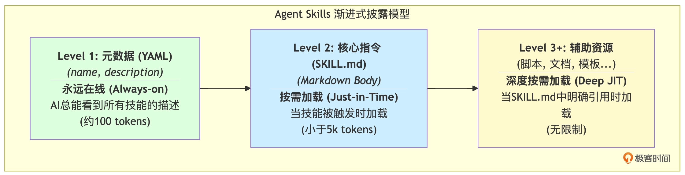
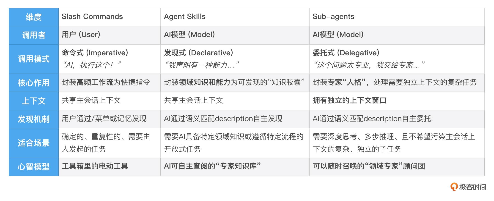
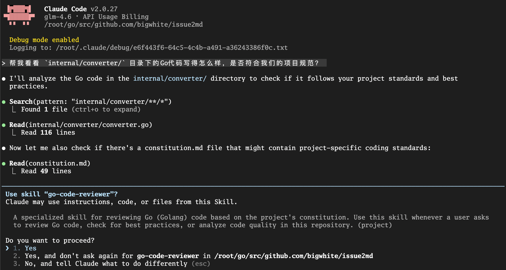
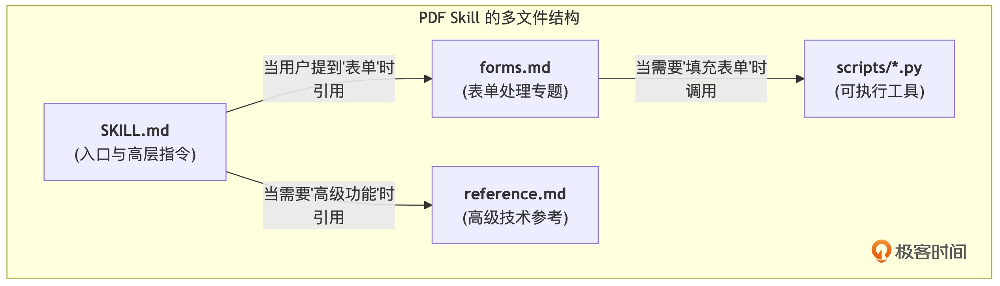

# 13 | 智能涌现的基石：精通AgentSkills，为AI植入专家能力

你好，我是 Tony Bai。

在前面的几讲中，我们已经学会了多种为 AI“赋能”的方法。我们用 Slash Commands 将复杂工作流封装为用户可以主动调用的指令；我们用 Hooks 在 AI 生命周期的特定节点上，植入了被动触发的自动化脚本；我们还用 MCP 服务器为 AI 连接了广阔的外部世界。

我们的 AI 伙伴 Claude Code，已经越来越像一个通用的（General-Purpose）问题解决专家。它能读文件、能跑测试、能操作 Git，几乎无所不能。

然而，一个深刻的矛盾也随之浮现：

- “随着模型能力的提升，我们现在可以构建出能够与完整计算环境交互的通用智能体……但当这些智能体变得越来越强大时，我们就需要一种可组合、可扩展、可移植的方式，来为它

- 们装备领域特定的专业知识。”

这段话精辟地指出了通用 AI Agent 面临的核心挑战：如何在保持其“通用性”的强大基础上，优雅地解决“专业性”的问题？

我们不可能为每一个垂直领域（比如“处理公司财务报表”“遵循团队 Figma 设计规范”“分析Kubernetes 日志”）都去从零开始训练一个专门的大模型，那样的成本是天文数字。我们也不

```
想把所有领域的专业知识都一股脑地塞进一个巨大的、难以维护的 CLAUDE.md 文件里，那样
```

会迅速撑爆 AI 的上下文窗口，导致其性能下降和“认知混乱”。

我们需要一种更先进的知识封装和调用机制。这种机制，应该能让我们的专业知识像一个个独立的“知识插件”一样存在，只有在 AI 处理相关任务时，才被精准地、动态地、高效地加载进来。

这，正是 Anthropic 给出的革命性答案——Agent Skills（智能体技能）。

今天这一讲，我们将深入探索 AI“智能涌现”的基石。你将理解 Skills 为何是一种全新的能力封装范式，学会如何将我们已有的知识和指令，升维成可被 AI 自主发现和调用的“技能”，并深刻辨析它与 Slash Commands、Sub-agents 之间的核心区别。掌握 Skills，意味着你将开始让AI 从一个“听话的执行者”，向一个“博学的思考者”进化。

## 从“指令”到“技能”：为什么说 Agent Skills 是能力涌现的关键？

要理解 Skills 的革命性，我们必须先厘清“指令”（Instruction）与“技能”（Skill）之间的本质区别。

- 指令（如 Slash Command）：是一个“祈使句”。它由用户发起，明确地告诉 AI“去做这件

```
事”。例如，/review-go-code。
```

- 技能（Skill）：是一段“陈述句”。它由开发者预先定义，安静地躺在那里，向 AI“自我介绍”：“我是一种能做某件事的能力”。例如，“我是一个能够根据 Go 项目规范审查代码的技能”。

这种从“命令”到“声明”的转变，引发了调用模式的根本性变革：

```
Slash Commands 是用户调用的。AI 处于被动等待状态，只有当你明确输入 /command
```

- 时，它才会去执行。

- Agent Skills 是模型调用的。AI 在接收到你的自然语言任务后，会主动地、自主地在它的“技能库”中进行扫描，寻找与当前任务最匹配的 Skill，然后加载并执行它。

这，就是“智能涌现”的关键。 我们不再需要为每一个任务都设计一个精确的指令。我们只需要像建设一个图书馆一样，不断地用标准化的格式，为 AI 丰富它的“技能库”。AI 则会像一个聪明的学者，根据自己要研究的课题，自主地去图书馆里查找并使用最相关的书籍和工具。

## 技能的解剖学：一个 Skill 的具体形态

那么，一个 Skill 在我们的文件系统中，究竟长什么样？它并非一个抽象的概念，而是一个极其简单、标准化的文件夹结构。这是你必须掌握的关于 Skill 的第一个核心知识点。

### 1. 基础结构：一个文件夹 + 一个 SKILL.md

```
在最简单的情况下，一个 Skill 就是一个包含 SKILL.md 文件的目录。
my-first-skill/
└── SKILL.md
这个 SKILL.md 文件，就是这个技能的“灵魂”和“大脑”，它由两部分构成：
YAML Frontmatter（元数据）：文件最顶部由 --- 包围的区域。它定义了这个技能的“身份
证”。其中，name（技能的唯一标识）和 description（技能的功能和触发时机的描述）
```

- 是必须的。

- Markdown Body（指令主体）：文件的主体部分。它包含了当这个技能被激活时，AI 需要遵循的具体步骤、指南和示例。

```
---
name: my-skill-name
description: A clear description of what this skill does and when to use it.
---
# My Skill Name
[这里是AI在激活此技能时需要遵循的具体指令...]
```

### 2. 进阶结构：封装脚本与辅助文档

当一个技能变得复杂时，我们可以将不同的知识和工具，拆分到不同的文件中，形成一个自包

```
含的“知识胶囊”。下面是官方 document-skills-pdf 示例所展示的高级模式。
pdf-processing-skill/
├── SKILL.md          # 技能的入口和核心指令
├── forms.md          # 专门处理PDF表单的详细指南
├── reference.md      # 更深入的PDF处理技术参考
└── scripts/
   ├── fill_form.py  # 可被SKILL.md中指令调用的Python脚本
   └── ...           # 其他辅助脚本
在这个结构中，SKILL.md 扮演了“总纲”或“路由”的角色，它会在适当的时候，引导 AI 去阅读
forms.md 或调用 scripts/ 目录下的脚本。在稍后的“深度剖析”小节我们还会进一步对这
```

个示例做探究。

### 3. 部署位置：Project 级 vs. User 级

你创建的这些 Skill 文件夹，可以放在两个标准位置，这决定了它们的作用域：

- Project Skills（团队共享）：

```
位置：项目根目录下的 ./.claude/skills/project-first-skill。
```

- 特点：这些技能会随着项目一起被提交到 Git 仓库。团队中的任何成员，只要克隆了项目，就能立即拥有这些技能。

```
用途：封装团队共享的最佳实践、项目特定的工作流。例如，go-code-reviewer、
deploy-to-staging。
```

- Personal Skills（个人专属）

```
位置：用户主目录下的 ~/.claude/skills/my-person-skill。
```

- 特点：这些技能只存在于你自己的机器上，可以在你所有的项目中随时被 AI 发现和调用。

```
用途：封装你个人的高频习惯、私人脚本工具集。例如，summarize-git-diff、
translate-to-english。
```

Claude Code 在启动时，会自动扫描这两个目录，构建起它可用的“技能库”。现在，我们已经清晰地看到了一个 Skill 的“物理形态”。接下来，让我们深入其内部，探索那个让这一切高效运转的神奇机制。

## “渐进式披露”：解决 AI 上下文瓶颈的优雅之道

Agent Skills 的设计哲学，可以用四个词来概括：可组合（Composable）、可移植（Portable）、高效（Efficient）、强大（Powerful）。而支撑这一切的核心机制，是一种被称为“渐进式披露（Progressive Disclosure）”的信息加载策略。

这是一种极其优雅的架构设计，它完美地解决了“为 AI 提供海量专业知识”与“保持其上下文窗口（Context Window）轻量高效”之间的根本矛盾。

我们可以通过一个三层信息加载模型来理解其精髓：



这个三层模型，就像是为 AI 设计的一套高效的“记忆检索系统”，让我们来逐层剖析：

1. Level 1：元数据（发现层 / 能力索引）：当 Claude Code 启动时，它会扫描所有可用的

```
Skills。但关键在于，它只加载每个 SKILL.md 文件最头部的 YAML Frontmatter，特别是
name 和 description 字段。这些极其简短的描述会被永久地注入到 AI 的系统提示
```

- （System Prompt）中。 这相当于为 AI 构建了一个可无限扩展的“能力索引”。AI 的知识库可以无限大，但它的“工作记忆”却只存放了索引，成本极低。这就是 Skills 解决可扩展性（Scalability）问题的答案。

2. Level 2：核心指令（触发层 / 即时加载）：当用户提出一个任务时，AI 会用这个任务的意图去和它脑中的“能力索引”进行语义匹配。如果匹配成功，AI 就“触发”了这个 Skill。此时，它

```
才会去真正地读取那个 SKILL.md 文件的主体内容（Markdown Body）。 这个过程，就是
```

- 一种“即时加载（Just-in-Time Loading）”专业知识的体现。当 AI 需要成为一个“PDF 专家”

```
时，它才去“阅读”那本名为pdf-skill.md的专业书籍，而不是把它所有的书都背在身上。
```

- 这完美地解决了上下文效率（Efficiency）的问题。

```
Level 3+：辅助资源（执行层 / 深度按需加载）：如果 SKILL.md 中的指令，又引用了该
Skill 目录下的其他文件（比如一个 Python 脚本 helper.py），AI 只有在执行到那一步
```

- 时，才会去加载那个具体的文件。 这是更深层次的按需加载，它允许我们构建包含大量脚本、模板、数据和文档的、极其复杂的 Skill，而不用担心会一次性撑爆 AI 的上下文窗口。这赋予了 Skills 强大的（Powerful）能力。

那么，Skills 又是如何实现可组合性与可移植性的呢？

- 可移植性（Portable）：源于其标准化的文件夹结构。就像之前所讲解的那样，一个 Skill 本质上就是一个自包含的文件夹，你可以轻松地在不同项目、不同团队成员之间通过 Git 进行

- 复制和共享，甚至跨 Claude Code、Claude API 等不同产品使用。Build once, useeverywhere.

- 可组合性（Composable）：源于 AI 模型的自主协调能力。如果一个复杂任务同时触及多个

```
技能的 description，AI 能够像一个项目经理一样，先后或交错地调用这些技能，共同
```

- 完成最终任务。

综上所述，“渐进式披露”架构与“可移植、可组合”的特性，共同构成了 Agent Skills 的基石，使其成为通用 AI Agent 装备领域专业知识的理想解决方案。

## 核心辨析：Skills vs. Slash Commands vs. Sub-agents

要真正理解 Agent Skills 的独特价值，我们还必须将它置于一个更广阔的能力版图中。这张版图主要由三种强大的扩展方式构成：我们已经掌握的 Slash Commands，正在学习的 AgentSkills，以及我们即将在下一讲深入的 Sub-agents。它们看似相似，但定位和适用场景却截然不同。



简单来说，如何选择？

- 当你希望自己能方便快捷地触发一个固定流程时，用 Slash Command。

- 当你希望 AI 在处理某个特定领域的问题时，能自动地、更聪明地工作时，用 Agent Skill。

- 当你希望 AI 能将一个复杂的大问题，分包给一个不会干扰你当前对话的“专家分身”去独立解决时，用 Sub-agent。

## 实战：将我们的 /review-go-code 指令，升维为可自主调用的 Skill

理论已经清晰，现在让我们进行一次激动人心的“升维”实战。我们将把在第 8 讲中创建的

```
/review-go-code 这个 Slash Command，改造为一个更智能、可被 AI 自主发现的 Agent
```

Skill。

### 第一步：创建 Skill 目录结构

```
根据官方规范，Project 级的 Skill 应该存放在 ./.claude/skills/ 目录下。我们为新的
```

Skill 创建一个目录：

```bash
mkdir -p ./.claude/skills/go-code-reviewer
目录名 go-code-reviewer 将成为这个 Skill 的 ID。
```

### 第二步：创建并编写 SKILL.md

```
在该目录下，创建核心文件 SKILL.md，并将我们之前 Slash Command 的核心逻辑，用
```

Skill 的格式进行重新组织。

```
./.claude/skills/go-code-reviewer/SKILL.md
---
name: Go Code Reviewer
description: A specialized skill for reviewing Go (Golang) code based on the proj
allowed-tools: Read, Grep, Glob
---
# Go Code Reviewer Skill
## 核心能力
本技能专用于根据本项目的开发“宪法” (`constitution.md`)，对Go语言代码进行深入、专业的审查。
## 触发条件
```

- 当用户的请求包含以下关键词时，你应该优先考虑激活本技能：

```
- "审查/review Go代码"
- "检查代码质量"
- "看看这段Go代码写得怎么样"
- "是否符合规范"
## 执行步骤
```

- 当你决定使用本技能时，必须严格遵循以下步骤：

```
1.  **加载核心准则:** 首先，你必须读取项目根目录下的 `constitution.md` 文件。这是你所有审查工
2.  **定位审查目标:** 确定用户要求审查的代码范围。这可能是一个文件（通过`@`指令提供），或是一个目
3.  **逐条审查:** 根据`constitution.md`中定义的**每一条原则**（如简单性、测试先行、明确性、
4.  **生成报告:** 按照以下Markdown格式，生成一份结构化的审查报告。报告必须直接回应“宪法”中的条
## 输出格式 (必须遵循)
### 总体评价
```

- 一句话总结代码的整体质量和合宪性。

```
### 优点 (值得称赞的地方)
- 列出1-2个最符合项目开发哲学的闪光点。
### 待改进项 (按优先级排序)
#### [高优先级] 违宪问题 (Violations of Constitution)
- **原则:** [引用违反的宪法条款，如：“第三条：明确性原则”]
- **位置:** `[文件名]:[行号]`
- **问题描述:** [清晰描述代码是如何违反该原则的]
- **修改建议:** [提供具体的、可执行的修改方案]
#### [中优先级] 建议性改进
- **位置:** `[文件名]:[行号]`
- **问题描述:** [描述可以进一步优化的地方]
- **修改建议:** [提供改进建议]
```

### 第三步：升维分析

```
让我们对比一下这个 SKILL.md 和我们之前的 Slash Command，看看发生了哪些关键的“升
```

维”：

```
从“被动执行”到“主动思考”：Slash Command 的内容是：“请审查 @$1…”，它是一个直接
```

- 的命令。而 Skill 的内容是：“本技能专用于审查…当你决定使用本技能时，请遵循以下步骤…”，它在向 AI 描述一种能力，并编程 AI 在使用该能力时的思考和行动流程。

```
description 的魔力：新增的 description 字段是关键。Use this skill
whenever a user asks to review Go code... 这部分，就是在为 AI 的“自主发
```

- 现”机制，提供最关键的“索引关键词”。

3. 更强的流程控制：Skill 中的“执行步骤”和“输出格式”部分，比 Slash Command 中的指令更详细、更具强制性。这是因为当 AI 自主调用一个能力时，我们需要比用户手动调用时，给予它更严格的流程约束，以保证输出的稳定性和可靠性。

通过这次升维，我们不再是简单地创建一个快捷方式。我们实际上是在封装并声明了一份关

```
于“Go 代码审查”的领域专业知识。我们的 description 字段，就是这份专业知识的“API 文
```

档”，供 Claude Code 这个“通用智能体平台”来发现和调用。这完美地解决了我们开篇提到的“通用 vs. 专精”的矛盾。

### 第四步：验证效果

```
现在，删除我们之前创建的 /review-go-code Slash Command 文件（以避免混淆）。然
后，以 --debug 模式启动一个新的 Claude Code 会话，在 debug 日志的启动日志中，你可
```

以看到 Claude Code 对我们定义的 Skill 的加载：

```
[DEBUG] Skills and commands included in Skill tool: Go Code Reviewer
```

然后，在这个会话中，我们不再使用指令，而是用一句非常自然的、口语化的方式提出请求：

```
帮我看看 internal/converter/ 目录下的 Go 代码写得怎么样，是否符合我们的项目规
```

- 范？

接下来，你可能会在 Claude Code 的思考阶段看到类似这样的内部思考过程，包括读取 Go

```
代码、读取 constitution.md 以及匹配我们的 go-code-reviewer Skill 的操作：
```



```
授权执行后，Claude Code 会使用该 Skill 输出一份完全符合我们在 SKILL.md 中定义的、结
```

构严谨、内容专业的代码审查报告。在我的环境下，这份报告如下：

```go
> The "Go Code Reviewer" skill is running
 ⎿  Allowed 3 tools for this command
● 代码审查报告：internal/converter/converter.go
 总体评价
 代码基本遵循了项目的简单性原则，但在错误处理和测试覆盖方面存在明显的违宪问题。
 优点 (值得称赞的地方)
 - 简单性原则践行良好: 使用标准库strings.Builder进行字符串拼接，避免引入不必要的依赖
 - 单一职责清晰: 专注于Markdown转换逻辑，符合converter包的职责定位
 - 代码结构简洁: 函数逻辑直接，易于理解和维护
 待改进项 (按优先级排序)
 [高优先级] 违宪问题 (Violations of Constitution)
 1. 错误处理缺失
 - 原则: 第三条：明确性原则 - 3.1 (错误处理)
 - 位置: internal/converter/converter.go:55-115
 - 问题描述: 所有公共函数(IssueToMarkdown, PullRequestToMarkdown, DiscussionToMarkdo
 字段为空或包含异常数据，函数会产生格式错误的Markdown，但没有任何错误提示
 - 修改建议:
 func IssueToMarkdown(issue *github.Issue, comments []github.Comment, enableUser
     if issue == nil {
         return "", fmt.Errorf("issue cannot be nil")
     }
     // ... 其他验证和处理
 }
 2. 缺少测试覆盖
 - 原则: 第二条：测试先行铁律 - 不可协商
 - 位置: 整个internal/converter/包
 - 问题描述: 包中没有任何测试文件，严重违反了"测试先行"的核心原则
 - 修改建议: 立即创建converter_test.go文件，为每个公共函数编写表格驱动测试，覆盖正常情况、边
 3. 公共API缺少GoDoc注释
 - 原则: 第三条：明确性原则 - 3.3 (注释的意义)
 - 位置: internal/converter/converter.go:55,76,97
 - 问题描述: 三个主要公共函数都缺少GoDoc格式的注释，违反了"所有公共API都必须有清晰的GoDoc注释
 - 修改建议:
 // IssueToMarkdown converts a GitHub issue and its comments to Markdown format.
 // It includes the issue title, metadata, description, and optionally user prof
 // Returns the formatted Markdown string or an error if the input is invalid.
 func IssueToMarkdown(issue *github.Issue, comments []github.Comment, enableUser
 [中优先级] 建议性改进
 1. 代码重复
 - 位置: internal/converter/converter.go:55-95
 - 问题描述: IssueToMarkdown和PullRequestToMarkdown函数逻辑几乎完全相同，存在明显的代码重
 - 修改建议: 提取公共函数，减少重复：
 func itemToMarkdown(title string, number int, url string, user github.User, bod
 []github.Comment, enableUserLinks bool) string {
     // 公共逻辑
 }
 2. 常量定义不完整
 - 位置: internal/converter/converter.go:11
 - 问题描述: 定义了githubBaseURL常量，但Markdown中还有其他硬编码的字符串
 - 修改建议: 将格式化字符串也提取为常量，提高可维护性
 3. 函数参数过多
 - 位置: internal/converter/converter.go:21
 - 问题描述: writeComment函数有4个参数，可以考虑使用结构体封装
 - 修改建议: 定义CommentConfig结构体来传递配置参数
● 总结： internal/converter/ 目录下的Go代码在简单性方面表现良好，但存在严重违反项目宪法的问题
```

- 建议优先修复错误处理和添加测试覆盖，以确保代码的健壮性和可维护性。

我们成功了！我们不再需要记住并输入一个精确的指令，AI 已经学会了自主地、智能地从它的“技能库”中，为我们的任务匹配并执行最合适的解决方案。

## 深度剖析：从官方 PDF Skill 示例看高级模式

```
我们的 go-code-reviewer 是一个简洁的单文件 Skill。但 Skills 的真正威力，在于它们能
```

够封装包含多个辅助文档和可执行脚本的复杂能力。

```
为了理解这种高级模式，让我们来剖析一下 Anthropic 官方提供的 document-skills-pdf
```

这个生产级的 Skill。它的目标是让 Claude 具备处理 PDF 文件的超能力。

### 目录结构剖析

这个 Skill 的目录结构，完美地诠释了“渐进式披露”的思想：

```
pdf/
├── SKILL.md          # Level 2: 核心入口和指令
├── forms.md          # Level 3+: 专门处理PDF表单的详细指南
├── reference.md      # Level 3+: 更深入的PDF处理技术参考
└── scripts/
   ├── fill_form.py  # Level 3+: 可被SKILL.md中指令调用的Python脚本
   └── ...           # 其他辅助脚本
```



### 工作流解读

```
当用户提出一个与 PDF 相关的任务，如“帮我从这份合同 contract.pdf 里提取表格”，
AI 会匹配到 pdf Skill 的 description，并加载 SKILL.md。
SKILL.md 的主体内容，就像一个“路由”。它告诉 AI：
If you need to fill out a PDF form, readforms.mdand follow its instructions.For advanced
features… seereference.md.
假设用户的任务是填充表单，AI 就会接着去读取 forms.md。这份文件包含了处理 PDF 表
```

- 单的两种情况：“可填充字段”和“不可填充字段”的详细工作流。

```
在 forms.md 的指引下，AI 可能会被要求执行一个位于 scripts/ 目录下的 Python 脚
本，比如 extract_form_field_info.py，来分析 PDF。
最关键的一点：forms.md、reference.md 和那些 Python 脚本，只有在被明确“提及”
```

- 时，才会被加载到上下文中。AI 在处理一个简单的文本提取任务时，完全不会知道

```
forms.md 的存在，从而极大地节省了 Token。
```

这个官方示例，为我们揭示了设计复杂 Skill 的最佳实践：将你的专业知识，像写一本结构清

```
晰的书一样组织起来。SKILL.md 是“目录”，辅助文档是“章节”，而可执行脚本，则是可以随
```

时取用的“工具箱”。

## Skills 的设计哲学与最佳实践

通过上面的学习和实战，我们已经掌握了创建和使用 Agent Skills 的核心技术。但在你开始为自己的项目构建庞大的“技能库”之前，我们有必要停下来，吸收一下来自 Anthropic 官方和社区沉淀下来的设计哲学与最佳实践。

遵循这些原则，能让你创造出的 Skills，不仅功能强大，而且真正地“AI 友好”，能够被 ClaudeCode 更精准地发现和更可靠地执行。

### 保持技能的“单一职责”

这可能是最重要的第一原则。一个好的 Skill，应该像一个好的 Go 函数一样，只做好一件事。

```
反模式（Too Broad）：创建一个名为 document-processing 的巨大 Skill，里面包含了处
```

理 PDF、Word、Markdown 的所有逻辑。

```
最佳实践（Focused）：创建三个独立的 Skill：pdf-form-filling、word-doc-
analysis、markdown-table-generator。
```

为什么？

```
提升发现精度：当技能职责单一时，它的description就能写得极其精准。AI 在匹配任务
```

- 时，就不太可能“选错技能”。

- 优化上下文效率：用户处理 PDF 时，AI 就只加载 PDF 相关的知识，完全不会被 Word 的指令所干扰，极大地节省了 Token。

- 增强可组合性：多个单一职责的技能，更容易被 AI 智能地组合起来，解决更复杂的跨领域任务。

### 精心撰写“技能广告语”

```
description 字段是 AI 发现你技能的唯一入口。你必须像一个顶级的广告文案写手一样，
精心打磨它。一个好的 description 必须清晰地回答两个问题：“这个技能能做什么？”和
```

“什么时候该用它？”。

```
反模式（Vague）：yaml description: For files。
最佳实践（Clear）：yaml description: Analyze Excel spreadsheets,
create pivot tables, and generate charts. Use when working with
Excel files, spreadsheets, or analyzing tabular data in .xlsx
format. 这个描述不仅说明了能力（分析、创建透视表、生成图表），还给出了明确的触
```

- 发关键词（Excel, spreadsheet, .xlsx），极大地降低了 AI 的“选择困难症”。

### 与团队一起“测试”和“演进”

Skills 并非一蹴而就。一个真正好用的 Skill，是在团队的实际使用中不断打磨出来的。你应该鼓励团队成员：

```
主动反馈：“我希望 AI 帮我做 X，但它没有调用 Y 技能，是不是 Y 技能的 description
```

- 不够好？”

```
共同建设：在 SKILL.md 中，像维护代码一样，通过注释或专门的章节，记录下使用的
```

- “坑”和成功的“模式”。

```
版本化文档：为你的 SKILL.md 添加版本历史。这对于团队共享的技能至关重要，它能让
```

- 成员清晰地了解一个技能的能力边界在何时发生了变化。

```
## Version History
- v2.0 (2025-10-21): Added support for processing password-protected PDFs.
- v1.0 (2025-09-10): Initial release, supports text extraction and form filling.
```

最后，我们必须认识到，Agent Skills 是一个非常新的、仍在快速演进的特性。它代表了 AIAgent 能力扩展的前沿方向，但其应用的最佳实践和最终形态，仍在被社区和我们每一位开发者共同塑造。

## 本讲小结

今天，我们一起解锁了 AI 能力扩展的全新维度——Agent Skills。我们让 AI 从一个只会“听令行事”的士兵，开始向一个能够“自主决策”的班长进化。

首先，我们从 AI 架构演进的高度，理解了 Skills 是为了解决通用 Agent 的领域专业化这一核

```
心挑战而生的。接着，我们详细解剖了一个 Skill 的具体形态，掌握了其文件夹 +SKILL.md
```

的基础结构，以及 Project 级和 User 级的部署方式。

```
然后，我们深入了 Agent Skills 的工作原理，特别是其基于 description 的发现机制和“渐
```

进式披露”的高效上下文管理策略，这是其能够兼顾强大功能与上下文效率的关键。我们还通过一张清晰的对比表，系统性地辨析了 Skills、Slash Commands 和 Sub-agents 这三大能力扩展方式的定位和心智模型。

最后，通过两个实战和四大最佳实践的学习，我们不仅掌握了 Skills 的设计与应用，更学会了如何创造出真正“AI 友好”、高质量的技能。

掌握 Agent Skills，意味着你开始以一种全新的、更高级的方式来“编程”AI。你不再是为 AI 编写一次性的“脚本”（Prompt），而是在为它构建一个可复用的、可发现的、不断成长的“能力库”。然而，无论是 Slash Commands, 还是 Agent Skills，它们都运行在主会话中，与我们的主要任务共享同一个上下文空间。如果 AI 需要处理一个极其复杂、需要深度思考、可能会产生大量“上下文噪音”的独立子任务，我们该怎么办？

这就是我们下一讲要探讨的主题：智能分身——精通 Sub-agent。我们将学习如何为 AI 创建拥有独立上下文的“专家分身”，让它们在不干扰主线任务的情况下，并行地、深度地解决复杂难题。

## 思考题

我们今天学习了设计 Skills 的四大最佳实践，其中最核心的两点是“保持技能单一职责”和“精心撰写 description”。现在，请你想象一个更复杂的场景：为一个 Go 微服务项目，设计一套（至少 3 个）相互关联的 Agent Skills。

```
你不必写出完整的 SKILL.md 内容，但需要思考并回答以下问题：
你会创建哪几个单一职责的技能？（例如，api-scaffolder、db-migrator、k8s-
deployer…）
请为其中一个你认为最重要的技能，精心撰写 **description。思考一下，你应该在这个
```

- 描述里放入哪些关键词，才能让 AI 在最恰当的时机，“想起”并激活这个 Skill？

欢迎在评论区分享你的“技能系统”设计！这个练习将考验你是否真正掌握了将复杂工作流，拆解为 AI 可发现、可组合的“能力单元”的思维方式。如果你觉得这节课的内容对你有帮助的话，也欢迎你分享给需要的朋友，我们下节课再见！
