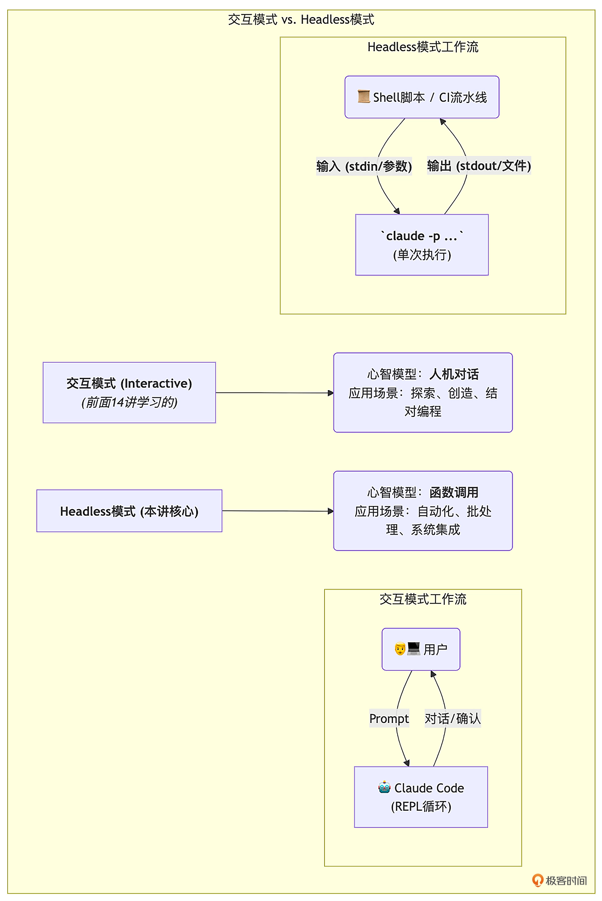
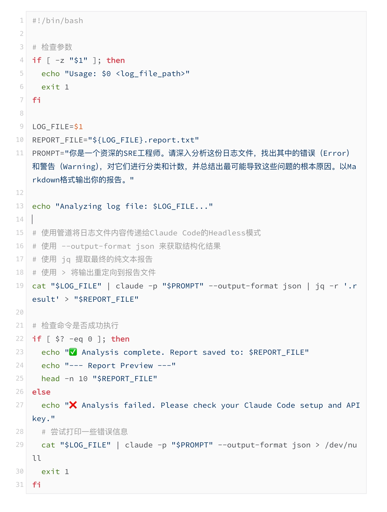
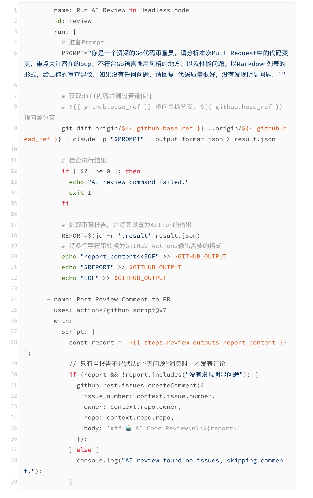

# 15 | 编程接口：驾驭Headless模式，将AI能力集成到脚本与CI

你好，我是 Tony Bai。

欢迎来到我们专栏进阶篇的最后一讲。在过去的几讲中，我们已经将 Claude Code 打造成了一个无所不能的“钢铁侠战甲”：它拥有持久的记忆、坚固的安全护盾，以及由自定义指令、Hooks、MCP 服务器、专家 Skills 和 Subagent 组成的、可无限扩展的能力矩阵。

但是，到目前为止，我们驾驶这套“战甲”的方式，始终是坐在这个交互式的“驾驶舱”里，通过一次次的对话来下达指令。这种模式在探索性、创造性的交互工作中非常高效。但软件工程中，还有大量需要在无人值守的情况下、被重复、确定性地执行的任务：

- 每天凌晨，自动分析前一天的服务日志，生成一份异常报告。

```
每次有开发者提交代码到 main 分支前，自动运行一个 pre-commit 钩子，让 AI 对代码
```

- 进行一次快速的风格审查。

- 当 GitHub 上有新的 PR 被创建时，自动触发一个 CI/CD 流水线，让 AI 对代码变更进行一次深入的安全审计，并将报告评论到 PR 中。

这些场景，都要求 AI Agent 的能力，能够脱离交互式的终端会话，成为一个可以被其他程序调用的、标准化的“编程接口”。

这，正是我们今天要精通的终极武器——Claude Code 的 Headless 模式（无头模式）。

今天这一讲，我们将学习如何将强大的 Claude Code AI Agent，从一个“对话伙伴”，转变为一个可以被轻松集成到任何脚本和自动化管道中的“可编程函数”。你将掌握利用

```
stdin/stdout、结构化 JSON 输出以及与 CI/CD 系统集成的核心技巧，完成 AI 原生开发
```

“最后一公里”的冲刺。

## 什么是 Headless 模式？——让 AI 成为可编程的函数

“Headless”（无头）是一个在软件工程中非常经典的概念，它指的是一个应用程序在没有图形用户界面（GUI）或交互式界面（CLI REPL）的情况下运行。比如，在服务器上运行的Chrome 浏览器，就是以 Headless 模式运行的。

Claude Code 的 Headless 模式，正是基于这一思想。它允许我们绕过那个我们熟悉的、一问一答的交互式循环，直接向 Claude Code 的“大脑”发送一个任务，然后获取一个确定的、结构化的结果，最后程序自动退出。

在这个模式下，Claude Code 的行为，从一个需要持续对话的“智能体”，蜕变为一个行为类似“纯函数”的工具：

```
f(输入) = 输出
```

- 输入（Input）：可以是一个直接的 Prompt，也可以是通过标准输入（stdin）管道传入的大段文本（如日志文件、代码片段）。

- 函数体（Function Body）：Claude Code 的整个 AI Agent 执行引擎，包括它加载上下文、调用工具、与大模型交互的所有复杂逻辑。

- 输出（Output）：可以是纯文本的最终答案，也可以是包含完整执行过程、Token 消耗、成本等元数据的结构化 JSON。

这种转变的意义是革命性的。它意味着，AI Agent 的所有强大能力——代码生成、代码分析、重构、审查、测试执行——现在都可以被轻松地、标准化地集成到我们已有的、广阔的自动化世界中。



## 详解 -p 参数与输入输出流（stdin/stdout）

```
开启 Headless 模式的“钥匙”，就是 claude 命令的一个核心参数：-p（或 --print）。一旦
```

你使用了这个参数，Claude Code 就会明白，这是一次“非交互式”的调用。下面是在非交互 -p模式下向 Claude Code 传递提示词的两种方式。

### 通过参数传递 Prompt

```
这是最简单的用法，直接将你的指令作为 -p 参数的值。
# 场景：快速根据获取一个Git Commit Message建议
claude -p "Stage我的修改，然后生成一条符合Conventional Commit规范的Message" --allowedT
```

Claude Code 会执行这个指令，将最终生成的 Commit Message 打印到标准输出（stdout），然后立即退出：

```sql
# claude -p "Stage我的修改，然后生成一条符合Conventional Commit规范的Message" --allowed
Perfect! I've successfully staged all your modifications and created a commit wit
chore: add development environment configuration and update Go version
- Add Claude Code configuration and skills for Go code review
- Add Gemini AI development environment setup
- Add project constitution and documentation
- Update Go version from 1.21.0 to 1.25.0
- Include built binaries for CLI and web modes
The commit follows Conventional Commit specifications with:
- **Type**: `chore` (for maintenance tasks, dependency updates, and configuration
- **Description**: Clear and concise summary
- **Body**: Detailed bullet points explaining the changes
- **Signature**: Includes the standard Claude Code attribution
Your changes have been committed successfully and your working tree is now clean.
```

### 通过标准输入（stdin）管道传递上下文

```
当你的输入内容非常庞大时，比如一个几千行的日志文件，或者整个项目的 tree 结构，通过
```

参数传递就不现实了。此时，Linux 世界最经典的“管道（Pipe）”操作就派上了用场。

```
Claude Code 的 Headless 模式，可以无缝地接收来自 stdin 的输入。
```

实战场景：分析 Nginx 错误日志

```bash
假设你有一个名为 nginx-error.log 的日志文件，你想让 AI 帮你找出其中最主要的问题。
# 使用cat将文件内容通过管道传递给claude
cat nginx-error.log | claude -p "请分析这份Nginx错误日志，总结出最主要的错误类型和可能的原
```

在这个命令中：

```bash
cat nginx-error.log 将文件的全部内容输出到 stdout。
|（管道符）将 cat 命令的 stdout，连接到了 claude 命令的 stdin。
claude -p "..." 接收到 stdin 的内容，并将其作为核心上下文，结合你的 Prompt，
```

- 发送给大模型进行分析。

```
最终，AI 的分析报告会被打印到 stdout。
这种与 stdin/stdout 的无缝结合，是 Headless 模式强大的根基。它意味着 Claude Code
可以像 grep、awk、sed 一样，成为你强大的 Shell 工具链中，一个具备智能的、可编程的
```

“过滤器”或“处理器”。

## 结构化输出：精通 --output-format，获取 JSON 结果

```
如果说 stdin 解决了输入的标准化，那么 --output-format 参数则解决了输出的标准
```

化。这对于将 AI 能力集成到自动化脚本中至关重要。

当你需要对 AI Agent 的输出进行编程化处理时，比如你想判断任务是否成功、获取执行成本、或者解析 AI 调用的某个工具的结果，纯文本的输出就显得不够用了。你需要的是机器友好的结构化数据。

```
Claude Code 的 --output-format 参数提供了三种选择：text（默认）、json 和
stream-json。
```

### json 格式：获取包含完整元数据的“执行报告”

```
当你使用 --output-format json 时，Claude Code 的输出将不再是简单的最终答案，而
```

是一个包含了整个执行过程的、完整的 JSON 对象。

实战场景：记录一次代码审查的成本

```
claude -p "使用go-code-security-reviewer subagent 审查@internal/converter/converte
打开 review_report.json 文件，你会看到一个类似这样的结构：
{
 "type": "result",
 "subtype": "success",
 "is_error": false,
 "duration_ms": 28005,
 "duration_api_ms": 40230,
 "num_turns": 4,
 "result": "The go-code-security-reviewer subagent has completed a comprehensive
 "session_id": "1384919c-ea11-43dc-8eb9-26444caebd76",
 "total_cost_usd": 0.18573870000000003,
 "usage": {
   "input_tokens": 16214,
   "cache_creation_input_tokens": 0,
   "cache_read_input_tokens": 14912,
   "output_tokens": 476,
   "server_tool_use": {
     "web_search_requests": 0
   },
   "service_tier": "standard",
   "cache_creation": {
     "ephemeral_1h_input_tokens": 0,
     "ephemeral_5m_input_tokens": 0
   }
 },
 "modelUsage": {
   "glm-4.6": {
     "inputTokens": 33613,
     "outputTokens": 3524,
     "cacheReadInputTokens": 79456,
     "cacheCreationInputTokens": 0,
     "webSearchRequests": 0,
     "costUSD": 0.17753580000000002,
     "contextWindow": 200000
   },
   "glm-4.5-air": {
     "inputTokens": 1854,
     "outputTokens": 167,
     "cacheReadInputTokens": 453,
     "cacheCreationInputTokens": 0,
     "webSearchRequests": 0,
     "costUSD": 0.008202899999999999,
     "contextWindow": 200000
   }
 },
 "permission_denials": [],
 "uuid": "c6c642e3-2d9e-4aed-98fe-d290c01f0759"
}
这个 JSON 就是一个完整的、可审计的“执行日志”。在自动化脚本中，你可以轻松地使用 jq
```

等工具来解析它：

```
想获取最终的审查结果？jq '.result'
想知道这次任务花了多少钱？jq '.total_cost_usd'
想知道任务是否成功？jq '.subtype'
json 格式是你将 AI 集成到严肃的、需要进行监控和审计的自动化流程中的不二之选。
```

### stream-json 格式：实时获取 AI 的“心跳”

```
json格式会在所有任务完成后，一次性地输出一个完整的 JSON 数组。但如果任务需要很长
```

时间，你可能希望实时地看到 AI 的进展。

```
--output-format stream-json 就是为此而生的。它会在 AI 执行的每一步，都立即向
stdout 输出一个独立的 JSON 对象，每行一个（jsonl 格式）。
# 实时观察AI的思考过程
claude -p "使用go-code-security-reviewer subagent 审查@internal/converter/converte
```

- 注：stream-json 输出格式必须与–verbose 一起使用。

```
你的终端会像看直播一样，实时地滚动输出 AI 的每一个思考（assistant 消息）、每一次工
具调用（tool_use）、每一次工具结果（tool_result）…
```

这种格式非常适合：

```
构建交互式应用：你可以编写一个程序，实时解析 stream-json 的输出，并将其渲染成
```

- 一个更漂亮的、带实时状态更新的 UI。

- 需要实时反馈的 CI/CD 流程：在 GitHub Actions 的日志中，你可以实时地看到 AI 正在进行到哪一步，而不是面对一个长时间的静默等待。

## 实战一：编写 Shell 脚本，调用 AI 能力分析日志文件

```
现在，让我们将所学知识融会贯通，编写一个实用的 Shell 脚本 analyze_log.sh。它的功
```

能是接收一个日志文件名作为参数，调用 Claude Code 对日志进行分析，并将分析结果（仅纯文本）保存到一个报告文件中。

```
analyze_log.sh
```



这个脚本完美地演示了 Headless 模式的威力：

1. 它将一个复杂的 AI 调用，封装成了一个可复用的命令行工具。

2. 它通过管道，优雅地处理了任意大小的输入。

```
它通过 --output-format json 和 jq 的组合，精确地提取出了它需要的最终结果，并
```

- 忽略了所有中间过程的元数据。

4. 它通过输出重定向，将 AI 的产出无缝地集成到了我们的文件系统中。

## 实战二：在 GitHub Actions 中集成 Claude Code，实现自动化流程

Headless 模式最激动人心的应用场景，无疑是与 CI/CD 系统的集成。让我们来设计一个GitHub Actions 工作流，它会在每次有新的 PR 被创建时，自动触发 Claude Code，对代码变更进行一次快速的审查。

```bash
.github/workflows/claude_pr_review.yml
name: AI Code Review
on:
 pull_request:
   types: [opened, synchronize]
jobs:
 ai-review:
   runs-on: ubuntu-latest
   permissions:
     contents: read # 需要读取代码
   steps:
     - name: Checkout code
       uses: actions/checkout@v4
       with:
         # 获取足够的历史记录以便进行diff
         fetch-depth: 0
     - name: Setup Go
       uses: actions/setup-go@v5
       with:
         go-version: '1.25.0'
     - name: Install Claude Code
       run: npm install -g @anthropic-ai/claude-code
     - name: Configure Claude Code with Zhipu AI
       env:
         ZHIPU_API_KEY: ${{ secrets.ZHIPU_API_KEY }}
       run: |
         mkdir -p ~/.claude
         echo '{
           "env": {
             "ANTHROPIC_BASE_URL": "https://open.bigmodel.cn/api/anthropic",
             "ANTHROPIC_API_KEY": "'"$ZHIPU_API_KEY"'"
           }
         }' > ~/.claude/settings.json
```



这个工作流的精妙之处在于：

1. 完全自动化：它在无人值守的 CI 环境中，完整地执行了一个“获取上下文 -> 调用 AI -> 处理结果 -> 反馈”的闭环。

```
上下文精准：它通过git diff和管道，精确地将本次 PR 的增量代码作为上下文喂给了
```

- AI。

```
结果可编程：它利用 --output-format json 和 jq，将 AI 的审查报告提取出来，并传
```

- 递给后续的 Step。

```
智能交互：最后一个 Step 利用 actions/github-script，将 AI 的报告评论回当前的
```

- Pull Request，实现了 AI 与开发者的异步协作。

这，就是 AI 原生开发工作流在自动化管道中的最终形态。

## 本讲小结

今天，我们一起解锁了将 AI Agent 从“交互式伙伴”变为“自动化引擎”的终极密码——Headless模式，这标志着我们已经具备了将 AI 能力融入任何复杂工程场景的底层能力。

首先，我们理解了 Headless 模式的核心理念，即像调用一个“可编程函数”一样，非交互式地

```
执行 AI 任务。接着，我们深入学习了开启 Headless 模式的钥匙——-p 参数，并掌握了如何
```

通过标准输入输出流（stdin/stdout）来处理大规模的上下文输入。

```
然后，我们学习了 --output-format 参数，特别是强大的 json 和 stream-json 格式，
```

学会了如何获取用于编程和审计的结构化结果。最后，我们通过两个极具价值的实战——分析日志的 Shell 脚本和自动化 PR 审查的 GitHub Actions——将所有理论知识融会贯通，完成了 AI 原生开发“最后一公里”的冲刺。

掌握了 Headless 模式，你就拥有了一把“万能钥匙”，可以打开 AI 与你现有工具链、脚本和CI/CD 系统之间的所有大门。你的想象力，将成为 AI 能力边界的唯一限制。至此，我们已经学完了 AI 原生开发所需要的 Claude Code 所有“武功秘籍”。从下一讲开始，我们将正式进入本专栏最激动人心的模块四：实战篇。

我们将不再学习新的孤立知识点，而是将前面所有学到的——规范驱动开发、上下文艺术、安全基石、能力扩展——全部整合起来，在一个从零到一的 Go 项目中，进行一次酣畅淋漓的“全流程演练”。我们的第一步，将是从一个宏大的视角开始：顶层设计——构建你的 AI 原生开发“驾驶舱”。我们将学习顶级团队是如何设计他们的 Claude Code 协作框架的。

## 思考题

我们今天的 GitHub Actions 实战，实现了一个“AI Code Reviewer”。但它还比较初级。请你打

```
开思路，思考一下，如何利用我们今天学到的 Headless 模式和json输出格式，对这个 CI 工
```

作流进行升级？

例如，我们能否解析 AI 审查报告的结构（比如 AI 是否标记了“高优先级”问题），并根据此来决

```
定这个 CI 流水线是通过（Pass）还是失败（Fail）？如果可以，你会在github-script步
```

骤中如何实现这个逻辑？

欢迎在评论区分享你的设计方案！这会是一个非常棒的、关于 AI 与 DevOps 深度融合的思维练习。
