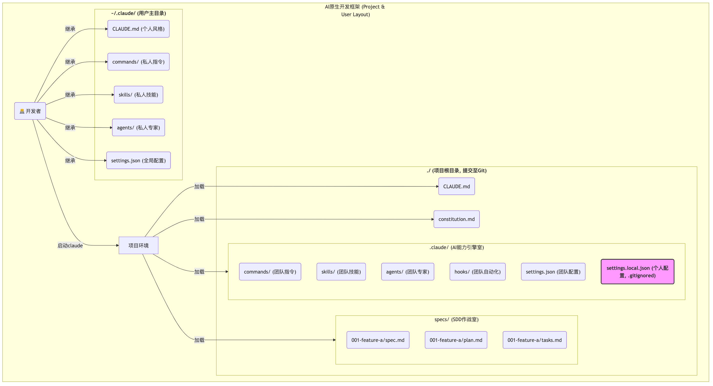
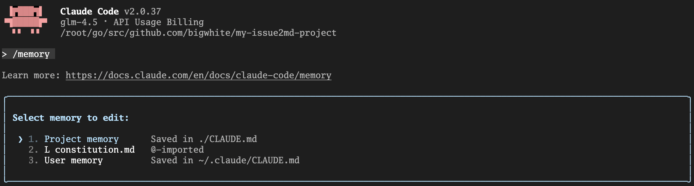

# 16 | 顶层设计：构建你的AI原生开发“驾驶舱”

你好，我是 Tony Bai。

欢迎来到我们专栏的第四模块——实战篇。从今天开始，我们将把前面所有学到的理论和技巧，全部投入到一个真实的 Go 项目中。

```
在基础篇和进阶篇，我们已经系统性地学习了 Claude Code 的各项“神功”：从 @ 和 ! 的核心
交互，到 CLAUDE.md 和 constitution.md 的上下文艺术；从 Slash Commands 的指令
封装，到 Hooks、Skills、Sub-agents 和 MCP 的能力扩展；再到 --checkpointing 的安
全回滚和headless模式的自动化接口。
```

你现在手上已经握有了一整套强大的“武功秘籍”。但一个新的、更严峻的挑战摆在了面前：如何将这些零散的、强大的招式，组合成一套进退有据、威力无穷的“武功体系”？

如果我们仅仅停留在“遇到问题，想起一个指令”的层面，那么我们很快就会陷入“手忙脚乱”的境地，AI Agent 也只不过是一个高级的“瑞士军刀”。我们离真正的“AI 原生工作流”，还差最关键的一步。

这一讲，作为实战篇的开篇，我们的目标，就是要完成这最关键的一步：进行顶层设计，为我们自己和团队，构建一套标准化的、可扩展的 AI 原生开发“驾驶舱”。

## 为什么要先设计一个“AI 协作框架”？

在开始动手之前，我们必须先回答一个“为什么”的问题。为什么我们不直接开始写代码，而是要花一整讲的时间，来设计一个听起来很“虚”的“框架”？

### 从“游击战”到“体系作战”：告别零散的 AI 指令

想象一下，如果没有一个统一的框架，团队中的开发者 A 可能会把他的代码审查指令放在

```
~/my_commands/ 下，开发者 B 可能会写一个截然不同的审查 Hook，而 AI Agent 在不同人
```

的机器上，由于上下文环境千差万别，表现得也像两个完全不同的“人”。

这是一种低效的、不可靠的“游击战”模式。每个开发者都在与 AI 进行着个性化的、难以复用的“二人转”。

而一个精心设计的“AI 协作框架”，则能将团队的 AI 协作能力，从“游击战”提升到“体系作战”的高度。它提供了一个统一的“作战平台”，确保 AI 在任何时间、任何地点、由任何团队成员指挥时，都能表现出一致的、专业的、符合团队最佳实践的行为。

### 框架的核心价值：沉淀经验、统一标准、赋能团队

这个框架，或者说“驾驶舱”，其核心价值体现在三个方面：

1. 沉淀经验：它是团队集体智慧的结晶。无论是资深架构师的安全审查清单，还是 DevOps

```
专家的部署脚本，都可以被封装成框架中的 Skill 或 Command，成为可被 AI 调用的、永
```

- 不丢失的“数字资产”。

```
统一标准：它通过共享的 settings.json、constitution.md 和 hooks，为整个团队
```

- 的 AI 协作设定了统一的“交通规则”和“质量门禁”，确保了工程质量的一致性。

3. 赋能团队：它极大地降低了新成员（包括人类和 AI）的上手门槛。一个新人无需再去通读几百页的开发规范，AI 会基于这个框架，自然地引导他遵循最佳实践。

### 我们的设计原则：模块化、分层、可共享、可扩展

我们即将设计的这个框架，将严格遵循以下几个现代软件工程原则：

- 模块化：每一种 AI 能力（指令、技能、subagent 专家）都应该被封装在独立的、可维护的文件或目录中。

- 分层：清晰地区分不同作用域的配置，如团队共享 vs. 个人专属，项目级 vs. 全局。

- 可共享：框架的核心部分应该能够被轻松地提交到 Git 仓库，随项目一起分发。

- 可扩展：框架必须是“活”的，能够随着团队能力的提升以及经验的积累，方便地添加新的能力和规则。

## 终极蓝图：AI 原生开发框架全景

现在，让我们揭开这个“驾驶舱”的终极设计蓝图。它主要由两个大的部分构成：项目级框架和用户级框架。其核心理念是区分“团队共享资产”与“个人专属配置”

```
项目级框架（Project Layout）：位于你的项目根目录下（./），所有内容都应该提交到 Git 仓
```

库。它定义了针对这个特定项目的、整个团队都必须遵守的规则和共享的能力。

```
用户级框架（User Layout）：位于你的用户主目录下（~/），所有内容都属于你个人，不应提
```

交到任何项目仓库。它定义了你跨所有项目的个人偏好和私人工具集。

Claude Code 在启动时，会智能地将这两个框架的配置进行合并与覆盖，最终形成一个独一无二的、既符合团队规范又尊重个人习惯的运行环境。

框架全景图



这张图也清晰地揭示了我们的 Git 管理策略。在一个标准的团队项目中，你的根

```
.gitignore 文件应该至少包含：
# 忽略所有用户本地的Claude Code配置
.claude/settings.local.json
# 忽略IDE和系统文件
.vscode/
.idea/
*.DS_Store
.claude/settings.local.json 这个文件非常关键，它允许团队成员在不修改共享的
settings.json 的情况下，覆盖或添加自己私有的配置（比如换一个自己喜欢的主题）。
```

## 详解项目级框架 (./)：团队协作的“中央枢纽”

现在，让我们深入这个框架的“心脏”——项目级框架，看看它的每一个部件是如何工作的。

### ./.claude/：AI 能力的“引擎室”

这个隐藏目录，是所有 AI 原生能力被定义和配置的地方。它是我们“驾驶舱”的“仪表盘”和“控制台”。

```
commands/（团队指令）
作用：封装团队的标准操作流程（SOP）。我们在第 8 讲创建的/review-go-code就应
```

- 该放在这里。

- 价值：将“最佳实践”从口头相传或 Wiki 文档，转变为可一键执行的、永不过时的“活”指令。

```
新人入职，只需告诉他：“审查代码？用 /review-go-code。”
skills/（团队技能）
作用：沉淀团队的领域知识和专家能力。我们在第 13 讲将/review-go-code升维成的
go-code-reviewer Skill 就存放在这里。
```

- 价值：让 AI 变得“更懂行”。它不再是通用的 AI，而是“懂我们公司支付业务”的 AI，“懂我们游戏渲染管线”的 AI。

```
agents/（团队专家）
```

- 作用：定义团队需要的“虚拟专家”角色（Sub-agents）。我们在第 14 讲创建的“Go 代码安全审查员”就属于这里。

- 价值：将复杂问题，拆解给拥有独立上下文和专业技能的“专家分身”处理，实现“虚拟团队”作战。

```
hooks/（团队自动化）
```

- 作用：自动化团队的“质量门禁”和“规范动作”。我们在第 11 讲创建的“自动运行 gofmt”的

```
Hook，如果希望团队共享，其配置就应在项目级的 settings.json 中定义，相关的脚本
也可以放在 ./.claude/hooks/ 目录下方便管理。
```

- 价值：将代码规范和质量保证，从依赖于人的自觉，转变为系统性的、强制性的自动化流程。

```
settings.json vs settings.local.json（共享配置与个人覆盖）
settings.json（团队共享）：这是团队的“基线配置”。里面应该定义所有成员必须统一
```

- 遵守的规则，比如权限配置（permissions）、共享的 Hooks、默认的模型选择等。

```
settings.local.json（个人专属，.gitignored）：这是个人“定制化”的入口。你可
以在这里覆盖 settings.json 中的某些设置，比如换一个自己喜欢的主题（theme），
或者为自己开启更激进的 Auto-Accept 模式，而不会影响到团队其他成员。
```

### ./specs/：规范驱动开发（SDD）的“作战指挥室”

这个目录是我们实践第 2 讲所学的 SDD 方法论的核心区域。

```
标准化目录结构：spec-kit 的最佳实践是为每一个新特性（Feature）或用户故事（User
Story），都在specs/ 下创建一个独立的目录，如 001-user-authentication/。这使
得与单个特性相关的所有规范产物（spec.md, plan.md, tasks.md）都能被内聚地管
```

- 理。

- 三大核心产物：这个目录清晰地存放着我们从“意图”到“行动”的完整编译链，是项目需求和技术方案的“活文档”和“真理之源”。

### CLAUDE.md 与 constitution.md：项目的“操作手册”与“根本大法”

这两个位于项目根目录的文件，是 AI“长期记忆”的最高层体现。

```
CLAUDE.md（操作手册）：我们在第 6 讲已经深入学习。它应该包含所有具体的、操作
性的指令，是 ./.claude/ 中各种能力的“高级 API 文档”。
constitution.md（根本大法）：我们在第 7 讲已经深入学习。它定义了项目不可动摇
```

- 的架构原则和开发哲学，是 AI 进行所有决策的“北极星”。

## 详解用户级框架 (~/)：你的跨项目“私人武器库”

项目级框架保证了团队协作的一致性，而用户级框架，则赋予了你作为个体，跨越所有项目边界的“超能力”。

### ~/.claude/：你的全局 AI 配置中心

这个位于你用户主目录下的文件夹，是只属于你一个人的“秘密基地”。

```
CLAUDE.md（个人风格）：你可以在这里定义一些你个人的、与具体项目无关的协作偏
```

- 好。比如：“我喜欢你在解释复杂概念时多用比喻”“请在所有代码示例后都加上注释”。

```
commands/,skills/,agents/（私人命令集）：这里是你存放“私人武器”的地方。比如，
一个 /translate-to-english 的翻译指令，一个分析 git log 的 Skill，或者一个帮
```

- 你写周报的 Sub-agent。这些能力将跟随你，无论你是在公司项目 A，还是在个人开源项目B 中工作。

```
settings.json（全局配置）：这里定义了你个人的“默认驾驶模式”。比如，你可以将
opus 模型设置为你的全局默认模型，或者为你自己配置一套全局的、更开放的
permissions。当然这里要注意各级 settings.json 的优先级顺序（可以回顾一下
```

- 第 4 讲的内容），避免配置后无法生效。

## 框架是如何支撑 AI 原生工作流的？

看到这里，你可能会觉得这个框架有些复杂。别担心，在实际工作中，你并不会时刻感知到它的存在。它就像汽车的底盘和引擎系统，默默地在后台为你提供着强大的、标准化的支持。

让我们来推演一个场景：一次 PR 的代码审查。

```
你作为审查者，在 PR 的评论区输入：@claude review this PR。
```

2. 框架开始工作：

```
Claude Code 启动，它首先加载了 ~/.claude/settings.json（你的全局配置），然
```

- 1.

```
后加载了 ./.claude/settings.json（项目团队配置），后者覆盖了前者中的同名设
```

- 置。

```
它接着加载了 ~/.claude/CLAUDE.md（你的个人风格），然后加载了
```

- 2.

```
./constitution.md（项目宪法），最后加载了 ./CLAUDE.md（项目操作手册）。
```

- AI 的“世界观”被瞬间塑造完成。3.

3. 能力调用：

```
AI 分析你的指令“review this PR”。它可能会发现，在 ./.claude/skills/ 中，有一
```

- 1.

```
个 description 为“进行代码审查”的 go-code-reviewer Skill。
```

- AI 决定自主激活这个 Skill。2.

```
go-code-reviewer 这个 Skill 的 SKILL.md 中指示 AI：“审查的第一步，是必须阅读
```

- 3.

```
constitution.md”。
```

- AI 遵循 Skill 的指令，开始严格地按照“宪法”，对 PR 的代码进行逐条审查。4.

4. 自动化触发：

```
在审查过程中，AI 发现了一处可以优化的代码，它决定调用 Edit 工具进行修改。
```

- 1.

```
这个修改动作，触发了我们在 ./.claude/settings.json 中定义的
```

- 2.

```
PostToolUseHook。
Hook 被执行，自动调用 gofmt 对 AI 刚刚修改的文件进行了格式化。
```

- 3.

5. 输出结果：

- AI 完成了审查和修改，将一份符合“宪法”原则、并且已经被自动格式化过的代码审查报1.告和修改建议，呈现给了你。

看到了吗？你只是下达了一个简单的意图，而我们精心设计的这个“驾驶舱”框架，就像一套精密的自动化系统，自动地为 AI 加载了正确的世界观（上下文），匹配了最佳的能力（Skill），并执行了标准的自动化流程（Hook）。

## 动手实践：初始化我们的 Go 项目 AI 协作框架

```
理论的最终目的是为了实践。现在，让我们一起动手，为我们即将开始的 issue2md Go 项
```

目，创建这套功能完备、开箱即用的 AI 协作框架。

### 第一步：创建并进入我们的项目目录

```
在开始之前，我们需要先明确我们的工作环境。虽然 github.com/bigwhite/issue2md
```

这个项目已经存在，但在本专栏的实战中，我们将创建一个属于我们自己的、全新的项目来进行演练。

请在你本地习惯存放代码的目录下，创建一个新的项目文件夹。为了避免混淆，我们可以叫它

```bash
my-issue2md-project。
# 在你的工作区创建一个新目录
mkdir my-issue2md-project
# 进入这个新目录，这将是我们后续所有实战的根目录
cd my-issue2md-project
# 初始化Go Module
# 即使我们创建了新目录，我们的Go模块路径依然可以保持与原始项目一致
# 这在实际工作中，当你fork一个项目或进行本地重构时非常常见
go mod init github.com/bigwhite/issue2md
```

好了，我们现在拥有了一个干净的项目环境。接下来，我们将在这个“空地”上，一砖一瓦地搭建起我们的 AI 原生开发“驾驶舱”。

### 第二步：创建框架的“骨架”——目录结构

执行以下命令，创建我们在蓝图中设计好的所有核心目录：

```bash
# 1. 创建AI能力引擎室
mkdir -p ./.claude/{commands,skills,agents,hooks}
# 2. 创建SDD作战室
mkdir -p ./specs
# 3. 创建.gitignore文件，并写入核心忽略规则
echo ".claude/settings.local.json" > .gitignore
echo ".vscode/" >> .gitignore
echo ".idea/" >> .gitignore
echo "*.DS_Store" >> .gitignore
echo "/my-issue2md-project" >> .gitignore # 忽略构建产物（假设与目录同名）
```

### 第三步：注入“灵魂”与“大脑”——填充核心记忆文件

一个空的框架是没有生命的。现在，我们将把在前面几讲中学到的精华，凝练成

```
constitution.md 和 CLAUDE.md 的初始内容，为我们的 AI 伙伴注入初始的“灵魂”和“操作
```

知识”。

### 1. 创建并填充 constitution.md (项目宪法)

这份文件是我们为 AI 设定的不可动摇的架构铁律。

```
# issue2md 项目开发宪法
# Version: 1.0, Ratified: $(date +%Y-%m-%d)
本文件定义了本项目不可动摇的核心开发原则。所有AI Agent在进行技术规划和代码实现时，必须无条件遵循
---
## 第一条：简单性原则 (Simplicity First)
**核心：** 遵循Go语言的“少即是多”哲学。绝不进行不必要的抽象，绝不引入非必需的依赖。
- **1.1 (YAGNI):** 只实现`spec.md`中明确要求的功能。
- **1.2 (标准库优先):** 必须优先使用Go标准库，例如Web服务使用`net/http`。
- **1.3 (反过度工程):** 简单的函数和数据结构优于复杂的接口和继承体系。
---
## 第二条：测试先行铁律 (Test-First Imperative) - 不可协商
**核心：** 所有新功能或Bug修复，都必须从编写一个（或多个）失败的测试开始。
- **2.1 (TDD循环):** 严格遵循“Red-Green-Refactor”循环。
- **2.2 (表格驱动):** 单元测试必须优先采用表格驱动测试（Table-Driven Tests）的风格。
- **2.3 (拒绝Mocks):** 优先编写集成测试，使用真实的依赖。
---
## 第三条：明确性原则 (Clarity and Explicitness)
**核心：** 代码的首要目的是让人类易于理解。
- **3.1 (错误处理):** **不可协商**：所有错误都必须被显式处理。错误传递时必须使用`fmt.Errorf
- **3.2 (无全局变量):** 绝不允许使用全局变量来传递状态，所有依赖必须通过函数参数或结构体成员显式
---
## 治理 (Governance)
本宪法具有最高优先级，其效力高于任何`CLAUDE.md`或单次会话中的指令。
```

### 2. 创建并填充CLAUDE.md (项目操作手册)

这份文件是 AI 执行具体任务时的“SOP（标准操作流程）”。

```
# ==================================
# issue2md 项目上下文总入口
# ==================================
# --- 核心原则导入 (最高优先级) ---
# 明确导入项目宪法，确保AI在思考任何问题前，都已加载核心原则。
@./constitution.md
# --- 核心使命与角色设定 ---
你是一个资深的Go语言工程师，正在协助我开发一个名为 "issue2md" 的工具。
```

- 你的所有行动都必须严格遵守上面导入的项目宪法。

```
---
## 1. 技术栈与环境
- **语言**: Go (版本 >= 1.24)
- **构建与测试**:
 - 使用 `Makefile` 进行标准化操作。
 - 运行所有测试: `make test`
 - 构建Web服务: `make web`
---
## 2. Git与版本控制
- **Commit Message规范**: 严格遵循 Conventional Commits 规范。
 - 格式: `<type>(<scope>): <subject>`
 - 当被要求生成commit message时，必须遵循此格式。
---
## 3. AI协作指令
- **当被要求添加新功能时**: 你的第一步应该是先用`@`指令阅读`internal/`下的相关包，并对照项目宪
- **当被要求编写测试时**: 你应该优先编写**表格驱动测试（Table-Driven Tests）**。
- **当被要求构建项目时**: 你应该优先提议使用`Makefile`中定义好的命令。
```

### 第四步：建立“安全护栏”——填充 settings.json

```
现在，我们为框架注入安全性和标准化配置。我们将把在第 09 讲设计的 permissions 配置
```

作为团队的共享基线。

```bash
cat <<'EOF' > ./.claude/settings.json
{
 "permissions": {
   "defaultMode": "plan",
   "allow": [
     "Read(*.go)",
     "Read(go.mod)",
     "Read(Makefile)",
     "Read(README.md)",
     "Read(constitution.md)",
     "Read(specs/**)",
     "Grep",
     "Glob",
     "LS",
     "Bash(go:version)",
     "Bash(go:list:*)",
     "Bash(go:build:*)",
     "Bash(go:test:*)",
     "Bash(gofmt:*)",
     "Bash(goimports:*)",
     "Bash(golangci-lint:run:*)"
   ],
   "ask": [
     "Write",
     "Edit",
     "MultiEdit",
     "Bash(go:get:*)",
     "Bash(go:mod:tidy)",
     "Bash(git:add:*)",
     "Bash(git:commit:*)"
   ],
   "deny": [
     "Read(./.env*)",
     "Read(*.pem)",
     "Read(*.key)",
     "Bash(rm:*)",
     "Bash(git:push:*)",
     "WebFetch"
   ]
 }
}
EOF
```

这份配置从一开始就为我们的 AI 协作建立了一个安全、高效的基线。

### 第五步：初始化用户级框架（可选，但强烈推荐）

项目级框架已经就绪。为了获得最佳体验，我们还应该确保我们的用户级框架也已初始化。如

```bash
果你的 ~/.claude 目录还不存在，可以运行以下命令：
# --- 初始化用户级框架 (如果不存在) ---
mkdir -p ~/.claude/{commands,skills,agents}
touch ~/.claude/settings.json
touch ~/.claude/CLAUDE.md
```

### 第六步：验证框架

万事俱备！我们的 AI 原生开发“驾驶舱”已经完成了初始的搭建。现在，是时候进行一次点火测试了。

```
在你的项目根目录 (my-issue2md-project) 中，启动 Claude Code：
claude
启动后，输入 /memory 命令并回车。
```

此时，Claude Code 会打开一个编辑器，显示它当前加载的所有上下文。你应该能清晰地看

```
到，我们刚刚编写的 constitution.md 和 CLAUDE.md 的内容，都已经被自动加载了进
```

来。



这意味着，从此刻起，你在这个项目中的任何一次 AI 对话，都会在我们设计的这个强大、安全、规范化的框架之上进行。AI 不再是一个“一张白纸”的通用模型，而是一个从启动第一秒就“入职”了我们项目的、了解我们技术哲学和操作规范的“资深团队成员”。

在接下来的实战篇中，我们将不断地向这个我们亲手搭建的框架中，“填充”进我们自己的指令、技能、专家和规则，让它随着我们的项目一同成长，变得越来越强大。

```
注：Claude Code 不直接支持 constitution.md，大家可以回顾 07 讲的内容，重温
constitution.md 的使用方式。
```

### 第七步：将框架纳入版本控制

```
我们刚刚构建的这一切——目录结构、constitution.md、CLAUDE.md、
settings.json——并不仅仅是一堆配置文件。它们共同构成了我们团队的 AI 协作基础设
施。就像 Dockerfile 或 CI/CD 配置一样，它们是项目的核心资产，必须被纳入版本控制。
```

这样做的好处是显而易见的：

- 团队共享：任何团队成员克隆项目后，都能获得一套完全一致的、开箱即用的 AI 协作环境。

- 版本追溯：我们可以清晰地追溯对 AI 协作框架的每一次演进和变更。

```
可审查性：对 AI 能力的任何修改（比如在 settings.json 中增加一项高风险权限），都
```

- 将通过 Pull Request 的形式，接受团队的审查。

现在，让我们完成这最后一步，将我们的“驾驶舱”正式固化为项目的第一次提交。

```
在你的项目根目录 (my-issue2md-project) 中，执行以下 Git 命令：
# 1. 初始化Git仓库
git init
# 2. 将所有框架文件添加到暂存区
git add .
# 3. 进行第一次提交，清晰地记录我们的工作
git commit -m "feat(ai): initialize AI-native development framework" -m "Set up t
# 4. 推送到远程仓库
... ...
```

完成这次提交后，我们的 AI 原生开发“驾驶舱”就不再是一次性的本地配置，而是成为了这个项目一个可传承、可演进的、有版本历史的核心资产。从现在开始，对 AI 协作方式的任何改进，都将像代码改进一样，被严谨地、系统地管理起来。

## 本讲小结

今天，我们完成了从理论到实践最关键的“惊险一跃”。我们不再将 AI 的各项能力视为孤立的知识点，而是将它们系统性地组织成了一个强大的、工程化的协作框架。

首先，我们明确了“AI 协作框架”的至高价值：它能将团队的 AI 协作能力从低效的“游击战”，升级为高效、标准的“体系作战”。接着，我们一起设计了一套 AI 原生开发框架（Layout）的终极蓝图，并清晰地区分了项目级（团队共享）和用户级（个人专属）两个核心层次。

然后，我们深入了这个框架的每一个角落，系统性地回顾并“安置”了我们在基础篇和进阶篇学

```
到的所有核心能力，从 commands 到 hooks，从 specs 到 constitution.md。最后，我
```

们通过一个生动的场景推演，理解了这个框架在实际工作中是如何被激活和调用的，并通过动手实践，为我们接下来的 Go 项目实战，搭建了坚实的“驾驶舱”骨架。

请务必理解并记住今天这张“框架全景图”。它不仅是你接下来所有实战学习的“地图”，更是你未来在任何项目中，从零开始构建高效 AI 原生工作流的“第一性原理”。你得到的，不仅仅是一个文件夹结构，而是你的第一套可传承、可演进的 AI 协作资产。从下一讲开始，我们将正式坐进这个驾驶舱，启动我们的 Go 项目引擎，开始我们激动人心的 AI 原生开发之旅。第一站：需求与设计。

本实战篇涉及的示例项目源码可以在这里查看。请注意，由于 AI 大模型响应的不确定性，你在本地实验中使用的 AI 编码智能体生成的项目代码或相关输出结果，可能与我提供的完全不同。

## 思考题

```
请你审视一下你当前所在团队的知识库（比如 Confluence, Wiki）或代码库的 docs/ 目录。
```

找出 1-2 个你认为最适合被“迁移”到我们今天构建的 AI 协作框架中的“知识资产”。

```
它是一份“新人 Onboarding 指南”吗？也许可以把它精炼成一份 CLAUDE.md。
它是一个“发布流程检查清单”吗？也许可以把它封装成一个 /release-checklist 的
```

- Slash Command。

```
它是一套“API 设计规范”吗？也许可以把它固化为 constitution.md 中的一个条款。
```

欢迎在评论区分享你的“知识迁移”计划。这个思考将帮助你发现，如何将团队已有的宝贵经验，转化为 AI 可以利用的“活”资产。
