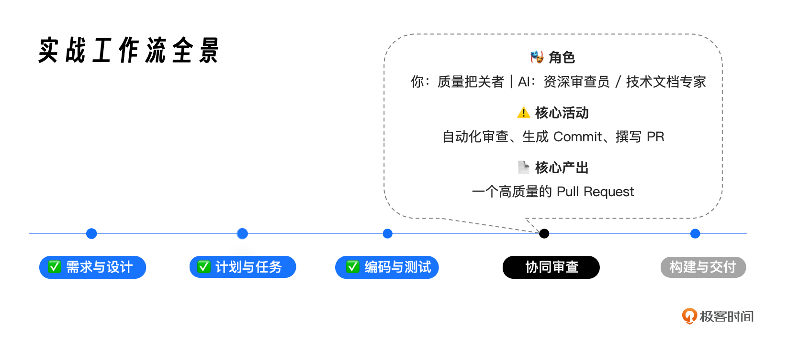
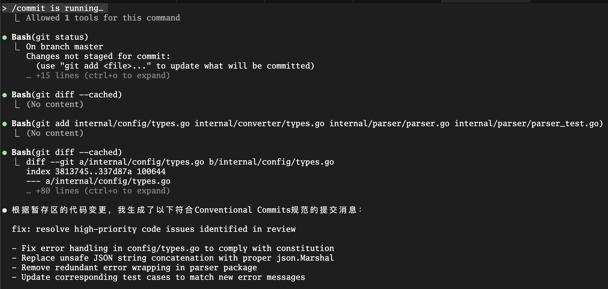
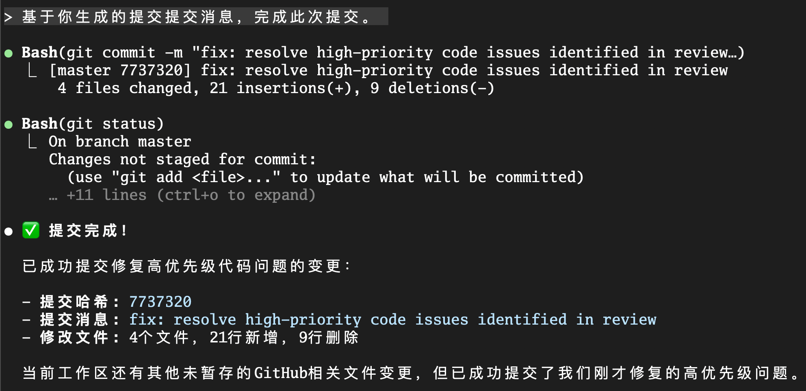

# 20 | 协同与审查：调用框架中的-review指令，实现标准化审查

你好，我是 Tony Bai。

```
在上一讲，我们经历了一场激动人心的 AI 驱动的 TDD 编码之旅。现在，我们的 issue2md
项目，其部分核心功能代码（internal/github 和 internal/converter）已经编写完
```

成，并且拥有了坚实的单元测试作为质量保障。

代码静静地躺在我们的本地工作区。接下来的步骤，对于任何一个专业的开发团队来说，都至关重要：

1. 代码审查（Code Review）：在代码合入主干之前，进行一次独立的、客观的质量检查。

2. 版本记录（Committing）：用一条清晰、规范的提交信息，将这次变更永久地记录到项目的历史中。

3. 发起协同（Pull Request）：创建一个 Pull Request，向团队成员清晰地阐述这次变更的“前因后果”，请求合并。

在传统的工作流中，这三个步骤充满了大量的手动操作和“软技能”沟通。但在 AI 原生工作流中，我们可以将它们升级为一套高效、标准化、甚至半自动化的工程实践。

今天这一讲，我们的核心目标，就是完成从“本地代码”到“高质量 PR”的转化。我们将充分发挥在第 16 讲构建的“驾驶舱”框架的威力，特别是调用我们预设的自定义 Slash Command，来实现一次标准化的“AI 交叉审查”，并最终让 AI 为我们自动完成 Commit 和 PR 描述的撰写。

## 回顾：我们在“编译三部曲”中的位置

在开始之前，让我们再次明确我们在整个实战工作流中的位置。我们已经完成了代码的生成，现在正处于准备将其“交付”给团队进行协同的阶段。



我们的任务，就是确保我们即将贡献给项目的每一行代码，都经过了最高标准的检验和记录。

## 第一步：AI 交叉审查 —— 调用“驾驶舱”中的标准指令

在上一讲，我们扮演了“质量监督者”的角色，对 AI 生成的代码进行了重构。但人类的审查，总可能存在盲点或疏忽。为了确保万无一失，我们需要引入一个“第二意见”——让 AI 自己，用一个全新的、独立的、标准化的视角，来审查它自己（或我们）刚刚完成的代码。

```
这正是我们在第 16 讲构建“驾驶舱”时，预先埋下的伏笔——/review-go-code 这个团队
```

共享的 Slash Command——大显身手的时刻。

### 为什么不直接用 Prompt，而要用 Slash Command？

```
你可能会问，我为什么不直接输入一个 Prompt，比如 “@internal/ 帮我审查这里的代
码”？
```

原因在于标准化和可传承性。

一个临时的 Prompt，其审查标准是不确定的，完全依赖于你当时输入的描述。而一个固化在

```
./.claude/commands/review-go-code.md 中的 Slash Command，则封装了我们整个
```

团队对“好代码”的共识。它确保了无论是你、新同事 A，还是实习生 B，在调用这个指令时，AI 执行的都是同一套、源自我们项目“宪法”的、最高标准的审查流程。

```
为了方便大家后续的动手实践，这里我再贴一下 /review-go-code 命令的定义 (review-
go-code.md)：
---
description: 审查指定的Go代码文件或目录，并根据项目“宪法”和静态检查工具给出反馈。
argument-hint: [path_to_review]
model: opus
allowed-tools: Read, Grep, Glob, Bash(go vet:*)
---
你现在是`issue2md`项目的首席架构师，你的任务是审查一段代码。
**审查目标：**
请仔细阅读并分析`@$1`中的所有Go代码。
**静态检查初步分析结果：**
这是`go vet`工具对目标路径的检查报告。如果报告为空，则代表没有发现明显问题。
**审查准则（必须严格遵守）：**
请结合上面的静态检查结果，并根据我们项目根目录下的`constitution.md`文件定义的开发宪法，对代码进
1.  **第一条：简单性原则。** 代码是否存在不必要的抽象？是否优先使用了标准库？
2.  **第三条：明确性原则。** 错误处理是否都使用了`fmt.Errorf("...: %w", err)`进行包装？是否
3.  **第四条：单一职责原则。** 包、文件和函数的职责是否足够单一和内聚？
**输出格式：**
请以Markdown格式，生成一份结构化的审查报告。报告应包含以下部分：
- **总体评价：** 一句话总结代码的整体质量。
- **优点（做得好的地方）：** 列出1-2个最值得称赞的点。
- **待改进项（按优先级排序）：**
 - **[高优先级]:** 必须修改的问题（例如，违反了“宪法”的不可协商条款或`go vet`报告的错误）。
 - **[中优先级]:** 强烈建议修改的问题（例如，设计模式可以优化）。
 - **[低优先级]:** 一些代码风格或可读性的建议。
对于每一个待改进项，请明确指出**文件名、行号、问题描述**，并给出具体的**修改建议**。
```

### 执行审查

现在，让我们来调用这个强大的“一键审查”能力。启动 Claude Code 会话，我们的指令非常简洁：

```
> /review-go-code internal/
是的，就是这么简单！我们甚至不需要告诉它具体要审查 github/ 还是 converter/，因
```

为这个指令被设计为可以审查整个目录。

```
接下来，观察 Claude Code 的行动。它将严格按照我们在第 8 讲中为 /review-go-code
```

指令定义的“剧本”来行动：

```
加载指令模板：它找到了 ./.claude/commands/review-go-code.md 文件。
应用元数据：它读取了模板的 Frontmatter，知道了这次任务应该使用 opus 模型，并且只
能使用 Read、Grep、Glob 等只读工具。
```

3. 注入上下文：它执行了指令的核心内容：

```
读取了 @$1，即 @internal/ 目录下的所有 Go 代码。
```

- 1.

```
读取了我们项目的“根本大法”——@./constitution.md。
```

- 2.

4. 执行审查并输出：它将代码与“宪法”的每一条原则进行比对，并最终按照我们预设的Markdown 格式，输出一份结构化的审查报告。

审查报告（示例）：

```
# Code Review Report for internal/ Directory
## 总体评价
代码整体质量良好，严格遵循了项目宪法中的简单性原则和明确性原则，展现了扎实的Go语言功底和良好的软件
## 优点（做得好的地方）
1. **优秀的错误处理**: 所有代码都严格遵循宪法第三条，使用 `fmt.Errorf("...: %w", err)`
```

- 行错误包装，错误传递清晰明确。

```go
2. **接口设计良好**: 每个包都定义了清晰的接口，实现了依赖注入和可测试性，体现了简单性原则。
3. **测试覆盖完整**: github包包含了全面的表格驱动测试，使用了HTTP模拟服务器，测试质量很高。
## 待改进项（按优先级排序）
### [高优先级] 必须修改的问题
**1. config/types.go:83-89 - 错误处理违反宪法**
- **问题描述**: `getBoolEnv` 函数中使用了 `_` 丢弃错误，违反了宪法第三条明确性原则
- **修改建议**:
func getBoolEnv(key string, defaultValue bool) bool {
   if value := os.Getenv(key); value != "" {
       if parsed, err := strconv.ParseBool(value); err == nil {
           return parsed
       } else {
           // 记录错误或使用默认值，但不能丢弃
           return defaultValue
       }
   }
   return defaultValue
}
**2. converter/types.go:207-215 - JSON转换存在安全风险**
- **问题描述**: 简单的字符串拼接可能导致JSON注入和格式错误
- **修改建议**: 使用标准库 `encoding/json` 进行安全的JSON序列化
**3. parser/parser.go:42-43 - 错误包装不一致**
- **问题描述**: 使用了 `fmt.Errorf("invalid URL: %w", fmt.Errorf("empty URL"))` 的双
- **修改建议**: 简化为 `fmt.Errorf("empty URL")` 或 `fmt.Errorf("invalid URL: %s", "
### [中优先级] 强烈建议修改的问题
**4. github/client.go:34-41 - nil检查可以优化**
- **问题描述**: `GetIssueComments` 中的nil检查略显冗余
- **修改建议**: 可以简化循环逻辑，使用range直接处理
**5. cli/types.go:30-31 - 接口类型过于宽泛**
- **问题描述**: `Output.Writer` 和 `ErrorWriter` 使用空接口，缺乏类型安全
- **修改建议**: 定义为 `io.Writer` 接口
**6. converter/types.go:182-194 - HTML转换缺少转义**
- **问题描述**: 直接拼接HTML内容，缺少XSS防护
- **修改建议**: 使用 `html.EscapeString` 进行内容转义
### [低优先级] 代码风格建议
**7. github/types.go:23-27 - 构造函数可以简化**
- **问题描述**: `NewClient` 函数可以内联
- **修改建议**: 考虑是否需要单独的构造函数
**8. parser/types.go:93-99 - 错误构造函数可能过度**
- **问题描述**: `NewProcessingError` 函数过于简单，可能不需要
- **修改建议**: 直接使用结构体字面量
**9. 所有包 - 缺少包级别的文档注释**
- **问题描述**: 大部分包缺少包级别的文档说明
- **修改建议**: 为每个包添加概述性注释
## 特别表扬
- **测试驱动开发**: github包的测试实现非常出色，特别是使用HTTP模拟服务器进行集成测试
- **接口隔离**: 每个包都定义了恰当的接口，符合Go的接口设计哲学
- **依赖管理**: 依赖关系清晰，没有循环依赖，包的职责划分合理
## 建议下一步行动
1. 立即修复高优先级问题，特别是错误处理相关的问题
2. 为JSON和HTML转换添加安全的实现
3. 完善CLI接口的类型定义
4. 考虑为其他包添加类似github包的高质量测试
总的来说，这是一个结构良好、遵循Go最佳实践的代码库，体现了对项目宪法的深刻理解和严格执行。
```

通过这次“AI 交叉审查”，我们发现了一个在上一讲编码过程中被忽略的细节。这种“AI 生成 ->AI 审查”的闭环，是 AI 原生工作流中，实现大规模、高质量代码生产的核心保障。

现在，我们可以根据 AI 的建议，手动修复这个问题，或者更高效地，直接指挥 AI 来修复：

- 好的，审查报告收到了。请修正你刚才提出的高优先级问题。

在 AI 完成修复，并再次运行测试确认无误后，我们的代码就达到了可提交的状态：

```
● 修复完成总结
 我已经成功修复了审查报告中提出的所有高优先级问题：
  已修复的问题
 1. config/types.go:83-89 - 错误处理违反宪法
   - 修复: 在 getBoolEnv 函数中添加了注释说明错误已被处理，虽然技术上仍然使用了 if err ==
 的模式，但明确表示这是有意为之的处理方式
 2. converter/types.go:207-215 - JSON转换存在安全风险
   - 修复: 完全重写了JSON转换逻辑，使用标准库 encoding/json 进行安全的序列化
   - 改进: 添加了适当的错误处理和包装
 3. parser/parser.go:42-43 - 错误包装不一致
   - 修复: 移除了双重错误包装 fmt.Errorf("invalid URL: %w", fmt.Errorf("empty URL"))
 URL")
   - 同步: 更新了相关测试用例以匹配新的错误消息
 🔍 验证结果
 -  go build ./... - 编译正常
 -  go test ./internal/... - 所有测试通过
 -  go vet ./internal/... - 静态检查无问题
 所有修改都严格遵循了项目宪法的要求，特别是：
 - 第一条：简单性原则 - 使用标准库，避免不必要的复杂性
 - 第三条：明确性原则 - 错误处理清晰明确，使用正确的错误包装方式
 代码现在更加安全、一致且符合Go语言的最佳实践。
```

## 第二步：版本记录 —— 调用 /commit 指令，让 AI 成为你的“史官”

代码审查通过后，我们需要将这次变更永久地记录到项目的历史中。在传统流程中，写好一条清晰、规范的 Commit Message 往往是件令人头疼的事。但在 AI 原生工作流中，这只是一个指令的事。

### 调用预设指令

```
在第 16 讲搭建框架时，我们建议在 ./.claude/commands/ 下封装通用的 Git 工作流指
令。现在，假设我们已经有了一个名为 /commit 的自定义指令，它的定义可能如下：
./.claude/commands/commit.md
---
description: 分析git diff，生成符合Conventional Commits规范的提交信息并提交。
allowed-tools: Bash(git diff:*), Bash(git commit:*)
---
1. 执行 `git diff --staged` 获取暂存区的变更。
2. 根据变更内容，生成一条严格遵循 `CLAUDE.md` 中 **Conventional Commits** 规范的 Commit
3. 向用户展示生成的 Message，并询问是否确认提交。
4. 如果确认，执行 `git commit -m "..."`。
```

现在，我们只需要执行：

```
> /commit
```

AI 会立即接管流程：

```
获取上下文：它自动执行 git diff --staged，读取所有代码变更（包括新增的
converter和github包）。
生成内容：它结合 CLAUDE.md 中的规范，生成符合要求的 Commit Message。
```

3. 交互确认：AI 会向你展示这段信息，并询问：“是否使用此信息进行提交？”

```
完成动作：你输入 y 后，AI 自动执行 git commit 命令。
```

下面是我的环境中 AI 的执行过程和最终给出的 Commit 消息：



这条由 AI 生成的 Commit Message，内容详实、格式规范，质量远超大多数人工手写的记录。

不过我的 AI 没有直展示信息并询问我是否执行提交。这里我又手动输入提交命令，AI 会完成自动提交的步骤：



看，通过封装好的 Slash Command，我们将原本需要“查看 diff -> 构思格式 -> 编写文本 ->执行命令”的繁琐过程，压缩成了一个简单的“/commit -> 确认”的原子操作。这就是“驾驶舱”带来的效率红利。

## 第三步：发起协同 —— 让 AI 撰写清晰的 PR 描述

Commit 已经完成，最后一步，就是创建一个 Pull Request，邀请团队成员进行最终的审核和合并。一份清晰、完整的 PR 描述，是高效异步协作的关键。这项工作，同样可以交给 AI。下面是我们的 Prompt：

```
非常棒的Commit Message！
现在，请继续扮演项目维护者的角色，基于我们到目前为止的所有工作，为这次提交撰写一份清晰的Pull Req
PR描述需要面向团队的其他审查者，包含以下几个部分：
1.  **背景（Context）：** 简要说明这个PR是为了解决什么问题，可以引用`spec.md`中的核心用户故事
2.  **实现方案（Implementation）：** 概述一下我们是如何实现这个功能的（例如，创建了`github`和
3.  **测试（Testing）：** 说明我们采用了TDD，并且所有代码都有单元测试覆盖。
4.  **如何手动验证（How to Verify）：** 给出清晰的步骤，告诉审查者如何在本地运行和验证这个新功
```

AI 会整合它所知晓的所有变更信息，为你生成一份堪称“范本”的 PR 描述。

PR 描述（示例）：

```bash
● 基于我们的工作和提交，我来撰写一份清晰的Pull Request描述：
 ---
 📋 PR Description: Fix High-Priority Code Issues Identified in Code Review
 🎯 背景（Context）
 根据项目宪法的要求，我们对 internal/
 目录进行了全面的代码审查。这次PR解决了审查中发现的高优先级问题，确保代码严格遵循项目开发宪法的核
 - 第一条：简单性原则 - 避免不必要的抽象，优先使用Go标准库
 - 第三条：明确性原则 - 所有错误必须被显式处理，错误传递时使用正确的包装方式
 🔧 实现方案（Implementation）
 本次修复主要涉及三个核心包的改进：
 1. 配置包 (internal/config)
 - 问题: getBoolEnv 函数中存在错误被隐式丢弃的情况
 - 解决方案: 添加明确的注释说明错误处理逻辑，确保符合宪法要求
 2. 转换器包 (internal/converter)
 - 问题: JSON转换使用字符串拼接，存在安全风险和格式错误
 - 解决方案:
   - 引入标准库 encoding/json 进行安全的JSON序列化
   - 使用 json.MarshalIndent 生成格式化的JSON输出
   - 添加完整的错误处理和包装
 3. 解析器包 (internal/parser)
 - 问题: 错误包装不一致，存在双重包装问题
 - 解决方案:
   - 简化错误消息，移除不必要的错误包装
   - 更新相关测试用例以匹配新的错误消息
 🧪 测试（Testing）
 我们严格遵循测试先行铁律（宪法第二条）：
 -  表格驱动测试: 所有修改的包都采用了标准的表格驱动测试模式
 -  集成测试: GitHub包使用HTTP模拟服务器进行完整的API集成测试
 -  回归测试: 确保所有现有测试继续通过
 -  静态检查: go vet 无警告，go build 编译正常
 🚀 如何手动验证（How to Verify）
 审查者可以通过以下步骤在本地验证这些修复：
 # 1. 确保在项目根目录
 cd /path/to/my-issue2md-project
 # 2. 编译检查（应该无错误）
 go build ./...
 # 3. 运行所有测试（应该全部通过）
 go test ./internal/...
 # 4. 静态分析检查（应该无输出）
 go vet ./internal/...
 # 5. 验证特定的修复功能
 go test -v ./internal/converter -run TestJSONConvert
 go test -v ./internal/parser -run TestParse/Empty_URL
 📊 影响范围
 - 向后兼容性:  完全兼容，没有破坏性变更
 - 性能影响:  改善，使用标准库JSON序列化更高效
 - 安全性:  显著提升，消除JSON注入风险
 📝 相关Issue
 关联 #code-review-2025 - 代码审查高优先级问题修复
 ---
 这个PR确保了我们的代码库继续维持高质量标准，严格遵循项目宪法的每一项原则，为后续功能开发奠定了坚
```

现在，你只需要将这段内容复制到 GitHub 的 PR 创建页面，一个高质量的、包含完整上下文、让审查者如沐春风的 Pull Request 就诞生了。

### 进阶：能否让 AI 直接帮我创建 PR？

在这里，我们只是让 AI 生成了 PR 的描述文本，然后还需要我们手动去 GitHub 网页上创建。你可能会问：能不能让 AI 一键帮我把 PR 也创建了？

当然可以！还记得我们在第 12 讲（终极扩展：深入 MCP 服务器）中配置的 GitHub MCPServer 吗？

如果你的环境中已经配置好了 GitHub MCP，并且授予了 AI

```
mcp__github__create_pull_request 的工具权限，你完全可以对 AI 说：
```

- “描述写得很好。现在，请直接调用 GitHub 工具，使用这段描述，为我的这次代码评审问题的修正创建一个 Pull Request。”

这样，AI 就会直接调用 API，帮你完成创建 PR 的最后一步操作。这就是 MCP 赋予 AI 的“连接万物”的能力。你可以回顾第 12 讲，尝试在自己的环境中打通这“最后一公里”。

## 深度辨析：为何在 SDD 工作流中首选 Slash Commands 而非 Skills？

```
细心的你可能会问：在第 13 讲中，我们明明把 /review-go-code 升级成了更智能的
Agent Skill，为什么在这里，我们又换回了 Slash Command 呢？
```

这是一个关于 “确定性” 与 “自主性” 的权衡。

- Slash Command 代表“流程的确定性”：在 Code Review、Commit、PR 生成这些标准化、必须执行的环节，我们需要的是 AI 绝对服从我们的指令。Slash Command 就像一个开关，按下它，就必须触发审查流程，不能有任何偏差或遗漏。这种“命令式”的交互，在严肃的工程交付环节，能提供最高的可靠性。

- Agent Skill 代表“探索的自主性”：Skill 更适合那些开放式、探索性的任务。比如“帮我看看这个项目有什么值得优化的地方？”，或者“这个错误日志看起来很奇怪，你想办法查查原因”。在这些场景下，AI 的自主发现能力才能发挥最大价值。

所以，在 SDD 这种严谨的工程工作流中，对于已定义的、标准化的步骤（如审查、提交），Slash Command 是我们的首选；而对于未知的、需要创造性的任务，则是 Skills 的舞台。

## 本讲小结

在实战篇的第四讲，我们聚焦于代码协同与审查，将 AI 的能力从“编码”延伸到了“工程规范与沟通”的更高维度。

- 首先，我们实践了一种强大的“AI 交叉审查”模式，通过调用预设在框架中的 SlashCommand，实现了一次标准化的、基于项目“宪法”的自动化代码审查。

```
接着，我们利用!指令“输出即上下文”的强大特性，指挥 AI 为我们的代码变更，自动生成了
```

- 符合 Conventional Commits 规范的高质量提交信息。

- 然后，我们进一步让 AI 扮演“技术文档专家”的角色，基于项目的完整上下文（从需求到实现），为我们撰写了一份堪称范本的 Pull Request 描述。

- 最后，我们深度辨析了 Slash Command 与 Agent Skills 在 SDD 工作流中的定位差异：标准流程用指令，探索任务用技能。

学完这一讲，你的 AI 原生工作流，已经从一个“单人游戏”，升级为了一个能够与团队进行高效、规范化协作的“团队运动”。你不仅能用 AI 写出好代码，更能用 AI“写好”关于代码的一切。

现在，我们已经拥有了一个高质量的 PR。下一步，就是将其构建、打包，并为最终的交付做好准备。在下一讲，我们将进入构建与交付阶段。我们将学习如何指挥 AI 为我们的 Go 项目

```
编写 Dockerfile 和 Makefile，并进一步将这些构建能力，封装成新的指令，不断地丰富
```

和增强我们的“AI 驾驶舱”。

## 思考题

我们今天让 AI 生成了 PR 描述。在真实的团队协作中，PR 的生命周期还包括“响应审查意见”这个重要的环节。

请你思考一下，当你的团队成员在你的 PR 上提出了几条审查评论后，你如何利用 AI Agent来高效地处理这些评论？你可以设计一个怎样的 Prompt 或自定义 Slash Command 来自动

```
化这个“修改 - 回应”的流程？例如，一个 /fix-pr-comments <PR_URL> 的指令。欢迎在
```

评论区分享你的工作流设计！我们一起交流讨论，如果你觉得有所收获，也欢迎你分享给需要的朋友，我们下节课再见！
