# 前沿技术速递 | AgentTeams：打造你的第一支“虚拟研发团队”

你好，我是 Tony Bai。

时光飞逝，转眼我们已经来到了 2026 年。

回顾过去的一年，如果说 2025 年是 Coding Agent 的元年，以 Claude Code 为代表的工具让“自然语言编程”真正成为了现实；那么 2026 年，我们正站在一个新的风口之上——AgentOrchestration（智能体编排）。

在专栏之前的课程中，我们已经精通了如何与单个 Claude Code 实例进行深度协作，甚至学会了用 Sub-agent 让它在同一个会话中“切换人格”。但这仍然是一个“单兵作战”的模式。随着任务复杂度的提升，单个 Agent 的上下文窗口（Context Window）和注意力很容易成为瓶颈。

我们不禁会想：如果能同时召唤多个 Claude Code，让它们像一个真实的开发团队那样，有分工、有协作、甚至互相 Code Review，会是怎样的景象？

Claude Code 最近在 2.1.32 版本中发布的重磅实验特性——Agent Teams（智能体团队），正是对这一未来的提前兑现。

今天这篇加餐，我就带你深入了解这个代表未来的新特性。我们将跳出“人机结对”的框架，尝试扮演一次“技术总监”，指挥一支由 AI 组成的“虚拟研发团队”，去并行解决一个全栈开发问题。

## Agent Teams：从“单兵”到“集群”的范式跃迁

首先，我们需要厘清 Agent Teams 与我们之前学过的 Sub-agents（第 14 讲）有何本质区别。

Sub-agents（智能分身）是在同一个会话中，通过加载不同的 System Prompt 来切换 AI 的角色，通常执行专注于结果导向的任务。虽然不会“继承”主 Agent 的上下文，不会因为主 Agent的上下文过长干扰 Sub-agent 的工作任务，但一个 Claude Code 会话一次只能执行一个 Sub-agent，是串行的。在项目规模扩大时，这种模式的任务执行或问题解决效率要低得多。

而 Agent Teams 采用了“Team Lead + Teammates”的架构：

- Team Lead（队长）：就是你当前交互的那个 Claude 会话。它负责拆解任务、分配工作、协调进度、合成结果。它拥有全局视野。

- Teammates（队员）：是完全独立的 Claude Code 实例，由 Lead 动态生成和管理。

Agent Teams（智能体团队）本质上是启动多个独立的 Claude Code 进程。它具有如下优势：

1. 完全并行：前端、后端、测试可以同时开工，互不阻塞。

2. 独立上下文：每个队员（Teammate）都有自己独立的上下文窗口，只关注自己的任务，不会被其他队员的琐碎细节污染。

3. 自主协同：队员之间可以通过“消息 (mailbox)”和“共享任务列表（Shared Task List）”进行直接沟通，无需人类充当传声筒。

## 业界前沿：16 个 Claude 重写 C 编译器的故事

为了验证这种“集群协同”模式的极限，Anthropic 的研究团队做了一个疯狂的实验：让 AgentTeams 从零开始使用 Rust 语言写一个 C 编译器。这个任务极其复杂，涉及词法分析、语法分析、IR 生成、寄存器分配、汇编生成等多个深奥领域。单靠一个 Context 窗口绝对无法容纳所有细节。

他们是这么做的：

1. 规模：启动了 16 个 Claude Code Agent 并行工作。

2. 协作模式：基于 Git 仓库进行同步。每个 Agent 领取任务后，在本地修改、测试，然后推送到上游，解决合并冲突。

3. 精细分工：有的负责实现具体功能（如“实现 if 语句解析”），有的负责“代码去重”，有的负责性能优化，甚至有的专门负责扮演“Rust 专家”来对代码架构进行批评和指正。

4. 测试驱动：引入了 GCC 作为“预言机”（Oracle），对比 Claude 编译器的输出和 GCC 的输出，确保正确性。

结果如何呢？

在消耗了约 20 亿输入 Token 后，这个 Agent 团队写出了一个 10 万行代码的编译器。它不仅能编译 SQLite、Redis、PostgreSQL 的系统软件或中间件，甚至可以在 x86、ARM、RISC-V架构上成功编译 Linux 6.9 内核。

当然，这个由 Agent 团队实现的 C 编译器还有这样那样的问题，比如生成的代码的执行效率不高、没有自己的汇编器和链接器（借助 GCC）、还不能真正替代真正的 GCC 编译器等。但这个案例向我们证明了：当多个 Agent 拥有独立上下文并能协同工作时，它们能解决的工程复杂度将呈指数级上升。

## 实战演练：开发一个“待办事项（Todo）”全栈应用

C 编译器太复杂了，为了让你能直观地体验 Agent Teams 的威力，我们来做一个更接地气的实验：在 10 分钟内，开发一个包含前端、后端和数据库的 Todo List 应用。我们将组建一支由三个 AI 专家组成的“虚拟研发团队”。

1. 环境准备与开启特性

Agent Teams 目前（截至 2026 年 2 月初）在 Claude Code 中仍属于实验特性（Experimental），且需要较新的版本（2.1.32 及以后版本）支持。在真正落地使用时，具体

```
表现可能与本讲描述略有出入。你可以启动 claude 后，使用/status命令查看你的 Claude
```

Code 版本，就像下图这样：

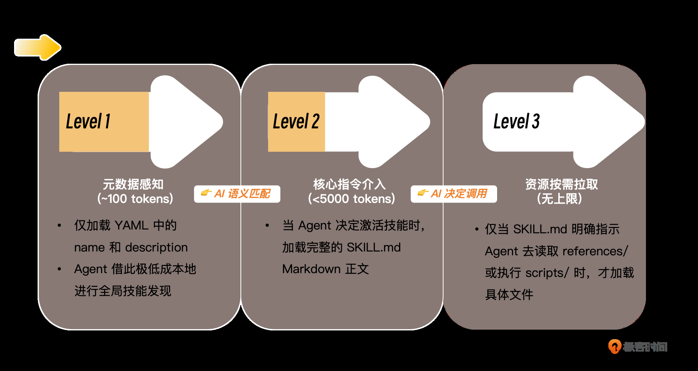

要使用 Agent Teams，你首先需要显式开启它：

```bash
# 在 ~/.claude/settings.json 设置
{
 "env": {
   "CLAUDE_CODE_EXPERIMENTAL_AGENT_TEAMS": "1"
 }
}
# 或环境变量中设置
export CLAUDE_CODE_EXPERIMENTAL_AGENT_TEAMS=1
```

建议使用 iTerm2 (macOS) 或 tmux 环境，因为 Agent Teams 支持 Split Panes（分屏显示）模式，能让你同时看到所有 Agent 的工作状态，那是真正的“上帝视角”。

不过限于开发环境，本讲无法给大家展示这么炫酷的效果了。我们采用的是“in-process”的模式，即所有 teammate agent 都在一个会话里展示自己的工作过程与结果。Claude Code 默认“teammateMode”设置是 auto，即它会根据运行环境自动判定使用“分屏显示模式”，还是“进程内显示模式”。

2. 下达指挥官指令

```
在一个空目录 todolist 下，我们启动 Claude Code，并输入以下 Prompt：
```

- 我要开发一个最简单的 Todo List 应用，包含：后端：使用 Go + Gin + SQLite，提供 RESTful API（增删改查）。前端：使用 React + Vite + TailwindCSS，实现单页应用。测试：为后端 API 编写集成测试。请创建一个 Agent Team 来并行完成这个任务：Backend Dev：负责后端代码和数据库设计。Frontend Dev：负责前端页面和 API 调用。QA Engineer：负责编写测试脚本。你是 Team Lead。请先规划 API 接口定义，然后指挥前后端并行开发，最后由 QA 进行验证。**

3. 观察 Team Agent 间的协作

此时，Claude 会化身为 Team Lead。它会分析你的请求，并初始化团队，如下图所示：

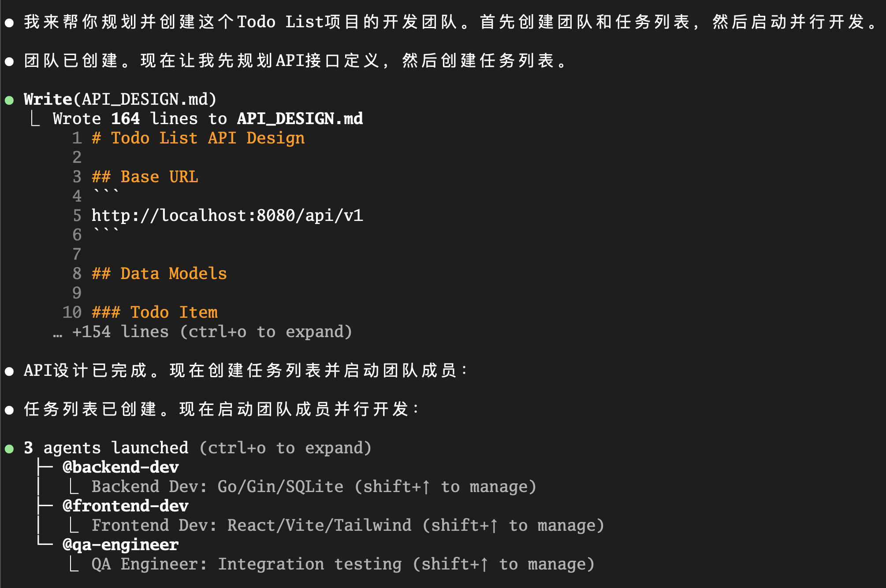

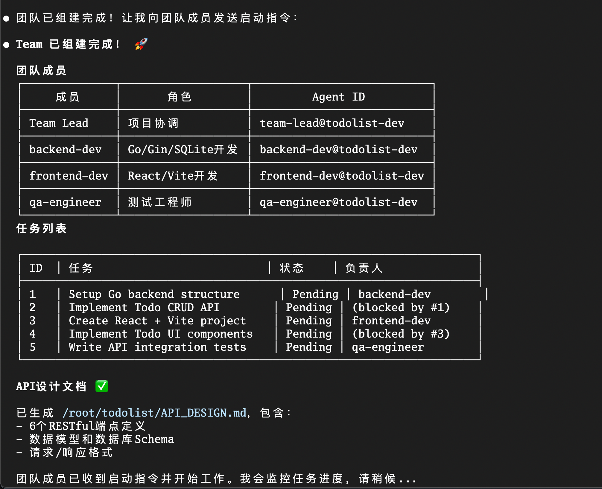

接下来，各个 Teammate 开始领任务并开始工作，以 qa-engineer 为例，我们看到它的过程输出：

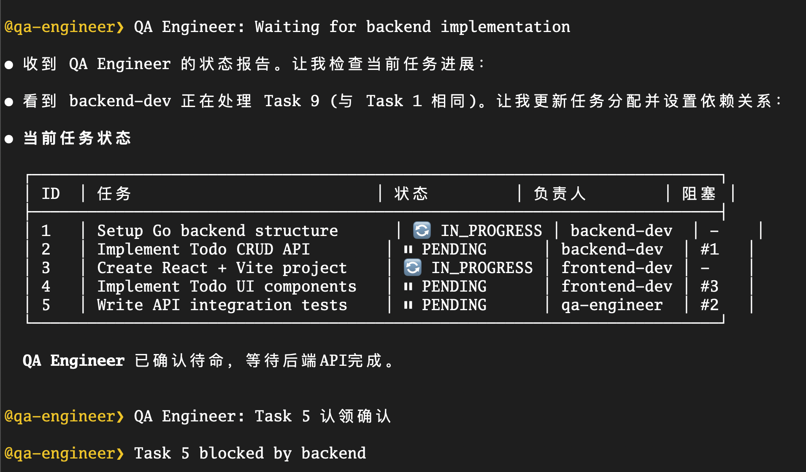

如果任务被其他 teammate 的任务阻塞，那么该 agent 会等待。就像 qa-engineer 要等待backend-dev 和 frontend-dev 完成一些开发任务后才能开始执行测试。

Team lead 会定期收集各个 Teammate 的工作进展：

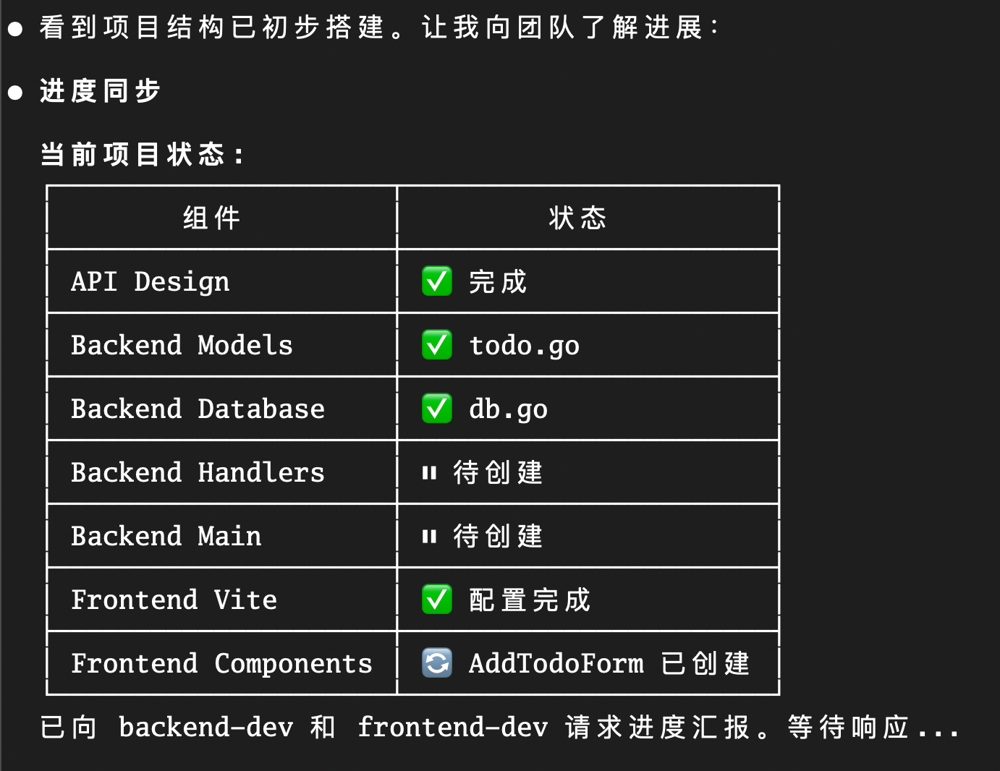

作为人类指挥官，你可以随时介入，查看各个 teammate 的当前状态（使用 ctrl+t 打开teammate 列表）：

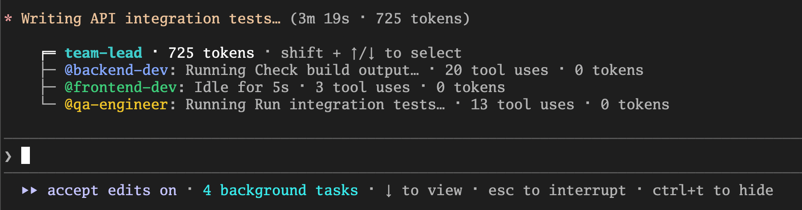

```
注：teammate 的初始权限设置与 team lead 相同。如果 lead 权限设置为 --
dangerously-skip-permissions ，则所有队友的权限也设置为 --dangerously-
skip-permissions。使用--dangerously-skip-permissions权限会让 team 工作
```

- 更流畅，否则需要人工反复确认各个 Teammate agent 的 执行权限。

4. 验收与收尾

当所有任务都完成后，Lead 会向各个 Teammate 确认。

Frontend-dev 确认已经关闭：

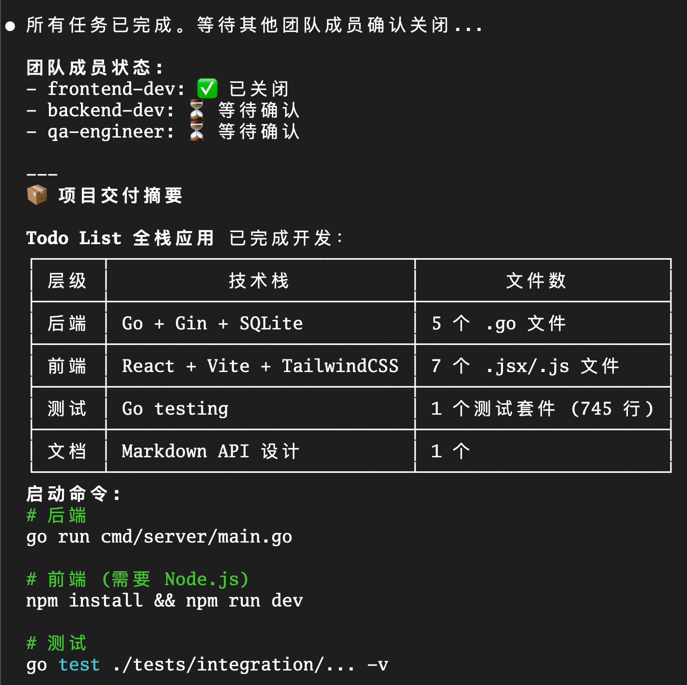

Qa-engineer 确认已经完成所有测试：

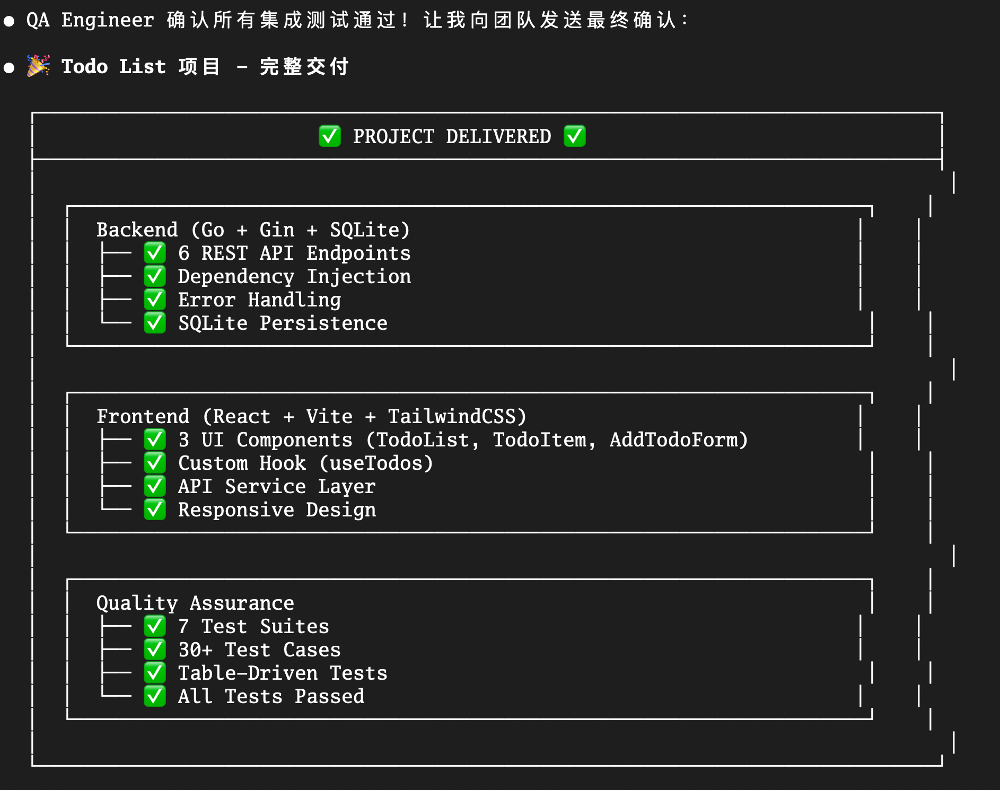

Qa-engineer 确认已经关闭：

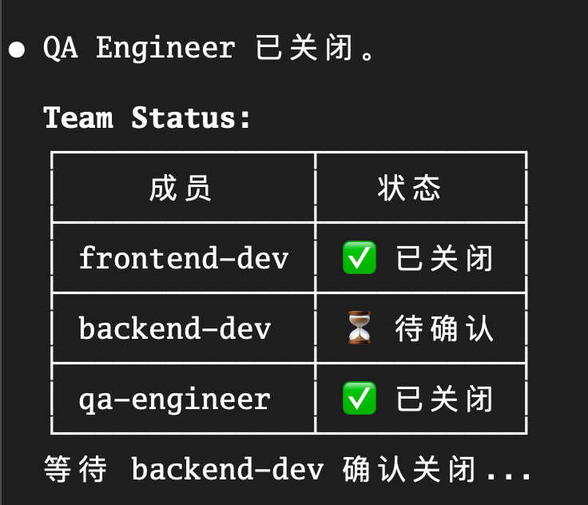

最后等待 Backend-dev 确认关闭：

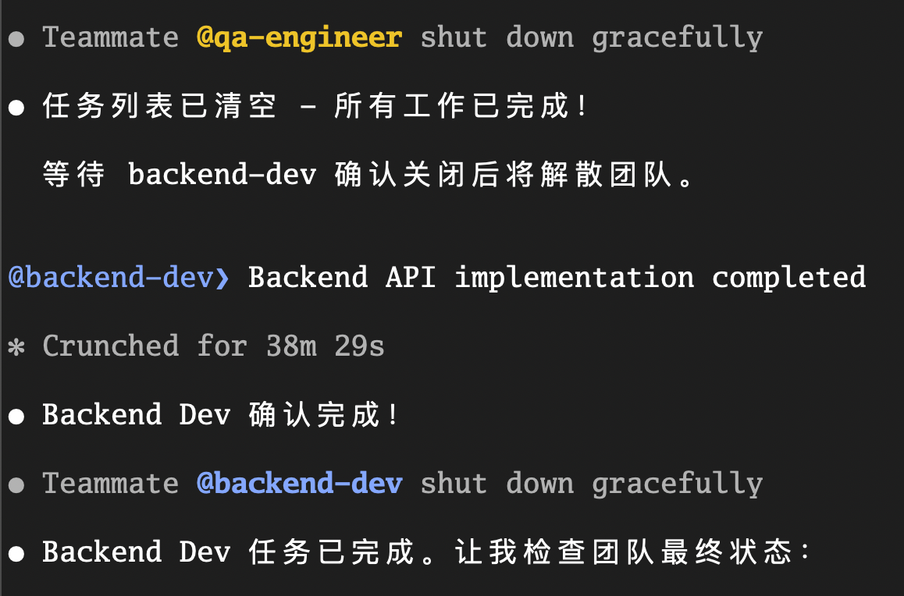

当所有任务完成且所有 Teammate 都确认关闭后，Team Lead 会清理团队并向你汇报：

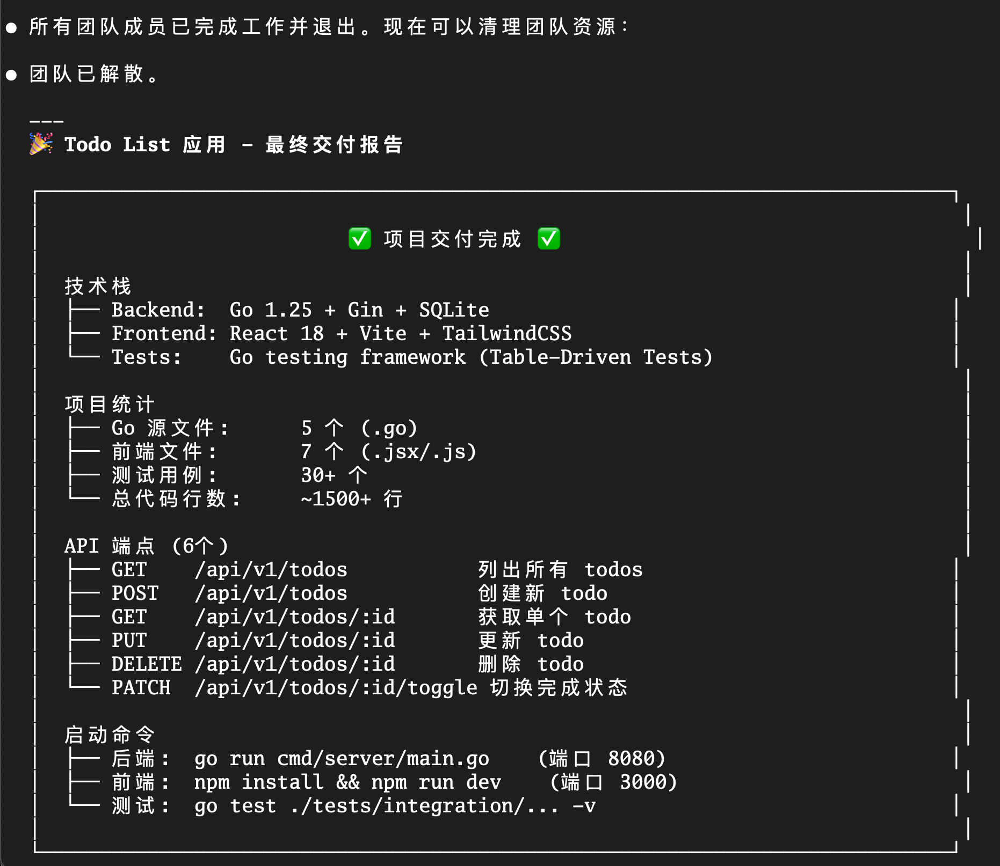

```
这里 team 的工作痕迹可能依然会存留在你的环境里，你可以显式输入 Clean up the
team，清除这些“痕迹”，并确认团队都已经清理完毕：
```

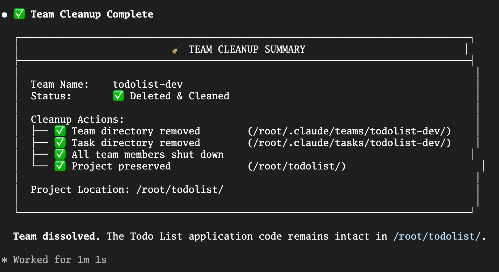

从图片中可以看到，Agent Team 工作时，团队配置信息和 task 信息都存储在本地：

团队配置一般放在：

```
~/.claude/teams/{team-name}/config.json
```

而 task 配置放在：

```
~/.claude/tasks/{team-name}/
```

## 最佳实践与注意事项

虽然 Agent Teams 很强大，但它也带来了新的复杂性和成本。以下是几条从实践中总结的经验：

1. 任务粒度要合适a. 不要为了用而用。如果任务是线性的（如“先改 A 文件，再改 B 文件”），单个 Agent 足够了，甚至更快。

- b. 并行度高、模块隔离度高的任务（如前后端联调、多语言翻译、微服务拆分）才是Agent Teams 的最佳舞台。

2. 关注 Token 成本a. 请记住，每个 Teammate 都是一个独立的 Claude 实例，拥有独立的上下文。启动一个 5人的团队，Token 消耗速度可能是平时的 5 倍。

- b. 善用委派模式（Delegate Mode）：让 Team Lead 只负责指挥和传递消息，不自己写代码，防止它“抢活”导致上下文浪费。创建一个团队后，按 Shift+Tab 切换到委派模式。

3. 明确的角色定义a. 在创建 Team 时，给每个 Teammate 明确的角色定义（System Prompt）。你是“最苛刻的安全审计员”，你是“追求极致性能的 C++ 专家”。角色越鲜明，协作效果越好。

4. 显示模式a. 如果环境满足，推荐使用 Split Panes (tmux/iTerm2) 模式。能同时看到所有 TeammateAgent 的“思考过程”，不仅便于监控，这种“赛博朋克”风格的体验本身就极具未来感。如果环境允许，大家可以自行体验。

## 本讲小结

Agent Teams 的出现，标志着我们从“人机结对编程”迈向了“人机组织管理”。

首先，并行执行和自主协同是 Agent Teams 区别于 Sub-agents 的核心优势，解决了复杂任务中规划分工和效率瓶颈的问题。

其次，通过 Team Lead + Teammates 的架构，我们可以在本地模拟出一个微型的“软件开发团队”，实现从需求到交付的全栈自动化。成本与收益的权衡是使用该特性的关键。它适合解决那些单兵难以应付的、结构复杂的工程难题。

最后，在不久的将来，评价一个高级工程师的标准，可能不再仅仅是你自己能写多少代码，而是你能否指挥一支由 AI 组成的“虚拟研发团队”，在半小时内解决过去需要一周才能完成的复杂工程问题。

希望这篇加餐能让你提前感受到 2026 年软件工程的脉搏。虽然它现在还是实验特性，但未来已来，只是分布尚不均匀。去试试吧，组建你的第一支 AI 战队！

## 思考题

如果让你现在就组建一支 Agent Team 来辅助你的日常工作，你会如何设计你的“队员”配置？

- 你需要一个专门负责 Code Review 的队员吗？

- 你需要一个专门负责写文档的队员吗？

- 还是需要一个专门负责紧盯错误日志的运维队员？

请在评论区分享你的“AI 虚拟研发团队”配置方案，让我们看看谁的团队设计最高效！
