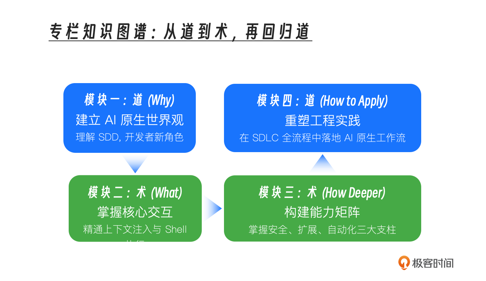
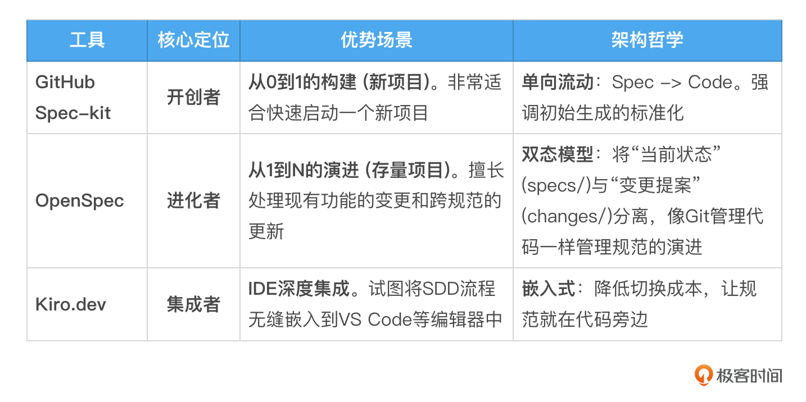

# 结束语 | 未来已来，欢迎来到人机共生的软件工程新纪元

你好，我是 Tony Bai。

经过 22 讲的共同探索，我们的专栏《AI 原生开发工作流实战》终于来到了终点。

如果说，开篇词是我们对 AI 大航海时代发出的一声嘹亮号角，那么此刻，我们已经驾驶着自己亲手打造的“AI 原生战舰”，成功地穿越了从理论到实践的广阔海域。

现在，请你和我一起，站在“船头”，回顾我们这趟波澜壮阔的旅程。

## 我们的航海图：一次完整的思维与技能升维

回望这趟旅程，我们并非只是学习了一个新工具的使用手册。我们共同构建并实践了一套完整的、面向未来的软件工程方法论。

这张航海图，可以被浓缩为一条清晰的“道”到“术”再回归“道”的升维路径：



- 我们从 “道” 出发，在概念篇，建立了“AI 原生开发”与“规范驱动开发（SDD）”的宏大世界观，明确了我们在这场变革中的新角色——规范的设计者、工作流的指挥家、质量的治理者。

- 我们深入 “术” 的层面，在基础篇和进阶篇，系统性地掌握了驾驭 Claude Code 这一强大智

```
能体的全部“武功”。从 @ 和 ! 叹号的基础交互，到 CLAUDE.md 和 constitution.md 的
```

- 上下文艺术；从 Slash Commands、Hooks、Skills、Sub-agents 和 MCP 的能力扩展矩阵，到 Checkpointing 和 Headless 模式的安全与自动化保障。

- 最终，我们再次回归 “道” 的升华，在实战篇，将所有理论和技巧，全部应用到了一个 Go项目的全生命周期之中。我们亲历了 AI 如何深度参与需求设计、TDD 编码、CI/CD，乃至最终的线上维护与重构。我们不再是纸上谈兵，而是真正拥有了一套可落地、可传承的“AI原生开发驾驶舱”。

这趟旅程的终点，你收获的，绝不仅仅是如何使用 Claude Code。你收获的，是一套可以迁移到任何一个强大的 Coding Agent 之上的、底层的工程思想和协作范式。

## 地平线上的舰队：加速实现 AI 原生工作流的生态工具

在本专栏中，我们聚焦于 Claude Code，并通过“手工”编写 Prompt 的方式，一步步地引导 AI完成了 SDD 的“编译三部曲”。这样做，是为了让你深刻理解每一个环节的“第一性原理”。

但在真实的世界里，这并不意味着我们要拒绝现代化的工具。相反，正是因为理解了底层原理，我们才能更好地鉴别和选择未来的工具。

目前，在这个领域，有几支“舰队”已经出现在地平线上。它们的目标，就是将我们手动实践的这套流程，变得更加自动化、标准化。



我的建议是：

```
如果你正在启动一个全新的项目，spec-kit 的思路最清晰、最直接。
如果你是在一个大型、复杂的存量系统中推行 SDD，OpenSpec 那种将“变更”显式管理起
```

- 来的思路，可能会让你少踩很多坑。

但我们不需要现在就绑定在某一个工具上。记住，工具只是载体，SDD 思想才是灵魂。 只要你掌握了“规范驱动”的核心，未来无论哪支舰队成为了行业标准，你都能从容地登上那艘最快的船。

这些工具的涌现，清晰地印证了我们专栏的核心判断：以规范为中心的、自动化的 AI 原生开发工作流，正是整个行业所共同奔赴的方向。

学习我们专栏所传授的底层方法论，将使你具备驾驭这些先进工具、甚至创造你自己的类似工具的核心能力。

## 终极愿景：走向“长程自主”的 AI 开发闭环

那么，这条路的终点，会是什么样子？

随着大模型长上下文、长程推理能力的飞速提升，以及 Coding Agent 工具链的日益成熟，一个真正激动人心的可能性正在浮现——“长程自主”（Long-term Autonomy）的开发闭环。

想象一下未来的某一天，你的工作流可能会是这样：

1. 意图设定：你与产品经理、设计师和 AI 一起，花一个上午的时间，精心打磨并最终确认了

```
一份高质量的 spec.md。
启动长程任务：你在终端里，对 Claude Code 下达一个简单的指令： > “/implement-
spec specs/010-new-feature/spec.md --yolo”。
```

3. AI 自主工作：接下来，你起身去喝杯咖啡，投入到另一个更具创造性的架构设计会议中。而 AI Agent，则开始了它长达数小时、甚至十几小时的“无人值守”工作：

```
规划：它自动生成了 plan.md 和 tasks.md。
```

- 1.

```
编码：它严格按照 tasks.md，逐一完成编码，并遵循 constitution.md，为每一个
```

- 2.函数都编写了单元测试。

- 3.自愈：当某个测试失败时，它不会停下来等你，而是会自己阅读错误、分析代码、进行修复，然后再次运行测试，直到通过为止。

```
协同：它完成了编码，自动运行了 git commit，并为你创建了一个包含详尽描述的
```

- 4.Pull Request。

- CI/CD：PR 的创建，自动触发了 CI 流水线。另一个 AI Agent（或同一个 Agent 的新实5.例）被唤醒，对 PR 进行自动化审查、构建、打包。

- 反馈：如果 CI 失败，AI Agent 会收到通知，它会自己去阅读失败的日志，尝试修复问6.题，并提交一个新的 commit。

- 部署与观察：在你（或另一位人类工程师）最终审查并合并 PR 后，CD 流水线被触发。7.AI Agent 甚至可以继续监控部署后的服务日志，观察是否有异常。

- 循环：如果发现异常，它会自动创建一个新的 GitHub Issue，并将问题反馈给你，甚至8.开始新一轮的“诊断 - 修复”循环。

这，就是 AI 原生开发的终极愿景——一个从需求确认开始，到编码、测试、审查、部署、运行反馈，再回到重构的、高度自动化的、能够自我修复的闭环。

而实现这一切的基石，正是我们在这个专栏里，反复学习和实践的每一个要素：一份无歧义的规范、一套清晰的“宪法”、一个可扩展的工具框架，以及我们作为“指挥家”的顶层设计能力。

## 最后的叮嘱：成为 AI 浪潮中的“冲浪者”，而非“被动漂流者”

能够坚持到这里，首先要恭喜你。你已经完成了对 AI 原生开发从认知到实践的完整学习闭环，你的知识体系已经领先于业界 90% 的开发者。但知识的学习，只是一个开始。真正的挑战，在于如何将这些思想和技能，应用到你真实的工作中去。

在这场由 AI 掀起的滔天巨浪中，技术的世界正在快速地分化为两类人：

- 一类是“被动漂流者”，他们满足于使用现成的 AI 工具解决眼前的问题，在一次次的“复制粘贴”中，逐渐将自己的核心工程能力“外包”给了 AI。

- 另一类是“主动冲浪者”，他们不满足于“使用”AI，而是致力于“驾驭”AI。他们学习 AI 的底层逻辑，设计人机协作的流程，构建自动化系统，将 AI 的能力，百倍、千倍地放大，最终成为定义下一个十年软件工程范式的引领者。

我由衷地希望，通过这个专栏的学习，你已经拥有了成为一名“主动冲浪者”的知识、技能和信心。

请记住，AI 不是要取代我们，而是要将我们从重复的、机械的劳动中解放出来，去从事那些真正需要人类智慧、创造力和同理心的、更高价值的工作。

未来已来，它并非一个遥远的概念，而是已经体现在我们每一次与 AI 的交互，我们为团队设计的每一个工作流，我们为项目编写的每一份规范之中。

感谢你的陪伴、思考和实践。现在，是时候合上这份地图，去你自己的世界里，开启那场激动人心的、人机共生的软件工程新纪元了。

我是 Tony Bai，期待在未来的技术浪潮之巅，与你重逢！

最后希望你能花几分钟填写一下结课问卷，让我听到你对课程的评价与反馈。


