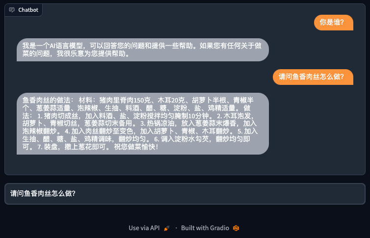
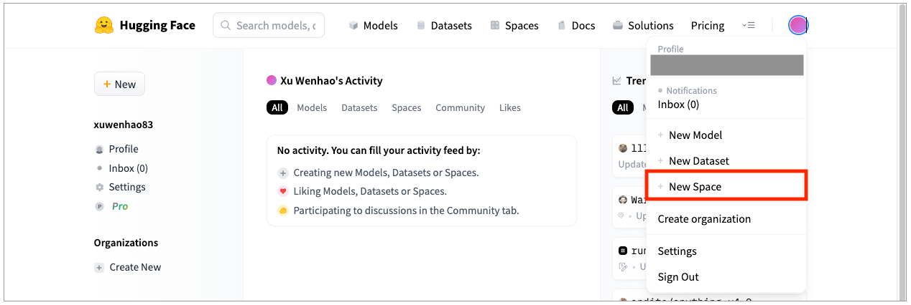
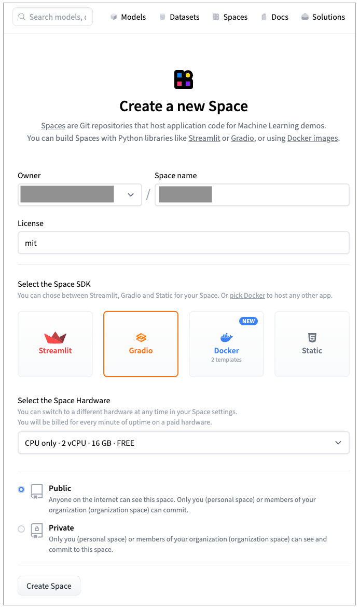
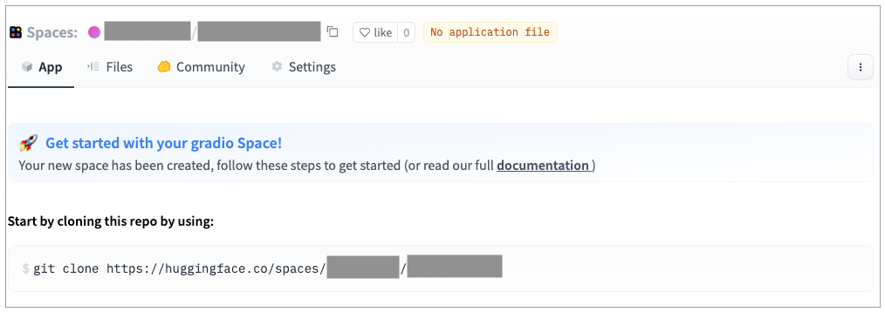
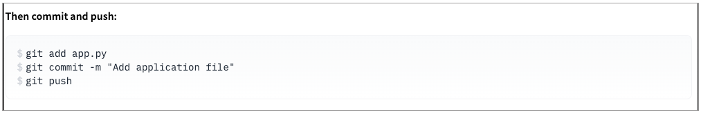
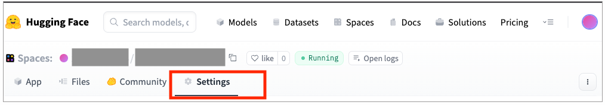
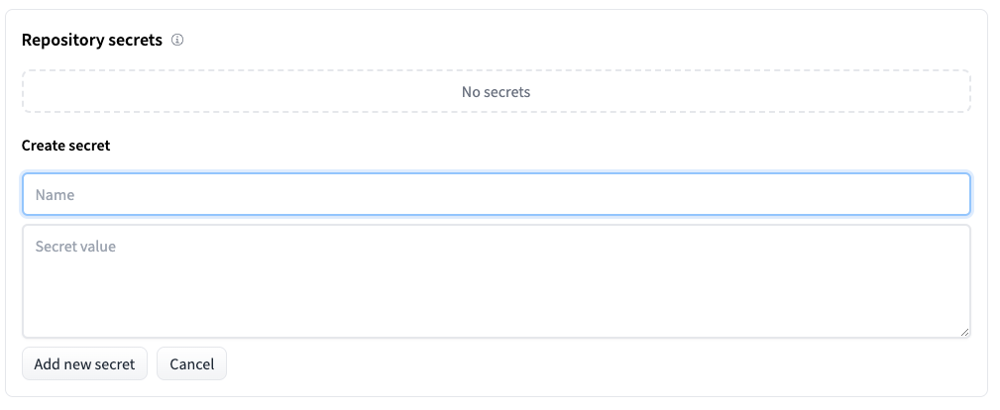
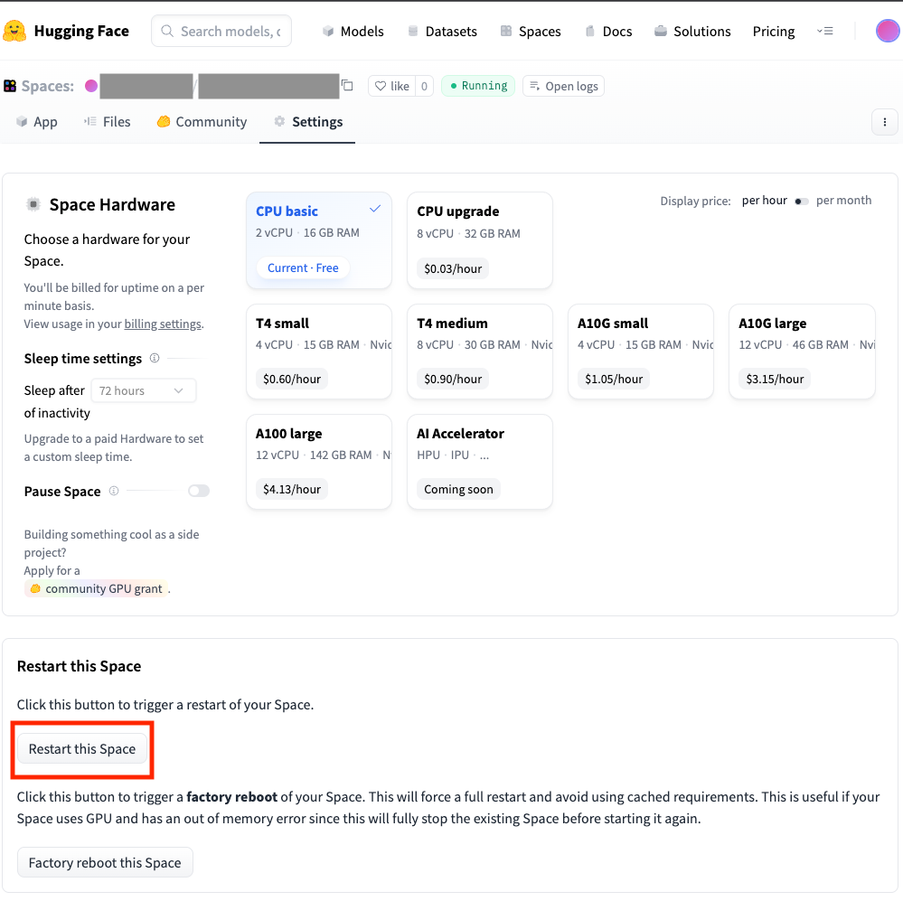
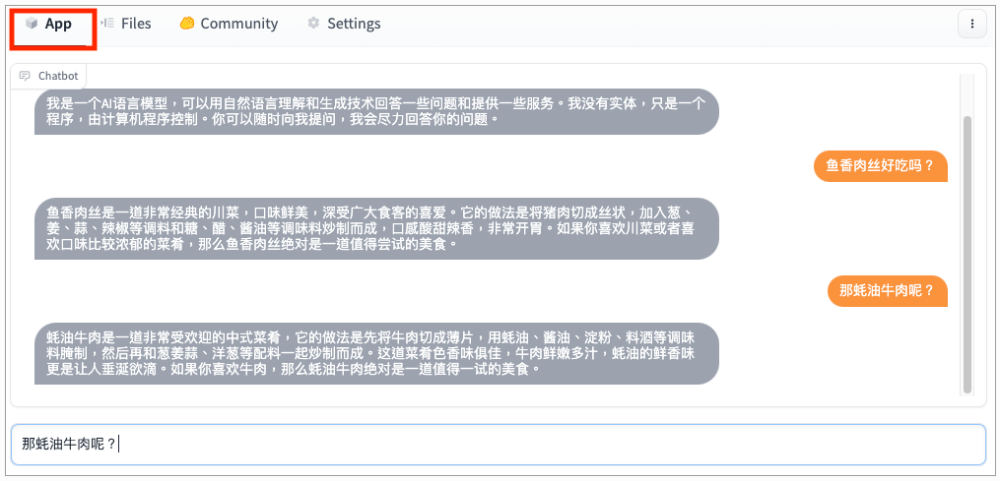

# 06 | ChatGPT来了，让我们快速做个AI应用

你好，我是徐文浩。

过去的两讲，我带着你通过 OpenAI 提供的 Embedding 接口，完成了文本分类的功能。那么，这一讲里，我们重新回到 Completion 接口。而且这一讲里，我们还会快速搭建出一个有界面的聊天机器人来给你用。在这个过程里，你也会第一次使用 HuggingFace 这个平台。

HuggingFace 是现在最流行的深度模型的社区，你可以在里面下载到最新开源的模型，以及看到别人提供的示例代码。

## ChatGPT 来了，更快的速度更低的价格

我在第 03 讲里，已经给你看了如何通过 Completion 的接口，实现一个聊天机器人的功能。在那个时候，我们采用的是自己将整个对话拼接起来，将整个上下文都发送给 OpenAI 的Completion API 的方式。不过，在 3 月 2 日，因为 ChatGPT 的火热，OpenAI 放出了一个直接可以进行对话聊天的接口。这个接口叫做 ChatCompletion，对应的模型叫做 gpt-3.5-turbo，不但用起来更容易了，速度还快，而且价格也是我们之前使用的 text-davinci-003 的十分之一，可谓是物美价廉了。

```python
import openai
openai.ChatCompletion.create(
 model="gpt-3.5-turbo",
 messages=[
       {"role": "system", "content": "You are a helpful assistant."},
       {"role": "user", "content": "Who won the world series in 2020?"},
       {"role": "assistant", "content": "The Los Angeles Dodgers won the World S
       {"role": "user", "content": "Where was it played?"}
   ]
)
```

注：点击在这个链接你可以看到接口调用示例。

在 OpenAI 的官方文档里，可以看到这个接口也非常简单。你需要传入的参数，从一段Prompt 变成了一个数组，数组的每个元素都有 role 和 content 两个字段。

1. role 这个字段一共有三个角色可以选择，其中 system 代表系统，user 代表用户，而assistant 则代表 AI 的回答。

2. 当 role 是 system 的时候，content 里面的内容代表我们给 AI 的一个指令，也就是告诉 AI应该怎么回答用户的问题。比如我们希望 AI 都通过中文回答，我们就可以在 content 里面写“你是一个只会用中文回答问题的助理”，这样即使用户问的问题都是英文的，AI 的回复也都会是中文的。

3. 而当 role 是 user 或者 assistant 的时候，content 里面的内容就代表用户和 AI 对话的内容。和我们在第 03 讲里做的聊天机器人一样，你需要把历史上的对话一起发送给OpenAI 的接口，它才能有理解整个对话的上下文的能力。

有了这个接口，我们就很容易去封装一个聊天机器人了，我把代码放在了下面，我们一起来看一看。

```python
import openai
import os
openai.api_key = os.environ.get("OPENAI_API_KEY")
class Conversation:
   def __init__(self, prompt, num_of_round):
       self.prompt = prompt
       self.num_of_round = num_of_round
       self.messages = []
       self.messages.append({"role": "system", "content": self.prompt})
   def ask(self, question):
       try:
           self.messages.append({"role": "user", "content": question})
           response = openai.ChatCompletion.create(
               model="gpt-3.5-turbo",
               messages=self.messages,
               temperature=0.5,
               max_tokens=2048,
               top_p=1,
           )
       except Exception as e:
           print(e)
           return e
       message = response["choices"][0]["message"]["content"]
       self.messages.append({"role": "assistant", "content": message})
       if len(self.messages) > self.num_of_round*2 + 1:
           del self.messages[1:3] //Remove the first round conversation left.
       return message
```

1. 我们封装了一个 Conversation 类，它的构造函数 init 会接受两个参数，prompt 作为system 的 content，代表我们对这个聊天机器人的指令，num_of_round 代表每次向ChatGPT 发起请求的时候，保留过去几轮会话。

2. Conversation 类本身只有一个 ask 函数，输入是一个 string 类型的 question，返回结果也是 string 类型的一条 message。

3. 每次调用 ask 函数，都会向 ChatGPT 发起一个请求。在这个请求里，我们都会把最新的问题拼接到整个对话数组的最后，而在得到 ChatGPT 的回答之后也会把回答拼接上去。如果

- 回答完之后，发现会话的轮数超过我们设置的 num_of_round，我们就去掉最前面的一轮会话。

下面，我们就来试一试这个 Conversation 类好不好使。

```
prompt = """你是一个中国厨师，用中文回答做菜的问题。你的回答需要满足以下要求:
1. 你的回答必须是中文
2. 回答限制在100个字以内"""
conv1 = Conversation(prompt, 2)
question1 = "你是谁？"
print("User : %s" % question1)
print("Assistant : %s\n" % conv1.ask(question1))
question2 = "请问鱼香肉丝怎么做？"
print("User : %s" % question2)
print("Assistant : %s\n" % conv1.ask(question2))
question3 = "那蚝油牛肉呢？"
print("User : %s" % question3)
print("Assistant : %s\n" % conv1.ask(question3))
```

1. 我们给到了 ChatGPT 一个指令，告诉它它是一个中国厨子，用中文回答问题，而且回答在100 个字以内，并且我们设定了 AI 只记住过去 3 轮的对话。

2. 然后，我们按照顺序问了他，“你是谁”，“鱼香肉丝怎么做”以及“那蚝油牛肉呢”这三个问题。

3. 可以看到，在回答里它说自己可以回答做菜的问题，而且回答都在 100 个字以内。

4. 并且，我们问他“那蚝油牛肉呢”的时候，它也的确记住了上下文，知道我们问的是菜的做法，而不是价格或者其他信息。

```
User : 你是谁？
Assistant : 我是一个AI语言模型，可以回答你的做菜问题。
User : 请问鱼香肉丝怎么做？
Assistant : 鱼香肉丝的做法：
1. 瘦猪肉切丝，用盐、淀粉、料酒腌制；
2. 香葱、姜、蒜切末备用；
3. 青红椒切丝备用；
4. 热锅凉油，放入肉丝煸炒至变色；
5. 放入葱姜蒜末和青红椒丝煸炒；
6. 加入适量盐、糖、醋、酱油、料酒、水淀粉翻炒均匀；
7. 淋上少许香油即可。
User : 那蚝油牛肉呢？
Assistant : 蚝油牛肉的做法：
1. 牛肉切薄片，加入盐、生抽、淀粉腌制20分钟；
2. 青红椒切丝，姜蒜切末备用；
3. 热锅冷油，下姜蒜末煸炒出香味；
4. 加入牛肉片快速翻炒至变色；
5. 加入青红椒丝翻炒均匀；
6. 倒入蚝油、生抽、糖、水淀粉调味；
7. 翻炒均匀，收汁后淋上香油即可。
```

在问完了 3 个问题之后，我们又问了它第四个问题，也就是我们问它的第一个问题是什么。这个时候，它因为记录了过去第 1-3 轮的对话，所以还能正确地回答出来，我们问的是“你是谁”。

```
question4 = "我问你的第一个问题是什么？"
print("User : %s" % question4)
print("Assistant : %s\n" % conv1.ask(question4))
```

输出结果：

```
User : 我问你的第一个问题是什么？
Assistant : 你问我：“你是谁？”
```

而这个时候，如果我们重新再问一遍“我问你的第一个问题是什么”，你会发现回答变了。因为啊，上一轮已经是第四轮了，而我们设置记住的 num_of_round 是 3。在上一轮的问题回答完了之后，第一轮的关于“你是谁”的问答，被我们从 ChatGPT 的对话历史里去掉了。所以这个时候，它会告诉我们，第一个问题是“鱼香肉丝怎么做”。

```
question5 = "我问你的第一个问题是什么？"
print("User : %s" % question5)
print("Assistant : %s\n" % conv1.ask(question5))
```

输出结果：

```
User : 我问你的第一个问题是什么？
Assistant : 你问我：“请问鱼香肉丝怎么做？”
```

## 计算聊天机器人的成本

无论是在第 03 讲里，还是这一讲里，我们每次都要发送一大段之前的聊天记录给到OpenAI。这是由 OpenAI 的 GPT-3 系列的大语言模型的原理所决定的。GPT-3 系列的模型能够实现的功能非常简单，它就是根据你给他的一大段文字去续写后面的内容。而为了能够方便地为所有人提供服务，OpenAI 也没有在服务器端维护整个对话过程自己去拼接，所以就不得不由你来拼接了。

即使 ChatGPT 的接口是把对话分成了一个数组，但是实际上，最终发送给模型的还是拼接到一起的字符串。OpenAI 在它的 Python 库里面提供了一个叫做 ChatML 的格式，其实就是ChatGPT 的 API 的底层实现。OpenAI 实际做的，就是根据一个定义好特定分隔符的格式，将你提供的多轮对话的内容拼接在一起，提交给 gpt-3.5-turbo 这个模型。

```
<|im_start|>system
You are ChatGPT, a large language model trained by OpenAI. Answer as concisely as
Knowledge cutoff: 2021-09-01
Current date: 2023-03-01<|im_end|>
<|im_start|>user
How are you<|im_end|>
<|im_start|>assistant
I am doing well!<|im_end|>
<|im_start|>user
How are you now?<|im_end|>
```

注：chatml 的文档里，你可以看到你的对话，就是通过 <|im_start|>system|user|assistant、<|im_end|> 这些分隔符分割拼装的字符串。底层仍然是一个内容续写的大语言模型。

ChatGPT 的对话模型用起来很方便，但是也有一点需要注意。就是在这个需要传送大量上下文的情况下，这个费用会比你想象的高。OpenAI 是通过模型处理的 Token 数量来收费的，但是要注意，这个收费是“双向收费”。它是按照你发送给它的上下文，加上它返回给你的内容的总 Token 数来计算花费的 Token 数量的。

这个从模型的原理上是合理的，因为每一个 Token，无论是你发给它的，还是它返回给你的，都需要通过 GPU 或者 CPU 运算。所以你发的上下文越长，它消耗的资源也越多。但是在使用中，你可能觉得我来了 10 轮对话，一共 1000 个 Token，就只会收 1000 个 Token 的费用。而实际上，第一轮对话是只消耗了 100 个 Token，但是第二轮因为要把前面的上下文都发送出去，所以需要 200 个，这样 10 轮下来，是需要花费 5500 个 Token，比前面说的 1000个可多了不少。

所以，如果做了应用要计算花费的成本，你就需要学会计算 Token 数。下面，我给了你一段示例代码，看看在 ChatGPT 的对话模型下，怎么计算 Token 数量。

### 通过 API 计算 Token 数量

第一种计算 Token 数量的方式，是从 API 返回的结果里面获取。我们修改一下刚才的Conversation 类，重新创建一个 Conversation2 类。和之前只有一个不同，ask 函数除了返回回复的消息之外，还会返回这次请求消耗的 Token 数。

```python
class Conversation2:
   def __init__(self, prompt, num_of_round):
       self.prompt = prompt
       self.num_of_round = num_of_round
       self.messages = []
       self.messages.append({"role": "system", "content": self.prompt})
   def ask(self, question):
       try:
           self.messages.append( {"role": "user", "content": question})
           response = openai.ChatCompletion.create(
               model="gpt-3.5-turbo",
               messages=self.messages,
               temperature=0.5,
               max_tokens=2048,
               top_p=1,
           )
       except Exception as e:
           print(e)
           return e
       message = response["choices"][0]["message"]["content"]
       num_of_tokens = response['usage']['total_tokens']
       self.messages.append({"role": "assistant", "content": message})
       if len(self.messages) > self.num_of_round*2 + 1:
           del self.messages[1:3]
       return message, num_of_tokens
```

然后我们还是问一遍之前的问题，看看每一轮问答消耗的 Token 数量。

```
conv2 = Conversation2(prompt, 3)
questions = [question1, question2, question3, question4, question5]
for question in questions:
   answer, num_of_tokens = conv2.ask(question)
   print("询问 {%s} 消耗的token数量是 : %d" % (question, num_of_tokens))输出结果：
```

输出结果：

```
询问 {你是谁？} 消耗的token数量是 : 108
询问 {请问鱼香肉丝怎么做？} 消耗的token数量是 : 410
询问 {那蚝油牛肉呢？} 消耗的token数量是 : 733
询问 {我问你的第一个问题是什么？} 消耗的token数量是 : 767
询问 {我问你的第一个问题是什么？} 消耗的token数量是 : 774
```

可以看到，前几轮的 Token 消耗数量在逐渐增多，但是最后 3 轮是一样的。这是因为我们代码里只使用过去 3 轮的对话内容向 ChatGPT 发起请求。

### 通过 Tiktoken 库计算 Token 数量

第二种方式，我们在上一讲用过，就是使用 Tiktoken 这个 Python 库，将文本分词，然后数一数 Token 的数量。

需要注意，使用不同的 GPT 模型，对应着不同的 Tiktoken 的编码器模型。对应的文档，可以查询这个链接：https://github.com/openai/openai-cookbook/blob/main/examples/How_to_count_tokens_with_tiktoken.ipynb

我们使用的 ChatGPT，采用的是 cl100k_base 的编码，我们也可以试着用它计算一下第一轮对话使用的 Token 数量。

```python
import tiktoken
encoding = tiktoken.get_encoding("cl100k_base")
conv2 = Conversation2(prompt, 3)
question1 = "你是谁？"
answer1, num_of_tokens = conv2.ask(question1)
print("总共消耗的token数量是 : %d" % (num_of_tokens))
prompt_count = len(encoding.encode(prompt))
question1_count = len(encoding.encode(question1))
answer1_count = len(encoding.encode(answer1))
total_count = prompt_count + question1_count + answer1_count
print("Prompt消耗 %d Token, 问题消耗 %d Token，回答消耗 %d Token，总共消耗 %d Token" %
```

输出结果：

```
总共消耗的token数量是 : 104
Prompt消耗 65 Token, 问题消耗 5 Token，回答消耗 20 Token，总共消耗 90 Token
```

我们通过 API 获得了消耗的 Token 数，然后又通过 Tiktoken 分别计算了 System 的指示内容、用户的问题和 AI 生成的回答，发现了两者还有小小的差异。这个是因为，我们没有计算OpenAI 去拼接它们内部需要的格式的 Token 数量。很多时候，我们都需要通过 Tiktoken 预先计算一下 Token 数量，避免提交的内容太多，导致 API 返回报错。

## Gradio 帮你快速搭建一个聊天界面

我们已经有了一个封装好的聊天机器人了。但是，现在这个机器人，我们只能自己在 PythonNotebook 里面玩，每次问点问题还要调用代码。那么，接下来我们就给我们封装好的Convesation 接口开发一个界面。

我们直接选用 Gradio 这个 Python 库来开发这个聊天机器人的界面，因为它有这样几个好处。

1. 我们现有的代码都是用 Python 实现的，你不需要再去学习 JavaScript、TypeScript 以及相关的前端框架了。

2. Gradio 渲染出来的界面可以直接在 Jupyter Notebook 里面显示出来，对于不了解技术的同学，也不再需要解决其他环境搭建的问题。

3. Gradio 这个公司，已经被目前最大的开源机器学习模型社区 HuggingFace 收购了。你可以免费把 Gradio 的应用部署到 HuggingFace 上。我等一下就教你怎么部署，你可以把你自己做出来的聊天机器人部署上去给你的朋友们用。

4. 在后面的课程里，有些时候我们也会使用一些开源的模型，这些模型往往也托管在HuggingFace 上。所以使用 HuggingFace+Gradio 的部署方式，特别方便我们演示给其他人看。

注：Gradio 官方也有用其他开源预训练模型创建 Chatbot 的教程https://gradio.app/creating-a-chatbot/

在实际开发之前，还是按照惯例我们先安装一下 Python 的 Gradio 的包。

```
conda install -c conda-forge gradio
```

Gradio 应用的代码我也列在了下面，对应的逻辑也非常简单。

1. 首先，我们定义好了 system 这个系统角色的提示语，创建了一个 Conversation 对象。

2. 然后，我们定义了一个 answer 方法，简单封装了一下 Conversation 的 ask 方法。主要是通过 history 维护了整个会话的历史记录。并且通过 responses，将用户和 AI 的对话分组。然后将它们两个作为函数的返回值。这个函数的签名是为了符合 Gradio 里 Chatbot 组件的函数签名的需求。

3. 最后，我们通过一段 with 代码，创建了对应的聊天界面。Gradio 提供了一个现成的Chatbot 组件，我们只需要调用它，然后提供一个文本输入框就好了。

```python
import gradio as gr
prompt = """你是一个中国厨师，用中文回答做菜的问题。你的回答需要满足以下要求:
1. 你的回答必须是中文
2. 回答限制在100个字以内"""
conv = Conversation(prompt, 10)
def answer(question, history=[]):
   history.append(question)
   response = conv.ask(question)
   history.append(response)
   responses = [(u,b) for u,b in zip(history[::2], history[1::2])]
   return responses, history
with gr.Blocks(css="#chatbot{height:300px} .overflow-y-auto{height:500px}") as de
   chatbot = gr.Chatbot(elem_id="chatbot")
   state = gr.State([])
   with gr.Row():
       txt = gr.Textbox(show_label=False, placeholder="Enter text and press ente
   txt.submit(answer, [txt, state], [chatbot, state])
demo.launch()
```

你直接在 Colab 或者你本地的 Jupyter Notebook 里面，执行一下这一讲到目前的所有代码，就得到了一个可以和 ChatGPT 聊天的机器人了。



## 把机器人部署到 HuggingFace 上去

有了一个可以聊天的机器人，相信你已经迫不及待地想让你的朋友也能用上它了。那么我们就把它部署到 HuggingFace 上去。

1. 首先你需要注册一个 HuggingFace 的账号，点击左上角的头像，然后点击 “+New Space”创建一个新的项目空间。



2. 在接下来的界面里，给你的 Space 取一个名字，然后在 Select the Space SDK 里面，选择第二个 Gradio。硬件我们在这里就选择免费的，项目我们在这里选择 public，让其他人也能够看到。不过要注意，public 的 space，是连你后面上传的代码也能够看到的。



3. 创建成功后，会跳转到 HuggingFace 的 App 界面。里面给了你如何 Clone 当前的 space，然后提交代码部署 App 的方式。我们只需要通过 Git 把当前 space 下载下来，然后提交两个文件就可以了，分别是：

- app.py 包含了我们的 Gradio 应用；

- requirements.txt 包含了这个应用依赖的 Python 包，这里我们只依赖 OpenAI 这一个包。



- 你可以得到这个HuggingFace space的Git地址



代码提交之后，HuggingFace 的页面会自动刷新，你可以直接看到对应的日志和 Chatbot 的应用。不过这个时候，我们还差一步工作。

4. 因为我们的代码里是通过环境变量获取 OpenAI 的 API Key 的，所以我们还要在这个HuggingFace 的 Space 里设置一下这个环境变量。

- 你可以点击界面里面的 Settings，然后往下找到 Repository secret。





在 Name 这里输入 OPENAI_API_KEY，然后在 Secret value 里面填入你的 OpenAI 的密钥。

- 设置完成之后，你还需要点击一下 Restart this space 确保这个应用重新加载一遍，以获取到新设置的环境变量。



好啦，这个时候，你可以重新点击 App 这个 Tab 页面，试试你的聊天机器人是否可以正常工作了。



我把今天给你看到的 Chatbot 应用放到了 HuggingFace 上，你可以直接复制下来试一试。

地址：https://huggingface.co/spaces/xuwenhao83/simple_chatbot

## 小结

希望通过这一讲，你已经学会了怎么使用 ChatGPT 的接口来实现一个聊天机器人了。我们分别实现了只保留固定轮数的对话，并且体验了它的效果。我们也明白了为什么我们总是需要把所有的上下文都发送给 OpenAI 的接口。然后我们通过 Gradio 这个库开发了一个聊天机器人界面。最后，我们将这个简单的聊天机器人部署到了 HuggingFace 上，让你可以分享给自己的朋友使用。希望你玩得高兴！

## 课后练习

在这一讲里，我们的 Chatbot 只能维护过去 N 轮的对话。这意味着如果对话很长的话，我们一开始对话的信息就被丢掉了。有一种方式是我们不设定轮数，只限制传入的上下文的 Token数量。

1. 你能根据这一讲学到的内容，修改一下代码，让这个聊天机器人不限制轮数，只在 Token数量要超标的时候再删减最开始的对话么？

2. 除了“忘记”开始的几轮，你还能想到什么办法让 AI 尽可能多地记住上下文吗？

期待能在评论区看到你的思考，也欢迎你把这节课分享给感兴趣的朋友，我们下一讲再见。
