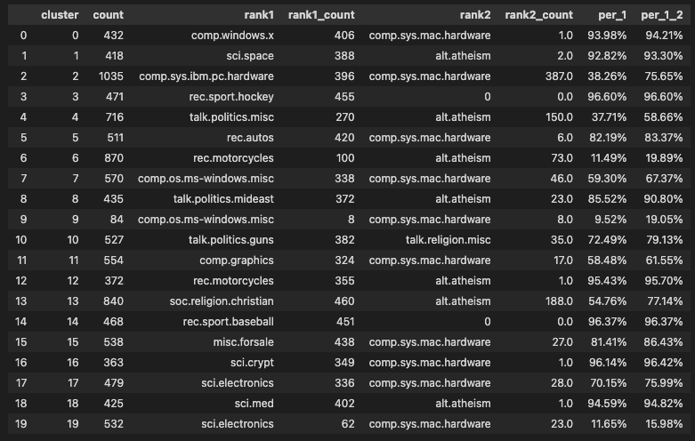

# 07 | 文本聚类与摘要，让AI帮你做个总结

你好，我是徐文浩。

上一讲里，我们用上了最新的 ChatGPT 的 API，注册好了 HuggingFace 的账号，也把我们的聊天机器人部署了出去。希望通过这个过程，你对实际的应用开发过程已经有了充足的体验。那么这一讲里，我们会回到 OpenAI 的各个接口能够提供的能力。我们分别看看怎么通过Embedding 进行文本聚类，怎么利用提示语（Prompt）做文本的总结。

## 基于 Embedding 向量进行文本聚类

我先给不太了解技术的同学简单科普一下什么叫做文本聚类，文本聚类就是把很多没有标注过的文本，根据它们之间的相似度，自动地分成几类。基于 GPT 系列的模型进行文本聚类很简单，因为我们可以通过 Embedding 把文本变成一段向量。而对于向量我们自然可以用一些简单的聚类算法，比如我们采用最简单的 K-Means 算法就可以了。

这一次，我们选用的数据集，是很多老的机器学习教程里常用的 20 newsgroups 数据集，也就是一个带了标注分好类的英文新闻组的数据集。这个数据集，其实不是最自然的自然语言，里面的数据是经过了预处理的，比如去除了标点符号、停用词等等。我们正好可以拿来看看，面对这样其实不太“自然语言”的数据，OpenAI 的 GPT 系列模型处理的效果怎么样。

首先，我们先通过 scikit-learn 这个 Python 库来拿到数据，数据集就内置在这个库里面。scikit-learn 也是非常常用的一个机器学习库，我们直接把数据下载下来，存储成 CSV 文件。对应的代码在下面可以看到。

```bash
from sklearn.datasets import fetch_20newsgroups
import pandas as pd
def twenty_newsgroup_to_csv():
   newsgroups_train = fetch_20newsgroups(subset='train', remove=('headers', 'foo
   df = pd.DataFrame([newsgroups_train.data, newsgroups_train.target.tolist()]).
   df.columns = ['text', 'target']
   targets = pd.DataFrame( newsgroups_train.target_names, columns=['title'])
   out = pd.merge(df, targets, left_on='target', right_index=True)
   out.to_csv('20_newsgroup.csv', index=False)
twenty_newsgroup_to_csv()
```

接着，我们要对数据做预处理，我们需要过滤掉数据里面有些文本是空的情况。以及和我们前面进行文本分类一样，把 Token 数量太多的给过滤掉。

```python
from openai.embeddings_utils import get_embeddings
import openai, os, tiktoken, backoff
openai.api_key = os.environ.get("OPENAI_API_KEY")
embedding_model = "text-embedding-ada-002"
embedding_encoding = "cl100k_base"  # this the encoding for text-embedding-ada-00
batch_size = 2000
max_tokens = 8000  # the maximum for text-embedding-ada-002 is 8191
df = pd.read_csv('20_newsgroup.csv')
print("Number of rows before null filtering:", len(df))
df = df[df['text'].isnull() == False]
encoding = tiktoken.get_encoding(embedding_encoding)
df["n_tokens"] = df.text.apply(lambda x: len(encoding.encode(x)))
print("Number of rows before token number filtering:", len(df))
df = df[df.n_tokens <= max_tokens]
print("Number of rows data used:", len(df))
```

输出结果：

```
Number of rows before null filtering: 11314
Number of rows before token number filtering: 11096
Number of rows data used: 11044
```

然后，我们仍然是通过 Embedding 的接口，拿到文本的 Embedding 向量，然后把整个数据存储成 parquet 文件。

```python
@backoff.on_exception(backoff.expo, openai.error.RateLimitError)
def get_embeddings_with_backoff(prompts, engine):
   embeddings = []
   for i in range(0, len(prompts), batch_size):
       batch = prompts[i:i+batch_size]
       embeddings += get_embeddings(list_of_text=batch, engine=engine)
   return embeddings
prompts = df.text.tolist()
prompt_batches = [prompts[i:i+batch_size] for i in range(0, len(prompts), batch_s
embeddings = []
for batch in prompt_batches:
   batch_embeddings = get_embeddings_with_backoff(prompts=batch, engine=embeddin
   embeddings += batch_embeddings
df["embedding"] = embeddings
df.to_parquet("data/20_newsgroup_with_embedding.parquet", index=False)
```

这一部分代码基本和前面我们做文本分类一样，我就不再做详细讲解了。不理解代码为什么要这么写的同学，可以去看前面的第 05 讲。

通常，在使用 Jupyter Notebook 或者 Python 去做机器学习类的任务的时候，我们往往会把一些中间步骤的数据结果给存下来。这样，我们可以避免在后面步骤写了 Bug 或者参数设错的时候从头开始。在这里，我们就把原始数据，以及 Embedding 处理完的数据都存了一份。这样，如果后面的聚类程序要做修改，我们不需要再花钱让 OpenAI 给我们算一次 Embedding了。

接着，我们就可以用 K-Means 算法来进行聚类了。因为原本的数据来自 20 个不同的新闻组，那么我们也不妨就聚合成 20 个类，正好我们看看自动聚类出来的分类会不会就和原始分类差不多。

```python
import numpy as np
from sklearn.cluster import KMeans
embedding_df = pd.read_parquet("data/20_newsgroup_with_embedding.parquet")
matrix = np.vstack(embedding_df.embedding.values)
num_of_clusters = 20
kmeans = KMeans(n_clusters=num_of_clusters, init="k-means++", n_init=10, random_s
kmeans.fit(matrix)
labels = kmeans.labels_
embedding_df["cluster"] = labels
```

聚类的代码非常简单，我们通过 NumPy 的 stack 函数，把所有的 Embedding 放到一个矩阵里面，设置一下要聚合出来的类的数量，然后运行一下 K-Means 算法的 fit 函数，就好了。不过，聚类完，我们怎么去看它聚类的结果是不是合适呢？每个聚合出来的类代表什么呢？

在这里，我们的数据之前就有分组。那么我们就可以用一个取巧的思路。我们统计一下聚类之后的每个类有多少条各个 newsgroups 分组的数据。然后看看这些数据里面，排名第一的分组是什么。如果我们聚类聚合出来的类，都是从某一个 newsgroup 分组出来的文章，那么说明这个聚合出来的类其实就和那个分组的内容差不多。使用这个思路的代码，我也放在下面了，我们一起来看一看。

```
# 统计每个cluster的数量
new_df = embedding_df.groupby('cluster')['cluster'].count().reset_index(name='cou
# 统计这个cluster里最多的分类的数量
title_count = embedding_df.groupby(['cluster', 'title']).size().reset_index(name=
first_titles = title_count.groupby('cluster').apply(lambda x: x.nlargest(1, colum
first_titles = first_titles.reset_index(drop=True)
new_df = pd.merge(new_df, first_titles[['cluster', 'title', 'title_count']], on='
new_df = new_df.rename(columns={'title': 'rank1', 'title_count': 'rank1_count'})
# 统计这个cluster里第二多的分类的数量
second_titles = title_count[~title_count['title'].isin(first_titles['title'])]
second_titles = second_titles.groupby('cluster').apply(lambda x: x.nlargest(1, co
second_titles = second_titles.reset_index(drop=True)
new_df = pd.merge(new_df, second_titles[['cluster', 'title', 'title_count']], on=
new_df = new_df.rename(columns={'title': 'rank2', 'title_count': 'rank2_count'})
new_df['first_percentage'] = (new_df['rank1_count'] / new_df['count']).map(lambda
# 将缺失值替换为 0
new_df.fillna(0, inplace=True)
# 输出结果
from IPython.display import display
display(new_df)
```

这个代码也不难写，我们可以分成几步来做。

1. 我们通过 groupby 可以把之前的 DataFrame 按照 cluster 进行聚合，统计每个 cluster 里面数据的条数。

2. 而要统计某一个 cluster 里面排名第一的分组名称和数量的时候，我们可以通过 groupby，把数据按照 cluster + title 的方式聚合。

3. 再通过 cluster 聚合后，使用 x.nlargest 函数拿到里面数量排名第一的分组的名字和数量。

4. 为了方便分析，我还把数据里排名第一的去掉之后，又统计了一下排名第二的分组，放在一起看一下。

输出结果：



从这个统计数据的结果来看，大部分聚类的结果，能够对应到某一个原本新闻组的分类。比如，cluster 0 就有 93.98% 来自 comp.windows.x 这个分类。在 20 个聚合出来的类里面，有10 个类 80% 来自原本 newsgroup 的某一个分类。剩下的分类中，比如 cluster 2，前两个分组加在一起占了 75%，这两个分组的名称分别是 pc.hardware 和 mac.hardware 其实都是聊电脑硬件的，不过是 newsgroups 里按照硬件不同做了区分而已。我们只有 3 个类，对应的分组比较分散，分别是 cluster 6、9 和 19。

从这个结果来看，我们直接使用文本的 Embedding 来进行聚类，效果还算不错。

## 使用提示语对文本进行总结

不过啊，在真实的应用场景里，我们拿来进行文本聚类的数据，多半并没有什么分组信息。过去，我们要去给聚合出来的类取一个名字，往往只能选择看看各个类里面的文本是什么内容。靠我们的“人脑”给“电脑”做出的选择起一个我们觉得合适的名字。比如，对应到这里的 20 个分类的数据，往往我们只能每个挑上几篇内容，人工读一遍，再取一个名字。而如果你英文不太好，那可就太痛苦了。

不过，既然有了 OpenAI 的 Completion 接口，我们完全可以让 AI 给我们聚合出来的类起一个名字。我们可以随机在每个聚合出来的类里面，挑上 3～5 条，然后请 AI 总结一下该取什么名字，然后再挑一两条文本让 AI 给我们翻译成中文，看看名字取的是不是合理。

```
items_per_cluster = 10
COMPLETIONS_MODEL = "text-davinci-003"
for i in range(num_of_clusters):
   cluster_name = new_df[new_df.cluster == i].iloc[0].rank1
   print(f"Cluster {i}, Rank 1: {cluster_name}, Theme:", end=" ")
   content = "\n".join(
       embedding_df[embedding_df.cluster == i].text.sample(items_per_cluster, ra
   )
   response = openai.Completion.create(
       model=COMPLETIONS_MODEL,
       prompt=f'''我们想要给下面的内容，分组成有意义的类别，以便我们可以对其进行总结。请根据下
       temperature=0,
       max_tokens=100,
       top_p=1,
   )
   print(response["choices"][0]["text"].replace("\n", ""))
```

我们可以用这样一段代码通过 Completion 接口来实现我们的需求。

1. 我们随机从聚类结果里的每一个类里面，都挑上 10 条记录，然后分行将这些记录拼在一起。

2. 然后，我们给 AI 这样一段提示语，告诉 AI 这些内容来自新闻组，请 AI 根据它们的共性给这些新闻组的内容取一个 50 个字以内的名字。

3. 输出的内容，我们用 Cluster，Cluster 里原先排名第一的分组英文，以及 AI 给出的新闻组名称，对应的输出结果在下面。

输出结果：

```
Cluster 0, Rank 1: comp.windows.x, Theme: Xlib编程
Cluster 1, Rank 1: sci.space, Theme: 太空技术与航空
Cluster 2, Rank 1: comp.sys.ibm.pc.hardware, Theme: PC硬件与系统
Cluster 3, Rank 1: rec.sport.hockey, Theme: 欧洲冰球vs北美冰球
Cluster 4, Rank 1: talk.politics.misc, Theme: 社会观点与自由
Cluster 5, Rank 1: rec.autos, Theme: 汽车硬件
Cluster 6, Rank 1: rec.motorcycles, Theme: 数学与文化冲击
Cluster 7, Rank 1: comp.os.ms-windows.misc, Theme: PC软件与硬件
Cluster 8, Rank 1: talk.politics.mideast, Theme: “穆斯林大屠杀”
Cluster 9, Rank 1: comp.os.ms-windows.misc, Theme: 科技产品"""
Cluster 10, Rank 1: talk.politics.guns, Theme: 枪支管制与安全
Cluster 11, Rank 1: comp.graphics, Theme: 计算机编程与硬件
Cluster 12, Rank 1: rec.motorcycles, Theme: 骑行安全与技巧
Cluster 13, Rank 1: soc.religion.christian, Theme: 宗教信仰与实践
Cluster 14, Rank 1: rec.sport.baseball, Theme: 棒球联盟
Cluster 15, Rank 1: misc.forsale, Theme: 购物优惠和出售
Cluster 16, Rank 1: sci.crypt, Theme: 关于加密政策的讨论
Cluster 17, Rank 1: sci.electronics, Theme: 电子设备技术
Cluster 18, Rank 1: sci.med, Theme: 药物和疾病
Cluster 19, Rank 1: sci.electronics, Theme: 电子邮件使用者研究
```

可以看到，机器给出的中文分类名称，大部分是合理的。我们还可以挑一些里面的文本内容，看看它们的中文翻译是不是和上面取的名字是一致的。翻译的代码和上面类似，少数的几个差别是：

1. 我们在每个分类的抽样数据里只找了 1 条，而不是总结时候选的 10 条。

2. 我们限制了这段文本的 Token 数量不超过 100 个，免得太占地方。

3. 输出的内容我们放大了字数到 500 字，确保翻译能提供足够的内容。

```
items_per_cluster = 1
COMPLETIONS_MODEL = "text-davinci-003"
for i in range(num_of_clusters):
   cluster_name = new_df[new_df.cluster == i].iloc[0].rank1
   print(f"Cluster {i}, Rank 1: {cluster_name}, 抽样翻译:", end=" ")
   content = "\n".join(
       embedding_df[(embedding_df.cluster == i) & (embedding_df.n_tokens > 100)]
   )
   response = openai.Completion.create(
       model=COMPLETIONS_MODEL,
       prompt=f'''请把下面的内容翻译成中文\n\n内容:\n"""\n{content}\n"""翻译：''',
       temperature=0,
       max_tokens=2000,
       top_p=1,
   )
   print(response["choices"][0]["text"].replace("\n", ""))
```

输出结果：

```
Cluster 0, Rank 1: comp.windows.x, 抽样翻译: 没有实际执行它？不知怎么回事，我的一个xtermi
Cluster 1, Rank 1: sci.space, 抽样翻译: 韦恩·马森和他的团伙在阿拉巴马州发生了什么？我还听说
Cluster 2, Rank 1: comp.sys.ibm.pc.hardware, 抽样翻译: 我怀疑这不是一个特定于Quadra的问
Cluster 3, Rank 1: rec.sport.hockey, 抽样翻译: 我相信那是4-1。罗德·布林道·阿莫尔在第三节
Cluster 4, Rank 1: talk.politics.misc, 抽样翻译: 为了确保每个人都清楚：“它从未有过”是指“保
Cluster 5, Rank 1: rec.autos, 抽样翻译: 噢，来吧，傻瓜，你要做的就是在你的引擎罩上割一个洞，
Cluster 6, Rank 1: rec.motorcycles, 抽样翻译: 你真是个失败者
Cluster 7, Rank 1: comp.os.ms-windows.misc, 抽样翻译: 偶尔你需要为表现良好的东西说句好话
Cluster 8, Rank 1: talk.politics.mideast, 抽样翻译: Avi，    供你参考，伊斯兰教允许宗教
Cluster 9, Rank 1: comp.os.ms-windows.misc, 抽样翻译: 每个人都有自己的梦想，但只有勇敢追
Cluster 10, Rank 1: talk.politics.guns, 抽样翻译: 不一定，特别是如果强奸犯被认定为此。例如
Cluster 11, Rank 1: comp.graphics, 抽样翻译: 帮帮我！！我需要代码/包/任何东西来处理3D数据
Cluster 12, Rank 1: rec.motorcycles, 抽样翻译: 这是一段心理学，对于任何长期骑行者来说都是必
Cluster 13, Rank 1: soc.religion.christian, 抽样翻译: 这是一个非常薄弱的论点，因为没有独
Cluster 14, Rank 1: rec.sport.baseball, 抽样翻译: 这个赔率意味着你下注5美元赌反败者赢8美元
Cluster 15, Rank 1: misc.forsale, 抽样翻译: 嗯，标题就是这样......我正在寻找便宜的二手TG
Cluster 16, Rank 1: sci.crypt, 抽样翻译: 哪里？老实说，我没有看到任何……我不同意，至少有其他
Cluster 17, Rank 1: sci.electronics, 抽样翻译: 动态RAM不是基于翻转锁存器；基本上每个位只有
Cluster 18, Rank 1: sci.med, 抽样翻译: 化学品已经消失，感谢所有的回应。
Cluster 19, Rank 1: sci.electronics, 抽样翻译: 尝试lyman.pppl.gov--/pub/8051
```

从输出的结果来看，我们选取的内容和 AI 总结的标题的确八九不离十。不知道这个过程，有没有重新让你回忆起 Completion 这个接口的强大之处。我们只要给出合适的指令，它就能按照我们的心意给出合理的结果。

## 利用文本摘要支持无限轮数的聊天

不知道你是否还记得上一讲里的思考题，如果不只是保留过去几轮对话，我们怎么在对话轮数越来越多的时候让 AI 记住尽量多的上下文？有一个办法，就是将过去几轮的上下文内容，先交给 AI 做一个 100 字的总结。然后，把这个总结也作为对话的 Prompt 信息，告诉 AI 这是聊天的背景，再重新开始新的一轮对话。

在这里我们不妨试一下。

1. 我们拿上一讲的一段聊天记录，让 AI 先总结一下，可以看到 AI 总结了 User 和 Assistant之间聊了什么。

```
history = """User : 你是谁？
Assistant : 我是一个人工智能语言模型，可以回答各种问题，包括做菜的问题。
User : 请问鱼香肉丝怎么做？
Assistant : 鱼香肉丝的做法：
1. 猪里脊肉切丝，加入盐、淀粉、料酒搅拌均匀，腌制10分钟
2. 胡萝卜、青椒、木耳切丝备用
3. 热锅凉油，放入蒜末、姜末煸炒出香味，加入肉丝翻炒至变色
4. 加入胡萝卜、青椒、木耳翻炒，加入酱油、糖、醋、盐、味精、水淀粉搅拌均匀，倒入锅中翻炒均匀即可。
```

- 提示：鱼香肉丝的关键是调料的配比，酱油、糖、醋、盐、味精的比例要适合自己的口味。

```
User : 那蚝油牛肉呢？
Assistant : 蚝油牛肉的做法：
1. 将牛肉切成薄片，加入盐、淀粉、料酒腌制10分钟
2. 葱姜切末，蒜切片，青红椒切丝备用
3. 热锅凉油，放入葱姜末、蒜片煸炒出香味，加入牛肉翻炒至变色
4. 加入蚝油、酱油、糖、水淀粉调味，加入青红椒翻炒均匀即可。
```

- 提示：蚝油牛肉的关键是牛肉要切薄，翻炒时火候要快，保证牛肉口感鲜嫩。调味时，蚝油和酱油的比例也要适

```python
"""
def summarize(text, max_tokens=200):
   response = openai.Completion.create(
       model=COMPLETIONS_MODEL,
       prompt=text + "\n\n请总结一下上面User和Assistant聊了些什么：\n",
       max_tokens=max_tokens,
   )
   return response["choices"][0]["text"]
summarized = summarize(history)
print(summarized)
```

输出结果：

```
User和Assistant聊了鱼香肉丝和蚝油牛肉的制作方法。User问了Assistant两个关于如何做鱼香肉丝和蚝
```

2. 然后，我们再新建一个 Conversation，这次的提示语里，我们先加上了总结的内容，然后告诉 AI 把对话继续下去。

```
prompt = summarized + "\n\n请你根据已经聊了的内容，继续对话："
conversation = Conversation(prompt, 5)
question = "那宫保鸡丁呢？"
answer = conversation.ask(question)
print("User : %s" % question)
print("Assistant : %s\n" % answer)
```

注意，如果你是在 Notebook 里面执行的话，你需要把上一讲的 Conversation 类的代码复制过来先执行一下。这里，我们启动了一个新的对话对象，将之前的几轮对话的内容总结了一下，放在 Prompt 的最前面，然后让 AI 根据已经聊了的内容，继续往下聊。

3. 当我们直接问，“那宫保鸡丁呢？”，AI 会正确回答出宫保鸡丁的做法。输出结果：

```
User : 那宫保鸡丁呢？
Assistant : 宫保鸡丁的制作方法也比较简单。首先，将鸡肉切成小丁状，用料酒、盐、生抽腌制一下。然后
```

- 热锅凉油，油温七成热时放入鸡丁煸炒至变色，捞出备用。再将葱姜蒜爆香，加入青红椒丁翻炒一下，然后加入需要注意的是，炒鸡丁的时候要用大火，这样鸡肉会更嫩。另外，调料的配比也很关键，需要根据个人口味适量

而如果我们没有加上 AI 总结的之前的对话，只是让 AI 对话，它只能和你闲扯一些别的。

```
conversation = Conversation("请你根据已经聊了的内容，继续对话：", 5)
question = "那宫保鸡丁呢？"
answer = conversation.ask(question)
print("User : %s" % question)
print("Assistant : %s\n" % answer)
```

输出结果：

```
User : 那宫保鸡丁呢？
Assistant : 宫保鸡丁是一道非常有名的川菜，口感麻辣鲜香，非常美味。你喜欢吃辣的食物吗？
```

如果没有给它已经总结了的内容，AI 只会和你瞎扯，告诉你宫保鸡丁很好吃。

## 小结

不知道今天教的这些技巧你学会了吗？这一讲里，我们先是快速实验了一下通过 Embedding拿到的向量进行文本聚类。对于聚类的结果，我们不用再像以前那样人工看成百上千条数据，然后拍个脑袋给这个类取个名字。我们直接利用了 Completion 接口可以帮我们总结内容的能力，给分类取了一个名字。从最终的效果来看，还算不错。

而类似的技巧，也可以用在多轮的长对话中。我们将历史对话，让 AI 总结成一小段文本放到提示语里面。这样既能够让 AI 记住过去的对话内容，又不会因为对话越来越长而超出模型可以支持的 Token 数量。这个技巧也是使用大语言模型的一种常见模式。

## 课后练习

1. 这一讲里，我们使用了让 AI 概括聚类文本内容和聊天记录的提示语。你自己在体验 GPT系列模型的时候，有什么觉得特别有用的提示语吗？欢迎你分享自己的体验。

2. 在文本聚类里面，有三个聚合出来的类，和原先的分组没有很明显的对应关系。你能利用现在学到的知识，写一些代码看看数据，研究一下是为什么吗？

期待能在评论区看到你的思考，也欢迎你把这节课分享给感兴趣的朋友，我们下一讲再见。
