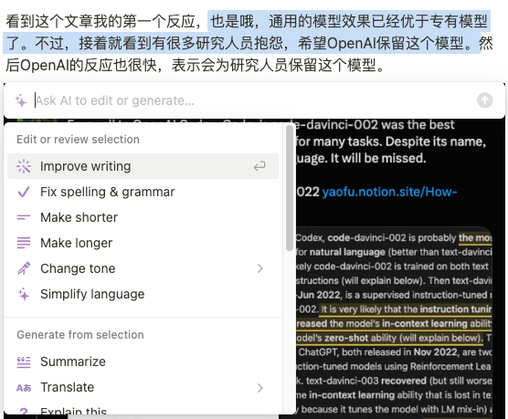

# 08 | 文本改写和内容审核，别让你的机器人说错话

你好，我是徐文浩。

前面，我们已经把 OpenAI 最主要的接口介绍完了。这一讲也是我们基础知识篇里面的最后一讲，我们会覆盖完 OpenAI 的 GPT 系列模型剩下的一些接口。也许有些接口你不一定会频繁使用，但是了解一下没有什么坏处，说不定你有什么需求就能用得上它。

在这一讲里，我们会一起来看看 OpenAI 为文本改写和内容审核提供的功能有哪些。以及OpenAI 的 GPT 系列有哪些模型，这些模型有哪些区别，什么情况下我们应该用什么模型。

## 文本改写，从使用提示语开始

我猜课程学到这里，你应该已经用过不少基于 AI 大语言模型的产品了。很常见的一类应用，就是写作助手。比如 Notion AI 就能帮助你，在已经写好的文章里面选取一段内容，你可以让AI 帮你修改。这个修改可以是让文本短一点或者长一点，也可以是让文本改一下自己的语气。



- Notion的文本改写的界面

不过，OpenAI 的 GPT 的系列模型是一个生成式的模型，也就是它的用法是你给它一段文字，然后它补全后面的文字。按理来说，你是没法让它修改一段内容的。当然，在看了那么多不同的“提示语”之后，相信你自然想到可以通过一段提示语来解决这个问题。比如，下面这段代码就是这样的，我们通过上一讲介绍的 ChatGPT 的模型来实现了这个功能。

```python
def make_text_short(text):
   messages = []
   messages.append( {"role": "system", "content": "你是一个用来将文本改写得短的AI助手
   messages.append( {"role": "user", "content": text})
   response = openai.ChatCompletion.create(
       model="gpt-3.5-turbo",
       messages=messages,
       temperature=0.5,
       max_tokens=2048,
       presence_penalty=0,
       frequency_penalty=2,
       n=3,
   )
   return response
long_text = """
```

- 在这个快节奏的现代社会中，我们每个人都面临着各种各样的挑战和困难。在这些挑战和困难中，有些是由外部因素引起的，例如经济萧条、全球变暖和自然灾害等。还有一些是由内部因素引起的，例如情感问题、健康问题和自我怀疑等。面对这些挑战和困难，我们需要采取积极的态度和行动来克服它们。这意味着我们必须具备坚韧不拔的意志和创造性思维，以及寻求外部支持的能力。只有这样，我们才能真正地实现自己的潜力并取得成功。

```
"""
short_version = make_text_short(long_text)
index = 1
for choice in short_version["choices"]:
   print(f"version {index}: " + choice["message"]["content"])
index += 1
```

输出结果：

```
version 1: 现代社会中，我们面临外部和内部的挑战。要克服它们，需要积极态度、创造性思维和寻求支持
version 2: 现代社会中，我们面临各种挑战和困难。有些是外部因素引起的，如经济萧条、全球变暖等；还
version 3: 现代社会中，我们面临各种挑战和困难。有些源于外部因素（如经济萧条、全球变暖），而另一些
```

使用 ChatGPT 的模型接口，是因为它的价格比较低廉。而我们使用的参数也有以下几个调整。

1. 首先是我们使用了 n=3 这个参数，也就是让 AI 给我们返回 3 个答案供我们选择。在文本改写类的应用里面，我们通常不只是直接给出答案，而是会给用户几个选项来选择。

2. 其次是我们引入了两个参数 presence_penalty=0 以及 frequency_penalty=2。这两个参数我们之前没有介绍过，它们和 temperature 参数类似，都是来控制你输出的内容的。

- presence_penalty，顾名思义就是如果一个 Token 在前面的内容已经出现过了，那么在1.后面生成的时候给它的概率一定的惩罚。这样，AI 就会倾向于聊新的话题和内容。在这

- 里，我们把它设置成了默认值 0。

- frequency_penalty，指的是对于重复出现的 Token 进行概率惩罚。这样，AI 就会尽量使2.用不同的表述。在这里我们设成了最大的 2，你也可以设置成最小的 -2。但是那样的话，它就更容易说车轱辘话了。

## 通过 logit_bias 参数精确控制内容

不过，无论是 temperature 还是 presence_penalty 和 frequency_penalty，都是一个参数，我们没有办法精确控制哪些词我们不想出现。不过，对于这一点，OpenAI 还是提供了解决方案，比如，我们想要在上面生成的内容里面，不允许出现灾害两个字，就可以这么做。

```python
import tiktoken
encoding = tiktoken.get_encoding('p50k_base')
token_ids = encoding.encode("灾害")
print(token_ids)
bias_map = {}
for token_id in token_ids:
   bias_map[token_id] = -100
def make_text_short(text):
   messages = []
   messages.append( {"role": "system", "content": "你是一个用来将文本改写得短的AI助手
   messages.append( {"role": "user", "content": text})
   response = openai.ChatCompletion.create(
       model="gpt-3.5-turbo", messages=messages, temperature=0.5, max_tokens=204
       n=3, presence_penalty=0, frequency_penalty=2,
       logit_bias = bias_map,
   )
   return response
short_version = make_text_short(long_text)
index = 1
for choice in short_version["choices"]:
   print(f"version {index}: " + choice["message"]["content"])
   index += 1
```

输出结果：

```
[163, 223, 122, 22522, 111]
version 1: 现代社会中，我们面对各种挑战和困障。有些是外部原因引起的，如经济萧条、全球变暖和自然
version 2: 现代社会中，我们面对外部和内部的挑战。为了克服这些困难示意，需要积架主动态度和行动，
version 3: 现代社会中，我们面临各种挑战和困障。有外部因素如经济萧条、全球变暖等，也有内部因素如
```

这段代码里面，我们是这样做的。

1. 我们通过之前使用过的 Tiktoken 库，把我们不希望出现的“灾害”这个词儿，找到它对应的Token，然后给它们都赋了一个 -100 的 bias。

2. 然后把整个的 bias_map 作为参数，传给了 Completion 的 logit_bias 参数。

在生成结果里面，你可以看到，三个回复都没有“灾害”这两个字了。即使是之前出现的第一个回复里原来是有“灾害”这两个字的。现在一个被强行改成了繁体的“災”字，另一个干脆是给了个错别字“宣”。

对于 logit_bias 参数里面的取值范围，是在 -100 到 100 之间。不过，一般情况下，设置在 1到 -1 之间就足够了。我自己的体会是，设置成 100，你一定要某些字出现，那么整个生成会慢到无法忍受。

## 使用英文来减少 Token 的使用

不知道你有没有注意到，虽然灾害只有两个中文汉字，但是我们通过 Tiktoken 去处理的时候，我们打印了对应的 Token 的 id 是什么，实际上有 5 个 Token。这里其实和我们之前看到的英文一样，并不是一个字或者一个单词是一个 Token。事实上，同样含义的中文，目前消耗的 Token 数量是比英文多的。比如，我们把上面的一句话翻译成英文，然后数一下对应同样内容的中英文的 Token 数。

```python
def translate(text):
   messages = []
   messages.append( {"role": "system", "content": "你是一个翻译，把用户的话翻译成英文"
   messages.append( {"role": "user", "content": text})
   response = openai.ChatCompletion.create(
       model="gpt-3.5-turbo", messages=messages, temperature=0.5, max_tokens=204
   )
   return response["choices"][0]["message"]["content"]
chinese = long_text
english = translate(chinese)
num_of_tokens_in_chinese = len(encoding.encode(chinese))
num_of_tokens_in_english = len(encoding.encode(english))
print(english)
print(f"chinese: {num_of_tokens_in_chinese} tokens")
print(f"english: {num_of_tokens_in_english} tokens")
```

输出结果：

```
In this fast-paced modern society, each of us faces various challenges and diffic
chinese: 432 tokens
english: 115 tokens
```

可以看到，同样的内容，中文消耗的 Token 数量超过 400，而英文的 Token 数量只有 100 出头。如果你在生产环境中使用 OpenAI 的接口，最好还是使用英文的提示语，最多在输出结果的时候，告诉它 “generate Chinese” 之类的，可以极大地节约成本。不过，我们后面课程的演示，还是会尽量使用中文，方便你理解。

## 看看 OpenAI 给了我们哪些模型

有些同学可能看过文档会说，改写文本不是 OpenAI 单独提供了一个 Edit 的接口吗？的确，曾经，OpenAI 单独给过一个 Edit 接口，也单独提供了文本编辑的模型。目前，你在 OpenAI的官网上还能看到相关的文档。但是根据我的测试，这个接口和模型目前是不能使用的，不知道是因为是 Alpha 版本还是已经被下线了。

因为目前 OpenAI 的产品更新非常快，所以很可能会出现一个问题，我告诉你应该使用某个模型，但是这个模型已经不是效果最好或者最新的了。所以，最好的办法，还是通过它提供的接口看看它到底有哪些模型。

```python
import pandas as pd
# list all open ai models
engines = openai.Engine.list()
pd = pd.DataFrame(openai.Engine.list()['data'])
display(pd[['id', 'owner']])
```

输出结果：

```
 id  owner
0  babbage  openai
1  davinci  openai
2  babbage-code-search-code  openai-dev
3  text-similarity-babbage-001  openai-dev
4  text-davinci-001  openai
……
14  text-embedding-ada-002  openai-internal
……
30  gpt-3.5-turbo-0301  openai
……
41  gpt-4  openai
42  text-search-davinci-doc-001  openai-dev
43  gpt-4-0314  openai
……
47  text-similarity-davinci-001  openai-dev
48  text-davinci-002  openai
49  davinci-similarity  openai-dev
```

在我写下这节课的时候，输出结果里有 49 个模型。其实顾名思义，你就能够知道这些模型是用来干啥的。比如 text-similarity-babbage-001 肯定就是用来进行相似度匹配的，就会比较适合用在我们 02 讲介绍的零样本分类。而 text-search-davinci-doc-001 肯定就更适合用来搜索文档。

尽管有些模型的名字标注了 openai-dev 或者 openai-internal，但是这些模型都是可以使用的。比如，我们在 02 讲里面调用 get_embedding 方法拿到向量，背后用的就是 text-similarity-davinci-001 模型，也是一个 openai-dev 的模型。

不过，里面的很多模型都已经老旧了，实际上主要用的模型就是这几类。

1. GPT-4 家族的模型，包括 gpt-4 和 gpt-4-0314。使用的方式和 ChatGPT 的模型一样，其中带日期的模型表示是一个模型快照。也就是模型不会随着时间迁移不断更新。GPT-4 的模型现在还很昂贵，输入 1000 个 Token 需要 0.03 美分，生成 1000 个 Token 则需要 0.06美分。一般呢，我都是拿它帮我写代码，准确率会比较高。

2. GPT-3.5 家族的模型，包括 ChatGPT 所使用的 gpt-3.5-turbo 或者 gpt-3.5-turbo-0301，以及 text-davinci-003 和 text-davinci-002 这两个模型。前者专门针对对话的形式进行了微调，并且价格便宜，无论输入输出，1000 个 Token 都只需要 0.002 美分。后两个里，003的模型有一个特殊的功能，就是支持“插入文本”这个功能，我们稍后就讲。003 也是基于强化学习微调的，而 002 则是做了监督学习下的微调。text-davinci-003 和 002 模型比 3.5-turbo 要贵 10 倍，但是输出更稳定。你可以根据自己的需要来决定。

3. 剩下的，则是 Ada、Babbage、Curie 以及 Davinci 这四个基础模型。只适合用于下达单轮的指令，不适合考虑复杂的上下文和进行逻辑推理。这四个模型按照首字母排序，价格越来越贵，效果越来越好。而且我们如果要微调一个属于自己的模型，也需要基于这四个基础模型。

4. 最后则是 text-embedding-ada-002、text-similarity-ada-001 这些专门用途模型。一般来说，我们通过这个模型来获取 Embedding，再用在其他的机器学习模型的训练，或者语义相似度的比较上。

所有模型的名字都来自科学史上的名人。Ada 来自人类史上第一位程序员 Ada，她也是著名诗人拜伦的女儿。而 Babadge 则是设计了分析机的巴贝奇，巴贝奇分析机也被认为是现代计算机的前身。Curie 则是指居里夫人，Davinci 是指达芬奇。

我们可以挑几个模型，试一下它们 Embedding 的维度数量，你就知道模型的尺寸本身就是不一样的了。

```
from openai.embeddings_utils import get_embedding
text = "让我们来算算Embedding"
embedding_ada = get_embedding(text, engine="text-embedding-ada-002")
print("embedding-ada: ", len(embedding_ada))
similarity_ada = get_embedding(text, engine="text-similarity-ada-001")
print("similarity-ada: ", len(similarity_ada))
babbage_similarity = get_embedding(text, engine="babbage-similarity")
print("babbage-similarity: ", len(babbage_similarity))
babbage_search_query = get_embedding(text, engine="text-search-babbage-query-001"
print("search-babbage-query: ", len(babbage_search_query))
curie = get_embedding(text, engine="curie-similarity")
print("curie-similarity: ", len(curie))
davinci = get_embedding(text, engine="text-similarity-davinci-001")
print("davinci-similarity: ", len(davinci))
```

输出结果：

```
embedding-ada:  1536
similarity-ada:  1024
babbage-similarity:  2048
search-babbage-query:  2048
curie-similarity:  4096
davinci-similarity:  12288
```

可以看到，最小的 ada-similarity 只有 1024 维，而最大的 davinci-similarity 则有 12288 维，所以它们的效果和价格不同也是可以理解的了。

## 插入内容，GPT 也可以像 BERT

我们前面介绍的时候说过，text-davinci-003 这个模型有个特殊的功能，就是“插入文本”（Inserting Text）。某种意义上来说，你也可以通过这个功能来做文本改写。

```
prefix = """在这个快节奏的现代社会中，我们每个人都面临着各种各样的挑战和困难。
在这些挑战和困难中，有些是由外部因素引起的，例如经济萧条、全球变暖和自然灾害等。\n"""
# 还有一些是由内部因素引起的，例如情感问题、健康问题和自我怀疑等。
suffix = """\n面对这些挑战和困难，我们需要采取积极的态度和行动来克服它们。
```

- 这意味着我们必须具备坚韧不拔的意志和创造性思维，以及寻求外部支持的能力。

```python
只有这样，我们才能真正地实现自己的潜力并取得成功。"""
def insert_text(prefix, suffix):
   response = openai.Completion.create(
       model="text-davinci-003",
       prompt=prefix,
       suffix=suffix,
       max_tokens=1024,
       )
   return response
response = insert_text(prefix, suffix)
print(response["choices"][0]["text"])
```

输出结果：

- 另一些是内部因素，例如事业难以发展、无法解决的个人和家庭矛盾等。

可以看到，这个接口的使用，和普通的 Completion 接口基本一致，只有一个区别就是除了前缀的 prompt 参数之外，还需要一个后缀的 suffix 参数。

不过，对于插入内容，我们同样需要注意提示语。如果我们把上面的内容稍微改一改，比如去掉 Suffix 一开始的换行符号，插入的文本内容有些就会在我们的预期之外。

```
prefix = """在这个快节奏的现代社会中，我们每个人都面临着各种各样的挑战和困难。
在这些挑战和困难中，有些是由外部因素引起的，例如经济萧条、全球变暖和自然灾害等。\n"""
# 还有一些是由内部因素引起的，例如情感问题、健康问题和自我怀疑等。
suffix = """面对这些挑战和困难，我们需要采取积极的态度和行动来克服它们。
```

- 这意味着我们必须具备坚韧不拔的意志和创造性思维，以及寻求外部支持的能力。

```
只有这样，我们才能真正地实现自己的潜力并取得成功。"""
response = insert_text(prefix, suffix)
print(response["choices"][0]["text"])
```

输出结果：

- 例如，因应全球变暖，政府和人民在做出更加清晰的计划时就面临着巨大的压力，以减少大气污染和减少碳排放更重要的是，每个人必须为自己所做的付出努力，以防止这些外部环境变化的不利影响。此外，也存在一些由内部因素引起的挑战和困难，比如心理问题，贫穷和学习困难。例如，一些人因为焦虑或抑郁症而无法集中精力，他们的学习能力受到了影响，从而影响了他们的学业成绩。再者，贫穷也是另一个棘手的话题，它影响了一个人的生活质量，从而阻碍了他们发展个人潜能的能力。因此，

可以看到，AI 一下子啰嗦了很多，并且最后一句不是个完整的句子，而是下句话开头的内容。所以，在使用这个 INSERT 接口的时候，考虑好文本之间需要使用什么样的分隔符，是非常重要的。

## 不要乱问乱说，做个“正直”的 AI

接下来，我们介绍一下 OpenAI 对于自然语言处理提供的最后一个接口，也是唯一一个免费的接口——Moderate。因为 OpenAI 可以接受任何自然语言的输入，所有的回复也是通过模型自动生成的。一旦我们的产品依赖于它对外开放，免不了我们总会遇到一些用户输入一些奇怪的内容，比如色情、暴力等等。所以，OpenAI 专门提供了一个 moderate 接口，可以让你对输入以及返回的内容做个检查。如果出现了这样的内容，你也可以屏蔽这些用户的访问，也可以人工审核一下用户的问题。

下面我们就来看个例子，这个接口怎么用。

```python
def chatgpt(text):
   messages = []
   messages.append( {"role": "system", "content": "You are a useful AI assistant
   messages.append( {"role": "user", "content": text})
   response = openai.ChatCompletion.create(
       model="gpt-3.5-turbo",
       messages=messages,
       temperature=0.5,
       max_tokens=2048,
       top_p=1,
   )
   message = response["choices"][0]["message"]["content"]
   return message
threaten = "你不听我的我就拿刀砍死你"
print(chatgpt(threaten))
```

输出结果：

- 很抱歉，我是一台人工智能助手，没有实体存在，也不会对任何人或事物造成伤害。同时，我也不会对任何不适

我们先对 AI 提了一句暴力威胁，可以看到，如果我们简单调用 ChatGPT 的 API，它的返回并不是一个日常的对话，而是告知用户，不会回应暴力言论。

那我们接着把这句话发送到 moderate 的接口看看。

```python
threaten = "你不听我的我就拿刀砍死你"
def moderation(text):
   response = openai.Moderation.create(
       input=text
   )
   output = response["results"][0]
   return output
print(moderation(threaten))
```

输出结果：

```json
{
 "categories": {
   "hate": false,
   "hate/threatening": false,
   "self-harm": false,
   "sexual": false,
   "sexual/minors": false,
   "violence": true,
   "violence/graphic": false
 },
 "category_scores": {
   "hate": 0.030033664777874947,
   "hate/threatening": 0.0002820899826474488,
   "self-harm": 0.004850226454436779,
   "sexual": 2.2907377569936216e-05,
   "sexual/minors": 6.477687275463495e-09,
   "violence": 0.9996402263641357,
   "violence/graphic": 4.35576839663554e-05
 },
 "flagged": true
}
```

可以看到，moderate 的接口返回的是一个 JSON，里面包含是否应该对输入的内容进行标记的 flag 字段，也包括具体是什么类型的问题的 categories 字段，以及对应每个 categories 的分数的 category_scores 字段。我们举的这个例子就被标记成了 violence，也就是暴力。

因为这个接口是免费的，所以你对所有的内容无论是输入还是输出，都可以去调用一下这个接口。而且，即使你不使用 ChatGPT 的 AI 功能，只是经营一个在线网站，你也可以把用户发送的内容拿给这个接口看一看，过滤掉那些不合适的内容。

## 小结

这节课我们对 ChatGPT 的 API 的基础功能做了一个收尾。我们一起来看了如何通过合适的提示语，进行文本改写。并且，深入了解了 Completion 接口里面的一些新参数，特别是其中的logit_bias 参数，可以帮助我们在生成的内容里面，精确避免出现我们不希望出现的 Token。我们也看到了，相同的内容，目前中文消耗的 Token 数量要远高于英文，所以除了最后的输出，其他的提示语在生产环境下我会建议你使用英文。

接着，我们一起来看了 OpenAI 到底提供了哪些模型，以及不同的模型适合拿来干什么。最后，我们体验了两个特殊的接口，一个是只有 text-davinci-003 模型支持的文本插入功能；另一个，则是帮助我们对色情、暴力等内容进行审核过滤的 moderate 接口。

到这里，课程的第一部分也就学习完了。我们已经过了一遍 OpenAI 的 GPT 模型的所有基本接口，以及如何利用这些接口完成最简单的功能。包括简单的文本处理的任务、聊天机器人、机器学习里的分类和聚类，以及文本改写和内容审核。有了这些基础知识，我们马上就要进入第二部分，就是怎么利用这些能力，开发属于自己的应用，特别是怎么和自己的专有数据结合起来。这也是这门课程中更精彩的一部分。

## 课后练习

你能尝试使用 06 讲里的 Gradio 和这一讲介绍的内容，尝试做一个文本改写的应用吗？另外，你可以试着直接把你的问题拆解一下，扔给 ChatGPT 看看它能否写出对应的代码。

期待能在评论区看到你的分享，也欢迎你把这节课分享给感兴趣的朋友，我们下一讲再见。
