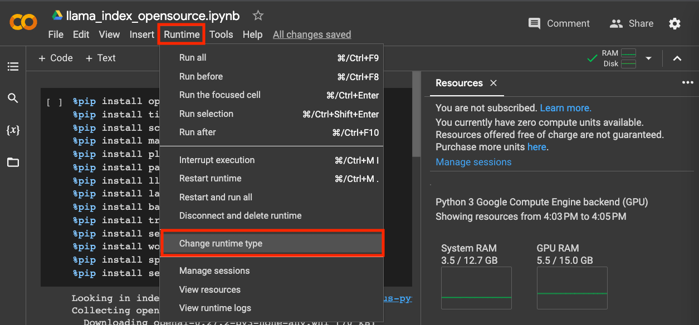
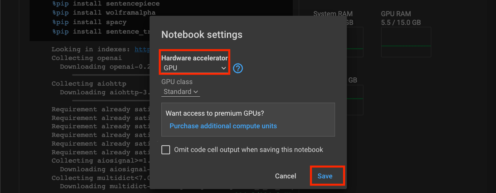

# 11 | 省下钱买显卡，如何利用开源模型节约成本？

你好，我是徐文浩。

不知道课程上到这里，你账户里免费的 5 美元的额度还剩下多少了？如果你尝试着完成我给的几个数据集里的思考题，相信这个额度应该是不太够用的。而 ChatCompletion 的接口，又需要传入大量的上下文信息，实际消耗的 Token 数量其实比我们感觉的要多。

而且，除了费用之外，还有一个问题是数据安全。因为每个国家的数据监管要求不同，并不是所有的数据，都适合通过 OpenAI 的 API 来处理的。所以，从这两个角度出发，我们需要一个OpenAI 以外的解决方案。那对于没有足够技术储备的中小型公司来说，最可行的一个思路就是利用好开源的大语言模型。

## 在 Colab 里使用 GPU

因为这一讲我们要使用一些开源模型，但不是所有人的电脑里都有一个强劲的 NVidia GPU的。所以，我建议你通过 Colab 来运行对应的 Notebook，并且注意，要把对应的运行环境设置成 GPU。



1. 你先选择菜单栏里的 Runtime，然后点击 Change runtime type。



2. 然后在弹出的对话框里，把 Hardware accelerator 换成 GPU，然后点击 Save 就可以了。

只要用得不是太多，Colab 的 GPU 是可以免费使用的。

## HuggingfaceEmbedding，你的开源伙伴

其实我们之前在 第 4 讲对比零样本分类效果的时候，就已经使用过 Google 开源的模型 T5了。那个模型的效果，虽然比 OpenAI 的 API 还是要差一些，但是其实 90% 的准确率也还算不错了。那么联想一下，上一讲我们使用的 llama-index 向量搜索部分，是不是可以用开源模型的 Embedding 给替换掉呢？

当然是可以的，llama-index 支持你自己直接定义一个定制化的 Embedding，对应的代码我放在了下面。

```
conda install -c conda-forge sentence-transformers
```

注：我们需要先安装一下 sentence-transformers 这个库。

```python
import openai, os
import faiss
from llama_index import SimpleDirectoryReader, LangchainEmbedding, GPTFaissIndex,
from langchain.embeddings.huggingface import HuggingFaceEmbeddings
from langchain.text_splitter import CharacterTextSplitter
from llama_index.node_parser import SimpleNodeParser
openai.api_key = ""
text_splitter = CharacterTextSplitter(separator="\n\n", chunk_size=100, chunk_ove
parser = SimpleNodeParser(text_splitter=text_splitter)
documents = SimpleDirectoryReader('./data/faq/').load_data()
nodes = parser.get_nodes_from_documents(documents)
embed_model = LangchainEmbedding(HuggingFaceEmbeddings(
   model_name="sentence-transformers/paraphrase-multilingual-mpnet-base-v2"
))
service_context = ServiceContext.from_defaults(embed_model=embed_model)
dimension = 768
faiss_index = faiss.IndexFlatIP(dimension)
index = GPTFaissIndex(nodes=nodes,faiss_index=faiss_index, service_context=servic
```

输出结果：

```
INFO:sentence_transformers.SentenceTransformer:Load pretrained SentenceTransforme
INFO:sentence_transformers.SentenceTransformer:Use pytorch device: cpu
WARNING:root:Created a chunk of size 130, which is longer than the specified 100
……
INFO:llama_index.token_counter.token_counter:> [build_index_from_documents] Total
INFO:llama_index.token_counter.token_counter:> [build_index_from_documents] Total
```

在这个例子里面，我们使用了一个面向电商的 FAQ 的纯文本文件作为输入。里面是一系列预设好的 FAQ 问答对。为了确保我们没有使用 OpenAI 的 API，我们先把 openai.api_key 给设成了一个空字符串。然后，我们定义了一个 embeded_model，这个 embeded_model 里面，我们包装的是一个 HuggingFaceEmbeddings 的类。

因为 HuggingFace 为基于 transformers 的模型定义了一个标准，所以大部分模型你只需要传入一个模型名称，HuggingFacebEmbedding 这个类就会下载模型、加载模型，并通过模型来计算你输入的文本的 Embedding。使用 HuggingFace 的好处是，你可以通过一套代码使用所有的 transfomers 类型的模型。

sentence-transformers 是目前效果最好的语义搜索类的模型，它在 BERT 的基础上采用了对比学习的方式，来区分文本语义的相似度，它包括了一系列的预训练模型。我们在这里，选用的是 sentence-transformers 下面的 paraphrase-multilingual-mpnet-base-v2 模型。顾名思义，这个是一个支持多语言（multilingual）并且能把语句和段落（paraphrase）变成向量的一个模型。因为我们给的示例都是中文，所以选取了这个模型。你可以根据你要解决的实际问题，来选取一个适合自己的模型。

我们还是使用 Faiss 这个库来作为我们的向量索引库，所以需要指定一下向量的维度，paraphrase-multilingual-mpnet-base-v2 这个模型的维度是 768，所以我们就把维度定义成768 维。

相应的对文档的切分，我们使用的是 CharacterTextSplitter，并且在参数上我们做了一些调整。

首先，我们把“\n\n”这样两个连续的换行符作为一段段文本的分隔符，因为我们的 FAQ 数据里，每一个问答对都有一个空行隔开，正好是连续两个换行。

然后，我们把 chunk_size 设置得比较小，只有 100。这是因为我们所使用的开源模型是个小模型，这样我们才能在单机加载起来。它能够支持的输入长度有限，只有 128 个 Token，超出的部分会进行截断处理。如果我们不设置 chunk_size，llama-index 会自动合并多个 chunk 变成一个段落。

其次，我们还增加了一个小小的参数，叫做 chunk_overlap。这个参数代表我们自动合并小的文本片段的时候，可以接受多大程度的重叠。它的默认值是 200，超过了单段文档的chunk_size，所以我们这里要把它设小一点，不然程序会报错。

我们可以在对应的 verbose 日志里看到，这里的 Embedding 使用了 3198 个 Token，不过这些 Token 都是我们通过 sentence_transformers 类型的开源模型计算的，不需要花钱。你的成本就节约下来了。

在创建完整个索引之后，我们就可以拿一些常见的电商类型的 FAQ 问题试一试。

问题 1：

```python
from llama_index import QueryMode
openai.api_key = os.environ.get("OPENAI_API_KEY")
response = index.query(
   "请问你们海南能发货吗？",
   mode=QueryMode.EMBEDDING,
   verbose=True,
)
print(response)
```

输出结果：

```
> Got node text: Q: 支持哪些省份配送？
A: 我们支持全国大部分省份的配送，包括北京、上海、天津、重庆、河北、山西、辽宁、吉林、黑龙江、江苏
INFO:llama_index.token_counter.token_counter:> [query] Total LLM token usage: 341
INFO:llama_index.token_counter.token_counter:> [query] Total embedding token usag
```

- 是的，我们支持海南省的配送。

问题 2：

```
response = index.query(
   "你们用哪些快递公司送货？",
   mode=QueryMode.EMBEDDING,
   verbose=True,
)
print(response)
```

输出结果：

```
> Got node text: Q: 提供哪些快递公司的服务？
A: 我们与顺丰速运、圆通速递、申通快递、韵达快递、中通快递、百世快递等多家知名快递公司合作。...
INFO:llama_index.token_counter.token_counter:> [query] Total LLM token usage: 281
INFO:llama_index.token_counter.token_counter:> [query] Total embedding token usag
```

- 我们与顺丰速运、圆通速递、申通快递、韵达快递、中通快递、百世快递等多家知名快递公司合作，用他们的服

问题 3：

```
response = index.query(
   "你们的退货政策是怎么样的？",
   mode=QueryMode.EMBEDDING,
   verbose=True,
)
print(response)
```

输出结果：

```
> Got node text: Q: 退货政策是什么？
A: 自收到商品之日起7天内，如产品未使用、包装完好，您可以申请退货。某些特殊商品可能不支持退货，请在
INFO:llama_index.token_counter.token_counter:> [query] Total LLM token usage: 393
INFO:llama_index.token_counter.token_counter:> [query] Total embedding token usag
我们的退货政策是自收到商品之日起7天内，如产品未使用、包装完好，您可以申请退货。某些特殊商品可能不
```

我们在问问题的时候，指定了 query 的 mode 是 Embedding。通过三个常用的问题，我们可以看到，AI 都给出了正确的回答，效果还是不错的。

## 使用 ChatGLM 提供对话效果

通过上面的代码，我们已经把生成 Embedding 以及利用 Embedding 的相似度进行搜索搞定了。但是，我们在实际问答的过程中，使用的还是 OpenAI 的 Completion API。那么这一部分我们有没有办法也替换掉呢？

同样的，我们寻求开源模型的帮助。在这里，我们就不妨来试一下来自清华大学的 ChatGLM语言模型，看看中文的开源语言模型，是不是也有基本的知识理解和推理能力。

首先我们还是要安装一些依赖包，因为 icetk 我没有找到 Conda 的源，所以我们这里通过 pip来安装，但是在 Conda 的包管理器里一样能够看到。

```
pip install icetk
pip install cpm_kernels
```

然后，我们还是先通过 transformers 来加载模型。ChatGLM 最大的一个模型有 1300 亿个参数。

```python
from transformers import AutoTokenizer, AutoModel
tokenizer = AutoTokenizer.from_pretrained("THUDM/chatglm-6b-int4", trust_remote_c
model = AutoModel.from_pretrained("THUDM/chatglm-6b-int4", trust_remote_code=True
model = model.eval()
```

输出结果：

```
Explicitly passing a `revision` is encouraged when loading a model with custom co
Explicitly passing a `revision` is encouraged when loading a configuration with c
Explicitly passing a `revision` is encouraged when loading a model with custom co
No compiled kernel found.
Compiling kernels : /root/.cache/huggingface/modules/transformers_modules/THUDM/c
Compiling gcc -O3 -fPIC -std=c99 /root/.cache/huggingface/modules/transformers_mo
Kernels compiled : /root/.cache/huggingface/modules/transformers_modules/THUDM/ch
Load kernel : /root/.cache/huggingface/modules/transformers_modules/THUDM/chatglm
Using quantization cache
Applying quantization to glm layers
```

但是这么大的模型，无论是你自己的电脑，还是 Colab 提供的 GPU 和 TPU 显然都放不了。所以我们只能选用一个裁剪后的 60 亿个参数的版本，并且我们还必须用 int-4 量化的方式，而不是用 float16 的浮点数。所以，这里我们的模型名字就叫做 chatglm-6b-int4，也就是 6B 的参数量，通过 int-4 量化。然后，在这里，我们希望通过 GPU 进行模型的计算，所以加载模型的时候调用了.cuda()。

这里加载模型的时候，我们还设置了一个 trust_remote_code = true 的参数，这是因为ChatGLM 的模型不是一个 Huggingface 官方发布的模型，而是由用户贡献的，所以需要你显式确认你信任这个模型的代码，它不会造成恶意的破坏。我们反正是在 Colab 里面运行这个代码，所以倒是不用太担心。

如果你想要用 CPU 运行，可以把模型加载的代码换成下面这样。

```
model = AutoModel.from_pretrained("THUDM/chatglm-6b-int4",trust_remote_code=True)
```

不过，我不建议你这么做。你没有 GPU 的话，还是直接使用 Colab 的 GPU 就好了。因为CPU 在运行对话的时候非常慢。

在拿到模型之后我们就可以尝试着通过这个模型来进行问答了。

问题 1：

```
question = """
自收到商品之日起7天内，如产品未使用、包装完好，您可以申请退货。某些特殊商品可能不支持退货，请在购
```

- 根据以上信息，请回答下面的问题：

```
Q: 你们的退货政策是怎么样的？
"""
response, history = model.chat(tokenizer, question, history=[])
print(response)
```

输出结果：

```
我们的退货政策是在产品未使用、包装完好的情况下，自收到商品之日起7天内可以退货。请注意，某些特殊商
```

可以看到，ChatGLM 的回答，的确是按照我们提示语里面有的上下文给出的。我们可以试着去掉提供的 FAQ 的内容，看看它的回答是怎样的。

问题 2：

```
question = """
Q: 你们的退货政策是怎么样的？
A:
"""
response, history = model.chat(tokenizer, question, history=[])
print(response)
```

输出结果：

```
我们公司的政策是，如果您在购买后的7天内发现我们的产品不符合您的期望，可以申请退货。退货条件如下：
1. 符合退货政策要求的产品；
2. 未使用或损坏的产品；
3. 符合退货地点的要求，即退货地址与购买地址相同；
4. 符合退货流程的要求，即您需要提供有效的退货单并完成退货流程。
```

- 如果符合上述退货政策要求，我们将尽快处理您的退货申请，并为您退款。请注意，如果您已经使用了我们的产

可以看到，在没有合适的上下文信息的时候，它编造出了一些原本没有的要求，比如“退货地址与购买地址相同”。

我们再来看一个例子，看看它能不能拥有简单的推理能力。我们的上下文里只说了可以送到海南，没有说是否支持三亚这个城市，看看这个时候 AI 能不能回答对这个问题。

问题 3：

```
question = """
```

- 我们支持全国大部分省份的配送，包括北京、上海、天津、重庆、河北、山西、辽宁、吉林、黑龙江、江苏、浙

- 根据以上信息，请回答下面的问题：

```
Q: 你们能配送到三亚吗？
"""
response, history = model.chat(tokenizer, question, history=[])
print(response)
```

输出结果：

- 是的，我们支持全国大部分省份的配送，包括三亚市。

可以看到，ChatGLM 知道是可以配送到三亚的。不过万一是巧合呢？我们再看看在上下文里面，去掉了东三省，然后问问它能不能送到哈尔滨。

问题 4：

```
question = """
```

- 我们支持全国大部分省份的配送，包括北京、上海、天津、重庆、河北、山西、江苏、浙江、安徽、福建、江西

- 根据以上信息，请回答下面的问题：

```
Q: 你们能配送到哈尔滨吗？
"""
response, history = model.chat(tokenizer, question, history=[])
print(response)
```

回答：

- 很抱歉，我们目前不能配送到哈尔滨。

结果也是正确的，这个时候，ChatGLM 会回答我们是送不到哈尔滨的。既然 ChatGLM 能够正确回答这个问题，那我们的 FAQ 问答就可以用 ChatGLM 来搞定了。

## 将 ChatGLM 封装成 LLM

不过上面的代码里面，我们用的还是原始的 ChatGLM 的模型代码，还不能直接通过 query 来访问 llama-index 直接得到答案。要做到这一点倒也不难，我们把它封装成一个 LLM 类，让我们的 index 使用这个指定的大语言模型就好了。对应的 llama-index 的文档，你也可以自己去看一下。

```python
import openai, os
import faiss
from llama_index import SimpleDirectoryReader, LangchainEmbedding, GPTFaissIndex,
from langchain.embeddings.huggingface import HuggingFaceEmbeddings
from langchain.text_splitter import CharacterTextSplitter
from llama_index.node_parser import SimpleNodeParser
from langchain.llms.base import LLM
from llama_index import LLMPredictor
from typing import Optional, List, Mapping, Any
class CustomLLM(LLM):
   def _call(self, prompt: str, stop: Optional[List[str]] = None) -> str:
       response, history = model.chat(tokenizer, prompt, history=[])
       return response
   @property
   def _identifying_params(self) -> Mapping[str, Any]:
       return {"name_of_model": "chatglm-6b-int4"}
   @property
   def _llm_type(self) -> str:
       return "custom"
```

我们把这个 CustomLLM 对象，传入 index 的构造函数里，重新运行一下我们的问题，看看效果是怎样的。

```python
from langchain.text_splitter import SpacyTextSplitter
llm_predictor = LLMPredictor(llm=CustomLLM())
text_splitter = CharacterTextSplitter(separator="\n\n", chunk_size=100, chunk_ove
parser = SimpleNodeParser(text_splitter=text_splitter)
documents = SimpleDirectoryReader('./drive/MyDrive/colab_data/faq/').load_data()
nodes = parser.get_nodes_from_documents(documents)
embed_model = LangchainEmbedding(HuggingFaceEmbeddings(
   model_name="sentence-transformers/paraphrase-multilingual-mpnet-base-v2"
))
service_context = ServiceContext.from_defaults(embed_model=embed_model, llm_predi
dimension = 768
faiss_index = faiss.IndexFlatIP(dimension)
index = GPTFaissIndex(nodes=nodes, faiss_index=faiss_index, service_context=servi
from llama_index import QuestionAnswerPrompt
from llama_index import QueryMode
QA_PROMPT_TMPL = (
   "{context_str}"
   "\n\n"
   "根据以上信息，请回答下面的问题：\n"
   "Q: {query_str}\n"
   )
QA_PROMPT = QuestionAnswerPrompt(QA_PROMPT_TMPL)
response = index.query(
   "请问你们海南能发货吗？",
   mode=QueryMode.EMBEDDING,
   text_qa_template=QA_PROMPT,
   verbose=True,
)
print(response)
```

输出结果：

```
> Got node text: Q: 支持哪些省份配送？
A: 我们支持全国大部分省份的配送，包括北京、上海、天津、重庆、河北、山西、辽宁、吉林、黑龙江、江苏
```

- 海南能发货。

可以看到，这样处理之后，我们就可以直接使用 ChatGLM 的模型，来进行我们的 FAQ 的问答了。

现在，我们有了一个通过 paraphrase-multilingual-mpnet-base-v2 模型来计算 Embeddding 并进行语义搜索，然后通过 chatglm-6b-int4 的模型来进行问答的解决方案了。而且这两个模型，可以跑在一块家用级别的显卡上。是不是很厉害？

## 开源模型的不足之处

看起来，我们这个本机就能运行的小模型似乎已经完成了。数据安全，又不用担心花费。但显然，事情没有那么简单。因为刚才我们处理的电商 FAQ 问题比较简单，我们再拿一个稍微复杂一点的问题来看看效果。

```
text_splitter = SpacyTextSplitter(pipeline="zh_core_web_sm", chunk_size = 128, ch
parser = SimpleNodeParser(text_splitter=text_splitter)
documents = SimpleDirectoryReader('./drive/MyDrive/colab_data/zhaohuaxishi/').loa
nodes = parser.get_nodes_from_documents(documents)
embed_model = LangchainEmbedding(HuggingFaceEmbeddings(
   model_name="sentence-transformers/paraphrase-multilingual-mpnet-base-v2"
))
service_context = ServiceContext.from_defaults(embed_model=embed_model, llm_predi
dimension = 768
faiss_index = faiss.IndexFlatIP(dimension)
index = GPTFaissIndex(nodes=nodes, faiss_index=faiss_index, service_context=servi
```

输出结果：

```
INFO:sentence_transformers.SentenceTransformer:Load pretrained SentenceTransforme
INFO:sentence_transformers.SentenceTransformer:Use pytorch device: cpu
……
INFO:llama_index.token_counter.token_counter:> [build_index_from_documents] Total
INFO:llama_index.token_counter.token_counter:> [build_index_from_documents] Total
```

这一次，我们输入索引起来的数据，是鲁迅先生整套《朝花夕拾》的散文集。选用这个是因为对应作品的版权已经过了保护期。我们来看看，在这套文集的内容里面，使用我们上面的纯开源方案，效果会是怎样的。

对应的模型和索引加载的代码基本一致，只有一个小小的区别，就是在文本分割的时候，我们用了上一讲介绍过的 SpacyTextSplitter，因为这里都是散文的内容，而不是确定好格式的 QA对。所以通过 SpacyTextSplitter 来分句，并在允许的时候合并小的片段是有意义的。

然后，我们试着问一下上一讲我们问过的问题，看看效果怎么样。

问题 1：

```python
# query will use the same embed_model
from llama_index import QueryMode
from llama_index import QuestionAnswerPrompt
openai.api_key = os.environ.get("OPENAI_API_KEY")
QA_PROMPT_TMPL = (
   "下面的内容来自鲁迅先生的散文集《朝花夕拾》，很多内容是以第一人称写的 \n"
   "---------------------\n"
   "{context_str}"
   "\n---------------------\n"
   "根据这些信息，请回答问题: {query_str}\n"
   "如果您不知道的话，请回答不知道\n"
)
QA_PROMPT = QuestionAnswerPrompt(QA_PROMPT_TMPL)
response = index.query(
   "鲁迅先生在日本学习医学的老师是谁？",
   mode=QueryMode.EMBEDDING,
   similarity_top_k = 1,
   text_qa_template=QA_PROMPT,
   verbose=True,
)
print(response)
```

输出结果：

```
> Got node text: 一将书放在讲台上，便用了缓慢而很有顿挫的声调，向学生介绍自己道：——
   “我就是叫作藤野严九郎的……。”
```

- 后面有几个人笑起来了。

```
他接着便讲述解剖学在日本发达的历史，那些大大小小的书，便是从最初到现今关于这一门学问的著作。...
```

- 鲁迅先生在日本学习医学的老师是藤野严九郎。

问题 2：

```
response = index.query(
   "鲁迅先生是在日本的哪个城市学习医学的？",
   mode=QueryMode.EMBEDDING,
   similarity_top_k = 1,
   text_qa_template=QA_PROMPT,
   verbose=True,
)
print(response)
```

输出结果：

```
> Got node text: 有时我常常想：他的对于我的热心的希望，不倦的教诲，小而言之，是为中国，就是希望
```

- 根据这些信息，无法得出鲁迅先生是在日本的哪个城市学习医学的答案。

可以看到，有些问题在这个模式下，定位到的文本片段是正确的。但是有些问题，虽然定位的还算是一个相关的片段，但是的确无法得出答案。

在这个过程中，我们可以观察到这样一个问题： 那就是单机的开源小模型能够承载的文本输入的长度问题。在我们使用 OpenAI 的 gpt-3.5-turbo 模型的时候，我们最长支持 4096 个Token，也就是一个文本片段可以放上上千字在里面。但是我们这里单机用的 paraphrase-multilingual-mpnet-base-v2 模型，只能支持 128 个 Token 的输入，虽然对应的 Tokenizer 不一样，但是就算一个字一个 Token，也就 100 个字而已。这使得我们检索出来的内容的上下文太少了，很多时候没有足够的信息，让语言模型去回答。

当然，这个问题并不是无法弥补的。我们可以通过把更大规模的模型，部署到云端来解决。这个内容，我们课程的第三部分专门有一讲会讲解。

不过，有一个更难解决的问题，就是模型的推理能力问题。比如，我们可以再试试第 1 讲里给商品总结英文名称和卖点的例子。

```
question = """Consideration proudct : 工厂现货PVC充气青蛙夜市地摊热卖充气玩具发光蛙儿童水
1. Compose human readale product title used on Amazon in english within 20 words.
2. Write 5 selling points for the products in Amazon.
3. Evaluate a price range for this product in U.S.
Output the result in json format with three properties called title, selling_poin
response, history = model.chat(tokenizer, question, history=[])
print(response)
```

输出结果：

```
1. title: 充气玩具青蛙夜市地摊卖
2. selling_points:
   - 工厂现货：保证产品质量
   - PVC充气：环保耐用
   - 夜市地摊：方便销售
   - 热卖：最受欢迎产品
   - 儿童水上玩具：适合各种年龄段儿童
3. price_range: (in USD)
   - low:   $1.99
   - high:   $5.99
```

可以看到，虽然这个结果不算太离谱，多少和问题还是有些关系的。但是无论是翻译成英文，还是使用 JSON 返回，模型都没有做到。给到的卖点也没有任何“推理出来”的性质，都是简单地对标题的重复描述。即使你部署一个更大版本的模型到云端，也好不到哪里去。

这也是 ChatGPT 让人震撼的原因，的确目前它的效果还是要远远超出任何一个竞争对手和开源项目的。

## 小结

好了，最后我们来回顾一下。这一讲里，我们一起尝试用开源模型来代替 ChatGPT。我们通过 sentence_transfomers 类型的模型，生成了文本分片的 Embedding，并且基于这个Embedding 来进行语义检索。我们通过 ChatGLM 这个开源模型，实现了基于上下文提示语的问答。在简单的电商 QA 这样的场景里，效果也还是不错的。即使我们使用的都是单机小模型，它也能正确回答出来。这些方法，也能节约我们的成本。不用把钱都交给 OpenAI，可以攒着买显卡来训练自己的模型。

但是，当我们需要解决更加复杂的问题时，比如需要更长的上下文信息，或者需要模型本身更强的推理能力的时候，这样的小模型就远远不够用了。更长的上下文信息检索，我们还能够通过在云端部署更大规模的模型，解决部分问题。但是模型的推理能力，目前的确没有好的解决方案。

所以不得不佩服，OpenAI 的在 AGI 这个目标上耕耘多年后震惊世人的效果。

## 思考题

最后，给你留一个思考题。ChatGLM 并不是唯一的中文大语言模型，开源社区目前在快速推进，尝试用各种方式提供更好的开源大模型。比如基于斯坦福的 Alpaca 数据集进行微调的Chinese-LLaMA-Alpaca，链家科技开源的 BELLE。你可以挑选一个模型试一试，看看它们的效果和 ChatGLM 比起来怎么样。欢迎你把你的评测结果分享出来，也欢迎你把这节课分享给需要的朋友，共同参谋，一起进步。我们下节课再见。

## 推荐阅读

基于开源模型来解决问题的思路并非我的原创，网上也有不少其他朋友用类似的方式解决了自己的问题。比如《让 LLM 回答问题更靠谱》这篇文章就组合了三个模型来完成了医学领域的语义搜索、语义匹配排序，以及最终的问答语句生成。你可以读一下。
