# 12 | 让AI帮你写个小插件，轻松处理Excel文件

你好，我是徐文浩。

过去的十多讲里，我为你介绍了各种利用大语言模型的方法和技巧。特别是在过去两讲里，我们也尝试更加深入地利用开源代码帮我们完成一些工作。通过 llama-index 这样的开源库，我们能够将自己的数据和大语言模型连接在一起。通过 sentence_transformers 这样的开源库和ChatGLM 这样的开源大语言模型，不依赖 OpenAI，我们也可以完成简单的电商 FAQ 的问答。

不过，这里面的代码，都是我们自己写的。虽然我们已经用了像 Colab 这样的在线 Notebook工具，但是这些对非技术人员来说还是有一些门槛的。如果想要让广告投放、产品运营的同事们用起来，我们还需要专门做一个适合他们习惯的界面。

其实，普通业务人员最常用的界面就是像 Excel 或者 Chrome 浏览器这样人手一个的应用。而且这些产品都有自己的插件机制。那么今天，我们就来为 Excel 写一个插件，让业务人员不需要懂代码也能随时使用 ChatGPT 来辅助完成工作，提高效率。而且，这个插件的代码也不是由我们自己来写，而是让 ChatGPT 来帮我们写。在这个过程中，你会看到我们如何利用ChatGPT 逐步探索，使用我们并不熟悉，甚至完全不会的编程语言和工具完成任务。

所以这一讲，不是一堂技能课，而是一堂方法和思维课。

## 让我们再来看看那只发光的青蛙

在课程的第 1 讲里面，我就给你举过一个例子。我们使用 ChatGPT 的 API，在一个商品上实现了标题翻译、卖点撰写和售价预估的功能。这个需求，其实是很多跨境电商的运营人员都能用上的。

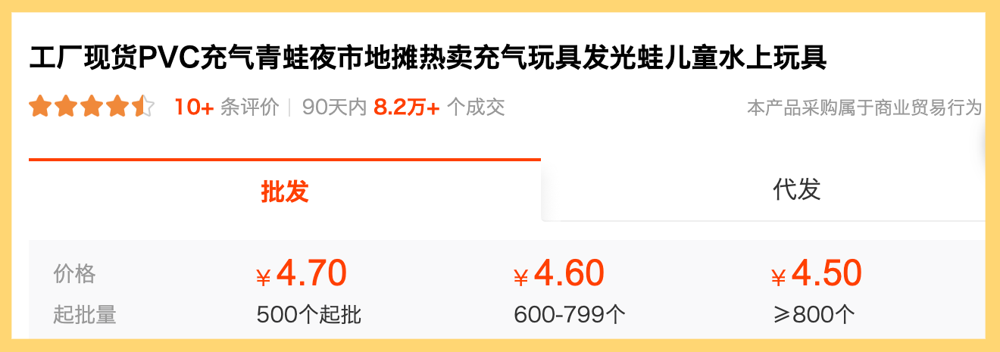

- 第一讲里面的例子

代码：

```python
import openai
import os
openai.api_key = os.environ.get("OPENAI_API_KEY")
COMPLETION_MODEL = "text-davinci-003"
prompt = """
Consideration proudct : 工厂现货PVC充气青蛙夜市地摊热卖充气玩具发光蛙儿童水上玩具
1. Compose human readable product title used on Amazon in english within 20 words
2. Write 5 selling points for the products in Amazon.
3. Evaluate a price range for this product in U.S.
Output the result in json format with three properties called title, selling_poin
"""
def get_response(prompt):
   completions = openai.Completion.create (
       engine=COMPLETION_MODEL,
       prompt=prompt,
       max_tokens=512,
       n=1,
       stop=None,
       temperature=0.0,
   )
   message = completions.choices[0].text
   return message
print(get_response(prompt))
```

输出结果：

```json
{
   "title": "Glow-in-the-Dark Inflatable PVC Frog Night Market Hot Selling Water
   "selling_points": [
       "Made of durable PVC material",
       "Glow-in-the-dark design for night play",
       "Inflatable design for easy storage and transport",
       "Perfect for water play and outdoor activities",
       "Great gift for kids"
   ],
   "price_range": "$10 - $20"
}
```

但是，让运营人员去学会用 Python 写程序，的确门槛还是太高了。但是，如果每件商品都把同样的提示语往 ChatGPT 的界面里复制粘贴，效率又太低了一点。那这个时候，其实 Excel就是一个很好的选择了。

我们的需求很简单，就是想把所有想要翻译和寻找卖点的商品标题，都放在 Excel 文件的第一列里面，然后让 AI 根据我们的需要填后面几列就好了。

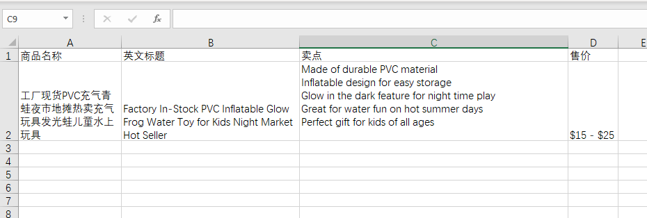

- 我们期望的Excel格式

不过，其实我和你一样，并没有写过 Excel 的插件。所以虽然我知道这事儿大概是可以做到的，但是具体怎么做，我也只能来问问 ChatGPT。

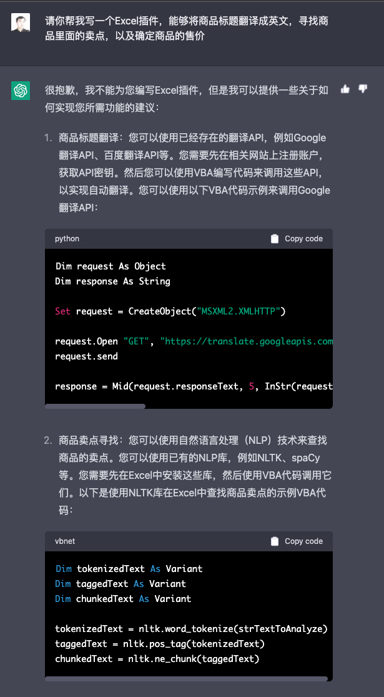

我直接把这个需求扔给了 ChatGPT，请它直接为我写个插件。我输入了一句提示语。

提示语：

```
请你帮我写一个Excel插件，能够将商品标题翻译成英文，寻找商品里面的卖点，以及确定商品的售价
```

可惜，答案不尽如人意。ChatGPT 不仅只是泛泛地告诉我们可以用翻译的 API，而且它在自然语言处理部分，还编造了一段代码。它实际介绍的 NLTK，spaCy 等等，都是 Python 的开源库，是没有 VBA 代码的。

不过，尽管这个回答并不是正确答案，但它还是给我们提供了一个很有用的信息，那就是Excel 里我们可以通过 VBA 来运行程序。这其实也是我们使用 ChatGPT 这样的 AI 助理的时候需要注意的一点，我们并不要求它一次做对，只要每次能让我们离答案更近了一点点就好了。

## 先来试一试简单的插件任务

知道了 Excel 可以通过 VBA 来执行程序，我们就先通过它来写一个最简单的功能，来试试整个流程是否可以走通。所以，我给了 AI 这样一个指令。

```
请你为我写一个Excel的VBA插件，它会将表格里面的第一列的内容，复制到第二列
```

这一次，ChatGPT 没有和我打官腔，而是直接给出了详细的代码，以及如何在 Excel 里面执行的步骤。

我也把下面截图中对应的整个对话分享到了 ShareGPT 里，你可以直接点击链接查看完整的操作方式。

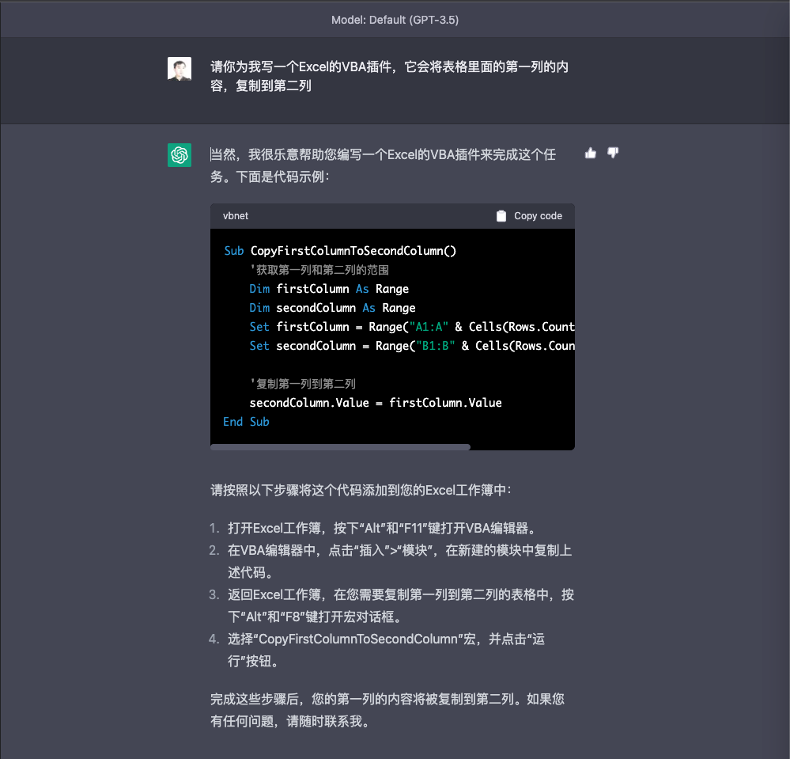

代码：

```
Sub CopyFirstColumnToSecondColumn()
   '获取第一列和第二列的范围
   Dim firstColumn As Range
   Dim secondColumn As Range
   Set firstColumn = Range("A1:A" & Cells(Rows.Count, 1).End(xlUp).Row)
   Set secondColumn = Range("B1:B" & Cells(Rows.Count, 1).End(xlUp).Row)
   '复制第一列到第二列
   secondColumn.Value = firstColumn.Value
End Sub
```

根据 ChatGPT 给出的详细操作步骤，我们可以通过快捷键 ALT + F11 打开 Excel 下的 VBA编辑器，然后把对应的 Excel 代码复制进去；也能够在 Excel 的表格界面里，通过快捷键 ALT+ F8 唤起宏的对话框，执行这段宏。你可以试一下，这段 VBA 的宏的确能够将我们表格里面的第一列，复制到第二列里面。

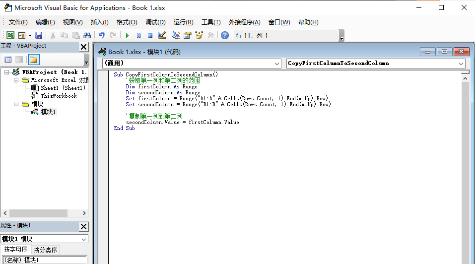

- 通过ALT+F11唤起VBA编辑器贴入VBA代码

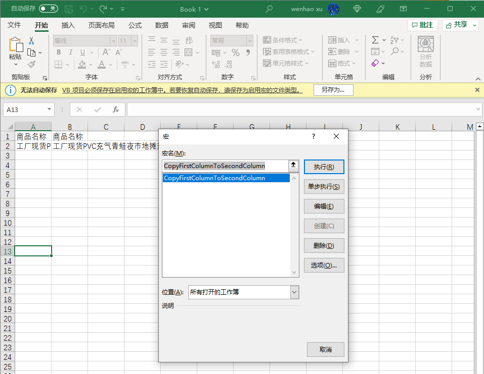

- 通过ALT+F8唤起执行VBA代码

虽然这段代码的功能非常简单，但是它帮助我们走通了一个基本路径，就是怎么在 Excel 里面撰写 VBA 代码并且执行。这种方法也是使用 AI 写代码时一个常用的方式，我们先通过一些简单的任务来试一试，看看 AI 是否能把路径走通，还是说它只会胡扯。如果能够走通的话，意味着我们又朝最终答案靠近了一步。而如果是胡扯的话，你也可以早点另请高明。

## 拆解想要完成的代码功能，分步骤让 AI 完成程序

在试过 VBA 代码能在 Excel 里正常运行之后，我们就可以开始尝试让 ChatGPT 帮我们写正式的代码了。这一次，我们不能和一开始一样，随便给它一个模糊的需求，而是应该拆解一下需求。在提示词里，更准确地描述我们希望 ChatGPT 写出的代码完成什么功能，包括我们希望它使用的具体步骤和方法。这样，它才有可能写出正确的代码。所以这一次我给到的提示语是这样的。

```
请为我写这样一段在Excel里面运行的VBA程序：
1. 读取表格里面的第一列的内容
2. 内容的每一行，都是一个商品标题。对这个商品标题，通过下面的Prompt，调用OpenAI的API拿到返回结
"""
Consideration proudct : 商品标题
1. Compose human readable product title used on Amazon in english within 20 words
2. Write 5 selling points for the products in Amazon.
3. Evaluate a price range for this product in U.S.
Output the result in json format with three properties called title, selling_poin
"""
3. 将对应API的返回结果，插入到表格的第二列里
```

生成的代码：

```sql
Option Explicit
Sub GetOpenAIResults()
   'Declare variables
   Dim wb As Workbook
   Dim ws As Worksheet
   Dim lastRow As Long
   Dim i As Long
   Dim productTitle As String
   Dim sellingPoints As String
   Dim priceRange As String
   Dim outputJSON As String
   Dim response As String
   Dim request As Object
   Dim url As String
   Dim apiKey As String
   'Set variables
   Set wb = ThisWorkbook
   Set ws = wb.ActiveSheet
   lastRow = ws.Cells(ws.Rows.Count, "A").End(xlUp).Row
   apiKey = "YOUR_OPENAI_API_KEY"
   url = "https://api.openai.com/v1/engines/davinci-codex/completions"
   'Loop through each row in column A
   For i = 1 To lastRow
       'Get the product title from column A
       productTitle = ws.Cells(i, 1).Value
       'Set up the OpenAI API request
       Set request = CreateObject("MSXML2.XMLHTTP")
       request.Open "POST", url, False
       request.setRequestHeader "Content-Type", "application/json"
       request.setRequestHeader "Authorization", "Bearer " & apiKey
       'Send the request to OpenAI API
       request.send "{""prompt"": ""Consideration proudct : " & productTitle & v
       'Get the response from OpenAI API
       response = request.responseText
       'Extract the title, selling points, and price range from the response
       productTitle = ExtractJSONValue(response, "title")
       sellingPoints = ExtractJSONValue(response, "selling_points")
       priceRange = ExtractJSONValue(response, "price_range")
       'Create the JSON output string
       outputJSON = "{""title"": """ & productTitle & """,""selling_points"": ""
       'Insert the JSON output into column B
       ws.Cells(i, 2).Value = outputJSON
   Next i
End Sub
Function ExtractJSONValue(jsonString As String, key As String) As String
   'Declare variables
   Dim jsonRegex As Object
   Dim matchCollection As Object
   Dim match As Object
   'Set variables
   Set jsonRegex = CreateObject("VBScript.RegExp")
   jsonRegex.Global = True
   jsonRegex.Pattern = """" & key & """\s*:\s*""([^""]+)"""
   Set matchCollection = jsonRegex.Execute(jsonString)
   'Check if the key was found in the JSON string
   If matchCollection.Count > 0 Then
       Set match = matchCollection(0)
       ExtractJSONValue = match.SubMatches(0)
   Else
       ExtractJSONValue = ""
   End
```

ChatGPT 这一次生成了一大堆的代码，我们也不知道对不对。不过可以先把它复制到我们的Excel 里，然后做一件事情，就是把代码里面，写着“YOUR_OPENAI_API_KEY”的地方，换成我们自己的 Key，不然程序是不会运行通过的。然后，我们就可以再次尝试通过 ALT+F8 唤起并运行这个宏了。

不过，在运行代码之前需要注意，如果你的 Excel 里面有很多重要的数据，你最好是备份好你的数据再来运行。毕竟，我们没有仔细审核过 ChatGPT 写出来的代码，只是简单地复制粘贴。要是它对我们的数据造成什么破坏，那可就得不偿失了。

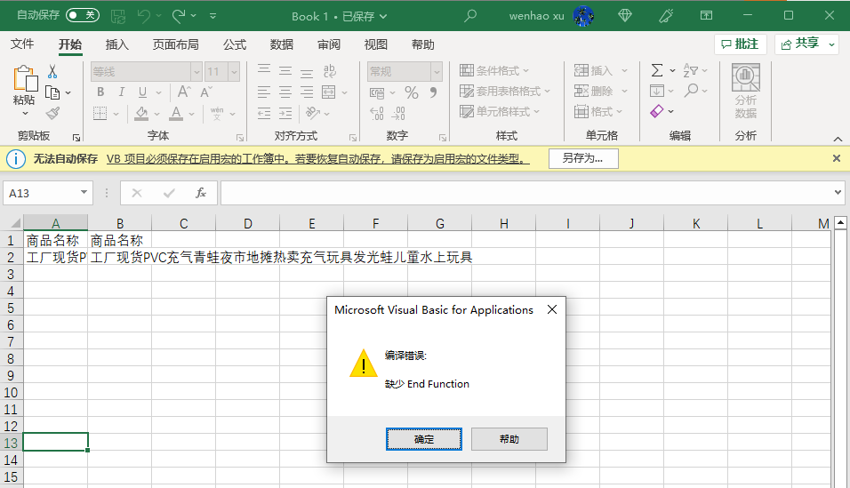

不过，这一次我们运气不太好，程序没有运行成功，还报错了。我们的 Excel 里面出现了一个VBA 的弹窗，有一段错误消息：“缺少 End Function”。我上一次写 VBA 代码，可能还要追溯到 2005 年在微软当实习生的时候。所以看到这个报错，我也没法立刻知道该怎么解决。

不过这个代码是 ChatGPT 写的，那出了错也应该让它负责。我们直接把对应的错误信息，填到 ChatGPT 的对话窗口里，让它看看怎么解决。这一次，它还挺礼貌，意识到了自己的错误，给出的代码里面缺少了“End Function”。所以，它会重新生成一份语法没有问题的代码给到我们。

提示语：

```
缺少End Function
```

代码：

```
……
   Else
       ExtractJSONValue = ""
   End If
End Function
```

注：整个对话参见链接https://sharegpt.com/c/joQQj7P

我们再把新的代码贴到 VBA 编辑器里面，再重新运行一次。这一次，程序运行通过了。但是，还是没有得到我们想要的结果。在第二列里，我们看到的是只有 JSON 结构，没有实际内容的 JSON 字符串。

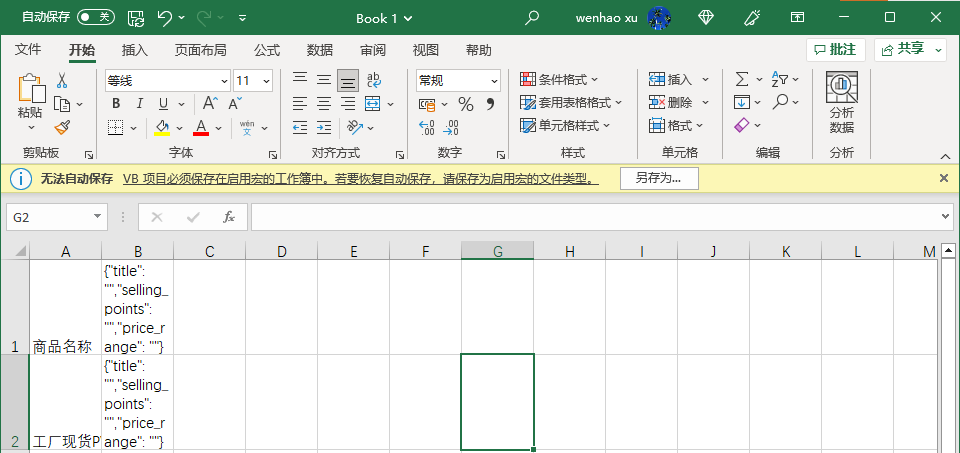

输出结果：

```json
{"title": "","selling_points": "","price_range": ""}
```

这个时候，我们就得先停下来，回头看看 ChatGPT 生成的代码到底干了些什么。虽然我们并不熟悉 VBA 的语法，但是如果你稍微有些编程的知识和经验，根据现在的代码其实大概就能够知道 ChatGPT 的这个程序是怎么回事儿了，现在我们就来把它拆解开。

1. 整个程序由两个函数组成，GetOpenAIResults 是主函数，是程序的主体执行结构。ExtractJSONValue 是一个功能函数，从 API 调用的返回结果里面，通过正则表达式去提取返回结果里面的内容。

2. GetOpenAIResults 这个主函数的结构也非常简单，除了一开始的一系列变量定义，其实就是做了这样几件事情。

- 通过一个 For 循环，遍历第一列单元格里面的值。

- 对每一个值，都构造了一个 HTTP 的请求，调用 OpenAI 的 API。

- 对于拿到的返回结果，通过 ExtractJSONValue 函数提取里面的内容，然后再重新拼装成一个 JSON。

- 最终将这个 outputJSON 的输出结果，填到第二列的单元格里面。

理解了代码的整体含义，还有拿到的输出结果，我们就有了调查问题的方向。我们想要看看在调用完 OpenAI 的 API 之后，拿到的返回结果是什么。看看是调用出错了，还是解析返回结果出错了？

于是，我们把 GetOpenAIResults 函数最后填入第二列单元格的代码修改一下，把调用OpenAI 的 API 拿到的返回结果，填到第三列里。修改完之后，我们重新运行宏，看看第三列里的返回结果是什么。

代码：

```
……
       ws.Cells(i, 2).Value = outputJSON
       ws.Cells(i, 3).Value = response
……
```

输出结果：

```json
{
   "error": {
       "message": "We could not parse the JSON body of your request. (HINT: This
       "type": "invalid_request_error",
       "param": null,
       "code": null
   }
}
```

从这个输出结果里面看到，错误信息是说，OpenAI 不能够解析我们输入的 JSON Body。那么，我们就再修改一下代码，把我们输入的 JSON 放到第四列里，看看是不是这部分代码ChatGPT 写错了。

```sql
……
       'Send the request to OpenAI API
       requestJSON = "{""prompt"": ""Consideration proudct : " & productTitle &
       request.send requestJSON
       'Get the response from OpenAI API
       response = request.responseText
……
       'Insert the JSON output into column B
       ws.Cells(i, 2).Value = outputJSON
       ws.Cells(i, 3).Value = response
       ws.Cells(i, 4).Value = requestJSON
……
```

这个时候我们尝试运行代码的话，VBA 会提示我们“变量未定义”的报错。这是因为 VBA 的语法规定，所有的变量在赋值之前都需要先单独定义，所以我们还需要在代码一开始变量定义的部分，加上 requestJSON 的变量定义。

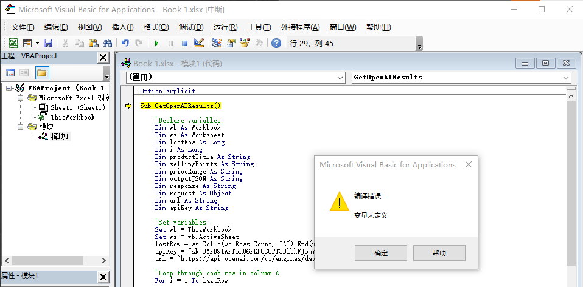

代码：

```
……
   Dim apiKey As String
   Dim requestJSON As String
   'Set variables
……
```

然后我们重新运行代码，就会在第四列里，得到我们输入的 JSON 数据。我们肉眼看不出这个 JSON 是不是合法，只能尝试让 ChatGPT 帮我们看一下这个 JSON 是否合法了。不过ChatGPT 告诉我们这个 JSON 是合法的，这个时候，我们又一次陷入了僵局。

JSON 数据：

```json
{"prompt": "Consideration proudct : 工厂现货PVC充气青蛙夜市地摊热卖充气玩具发光蛙儿童水上玩
1. Compose human readable product title used on Amazon in english within 20 words
2. Write 5 selling points for the products in Amazon.
3. Evaluate a price range for this product in U.S.
Output the result in json format with three properties called title, selling_poin
```

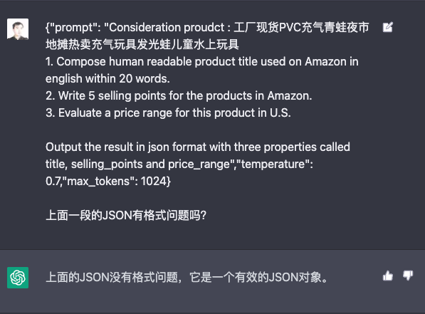

## 简化问题寻找思路

我们并不擅长撰写 VBA 应用，所以这个时候，我们的思路还是要把问题简化。我们拿一个最简单的 JSON 来向 OpenAI 发起请求，看看结果是不是还会报出相同的错误。

```
……
       'Send the request to OpenAI API
       requestJSON = "{""prompt"": ""Consideration proudct : " & productTitle &
       requestJSON = "{""prompt"": ""How are you?""}"
       request.send requestJSON
       'Get the response from OpenAI API
       response = request.responseText
……
```

修改之后，我们发现，API 调用的返回结果虽然还是个报错。但是这个报错变了，而且这个报错我们看得懂了。

Excel 里面的 response 内容：

```json
{
   "error": {
       "message": "The model: `davinci-codex` does not exist",
       "type": "invalid_request_error",
       "param": null,
       "code": "model_not_found"
   }
}
```

这个报错告诉我们，对应的 davinci-codex 模型不存在。的确，最近 OpenAI 把 CodeX 的模型下线了，那我们就把模型修改成 text-davinci-003 这个我们之前常用的模型。

```
   url = "https://api.openai.com/v1/engines/text-davinci-003/completions"
```

然后我们再重新运行一下代码，这时，我们第一次拿到了一个正确的来自 AI 的回复。

```json
{"id":"cmpl-70ZEVctFduMnv6D1WIz4iffTZdaGl","object":"text_completion","created":1
```

不过这个返回内容，针对的还是我们刚才构造的最简单的 Prompt：“How are you?”的回答，我们把使用的 JSON 切换回去，再运行一下，看看结果是怎么样的。

```
……
       'Send the request to OpenAI API
       requestJSON = "{""prompt"": ""Consideration proudct : " & productTitle &
       request.send requestJSON
       'Get the response from OpenAI API
       response = request.responseText
```

不幸的是，这一次我们还是拿到了一段和之前相同的报错，告诉我们 JSON 的格式解析不了。

```json
{
   "error": {
       "message": "We could not parse the JSON body of your request. (HINT: This
       "type": "invalid_request_error",
       "param": null,
       "code": null
   }
}
```

但是这个时候，我们已经不慌了。因为我们之前已经用一个简单的 JSON 拿到了 ChatGPT 的正确回答。所以，我们可以确定，的确现在的 JSON 是有问题的。我们只要能够找到这个JSON 的格式问题，相信我们离正确答案就不远了。

既然 AI 前面说这个 JSON 格式是合法的，那我们就不妨让它来给我们生成一个同样内容的VBA 的 JSON 字符串好了，我们也把问题简化，只关心我们的 Prompt 部分。

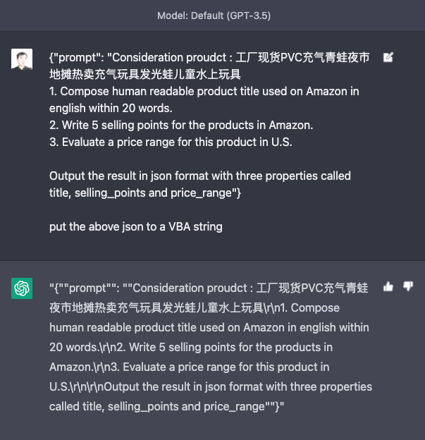

然后我们再修改一下 VBA 代码，重新运行一次。

```
……
       'Send the request to OpenAI API
       requestJSON = "{""prompt"": ""Consideration proudct : " & productTitle &
       requestJSON = "{""prompt"": ""Consideration proudct : 工厂现货PVC充气青蛙夜市
       request.send requestJSON
       'Get the response from OpenAI API
       response = request.responseText
……
```

而这么一运行，我们就得到了一个正常的、有意义的 JSON 返回值。那这个时候，对于问题的定位就进一步缩小了。我们只要看看上下两个字符串有什么不一样就好了。仔细观察一下，你就会发现，上下两边使用的换行符不一样。上面使用的是 vbnewline，而下面使用的是\r\n。那我们就把上面的换行符设成和下面完全一致的，再来试试看。

```
……
       requestJSON = "{""prompt"": ""Consideration proudct : " & productTitle &
       request.send requestJSON
……
```

再运行一次代码，这次成功了。我们在第三列拿到了一个正常的 OpenAI 的返回内容，里面的确有我们想要的英文标题、卖点和售价。

```json
{"id":"cmpl-70ZaUPXSb8nU39jmpNkhl59bMsG4A","object":"text_completion","created":1
```

不过，我们的第二列数据的 JSON 还是没有具体内容，只有结构。不过这个时候，我们离自己想要的答案已经越来越近了。

## 让 AI 单独写出提取函数，完成最后的程序

原先 AI 生成的解析 JSON 的代码，使用的是正则表达式，而不是对 JSON 进行反序列化。而且给运营人员用，我们也不希望再重新拼接成 JSON 格式。所以，这个时候我们不妨问一问ChatGPT，怎么把 JSON 反序列化。

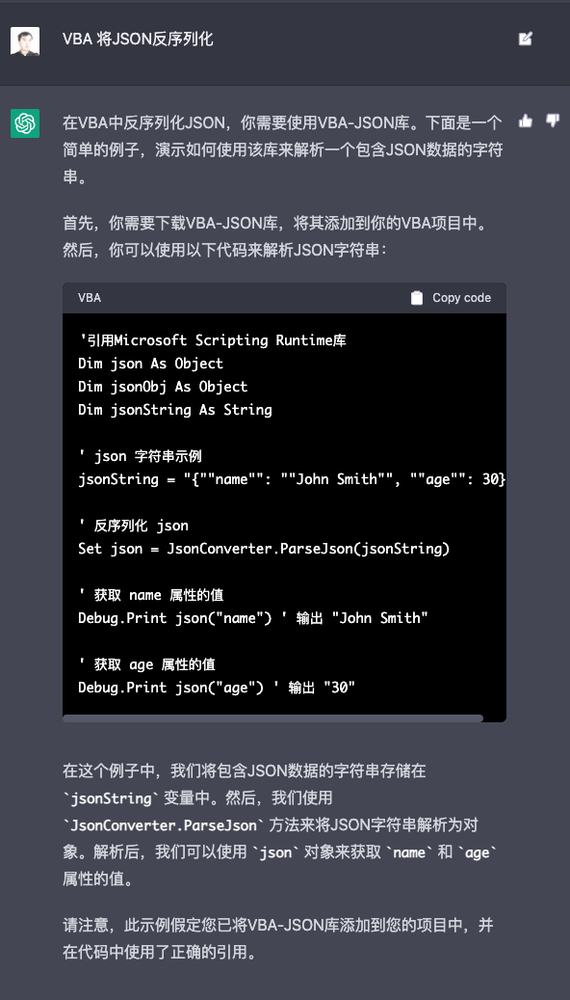

注：对应的整个对话参见链接 https://sharegpt.com/c/rAmlkqQ

ChatGPT 给了我们示例，告诉我们可以在 GitHub 上找到对应的函数库。如果你按图索骥，就能在 VBA-JSON 和 VBA-Dictionary 找到我们需要的库。并且按照文档的要求，在 VBA编辑器里通过 “文件”=>“导入文件” 来导入函数库。然后，我们只要按照文档的格式小小修改一下现在的代码，就能提取到我们希望得到的 JSON 格式了。

```sql
……
   Dim requestJSON As String
   Dim Json As Object
   'Set variables
……
   'Loop through each row in column A
   For i = 1 To lastRow
……
       Set Json = JsonConverter.ParseJson(response)
       'Insert the JSON output into column B
       ws.Cells(i, 2).Value = Json("choices")(1)("text")
       ws.Cells(i, 3).Value = response
       ws.Cells(i, 4).Value = requestJSON
```

再运行一下，第二列里就是我们想要的 JSON 了。

```json
{  "title": "Glow In The Dark Inflatable PVC Frog Pool Toy For Kids",  "selling_p
```

那接下来，问题就很简单了。我们只需要进一步把这个 JSON 字符串也解析一下，然后把title、selling_points 以及 price_range 解析出来，分别放到不同的列里面就可以了。如果有想不明白怎么写的代码你还是可以继续问 ChatGPT。

我把要修改的代码列在了下面。

```sql
Option Explicit
Sub GetOpenAIResults()
   'Declare variables
   Dim wb As Workbook
   Dim ws As Worksheet
   Dim lastRow As Long
   Dim i As Long
   Dim productTitle As String
   Dim response As String
   Dim request As Object
   Dim url As String
   Dim apiKey As String
   Dim requestJSON As String
   Dim Json As Object
   'Set variables
   Set wb = ThisWorkbook
   Set ws = wb.ActiveSheet
   lastRow = ws.Cells(ws.Rows.Count, "A").End(xlUp).Row
   apiKey = "sk-xxxx"
   url = "https://api.openai.com/v1/engines/text-davinci-003/completions"
   'Loop through each row in column A
   For i = 2 To lastRow
       'Get the product title from column A
       productTitle = ws.Cells(i, 1).Value
       'Set up the OpenAI API request
       Set request = CreateObject("MSXML2.XMLHTTP")
       request.Open "POST", url, False
       request.setRequestHeader "Content-Type", "application/json"
       request.setRequestHeader "Authorization", "Bearer " & apiKey
       'Send the request to OpenAI API
       requestJSON = "{""prompt"": ""Consideration proudct : " & productTitle &
       request.send requestJSON
       'Get the response from OpenAI API
       response = request.responseText
       Set Json = JsonConverter.ParseJson(response)
       Set Json = JsonConverter.ParseJson(Json("choices")(1)("text"))
       'Insert the JSON output into column B
       ws.Cells(i, 2).Value = Json("title")
       ws.Cells(i, 3).Value = ConcatenateArrayToString(Json("selling_points"))
       ws.Cells(i, 4).Value = Json("price_range")
   Next i
End Sub
Function ConcatenateArrayToString(arr) As String
   Dim result As String
   Dim i As Long
   'Assuming the array is stored in a variable named "arr"
   For i = 1 To 5
       result = result & arr(i) & vbCrLf  'Use vbCrLf to add a line break after
   Next i
   'The "result" variable now contains the concatenated string
   ConcatenateArrayToString = result
End Function
```

最后的代码我们做了几处小的更改。

1. 遍历列表的第一列的时候，我们跳过了第一行的标题行。

2. 去除了不再需要使用的临时变量，以及不再需要的之前 AI 自动生成的函数。

3. selling_points 是一个 5 个元素的数组，通过一个单独的函数封装了从数组到字符串的拼装。

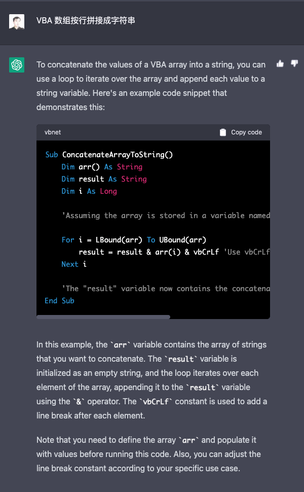

VBA 数组拼接字符串的工作，我们也是让 ChatGPT 指导我们做的

修改之后再执行一下，我们终于得到了理想的结果。

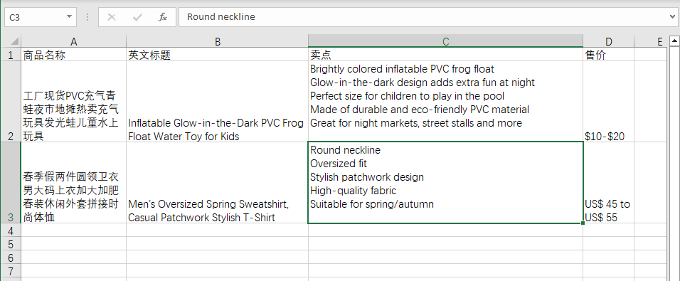

- 最后Excel输出的结果

最后整个完整功能的 VBA 代码，我也放在了 GitHub 里，你可以直接拿去运行。不过记得在运行之前，需要先安装 VBA-JSON 库和 VBA-Dictionary 库。

## 小结

好了，这一讲到这里也就结束了。设计这节课的目的是给你演示一下如何和 ChatGPT 协同编写代码，完成一个对你有价值的小插件。我们通过 ChatGPT 的帮助，完成了一个使用 VBA来编写的 Excel 小插件。

我自己上一次使用 VBA 也大概是 20 年前了，所以我相信如果你有一些代码基础的话，应该和我一样，能够通过 ChatGPT 完成这个插件的开发。

在这个开发的过程中，我们没有去重新学习 VB.NET 这样的编程语言，也没有使用 Google 来搜索解决问题。而是完全让 ChatGPT 主导，只是在遇到问题的时候，我们通过缩小和简化问题来进行 Debug。唯一需要撰写的一点代码，也是最后简单阅读了 ChatGPT 推荐给我们的VBA-JSON 的示例，加了一点点 JSON 解析的代码而已。

希望这一讲能够打开你的思路，帮助你善用 ChatGPT 更快、更好地完成写代码的任务。

## 思考题

最后，按照惯例还是给你留一道思考题。你有什么想要实现的插件小功能吗？无论是在Excel、浏览器或者是其他什么场景下，请试着一步一步向 ChatGPT 输入你的需求，让它帮你写代码，来做一个属于你自己的插件吧！

期待你把自己的体验分享到评论区，也欢迎你把这一讲分享给需要的朋友，我们下一讲再见！

## 推荐体验

最近有一个很火的新的代码编辑器，叫做 cursor.so。它背后也是 GPT 的模型，能够快速根据你输入的需求描述生成 Python 和 Typescript 代码。如果你没有订阅 GitHub Copilot，也可以去尝试一下这个应用。
