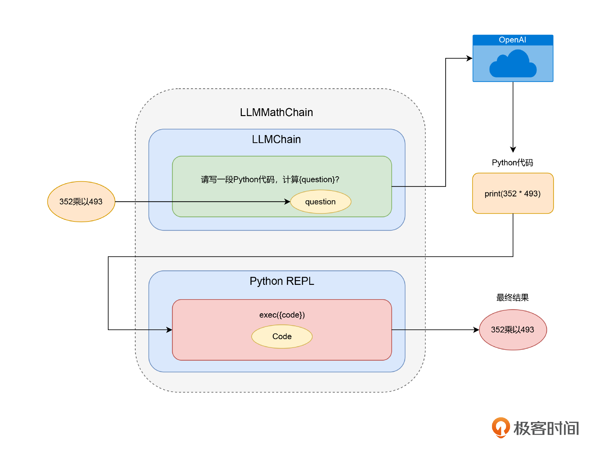
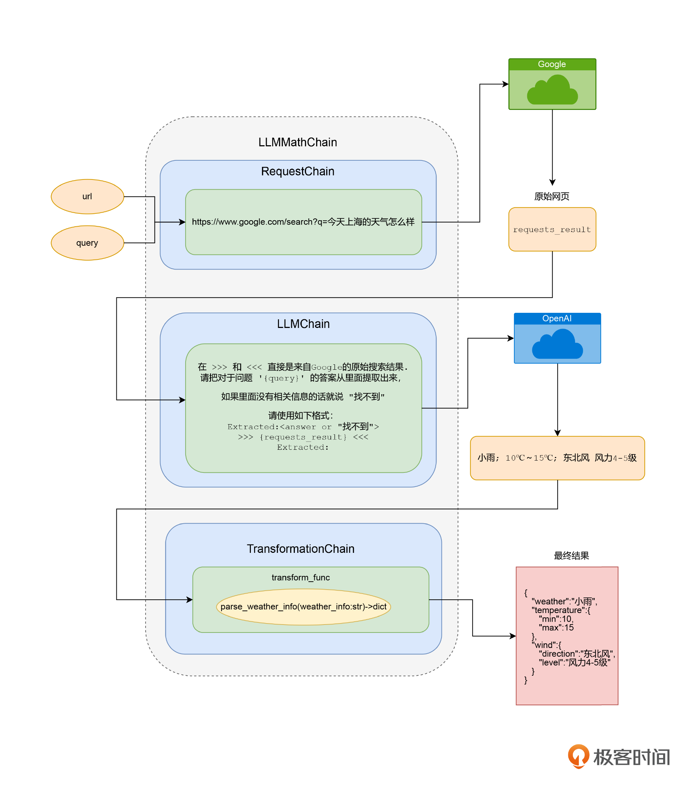

# 15 | 深入使用LLMChain，给AI连上Google和计算器

你好，我是徐文浩。

上一讲里，我们一起学习了怎么通过 LangChain 这个 Python 包，链式地调用 OpenAI 的API。通过链式调用的方式，我们可以把一个需要询问 AI 多轮才能解决的问题封装起来，把一个通过自然语言多轮调用才能解决的问题，变成了一个函数调用。

不过，LangChain 能够帮到我们的远不止这一点。前一阵，ChatGPT 发布了 Plugins 这个插件机制。通过 Plugins，ChatGPT 可以浏览整个互联网，还可以接上 Wolfram 这样的科学计算工具，能够实现很多原先光靠大语言模型解决不好的问题。不过，这个功能目前还是处于wait list 的状态，我也还没有拿到权限。

不过没有关系，我们通过 LangChain 也能实现这些类似的功能。今天这一讲，我们就继续深入挖掘一下 Langchain，看看它怎么解决这些问题。

## 解决 AI 数理能力的难题

很多人发现，虽然 ChatGPT 回答各种问题的时候都像模像样的，但是一到计算三位数乘法的时候就露馅儿了。感觉它只是快速估计了一个数字，而不是真的准确计算了。我们来看下面这段代码，我们让 OpenAI 帮我们计算一下 352 x 493 等于多少，你会发现，它算得大差不差，但还是算错了。这就很尴尬，如果我们真的想要让它来担任一个小学数学的助教，总是给出错误的答案也不是个事儿。

```python
import openai, os
openai.api_key = os.environ.get("OPENAI_API_KEY")
from langchain.prompts import PromptTemplate
from langchain.llms import OpenAI
from langchain.chains import LLMChain
llm = OpenAI(model_name="text-davinci-003", max_tokens=2048, temperature=0.5)
multiply_prompt = PromptTemplate(template="请计算一下{question}是多少?", input_varia
math_chain = LLMChain(llm=llm, prompt=multiply_prompt, output_key="answer")
answer = math_chain.run({"question": "352乘以493"})
print("OpenAI API 说答案是:", answer)
python_answer = 352 * 493
print("Python 说答案是:", python_answer)
```

输出结果：

```
OpenAI API 说答案是:
352 x 493 = 174,336
Python 说答案是: 173536
```

注：可以看到，OpenAI 给出的结果，答案是错误的。

不过，有人很聪明，说虽然 ChatGPT 直接算这些数学题不行，但是它不是会写代码吗？我们直接让它帮我们写一段利用 Python 计算这个数学式子的代码不就好了吗？的确，如果你让它写一段 Python 代码，给出的代码是没有问题的。

```
multiply_by_python_prompt = PromptTemplate(template="请写一段Python代码，计算{questi
math_chain = LLMChain(llm=llm, prompt=multiply_by_python_prompt, output_key="answ
answer = math_chain.run({"question": "352乘以493"})
print(answer)
```

输出结果：

```
print(352 * 493)
```

不过，我们不想再把这段代码，复制粘贴到 Python 的解释器或者 Notebook 里面，再去手工执行一遍。所以，我们可以在后面再调用一个 Python 解释器，让整个过程自动完成，对应的代码我也放在了下面。

```
multiply_by_python_prompt = PromptTemplate(template="请写一段Python代码，计算{questi
math_chain = LLMChain(llm=llm, prompt=multiply_by_python_prompt, output_key="answ
answer_code = math_chain.run({"question": "352乘以493"})
from langchain.utilities import PythonREPL
python_repl = PythonREPL()
result = python_repl.run(answer_code)
print(result)
```

输出结果：

```
173536
```

注：生成的 Python 脚本是正确的，再通过调用 Python 解释器就能得到正确的计算结果。

可以看到，LangChain 里面内置了一个 utilities 的包，里面包含了 PythonREPL 这个类，可以实现对 Python 解释器的调用。如果你去翻看一下对应代码的源码的话，它其实就是简单地调用了一下系统自带的 exec 方法，来执行 Python 代码。utilities 里面还有很多其他的类，能够实现很多功能，比如可以直接运行 Bash 脚本，调用 Google Search 的 API 等等。你可以去LangChain 的文档，看看它内置的这些工具类有哪些。

如果你仔细想一下，你会发现这其实也是一种链式调用。只不过，调用链里面的第二步，不是去访问 OpenAI 的 API 而已。所以，对于这些工具能力，LangChain 也把它们封装成了LLMChain 的形式。比如刚才的数学计算问题，是一个先生成 Python 脚本，再调用 Python 解释器的过程，LangChain 就把这个过程封装成了一个叫做 LLMMathChain 的 LLMChain。不需要自己去生成代码，再调用 PythonREPL，只要直接调用 LLMMathChain，它就会在背后把这一切都给做好，对应的代码我也放在下面。

```python
from langchain import LLMMathChain
llm_math = LLMMathChain(llm=llm, verbose=True)
result = llm_math.run("请计算一下352乘以493是多少?")
print(result)
```

输出结果：

```
> Entering new LLMMathChain chain...
请计算一下352乘以493是多少?
print(352 * 493)
Answer: 173536
> Finished chain.
Answer: 173536
```

LangChain 也把前面讲过的 utilities 包里面的很多功能，都封装成了 Utility Chains。比如，SQLDatabaseChain 可以直接根据你的数据库生成 SQL，然后获取数据，LLMRequestsChain 可以通过 API 调用外部系统，获得想要的答案。你可以直接在LangChain 关于 Utility Chains 的文档里面，找到有哪些工具可以用。



- LLMathChain通过OpenAI生成Python代码，再通过REPL执行Python代码，完成数学计算

## 通过 RequestsChain 获取实时外部信息

这里我们来重点讲一讲如何通过 API 来调用外部系统，获得想要的答案。之前在介绍 llama-index 的时候，我们已经介绍过一种为 AI 引入外部知识的方法了，那就是计算这些外部知识的Embedding，然后作为索引先保存下来。但是，这只适用于处理那些预先准备好会被问到的知识，比如一本书、一篇论文。这些东西，内容多但是固定，也不存在时效性问题，我们可以提前索引好，而且用户问的问题往往也有很强的相似性。

但是，对于时效性强的问题，这个方法不太适用，因为我们可能没有必要不停地更新索引。比如，你想要知道实时的天气情况，我们不太可能把全球所有城市最新的天气信息每隔几分钟都索引一遍。

这个时候，我们可以使用 LLMRequestsChain，通过一个 HTTP 请求来得到问题的答案。最简单粗暴的一个办法，就是直接通过一个 HTTP 请求来问一下 Google。

```
from langchain.chains import LLMRequestsChain
template = """在 >>> 和 <<< 直接是来自Google的原始搜索结果.
请把对于问题 '{query}' 的答案从里面提取出来，如果里面没有相关信息的话就说 "找不到"
```

- 请使用如下格式：

```
Extracted:<answer or "找不到">
>>> {requests_result} <<<
Extracted:"""
PROMPT = PromptTemplate(
   input_variables=["query", "requests_result"],
   template=template,
)
requests_chain = LLMRequestsChain(llm_chain = LLMChain(llm=OpenAI(temperature=0),
question = "今天上海的天气怎么样？"
inputs = {
   "query": question,
   "url": "https://www.google.com/search?q=" + question.replace(" ", "+")
}
result=requests_chain(inputs)
print(result)
print(result['output'])
```

输出结果：

```
{'query': '今天上海的天气怎么样？', 'url': 'https://www.google.com/search?q=今天上海的天
小雨; 10℃～15℃; 东北风 风力4-5级
```

我们来看看这段代码，基于 LLMRequestsChain，我们用到了之前使用过的好几个技巧。

1. 首先，因为我们是简单粗暴地搜索 Google。但是我们想要的是一个有价值的天气信息，而不是整个网页。所以，我们还需要通过 ChatGPT 把网页搜索结果里面的答案给找出来。所以我们定义了一个 PromptTemplate，通过一段提示语，让 OpenAI 为我们在搜索结果里面，找出问题的答案，而不是去拿原始的 HTML 页面。

2. 然后，我们使用了 LLMRequestsChain，并且把刚才 PromptTemplate 构造的一个普通的LLMChain，作为构造函数的一个参数，传给 LLMRequestsChain，帮助我们在搜索之后处理搜索结果。

3. 对应的搜索词，通过 query 这个参数传入，对应的原始搜索结果，则会默认放到requests_results 里。而通过我们自己定义的 PromptTemplate 抽取出来的最终答案，则会放到 output 这个输出参数里面。

我们运行一下，就可以看到我们通过简单搜索 Google 加上通过 OpenAI 提取搜索结果里面的答案，就得到了最新的天气信息。

## 通过 TransformationChain 转换数据格式

有了实时的外部数据，我们就又有很多做应用的创意了。比如说，我们可以根据气温来推荐大家穿什么衣服。我们可以要求如果最低温度低于 0 度，就要推荐用户去穿羽绒服。或者，根据是否下雨来决定要不要提醒用户出门带伞。

不过，在现在的返回结果里，天气信息（天气、温度、风力）只是一段文本，而不是可以直接获取的 JSON 格式。当然，我们可以在 LLMChain 里面再链式地调用一次 OpenAI 的接口，把这段文本转换成 JSON 格式。但是，这样做的话，一来还要消耗更多的 Token、花更多的钱，二来这也会进一步增加程序需要运行的时间，毕竟一次往返的网络请求也是很慢的。这里的文本格式其实很简单，我们完全可以通过简单的字符串处理完成解析。

```python
import re
def parse_weather_info(weather_info: str) -> dict:
   # 将天气信息拆分成不同部分
   parts = weather_info.split('; ')
   # 解析天气
   weather = parts[0].strip()
   # 解析温度范围，并提取最小和最大温度
   temperature_range = parts[1].strip().replace('℃', '').split('～')
   temperature_min = int(temperature_range[0])
   temperature_max = int(temperature_range[1])
   # 解析风向和风力
   wind_parts = parts[2].split(' ')
   wind_direction = wind_parts[0].strip()
   wind_force = wind_parts[1].strip()
   # 返回解析后的天气信息字典
   weather_dict = {
       'weather': weather,
       'temperature_min': temperature_min,
       'temperature_max': temperature_max,
       'wind_direction': wind_direction,
       'wind_force': wind_force
   }
   return weather_dict
# 示例
weather_info = "小雨; 10℃～15℃; 东北风 风力4-5级"
weather_dict = parse_weather_info(weather_info)
print(weather_dict)
```

输出结果：

```
{'weather': '小雨', 'temperature': {'min': 10, 'max': 15}, 'wind': {'direction': '
```

注：上面这段代码，其实是我让 GPT-4 写的。

我们在这里实现了一个 parse_weather_info 函数，可以把前面 LLMRequestsChain 的输出结果，解析成一个 dict。不过，我们能不能更进一步，把这个解析的逻辑，也传到 LLMChain的链式调用的最后呢？答案当然是可以的。对于这样的要求，Langchain 里面也有一个专门的解决方案，叫做 TransformChain，也就是做格式转换。

```python
from langchain.chains import TransformChain, SequentialChain
def transform_func(inputs: dict) -> dict:
   text = inputs["output"]
   return {"weather_info" : parse_weather_info(text)}
transformation_chain = TransformChain(input_variables=["output"],
                                     output_variables=["weather_info"], transfor
final_chain = SequentialChain(chains=[requests_chain, transformation_chain],
                             input_variables=["query", "url"], output_variables=
final_result = final_chain.run(inputs)
print(final_result)
```

输出结果：

```
{'weather': '小雨', 'temperature': {'min': 10, 'max': 15}, 'wind': {'direction': '
```

注：在 requests_chain 后面跟上一个 transformation_chain，我们就能把结果解析成 dict，供后面其他业务使用结构化的数据。

1. 我们在这里，先定义了一个 transform_func，对前面的 parse_weather_info 函数做了一下简单的封装。它的输入，是整个 LLMChain 里，执行到 TransformChain 之前的整个输出结果的 dict。我们前面看到整个 LLMRequestsChain 里面的天气信息的文本内容，是通过output 这个 key 拿到的，所以这里我们也是先通过它来拿到天气信息的文本内容，再调用parse_weather_info 解析，并且把结果输出到 weather_info 这个字段里。

2. 然后，我们就定义了一个 TransformChain，里面的输入参数就是 output，输出参数就是weather_info。

3. 最后，我们通过上一讲用过的 SequentialChain，将前面的 LLMRequestsChain 和这里的TransformChain 串联到一起，变成一个新的叫做 final_chain 的 LLMChain。

在这三步完成之后，未来我们想要获得天气信息，并且拿到一个 dict 形式的输出，只要调用final_chain 的 run 方法，输入我们关于天气的搜索文本就好了。



- 通过三个步骤，拿到最后结构化的天气信息

最后，我们来梳理一下 final_chain 都做了哪些事。

1. 通过一个 HTTP 请求，根据搜索词拿到 Google 的搜索结果页。

2. 把我们定义的 Prompt 提交给 OpenAI，然后把我们搜索的问题和结果页都发给了OpenAI，让它从里面提取出搜索结果页里面的天气信息。

3. 最后我们通过 transform_func 解析拿到的天气信息的文本，被转换成一个 dict。这样，后面的程序就好处理了。

## 通过 VectorDBQA 来实现先搜索再回复的能力

此外，还有一个常用的 LLMChain，就是我们之前介绍的 llama-index 的使用场景，也就是针对自己的资料库进行问答。我们预先把资料库索引好，然后每次用户来问问题的时候，都是先到这个资料库里搜索，再把问题和答案一并交给 AI，让它去组织语言回答。

```python
from langchain.embeddings.openai import OpenAIEmbeddings
from langchain.vectorstores import FAISS
from langchain.text_splitter import SpacyTextSplitter
from langchain import OpenAI, VectorDBQA
from langchain.document_loaders import TextLoader
llm = OpenAI(temperature=0)
loader = TextLoader('./data/ecommerce_faq.txt')
documents = loader.load()
text_splitter = SpacyTextSplitter(chunk_size=256, pipeline="zh_core_web_sm")
texts = text_splitter.split_documents(documents)
embeddings = OpenAIEmbeddings()
docsearch = FAISS.from_documents(texts, embeddings)
faq_chain = VectorDBQA.from_chain_type(llm=llm, vectorstore=docsearch, verbose=Tr
```

注：上面的代码创建了一个基于 FAISS 进行向量存储的 docsearch 的索引，以及基于这个索引的 VectorDBQA 这个 LLMChain。

先来看第一段代码，我们通过一个 TextLoader 把文件加载进来，还通过 SpacyTextSplitter 给文本分段，确保每个分出来的 Document 都是一个完整的句子。因为我们这里的文档是电商FAQ 的内容，都比较短小精悍，所以我们设置的 chunk_size 只有 256。然后，我们定义了使用 OpenAIEmbeddings 来给文档创建 Embedding，通过 FAISS 把它存储成一个VectorStore。最后，我们通过 VectorDBQA 的 from_chain_type 定义了一个 LLM。对应的FAQ 内容，我是请 ChatGPT 为我编造之后放在了 ecommerce_faq.txt 这个文件里。

问题：

```
question = "请问你们的货，能送到三亚吗？大概需要几天？"
result = faq_chain.run(question)
print(result)
```

输出结果：

```
> Entering new VectorDBQA chain...
> Finished chain.
我们支持全国大部分省份的配送，包括三亚。一般情况下，大部分城市的订单在2-3个工作日内送达，偏远地
```

问题：

```
question = "请问你们的退货政策是怎么样的？"
result = faq_chain.run(question)
print(result)
```

输出结果：

```
> Entering new VectorDBQA chain...
> Finished chain.
自收到商品之日起7天内，如产品未使用、包装完好，您可以申请退货。某些特殊商品可能不支持退货，请在购
```

我向它提了两个不同类型的问题，faq_chain 都能够正确地回答出来。你可以去看看 data 目录下面的 ecommerce_faq.txt 文件，看看它的回答是不是和文档写的内容一致。在 VectorDBQA这个 LLMChain 背后，其实也是通过一系列的链式调用，来完成搜索 VectorStore，再向 AI 发起 Completion 请求这样两个步骤的。

可以看到 LLMChain 是一个很强大的武器，它可以把解决一个问题需要的多个步骤串联到一起。这个步骤可以是调用我们的语言模型，也可以是调用一个外部 API，或者在内部我们定义一个 Python 函数。这大大增强了我们利用大语言模型的能力，特别是能够弥补它的很多不足之处，比如缺少有时效的信息，通过 HTTP 调用比较慢等等。

## 小结

好了，这一讲到这里也就结束了。

我们可以看到，Langchain 的链式调用并不局限于使用大语言模型的接口。这一讲里，我们就看到四种常见的将大语言模型的接口和其他能力结合在一起的链式调用。

1. LLMMathChain 能够通过 Python 解释器变成一个计算器，让 AI 能够准确地进行数学运算。

2. 通过 RequestsChain，我们可以直接调用外部 API，然后再让 AI 从返回的结果里提取我们关心的内容。

3. TransformChain 能够让我们根据自己的要求对数据进行处理和转化，我们可以把 AI 返回的自然语言的结果进一步转换成结构化的数据，方便其他程序去处理。

4. VectorDBQA 能够完成和 llama-index 相似的事情，只要预先做好内部数据资料的Embedding 和索引，通过对 LLMChain 进行一次调用，我们就可以直接获取回答的结果。

这些能力大大增强了 AI 的实用性，解决了几个之前大语言模型处理得不好的问题，包括数学计算能力、实时数据能力、和现有程序结合的能力，以及搜索属于自己的资料库的能力。你完全可以定义自己需要的 LLMChain，通过程序来完成各种任务，然后合理地组合不同类型的LLMChain 对象，来实现连 ChatGPT 都做不到的事情。而 ChatGPT Plugins 的实现机制，其实也是类似的。

## 思考题

最后，我给你留一道思考题。我们前面说过，Langchain 里有 SQLDatabaseChain 可以直接让我们写需求访问数据库。在官方文档里也给出了对应的例子，你可以去试一试体验一下，想一想它是通过什么样的提示语信息，来让 AI 写出可以直接执行的 SQL 的？

欢迎你把你体验之后的感受以及思考后的结果分享在评论区，也欢迎你把这一讲分享给感兴趣的朋友，我们下一讲再见！

## 推荐试用

我们目前对于 Langchain 的讲解，都是通过 Python 编程的方式来实现真实业务场景的需求的。有人直接为 Langchain 做了一个可以拖拽的图形界面叫做 LangFlow。你可以试着下载体验一下，看看图形界面是不是可以进一步提升你的效率。
