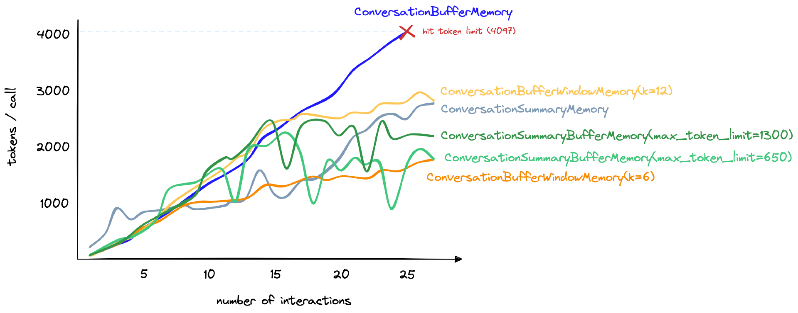

# 16 | Langchain里的“记忆力”，让AI只记住有用的事儿

你好，我是徐文浩。

在过去的两讲里，我们深入了解了 Langchain 的第一个核心功能，也就是 LLMChain。LLMChain 能够帮助我们链式地调用一系列命令，这里面既包含直接调用 OpenAI 的 API，也包括调用其他外部接口，或者自己实现的 Python 代码。但是这一连串的调用，还只是完成一个小任务。我们很多时候还是希望用一个互动聊天的过程，来完成整个任务。

所以 LangChain 并不是只有链式调用这样一个核心功能，它还封装了很多其他能力，来方便我们开发 AI 应用。比如，让 AI 能够拥有“记忆力”，也就是记住我们聊天上下文的能力。不知道你还记不记得，我们在第 6 讲里做的聊天机器人。在那个里面，为了能够让 ChatGPT 知道整个聊天的上下文，我们需要把历史的对话记录都传给它。但是，因为能够接收的 Token数量有上限，所以我们只能设定一个参数，只保留最后几轮对话。我们最后把这个功能，抽象成了一个 Conversation 类。

```python
import openai
import os
openai.api_key = os.environ.get("OPENAI_API_KEY")
class Conversation:
   def __init__(self, prompt, num_of_round):
       self.prompt = prompt
       self.num_of_round = num_of_round
       self.messages = []
       self.messages.append({"role": "system", "content": self.prompt})
   def ask(self, question):
       try:
           self.messages.append({"role": "user", "content": question})
           response = openai.ChatCompletion.create(
               model="gpt-3.5-turbo",
               messages=self.messages,
               temperature=0.5,
               max_tokens=2048,
               top_p=1,
           )
       except Exception as e:
           print(e)
           return e
       message = response["choices"][0]["message"]["content"]
       self.messages.append({"role": "assistant", "content": message})
       if len(self.messages) > self.num_of_round*2 + 1:
           del self.messages[1:3] //Remove the first round conversation left.
       return message
```

不知道你是否还记得这个 Conversation 类。

## BufferWindow，滑动窗口记忆

这个基于一个固定长度的滑动窗口的“记忆”功能，被直接内置在 LangChain 里面了。在Langchain 里，把对于整个对话过程的上下文叫做 Memory。任何一个 LLMChain，我们都可以给它加上一个 Memory，来让它记住最近的对话上下文。我也把对应的代码放在了下面。

```
from langchain.memory import ConversationBufferWindowMemory
template = """你是一个中国厨师，用中文回答做菜的问题。你的回答需要满足以下要求:
1. 你的回答必须是中文
2. 回答限制在100个字以内
{chat_history}
Human: {human_input}
Chatbot:"""
prompt = PromptTemplate(
   input_variables=["chat_history", "human_input"],
   template=template
)
memory = ConversationBufferWindowMemory(memory_key="chat_history", k=3)
llm_chain = LLMChain(
   llm=OpenAI(),
   prompt=prompt,
   memory=memory,
   verbose=True
)
llm_chain.predict(human_input="你是谁？")
```

输出结果：

```
' 我是一个中国厨师，我可以帮助你做菜。我会根据你的口味和特殊要求，精心烹饪出独特美味的中国菜肴。'
```

可以看到，我们做的事情其实和之前的 Conversation 类似，我们定义了一个 PromptTemplate来输入我们的指示。然后，在 LLMChain 构造的时候，我们为它指定了一个叫做ConversationBufferWindowMemory 的 memory 对象，并且为这个 memory 对象定义了k=3，也就是只保留最近三轮的对话内容。

如果我们和第 6 讲一样，和它连续进行几轮对话，你会发现，到第四轮的时候它还是能够记得我们问它的第一个问题是“你是谁”，但是第 5 轮的时候，已经变成“鱼香肉丝怎么做？”了。这就是因为我们选择只保留过去 3 轮对话。

```
llm_chain.predict(human_input="鱼香肉丝怎么做？")
llm_chain.predict(human_input="那宫保鸡丁呢？")
llm_chain.predict(human_input="我问你的第一句话是什么？")
```

输出结果：

```
' 你是谁？'
```

再次询问第一句话是什么：

```
llm_chain.predict(human_input="我问你的第一句话是什么？")
```

输出结果：

```
' 你问我的第一句话是“鱼香肉丝怎么做？”'
```

事实上，你可以直接调用 memory 的 load_memory_variables 方法，它会直接返回 memory里实际记住的对话内容。

```
memory.load_memory_variables({})
```

输出结果：

```
{'chat_history': 'Human: 那宫保鸡丁呢？\nAI:  宫保鸡丁是一道经典的中国家常菜，需要准备鸡肉、
```

## SummaryMemory，把小结作为历史记忆

使用 BufferWindow 这样的滑动窗口有一个坏处，就是几轮对话之后，AI 就把一开始聊的内容给忘了。所以在第 7 讲的时候我们讲过，遇到这种情况，可以让 AI 去总结一下前面几轮对话的内容。这样，我们就不怕对话轮数太多或者太长了。

同样的，Langchain 也提供了一个 ConversationSummaryMemory，可以实现这样的功能，我们还是通过一段简单的代码来看看它是怎么用的。

代码中只有两个需要注意的点。

第一个是对于我们定义的 ConversationSummaryMemory，它的构造函数也接受一个 LLM 对象。这个对象会专门用来生成历史对话的小结，是可以和对话本身使用的 LLM 对象不同的。

第二个是这次我们没有使用 LLMChain 这个对象，而是用了封装好的 ConversationChain。用ConversationChain 的话，其实我们是可以不用自己定义 PromptTemplate 来维护历史聊天记录的，但是为了使用中文的 PromptTemplate，我们在这里还是自定义了对应的 Prompt。

```
from langchain.chains import ConversationChain
from langchain.memory import ConversationSummaryMemory
llm = OpenAI(temperature=0)
memory = ConversationSummaryMemory(llm=OpenAI())
prompt_template = """你是一个中国厨师，用中文回答做菜的问题。你的回答需要满足以下要求:
1. 你的回答必须是中文
2. 回答限制在100个字以内
{history}
Human: {input}
AI:"""
prompt = PromptTemplate(
   input_variables=["history", "input"], template=prompt_template
)
conversation_with_summary = ConversationChain(
   llm=llm,
   memory=memory,
   prompt=prompt,
   verbose=True
)
conversation_with_summary.predict(input="你好")
```

输出结果：

```
> Entering new ConversationChain chain...
Prompt after formatting:
你是一个中国厨师，用中文回答做菜的问题。你的回答需要满足以下要求:
1. 你的回答必须是中文
2. 回答限制在100个字以内
Human: 你好
AI:
> Finished chain.
' 你好，我可以帮你做菜。我会根据你的口味和喜好，结合当地的食材，制作出美味可口的菜肴。我会尽力做出
```

在我们打开了 ConversationChain 的 Verbose 模式，然后再次询问 AI 第二个问题的时候，你可以看到，在 Verbose 的信息里面，没有历史聊天记录，而是多了一段对之前聊天内容的英文小结。

```
conversation_with_summary.predict(input="鱼香肉丝怎么做？")
```

输出结果：

```
> Entering new ConversationChain chain...
Prompt after formatting:
你是一个中国厨师，用中文回答做菜的问题。你的回答需要满足以下要求:
1. 你的回答必须是中文
2. 回答限制在100个字以内
The human greeted the AI and the AI responded that it can help cook by combining
Human: 鱼香肉丝怎么做？
AI:
> Finished chain.
' 鱼香肉丝是一道经典的家常菜，需要准备肉丝、葱姜蒜、鱼香调料、豆瓣酱、醋、糖、盐等调料，先将肉丝用
```

而如果这个时候我们调用 memory 的 load_memory_variables 方法，可以看到记录下来的history 是一小段关于对话的英文小结。而不是像上面那样，记录完整的历史对话。

```
memory.load_memory_variables({})
```

输出结果：

```
{'history': '\nThe human greeted the AI, to which the AI replied that it was a Ch
```

而如果我们进一步通过 conversation_with_summary 去和 AI 对话，就会看到英文的小结内容会随着对话内容不断变化。每一次 AI 都是把之前的小结和新的对话交给 memory 中定义的LLM 再次进行小结。

```
conversation_with_summary.predict(input="那蚝油牛肉呢？")
```

输出结果：

```
> Entering new ConversationChain chain...
Prompt after formatting:
你是一个中国厨师，用中文回答做菜的问题。你的回答需要满足以下要求:
1. 你的回答必须是中文
2. 回答限制在100个字以内
The human greeted the AI and the AI responded that it can help cook by combining
Human: 那蚝油牛肉呢？
AI:
> Finished chain.
' 蚝油牛肉需要准备牛肉、蚝油、葱、姜、蒜、料酒、盐、糖、醋、淀粉和水。牛肉应先用盐、料酒和胡椒粉腌
```

## 两者结合，使用 SummaryBufferMemory

虽然 SummaryMemory 可以支持更长的对话轮数，但是它也有一个缺点，就是即使是最近几轮的对话，记录的也不是精确的内容。当你问“上一轮我问的问题是什么？”的时候，它其实没法给出准确的回答。不过，相信你也想到了，我们把 BufferMemory 和 SummaryMemory 结合一下不就好了吗？没错，LangChain 里还真提供了一个这样的解决方案，就叫做ConversationSummaryBufferMemory。

下面，我们就来看看 ConversationSummaryBufferMemory 怎么用。

```python
from langchain import PromptTemplate
from langchain.chains import ConversationChain
from langchain.memory import ConversationSummaryBufferMemory
from langchain.llms import OpenAI
SUMMARIZER_TEMPLATE = """请将以下内容逐步概括所提供的对话内容，并将新的概括添加到之前的概括中
EXAMPLE
Current summary:
Human询问AI对人工智能的看法。AI认为人工智能是一种积极的力量。
New lines of conversation:
Human：为什么你认为人工智能是一种积极的力量？
AI：因为人工智能将帮助人类发挥他们的潜能。
New summary:
Human询问AI对人工智能的看法。AI认为人工智能是一种积极的力量，因为它将帮助人类发挥他们的潜能。
END OF EXAMPLE
Current summary:
{summary}
New lines of conversation:
{new_lines}
New summary:"""
SUMMARY_PROMPT = PromptTemplate(
   input_variables=["summary", "new_lines"], template=SUMMARIZER_TEMPLATE
)
memory = ConversationSummaryBufferMemory(llm=OpenAI(), prompt=SUMMARY_PROMPT, max
CHEF_TEMPLATE = """你是一个中国厨师，用中文回答做菜的问题。你的回答需要满足以下要求:
1. 你的回答必须是中文。
2. 对于做菜步骤的回答尽量详细一些。
{history}
Human: {input}
AI:"""
CHEF_PROMPT = PromptTemplate(
   input_variables=["history", "input"], template=CHEF_TEMPLATE
)
conversation_with_summary = ConversationChain(
   llm=OpenAI(model_name="text-davinci-003", stop="\n\n", max_tokens=2048, tempe
   prompt=CHEF_PROMPT,
   memory=memory,
   verbose=True
)
answer = conversation_with_summary.predict(input="你是谁？")
print(answer)
```

输出结果：

```
> Entering new ConversationChain chain...
Prompt after formatting:
你是一个中国厨师，用中文回答做菜的问题。你的回答需要满足以下要求:
1. 你的回答必须是中文。
2. 对于做菜步骤的回答尽量详细一些。
Human: 你是谁？
AI:
> Finished chain.
```

- 我是一个中国厨师，您有什么可以问我的关于做菜的问题吗？

1. 这个代码显得有些长，这是为了演示的时候让你看得更加清楚一些。我把 Langchain 原来默认的对 Memory 进行小结的提示语模版从英文改成中文的了，不过这个翻译工作我也是让 ChatGPT 帮我做的。如果你想了解原始的英文提示语是什么样的，可以去看一下它源码里面的 _DEFAULT_SUMMARIZER_TEMPLATE，对应的链接我也放在这里了。

2. 我们定义了一个 ConversationSummaryBufferMemory，在这个 Memory 的构造函数里面，我们指定了使用的 LLM、提示语，以及一个 max_token_limit 参数。max_token_limit 参数，其实就是告诉我们，当对话的长度到多长之后，我们就应该调用 LLM 去把文本内容小结一下。

3. 后面的代码其实就和前面其他的例子基本一样了。

因为我们在代码里面打开了 Verbose 模式，所以你能看到实际 AI 记录的整个对话历史是怎么样的。当我们连续多问 AI 几句话，你就会看到，随着对话轮数的增加，Token 数量超过了前面的 max_token_limit 。于是 SummaryBufferMemory 就会触发，对前面的对话进行小结，也就会出现一个 System 的信息部分，里面是聊天历史的小结，而后面完整记录的实际对话轮数就变少了。

我们先问鱼香肉丝怎么做，Verbose 的信息里还是显示历史的聊天记录。

```
answer = conversation_with_summary.predict(input="请问鱼香肉丝怎么做？")
print(answer)
```

输出结果：

```
> Entering new ConversationChain chain...
Prompt after formatting:
你是一个中国厨师，用中文回答做菜的问题。你的回答需要满足以下要求:
1. 你的回答必须是中文。
2. 对于做菜步骤的回答尽量详细一些。
Human: 你是谁？
AI:  我是一个中国厨师，您有什么可以问我的关于做菜的问题吗？
Human: 请问鱼香肉丝怎么做？
AI:
> Finished chain.
```

- 鱼香肉丝是一道很受欢迎的中国菜，准备材料有：猪肉、木耳、胡萝卜、葱姜蒜、花椒、八角、辣椒、料酒、

等到我们再问蚝油牛肉，前面的对话就被小结到 System 下面去了。

```
answer = conversation_with_summary.predict(input="那蚝油牛肉呢？")
print(answer)
```

输出结果：

```
> Entering new ConversationChain chain...
Prompt after formatting:
你是一个中国厨师，用中文回答做菜的问题。你的回答需要满足以下要求:
1. 你的回答必须是中文。
2. 对于做菜步骤的回答尽量详细一些。
System:
Human询问AI是谁，AI回答自己是一个中国厨师，并问Human是否有关于做菜的问题。Human问AI如何做出鱼
Human: 那蚝油牛肉呢？
AI:
> Finished chain.
```

- 准备材料有牛肉、葱、姜、蒜、蚝油、料酒、醋、糖、盐、香油，做法步骤是先将牛肉切成薄片，用料酒、盐

当然，在你实际使用 SummaryBufferMemory 的时候，并不需要把各个 Prompt 都改成自定义的中文版本。用默认的英文 Prompt 就足够了。因为在 Verbose 信息里出现的 System 信息并不会在实际的对话进行过程中显示给用户。这部分提示，只要 AI 自己能够理解就足够了。当然，你也可以根据实际对话的效果，来改写自己需要的提示语。



Pinecone 在自己网站上给出了一个数据对比，不同类型的 Memory，随着对话轮数的增长，占用的 Token 数量的变化。你可以去看一看，不同的 Memory 在不同的参数下，占用的Token 数量是不同的。比较合理的方式，还是使用这里的ConversationSummaryBufferMemory，这样既可以在记录少数对话内容的时候，记住的东西更加精确，也可以在对话轮数增长之后，既能够记住各种信息，又不至于超出 Token 数量的上限。

不过，在运行程序的过程里，你应该可以感觉到现在程序跑得有点儿慢。这是因为我们使用ConversationSummaryBufferMemory 很多时候要调用多次 OpenAI 的 API。在字数超过max_token_limit 的时候，需要额外调用一次 API 来做小结。而且这样做，对应的 Token 数量消耗也是不少的。

所以，不是所有的任务，都适合通过调用一次 ChatGPT 的 API 来解决。很多时候，你还是可以多思考是否可以用上一讲介绍的 UtilityChain 和 TransformChain 来解决问题。

## 让 AI 记住点有用的信息

我们不仅可以在整个对话过程里，使用我们的 Memory 功能。如果你之前已经有了一系列的历史对话，我们也可以通过 Memory 提供的 save_context 接口，把历史聊天记录灌进去。然后基于这个 Memory 让 AI 接着和用户对话。比如下面我们就把一组电商客服历史对话记录给了SummaryBufferMemory。

```
memory = ConversationSummaryBufferMemory(llm=OpenAI(), prompt=SUMMARY_PROMPT, max
memory.save_context(
   {"input": "你好"},
   {"ouput": "你好，我是客服李四，有什么我可以帮助您的么"}
   )
memory.save_context(
   {"input": "我叫张三，在你们这里下了一张订单，订单号是 2023ABCD，我的邮箱地址是 customer
   {"ouput": "好的，您稍等，我先为您查询一下您的订单"}
   )
memory.load_memory_variables({})
```

输出结果：

```
{'history': 'System: \nHuman和AI打招呼，AI介绍自己是客服李四，问Human有什么可以帮助的。Hum
```

注：为了演示方便，我设置了一个很小的 max_token_limit，但是这个问题在大的max_token_limit 下，面对上下文比较多的会话一样会有问题。

通过调用 memory.load_memory_variables 方法，我们发现 AI 对整段对话做了小结。但是这个小结有个问题，就是它并没有提取到我们最关注的信息，比如用户的订单号、用户的邮箱。只有有了这些信息，AI 才能够去查询订单，拿到结果然后回答用户的问题。

以前在还没有 ChatGPT 的时代，在客服聊天机器人这样的领域，我们会通过命名实体识别的方式，把邮箱、订单号之类的关键信息提取出来。在有了 ChatGPT 这样的大语言模型之后，我们还是应该这样做。不过我们不是让专门的命名实体识别的算法做，而是直接让 ChatGPT帮我们做。Langchain 也内置了一个 EntityMemory 的封装，让 AI 自动帮我们提取这样的信息。我们来试一试。

```
from langchain.chains import ConversationChain
from langchain.memory import ConversationEntityMemory
from langchain.memory.prompt import ENTITY_MEMORY_CONVERSATION_TEMPLATE
entityMemory = ConversationEntityMemory(llm=llm)
conversation = ConversationChain(
   llm=llm,
   verbose=True,
   prompt=ENTITY_MEMORY_CONVERSATION_TEMPLATE,
   memory=entityMemory
)
answer=conversation.predict(input="我叫张老三，在你们这里下了一张订单，订单号是 2023ABCD
print(answer)
```

输出结果：

```
> Entering new ConversationChain chain...
Prompt after formatting:
You are an assistant to a human, powered by a large language model trained by Ope
You are designed to be able to assist with a wide range of tasks, from answering
You are constantly learning and improving, and your capabilities are constantly e
Overall, you are a powerful tool that can help with a wide range of tasks and pro
Context:
{'张老三': '', '2023ABCD': '', 'customer@abc.com': ''}
Current conversation:
Last line:
Human: 我叫张老三，在你们这里下了一张订单，订单号是 2023ABCD，我的邮箱地址是 customer@abc.c
You:
> Finished chain.
```

- 您好，张老三，我很抱歉你没有收到货。我们会尽快核实订单信息，并尽快给您处理，请您耐心等待，如果有

我们还是使用 ConversationChain，只是这一次，我们指定使用 EntityMemory。可以看到，在Verbose 的日志里面，整个对话的提示语，多了一个叫做 Context 的部分，里面包含了刚才用户提供的姓名、订单号和邮箱。

进一步，我们把 memory 里面存储的东西打印出来。

```
print(conversation.memory.entity_store.store)
```

输出结果：

```
{'张老三': '张老三是一位订单号为2023ABCD、邮箱地址为customer@abc.com的客户。', '2023ABCD'
```

可以看到，EntityMemory 里面不仅存储了这些命名实体的名字，也对应的把命名实体所关联的上下文记录了下来。这个时候，如果我们再通过对话来询问相关的问题，AI 也能够答上来。

问题 1：

```
answer=conversation.predict(input="我刚才的订单号是多少？")
print(answer)
```

输出结果：

```
您的订单号是2023ABCD。
```

问题 2：

```
answer=conversation.predict(input="订单2023ABCD是谁的订单？")
print(answer)
```

输出结果：

```
订单2023ABCD是您张老三的订单，您的邮箱地址是customer@abc.com。
```

这些往往才是我们在聊天的过程中真正关注的信息。如果我们要做一个电商客服，后续的对话需要查询订单号、用户姓名的时候，这些信息是必不可少的。

事实上，我们不仅可以把这些 Memory 放在内存里面，还可以进一步把它们存放在 Redis 这样的外部存储里面。这样即使我们的服务进程消失了，这些“记忆”也不会丢失。你可以对照着官方文档尝试一下。

## 小结

最后，我们来做个小结。这一讲，我主要为你讲解了 Langchain 里面的 Memory 功能。Memory 对整个对话的过程里我们希望记住的东西做了封装。我们可以通过BufferWindowMemory 记住过去几轮的对话，通过 SummaryMemory 概括对话的历史并记下来。也可以将两者结合，使用 BufferSummaryMemory 来维护一个对整体对话做了小结，同时又记住最近几轮对话的“记忆”。

不过，更具有实用意义的是 EntityMemory。在实际使用 AI 进行对话的过程中，并不是让它不分轻重地记住一切内容，而是有一些我们要关注的核心要点。比如，如果你要搭建一个电商客服的聊天机器人，你肯定希望它记住具体的订单号、用户的邮箱等等。这个时候，我们就可以使用 EntityMemory，它会帮助我们记住整个对话里面的“命名实体”（Entity），保留实际在对话中我们最关心的信息。

在过去的几讲里面，从 llama-index 开始，我们已经学会了将外部的资料库索引起来进行问答，也学会了通过 Langchain 的链式调用，实时获取外部的数据信息，或者运行 Python 程序。这一讲，我们又专门研究了怎样记住对话中我们关心的部分。

将这些能力组合起来，我们就可以搭建一个完整的，属于自己的聊天机器人。我们可以根据用户提供的订单号，去查询订单物流信息，安抚客户；也可以根据用户想要了解的商品，查询我们的商品库，进行商品导购。而这些，也是我们下一讲要解决的问题。

## 思考题

最后，我给你留一道思考题。在这一讲里，我为你介绍了 EntityMemory 的使用方法，Langchain 里面还提供了一个 KnowledgeGraphMemory，你能不能去试着用一下，看看它能在什么样的场景下帮你解决问题？

## 推荐阅读

在 Pinecone 提供的 Langchain AI Handbook 里面，专门测试了一下，从BufferWindowMemory 到 BufferSummaryMemory，对于上下文保持的能力，以及消耗的Token 数量的统计。那个教程你也可以去看一下。
