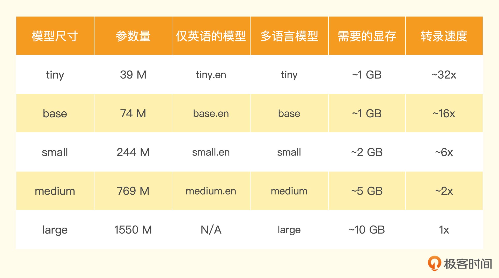

# 19 | Whisper+ChatGPT：请AI代你听播客

你好，我是徐文浩。

今天，我们的课程开始进入一个新的主题了，那就是语音识别。过去几周我们介绍的ChatGPT 虽然很强大，但是只能接受文本的输入。而在现实生活中，很多时候我们并不方便停下来打字。很多内容比如像播客也没有文字版，所以这个时候，我们就需要一个能够将语音内容转换成文本的能力。

作为目前 AI 界的领导者，OpenAI 自然也不会放过这个需求。他们不仅发表了一个通用的语音识别模型 Whisper，还把对应的代码开源了。在今年的 1 月份，他们也在 API 里提供了对应的语音识别服务。那么今天，我们就一起来看看 Whisper 这个语音识别的模型可以怎么用。

## Whisper API 101

我自己经常会在差旅的过程中听播客。不过，筛选听什么播客的时候，有一个问题，就是光看标题和简介其实不是特别好判断里面的内容我是不是真的感兴趣。所以，在看到 Whisper 和ChatGPT 这两个产品之后，我自然就想到了可以通过组合这两个 API，让 AI 来代我听播客。我想通过 Whisper 把想要听的播客转录成文字稿，再通过 ChatGPT 做个小结，看看 AI 总结的小结内容是不是我想要听的。

我前一阵刚听过一个关于 ChatGPT 的播客，我们不妨就从这个开始。我们可以通过listennotes 这个网站来搜索播客，还能够下载到播客的源文件。而且，这个网站还有一个很有用的功能，就是可以直接切出播客中的一段内容，创建出一个切片（clip）。

我们先拿一个小的切片来试试 Whisper 的 API，对应的切片的链接我也放在这里了。课程Github 的 data 目录里也有已经下载好的 MP3 文件。

OpenAI 提供的 Whisper 的 API 非常简单，你只要调用一下 transcribe 函数，就能将音频文件转录成文字。

```python
import openai, os
openai.api_key = os.getenv("OPENAI_API_KEY")
audio_file= open("./data/podcast_clip.mp3", "rb")
transcript = openai.Audio.transcribe("whisper-1", audio_file)
print(transcript['text'])
```

输出结果：

```
欢迎来到 Onboard 真实的一线经验 走新的投资思考 我是 Monica 我是高宁 我们一起聊聊软件如何改变世
```

从转录的结果来看，有一个好消息和一个坏消息。好消息是，语音识别的转录效果非常好。我们看到尽管播客里面混杂着中英文，但是 Whisper 还是很好地识别出来了。坏消息是，转录出来的内容只有空格的分隔符，没有标点符号。

不过，这个问题也并不难解决。我们只要在前面的代码里面，增加一个 Prompt 参数就好了。

```
audio_file= open("./data/podcast_clip.mp3", "rb")
transcript = openai.Audio.transcribe("whisper-1", audio_file,
                                    prompt="这是一段中文播客内容。")
print(transcript['text'])
```

输出结果：

```
欢迎来到 Onboard,真实的一线经验,走新的投资思考。 我是 Monica。 我是高宁。我们一起聊聊软件如何
```

我们在 transcribe 函数被调用的时候，传入了一个 Prompt 参数。里面是一句引导 Whisper 模型的提示语。在这里，我们的 Prompt 里用了一句中文介绍，并且带上了标点符号。你就会发现，transcribe 函数转录出来的内容也就带上了正确的标点符号。

不过，转录出来的内容还有一点小小的瑕疵。那就是中英文混排的内容里面，英文前后会多出一些空格。那我们就再修改一下 Prompt，在提示语里面也使用中英文混排并且不留空格。

```
audio_file= open("./data/podcast_clip.mp3", "rb")
transcript = openai.Audio.transcribe("whisper-1", audio_file,
                                    prompt="这是一段Onboard播客的内容。")
print(transcript['text'])
```

输出结果：

```
欢迎来到Onboard,真实的一线经验,走新的投资思考。 我是Monica,我是高宁,我们一起聊聊软件如何改变世
```

可以看到，输出结果的英文前后也就没有空格了。能够在音频内容的转录之前提供一段Prompt，来引导模型更好地做语音识别，是 Whisper 模型的一大亮点。如果你觉得音频里面会有很多专有名词，模型容易识别错，你就可以在 Prompt 里加上对应的专有名词。比如，在上面的内容转录里面，模型就把 ChatGPT 也听错了，变成了 ChatGBT。Google 的 PALM 模型也给听错了，听成了 POM。对应的全称 Pathways Language Model 也少了一个 s。而针对这些错漏，我们只要再修改一下 Prompt，它就能够转录正确了。

```
audio_file= open("./data/podcast_clip.mp3", "rb")
transcript = openai.Audio.transcribe("whisper-1", audio_file,
                                    prompt="这是一段Onboard播客，里面会聊到ChatGPT以及
print(transcript['text'])
```

输出结果：

```
欢迎来到Onboard,真实的一线经验,走新的投资思考。我是Monica。 我是高宁。我们一起聊聊软件如何改变
```

出现这个现象的原因，主要和 Whisper 的模型原理相关，它也是一个和 GPT 类似的模型，会用前面转录出来的文本去预测下一帧音频的内容。通过在最前面加上文本 Prompt，就会影响后面识别出来的内容的概率，也就是能够起到给专有名词“纠错”的作用。

除了模型名称、音频文件和 Prompt 之外，transcribe 接口还支持这样三个参数。

1. response_format，也就是返回的文件格式，我们这里是默认值，也就是 JSON。实际你还可以选择 TEXT 这样的纯文本，或者 SRT 和 VTT 这样的音频字幕格式。这两个格式里

- 面，除了文本内容，还会有对应的时间信息，方便你给视频和音频做字幕。你可以直接试着运行一下看看效果。

2. temperature，这个和我们之前在 ChatGPT 类型模型里的参数含义类似，就是采样下一帧的时候，如何调整概率分布。这里的参数范围是 0-1 之间。

3. language，就是音频的语言。提前给模型指定音频的语言，有助于提升模型识别的准确率和速度。

这些参数你都可以自己试着改一下，看看效果。

```
audio_file= open("./data/podcast_clip.mp3", "rb")
transcript = openai.Audio.transcribe("whisper-1", audio_file, response_format="sr
                                    prompt="这是一段Onboard播客，里面会聊到PALM这个大
print(transcript)
```

输出结果：

```
1
00:00:01,000 --> 00:00:07,000
欢迎来到Onboard,真实的一线经验,走新的投资思考。我是Monica。
2
00:00:07,000 --> 00:00:11,000
```

- 我是高宁。我们一起聊聊软件如何改变世界。

```
3
00:00:15,000 --> 00:00:17,000
大家好,欢迎来到Onboard,我是Monica。
4
00:00:17,000 --> 00:00:28,000
自从OpenAI发布的ChatGBT掀起了席卷世界的AI热潮,不到三个月就积累了超过一亿的越活用户,超过1300万
5
00:00:28,000 --> 00:00:34,000
真的是展现了AI让人惊叹的能力,也让很多人直呼这就是下一个互联网的未来。
6
00:00:34,000 --> 00:00:41,000
有不少观众都说希望我们再做一期AI的讨论,于是这次硬核讨论就来了。
7
...
欢迎来到未来,大家enjoy!
```

## 转录的时候顺便翻译一下

除了基本的音频转录功能，Whisper 的 API 还额外提供了一个叫做 translation 的接口。这个接口可以在转录音频的时候直接把语音翻译成英文，我们不妨来试一下。

```
audio_file= open("./data/podcast_clip.mp3", "rb")
translated_prompt="""This is a podcast discussing ChatGPT and PaLM model.
The full name of PaLM is Pathways Language Model."""
transcript = openai.Audio.translate("whisper-1", audio_file,
                                   prompt=translated_prompt)
print(transcript['text'])
```

输出结果：

```
Welcome to Onboard. Real first-line experience. New investment thinking. I am Mon
```

这个接口只能把内容翻译成英文，不能变成其他语言。所以对应的，Prompt 也必须换成英文。只能翻译成英文对我们来说稍微有些可惜了。如果能够指定翻译的语言，很多英文播客，我们就可以直接转录成中文来读了。现在我们要做到这一点，就不得不再花一份钱，让ChatGPT 来帮我们翻译。

## 通过分割音频来处理大文件

刚才我们只是尝试转录了一个 3 分钟的音频片段，那接下来我们就来转录一下整个音频。不过，我们没法把整个 150 分钟的播客一次性转录出来，因为 OpenAI 限制 Whisper 一次只能转录 25MB 大小的文件。所以我们要先把大的播客文件分割成一个个小的片段，转录完之后再把它们拼起来。我们可以选用 OpenAI 在官方文档里面提供的 PyDub 的库来分割文件。

不过，在分割之前，我们先要通过 FFmpeg 把从 listennotes 下载的 MP4 文件转换成 MP3 格式。你不了解 FFmpeg 或者没有安装也没有关系，对应的命令我是让 ChatGPT 写的。转换后的文件我也放到了课程 Github 库里的网盘地址了。

```
ffmpeg -i ./data/podcast_long.mp4 -vn -c:a libmp3lame -q:a 4 ./data/podcast_long.
```

分割 MP3 文件的代码也很简单，我们按照 15 分钟一个片段的方式，把音频切分一下就好了。通过 PyDub 的 AudioSegment 包，我们可以把整个长的 MP3 文件加载到内存里面来变成一个数组。里面每 1 毫秒的音频数据就是数组里的一个元素，我们可以很容易地将数组按照时间切分成每 15 分钟一个片段的新的 MP3 文件。

先确保我们安装了 PyDub 包。

```
%pip install -U pydub
```

代码：

```python
from pydub import AudioSegment
podcast = AudioSegment.from_mp3("./data/podcast_long.mp3")
# PyDub handles time in milliseconds
ten_minutes = 15 * 60 * 1000
total_length = len(podcast)
start = 0
index = 0
while start < total_length:
   end = start + ten_minutes
   if end < total_length:
       chunk = podcast[start:end]
   else:
       chunk = podcast[start:]
   with open(f"./data/podcast_clip_{index}.mp3", "wb") as f:
       chunk.export(f, format="mp3")
   start = end
   index += 1
```

在切分完成之后，我们就一个个地来转录对应的音频文件，对应的代码就在下面。

```
prompt = "这是一段Onboard播客，里面会聊到ChatGPT以及PALM这个大语言模型。这个模型也叫做Pathw
for i in range(index):
   clip = f"./data/podcast_clip_{i}.mp3"
   audio_file= open(clip, "rb")
   transcript = openai.Audio.transcribe("whisper-1", audio_file,
                                    prompt=prompt)
   # mkdir ./data/transcripts if not exists
   if not os.path.exists("./data/transcripts"):
       os.makedirs("./data/transcripts")
   # write to file
   with open(f"./data/transcripts/podcast_clip_{i}.txt", "w") as f:
       f.write(transcript['text'])
   # get last sentence of the transcript
   sentences = transcript['text'].split("。")
   prompt = sentences[-1]
```

在这里，我们对每次进行转录的 Prompt 做了一个小小的特殊处理。我们把前一个片段转录结果的最后一句话，变成了下一个转录片段的提示语。这样，我们可以让后面的片段在进行语音识别的时候，知道前面最后说了什么。这样做，可以减少错别字的出现。

## 通过开源模型直接在本地转录

通过 OpenAI 的 Whisper API 来转录音频是有成本的，目前的定价是 0.006 美元 / 分钟。比如我们上面的 150 分钟的音频文件，只需要不到 1 美元，其实已经很便宜了。不过，如果你不想把对应的数据发送给 OpenAI，避免任何数据泄露的风险，你还有另外一个选择，那就是直接使用 OpenAI 开源出来的模型就好了。

不过使用开源模型你还是需要一块 GPU，如果没有的话，你仍然可以使用免费的 Colab 的Notebook 环境。

先安装 openai-whisper 的相关的依赖包。

```
%pip install openai-whisper
%pip install setuptools-rust
```

代码本身很简单，我们只是把原先调用 OpenAI 的 API 的地方，换成了加载 Whisper 的模型，然后在 transcribe 的参数上，有一些小小的差异。其他部分的代码和前面我们调用OpenAI 的 Whisper API 的代码基本上是一致的。

```python
import whisper
model = whisper.load_model("large")
index = 11 # number of fi
def transcript(clip, prompt, output):
   result = model.transcribe(clip, initial_prompt=prompt)
   with open(output, "w") as f:
       f.write(result['text'])
   print("Transcripted: ", clip)
original_prompt = "这是一段Onboard播客，里面会聊到ChatGPT以及PALM这个大语言模型。这个模型也
prompt = original_prompt
for i in range(index):
   clip = f"./drive/MyDrive/colab_data/podcast/podcast_clip_{i}.mp3"
   output = f"./drive/MyDrive/colab_data/podcast/transcripts/local_podcast_clip_
   transcript(clip, prompt, output)
   # get last sentence of the transcript
   with open(output, "r") as f:
       transcript = f.read()
   sentences = transcript.split("。")
   prompt = original_prompt + sentences[-1]
```

有一个点你可以注意一下，Whisper 的模型和我们之前看过的其他开源模型一样，有好几种不同尺寸。你可以通过 load_model 里面的参数来决定加载什么模型。这里我们选用的是最大的large 模型，它大约需要 10GB 的显存。因为 Colab 提供的 GPU 是英伟达的 T4，有 16G 显存，所以是完全够用的。

如果你是使用自己电脑上的显卡，显存没有那么大，你可以选用小一些的模型，比如 small 或者 base。如果你要转录的内容都是英语的，还可以直接使用 small.en 这样仅限于英语的模型。这种小的或者限制语言的模型，速度还更快。不过，如果是像我们这样转录中文为主，混杂了英文的内容，那么尽可能选取大一些的模型，转录的准确率才会比较高。



- Whisper项目的模型参数和尺寸说明

Whisper 项目：https://github.com/openai/whisper

## 结合 ChatGPT 做内容小结

无论是使用 API 还是通过本地的 GPU 进行文本转录，我们都会获得转录之后的文本。要给这些文本做个小结，其实我们在第 10 讲讲解 llama-index 的时候就给过示例了。我们把那个代码稍微改写一下，就能得到对应播客的小结。

```python
from langchain.chat_models import ChatOpenAI
from langchain.text_splitter import SpacyTextSplitter
from llama_index import GPTListIndex, LLMPredictor, ServiceContext, SimpleDirecto
from llama_index.node_parser import SimpleNodeParser
# define LLM
llm_predictor = LLMPredictor(llm=ChatOpenAI(temperature=0, model_name="gpt-3.5-tu
text_splitter = SpacyTextSplitter(pipeline="zh_core_web_sm", chunk_size = 2048)
parser = SimpleNodeParser(text_splitter=text_splitter)
documents = SimpleDirectoryReader('./data/transcripts').load_data()
nodes = parser.get_nodes_from_documents(documents)
service_context = ServiceContext.from_defaults(llm_predictor=llm_predictor)
list_index = GPTListIndex(nodes=nodes, service_context=service_context)
response = list_index.query("请你用中文总结一下我们的播客内容:", response_mode="tree_s
print(response)
```

输出结果：

- 这个播客讨论了人工智能和深度学习领域的高级技术和最新发展，包括稳定性人工智能、语言模型的预训练方法

基于这里的代码，你完全可以开发一个自动抓取并小结你订阅的播客内容的小应用。一般的播客也就是 40-50 分钟一期，转录并小结一期的成本也就在 5 块人民币上下。

## 小结

好了，这一讲到这里也就结束了。

OpenAI 的 Whisper 模型，使用起来非常简单方便。无论是通过 API 还是使用开源的模型，只要一行代码调用一个 transcribe 函数，就能把一个音频文件转录成对应的文本。而且即使对于多语言混杂的内容，它也能转录得很好。而通过传入一个 Prompt，它不仅能够在整个文本里，加上合适的标点符号，还能够根据 Prompt 里面的专有名词，减少转录中这些内容的错漏。虽然 OpenAI 的 API 接口限制了单个转录文件的大小，但是我们可以很方便地通过PyDub 这样的 Python 包，把音频文件切分成多个小的片段来解决问题。

对于转录后的结果，我们可以很容易地使用之前学习过的 ChatGPT 和 llama-index 来进行相应的文本小结。通过组合 Whisper 和 ChatGPT，我们就可以快速地让机器自动帮助我们将播客、Youtube 访谈，变成一段文本小结，能够让我们快速浏览并判定是否有必要深入去听一下原始的内容。

## 思考题

我们在将长音频分片进行转录的过程里，是完全按照精确的时间去切割音频文件的。但是实际上音频的断句其实并不在那一毫秒。所以转录的时候，效果也不一定好，特别是在录音的开头和结尾部分，很有可能不是一个完整的句子，也容易出现一些错漏的情况。你能想想有什么好办法可以解决这个问题吗？我们是否可以利用 SRT 或 VTT 文件里面文本对应的时间标注信息？

欢迎你把你思考的结果分享到留言区，也欢迎你把这一讲分享给需要的朋友，我们下一讲再见！

## 推荐阅读

李沐老师在他的论文精读系列视频里面，有专门讲解过 OpenAI Whisper 的相关论文。他还专门基于 Whisper 的开源代码做了一个用来剪辑视频的小工具 AutoCut。你有兴趣的话，可以去看一看。
