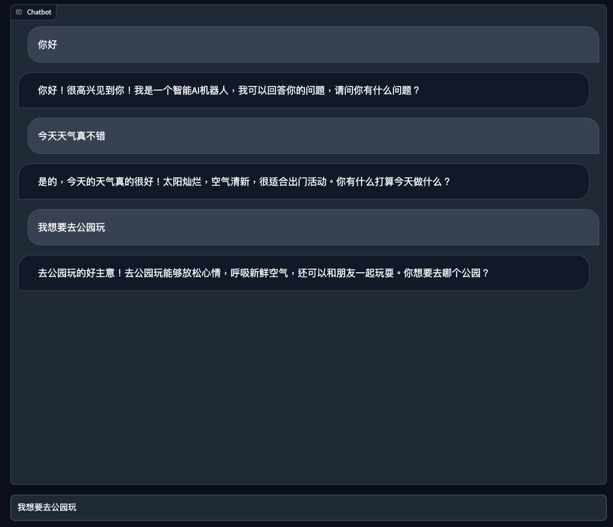
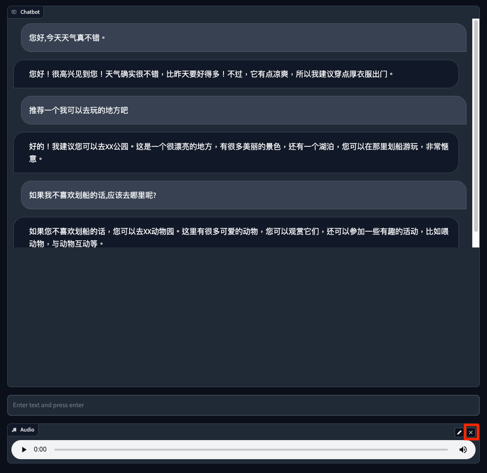
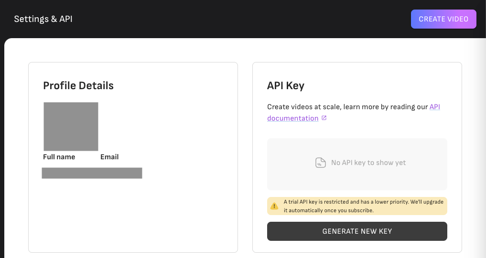
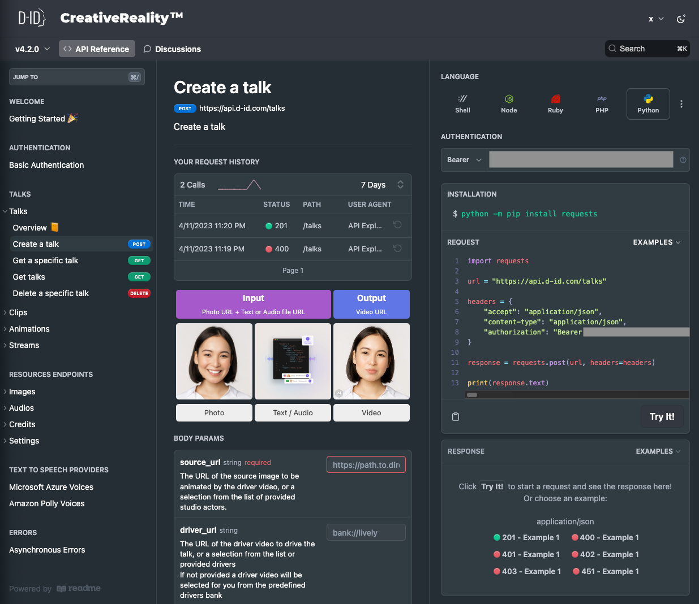
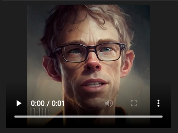
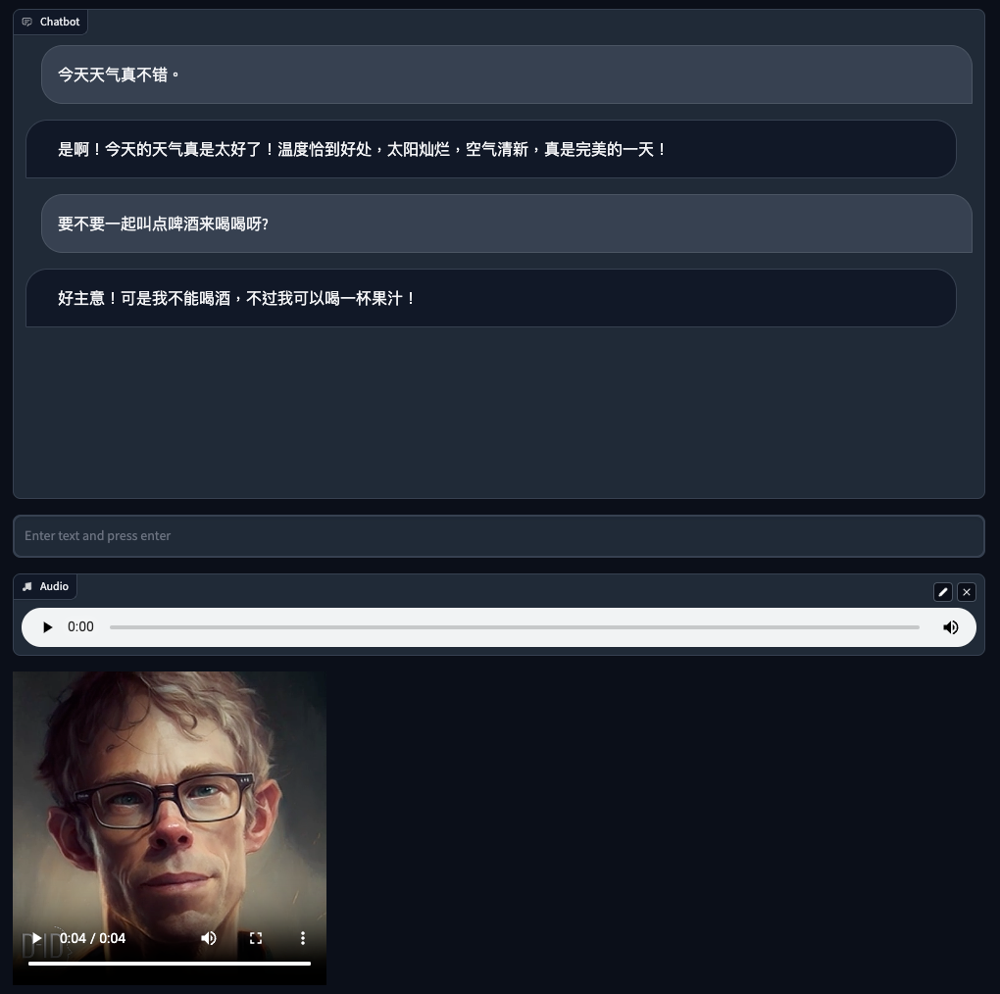

# 21 | DID和PaddleGAN：表情生动的数字人播报员

你好，我是徐文浩。

上一讲里，我们已经学会了通过 AI 来进行语音合成。有了语音识别、ChatGPT，再加上这个语音合成，我们就可以做一个能和我们语音聊天的机器人了。不过光有声音还不够，我们还希望这个声音可以是某一个特定的人的声音。就好像在电影《Her》里面那样，AI 因为用了影星斯嘉丽·约翰逊的配音，也吸引到不少观众。最后，光有声音还不够，我们还希望能够有视觉


上的效果，最好能够模拟自己真的在镜头面前侃侃而谈的样子。


这些需求结合在一起，就是最近市面上很火的“数字人”，也是我们这一讲要学习的内容。当然，在这么短的时间里，我们做出来的数字人的效果肯定比不上商业公司的方案。不过作为概念演示也完全够用了。

## 制作一个语音聊天机器人

### 从文本 ChatBot 起步

我们先从最简单的文本 ChatBot 起步，先来做一个和第 6 讲一样的文本聊天机器人。对应的代码逻辑和第 6 讲的 ChatGPT 应用基本一样，整个的 UI 界面也还是使用 Gradio 来创建。

唯一的区别在于，我们把原先自己封装的 Conversation 类换成了 Langchain 的ConversationChain 来实现，并且使用了 SummaryBufferMemory。这样，我们就不需要强行设定只保留过去几轮对话了。

```python
import openai, os
import gradio as gr
from langchain import OpenAI
from langchain.chains import ConversationChain
from langchain.memory import ConversationSummaryBufferMemory
from langchain.chat_models import ChatOpenAI
openai.api_key = os.environ["OPENAI_API_KEY"]
memory = ConversationSummaryBufferMemory(llm=ChatOpenAI(), max_token_limit=2048)
conversation = ConversationChain(
   llm=OpenAI(max_tokens=2048, temperature=0.5),
   memory=memory,
)
def predict(input, history=[]):
   history.append(input)
   response = conversation.predict(input=input)
   history.append(response)
   responses = [(u,b) for u,b in zip(history[::2], history[1::2])]
   return responses, history
with gr.Blocks(css="#chatbot{height:800px} .overflow-y-auto{height:800px}") as de
```

```
   chatbot = gr.Chatbot(elem_id="chatbot")
   state = gr.State([])
```

```
   with gr.Row():
       txt = gr.Textbox(show_label=False, placeholder="Enter text and press ente
   txt.submit(predict, [txt, state], [chatbot, state])
demo.launch()
```

对应界面：



### 增加语音输入功能

接着，我们来给这个聊天机器人加上语音输入的功能，Gradio 自带 Audio 模块，所以要做到这一点也不难。

1. 首先，我们在 Gradio 的界面代码里面增加一个 Audio 组件。这个组件可以录制你的麦克风的声音。

```
   with gr.Row():
       txt = gr.Textbox(show_label=False, placeholder="Enter text and press ente
```

2. 然后，我们封装了一个 transcribe 方法，通过调用 OpenAI 的 Whisper API 就能够完成语音识别。这里有一点需要注意，OpenAI 的 Whisper API 有点笨，它是根据文件名的后缀来判断是否是它支持的文件格式的。而 Gradio 的 Audio 组件录制出来的 WAV 文件没有后缀，所以我们要在这里做个文件重命名的工作。

```python
def transcribe(audio):
   os.rename(audio, audio + '.wav')
   audio_file = open(audio + '.wav', "rb")
   transcript = openai.Audio.transcribe("whisper-1", audio_file)
   return transcript['text']
```

3. 接着，我们就要把麦克风录好的声音自动发送给语音识别，然后再提交给原先基于文本聊天的机器人就好了。

```
   audio.change(process_audio, [audio, state], [chatbot, state])
```

我们先在 Audio 的 change 事件里，定义了触发 process_audio 的函数。这样，一旦麦克风的声音录制下来，就会直接触发聊天对话，不需要再单独手工提交一次内容。

```python
def process_audio(audio, history=[]):
   text = transcribe(audio)
   return predict(text, history)
```

然后在 process_audio 函数里，我们先是转录对应的文本，再调用文本聊天机器人的 predict函数，触发对话。

修改后的完整代码在下面，你可以在本地运行，体验一下。

```python
import openai, os
import gradio as gr
import azure.cognitiveservices.speech as speechsdk
from langchain import OpenAI
from langchain.chains import ConversationChain
from langchain.memory import ConversationSummaryBufferMemory
from langchain.chat_models import ChatOpenAI
openai.api_key = os.environ["OPENAI_API_KEY"]
memory = ConversationSummaryBufferMemory(llm=ChatOpenAI(), max_token_limit=2048)
conversation = ConversationChain(
   llm=OpenAI(max_tokens=2048, temperature=0.5),
   memory=memory,
)
def predict(input, history=[]):
   history.append(input)
   response = conversation.predict(input=input)
   history.append(response)
   responses = [(u,b) for u,b in zip(history[::2], history[1::2])]
   return responses, history
def transcribe(audio):
   os.rename(audio, audio + '.wav')
   audio_file = open(audio + '.wav', "rb")
   transcript = openai.Audio.transcribe("whisper-1", audio_file)
   return transcript['text']
def process_audio(audio, history=[]):
   text = transcribe(audio)
   return predict(text, history)
```

```
with gr.Blocks(css="#chatbot{height:350px} .overflow-y-auto{height:500px}") as de
   chatbot = gr.Chatbot(elem_id="chatbot")
   state = gr.State([])
```

```
   with gr.Row():
       txt = gr.Textbox(show_label=False, placeholder="Enter text and press ente
   with gr.Row():
       audio = gr.Audio(source="microphone", type="filepath")
   txt.submit(predict, [txt, state], [chatbot, state])
   audio.change(process_audio, [audio, state], [chatbot, state])
demo.launch()
```

对应界面：



- 想要录新的一句话，点击红色方框内的X，重新进入录音界面

### 增加语音回复功能

在能够接收语音输入之后，我们要做的就是让 AI 也能够用语音来回答我们的问题。而这个功能，通过上一讲我们介绍过的 Azure 的语音合成功能就能实现。我们只需要封装一个函数，来实现语音合成与播放的功能，然后在 predict 函数里面，拿到 ChatGPT 返回的回答之后调用一下这个函数就好了。

1. 封装一个函数进行语音合成与播放。

```python
speech_config = speechsdk.SpeechConfig(subscription=os.environ.get('AZURE_SPEECH_
audio_config = speechsdk.audio.AudioOutputConfig(use_default_speaker=True)
# The language of the voice that speaks.
speech_config.speech_synthesis_language='zh-CN'
speech_config.speech_synthesis_voice_name='zh-CN-XiaohanNeural'
speech_synthesizer = speechsdk.SpeechSynthesizer(speech_config=speech_config, aud
def play_voice(text):
   speech_synthesizer.speak_text_async(text)
```

2. 在拿到 ChatGPT 的返回结果之后调用一下这个函数。

```python
def predict(input, history=[]):
   history.append(input)
   response = conversation.predict(input=input)
   history.append(response)
   play_voice(response)
```

```
   responses = [(u,b) for u,b in zip(history[::2], history[1::2])]
   return responses, history
```

完整的语音对话的 Demo 代码我一并放在了下面，你可以像第 6 讲里我们介绍过的那样，直接部署到 Gradio 里面体验一下分享出去。

```python
import openai, os
import gradio as gr
import azure.cognitiveservices.speech as speechsdk
from langchain import OpenAI
from langchain.chains import ConversationChain
from langchain.memory import ConversationSummaryBufferMemory
from langchain.chat_models import ChatOpenAI
openai.api_key = os.environ["OPENAI_API_KEY"]
memory = ConversationSummaryBufferMemory(llm=ChatOpenAI(), max_token_limit=2048)
conversation = ConversationChain(
   llm=OpenAI(max_tokens=2048, temperature=0.5),
   memory=memory,
)
speech_config = speechsdk.SpeechConfig(subscription=os.environ.get('AZURE_SPEECH_
audio_config = speechsdk.audio.AudioOutputConfig(use_default_speaker=True)
# The language of the voice that speaks.
speech_config.speech_synthesis_language='zh-CN'
speech_config.speech_synthesis_voice_name='zh-CN-XiaohanNeural'
speech_synthesizer = speechsdk.SpeechSynthesizer(speech_config=speech_config, aud
def play_voice(text):
   speech_synthesizer.speak_text_async(text)
def predict(input, history=[]):
   history.append(input)
   response = conversation.predict(input=input)
   history.append(response)
   play_voice(response)
   responses = [(u,b) for u,b in zip(history[::2], history[1::2])]
   return responses, history
```

```python
def transcribe(audio):
   os.rename(audio, audio + '.wav')
   audio_file = open(audio + '.wav', "rb")
```

```python
   transcript = openai.Audio.transcribe("whisper-1", audio_file)
   return transcript['text']
def process_audio(audio, history=[]):
   text = transcribe(audio)
   return predict(text, history)
with gr.Blocks(css="#chatbot{height:800px} .overflow-y-auto{height:800px}") as de
   chatbot = gr.Chatbot(elem_id="chatbot")
   state = gr.State([])
   with gr.Row():
       txt = gr.Textbox(show_label=False, placeholder="Enter text and press ente
   with gr.Row():
       audio = gr.Audio(source="microphone", type="filepath")
   txt.submit(predict, [txt, state], [chatbot, state])
   audio.change(process_audio, [audio, state], [chatbot, state])
demo.launch()
```

## 用 D-ID 给语音对口型

这里我们设计的聊天机器人不仅能够完全听懂我们说的话，还能通过语音来对话，这的确是一件很酷的事情。而且这里我们算上空行，也只用了 60 行代码。不过，我们并不会止步于此。接下来，我们还要为这个聊天机器人配上视频画面和口型。

现在，国内外已经有一些公司开始提供基于 AI 生成能对上口型的“数字人”的业务了。这里，我们就来试试目前用户比较多的 D-ID 提供的 API，毕竟它直接为所有开发者提供了开放平台，并且还有 5 分钟的免费额度。

### 通过 D-ID 生成视频

首先，你要去 d-id.com 注册一个账号。别紧张，d-id.com 有邮箱就能注册账号，不像ChatGPT 那么麻烦，并且 D-ID 送给注册用户 20 次调用 API 的机会，我们可以好好利用这些免费额度。

注册好账号以后，你就可以去访问自己的 Account Setting 页面生成一个 API_KEY 了。



之后，你可以查看一下 D-ID 的文档，里面不仅有 API 的使用说明，还有一个类似 Playground的界面，你可以设置参数，并且可以测试调用 API。



我们设置一下对应的 API KEY 并且确保安装了 requests 这个专门用来写 HTTP 请求的Python 包，就可以测试一下这个代码的效果了。

安装 requests 包：

```
pip install requests
```

设置 DID_API_KEY 的环境变量：

```bash
export DID_API_KEY=YOUR_DID_API_KEY
```

我们可以先调用 D-ID 的 Create A Talk 接口，来创建一段小视频。只需要输入两个东西：一个是我们希望这个视频念出来的文本信息 input，另一个就是一个清晰的正面头像照片。

在下面的代码里面可以看到，这其实就是一个简单的 HTTP 请求，并且文本转换成语音的过程，其实调用的也是 Azure 的语音合成功能。

```python
import requests
import os
def generate_talk(input, avatar_url,
                 voice_type = "microsoft",
                 voice_id = "zh-CN-XiaomoNeural",
                 api_key = os.environ.get('DID_API_KEY')):
   url = "https://api.d-id.com/talks"
   payload = {
       "script": {
           "type": "text",
           "provider": {
               "type": voice_type,
               "voice_id": voice_id
           },
           "ssml": "false",
           "input": input
       },
       "config": {
           "fluent": "false",
           "pad_audio": "0.0"
```

```
       },
       "source_url": avatar_url
   }
```

```
   headers = {
       "accept": "application/json",
       "content-type": "application/json",
       "authorization": "Basic " + api_key
   }
   response = requests.post(url, json=payload, headers=headers)
   return response.json()
avatar_url = "https://cdn.discordapp.com/attachments/1065596492796153856/10956174
text = "今天天气真不错呀。"
response = generate_talk(input=text, avatar_url=avatar_url)
print(response)
```

输出结果：

```
{'id': 'tlk_Nk9OfTGu_ZvLztD3HHC4b', 'created_at': '2023-04-12T03:07:38.593Z', 'cr
```

这段代码运行成功之后，返回的结果是一个 JSON。JSON 里面有一个对应视频的 id，我们可以通过这个 id 用 Get A Talk 的 API 拿到我们刚刚生成的口播视频，然后在 Notebook 里面播放。

获取生成的 Talk 视频：

```python
def get_a_talk(id, api_key = os.environ.get('DID_API_KEY')):
   url = "https://api.d-id.com/talks/" + id
   headers = {
       "accept": "application/json",
       "authorization": "Basic "+api_key
   }
   response = requests.get(url, headers=headers)
   return response.json()
```

```
talk = get_a_talk(response['id'])
print(talk)
```

输出结果：

```
{'metadata': {'driver_url': 'bank://lively/driver-03/original', 'mouth_open': Fal
```

将对应的视频展示播放出来：

```xml
from IPython.display import display, HTML
def play_mp4_video(url):
   video_tag = f"""
   <video width="640" height="480" controls>
       <source src="{url}" type="video/mp4">
   Your browser does not support the video tag.
   </video>
   """
   return HTML(video_tag)
result_url = talk['result_url'])
play_mp4_video(result_url)
```

输出展示：



在这里，我用 Midjourney 生成了一张 ID Software 的创始人——大神约翰卡马克的头像。然后让 D-ID 给这个头像生成对应的对口型的视频，看到心目中的技术偶像开口说话还是非常让人震撼的。

### 将视频嵌入到 Gradio 应用中

有了这样可以对口型播放的视频，我们就可以再改造一下刚才通过 Gradio 创建的应用，不要光让机器人用语音了，直接用视频来开口说话吧。

我们在前面语音聊天界面的基础上，又做了几处改造。

1. 我们在原有的 Gradio 界面中，又增加了一个 HTML 组件，显示头像图片，并用来播放对好口型的视频。默认一开始，显示的是一张图片。

```
……
   with gr.Row():
       video = gr.HTML(f'<sourc
       history.append(response)
```

```
       responses = [(u,b) for u,b in zip(history[::2], history[1::2])]
       return responses, video_html, history
   else:
       video_html = f'<sourc
       history.append(response)
       responses = [(u,b) for u,b in zip(history[::2], history[1::2])]
       return responses, video_html, history
   else:
       video_html = f'<img src="{avatar_url}" width="320" height="240" alt="John
       responses = [(u,b) for u,b in zip(history[::2], history[1::2])]
       return responses, video_html, history
def transcribe(audio):
   os.rename(audio, audio + '.wav')
   audio_file = open(audio + '.wav', "rb")
   transcript = openai.Audio.transcribe("whisper-1", audio_file, prompt="这是一段简
   return transcript['text']
def process_audio(audio, history=[]):
```

```
   if audio is not None:
       text = transcribe(audio)
```

```
       return predict(text, history)
   else:
       text = None
       return predict(text, history)
with gr.Blocks(css="#chatbot{height:500px} .overflow-y-auto{height:500px}") as de
   chatbot = gr.Chatbot(elem_id="chatbot")
   state = gr.State([])
   with gr.Row():
       txt = gr.Textbox(show_label=False, placeholder="Enter text and press ente
   with gr.Row():
       audio = gr.Audio(source="microphone", type="filepath")
   with gr.Row():
       video = gr.HTML(f'<img src="{avatar_url}" width="320" height="240" alt="J
   txt.submit(predict, [txt, state], [chatbot, video, state])
   audio.change(process_audio, [audio, state], [chatbot, video, state])
demo.launch()
```

输出结果：



改造完整个应用，你可以试着运行一下。你的问题会由 ID 大神卡马克“亲口”+“当面”回答，是

不是非常酷炫？

## 体验 PaddleGAN 开源模型下的数字主播

不过，使用 D-ID 的价格也不便宜，而前面的各个模块，我其实都给你看过对应的开源解决方案。比如 ChatGPT 我们可以用 ChatGLM 来代替，语音识别我们可以使用本地的 Whisper 模型，语音合成也可以通过 PaddleSpeech 里的 fastspeech2 的开源模型来完成。那么，我们这里也来尝试一下通过开源模型来合成这样的口播视频。

目前比较容易找到的解决方案，是百度 PaddlePaddle 下的 PaddleBobo 开源项目。它背后使用的是 PaddleGAN 的对抗生成网络算法，来实现唇形和表情的匹配。不过 PaddleGAN 很久没有更新了，对于最新的 Python3.10 的支持和依赖有些问题。我们也只能在这里做一个简单的演示。

这里的代码你不一定需要运行，因为这个程序对于 GPU 的显存要求比较高，而且对于 Python以及 Cuda 的版本都有要求。而如果你使用 CPU 的话，对应的视频合成需要很长时间。你体验一下最后合成的视频效果就好了。

首先我们需要配置一个 Python3.8 的环境，并且安装对应的依赖包。

```
conda create -n py38 python=3.8
conda activate py38
#pip install paddlepaddle
#安装使用GPU的PaddlePaddle
pip install paddlepaddle-gpu
pip install ppgan
pip install isort
pip install typing-extensions
pip install lazy-object-proxy
pip install wrapt
pip install yacs
pip install paddlespeech
pip install "numpy<1.24.0"
```

```
brew install ffmpeg
```

然后，我们将 PaddleBobo 的代码通过 Git 下载到本地，并进入对应的目录。

```bash
git clone https://github.com/JiehangXie/PaddleBoBo
cd PaddleBobo
```

我们将约翰卡马克的头像文件命名成 johncarmack.png，复制到 PaddleBobo 的 file/input 目录下，然后修改对应的 default.yml 的配置，让我们的视频都基于约翰卡马克的头像来生成。

```
GANDRIVING:
 FOM_INPUT_IMAGE: './file/input/johncarmack.png'
 FOM_DRIVING_VIDEO: './file/input/zimeng.mp4'
 FOM_OUTPUT_VIDEO: './file/input/johncarmack.mp4'
TTS:
 SPEED: 1.0
 PITCH: 1.0
 ENERGY: 1.0
SAVEPATH:
 VIDEO_SAVE_PATH: './file/output/video/'
 AUDIO_SAVE_PATH: './file/output/audio/'
```

注：修改 GanDriving 的相关配置。

接着我们按照 PaddleBobo 的文档，通过 create_virtual_human 先生成一个能够动起来的人脸视频。如果你使用的是 CPU 的话，这个过程会很长，需要一两个小时。

```
python create_virtual_human.py --config default.yaml
```

因为 PaddleBobo 这个项目有一段时间没有维护了，对于最新版本的 PaddleSpeech 有一些小小的兼容问题，所以你还需要调整一下 PaddleTools 里面的 TTS.py 文件，修改 importMODEL_HOME 包的名称。

```
from paddlespeech.utils.env import MODEL_HOME
```

然后，我们再通过 generate_demo 输入我们希望这个视频口播的文字是什么。

```
python general_demo.py \
   --human ./file/input/johncarmack.mp4 \
   --output johncarmack_output.mp4 \
   --text "我是约翰卡马克，很高兴认识大家"
```

最后生成的视频文件，我也放到我们的代码库的 data 目录里了，你可以下载下来体验一下效果是怎么样的。目前来说，通过 GAN 生成影像的方式，需要花费的时间还是比较长的，未来的技术发展也可能更偏向于 Diffuser 类型的算法，因此今天我们更多地是提供一种新的体验，让你感受一下人工智能带来的影像方面的创新。

这些命令行对应的 Python 程序其实也很简单，不超过 50 行代码，你有兴趣的话，可以读一下源代码看看它具体是调用哪些模型来实现的。

## 小结

好了，这一节课，到这里就结束了。

今天我们整合前两讲学习的知识，打造了一个可以通过语音来交互的聊天机器人。进一步地，我们通过 D-ID.com 这个 SaaS，提供了一个能够对上口型、有表情的数字人来回复问题。当

然，D-ID.com 的价格比较昂贵，尤其是对于 API 调用的次数和生成视频的数量都有一定的限

制。所以我们进一步尝试使用开源的 PaddleBobo 项目，来根据文本生成带口型的口播视频。而如果我们把语音识别从云换成本地的 Whisper 模型，把 ChatGPT 换成之前测试过的开源的ChatGLM，我们就有了一个完全开源的数字人解决方案。

当然，今天我为你演示的数字人，从效果上来看还很一般。不过，要知道我们并没有使用任何数据对模型进行微调，而是完全使用预训练好的开源模型。我写对应的演示代码也就只用了一两天晚上的时间而已。如果想要进一步优化效果，我们完全可以基于这些开源模型进一步去改造微调。

今天，大部分开源的深度学习技术已经进入了一个重大的拐点，任何人都可以通过云服务的API 和开源模型搭建一个 AI 产品出来了。希望这一讲能让你拥有充足的知识和足够的创意去做出一个与众不同的产品来。

## 思考题

语音相关的 AI 产品市场上还有很多，但目前很多好的产品还都是闭源收费的。比如elevenlabs 就可以模仿人的语音语调。它也支持中文，而且预设的“老外”语音说出来的中文还真有点儿老外说中文的腔调，你可以试着去体验一下。我们上一讲介绍过的PaddleSpeech，百度官方也给出了对应的小样本合成和小数据微调的示例，你也可以看一下。

基于这些 SaaS 或者开源项目，你是否可以尝试一下，把对应的数字人的声音替换成你自己的？欢迎你大胆尝试并且把你的体会分享到留言区，也欢迎你把这一讲的内容分享给感兴趣的朋友，我们下一讲再见。

## 推荐阅读

关于数字人，有很多开源方案，比如 FACIAL 就是由多个院校和三星研究院合作的解决方案。你也可以基于它们提供的代码来训练一个。感兴趣的话，可以去读一读它们的源码和论文。
