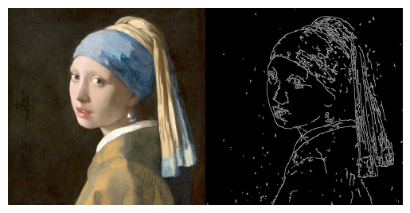
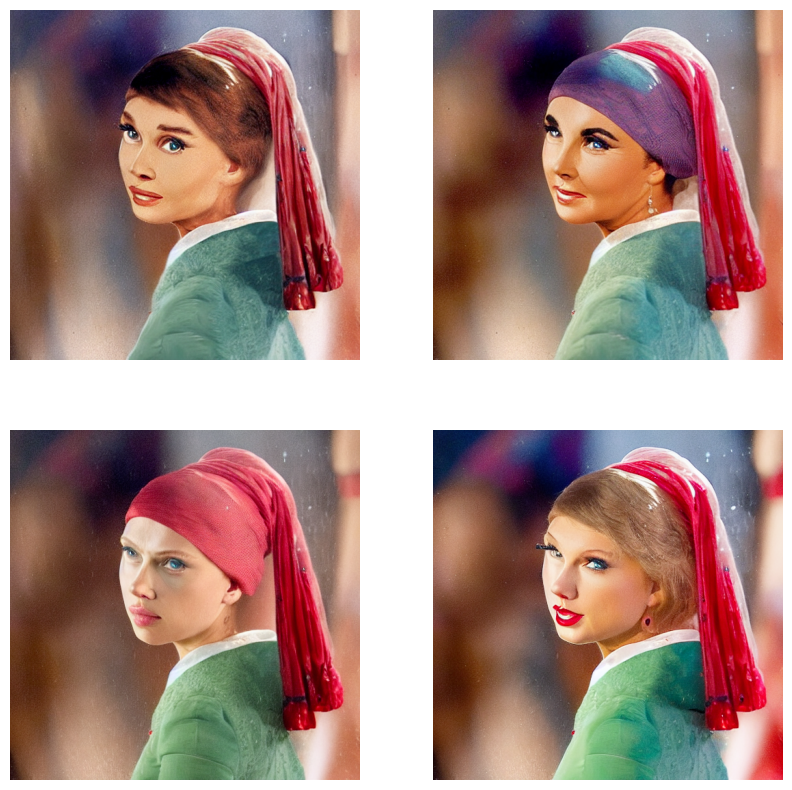
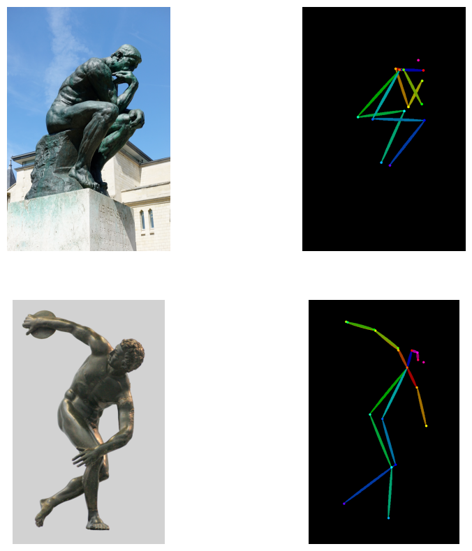
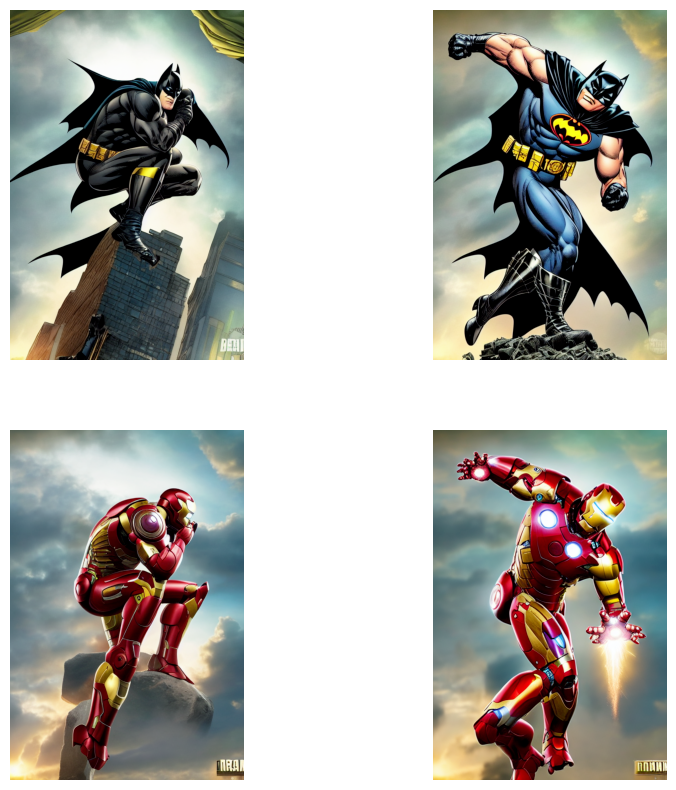
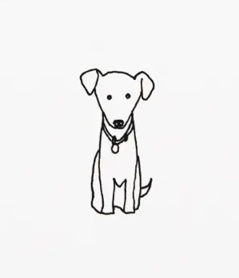
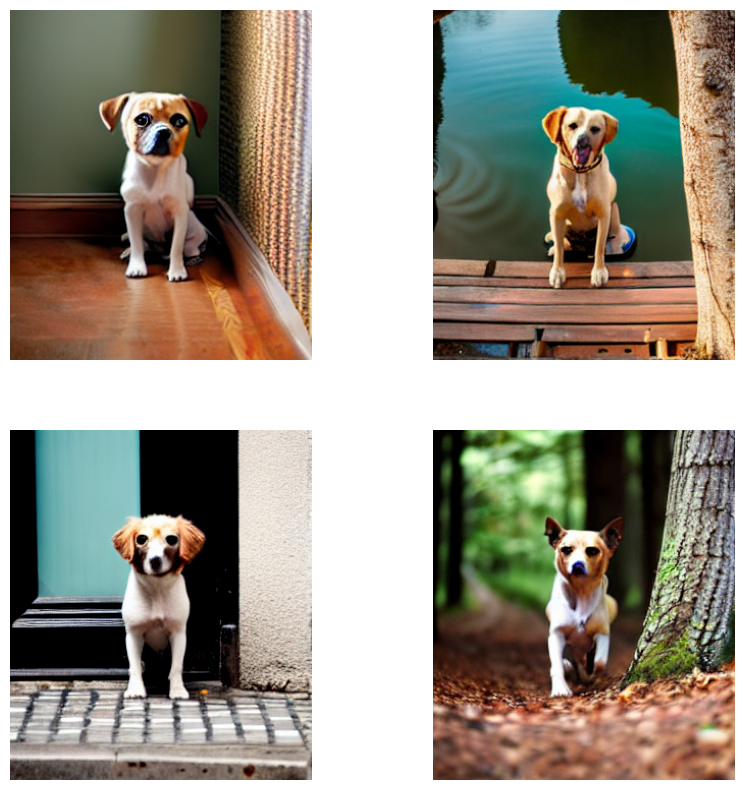

# 25 | ControlNet：让你的图拥有一个“骨架”

你好，我是徐文浩。

上一讲，我们体验了 Stable Diffusion 这个时下最流行的开源“AI 画画”项目，不知道你有没有试着用它画一些你想要的图片呢？不过，如果仅仅是使用预训练好的模型来画图的话，我们对于画出来的图还是缺少必要的控制。这会出现一个常见的问题：我们只能通过文本描述来绘制一张图片，但是具体的图片很有可能和你脑海中想象的完全不一样。

尽管我们可以通过 img2img 的方式，提供一张底图来对图片产生一定的控制，但是实际你多尝试一下就会发现这样的控制不太稳定，随机性很强。

对于这个问题，繁荣的 Stable Diffusion 社区也很快给出了回应，就是今天我们要介绍的项目ControlNet。ControlNet 是在 Stable Diffusion 的基础上进行优化的一个开源项目，它既对原本的模型架构进行了修改，又在此基础上进行了进一步地训练，提供了一系列新的模型供你使用。

## 体验使用 ControlNet 模型

那么，接下来我们就先来看看如何使用 ControlNet。我们还是需要 Colab 这样的 GPU 环境，并且安装好一系列依赖包。

```
%pip install diffusers transformers xformers accelerate
%pip install opencv-contrib-python
%pip install controlnet_aux
```

这些依赖包，大部分我们之前都见过了，这里主要新增了三个。

- xformers 是 Facebook 开源的一个 transformers 加速库，它的作用是优化实际模型计算的推理过程并且节约使用的内存，也就是我们画图会比之前快一些，对显卡的要求低一点。但是，它也有缺点，那就是输出图片的质量不太稳定，有时候图片质量会差一些。

- opencv-contrib-python 是一个 OpenCV 的工具库，我们使用 ControlNet 画图的时候，需要通过这个库拿到其他图片的边缘、姿势、语义分割信息等等。然后再把这些信息作为我们的控制条件，实际拿来画图。

- controlnet_aux 包含了 ControlNet 预先训练好的一系列模型。

### 通过边缘检测绘制头像

安装好依赖包之后，我们不妨先找来一张图片试一试，基于这个底图来画一些头像。

我们先要通过 OpenCV 对图片做一下预处理。我们先定义了一个 get_canny_image 的函数，这个函数可以根据我们设置的 low_threshold 和 high_threshold 对图片进行边缘检测。低于low_threshold 的部分会被忽略，高于 high_threshold 的部分会被认为是边缘，而在两者之间的则会根据和其他边缘的连接情况来判定。检测完之后，边缘处的像素值是 255（白色），非边缘处的则是 0（黑色）。

然后我们对原始的图片调用了 get_canny_image，再将原始图片和边缘检测之后的结果图片都通过 display_images 分列左右显示出来。

```python
import cv2
import numpy as np
import matplotlib.pyplot as plt
from diffusers.utils import load_image
from PIL import Image
image_file = "https://hf.co/datasets/huggingface/documentation-images/resolve/mai
def get_canny_image(original_image, low_threshold=100, high_threshold=200):
 image = np.array(original_image)
 image = cv2.Canny(image, low_threshold, high_threshold)
 image = image[:, :, None]
 image = np.concatenate([image, image, image], axis=2)
 canny_image = Image.fromarray(image)
 return canny_image
canny_image = get_canny_image(original_image)
def display_images(image1, image2):
 # Combine the images horizontally
 combined_image = Image.new('RGB', (image1.width + image2.width, max(image1.heig
 combined_image.paste(image1, (0, 0))
 combined_image.paste(image2, (image1.width, 0))
 # Display the combined image
 plt.imshow(combined_image)
 plt.axis('off')
 plt.show()
display_images(original_image, canny_image)
```

输出结果：



我们这里选用的图片，也是 Huggingface 官方文档里面使用的名画“戴珍珠耳环的少女”，可以看到，整个图片的边缘比较准确地被捕捉了出来。

在有了边缘检测的底图之后，我们就可以使用 ControlNet 的模型来画图了。

首先，我们还是通过 Diffusers 库的 Pipeline 功能来加载模型。这个过程里，我们要加载两个模型，一个是基础的 Stable Diffusion 1.5 的模型，另一个则是 controlnet-canny 的模型，也就是基于一系列的边缘检测图片和原始的 Stable Diffusion 训练出来的一个额外的模型。

在模型加载完成之后，我们还对 Pipeline 设置了两个配置。

1. enable_cpu_offload 会在 GPU 显存不够用的时候，把不需要使用的模型从 GPU 显存里移除，放到内存里面。因为上一讲我们讲过，Stable Diffusion 是多个模型的组合。比如我们要先通过 CLIP 模型把文本变成向量，但在文本变成向量之后，我们其实就不需要再使用CLIP 模型了。那么这个时候，这个模型就可以从显存里面移除了。因为比起原始的 StableDiffusion，ControlNet 还要额外加载一个模型，所以这个配置很有必要，不然很容易遇到GPU 显存不足的情况。

2. enable_xformers_memory_efficient_attention 则是通过我们安装好的 xformers 库来加速模型推理。

```python
from diffusers import StableDiffusionControlNetPipeline, ControlNetModel
import torch
controlnet = ControlNetModel.from_pretrained("lllyasviel/sd-controlnet-canny", to
pipe = StableDiffusionControlNetPipeline.from_pretrained(
   "runwayml/stable-diffusion-v1-5", controlnet=controlnet, torch_dtype=torch.fl
)
pipe.enable_model_cpu_offload()
pipe.enable_xformers_memory_efficient_attention()
```

在 Pipeline 加载完成之后，我们就可以来实际画图了。

```
prompt = ", best quality, extremely detailed"
prompt = [t + prompt for t in ["Audrey Hepburn", "Elizabeth Taylor", "Scarlett Jo
generator = [torch.Generator(device="cpu").manual_seed(42) for i in range(len(pro
output = pipe(
   prompt,
   canny_image,
   negative_prompt=["monochrome, lowres, bad anatomy, worst quality, low quality
   num_inference_steps=20,
   generator=generator,
)
```

我们这里一次性画了 4 张图片，这个也是直接使用 Diffusers 的 Pipeline 功能的好处。我们可以对数据进行批处理，4 段 Prompt 是一起被 CLIP 模型处理成向量的，对应的 4 张图片也是同时一步步生成的。这样，我们就不用画一张图片，把 CLIP 模型从内存里面挪走，然后在画下一张图片的时候再重新把 CLIP 模型加载到 GPU 显存里了。

对应的 Prompts，我们设置了四位不同年代的知名女星，并且通过负面提示语排除了黑白照片等等。然后，我们再通过 draw_image_grids 函数，把这 4 张图片一一呈现出来。

```python
def draw_image_grids(images, rows, cols):
 # Create a rows x cols grid for displaying the images
 fig, axes = plt.subplots(2, 2, figsize=(10, 10))
 for row in range(rows):
   for col in range(cols):
     axes[row, col].imshow(images[col + row * cols])
 for ax in axes.flatten():
     ax.axis('off')
 # Display the grid
 plt.show()
draw_image_grids(output.images, 2, 2)
```

输出结果：



可以看到，画出来的图片和我们给到的底图布局完全一样。但是对应的人物头像，的确又是我们指定的“明星脸”。这个效果，就是 ControlNet 最大的价值所在了。通过图片的框架结构，我们可以精确地控制图片的输出。比如这里就是通过边缘检测，控制了整个人物头像的姿势和大致轮廓。

而通过这个办法，你可以轻松地复制各种“世界名画”。你不妨试一试，用这个方式复刻一下不同名人展示的“蒙娜丽莎的微笑”。

### 通过“动态捕捉”来画人物图片

ControlNet 不仅拥有通过边缘检测来画图的能力，它还包含了很多其他的模型。一个很常用的方法就是通过 Open Pose 捕捉人体的动作来复刻图片，我们不妨一起来试一下。

首先，我们通过 OpenposeDetector 先捕捉一下图片里面的人物姿势。我们这里选取的图片，是两个很经典的雕塑“思考者”和“掷铁饼者”，可以看到我们通过 OpenposeDetector 非常准确地捕捉到了两个雕塑的姿势。

```python
from controlnet_aux import OpenposeDetector
from diffusers.utils import load_image
openpose = OpenposeDetector.from_pretrained("lllyasviel/ControlNet")
image_file1 = "./data/rodin.jpg"
original_image1 = load_image(image_file1)
openpose_image1 = openpose(original_image1)
image_file2 = "./data/discobolos.jpg"
original_image2 = load_image(image_file2)
openpose_image2 = openpose(original_image2)
images = [original_image1, openpose_image1, original_image2, openpose_image2]
draw_image_grids(images, 2, 2)
```

输出结果：



有了捕捉到的人体姿势之后，我们就可以基于这些姿势来画画了。

首先，我们需要重新创建一个 Pipeline。因为基于 Open Pose 的 ControlNet 模型是另外一个独立的模型，所以我们需要重新指定使用的 ControlNet 模型。这里，我们还额外设置了一个参数，就是我们把 Pipeline 的 Scheduler 设置成了 UniPCMultistepScheduler，这个Scheduler 同样会加速图片的生成过程，可以用更少的推理步数来生成图片。

```python
from diffusers import StableDiffusionControlNetPipeline, ControlNetModel
from diffusers import UniPCMultistepScheduler
import torch
controlnet = ControlNetModel.from_pretrained(
   "fusing/stable-diffusion-v1-5-controlnet-openpose", torch_dtype=torch.float16
)
pipe = StableDiffusionControlNetPipeline.from_pretrained(
   "runwayml/stable-diffusion-v1-5",
   controlnet=controlnet,
   torch_dtype=torch.float16,
)
pipe.scheduler = UniPCMultistepScheduler.from_config(pipe.scheduler.config)
pipe.enable_model_cpu_offload()
pipe.enable_xformers_memory_efficient_attention()
```

然后，我们就可以通过这个 Pipeline 来画画了，这里我们的推理就只用了 20 步。我们分别拿两个姿势各生成了两张图片，把蝙蝠侠和钢铁侠这两个不同的漫画人物作为了提示词，并且和前面的边缘检测一样，我们也设置了一些负面提示语来避免生成低质量的图片。

```
poses = [openpose_image1, openpose_image2, openpose_image1, openpose_image2]
generator = [torch.Generator(device="cpu").manual_seed(42) for i in range(4)]
prompt1 = "batman character, best quality, extremely detailed"
prompt2 = "ironman character, best quality, extremely detailed"
output = pipe(
   [prompt1, prompt1, prompt2, prompt2],
   poses,
   negative_prompt=["monochrome, lowres, bad anatomy, worst quality, low quality
   generator=generator,
   num_inference_steps=20,
)
```

输出结果：



可以看到，最终生成的图片就是我们的超级英雄摆出了“思考者”和“掷铁饼者”的姿势。有了这个“捕捉动作”的能力之后，我们不仅能让 AI 画画，让 AI 去拍动画片也成为了可能。我们只需要通过 Open Pose 将原本真人动作里每一帧的人体姿势都提取出来，然后通过 StableDiffusion 为每一帧重新绘制图片，最后把绘制出来的图片再重新一帧帧地组合起来变成动画就好了。实际上，现在你看到的各种 Stable Diffusion 生成的动画和短视频，基本上都是利用了这个原理。

### 通过简笔画来画出好看的图片

还有一种常见的 ControlNet 模型叫做 Scribble，它的效果就是能够让你以一个简单的简笔画为基础，生成精美的图片。我们还是和上面的代码流程一样加载模型、生成图片，并且最终展示出来。

加载模型：

```python
from diffusers import StableDiffusionControlNetPipeline, ControlNetModel
from diffusers import UniPCMultistepScheduler
import torch
controlnet = ControlNetModel.from_pretrained(
   "lllyasviel/sd-controlnet-scribble", torch_dtype=torch.float16
)
pipe = StableDiffusionControlNetPipeline.from_pretrained(
   "runwayml/stable-diffusion-v1-5",
   controlnet=controlnet,
   torch_dtype=torch.float16,
)
pipe.enable_model_cpu_offload()
pipe.enable_xformers_memory_efficient_attention()
```

绘制图片：

```
from diffusers.utils import load_image
image_file = "./data/scribble_dog.png"
scribble_image = load_image(image_file)
generator = [torch.Generator(device="cpu").manual_seed(2) for i in range(4)]
prompt = "dog"
prompt = [prompt + t for t in [" in a room", " near the lake", " on the street",
output = pipe(
   prompt,
   scribble_image,
   negative_prompt=["lowres, bad anatomy, worst quality, low quality"] * 4,
   generator=generator,
   num_inference_steps=50,
)
```

简笔画图片：

```
scribble_image
```

输出结果：



生成图片：



我们使用了一张相同的简笔画图片，但是使用了不同的提示语。提示语之间的差别就是设置了小狗在不同的环境下，分别是房间里、湖边、马路上和森林里。对应生成的图片，也体现了我们提示语中指定的环境。

### ControlNet 支持的模型

ControlNet 一共训练了 8 个不同的模型，除了上面 3 个之外，还包括以下 5 种。

- HED Boundary，这是除 Canny 之外，另外一种边缘检测算法获得的边缘检测图片。我测试效果往往还比 Canny 更好一些。

- Depth，深度估计，也就是对一张图片的前后深度估计出来的轮廓图。

- Normal Map，法线贴图，通常在游戏中用得比较多，可以在不增加模型复杂性的情况下，提升细节效果。

- Semantic Segmentation，语义分割图，可以把图片划分成不同的区域模块。上一讲里我们拿来生成宫崎骏风格的城堡的底图，风格就类似于一个语义分割图。

- M-LSD，这个能够获取图片中的直线段，很适合用来给建筑物或者房间内的布局描绘轮廓。这个算法也常常被用在自动驾驶里面。

这些对应的图片效果，你可以在 ControlNet 的 GitHub 里面看到。对应的源码里每一类的图片都有一个 Gradio 应用，方便你直接运行体验。

## 小结

好了，今天这一讲到这里也就结束了。

这一讲里，我为你介绍了 ControlNet 这个模型。它也是我认为到目前为止 Stable Diffusion 社区里最重要的一个模型改进。通过 ControlNet，我们可以比较精确地控制生成图片的轮廓、姿态。特别是对于姿态的控制，让我们可以从生成图片向生成视频迈进了。

在这一讲里我们看到的代码也都非常简单，这得益于 Huggingface 的 Diffusers 库对 StableDiffusion 类型的模型做的良好封装，只需要简单指定一下使用的 Stable Diffusion 的模型和对应的 ControlNet 模型，然后调用一下 Pipeline 就可以完成我们的画图任务了。

当然，今天我们对 Stable Diffusion 和 ControlNet 的讲解只是你应用 AI 画画的一个开始。想要深入了解，还需要你自己去花更多功夫研究它们花样繁多的使用方法。

## 思考题

最后，我给你留一道思考题。ControlNet 不仅可以用在原始的预训练好的 Stable Diffusion 模型上，也可以应用到社区里其他人使用 Stable Diffusion 结构微调之后的模型上。

你可以看一下这个链接，看看是否真的可以把 ControlNet 运用到社区微调之后的其他Stable Diffusion 模型上。欢迎你把尝试后的结果分享到评论区，我们一起讨论，也欢迎你把这一讲分享给需要的朋友，我们下一讲再见！

## 推荐阅读

如果你对 ControlNet 是如何训练出来的感兴趣，那么不妨去读一下它的论文。了解一下它是如何做到控制 Stable Diffusion 的输出结果的。
