# 26 | VisualChatGPT是如何做到边聊边画的？

你好，我是徐文浩。

过去三讲里，我们分别体验了 CLIP、Stable Diffusion 和 ControlNet 这三个模型。我们用这些模型来识别图片的内容，或者通过输入一段文本指令来画图。这些模型都是所谓的多模态模型，能够把图片和文本信息联系在一起。

不过，如果我们不仅仅是要随便找几个关键词画两张画玩个票，而是要在实际的工作环境里生成能用的图片，那么现在的体验还是远远不够的。对于画出来的图我们总有各种各样的修改和编辑的需求。比如，我们总是会遇到各个团队的人对着设计师的图指手画脚地提出各种各样的意见：“能不能把小狗移到图片的右边？”“能不能把背景从草地改成森林？”“我想要一个色彩斑斓的黑。”等等。

所以，理想中的 AI 画画的功能，最好还能配上一个听得懂人话的 AI，能够根据我们这些外行的指手画脚来修改生成的图片。针对这个需求，我们就来介绍一下微软开源的 VisualChatGPT。

和之前我们自己写代码不同，这一讲我们一起来读一读 Visual ChatGPT 这个开源项目的代码，看看它是如何做到能让我们聊着天就把图片给修改完了的。

## 体验 Visual ChatGPT

我们先来体验一下 Visual ChatGPT 的效果是怎么样的。这一次，Colab 里的 GPU 也不够我们用了。Visual ChatGPT 要加载很多个不同的图片相关的模型，这些模型加起来的显存得有40GB 以上。

好在，微软通过 HuggingFace 的 Space 功能提供了一个免费的 Space，让你可以直接体验Visual ChatGPT 的功能。不过，考虑到用的人很多，使用的过程中你的请求会被排队处理，往往要等待很长时间才能完成一条指令。所以，我建议你花个几美元的小钱，部署一个自己的Visual ChatGPT 的 Space 来体验一下它的功能。

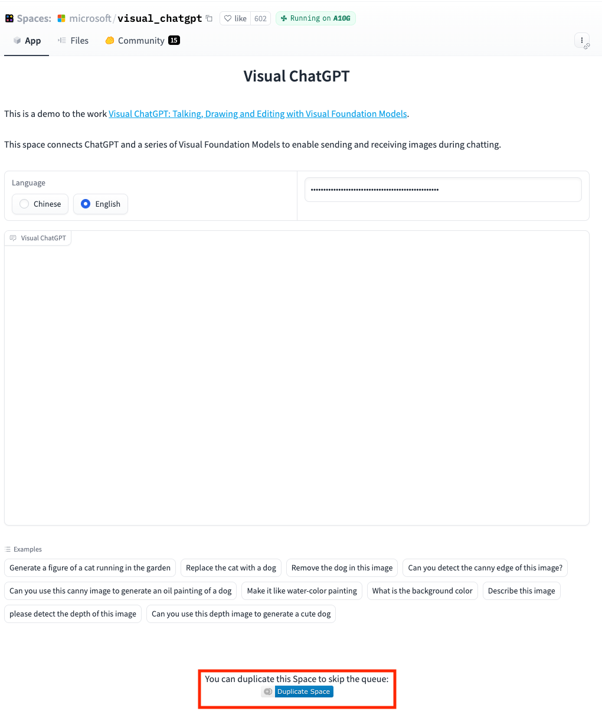

- 微软在 HuggingFace 的 Space 里提供了一个可以免费体验的 Visual ChatGPT

你可以点击微软提供的 Space 底部的 Duplicate Space，部署一个完全一样的 VisualChatGPT Space 到自己的账号下，这样你就不用和其他人排队等着了。

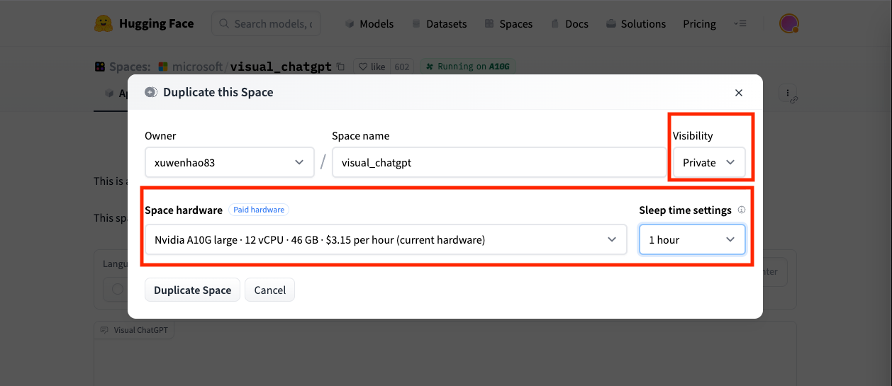

因为我们复制的是原先的 Space，所以对应的硬件配置也是和微软免费提供的一样。通过一块46G 显存的 A10 显卡，我们可以直接装载所有用到的模型。不过，使用 A10 显卡的 Space是有成本的，一个小时就要花去你 3.15 美元。所以在复制 Space 的时候，有两个参数你需要注意。

- 第一个是 Sleep time settings，我建议你设置成 5 分钟。这样，一旦 5 分钟没有人使用这个Space，它就会进入休眠状态。而 HuggingFace 在休眠状态下就不会收取你任何费用。只是下一次你要使用这个 Space 的时候，会重新启动整个 Space，需要一点点时间。

- 另一个是 Space 的 Visibility，我建议你选择 Private。这样，这个 Space 只有你能看到。不然的话，就算你设置了自动休眠，也免不了有人看到你的 Space 上来试一试。如果不断有人来使用你的 Space 的话，它会一直在线运行，而你就是那个付账单的人。

在复制的 Space 部署完成之后，你就可以先来试一下 Visual ChatGPT 了。首先你需要在右上角输入你的 OpenAI 的 API Key，并按下回车键。这样，整个窗口的下方就会出现可以输入文本的聊天窗口。你可以选择自由输入你想要画的内容，也可以在下面的 Examples 里选择预设好的一些指令。

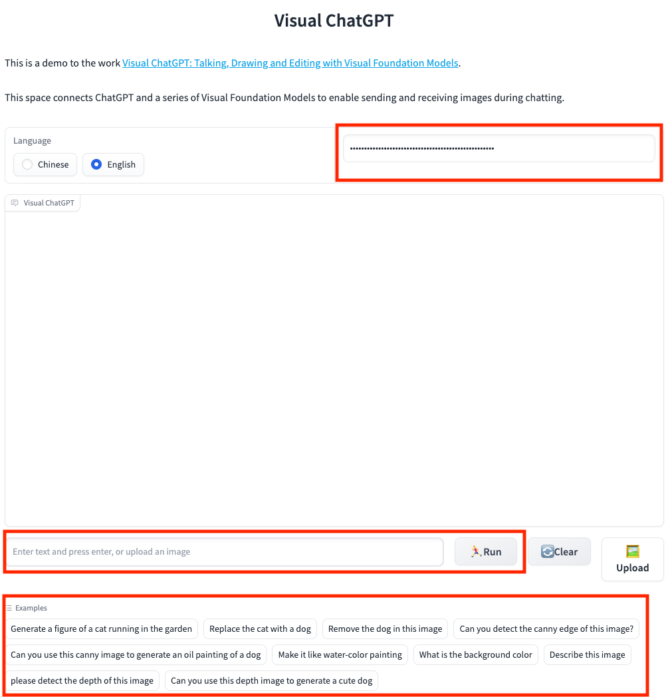

- 输入 API KEY 之后一定要按下回车，否则下面的对话输入框无法出现

我们可以分别试一下 Examples 里面给出的指令。

1. 我们先让 Visual ChatGPT 画一幅小猫在花园里奔跑的图片。

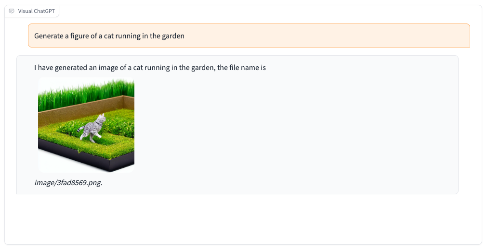

2. 然后再把画面里的小猫换成小狗。

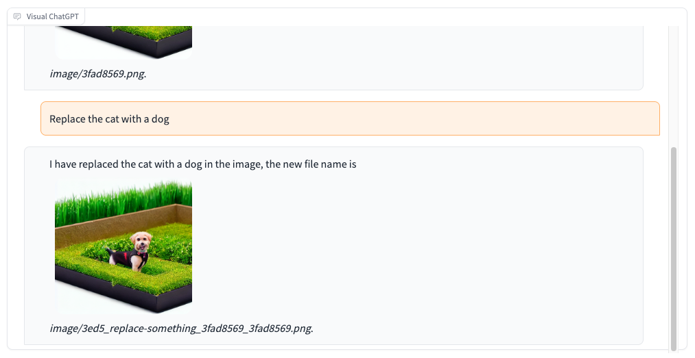

3. 接着去掉画面中的小狗。

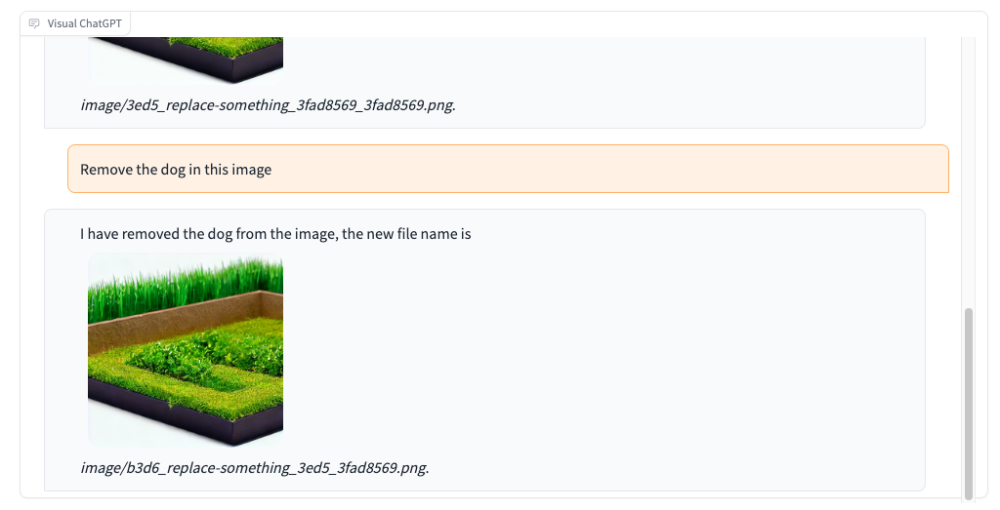

4. 再把图片风格换成水彩画。

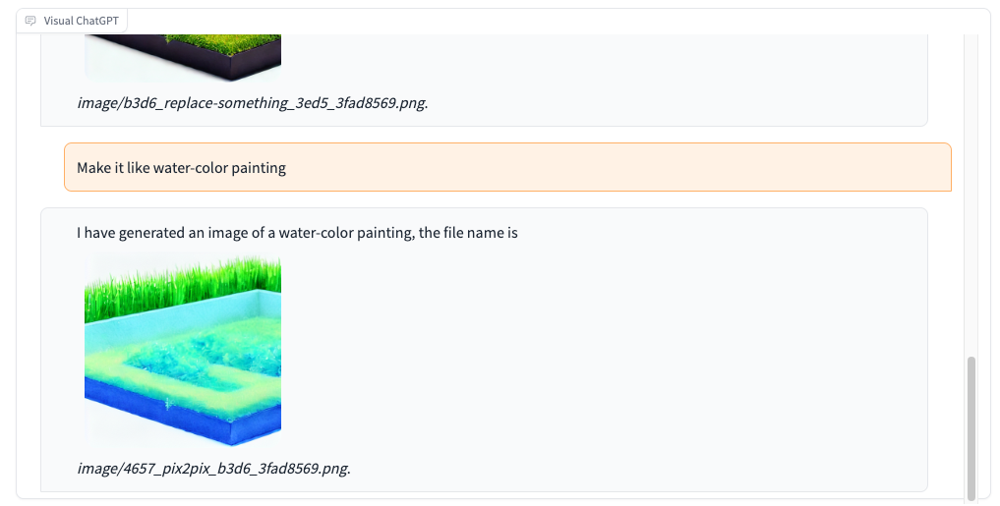

5. 最后我们让 Visual ChatGPT 描述一下图片的内容。

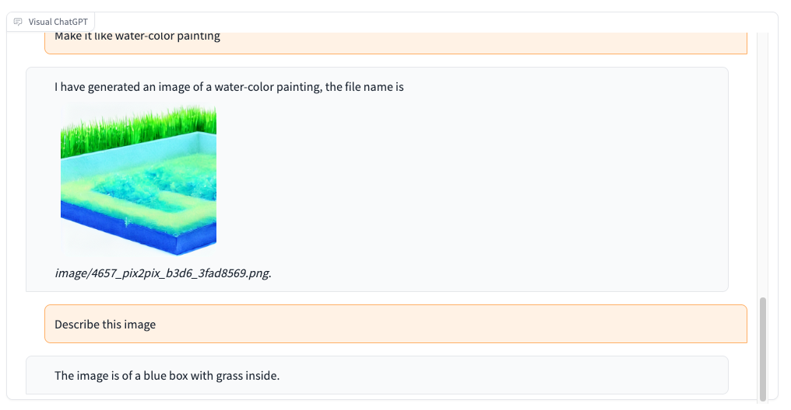

可以看到，Visual ChatGPT 很好地完成了我们的每一条指令。而这样的交互体验大大提升了我们用 AI 画画的实际体验。比如，上一讲里我们通过 Canny 算法获取了“戴珍珠耳环的少女”画像的轮廓，然后通过 ControlNet 绘制了同样姿势的其他明星的头像。原本这个过程我们是通过一系列的代码来实现的，现在我们完全可以用 Visual ChatGPT，通过一系列的对话向 AI下达指令来实现。

首先，我们通过 Upload 按钮把“戴珍珠耳环的少女”图片上传上去。

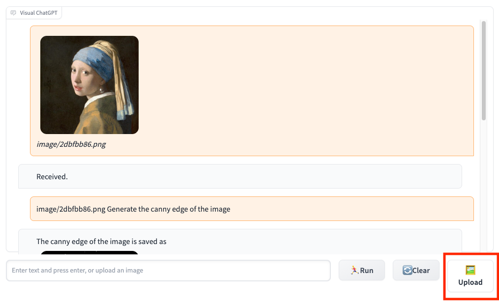

接着，我们在对话框里输入文本 “Generate the canny edge of the image”，Visual ChatGPT就会把上传图片的边缘提取出来，并且生成一张新的图片。

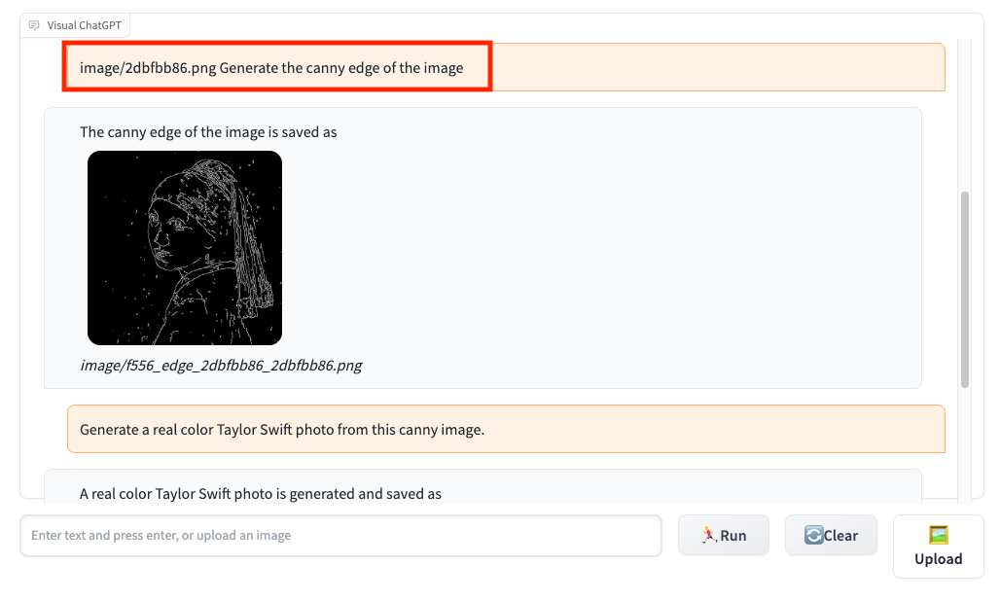

最后，我们在对话框里输入 “Generate a real color Taylor Swift photo from this cannyimage”，Visual ChatGPT 就会基于上面边缘检测的轮廓图生成一个新的人像图。

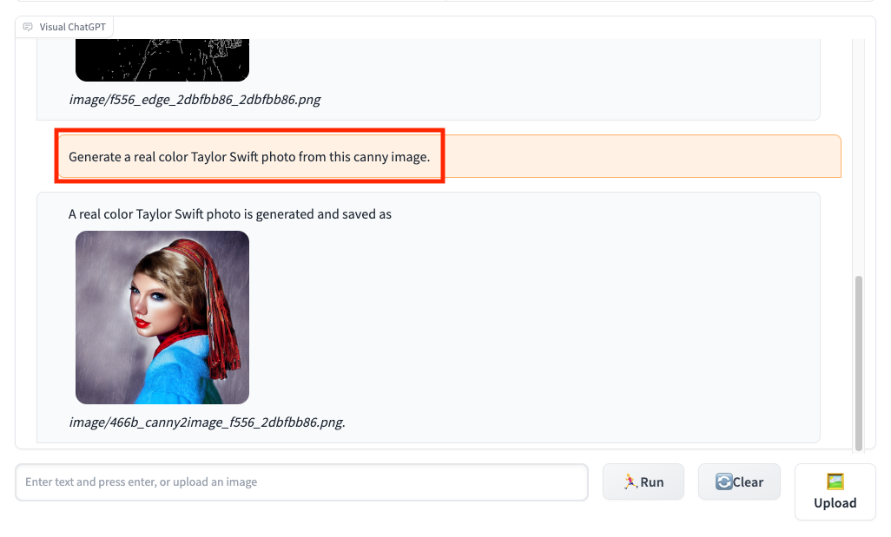

这样，我们不需要撰写任何代码，通过一个聊天窗口就能完成对图片的编辑和修改工作。

## Visual ChatGPT 的原理与实现

Visual ChatGPT 的效果非常神奇，但是其实内部原理却非常简单。Visual ChatGPT 解决问题的办法就是使用第 17 讲我们介绍过的 LangChain 的 ReAct Agent 模式，它做了这样几件事情。

1. 它把各种各样图像处理的视觉基础模型（Visual Foundation Model）都封装成了一个个Tool。

2. 然后，将这些 Tool 都交给了一个 conversation-react-description 类型的 Agent。每次你输入文本的时候，其实就是和这个 Agent 在交流。Agent 接收到你的文本，就要判断自己应该使用哪一个 Tool，还有应该从输入的内容里提取什么参数给到这个 Tool。这些输入参数

- 中既包括需要修改哪一个图片，也包括使用什么样的提示语。这里的 Agent 背后使用的就是 ChatGPT。

3. 最后，Agent 会实际去调用这个 Tool，生成一张新的图片返回给你。

那接下来，我们就进入 Visual ChatGPT 的代码，来看一下具体的代码是怎么做的。VisualChatGPT 的源代码只有一个文件 visual_chatgpt.py。整个文件从头到尾可以分成四个部分。

1. 一系列预先定义好的 ChatGPT 的 Prompt，以及一些会被调用的辅助函数。

2. 一系列视觉模型的 Class，每一个 Class 都代表了一个或者多个图片处理的工具。

3. 一个叫做 ConversationBot 的 Class，实际封装了通过对话调用各种视觉模型工具的流程。

4. 实际从命令行启动整个应用的入口，其实就是对 ConverationBot 提供了一个 Gradio 应用的封装。

### Visual ChatGPT 的调用入口

对于源码，我们可以倒过来从下往上看，从 Visual ChatGPT 的启动入口来学习代码。对应的启动代码其实很简单，就是干了两件事情。

```
从命令行加载了 load 参数，并且把对应的字符串解析成一个 load_dict，然后通过
load_dict 创建了 ConversationBot。
if __name__ == '__main__':
   if not os.path.exists("checkpoints"):
       os.mkdir("checkpoints")
   parser = argparse.ArgumentParser()
   parser.add_argument('--load', type=str, default="ImageCaptioning_cuda:0,Text2
   args = parser.parse_args()
   load_dict = {e.split('_')[0].strip(): e.split('_')[1].strip() for e in args.l
   bot = ConversationBot(load_dict=load_dict)
   ……
```

2. 然后将整个 ConversationBot 做成了一个有界面的 Gradio 应用。

```
……
   with gr.Blocks(css="#chatbot .overflow-y-auto{height:500px}") as demo:
       lang = gr.Radio(choices = ['Chinese','English'], value=None, label='Langu
       chatbot = gr.Chatbot(elem_id="chatbot", label="Visual ChatGPT")
       state = gr.State([])
       with gr.Row(visible=False) as input_raws:
           with gr.Column(scale=0.7):
               txt = gr.Textbox(show_label=False, placeholder="Enter text and pr
                   container=False)
           with gr.Column(scale=0.15, min_width=0):
               clear = gr.Button("Clear")
           with gr.Column(scale=0.15, min_width=0):
               btn = gr.UploadButton(label="🖼️",file_types=["image"])
       lang.change(bot.init_agent, [lang], [input_raws, lang, txt, clear])
       txt.submit(bot.run_text, [txt, state], [chatbot, state])
       txt.submit(lambda: "", None, txt)
       btn.upload(bot.run_image, [btn, state, txt, lang], [chatbot, state, txt])
       clear.click(bot.memory.clear)
       clear.click(lambda: [], None, chatbot)
       clear.click(lambda: [], None, state)
   demo.launch(server_name="0.0.0.0", server_port=7860)
```

我们看一下 load 参数，其实就是指定了不同的工具类应该使用 CPU 还是 GPU，以及对应的模型应该加载到哪一个 GPU 上。

```
python visual_chatgpt.py --load "Text2Box_cuda:0,Segmenting_cuda:0,
   Inpainting_cuda:0,ImageCaptioning_cuda:0,
   Text2Image_cuda:1,Image2Canny_cpu,CannyText2Image_cuda:1,
   Image2Depth_cpu,DepthText2Image_cuda:1,VisualQuestionAnswering_cuda:2,
   InstructPix2Pix_cuda:2,Image2Scribble_cpu,ScribbleText2Image_cuda:2,
   SegText2Image_cuda:2,Image2Pose_cpu,PoseText2Image_cuda:2,
   Image2Hed_cpu,HedText2Image_cuda:3,Image2Normal_cpu,
   NormalText2Image_cuda:3,Image2Line_cpu,LineText2Image_cuda:3"
```

### ConversationBot，一个 Langchain Agnet

接下来我们再来看看控制 Visual ChatGPT 的核心运转流程的 ConversationBot 是什么样的。

```
ConversationBot 里面包含了四个函数，分别是 __init__ 的构造函数、init_agent 函
数、run_text 和 run_image 函数。
__init__ 的构造函数用来加载使用的各个视觉基础模型（Visual Foundation Model）。
init_agent 函数构造了一个 LangChain 的 conversation-react-description 类型的
```

- Agent，用来实际处理整个 AI 对话过程。

```
run_text 处理用户的文本输入。
run_image 处理用户的图片输入。
```

### __init__ 构造函数

```python
我们先来看看 __init__ 这个构造函数。
def __init__(self, load_dict):
       # load_dict = {'VisualQuestionAnswering':'cuda:0', 'ImageCaptioning':'cud
       print(f"Initializing VisualChatGPT, load_dict={load_dict}")
       if 'ImageCaptioning' not in load_dict:
           raise ValueError("You have to load ImageCaptioning as a basic functio
       self.models = {}
       # Load Basic Foundation Models
       for class_name, device in load_dict.items():
           self.models[class_name] = globals()[class_name](device=device)
       # Load Template Foundation Models
       for class_name, module in globals().items():
           if getattr(module, 'template_model', False):
               template_required_names = {k for k in inspect.signature(module.__
               loaded_names = set([type(e).__name__ for e in self.models.values(
               if template_required_names.issubset(loaded_names):
                   self.models[class_name] = globals()[class_name](
                       **{name: self.models[name] for name in template_required_
       print(f"All the Available Functions: {self.models}")
……
代码其实很简单，首先就是将前面从命令行读入的 load_dict 里面的每一个 Class 都实例
```

化，后面我们会看到，在实例化的过程中，这些 Class 都会把各种预训练好的模型加载到CPU 或者 GPU 里面来。

这其中有一个情况需要注意，有些模型 Class 在我们这里叫做 template_model，其实就是能够组合多个模型组合，来解决一个单一的任务。这些 Class 不是通过命令行传入的参数名称来加载的，而是去判断这个 Class 需要的其他模型是否都已经加载了，如果都加载了，那么这个Class 自然可以用，不需要额外占用显存或者内存。否则的话，这个 Class 就不会被加载。

接下来就是遍历所有的这些 Class，找到里面以 inference 开头的函数。每一个函数都会被当作是一个 LangChain 里面的 Tool，放到当前实例的 Tools 数组中去。

然后就创建了 Agent 需要的 LLM 和 Memory，如果你想要用 GPT-4 来管理对话过程以取得更好的效果，你就可以在这里用 GPT-4 替换掉 LLM 来做到这一点。

```
……
       self.tools = []
       for instance in self.models.values():
           for e in dir(instance):
               if e.startswith('inference'):
                   func = getattr(instance, e)
                   self.tools.append(Tool(name=func.name, description=func.descr
       self.llm = OpenAI(temperature=0)
       self.memory = ConversationBufferMemory(memory_key="chat_history", output_
```

### init_agent 函数

```
接下来的 init_agent 函数就特别简单了，它其实就是利用上面我们加载的 Tools、Memory
```

以及 LLM 创建了一个 conversational-react-description 类型的 Agent。这个 Agent 我们在第 17 讲其实已经介绍过了一遍。

```
不过，这里我们通过 agent_kwargs 为这个 Agent 专门定制了对应的提示语。这部分提示语
我们晚一点再介绍。这里，对于中文和英文 Visual ChatGPT 只是通过简单的 if...else 提
```

供了一组不同的提示语而已。

```sql
   def init_agent(self, lang):
       self.memory.clear() #clear previous history
       if lang=='English':
           PREFIX, FORMAT_INSTRUCTIONS, SUFFIX = VISUAL_CHATGPT_PREFIX, VISUAL_C
           place = "Enter text and press enter, or upload an image"
           label_clear = "Clear"
       else:
           PREFIX, FORMAT_INSTRUCTIONS, SUFFIX = VISUAL_CHATGPT_PREFIX_CN, VISUA
           place = "输入文字并回车，或者上传图片"
           label_clear = "清除"
       self.agent = initialize_agent(
           self.tools,
           self.llm,
           agent="conversational-react-description",
           verbose=True,
           memory=self.memory,
           return_intermediate_steps=True,
           agent_kwargs={'prefix': PREFIX, 'format_instructions': FORMAT_INSTRUC
                         'suffix': SUFFIX}, )
       return gr.update(visible = True), gr.update(visible = False), gr.update(p
```

### run_text 和 run_image 函数

```
实际处理对话的 run_text 和 run_image 函数也非常简单。run_text 函数就是先确保
```

Memory 不要超出我们设置的上下文长度的限制。然后直接调用 Agent 来应对用户输入的文本。并且对于输出的结果，它只是做了一些文件名上的字符串显示的处理而已。

```python
   def run_text(self, text, state):
       self.agent.memory.buffer = cut_dialogue_history(self.agent.memory.buffer,
       res = self.agent({"input": text.strip()})
       res['output'] = res['output'].replace("\\", "/")
       response = re.sub('(image/[-\w]*.png)', lambda m: f'}
       state = state + [(text, response)]
       print(f"\nProcessed run_text, Input text: {text}\nCurrent state: {state}\
             f"Current Memory: {self.agent.memory.buffer}")
       return state, state
而 run_image 函数，则是把用户上传的图片转换成完全相同的尺寸和格式。此外，它还会使
```

用 ImageCaptioning 这个模型拿到图片的描述。最后，模型将图片名称和描述等信息也作为一轮对话拼接到 Agent 的 memory 里面去。

```python
   def run_image(self, image, state, txt, lang):
       image_filename = os.path.join('image', f"{str(uuid.uuid4())[:8]}.png")
       print("======>Auto Resize Image...")
       img = Image.open(image.name)
       width, height = img.size
       ratio = min(512 / width, 512 / height)
       width_new, height_new = (round(width * ratio), round(height * ratio))
       width_new = int(np.round(width_new / 64.0)) * 64
       height_new = int(np.round(height_new / 64.0)) * 64
       img = img.resize((width_new, height_new))
       img = img.convert('RGB')
       img.save(image_filename, "PNG")
       print(f"Resize image form {width}x{height} to {width_new}x{height_new}")
       description = self.models['ImageCaptioning'].inference(image_filename)
       if lang == 'Chinese':
           Human_prompt = f'\nHuman: 提供一张名为 {image_filename}的图片。它的描述是:
           AI_prompt = "收到。  "
       else:
           Human_prompt = f'\nHuman: provide a figure named {image_filename}. Th
           AI_prompt = "Received.  "
       self.agent.memory.buffer = self.agent.memory.buffer + Human_prompt + 'AI:
       state = state + [(f"*{image_filename}*", AI_pro
       print(f"\nProcessed run_image, Input image: {image_filename}\nCurrent sta
             f"Current Memory: {self.agent.memory.buffer}")
       return state, state, f'{txt} {image_filename} '
```

### Visual Foundation Model，实际处理图片的工具

看完了 ConversationBot，我们就知道其实我们向 Visual ChatGPT 输入的各种文本指令，都会变成对某一个视觉基础模型（Visual Foundation Model）的调用。那么，我们就挑一两个视觉基础模型，来看看具体里面是如何调用的。

我们还是拿之前我们比较熟悉的通过 Canny 算法进行边缘检测的 CannyText2Image 来演示好了。在这个 Class 的构造函数里，我们还是通过 Diffusers 的 Pipeline 加载了 Stable Diffusion和 ControlNet 的模型。这样，后面我们就可以用这个 Pipeline 来对图片进行处理了。

另外，在构造函数的最后，它还设置了一系列正面和负面的提示语内容。负面的提示语用于排除低质量的照片，而正面的提示语则会和用户输入的提示语拼接到一起，用来生成图片。

```python
class CannyText2Image:
   def __init__(self, device):
       print(f"Initializing CannyText2Image to {device}")
       self.torch_dtype = torch.float16 if 'cuda' in device else torch.float32
       self.controlnet = ControlNetModel.from_pretrained("fusing/stable-diffusio
                                                         torch_dtype=self.torch_
       self.pipe = StableDiffusionControlNetPipeline.from_pretrained(
           "runwayml/stable-diffusion-v1-5", controlnet=self.controlnet, safety_
           torch_dtype=self.torch_dtype)
       self.pipe.scheduler = UniPCMultistepScheduler.from_config(self.pipe.sched
       self.pipe.to(device)
       self.seed = -1
       self.a_prompt = 'best quality, extremely detailed'
       self.n_prompt = 'longbody, lowres, bad anatomy, bad hands, missing finger
                           'fewer digits, cropped, worst quality, low quality'
```

除了构造函数，这个 Class 还有一个 inference 函数。这个函数通过 Prompts 这个 decorator定义了 name 和 description 属性，这些属性也是我们实际加载 Tools 的时候使用的参数。Agent 就会根据这些描述判断用户输入的文本是否应该使用当前这个工具。比如这里CannyText2Image 的 description 里，就告诉你用户一般会通过“generate a real image of aobject or something from this canny image” 这样的指令来调用当前的工具。

而对应的 inference 函数的内容，就是简单地根据输入的文本调用模型来处理图片。不过要注意，这里作为输入的 Inputs 文本，并不是用户原始输入的内容。而是通过 ConversationBot的 Agent，经过“思考”之后拿到的 Action Inputs。这个 Inputs 里面，既会包含需要处理的图片路径，也会包含对应的 Prompts。

```python
   @prompts(name="Generate Image Condition On Canny Image",
            description="useful when you want to generate a new real image from
                        " like: generate a real image of a object or something f
                        " or generate a new real image of a object or something
                        "The input to this tool should be a comma separated stri
                        "representing the image_path and the user description. "
   def inference(self, inputs):
       image_path, instruct_text = inputs.split(",")[0], ','.join(inputs.split('
       image = Image.open(image_path)
       self.seed = random.randint(0, 65535)
       seed_everything(self.seed)
       prompt = f'{instruct_text}, {self.a_prompt}'
       image = self.pipe(prompt, image, num_inference_steps=20, eta=0.0, negativ
                         guidance_scale=9.0).images[0]
       updated_image_path = get_new_image_name(image_path, func_name="canny2imag
       image.save(updated_image_path)
       print(f"\nProcessed CannyText2Image, Input Canny: {image_path}, Input Tex
             f"Output Text: {updated_image_path}")
       return updated_image_path
```

当然，不是所有模型 Class 的 inference 函数都这么简单。有些 Class，特别是我们前面介绍过的 template_model 的 Class，它的 inference 函数会复杂一些，需要多次调用多个模型组合来完成任务。比如 InfinityOutPainting 这个 Class，就需要不断循环调用VisualQuestionAnswering 和 ImageCaption 来获取图片的描述，然后通过 Inpainting 来补全图片中没有画出来的部分，最终实现把图片无限扩大，补全扩大出来的部分背景的能力。

### 复盘 Prompt，理解 Task Matrix 机制

我们刚才说过，每个 Class 模型拿到的 inputs 输入都是模型“思考”之后根据用户输入提取出来的 Action Inputs。这一点，其实还是要归功于 ChatGPT 强大的逻辑推理能力。我们只要回到代码的开头，看一下对应的 Prompts 其实就能知道 Visual ChatGPT 是怎么做到的了。实际上，每次用户输入的内容，都是通过 VISUAL_CHATGPT_PREFIX、VISUAL_CHATGPT_FORMAT_INSTRUCTIONS 和 VISUAL_CHATGPT_SUFFIX 这三段Prompts 拼接而成的。

而 AI 的思考过程，其实就是 VISUAL_CHATGPT_FORMAT_INSTRUCTIONS 这一小段。

```
VISUAL_CHATGPT_FORMAT_INSTRUCTIONS = """To use a tool, please use the following f
Thought: Do I need to use a tool? Yes
Action: the action to take, should be one of [{tool_names}]
Action Input: the input to the action
Observation: the result of the action
When you have a response to say to the Human, or if you do not need to use a tool
Thought: Do I need to use a tool? No
{ai_prefix}: [your response here]
"""
```

这个其实就是我在第 17 讲里给你看过的 MRKL 的提示语模版。AI 通过 Thought、Action、Action Input 和 Observation 这样的四轮循环，完成一次 Tools 的判定与调用。并且，每次给到 Agent 的输入里，都可以包含多个迭代的 Action 和 Action Input，调用多次模型 Class 来解决问题。

## 小结

看完这个代码之后，相信你完全有能力修改代码满足自己的需求了。如果有一天出现了一个更好用的视觉基础模型，你完全可以把这个新的模型 Class 加入到 Visual ChatGPT 中。你只需

```
要通过 __init__ 函数加载模型，然后定义好它对应的提示语以及 inference 函数，就能让
```

Visual ChatGPT 支持一种新的图片编辑和绘制功能了。

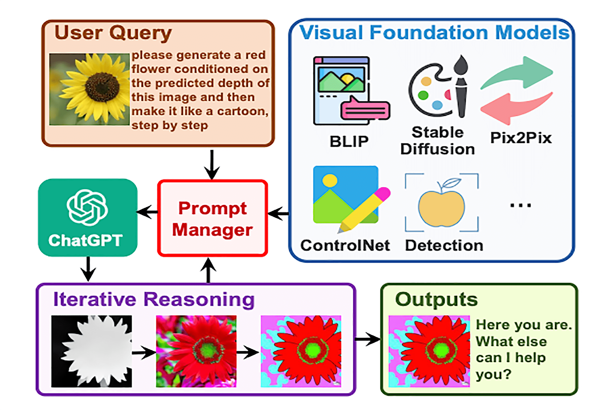

- 来自 Visual ChatGPT 论文中的图 1

回顾整个 Visual ChatGPT 的代码，其实并不复杂。它就是将第 17 讲我们介绍过的LangChain 的 Agent，和过去 3 讲我们介绍的各种视觉大模型组合起来，通过 ChatGPT 的语言和逻辑推理能力处理用户输入，通过 LangChain 的 Agent 机制来调度推理过程和工具的使用，通过视觉大模型实际来处理图片以及理解图片的内容。

这样的机制其实不仅可以用来处理图片，也可以用在其他机器学习的模型里，比如语音、视频，甚至你还可以利用它再去调用别的大语言模型。而这个机制，后来也被微软进一步扩展到Task Matrix 这个概念里。Visual ChatGPT 的代码库的名称今天也被改成了 Task Matrix，也就是“任务矩阵”的意思。

## 思考题

最后，按照惯例还是给你留一道思考题。

Stable Diffusion 的提示语是不支持中文的，但是 Visual ChatGPT 支持你通过中文输入你对图片的绘制和修改要求。你觉得它目前的实现有没有什么问题？如果我们想要让它不只支持中文和英文，也能支持德文、法文、西班牙文等各个语种，我们可以怎么做？欢迎你把思考后的结果分享到评论区，我们一起讨论，也欢迎你把这一讲分享给需要的朋友，我们下一讲再见！

## 推荐阅读

在 Visual ChatGPT 之后，微软更进一步将这个概念扩展成为 Task Matrix，也对应发表了一篇论文。你有兴趣的话，可以去阅读一下。
