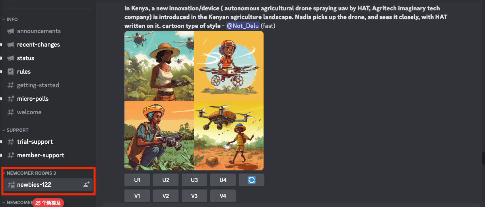
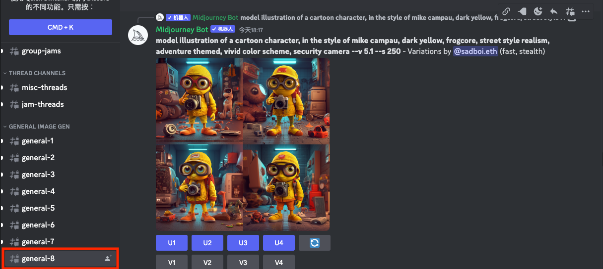
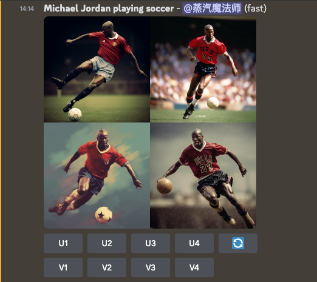
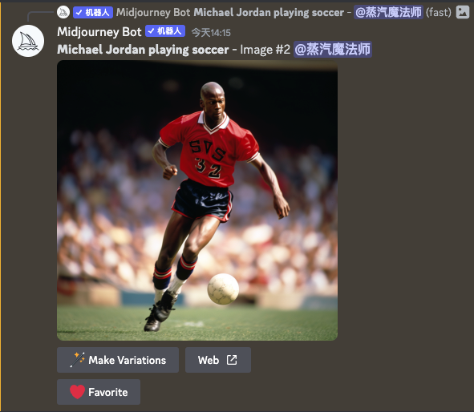
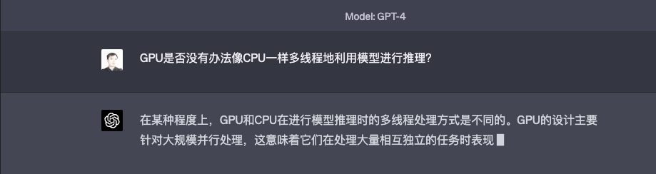
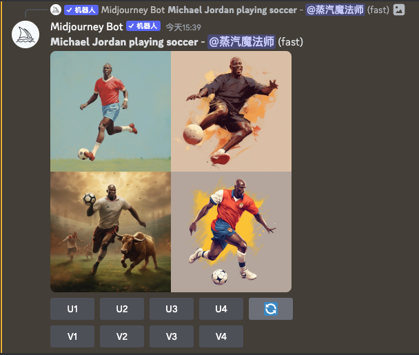
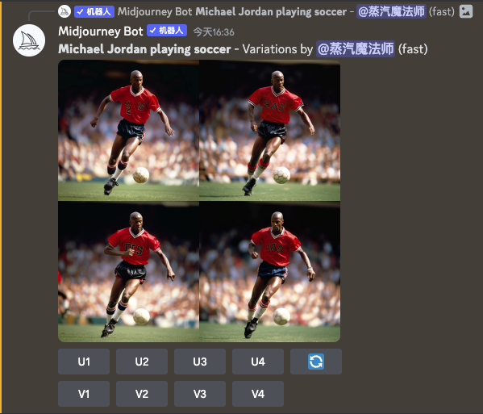
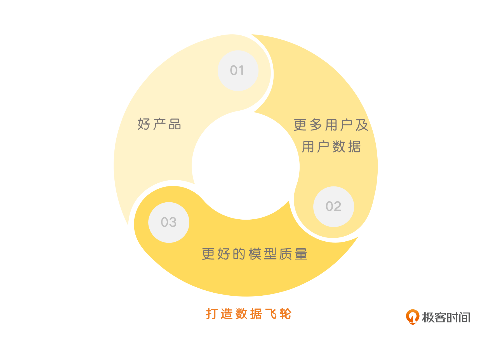

# 27 | 从Midjourney开始，探索AI产品的用户体验

你好，我是徐文浩。

学到这里，这个课程终于到了尾声。过去的二十多讲里，我们围绕着文本、语音、视频、图像体验了大量的 AI 应用场景。不过在这些场景里，我们还只是通过撰写代码体验了 AI 的能力。那么，如果我们今天想通过学习到的这些知识，开发一个真正的 AI 应用，需要注意些什么呢？我们是只需要简单地给我们的 Python 代码封装一个对话框一样的用户界面就可以了吗？

如果你有这样的疑惑，那请一定要坚持学完这最后一讲。我们一起来看看 Midjourney 这个 AI画画的应用是怎么做的。它在整个应用的体验里考虑了哪些设计原则？毕竟，Midjourney 在过去一年里可谓是创造了一个 AI 产品的奇迹。它没有独立的 App，完全依赖 Discord 这个语音社区聊天工具和用户交互。团队只有十几个人，但是出图的质量始终领先于有整个开源社区支持的 Stable Diffusion。没有外部融资，却完全靠用户订阅获取了 1 亿美元的年收入。

无论从哪个角度来看，Midjourney 都是一个值得研究的 AI 产品。在它所有的产品设计里，我认为有三个要点是今天所有的 AI 应用都应该借鉴的，那就是以用户社区作为入门教程、给用户即时反馈以及搭建数据飞轮以迭代模型。下面我们一个一个来看。

## 善用用户社区，降低上手门槛

Midjourney 这样的 AI 内容生成类型的产品，常常会遇到一个挑战，就是用户其实不知道该怎么玩这个产品。这个“不知道怎么玩儿”，不是说不知道怎么生成一张图片，而是说不知道什么样的提示语值得一试，可以画出什么样的场景。

因为大部分人和你我一样，不太懂得绘画，也缺少一些想象力。这样，很容易随便画了两三张图片之后，就放弃使用 Midjourney 这样的产品了。所以，Midjourney 就做了一个很巧妙的设计。就是你一旦注册成功，进入 Midjourney 的 Discord 频道之后，并不是让你对着Midjourney 的机器人自己发挥想象去画画，而是会直接进入某一个新用户的聊天室里，无论是自己通过提示语去画画，还是其他在聊天室里的用户去画画，都会在聊天室里不停地刷新。

- 默认你会进入一个新用户的聊天室里

因为用户的背景以及想要画的内容各不相同，所以你在这个聊天室里，可以看到各种不同风格的画作。而如果你想要自己尝试相同的风格，这些画作的提示语也在那里。你只需要简单地复制粘贴提示语，然后修改几个单词，就可以尝试复刻其他人相同风格的画作了。

而且，这样的聊天室并不仅仅局限于新用户。Midjourney 同样也为老用户设置了 general 频道，你在里面一样可以看到老玩家们绘制的优秀画作。

此外，整个 Midjourney 的 Discord 里，还有 show-case、daily-theme 等一系列从用户生成的图片里面挑选出来的优秀案例。

通过“共享”用户创建的内容这样的方式，Midjourney 很容易地让整个社区成为了教会新用户使用产品的通道。而不需要自己费劲费力地去写教程，或者提供大量的新手引导功能。

事实上，ChatGPT 就缺少这样的功能。这也给很多外部开发者提供了机会，于是就有了ShareGPT、FlowGPT 这样分享 ChatGPT 对话内容以及特定、有趣的提示语网站了。

## AI 应用面临的技术限制

在通过这样的引导学会了使用 Midjourney 各种好用的提示语之后，相信用户都会愿意多试试不同的提示语，画出漂亮的图画来。而作为一个 AI 内容生成的应用，Midjourney 在产品设计里的第一个挑战，就是响应时间问题。

我们之前用 Stable Diffusion 画画的时候，即使已经用 UniPCMultistepScheduler 来加快生成速度了，也还是要花上个 10 秒钟，而且那还是我们独占一块显卡的时候。如果你要像Midjourney 一样，直接面向消费者提供服务，你还会面临一个问题，就是所有的用户请求需要排队。并且，最好能够按照一个批次（Batch）进行处理。

这是由我们通过 GPU 来生成内容的原理决定的，GPU 不像 CPU 那样可以通过多线程或者时分复用的方式来处理请求，而只适合顺序地处理请求。而为了让显卡的利用率最大化，最好的办法是一个批次能够同时处理多张图片。

## 通过及时反馈，提升用户体验

所以我的预测是，你发给 Midjourney 的请求在它服务器端的集群里一样会先去排队。等到其他人的请求和你的请求一起凑满了一个批次，才会去生成图片。这也会使得从我们向Midjourney 发送提示语，到拿到最终的图片需要更长的时间。而这也会进一步消耗用户的耐心，让用户可能连第一次尝试都等不到完成的时候就走了。

Midjourney 解决问题的办法，则是尽可能让用户能在等待过程中看到这个任务是有进展的。

首先，在你的提示语提交之后，Discord 里面的 Bot 会告诉你，目前的任务是处于 Waiting tostart 的阶段的。

而一旦整个图片生成的任务启动，Midjourney 就会不断更新图片生成的中间过程，整个图像会逐渐从模糊变清晰。你不需要等到整个图片生成完成之后，才能看到最后的完整图片。而是每隔一两秒钟就能看到一点点进展，这样整个图片的生成过程感觉一晃就过去了。而如果你想用StableDiffusion 来做一个图片生成的应用的话，我们在第 24 讲也演示了如何将生成过程里的中间结果输出出来。你完全可以仿照着实现和 Midjourney 相同的效果。

此外，针对每次你输入的提示语，Midjourney 并不是为你直接生成一张高清晰度的大图，而是生成了 4 张不同的图片。这其实也是为了弥补 Diffusion 类型算法的一个缺陷，就是生成的图像可控性比较差，一次性就能拿到我们满意的图片的概率比较低。比如，我们这里输入的“Michael Jordan playing soccer”是想要生成迈克尔乔丹踢足球的照片。但是里面右下角的第四张图里，显然还是一个打篮球的姿势，只是把手上拿着的篮球换成了足球而已。而一次性提供四张图片，让用户可以从四张里面挑一张，显然成功率就高多了。

而且生成小尺寸的图片，GPU 需要的计算时间也比较少。等到我们确定大致图片没有问题了，再通过 Diffusion 的生成算法，把图片放大变成高清大图，需要的总时间也短得多。在上面的 4 张图里，显然第 2 张更像是一张靠谱的踢足球的图片。我们选择它之后，只要 1~2 秒钟，就能拿到自己想要的高清大图。

事实上，尽可能地让用户在内容生成的过程中就获取到反馈，是现在很多 AI 应用一个比较常见的产品设计策略。比如用来做文本生成的 ChatGPT，在你输入问题之后，并不是等到整个答案生成完毕之后一股脑儿地返回给你。而是在生成的过程中就一个词一个词地输出，让你能够看到整个答题过程。在第 18 讲的时候，我也教给过你如何使用 OpenAI API 的 Stream模式来达到这样的效果。所以你可以自己尝试一下。

- ChatGPT一样在数据的生成过程中将文本发送出来

## 搭建数据飞轮，快速迭代模型

如果你用过 Midjourney 的话，应该知道它出的图质量很好，很多人都觉得要比开源的 StableDiffusion 好上不少。在我看来，这背后有一个很重要的因素，就是它拥有更多高质量的标注数据。你可能要问了，Midjourney 只有不到 20 个人的团队，哪里来的资源去标注数据呢？答案就在 Midjourney 的产品设计流程里。

最直接的一个数据标注，就是在每次生成的高清大图下面，都有一个 Favourite 的按钮。用户可以点击这个按钮表示喜欢并且收藏这个图片。而每次当用户按下这个按钮的时候，Midjourney 的团队其实就获得了一个由用户标注好的优质图片数据，也就是用户输入的提示词和对应图片的配对组合。

- Favorite 按钮能够帮助你标记图片，同时也是在帮Midjourney标注数据

但是只要做过一些产品，你也会发现真的会主动点击 Favorite 的用户还是太少了。不过，Midjourney 其实还有更多“隐形”的操作，也帮助他们标注了图片质量的好坏。

我们上面刚刚介绍过 Midjourney 对于任何一个提示语，都会生成四张图片。除了直接从四张图片里面选一张放大之外，你还可以有另外两个选择。

- 第一个是你可能对四张图片都不满意，那么你可以直接点击图片下面的“刷新”按钮，重新生成四张图片。

- 如果对四张图片都不满意，你可以一键重新生成4张图片

- 或者，你对其中一张图片的整体观感还是不错的，但是还不够满意。你同样可以点击四格图下方的 V1-V4 按钮中的一个，以四格图里面的一张为基础，再生成 4 张相似的图片。而对于已经放大了的高清大图，用户同样可以点击 Make Variation 的按钮，来重新生成 4 张图片，再让用户选择。

这两个动作里，用户尽管没有标记说哪一张图片是好的。但是其实已经告诉了我们，哪些图片他并不喜欢，以及 4 张图片里哪一张更接近他心目中理想的图片。而 Midjourney 就可以根据用户前后的一系列操作日志，来筛选出那些用户最终选择的图片。如果用户做了大量刷新重新生成或者生成变体的操作，并且最后选定了一张图片放大，那么这张图片大概率是一张用户满意的高清大图，我们不需要依赖用户点击 Favorite 按钮这一动作。

其实，这样“隐式”的反馈，在搜索、推荐等应用场景下早就被广泛应用了。在搜索的应用场景下，如果用户输入了搜索词之后，没有点击任何链接又重新输入了新的搜索词，那么自然表示用户对搜索结果不满意。在短视频的推荐里面，尽管用户没有点赞或者收藏，但是用户看完了整个视频，大概率表示用户对视频是感兴趣的。

对于 AIGC 应用，这样“隐式”反馈信息的使用也是非常重要的。能够尽早让产品上线，并且收集到的真实用户反馈往往能带来意想不到的产品优势。因为用户反馈越多，数据的质量也就越高。高质量的数据，则能让我们训练出更好的模型。而更好的模型，就意味着产品能够生成更高质量的内容，吸引更多的用户。这样，好的产品 -> 更多的用户数据 -> 更好的模型质量 ->更好的产品就进入了一个正向循环。一旦我们搭建起了这样的数据飞轮，就能在竞争中和对手拉开距离。

就比如 Midjourney，尽管没有开源社区里自带干粮的开发者们添砖加瓦，但是大量的用户反馈数据给了他们一个高质量的数据集。而开源的 Stable Diffusion，相对来说就缺少这样的数据反馈。因为大部分人部署模型之后，生成的图片都是自己使用，并没有把什么样的图片质量高、什么样的图片没法用反馈给 Stability AI 这个公司。

## 小结

好了，这一讲我们针对 Midjourney 这个现象级的 AI 应用，总结了 AI 产品设计的一些核心原则。

很多用户面对 AI 内容生成类的应用，其实是不知道应该如何入手的。因为生成内容的挑战不在于如何操作，而是如何发挥想象。而通过 Discord 的新手房间，任何一个新用户都可以看到其他人的提示语和对应的图片效果。很快就能学会更多的提示语。

而通过 AI 来生成内容需要的时间往往比较长，所以我们需要在内容生成的过程中，就要给到用户反馈。即使只是一个模糊的轮廓图，也能抚慰用户焦躁的情绪。此外，因为文生图本身的可控性比较差，Midjourney 采取了一次性生成 4 张小图的方式，让用户有更多挑选的余地。只有当用户确定真的满意其中的某一张图，再通过一次生成过程将其变成高清大图。

最后，通过生成 4 张小图供用户进行选择的这个过程，Midjourney 本质上是让用户为自己标注大量的数据。每一次用户选择进行“变形”的图片，都是一个正面反馈的标注。而每一张用户选择放大的图片，也都是一个更强力的“正面”信号。在不经意间，Midjourney 就有了海量的用户在背后为他们标注数据。

当然，Midjourney 以及其他优秀的 AI 产品的亮点并不只有这三个。但是一般来说，用户社区、及时反馈以及建立数据飞轮是 AIGC 类应用必不可少的组成部分。如果你接下来决定开发一个这样的应用，一定不能在产品中漏掉这三个元素。

## 思考题

最后，还是按照惯例给你留一个思考题。过去几个月里，各种各样的 AI 应用如同雨后春笋一样冒了出来。有什么 AI 应用给你带来了特别好的用户体验？它是否也利用了我们今天讲到的AIGC 产品设计的三个原则？请你把你喜欢的 AI 应用里优秀的产品设计分享给大家。让所有人通过极客时间这个社区共同成长。同时也欢迎你把这一讲分享给你身边对 AIGC 产品感兴趣的朋友。
