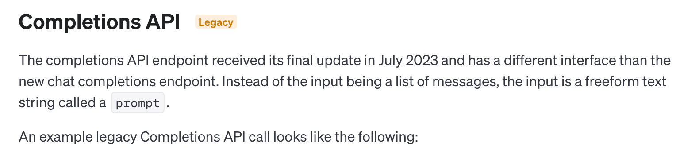

# 加餐一 | 让你的GPT稳定输出，JSON模式和Fingerprint

你好，我是徐文浩。

过去一年，是整个 AI 领域风驰电掣的一年。希望「AI 大模型之美」这门课程，让你对大模型领域有了一个完整的认识。而随着 AI 大模型领域的进一步发展，无论是 OpenAI 开放的 API能力，还是开源领域百花齐放的各种模型，都有了长足的进步和发展。

所以，在这新的一年里，我会对「AI 大模型之美」这门课程做一个更新。一方面，是查漏补缺，修订一下已经上线的内容。因为无论是 OpenAI 提供的 GPT，还是 llama-index 和LangChain 这样的开源项目，在 API 上都发生了很大的变化。另一方面，则是提供一些更深入的内容，因为 OpenAI 和百花齐放的开源领域，都提供更丰富的 AI 能力，让我们开发 AI 的应用更加方便了。

## 废弃 Completions 接口，使用 Chat Completions 接口

在这个课程一开始的时候，我就以一个给跨境电商的商品写标题的例子向你展示了 GPT-3.5模型的能力。

```python
from openai import OpenAI
import os
client = OpenAI(
 api_key=os.environ['OPENAI_API_KEY'],
)
COMPLETION_MODEL = "text-davinci-003"
prompt = """
Consideration proudct : 工厂现货PVC充气青蛙夜市地摊热卖充气玩具发光蛙儿童水上玩具
1. Compose human readale product title used on Amazon in english within 20 words.
2. Write 5 selling points for the products in Amazon.
3. Evaluate a price range for this product in U.S.
Output the result in json format with three properties called title, selling_poin
"""
def get_response(prompt, model=COMPLETION_MODEL):
   completions = client.completions.create (
       model=COMPLETION_MODEL,
       prompt=prompt,
       max_tokens=512,
       n=1,
       stop=None,
       temperature=0.0,
   )
   message = completions.choices[0].text
   return message
print(get_response(prompt))
```

输出结果：

```
NotFoundError: Error code: 404 - {'error': {'message': 'The model `text-davinci-0
```

不过如果你今天尝试运行这段代码，只会收到一个报错。这是因为 OpenAI 已经将这个例子里的 text-davinci-003 模型废弃了。现在如果你还是想要获得相同的返回结果，需要替换成 gpt-3.5-turbo-instruct 这个模型。

```
NEW_MODEL = "gpt-3.5-turbo-instruct"
print(get_response(prompt, model=NEW_MODEL))
```

输出结果：

```json
{
 "title": "Factory Stock PVC Inflatable Frog, Hot Selling Night Market Stall Toy
 "selling_points": [
   "Made with high quality PVC material",
   "Inflatable and easy to store",
   "Attractive design with glowing feature",
   "Perfect for water play and night markets",
   "Available in stock for immediate purchase"
 ],
 "price_range": "$15 - $25"
}
```

好在 gpt-3.5-turbo-instruct 这个模型的价格要比 text-davinci-003 低上不少，所以更换成这个新模型对用户来说还是划得来的。毕竟，你只需要修改一下模型名称，原来的代码就能继续跑起来了。



- 在 OpenAI 的官方文档可以看到，Completions API 已经打上了 Legacy 的标记

不过，如果你想写一些新功能和新代码，我建议你不要再使用上面的 Completions API 了，因为这一系列的 API 已经被 OpenAI 打上了“Legacy”的标记。而且，OpenAI 也没有为 GPT-4 这个最强大模型，提供 Completions API。

如果今天你想要实现让 GPT 给你写文案和标题的能力，我推荐你使用 Chat Completions 接口，你只需要把你的指令需求替换成一个用户通过 chat 对话向 AI 发出请求的方式就可以了，非常简单。

```python
from openai import OpenAI
import os
client = OpenAI(
 api_key=os.environ['OPENAI_API_KEY'],
)
CHAT_COMPLETION_MODEL = "gpt-3.5-turbo"
prompt = """
Consideration proudct : 工厂现货PVC充气青蛙夜市地摊热卖充气玩具发光蛙儿童水上玩具
1. Compose human readale product title used on Amazon in english within 20 words.
2. Write 5 selling points for the products in Amazon.
3. Evaluate a price range for this product in U.S.
Output the result in json format with three properties called title, selling_poin
"""
def get_chat_response(prompt, model=CHAT_COMPLETION_MODEL):
   messages = [
       {"role" : "system", "content" : "You are an useful AI asssitant."},
       {"role" : "user", "content": prompt}
   ]
   response = client.chat.completions.create (
       model=model,
       messages=messages,
       max_tokens=512,
       n=1,
       stop=None,
       temperature=0.7,
   )
   message = response.choices[0].message.content
   return message
print(get_chat_response(prompt))
```

输出结果：

```json
{
 "title": "Factory Stock PVC Inflatable Frog Night Market Hot Selling Light-up F
 "selling_points": [
   "High-quality PVC material for durability",
   "Inflatable design for easy storage and transportation",
   "Glowing feature adds fun to nighttime play",
   "Suitable for both kids and adults",
   "Perfect for water play at the pool or beach"
 ],
 "price_range": "$10 - $20"
}
```

可以看到，这个代码和我们使用 Completions API 的代码基本是一样的，我们只是做了三个小小的改动。

1. 将代码接口从 client.completions.create 更换成了 client.chat.completions.create。

2. 不再是直接提供一个 prompt 参数，而是需要将你的 prompt 封装成 system 和 user 的message。

3. 解析的返回结果的格式也有了小小的变动，拿到的是包含 role 和 content 的 message，而不是原来那样的 text。

## 使用 JSON 模式获得稳定输出

在这个例子中，我们让 AI 为我们输出一个 JSON 格式的回复。这也是大量 AI 辅助应用场景下，我们经常会提出的需求。因为一旦输出结果是 JSON 格式，就意味着我们可以很容易地用程序来解析返回的结果，也就不需要手工去分段复制粘贴 AI 返回的内容了，可以批量且自动化地完成相应的任务。

生成式 AI（GenAI）虽然非常聪明，能够理解你提出的要求，也能给出聪明而且正确的返回结果。但是，它也有一个小小的缺点，就是输出结果有时候并不是那么可控。比如，我们用更加像人类对话的方式提出我们的需求，就会遇到这样的问题。

```
prompt = """
Hi,
Could you write me a title, 5 selling points, and a price range for a product cal
"""
print(get_chat_response(prompt))
```

输出结果：

```
Certainly! Here's the information you requested in JSON format:
```json
{
 "title": "Factory Stock PVC Inflatable Frog Night Market Bestseller Inflatable
 "sellingPoints": [
   "High-quality PVC material",
   "Inflatable and portable design",
   "Attractive LED lights for night play",
   "Suitable for water activities",
   "Popular choice at night markets"
 ],
 "priceRange": "$10 - $20"
}
Please note that the translation provided is based on the given product name, and
```

上面这段代码里，我们并没有修改任何需求的逻辑，只是把提出的要求变得更加口语化了一点。但是在输出的结果中，AI 给出了一些我们并不需要的冗余信息。除了原本我们希望得到的 JSON 格式的内容之外，AI 还在 JSON 的前后，给了一些模仿人类对话的介绍和贴心的建议。

然而，如果我们是通过一段程序来自动解析输出的 JSON，这样的返回结果反而变得更麻烦了。当遇到这种情况的时候，要么调整我们的提示语（Prompt），然后寄希望于输出结果里只有一个干净的 JSON 字符串。或者，我们提供一个考虑到可能存在各种脏数据的 JSON 解析函数，在解析 JSON 之前，剔除掉前后无关的文本内容。但是这两种方法，其实都不太稳定。前者，可能需要你花费很多时间去调整 Prompt，后者，则总会遇到一些你意想不到的脏数据，导致在有些场景下解析失败。

不过，OpenAI 显然是已经考虑到了这个问题。毕竟，让 ChatGPT 的接口返回一些格式化好的数据，然后把后续流程交给代码来处理，是目前应用 AI 最常见的一种组合。所以，现在你可以在调用 Chat Completions 接口的时候，就指定输出 JSON 格式。一旦你指定了输出格式是 JSON，对应的 Chat Completions 的接口返回的内容就只有 JSON，你就不再需要操心微调提示语，或者兼容各种脏数据输出的情况了。你可以按照下面这样来修改你的代码。

```python
CHAT_COMPLETION_MODEL = "gpt-3.5-turbo-0125"
def get_json_response(prompt, model=CHAT_COMPLETION_MODEL):
   messages = [
       {"role" : "system", "content" : "You are an useful AI asssitant."},
       {"role" : "user", "content": prompt}
   ]
   response = client.chat.completions.create (
       model=model,
       messages=messages,
       max_tokens=512,
       n=1,
       stop=None,
       temperature=0.7,
       response_format={ "type": "json_object" },
   )
   message = response.choices[0].message.content
   return message
prompt = """
Hi,
Could you write me a title, 5 selling points, and a price range for a product cal
The json format should be like this:
{
   "title": "Blablabla",
   "selling_points": [
       "Blablabla",
       "Blablabla",
       "Blablabla",
       "Blablabla",
       "Blablabla"
   ],
   "price_range": "$x.00 - $y.00"
}
"""
print(get_json_response(prompt))
```

输出结果：

```json
{
   "title": "Factory Stock PVC Inflatable Frog Night Market Stall Hot Selling Li
   "selling_points": [
       "Inflatable frog toy for children",
       "Glow in the dark feature for added fun",
       "Perfect for water play activities",
       "Ideal for night markets and stalls",
       "High-quality PVC material for durability"
   ],
   "price_range": "$10.00 - $20.00"
}
```

1. 首先，只有在使用 gpt-4-turbo-preview 或者 gpt-3.5-turbo-0125 这两个模型的时候，OpenAI 的 API 才支持指定 JSON 作为输出格式。所以你要先把使用的模型换成这两个模型中的一个。

2. 然后，你只需要在 Chat Completions 接口中，增加一个参数，指定 response_format={“type”: “json_object” } 就好了。

3. 除了这两处修改之外，为了确保输出的 JSON 格式和你期望的一样。我建议你在原来的Prompt 的最后，再给出一个你期望的 JSON 格式的例子。这个小技巧有助于最终输出的JSON 格式和你期望的一样，确保后续程序的解析成功。如果对比一下这里给出了 JSON格式例子代码的输出结果和上面没有给例子的输出结果，你会发现，JSON 中对应价格区间的字段 price_range 的输出格式，一个是用了下划线 _ 作为单词之间的分割，而另一个则是用了驼峰格式的 priceRange。如果你的解析代码中，希望使用 price_range，那么在原来的输出结果里是获取不到的。

## 使用 seed 参数和 Fingerprint

无论是指定 JSON 作为输出的数据格式，还是进一步地提供了对应 JSON 格式的示例，我们都是为了确保 AI 模型的输出结果是稳定的。不过，虽然输出的数据格式稳定了，但是如果你反复运行几次上面的代码，你会发现它输出的内容每次都会发生变化。

```json
{
   "title": "Factory Stock PVC Inflatable Frog Night Market Stall Hot Selling In
   "selling_points": [
       "Made of high-quality PVC material",
       "Unique design with glowing feature",
       "Perfect for children's water play",
       "Ideal for night market stalls",
       "Limited stock available"
   ],
   "price_range": "$15.00 - $25.00"
}
```

注：如果再次运行代码，输出的 JSON 内容是不同的。

但是，在有些场景下，我们不仅希望输出的格式是稳定的，我们还希望在输入内容一样的情况下，输出的结果也不要发生变化。比如，我在撰写这个课程的例子的时候，我希望提供的示例代码，每次的输出结果都是一样的。这样，方便你验证自己实验的结果。你可能会说，那是不是把 temperature 这个参数设置成 0 就可以了? 因为我们之前就介绍过，这个参数决定了模型生成文本时的随机性。

你不妨可以试一试，结果其实并非如此。Temperature 作为一个参数，其实是决定了我们在 AI大模型生成下一个 Token 的候选列表的时候，高概率的 Token 被选中的概率的分布是更大还是更小。即使 Temperature 设置成 0，也并不意味着模型的输出是一样的。

```python
def get_fingerprint_response(prompt, seed=42, model=CHAT_COMPLETION_MODEL):
   messages = [
       {"role" : "system", "content" : "You are an useful AI asssitant."},
       {"role" : "user", "content": prompt}
   ]
   response = client.chat.completions.create (
       model=model,
       messages=messages,
       max_tokens=512,
       n=1,
       stop=None,
       seed=seed,
       temperature=0,
       response_format={ "type": "json_object" },
   )
   message = response.choices[0].message.content
   fingerpring = response.system_fingerprint
   return fingerpring, message
fingerprint , json_response = get_fingerprint_response(prompt,seed=1)
print(fingerprint)
print(json_response)
```

输出结果：

```
fp_69829325d0
{
   "title": "Factory Stock PVC Inflatable Frog Night Market Stall Hot Selling In
   "selling_points": [
       "Made of high-quality PVC material",
       "Unique design with glowing feature",
       "Perfect for children to play with in the water",
       "Ideal for night markets and outdoor events",
       "Easy to inflate and deflate for storage"
   ],
   "price_range": "$10.00 - $20.00"
}
```

换一个 seed 调一次：

```
fingerprint , json_response = get_fingerprint_response(prompt,seed=2)
print(fingerprint)
print(json_response)
```

输出结果：

```
fp_69829325d0
{
   "title": "Factory Stock PVC Inflatable Frog Night Market Stall Hot Selling In
   "selling_points": [
       "Made of high-quality PVC material",
       "Suitable for night markets and stalls",
       "Glowing feature adds fun for children",
       "Ideal for water play",
       "Popular and in-demand product"
   ],
   "price_range": "$10.00 - $20.00"
}
```

通过这个例子可以看到，尽管 temperature 已经设置成了 0，但是不同 seed 输出的结果还是不同的。

为了尽可能地确保每次的输出结果一样，你还需要指定一个 seed 参数。这个 seed 参数是一个随机数的种子。如果你指定了相同的 seed 参数，把 temperature 设置成 0，并且确保调用模型的其他参数和提示语完全一致。那么，OpenAI 的输出结果，就会尽可能地一致。

我们把 seed 设置成 12345 运行一次：

```
fingerprint , json_response_1 = get_fingerprint_response(prompt,seed=12345)
print(fingerprint)
print(json_response_1)
```

输出结果：

```
fp_69829325d0
{
   "title": "Factory Stock PVC Inflatable Frog Night Market Stall Hot Selling In
   "selling_points": [
       "Made of high-quality PVC material",
       "Unique design with glowing feature",
       "Perfect for children to play with in the water",
       "Ideal for night markets and outdoor events",
       "Easy to inflate and deflate for storage"
   ],
   "price_range": "$10.00 - $20.00"
}
```

再运行一次：

```
fingerprint , json_response_2 = get_fingerprint_response(prompt,seed=12345)
print(fingerprint)
print(json_response_2)
```

输出结果：

```
fp_69829325d0
{
   "title": "Factory Stock PVC Inflatable Frog Night Market Stall Hot Selling In
   "selling_points": [
       "Made of high-quality PVC material",
       "Unique design with glowing feature",
       "Perfect for children to play with in the water",
       "Ideal for night markets and outdoor events",
       "Easy to inflate and deflate for storage"
   ],
   "price_range": "$10.00 - $20.00"
}
```

再来对比一下输出的结果：

```
print(json_response_1 == json_response_2)
```

输出结果一致。

```
True
```

我在这使用了相同的提示语、模型的配置参数，在 seed 参数相同和不同这两种情况下，运行了程序。可以看到，即使我们已经把 temperature 设置成 0，seed 参数不同的情况下，输出结果也并不完全相同。而当我们把 seed 都设置成了 12345 之后，输出的结果就完全一致了。不过，需要注意，OpenAI 在官方文档中，也申明了即使 seed 一致，它也只是尽可能保障输出结果是一致的，而没有打上 100% 的保票。

如果你希望通过相同的 seed 参数来保障输出结果是可以反复重现（Reproducible）的，我也推荐你和我一样，把输出结果中的 system_fingerprint 参数单拎出来。这个参数，是针对你调用模型的各个参数组合的指纹，如果这个值在两次 AI 模型调用中不一样，就意味着你一定有一些参数在两次调用中是不同的。这个时候，输出的结果不一致是正常现象，并不能说明你的 seed 参数不一样。

## 小结

好了，这就是这一讲的主要内容，最后我们来回顾一下。这一讲主要是为了教会你如何让OpenAI 的模型稳定输出。为了让模型的输出结果一直是一个干净的 JSON 文件，你需要选用gpt-4-turbo-preview 或者 gpt-3.5-turbo-0125 这两个模型中的一个，并且在参数中设定返回结果是 JSON Mode。为了确保输出的 JSON 的参数和你计划的一样，你需要在提示语中给出你期望的 JSON 示例。

如果你不仅希望输出的格式是稳定的，连输出的内容也是可复现的，相同的输入总能得到相同的输出结果，要怎么办呢？一方面你要将 temperature 参数设置成 0，另一方面在每次调用模型的时候，需要将 seed 这个随机数种子设置成相同的值。你学会了吗？

## 课后练习

除了对比输出的内容之外，我们还可以通过 embedding 计算两个输出结果之间的距离，来看它们是否是一致的。在 OpenAI 的 Cookbook 里，也有对应的示例。你能试着使用这个方式，看看不同 seed 和相同 seed 的返回结果之间的距离是怎么样的吗？

欢迎你把你试验的成果分享到评论区，也欢迎你把这节课的内容分享给需要的朋友，我们下节课再见！
