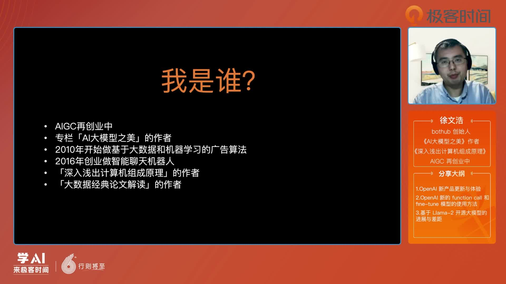

# 直播加餐 | 6个月过去了，重新认识大语言模型

直播主要内容：

- OpenAI 最新的产品更新与体验

- Advanced Data Analysis

- GPT4-V & DALL-E 3

- Function Call 和全新的 Fine-Tune 界面

- 基于 Llama-2 的开源大模型的进展与差距

- 蒸馏 GPT-4 的 Orca 数据集和模型微调的进步

- VLLM 这样方便运用的推理框架

此次分享为极客时间 6 周年徐文浩老师的分享，内容偏软性，如果对上述这些问题感兴趣的话可以点开视频观看。

直播 PPT 获取链接: https://pan.baidu.com/s/1VHd5bB5fZpfdBoI1M21euw?pwd=xs4y 提取码: xs4y
