# 06 | RAG实战：基于ChatGLM3-6B+LangChain+Faiss搭建企业内部知识库

你好，我是独行。

上一节课，我们通过一个企业内部小助手的案例，学习了 6B 的微调过程。其中，除了微调，还有一种模式就是知识库，用来增强大模型信息检索的能力，我们称之为检索增强生成（RAG），这是目前非常流行的一种做法，知识库模式相比于微调有 2 个好处。

1. 知识准确：先把知识进行向量化，存储到向量数据库里，使用的时候通过向量检索从向量库把知识检索出来，这样可以确保知识的准确性。

2. 更新频率快：当你发现知识库里的知识不全的时候，可以随时补充，不需要像微调一样，重新跑微调任务、验证结果、重新部署等。

这节课我们就通过外挂向量库的方式，继续完善法律小助手案例。除了大模型 6B 外，你还需要了解 LangChain、向量化、向量库等组件及概念。ChatGLM3 官方提供了一个和LangChain 结合的 demo：Langchain-Chatchat，还带有 UI 界面，我们可以直接拿过来使用。如果你理解了这个演示项目，那么智能体的原理也就学得差不多了，剩下的就是工程化的事情了。

## Langchain-Chatchat 架构

Langchain-Chatchat 主要包含几个模块：大语言模型、Embedding 模型、分词器、向量数据库、Agent Tools、API、WebUI。

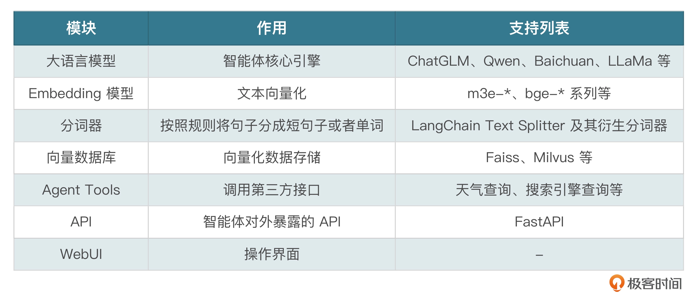

知识库大概流程图包含分词、向量化、存储、查询等过程，图中不包括其他 Tools。

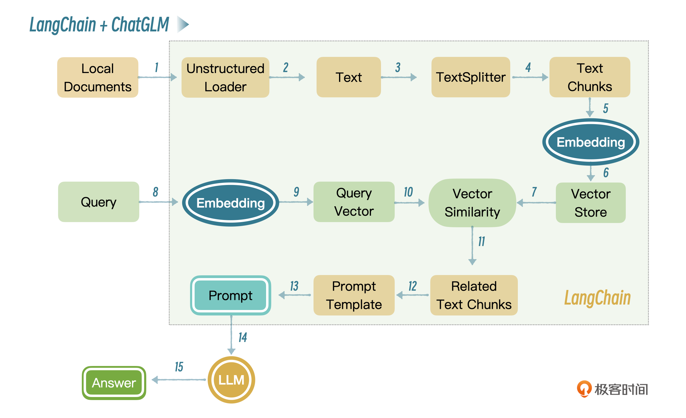

1～7 是文档完成向量化存储的过程，8～15 是知识库检索的过程。下面我们完整地跑一下这个 demo。

## 系统部署

1. 安装依赖

```
首先，从 GitHub 上克隆代码 https://github.com/chatchat-space/Langchain-
Chatchat.git。然后安装依赖，如果之前已经安装过的，可以排除掉，通过 pip3 list 查看
```

已经安装过的包和版本，当然如果网速允许，建议直接安装，否则可能会有依赖库冲突的问题。

三个依赖全部安装：requirements.txt、requirements_api.txt、requirements_webui.txt。

指定国内源速度更快：

```
pip3 install -r requirements.txt -i https://mirrors.aliyun.com/pypi/simple
```

使用 Faiss 向量库，需要安装 faiss-gpu 依赖。

```
pip3 install faiss-gpu
```

2. 下载模型

之前我们已经安装过 ChatGLM3-6B 了，本次无需再次安装，只要下载 Embedding 模型即可，我们选择 bge-large-zh-v1.5 进行下载，可以从 HuggingFace 下载，也可以从ModelScope 下载，后者速度更快。

```
git clone https://www.modelscope.cn/AI-ModelScope/bge-large-zh-v1.5.git
git lfs pull
```

git lfs 是专门用来拉取 git 上存储的大文件的，通过 git lfs pull 将模型权重拉取到本地。

3. 参数配置

执行以下命令，将配置文件复制一份到 config 目录，方便修改。

```
python copy_config_example.py
```

主要有以下几个配置文件：

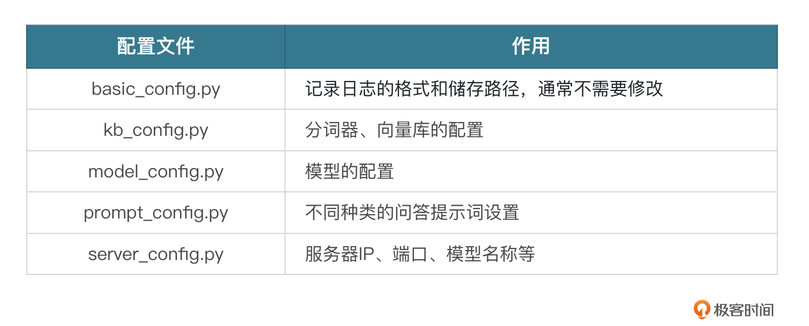

大部分不需要修改，我们只需要改一下 model_config.py 指定大模型和 Embedding 模型的路径即可。找到 MODEL_PATH 配置，分别修改 embed_model 里 bge-large-zh-v1.5 模型的本地目录，以及 llm_model 里 chatglm3-6b 的本地目录即可。

4. 初始化向量库数据

这一步主要是确认向量数据库和 Embedding 模型有没有部署好，实际生产环境中，我们可以自己创建业务向量数据库，这里通过初始化放一些示例数据进去。执行命令：

```
python3 init_database.py --recreate-vs
```

如果看到不断地加载示例数据，直到进度 100% 完成，就说明成功了，接下来就是一键启动。

```
$ python3 startup.py -a
```

当命令行出现如下提示，说明启动成功了。

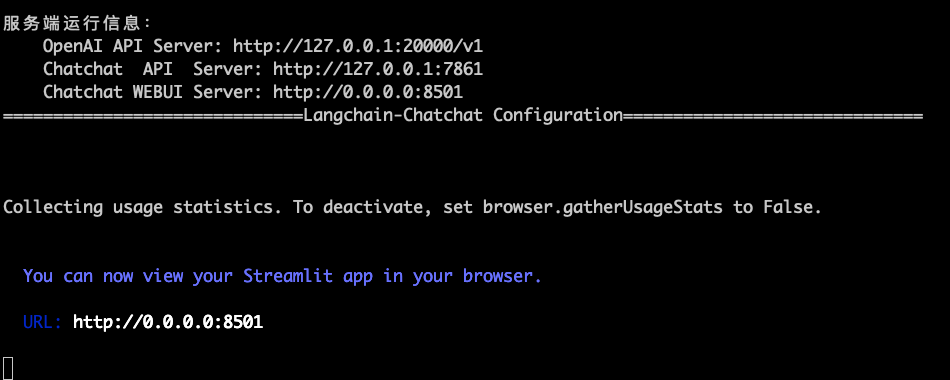

打开地址进入页面：

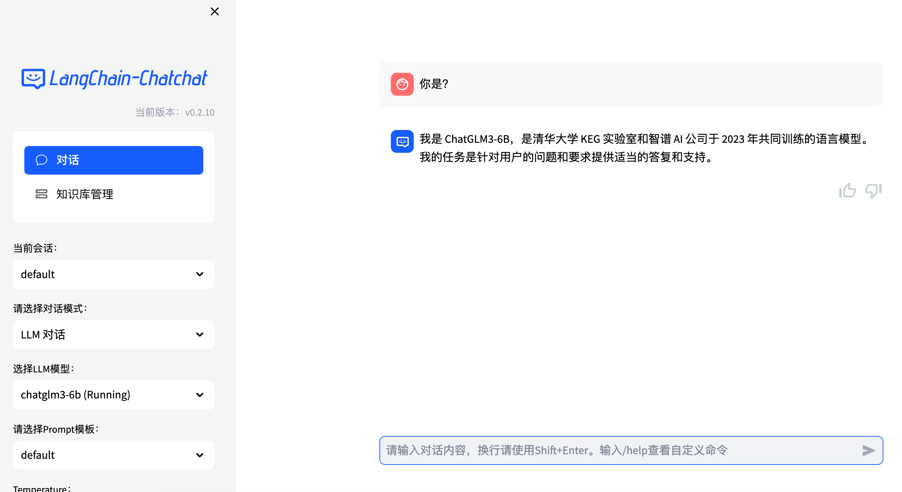

到这里基本上就算安装成功了，下面我们看一下如何管理知识库，以及自定义工具来增强大模型的检索能力。

## 知识管理

打开页面，点击左侧的知识库管理，可以进行知识库的上传、删除、更新操作。

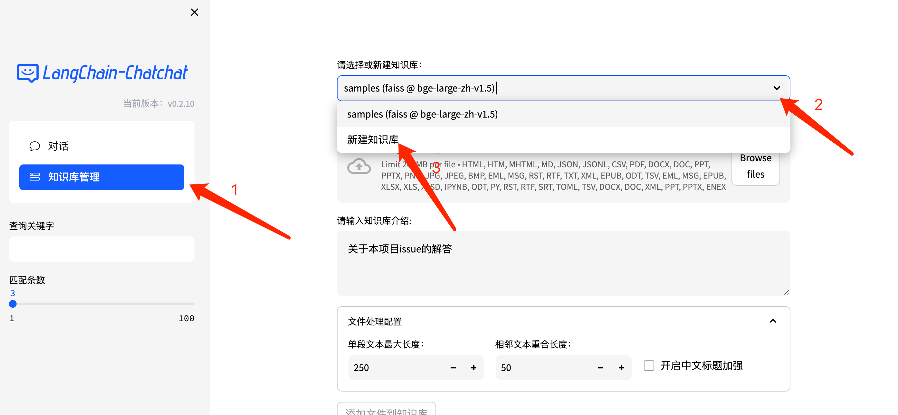

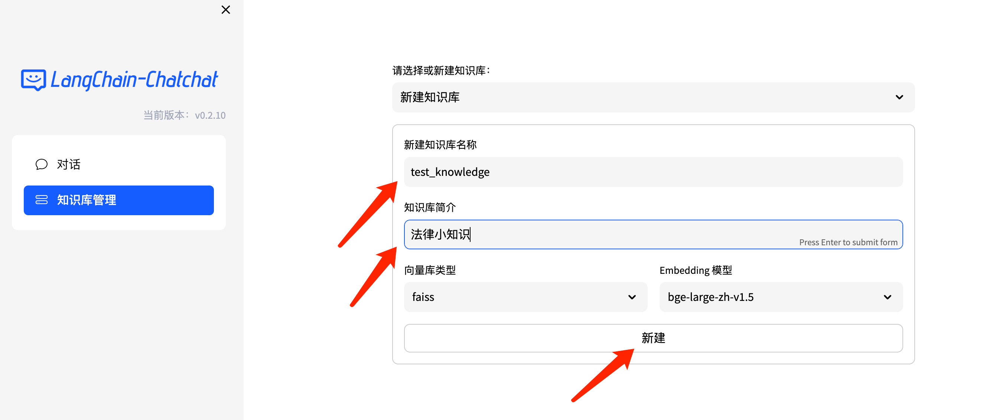

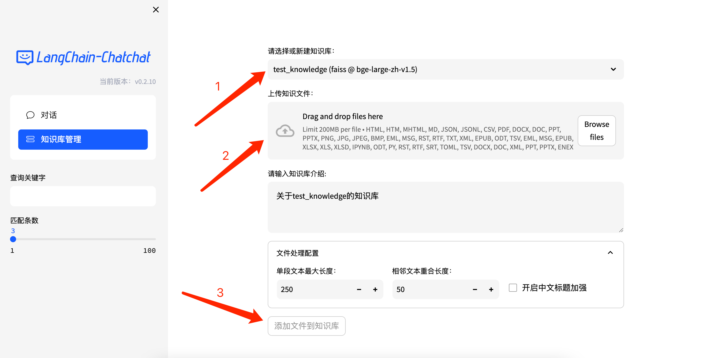

通过上面的操作可以将文档存入所选择的向量库内，供对话时检索。我们也可以通过 API 进行知识库管理、对话及查看服务器信息等操作。

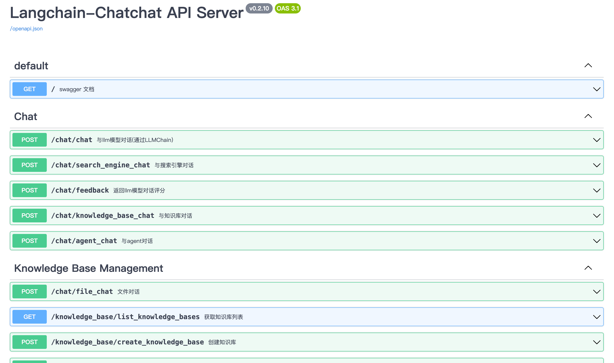

下面我们看一下知识库的效果，先对大模型进行提问。

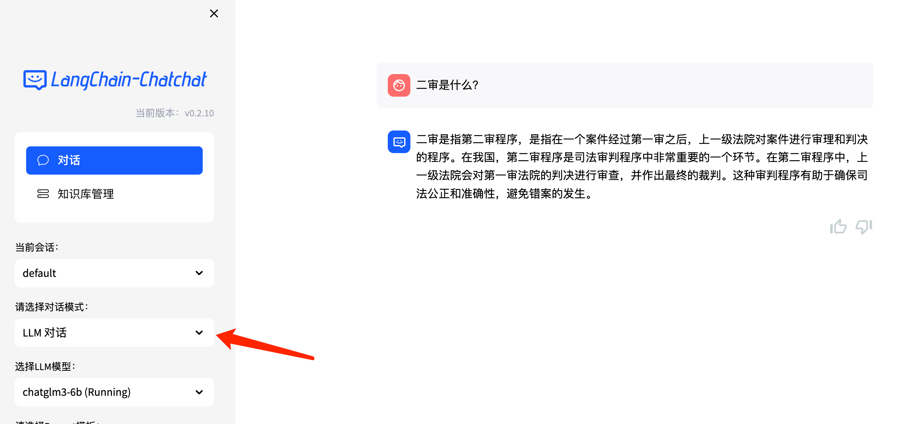

选择知识库模式，并选择我们上传好的知识，再次提问。

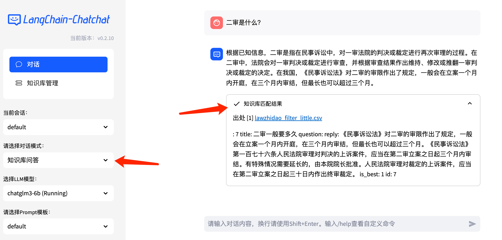

既获取了大模型的输出，也获取到了知识库的输出，实际应用过程中，我们可以把从知识库中检索到的信息传入大模型，大模型会进行上下文理解，经过整理后输出。

这些都是这个 demo 提供的一些基本功能，实际生产中，我们可以在企业内部搭建知识管理系统，由专业的团队进行知识维护。应用过程中需要考虑的事项比较多，比如企业内部统一登录、操作权限、操作日志等，都需要按照企业需求进行详细设计。后面第 25 讲我们会专门讲解企业大模型落地系统架构设计，到时候我们会把所有该考虑的细节都梳理一遍。

除了知识库外，在一个智能体应用中，我们可以开发各种各样的 Tool，下面我们再研究一下这个 demo 自带的天气查询工具。

## Tools 使用

打开 kb_config.py 配置文件，里面有天气查询、搜索引擎查询等工具开发配置，我们去心知天气官网申请一个 API 密钥，赋值给 SENIVERSE_API_KEY 变量，页面上就可以直接用了。

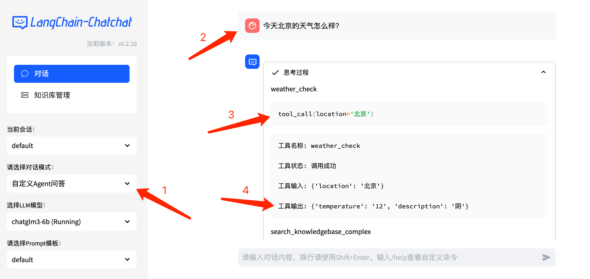

这是一个典型的检索增强生成（RAG）案例，通过 API 调用第三方服务，扩大信息检索范围。实际应用过程中，我们可以把企业内部的数据或者产品数据通过 API 喂给大模型，为产品增加 AI 能力，进而提升产品竞争力。

我们知道知识库模式，底层实际上是一个向量库，这个 demo 我们用的是 Meta 开源的向量数据库 Faiss，当然也可以替换成国产向量数据库 Milvus，接下来我们简单讲讲向量数据库是什么样的数据库，能解决什么问题。

## 向量数据库

在聊向量数据库之前，让我们先简单了解一下“向量”这个概念。在计算机科学和数学中，向量是由一系列数字组成的数组，这些数字可以表示任何东西，从物理空间的方向和大小到商品的特性和用户偏好等。

### 相似度计算

比如，在评价一部电影时，你给它的评分包括剧情 8 分、特效 7 分、演技 9 分、音乐 6 分。

```
这四个评分点就可以构成一个向量 [8, 7, 9, 6]。在这个向量中，每一个维度都代表了电
```

影的一个属性。现在，假设你是一位开发工程师，你正在构建一个推荐系统。你的目标是根据用户的喜好向他们推荐电影。用户的喜好也可以用一个向量来表示，比如一个用户可能喜欢剧

```
情和演技重于特效和音乐，他们的喜好向量可能是 [10, 5, 10, 4]。
```

现在，如果你想找出哪部电影最符合这类用户的口味，你可以计算用户喜好向量和每部电影向量之间的相似度。在向量空间中，这通常通过计算向量之间的距离来完成，如欧氏距离或余弦相似度。距离越小或相似度越高，表示电影越符合用户的口味。

```python
import numpy as np
# 定义计算余弦相似度的函数
def calculate_similarity(vector1, vector2):
   # 使用numpy库来计算余弦相似度
   dot_product = np.dot(vector1, vector2)
   norm_vector1 = np.linalg.norm(vector1)
   norm_vector2 = np.linalg.norm(vector2)
   similarity = dot_product / (norm_vector1 * norm_vector2)
   return similarity
# 假设我们有一个向量代表用户偏好
user_preference = np.array([10, 5, 10, 4])
# 我们有一系列电影向量
movie_vectors = np.array([
   [8, 7, 9, 6],   # 电影A
   [9, 6, 8, 7],   # 电影B
   [10, 5, 7, 8]   # 电影C
])
# 计算并打印每部电影与用户偏好之间的相似度
for i, movie_vector in enumerate(movie_vectors):
   similarity = calculate_similarity(user_preference, movie_vector)
   print(f"电影{chr(65+i)}与用户偏好的相似度为: {similarity:.2f}")
```

我们这个示例里使用余弦相似度算法，执行这个代码块得出如下结果：

```
电影A与用户偏好的相似度为: 0.97
电影B与用户偏好的相似度为: 0.97
电影C与用户偏好的相似度为: 0.95
```

特别提醒：推荐你先熟练掌握 Python 语言，可以说大部分和 AI 相关的代码都是 Python 实现的，后面的示例代码我们基本都会用 Python 去写。

### 文本向量

在自然语言处理（NLP）中，一个词的向量值是通过在大量文本上训练得到的。一个词的向量值取决于它是如何被训练的，以及训练数据的性质。例如在不同的 Word2Vec 模型中，即使是相同的词，向量值也可能完全不同，因为它们可能基于不同的文本集或使用不同的参数训练。

常见的 Word2Vec 模型会生成几百维的向量。我们举一个例子来说明不同的词之间向量是怎么表示的，以及相似度是如何计算的。下面的例子是基于 GoogleNews-vectors-negative300.bin模型计算的，计算男人和男孩的向量表示以及相似度。

```python
import numpy as np
from gensim.models import KeyedVectors
model = KeyedVectors.load_word2vec_format('GoogleNews-vectors-negative300.bin', b
def cosine_similarity(vec_a, vec_b):
   # 计算两个向量的点积
   dot_product = np.dot(vec_a, vec_b)
   # 计算每个向量的欧几里得长度
   norm_a = np.linalg.norm(vec_a)
   norm_b = np.linalg.norm(vec_b)
   # 计算余弦相似度
   return dot_product / (norm_a * norm_b)
# 获取man和boy两个词的向量
man_vector = model['man']
boy_vector = model['boy']
# 打印出这两个向量的前10个元素
print(man_vector[:10])
print(boy_vector[:10])
similarity_man_boy = cosine_similarity(man_vector, boy_vector)
print(f"男人和男孩的相似度: {similarity man boy}")
```

程序输出如下：

```
[ 0.32617188  0.13085938  0.03466797 -0.08300781  0.08984375 -0.04125977
-0.19824219  0.00689697  0.14355469  0.0019455 ]
[ 0.23535156  0.16503906  0.09326172 -0.12890625  0.01599121  0.03613281
-0.11669922 -0.07324219  0.13867188  0.01153564]
男人和男孩的相似度: 0.6824870705604553
```

这只是一个例子，不同的模型、不同的训练数据集，甚至是不同的训练参数都会产生不同的词向量。同样的道理，女人和女孩、男人和青少年等等，相似度也很高。这种特性使我们进行信息检索的时候，不需要像传统数据库那样通过 like 去找相似的内容，而是通过向量相似度去检索相似的内容。这样做的好处是可以通过多个维度（属性）去比较，比如男人和男孩相似度很高，是因为男人和男孩在性别、社会角色、关系、活动和兴趣、情感和行为等方面都比较相似。

### 向量存储

存储向量数据有专门的向量数据库，比如 Faiss、Milvus。向量数据库专门被设计用于存储和检索向量数据，非常适合处理词向量、图像特征向量或任何其他形式的高维数据。我们以刚刚生成的词向量为例来解释如何通过向量数据库存储这些数据。

```python
import numpy as np
import faiss
# 假设我们有一些词向量，每个向量的维度为100
dimension = 100  # 向量维度
word_vectors = np.array([
   [0.1, 0.2, ...],  # 'man'的向量
   [0.01, 0.2, ...],  # 'boy'的向量
   ...  # 更多向量
]).astype('float32')  # Faiss要求使用float32
# 创建一个用于存储向量的索引
# 这里使用的是L2距离（欧氏距离），如果你需要使用余弦相似度，需要先规范化向量
index = faiss.IndexFlatL2(dimension)
# 添加向量到索引
index.add(word_vectors)
# 假设我们想找到与'new_man'（新向量）最相似的5个向量
new_man = np.array([[0.1, 0.21, ...]]).astype('float32')  # 新的查询向量
k = 5  # 返回最相似的5个向量
D, I = index.search(new_man, k)  # D是距离的数组，I是索引的数组
# 打印出最相似的向量的索引
print(I)
```

记得先安装一下 Faiss 依赖。

```
pip install faiss-cpu  # 对于没有GPU的系统
# 或者
pip install faiss-gpu  # 对于有GPU的系统
```

使用起来也比较简单，和我们一般的数据存储一样，通过客户端进行数据插入和查询。和其他存储中间件一样，当数据量非常大的时候，同样会遇到性能、稳定性等问题，当大规模使用的时候需要考虑各种各样的问题，只不过对于向量数据库，挑战在于多维度的存储，比如随着数据维度的增加（一个词被表示为一个 300 维的向量），数据点（向量）之间的距离开始变得难以区分。这不仅让寻找“最近的邻居”变得更加困难和耗时，而且还会增加存储和搜索时所需的资源。

你可以本地自己搭建一个向量数据库体验一下，和传统的关系 / 非关系型数据存储有什么区别，当然，如果感兴趣也可以看看底层的存储原理。

## 应用场景

知识库模式可以用在相对固定的场景做推理，比如企业内部使用的员工小助手，包含考勤制度、薪酬制度、报销制度、法律帮助，以及产品操作手册、使用帮助等等，这类场景不需要太多的逻辑推理，使用知识库模式检索精确度高，并且可以随时更新。企业实际应用过程中，除了使用大语言模型本身的基础能力外，其他的也就是在不同场景下，把各种各样的 Agent 进行堆叠，产生智能化的效果。

## 小结

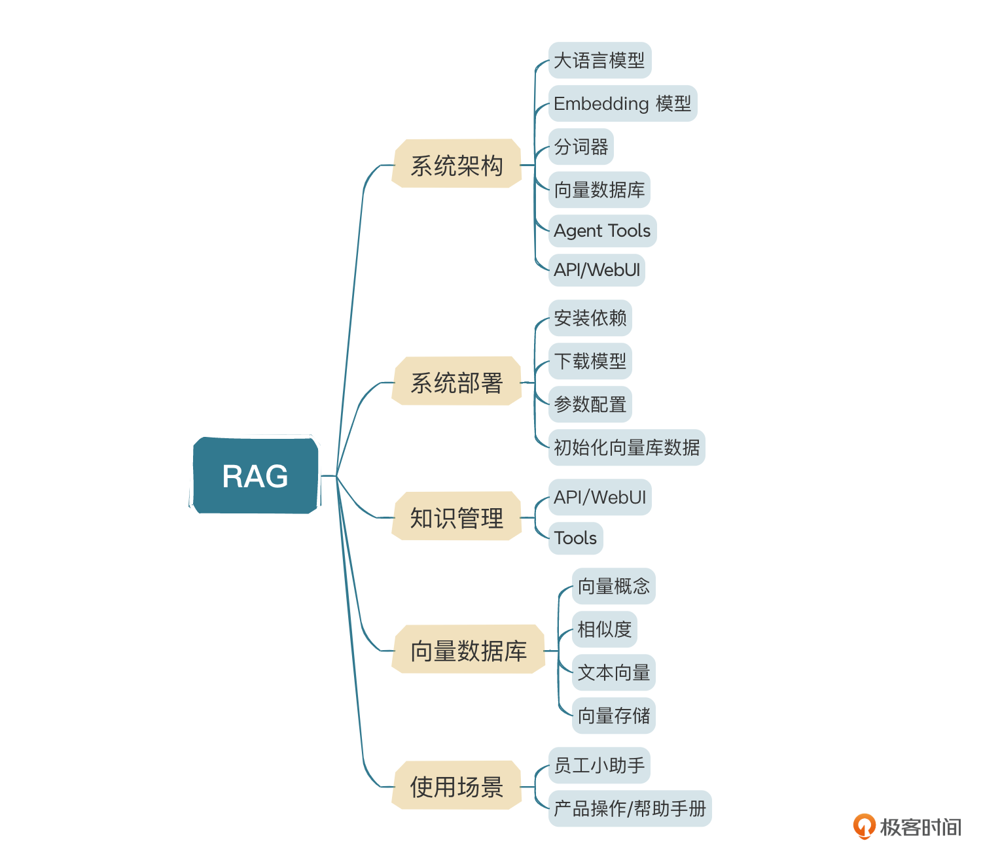

本节课我们基于 6B、LangChain、Faiss 搭建了企业内部知识库系统，了解了知识库、向量库、智能体等相关的知识和应用场景，完整地体验了 RAG 场景。这节课还有很多可以动手操作的小实验，比如自定义 Tool、切换向量数据库、自定义 API，时间充足的话你可以每一个都试一下，学习效果会更好。

## 思考题

在前面知识库的例子中，我们将大模型的输出和知识库检索的全部结果进行了展示，实际应用过程中，一般不会把这两个输出的内容全部返回给用户，你可以思考一下如何设计可以更加人性化的返回结果。欢迎你在评论区留言，和我一起讨论，也欢迎你把这节课的内容分享给需要的朋友，我们下节课再见！

戳此加入课程交流群
