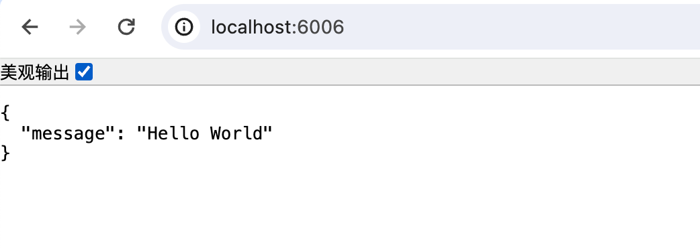

# 07 | 大模型API封装：自建大模型如何对外服务？

你好，我是独行。

上一节课我们详细讲解了基于 ChatGLM3-6B + LangChain + 向量数据库的企业内部知识系统，在这个演示项目中，其实已经用到了 API 的封装，我们从 WebUI 界面提问，通过接口将数据传到后端服务，从而获得响应。大模型是没有 Web API 的，所以需要我们进行一次封装，将大模型的核心接口封装成 Web API 来为用户提供服务，这是企业自建大模型的必经之路。

在这里我们需要引入一个类似于 SpringBoot 的框架，用来做接口服务化，在 Python 技术体系里，有一个框架叫 FastAPI，可以很方便地实现接口注册，所以我们这节课会基于 FastAPI 对大模型的接口进行封装。实际上光写一个 Demo 不算难，但是如果要完整地用于工程化项目，还是有不少事情要注意，所以这节课我会把各种各样和 API 相关的细节梳理出来，学完这节课的内容，再结合前面学习的大模型部署，你本地搭建的大模型基本可以对外提供服务了。

## 接口封装

提供 Web API 服务需要两个技术组件：Uvicorn 和 FastAPI。

Uvicorn 作为 Web 服务器，类似 Tomcat，但是比 Tomcat 轻很多。允许异步处理 HTTP 请求，所以非常适合处理并发请求。基于 uvloop 和 httptools，所以具备非常高的性能，适合高并发请求的现代 Web 应用。

FastAPI 作为 API 框架，和 SpringBoot 差不多，同样比 SpringBoot 轻很多，只是形式上类似于 SpringBoot 的角色。结合使用 Uvicorn 和 FastAPI，你可以构建一个高性能、易于扩展的异步 Web 应用程序或 API。Uvicorn 作为服务器运行你的 FastAPI 应用，可以提供优异的并发处理能力，而 FastAPI 则让你的应用开发得更快、更简单、更安全。

接下来我们一步一步讲解。首先，安装所需要的依赖包。

### 安装依赖

```
pip install fastapi
pip install uvicorn
```

### 代码分层

简单来看，创建 api.py，写入以下代码，就可以定义一个接口。

```python
import uvicorn
from fastapi import FastAPI
# 创建API应用
app = FastAPI()
@app.get("/")
async def root():
 return {"message": "Hello World"}
if __name__ == '__main__':
 uvicorn.run(app, host='0.0.0.0', port=6006, log_level="info", workers=1)
python api.py
```



实际开发过程中，接口输入可能是多个字段，和 Java 接口一样，需要定义一个 Request 实体类来承接 HTTP 请求参数，Python 里使用 Pydantic 模型来定义数据结构，Pydantic 是一个数据验证和设置管理的库，它利用 Python 类型提示来进行数据验证。类似 Java 里的Validation，下面这段代码你应该并不陌生。

```java
import javax.validation.constraints.Min;
import javax.validation.constraints.NotNull;
import javax.validation.constraints.Size;
public class Product {
   @NotNull
   @Size(min = 2, max = 30)
   private String name;
   @NotNull
   @Min(0)
   private Float price;
   // 构造器、getter 和 setter 省略
}
```

对应的 Python 实现就是这样的：

```python
from fastapi import FastAPI
from pydantic import BaseModel, Field
from typing import Optional, List
app = FastAPI()
class Message(BaseModel):
   role: str
   content: str
class ChatMessage(BaseModel):
   history: List[Message]
   prompt: str
   max_tokens: int
   temperature: float
   top_p: float = Field(default=1.0)
@app.post("/v1/chat/completions")
async def create_chat_response(message: ChatMessage):
   return {"message": "Hello World"}
if __name__ == '__main__':
 uvicorn.run(app, host='0.0.0.0', port=6006, log_level="info", workers=1)
```

这里引入了一个 BaseModel 类，类似于 Java 里的 Object 类，但是又不完全是 Object，Object 是所有 Java 类的基类，Java 中所有类会默认集成 Object 类的公共方法，比如toString()、equals()、hashcode() 等，而 BaseModel 是为了数据验证和管理而设计的。当你创建一个继承自 BaseModel 的类时，比如上面的 ChatSession 和 Message 类，将自动获得数据验证、序列化和反序列化的功能。

另外，我们实际开发过程中，也不可能把所有 API 的定义和 Pydantic 类放在最外层，按照Java 工程化的最佳实践，Web 应用我们一般会进行分层，比如 controller、service、model、tool 等，Python 工程化的时候，为了方便管理代码，也会进行分层，一个典型的代码结构如下：

```
project_name/
│
├── app/                         # 主应用目录
│   ├── main.py                  # FastAPI 应用入口
│   └── controller/              # API 特定逻辑
│       └── chat.py
│   └── common/                  # 通用API组件
│       └── errors.py            # 错误处理和自定义异常
│
├── services/                    # 服务层目录
│   ├── chat_service.py          # 聊天服务相关逻辑
│
├── schemas/                     # Pydantic 模型（请求和响应模式）
│   ├── chat_schema.py           # 聊天数据模式
│
├── database/                    # 数据库连接和会话管理
│   ├── session.py               # 数据库会话配置
│   └── engine.py                # 数据库引擎配置
│
├── tools/                       # 工具和实用程序目录
│   ├── data_migration.py        # 数据迁移工具
│
├── tests/                       # 测试目录
│   ├── conftest.py              # 测试配置和夹具
│   ├── test_services/           # 服务层测试
│   │   ├── test_chat_service.py
│   └── test_controller/
│       ├── test_chat_controller.py
│
├── requirements.txt             # 项目依赖文件
└── setup.py                     # 安装、打包、分发配置文件
```

FastAPI 的 include_router 方法就是用来将不同的路由集成到主应用中的，有助于组织和分离代码，特别是在构建大型工程化应用时，非常好用。你可以看一下修改后的代码。

应用入口 main.py

```python
import uvicorn as uvicorn
from fastapi import FastAPI
from controller.chat_controller import chat_router as chat_router
app = FastAPI()
app.include_router(chat_router, prefix="/chat", tags=["chat"])
if __name__ == '__main__':
   uvicorn.run(app, host='0.0.0.0', port=6006, log_level="info", workers=1)
```

chat_controller.py

```python
from fastapi import APIRouter
from service.chat_service import ChatService
from schema.chat_schema import ChatMessage, MessageDisplay
chat_router = APIRouter()
chat_service = ChatService()
@chat_router.post("/new/message/")
def post_message(message: ChatMessage):
   return chat_service.post_message(message)
@chat_router.get("/get/messages/")
def get_messages():
   return chat_service.get_messages()
```

chat_service.py

```python
from schema.chat_schema import ChatMessage
class ChatService:
   def post_message(self, message: ChatMessage) :
       print(message.prompt)
       return {"message": "post message"}
   def get_messages(self):
       return {"message": "get message"}
```

参数类定义如下：

```python
from pydantic import BaseModel, Field
class Message(BaseModel):
   role: str
   content: str
class ChatMessage(BaseModel):
   prompt: str
   max_tokens: int
   temperature: float = Field(default=1.0)
   top_p: float = Field(default=1.0)
```

我们可以在 chat_service 里进行详细地业务逻辑处理，到这里基本就和 Java 里一样了。下面是一段简单的测试代码：

```python
import json
import requests
url = 'http://localhost:6006/chat/new/message/'
data = {
   'prompt': 'hello',
   'max_tokens': 1000
}
response = requests.post(url, data=json.dumps(data))
print(response.text)
url2 = 'http://localhost:6006/chat/get/messages/'
response = requests.get(url2)
print(response.text)
{"message":"post message"}
{"message":"get message"}
```

关于 FastAPI 的使用，你可以参考这个教程。工程化代码结构搞定，我们就可以封装大模型的接口了。

### 大模型接口封装

不同的大模型对应的对话接口不一样，下面的示例代码基于 ChatGLM3-6B。我们在 service层进行模型对话的封装。你可以看一下示例代码。

```python
from datetime import datetime
import model_manager
from schema.chat_schema import ChatMessage
class ChatService:
   def post_message(self, message: ChatMessage):
       print(message.prompt)
       model = model_manager.ModelManager.get_model()
       tokenizer = model_manager.ModelManager.get_tokenizer()
       response, history = model.chat(
           tokenizer,
           message.prompt,
           history=message.histroy,
           max_length=message.max_tokens,
           top_p=message.top_p,
           temperature=message.temperature
       )
       now = datetime.datetime.now()  # 获取当前时间
       time = now.strftime("%Y-%m-%d %H:%M:%S")  # 格式化时间为字符串
       answer = {
           "response": response,
           "history": history,
           "status": 200,
           "time": time
       }
       log = "[" + time + "] " + '", prompt:"' + message.prompt + '", response:"
       print(log)
       return answer
   def get_messages(self):
       return {"message": "get message"}
```

定义一个 ModelManager 类进行大模型的懒加载。

```python
from transformers import AutoTokenizer, AutoModelForCausalLM
class ModelManager:
   _model = None
   _tokenizer = None
   @classmethod
   def get_model(cls):
       if cls._model is None:
           _model = AutoModelForCausalLM.from_pretrained("chatglm3-6b", trust_re
       return _model
       @classmethod
   def get_tokenizer(cls):
       if cls._tokenizer is None:
           _tokenizer = AutoTokenizer.from_pretrained("chatglm3-6b", trust_remot
       return _tokenizer
```

model.chat() 是 6B 暴露的对话接口，通过对 model.chat() 的封装就可以实现基本的对话接口了，这个接口一次性输出大模型返回的内容，而我们在使用大模型产品的时候，比如ChatGPT 或者文心一言，会发现大模型是一个字一个字返回的，那是什么原因呢？那种模式叫流式输出。

## 流式输出

流式输出使用另一个接口：model.stream_chat，有几种模式，像一个字一个字输出，比如：

- 我是中国人

或者每次输出当前已经输出的全部，比如：

- 我我是我是中我是中国我是中国人

当然也有每次吐出 2 个字的，实际生产过程中可以根据产品交互设计自行修改逻辑。我们看一个简单的代码片段，通过 stream 变量来控制是否是流式输出。

```
if stream:
   async for token in callback.aiter():
       # Use server-sent-events to stream the response
       yield json.dumps(
           {"text": token, "message_id": message_id},
           ensure_ascii=False)
else:
   answer = ""
   async for token in callback.aiter():
       answer += token
   yield json.dumps(
       {"text": answer, "message_id": message_id},
       ensure_ascii=False)
await task
```

我们输入“你好”，当 stream=true 时，接口输出是这样的：

```
data: {"text": "你", "message_id": "80b2af55c5b7440eaca6b9d510677a75"}
data: {"text": "好", "message_id": "80b2af55c5b7440eaca6b9d510677a75"}
data: {"text": "", "message_id": "80b2af55c5b7440eaca6b9d510677a75"}
data: {"text": "！", "message_id": "80b2af55c5b7440eaca6b9d510677a75"}
data: {"text": "我是", "message_id": "80b2af55c5b7440eaca6b9d510677a75"}
data: {"text": "人工智能", "message_id": "80b2af55c5b7440eaca6b9d510677a75"}
data: {"text": "助手", "message_id": "80b2af55c5b7440eaca6b9d510677a75"}
data: {"text": " Chat", "message_id": "80b2af55c5b7440eaca6b9d510677a75"}
data: {"text": "GL", "message_id": "80b2af55c5b7440eaca6b9d510677a75"}
data: {"text": "M", "message_id": "80b2af55c5b7440eaca6b9d510677a75"}
data: {"text": "3", "message_id": "80b2af55c5b7440eaca6b9d510677a75"}
data: {"text": "-", "message_id": "80b2af55c5b7440eaca6b9d510677a75"}
data: {"text": "6", "message_id": "80b2af55c5b7440eaca6b9d510677a75"}
data: {"text": "B", "message_id": "80b2af55c5b7440eaca6b9d510677a75"}
data: {"text": "，", "message_id": "80b2af55c5b7440eaca6b9d510677a75"}
data: {"text": "很高兴", "message_id": "80b2af55c5b7440eaca6b9d510677a75"}
data: {"text": "见到", "message_id": "80b2af55c5b7440eaca6b9d510677a75"}
data: {"text": "你", "message_id": "80b2af55c5b7440eaca6b9d510677a75"}
data: {"text": "，", "message_id": "80b2af55c5b7440eaca6b9d510677a75"}
data: {"text": "欢迎", "message_id": "80b2af55c5b7440eaca6b9d510677a75"}
data: {"text": "问我", "message_id": "80b2af55c5b7440eaca6b9d510677a75"}
data: {"text": "任何", "message_id": "80b2af55c5b7440eaca6b9d510677a75"}
data: {"text": "问题", "message_id": "80b2af55c5b7440eaca6b9d510677a75"}
data: {"text": "。", "message_id": "80b2af55c5b7440eaca6b9d510677a75"}
```

当 stream=false 时，接口返回如下：

```
data: {"text": "你好！我是人工智能助手，很高兴为您服务。请问有什么问题我可以帮您解答吗？", "m
```

到这里，大模型的 API 基本就封装好了，接下来我们看下如何调用。

## 接口调用

在实际工程化过程中，我们一般会把 AI 相关的逻辑，包括大模型 API 的封装放在 Python 应用中，上层应用一般通过其他语言实现，比如 Java、C#、Go 等，这里我简单举一个 Java 版本的调用例子。非流式输出就是普通的 HTTP 请求，我们就不展示了，重点看下流式输出怎么进行调用，主要分两步，都是流式的。

1. Java 调用 Python 接口：主要用到了 okhttp3 框架，需要组装参数、发起流式请求，事件监听处理三步。

```java
@ApiOperation(value = "流式发送对话消息")
@PostMapping(value = "sendMessage")
public void sendMessage(@RequestBody ChatRequest request, HttpServletResponse res
 try {
   JSONObject body = new JSONObject();
   body.put("model", request.getModel());
   body.put("stream", true);
   JSONArray messages = new JSONArray();
   JSONObject query = new JSONObject();
   query.put("role", "user");
   query.put("content", request.getQuery());
   messages.add(query);
   body.put("messages", messages);
   EsListener eventSourceListener = new EsListener(request, response);
   RequestBody formBody = RequestBody.create(body, MediaType.parse("application/
   Request.Builder requestBuilder = new Request.Builder();
   Request request2 = requestBuilder.url(URL).post(formBody).build();
   EventSource.Factory factory = EventSources.createFactory(OkHttpUtil.getInstan
   factory.newEventSource(request2, eventSourceListener);
   eventSourceListener.getCountDownLatch().await();
 } catch (Exception e) {
   log.error("流式调用异常", e);
 }
}
```

EsListener 继承自 EventSourceListener，在 Request 请求的过程中不断触发 EsListener 的onEvent 方法，然后将数据写回前端。

```java
@Override
public void onEvent(EventSource eventSource, String id, String type, String data)
 try {
   output.append(data);
   if ("finish".equals(type)) {
   }
   if ("error".equals(type)) {
   }
   // 开始处理data，此处只展示基本操作
   // 开发过程中具体逻辑可自行扩展
   if (response != null) {
     response.getWriter().write(data);
     response.getWriter().flush();
   }
 } catch (Exception e) {
   log.error("事件处理异常", e);
 }
}
```

2. 前端调用 Java 接口：使用 JS 原生 EventSource 的 API 就可以。

```xml
<script>
   let eventData = '';
   const eventSource = new EventSource('http://localhost:8888/sendMessage');
   eventSource.onmessage = function(event) {
       // 累加接收到的事件数据
       eventData += event.data;
   };
</script>
```

到这一步，大模型 API 从封装到调用就基本完成了，你可以把整个链路都串起来跑一跑，体验下效果。实际工程化的过程中，还会遇到其他问题，比如 API 的鉴权（指 Java->Python）、跨域问题、API 限流问题（大模型的吞吐量有限），我们会在后面的课程中讲解。

## 小结

我们这节课学的内容是自建大模型服务不可缺少的一步，整体来说不算难，唯一可能难一点的就是要使用 Python 语言，因为在使用 FastAPI 的过程中，会有大量的异步操作，和 Java 的处理方式有点差异，需要注意下。

这节课学完，我们基本上把企业内部构建大模型的过程全部讲完了，你自己构建的大模型基本可以对外提供服务了。如果在生产环境使用，一定要注意做好降级准备，因为有很多不确定性，比如模型的吞吐量（TPS）评估是否准确，模型会不会出现意想不到的输出等等，一旦出现问题随时降级。

## 思考题

前面我们提到，大模型相关的 API 封装在 Python 应用中，对用户提供服务的时候，会再套一层 Java 应用，你可以想一下为什么要这么设计，欢迎你把你的想法分享到评论区，我们一起讨论，如果你觉得这节课的内容对你有帮助的话，也欢迎你分享给其他朋友，我们下节课再见！
