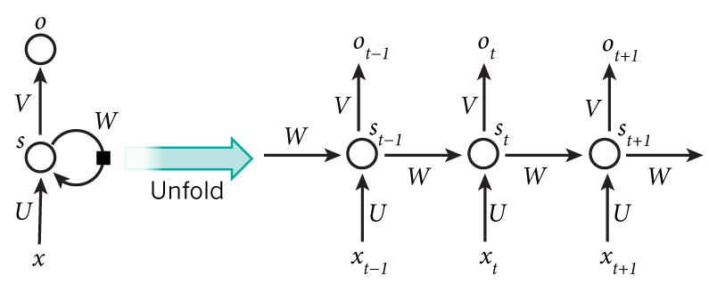
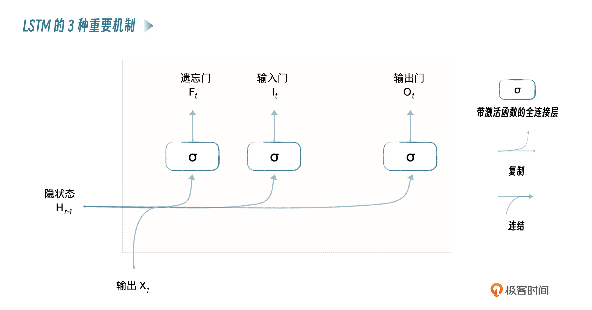

# 10 | 经典算法之RNN：开发人员绕不开的循环神经网络

你好，我是独行。

上一节课的最后我们介绍了神经网络，神经网络有很多种，包括前馈神经网络（FNN）、卷积神经网络（CNN）、循环神经网络（RNN）、图神经网络（GNN）、自注意力机制模型Transformer 等。

这节课我们就来学习其中的 RNN，它主要用来处理序列数据，为什么我们要学习 RNN 呢？实际上目前大部分大语言模型都是基于 Transformer 的，通过学习 RNN，我们可以理解神经网络如何处理序列中的依赖关系、记忆过去的信息，并在此基础上生成预测的基本概念，尤其是几个关键问题，比如梯度消失和梯度爆炸等，为我们后面进一步理解 Transformer 打下基础。

## 循环神经网络

循环神经网络（RNN）是一类用于处理序列数据的神经网络。不同于传统的前馈神经网络，RNN 能够处理序列长度变化的数据，如文本、语音等。RNN 的特点是在模型中引入循环，使得网络能够保持某种状态，从而在处理序列数据时表现出更好的性能。我们看一下下面的图片。



- 图片源于网络

左边简单描述 RNN 的原理，x 是输入层，o 是输出层，中间 s 是隐藏层，在 s 层进行一个循环，右边表示展开循环看到的逻辑，其实是和时间 t 相关的一个状态变化，也就是说神经网络在处理数据的时候，能看到前一时刻、后一时刻的状态，也就是我们常说的上下文。

举个例子，你女朋友看了小米汽车发布会，和你说她想买个 21.59 万的小米，你肯定知道她要买的是标准版的小米汽车，而不是 21.59 万粒小黄米，因为你知道上下文。如果换做模型，怎么才能准确地理解我们的语义呢？同样，需要上下文。RNN 因为隐藏层有时序状态，那么在推理的时候就可以借助上下文，从而更加准确地理解语义。

## 基本结构与原理

RNN 的核心在于隐藏层，隐藏层主要的逻辑在于如何随时间的变化更新隐藏状态，隐藏状态的计算公式如下：

- ​ =

## f(W

- ​ +​ +​)

## h

- ​x

## W

- ​h

## b

- t−1txhthhh

## h

## x

## h

- 是当前时间步的隐藏状态，是当前时间步的输入，是前一个时间步的隐藏状

其中，

- t−1​t​t​

## W

## W

## b

## f

- 和是权重矩阵，是偏置项， 是激活函数，在这个例子里我们使用 tanh 函

态，

- xhhh​h​​

数。

假设我们正在处理一个文本序列任务，目的是根据已有的字符序列预测下一个字符。为了简化，我们假设字符集只包含三个字符：“A”“B”“C”，并且我们的任务是给定序列“AB”，预测下一个字符。

首先，在输入层，我们将字符转换为数值形式，例如通过 One-hot 编码，“A”=[1,0,0]，“B”=[0,1,0]，“C”=[0,0,1]。所以，序列“AB”的输入表示为两个向量：[1,0,0] 和 [0,1,0]。

其次，在隐藏层，假设我们只有一个隐藏单元，实际应用中可能会有多个，使用 tanh 作为激活函数。

时间步 1- 处理 A：

1. 输入：[1,0,0]​ =

## 0

## W

## W

## h

- 假设和的值均为 1，初始隐藏状态。0xhhh​​​ =

## tanh(1 ∗[1, 0, 0] + 1 ∗0) = tanh(1) ≈0.76

## h

- 计算新的隐藏状态。1

时间步 2- 处理 B：

1. 输入：[0,1,0]​ ≈

## 0.76

## h

- 使用上一个时间步的隐藏状态。1​ =

## tanh(1 ∗[0, 1, 0] + 1 ∗0.76) = tanh(0.76) ≈0.64

## h

- 计算新的隐藏状态。2

## h

## x

在这个简化的例子中，每个时间步的隐藏状态

- 基于当前的输入和上一个时间步的隐藏​t​t

## h

状态

- 计算得到。通过这种方式，RNN 能够记住之前的输入（在这个例子中是字符 A 和t−1​

B），并使用这些信息来影响后续的处理，比如预测序列中的下一个字符。这样，模型就具备了记忆功能。


注：One-hot 编码的内容来自《深度学习推荐系统实战》中的 05 | 特征处理：如何利用Spark 解决特征处理问题？

## 关键挑战

RNN 通过当前的隐藏状态来记住序列中之前的信息。这种记忆一般是短期的，因为随着时间步的增加，早期输入对当前状态的影响会逐渐减弱，在标准 RNN 中，尤其当遇到梯度消失情况时，就会遇到短期记忆的问题，几乎无法更新权重。

### 梯度消失

我们先来看下什么是梯度？梯度是指函数在某一点的斜率，在深度学习中，该函数一般指具有多个变量的损失函数，变量就是模型的权重。损失函数衡量的是模型预测与实际数据之间的差异，一般情况下，我们要尽可能地让损失函数的值最小。如何找到这个最小值呢？需要进行梯度下降，也就是说，我们要不断调整参数（权重），使损失函数的值降到最小，这个过程就是梯度下降。

为什么会产生梯度消失呢？一般有两个原因。

1. 深层网络中的连乘效应：在深层网络中，梯度是通过链式法则进行反向传播的。如果每一层的梯度都小于 1，那么随着层数的增加，这些小于 1 的值会连乘在一起，导致最终的梯度非常小。

2. 激活函数的选择：使用某些激活函数，如 tanh，函数的取值范围是 -1～1，小于 1 的数进行连乘，也会快速降低梯度值。

这里我解释下反向传播，在深度学习中，训练神经网络涉及两个主要的传播阶段：前向传播和反向传播。在前向传播阶段，输入数据从网络的输入层开始，逐层向前传递至输出层。每一层都会对其输入进行计算，如加权求和，然后应用激活函数等，并将计算结果传递给下一层，直到最终产生输出。这个过程的目标是根据当前的网络参数、权重和偏置等得到预测输出。

一旦在输出层得到了预测输出，就会计算损失函数，即预测输出与实际目标输出之间的差异。接下来，这个损失会被用来计算损失函数相对于网络中每个参数的梯度，这是通过链式法则实现的。这个计算过程从输出层开始，沿着网络向后，即向输入层的方向，逐层进行，这就是“反向传播”的由来。

这些梯度表示了为了减少损失，各个参数需要如何调整。最后，这些梯度会用来更新网络的参数，通常是通过梯度下降或其变体算法实现。而在反向传播过程中，每到达一层，都会触发激活函数，这就是我们上面说的第 2 点原因。

由此可见，如果要解决梯度消失的问题，我们就从这两个原因入手。

1. 长短期记忆（LSTM）和门控循环单元（GRU）是专门为了避免梯度消失问题而设计的。它们通过引入门控机制来调节信息的流动，保留长期依赖信息，从而避免梯度在反向传播过程中消失。

2. 使用 ReLU 及其变体激活函数，在正区间内的梯度保持恒定，不会随着输入的增加而减少到 0，这有助于减轻梯度消失问题。

### 梯度爆炸

与梯度消失相对的问题是梯度爆炸，当模型的梯度在反向传播过程中变得非常大，以至于更新后的权重偏离了最优值，导致模型无法收敛，甚至发散。

通常梯度爆炸发生原因有三个。

1. 深层网络的连乘效应：在深层网络中，梯度是通过链式法则进行反向传播的。如果每一层的梯度都大于 1，那么随着层数的增加，这些大于 1 的值会连乘在一起，导致最终的梯度非常大。

2. 权重初始化不当：如果网络的权重初始化得太大，那么在前向传播过程中信号的大小会迅速增加，同样，反向传播时梯度也会迅速增加。

3. 使用不恰当的激活函数：某些激活函数（如 ReLU）在正区间的梯度为常数。如果网络架构设计不当，使用这些激活函数也可能导致梯度爆炸。

梯度爆炸和梯度消失基本相反，解决方法一样，要么使用长短期记忆和门控循环单元调整网络结构，要么替换激活函数，还有一种办法是进行梯度裁剪，梯度裁剪意思是在训练过程中，通过限制梯度的最小 / 大值来防止梯度消失 / 爆炸，间接地保持梯度的稳定性。

### 长短期记忆（LSTM）

无论是梯度消失还是梯度爆炸，都提到长短期记忆结构，我们来简单看一下，LSTM 就像是具有类似大脑记忆功能的模型，它在处理数据，如文本、时间序列数据时，能够记住对当前任务重要的信息，并忘记不重要的信息。这是通过以下几个关键机制实现的。

1. 遗忘门（Forget Gate）：决定了哪些信息是过时的、不重要的，因此应该从模型的记忆中抛弃。就像你在阅读时可能忘记某个次要角色的不重要的细节。

2. 输入门（Input Gate）：它决定哪些新的信息是重要的，应该被添加到模型的记忆中。这就像你在阅读新章节时，发现关于男主人公重要的新信息并记住它们。

3. 输出门（Output Gate）：它决定了在当前时刻，哪些记忆是相关的，应该被用来生成输出。这就像你在思考男主人公的动机和行为时，会回想起之前关于他的重要记忆。



通过这些机制，LSTM 能够在处理序列数据时，有效地保留长期的依赖信息，就像是记住故事中的关键情节和角色，同时避免了标准 RNN 中常见的梯度消失问题。这使得 LSTM 特别适用于需要理解整个序列背景的任务，比如语言翻译，需要理解整个句子的含义，或者股票价格预测，需要考虑长期的价格变化趋势。

## RNN 实际应用场景

### 文本生成

文本生成是 RNN 的一个典型应用，通过学习大量的文本数据，RNN 能够生成具有相似风格的文本。我们看一个简单的文本生成模型的代码示例。

```python
import torch
import torch.nn as nn
import torch.optim as optim
from torch.nn.utils.rnn import pad_sequence
from torch.utils.data import DataLoader, Dataset
# 数据预处理
text = "Here is some sample text to demonstrate text generation with RNN. This is
tokens = text.lower().split()
tokenizer = {word: i + 1 for i, word in enumerate(set(tokens))}
total_words = len(tokenizer) + 1
# 创建输入序列
sequences = []
for line in text.split('.'):
   token_list = [tokenizer[word] for word in line.lower().split() if word in tok
   for i in range(1, len(token_list)):
       n_gram_sequence = token_list[:i + 1]
       sequences.append(n_gram_sequence)
max_sequence_len = max([len(x) for x in sequences])
sequences = [torch.tensor(seq) for seq in sequences]
sequences = pad_sequence(sequences, batch_first=True, padding_value=0)
class TextDataset(Dataset):
   def __init__(self, sequences):
       self.x = sequences[:, :-1]
       self.y = sequences[:, -1]
   def __len__(self):
       return len(self.x)
   def __getitem__(self, idx):
       return self.x[idx], self.y[idx]
dataset = TextDataset(sequences)
dataloader = DataLoader(dataset, batch_size=2, shuffle=True)
# 构建模型
class RNNModel(nn.Module):
   def __init__(self, vocab_size, embed_size, hidden_size):
       super(RNNModel, self).__init__()
       self.embedding = nn.Embedding(vocab_size, embed_size)
       self.lstm = nn.LSTM(embed_size, hidden_size, batch_first=True)
       self.fc = nn.Linear(hidden_size, vocab_size)
   def forward(self, x):
       x = self.embedding(x)
       x, _ = self.lstm(x)
       x = self.fc(x[:, -1, :])
       return x
model = RNNModel(total_words, 64, 20)
criterion = nn.CrossEntropyLoss()
optimizer = optim.Adam(model.parameters(), lr=0.001)
# 模型训练
for epoch in range(100):
   for x_batch, y_batch in dataloader:
       optimizer.zero_grad()
       output = model(x_batch)
       loss = criterion(output, y_batch)
       loss.backward()
       optimizer.step()
   if epoch % 10 == 0:
       print(f'Epoch {epoch + 1}, Loss: {loss.item()}')
# 文本生成
def generate_text(seed_text, next_words, model, max_sequence_len):
   model.eval()
   for _ in range(next_words):
       token_list = [tokenizer[word] for word in seed_text.lower().split() if wo
       token_list = torch.tensor(token_list).unsqueeze(0)
       token_list = nn.functional.pad(token_list, (max_sequence_len - 1 - token_
       with torch.no_grad():
           predicted = model(token_list)
           predicted = torch.argmax(predicted, dim=-1).item()
       output_word = ""
       for word, index in tokenizer.items():
           if index == predicted:
               output_word = word
               break
       seed_text += " " + output_word
   return seed_text
print(generate_text("Here is", 4, model, max_sequence_len))
```

核心过程我在代码中注释过了，这只是一个简单的代码示例，实际使用的时候，你可能需要使用更大的文本数据集来训练模型，调整模型架构，比如增加层数、调整 LSTM 单元数量、超参数等，以及实施更复杂的数据预处理和文本生成策略，以达到更好的生成效果。

## 小结

这节课内容实际是有点难度的，我们通过简单的例子学习了 RNN 的基本概念，然后通过敲代码进行练习。RNN 的优势在于它的记忆能力，通过隐藏层循环结构捕捉序列的长期依赖关系，特别适合用于文本生成、语音识别等领域。同时，RNN 也有局限性，比如梯度消失、梯度爆炸等，而引入 LSTM 可以一定程度上解决这些问题。

## 思考题

既然引入 LSTM 可以解决一系列问题，那目前主流的大语言模型为什么没有使用 RNN 架构呢？请你说说你的理解，也欢迎你在评论区和我交流讨论，如果你觉得这节课的内容对你有帮助的话，欢迎你分享给其他朋友，我们下节课再见！
