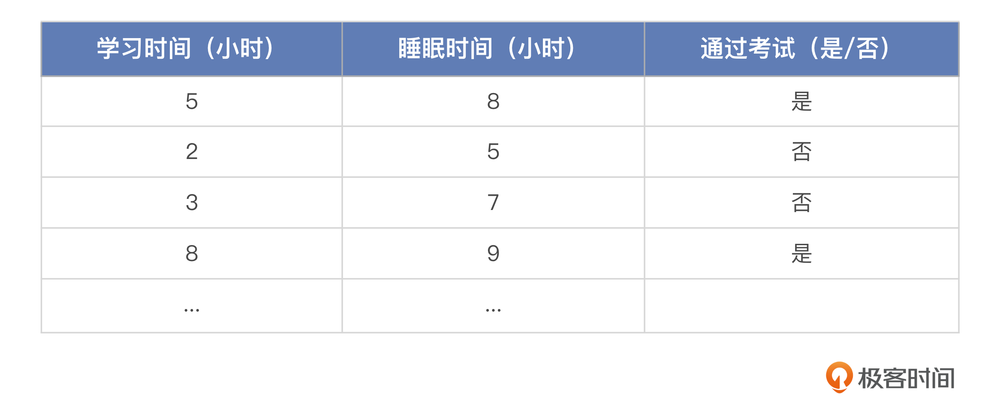

# 18 | 大模型预训练：Pre-Training如何让模型变聪明？

你好，我是独行。

上节课我向你介绍了模型的内部结构，为了理解模型的内部结构，我们又顺带回顾了一下模型的实现原理，其中我讲过一句话：模型的训练过程就是不断调整权重的过程，准确一点还应该加上偏置，模型的训练过程就是不断调整权重和偏置的过程，调整的过程依赖反向传播、损失函数等等。

前面我们没有详细讲解这方面的细节，这节课我们再通过一个简单的例子，把预训练的过程完整细致地串一遍。我们将使用一个三层神经网络结构的模型来进行数据分类的展示。这个模型接收两个输入变量：学习时间和睡眠时间，并基于这些输入预测一个学生是否能够通过考试。

我们还是按照常规的模型训练步骤来进行，但前面讲过的内容这节课就不细说了。

## 网络结构设计

模型网络结构的定义，你可以参考手敲 Transformer 那节课的代码。

```python
import torch
from torch import nn
# 定义一个只包含解码器的Transformer模型
class TransformerDecoderModel(nn.Module):
   def __init__(self, vocab_size, embed_size, num_heads, hidden_dim, num_layers)
       super(TransformerDecoderModel, self).__init__()
       self.embed = nn.Embedding(vocab_size, embed_size)
       self.positional_encoding = nn.Parameter(torch.randn(embed_size).unsqueeze
       decoder_layer = nn.TransformerDecoderLayer(d_model=embed_size, nhead=num_
       self.transformer_decoder = nn.TransformerDecoder(decoder_layer, num_layer
       self.fc = nn.Linear(embed_size, vocab_size)
   def forward(self, src):
       src = self.embed(src) + self.positional_encoding
       src_mask = self.generate_square_subsequent_mask(src.size(0))
       output = self.transformer_decoder(src, src, src_mask)
       output = self.fc(output)
       return output
   def generate_square_subsequent_mask(self, sz):
       mask = (torch.triu(torch.ones(sz, sz)) == 1).transpose(0, 1)
       mask = mask.float().masked_fill(mask == 0, float('-inf')).masked_fill(mas
       return mask
```

初始化的时候指定 num_layers=3 就可以了。

## 数据集准备

准备一些训练数据，可以用 CSV 格式的文件存储。



将数据集分割为训练集和测试集，常用的比例为 80% 训练集和 20% 测试集，确保模型能在未见过的数据上进行有效预测。

## 初始化参数

## (W)

## (b)

这里说的参数主要是指权重

- 和偏置。这两个变量的初始值非常关键，因为它们可以

影响网络的收敛速度，以及是否能够收敛到一个好的解。选择好的初始值可以避免一些问题，如梯度消失或梯度爆炸。我们来看一些常用的权重和偏置初始化方法。

### 随机初始化

通常使用较小的随机数来初始化权重。这些随机值可以从一个均匀分布或正态分布中抽取。例

## 1/

- ​n

## n

如从均值为 0，标准差为

- 的正态分布中抽取，其中 是输入到当前层的节点数。这种

初始化方法有时被叫做 He 初始化、Glorot 初始化或者 Xavier 初始化，具体取决于所选分布的方差。刚刚我们定义的 Transformer 模型，解码器层默认使用的权重初始化方法就是Glorot。

偏置通常可以初始化为 0 或者很小的正数，比如 0.01。这样做的理由是在初期不希望偏置对结果有过大影响，让模型主要通过调整权重来学习。

### 常数初始化

将所有权重或偏置设置为同一个常数，比如 0。不过我不太推荐这种方法，因为它会导致神经网络在训练初期每个神经元的行为都相同，这会阻碍有效的学习。

### 特定分布初始化

对于某些特定的网络架构或激活函数，可能需要特定的初始化方法。例如，使用 ReLU 激活函数的时候，He 初始化，也就是使用较大的方差来初始化权重，通常效果更好，因为它考虑到了 ReLU 在负值上的非激活特性。

### 正交初始化

在某些情况下，特别是在训练深层网络或循环神经网络（RNNs）的时候，使用正交初始化方法来初始化权重有助于减少梯度消失或爆炸的问题。正交初始化保证了权重矩阵的行或列是正交的，这有助于保持激活和梯度在不同层间的独立性。

我们可以查看源代码来了解各个层，如 Embedding 层、Linear 层、编码器、解码器层使用的初始化方法。使用下面的方法查看默认的参数值：

```
print(decoder_layer.self_attn.in_proj_weight)
```

在实际应用中，如果默认的初始化策略不满足特定的需求，你也可以用下面的代码，通过自定

```
义函数并使用 .apply() 方法来对模型的所有参数进行自定义初始化。这种方法非常灵活，
```

适用于复杂的模型结构。

```python
# 创建一个TransformerDecoderLayer实例
decoder_layer = nn.TransformerDecoderLayer(d_model=512, nhead=8)
# 如果需要自定义初始化
def custom_init(m):
   if isinstance(m, nn.Linear):
       torch.nn.init.xavier_uniform_(m.weight)
       if m.bias is not None:
           torch.nn.init.constant_(m.bias, 0.0)
# 应用自定义初始化
decoder_layer.apply(custom_init)
```

## 前向传播

在训练过程中，前向传播就是 Embedding 后的输入向量一层一层向后传递的过程，每一层都有权重和偏置，我们看一下 Linear 层的权重和参数是怎么赋值的。

```
self.fc = nn.Linear(embed_size, vocab_size)
```

nn.Linear 定义：

```python
def __init__(self, in_features: int, out_features: int, bias: bool = True,
            device=None, dtype=None) -> None:
   factory_kwargs = {'device': device, 'dtype': dtype}
   super().__init__()
   self.in_features = in_features
   self.out_features = out_features
   self.weight = Parameter(torch.empty((out_features, in_features), **factory_kw
   if bias:
       self.bias = Parameter(torch.empty(out_features, **factory_kwargs))
   else:
       self.register_parameter('bias', None)
   self.reset_parameters()
```

- 权重（Weights）：一个形状为 (embed_size, num_features) 的矩阵。

- 偏置（Bias）：一个形状为 (embed_size,) 的向量。

当你通过这一层传递输入 input 时（input = self.fc1(input)），它实际上执行的操作是矩阵乘法加上偏置项，你可以看一下计算公式。

- T

## output = input × weight +

## bias

这里 T 表示的是转置，不是次方，这是线性代数中的一个常见操作，用来调整矩阵的维度，使

## m × n

## m

矩阵乘法可以正确执行。在这个公式里，input 是一个

- 的矩阵，其中是批处理大小

## d × n

## n

## d

（即样本数量），而 是特征的数量。weight 是一个

- 的矩阵，其中 是输出层或下一

层神经元的数量。

## n

为了使矩阵乘法有效，input 矩阵的列数 必须与 weight 矩阵的行数匹配。然而，在

## d × n

## n × d

nn.Linear 层中，权重矩阵通常是以

- 的形式存储，而矩阵乘法需要的形状。因

## n × d

## m × n

此，我们对 weight 矩阵进行转置，得到

- 的矩阵，现在可以与的 input 矩阵相

## m × d

## m

乘。结果是一个

- 的矩阵，表示个样本的输出。

对于三层网络模型，前向传播简单计算如下：

从输入层到隐藏层：

- 11

## b1

## Z =

## W X +

- 11

## A =

## ReLU(Z )

从隐藏层到输出层：

- 221

## b2

## Z =

## W A +

- 22

## A =

## σ(Z )

## A2

## σ

其中 是 Sigmoid 函数，一种常用的激活函数。最后将

- 作为输入传入输出层，计算本次

前向传播得到的输出值，用来计算损失。

## 计算损失

损失是神经网络训练过程中非常重要的概念，描述本次前向传播结果和实际值的差异，一般来说越低越好，神经网络根据损失进行反向传播，找到更合适的权重和偏置，进而更新参数。对于我们举的二元分类问题，最常用的损失函数是二元交叉熵损失（Binary Cross-EntropyLoss）。当输出是一个概率值，并且标签是 0 或 1 的时候，这种方法非常合适。损失的计算公式如下：

- N

## 1

## ∑

- ​ log(

## L = −

- ​) + (1 −y​) log(1 −​)

## [ i

## y^i

## y^i ]

- ​ yi​​​

## N

- i=1

## y^i

## N

## y

其中

- 是样本数量，是真实标签，是预测的概率。Python 中可以直接使用下面的函​i​​

数。

```python
import torch.nn as nn
criterion = nn.BCEWithLogitsLoss()
```

通过下面这个方法来使用：

```
loss = criterion(output, target)
```

得到损失值就可以开始反向传播了。当然，如果损失已经非常小，并到达训练目标了，那是可以停止训练的。

## 反向传播

反向传播也是神经网络训练过程中的一个重要概念，用来根据损失推算合适的权重和偏置。为

## y = kx + b

了理解反向传播的含义，我们还是举

- 的例子。

## x = 1

## k

## b

## y

当我们初始化 和 的值分别为 2 和 1 时，如果输入值

- ，那么经过计算 的值为 3。

如果我们期望的值是 4，那么此处就可以通过调用损失函数，把前向传播得到的值 3 和期望值4 传入损失函数 L，计算出损失值。假设得到的损失值是 0.6，这个时候我们需要通过一定的

## x = 1

## k + b = 3

## k

## b

计算公式反推出合适的 和 ，比如当输入

- 时，，这个时候需要找到合适

## k

## b

## k

## b

的 和 。因为 和 有无数种组合，那到底该怎么推呢？我们看一下详细的过程。

- ∂L∂L

## w

## b

反向传播的目的是计算

- （损失 L 对 w 的梯度）和（损失 L 对 b 的梯度），其中和∂w∂b​​

是网络层的权重和偏置。我们可以应用链式法则，你看一下这 2 条公式。

## ∂L

## ∂L

## ∂y

- ​ =​ ⋅

## ∂w

## ∂y

## ∂w

- ​

## ∂L

## ∂L

## ∂y

- ​ =​ ⋅

## ∂b

## ∂y

## ∂b

- ​

## ∂

- 符号 表示偏导数，用于描述在多变量函数中，当保持除了一个变量以外的其他变量固定时，该函数相对于该单一变量的变化率。∂L

## L

## w

## w

## L

- 表示损失关于斜率的偏导数，表示当改变一点点时，会如何改变。∂w​∂L

## L

## b

## b

## L

- 表示损失关于斜率 的偏导数，表示当 改变一点点时，会如何改变。∂b​

我们在训练的时候，不用自己计算，调用如下代码就可以计算梯度了。

```
loss.backward()
```

## 更新参数

- ∂L∂L

得到

- 和后，就可以更新参数了。∂w∂b​​

- ∂L

## w ←w −η

## w

- 更新：∂w​

- ∂L

## b ←b −η

## b

更新：

- ∂b​

## η

其中， 是学习率，一个小的正数，用来控制学习的步长。我们可以使用下面这行代码更新权重参数。

```
optimizer = optim.Adam(model.parameters(), lr=learning_rate)
optimizer.step()
```

这里使用的是 optim.Adam 优化器，当然也可以使用其他优化器，比如 AdaGrad 和 RMSProp等。接下来就是按照训练的策略，继续下一轮训练，直到达到目标或者训练轮数完成。

## 小结

这节课我带你剖析了神经网络训练的细节。这一节课理解透了的话，关于网络的训练部分基本就会很清楚了，实际操作过程中，基本都是封装好的，我这里为了方便你理解原理，所以放了一些公式。经过一轮一轮地训练，当损失率降到理想范围内，我们就可以说，模型的训练是成功的，否则还需要进一步调整数据，调整训练轮数和训练参数，比如参数初始化值、损失函数等等。

## 思考题

训练过程中，如果你发现模型在训练集上的表现远远好于在验证集上，可能是什么原因导致的？应该采取哪些措施可以改善这种情况？欢迎你把想法分享在评论区，我们一起讨论，如果你觉得这节课的内容对你有帮助的话，也欢迎你分享给其他朋友，我们下节课再见！
