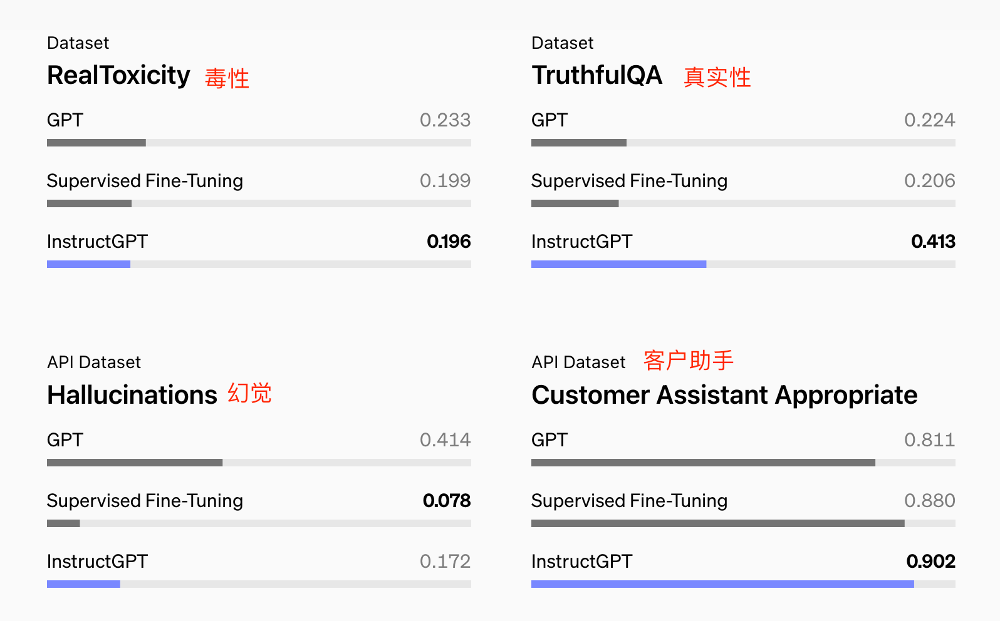
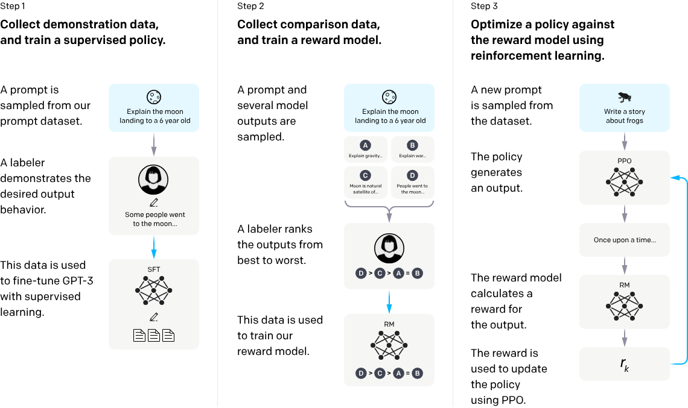
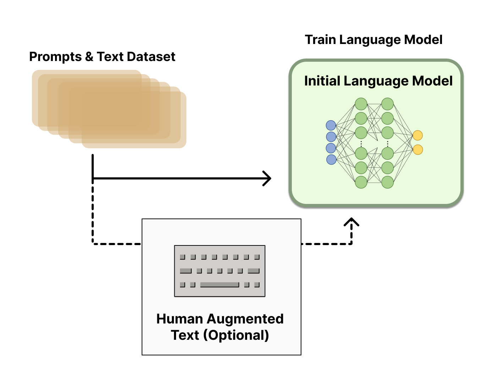
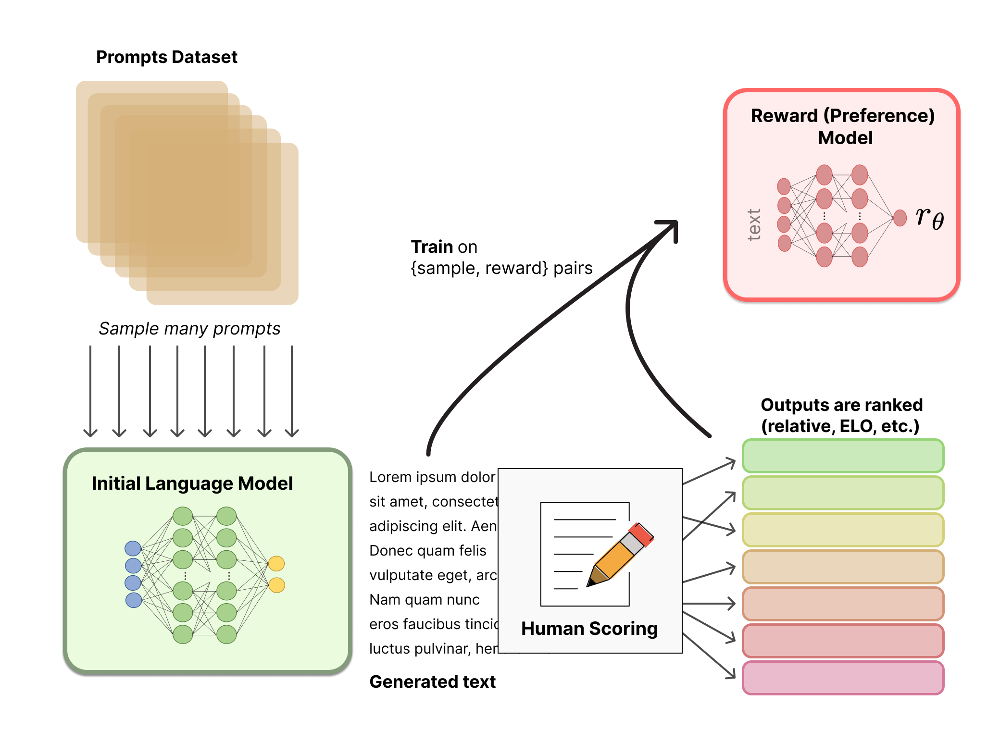
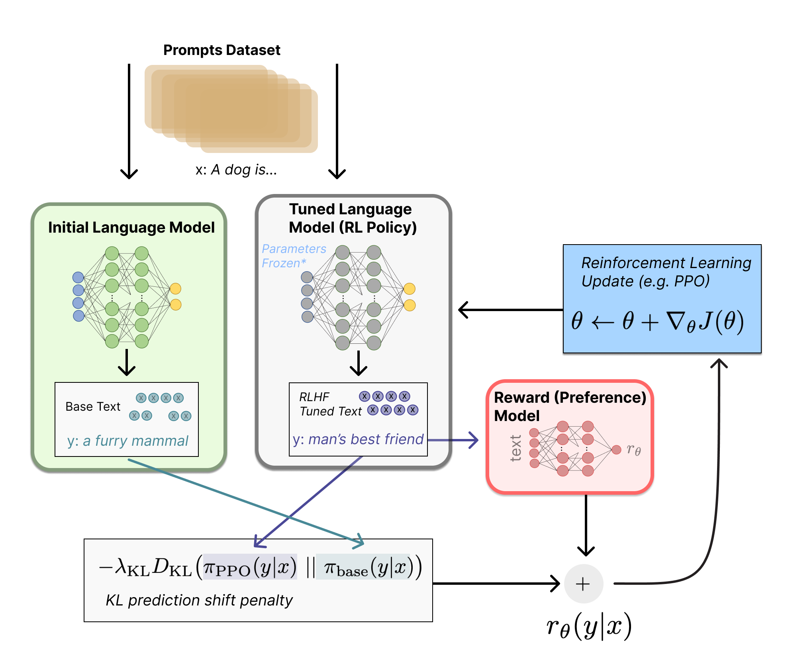
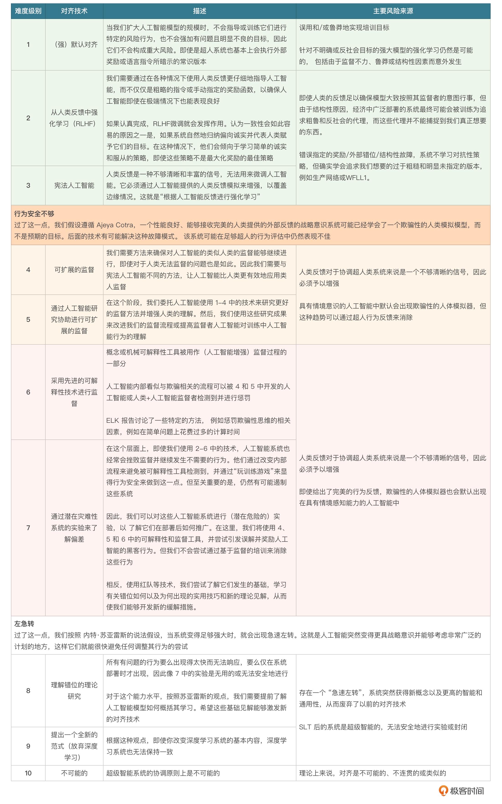

# 20 | 人类意图对齐，让模型拥有更高的情商

你好，我是独行。

这节课我会向你介绍大模型背后的“大功臣”——Alignment，翻译过来就是与人类意图对齐。Alignment 是一类技术的统称，并非指某一个技术。在第一节课我向你介绍 ChatGPT 为什么崛起的时候，讲到过 NLP 技术的突破，其中之一就是与人类意图对齐，里面最重要的一项技术就是基于人类反馈的强化学习，简称 RLHF。

## RLHF 由来

我们知道 GPT-3 于 2020 年 3 月份发布，在当时算是一个非常强大的模型，可以使用精心设计的文本提示来引导它执行自然语言任务。但是，GPT-3 也可能产生不真实、有毒或反映有害情绪的内容，原因我们之前讲过，GPT-3 的训练数据主要来自于互联网，而互联网中掺杂了各种各样的内容，有些是正常的，有些则不正常。所以直接输出内容很可能会不符合人类意图，官方称这种情况为“不安全”。

后来为了解决这个问题，OpenAI 基于 RLHF 做了指令微调模型 InstructGPT，使大模型输出的有害内容大大减少，虽然参数少了 100 倍以上，但与 175B 参数的 GPT-3 输出相比，仅有1.3B 规模参数 InstructGPT 模型的输出更加符合人类意图。我们看一下官网披露的 GPT-3 经过 SFT 和指令微调后，在各种指标方面的对比。

- 图片来自官网

## RLHF 的实现过程

RLHF 目标很简单，就是让大模型的输出和人类保持一致，但是怎么理解这个一致性呢？毕竟正常情况下人与人很多时候都会出现各种不一致的现象。所以人们专门设计了几个原则。

1. 有用性：大模型需要遵循指示、执行任务、提供答案。

2. 真实性：大模型提供的信息必须是准确的事实，并有承认其自身不确定性和局限性的能力。

3. 无害性：避免有毒、偏见或冒犯性的输出，以及拒绝协助危险活动。

如果大模型的输出能满足以上 3 点，那么我们就认为它的输出是与人类意图一致的。但是毕竟这还是人为设定的原则，各类专家依然可以保留自己的意见，这方面目前还没有统一的认识，有可能在将来的某一天，有一个世界级的人工智能组织，站出来组织各类玩家制定公约，也不是没有可能。

那 RLHF 到底该怎么做呢？简单理解，就是通过一个奖励模型（RM）引导基线模型（如GPT-3）做出反应，而这个奖励模型就是按照人类偏好训练好的模型。我们来看一下 OpenAI给出的 RLHF 过程示意图，大体上分为 3 步。

注：图片出自 OpenAI 的论文 Training language models to follow instructions with humanfeedback

### 步骤 1：收集示范数据，并训练一个监督策略

在这个步骤中，从预设的提示数据集中抽取一个提示，比如向一个 6 岁小孩解释月球登陆。一个标注者或多个标注者提供期望的输出行为，即如何响应这个提示。比如，标注者可能会解释说：“一些人去了月球……”，收集到的这些数据将通过监督学习微调 GPT-3，使它能够生成类似的高质量响应。

### 步骤 2：收集比较数据，并训练奖励模型

同样从数据集中抽取一个提示，并生成多个模型输出。比如，对于“向一个 6 岁小孩解释月球登陆”的提示，可能会生成关于“引力”“战争”“月球是自然卫星”以及“人们去月球”等不同解释。标注者将这些输出从最好到最差进行排名。这些比较数据被用来训练一个奖励模型，这个模型学习区分高质量和低质量的响应。

### 步骤 3：使用强化学习优化策略对奖励模型进行优化

抽取一个新的提示，比如“写一个关于青蛙的故事”。策略根据这个新的提示生成一个输出，比如开始一个故事：“从前有个……”。奖励模型评估这个输出，并计算一个奖励值。这个奖励值被用来通过算法（如 PPO，即 Proximal Policy Optimization）更新策略，来提高未来输出的质量。

关于近端策略优化 PPO，我简单解释下。这个算法主要用来训练机器在某个环境中做出决策，核心思想是渐进式地调整决策策略，意思是在训练过程中，它会尝试轻微地修改机器的决策方式，而不是做出大幅改变。这样做的好处是可以避免一些突然的、不稳定的决策变化，让学习过程更平稳、更可靠。

具体来说，PPO 在优化策略时，会考虑当前策略和新策略之间的差异，并尽量保持这种差异在一个安全的范围内。就像你教小孩子骑自行车，不会突然推他们到下一个陡峭的坡道，而是逐渐增加难度，让他们能够逐步适应。

在技术上，PPO 通过一个特定的数学公式来限制新策略和旧策略之间的差异，确保这种更新是渐进的，不会太过激进。这种方法不仅提高了学习效率，也使算法更加稳定，因此在实际应用中很受欢迎。

## RLHF 的局限

只要有人工干预的情况，一般都有局限，为什么这么说呢？因为人类能想到的场景毕竟是有限的。

### 对齐税

如果我们通过 RLHF 让大模型在某些方面和人类意图对齐，那么在其他一些方面，它们的表现就有可能会比较差，OpenAI 把这个现象叫做“对齐税”，也就是对齐带来的代价。

那么如何解决这个问题呢？

在 RLHF 期间，混合了一小部分用于训练 GPT-3 的原始数据，并使用正常对数似然最大化来训练这些数据，这大致保持了安全及人类偏好方面的表现，同时减轻了对齐税，在某些情况下效果还是不错的。

关于似然函数，我们在第 8 课中有讲过，你可以再去回顾一下。

### 英语化

我们知道 InstructGPT 不论是预训练数据，还是 RHLF 过程使用的人工标注，都是基于英语区的人文的，整体偏向于英语国家的价值观。你问一下 ChatGPT：早餐吃什么？给你的答案大概率是火腿三明治沙拉之类的。当然如果我们输入的是中文，他可能会把我们定义为中国人，给出的一些答案包含豆浆包子，但同样会输出火腿三明治沙拉，这就是文化差异导致的。如果要做通用人工智能，那文化上的差异也得解决。

### 漏网之鱼

虽然经过 RHLF，能尽可能地减少了有害内容的产生，但是想要完全避免几乎是不可能的，这也是机器学习本身的机制所决定的，算法本身就是处理概率问题，再好的算法也做不到100%，那这个时候该怎么办呢？答案是通过过滤器实现。对模型的输入和输出进行检测，对输入的检测可以提前拦截一些有害提示，比如有人希望通过大模型实现钓鱼软件，这类请求就可以提前拦截掉。对输出的检测，可以把一些有害输出拦截掉，避免提供给用户。

## RLHF 的未来

人类意图对齐，其实是一个非常复杂的话题，国外甚至有很多团队专门从事这部分研究。其中有个人叫塞缪尔·迪伦·马丁，他提出了一个人工智能对齐的难度等级，其中十个级别分别对应人工智能系统对齐的各种技术。我把这十个等级的表格放在这里，供你参考。

如果你感兴趣的话，可以直接阅读原文链接，了解更多内容。

## 小结

这节课我们学习了 RLHF，RLHF 是 Alignment 技术体系里最重要的一项，虽然 OpenAI 并没有公布 ChatGPT 背后大模型的技术细节，但是我们可以大胆猜测，就是 RLHF，而且ChatGPT 背后的 RLHF 可能会更加复杂、先进，我们从论文里看到的内容基本都是 4、5 年前的东西了，并且我们看到的只是一个大概的流程，更加细节的内容其实 OpenAI 并没有披露。

总体看，Alignment 相关的技术比较深，如果你感兴趣，可以顺着我这节课的思路再研究一下，这个方向还是蛮不错的。

## 思考题

你觉得 RLHF 是一种微调技术吗？它和微调的区别和联系分别是什么？欢迎你把想法分享在评论区，我们一起讨论。如果你觉得这节课对你有帮助的话，也欢迎你分享给感兴趣的朋友，邀他们一起学习。我们下节课再见！
