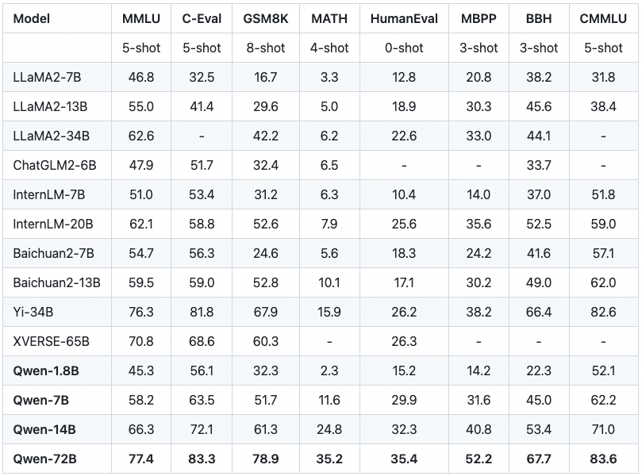
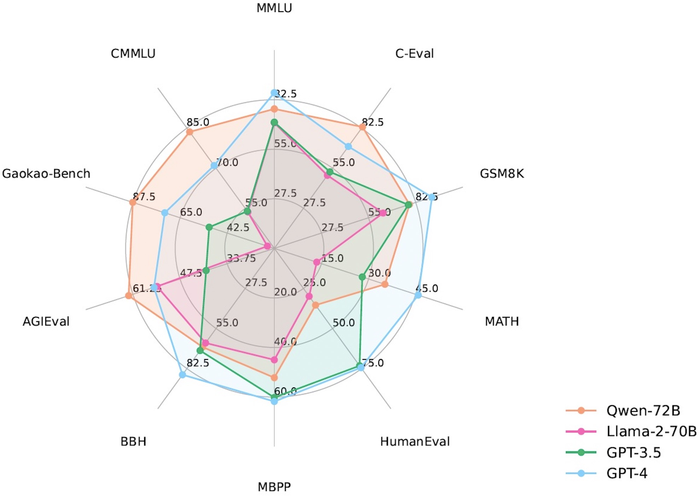
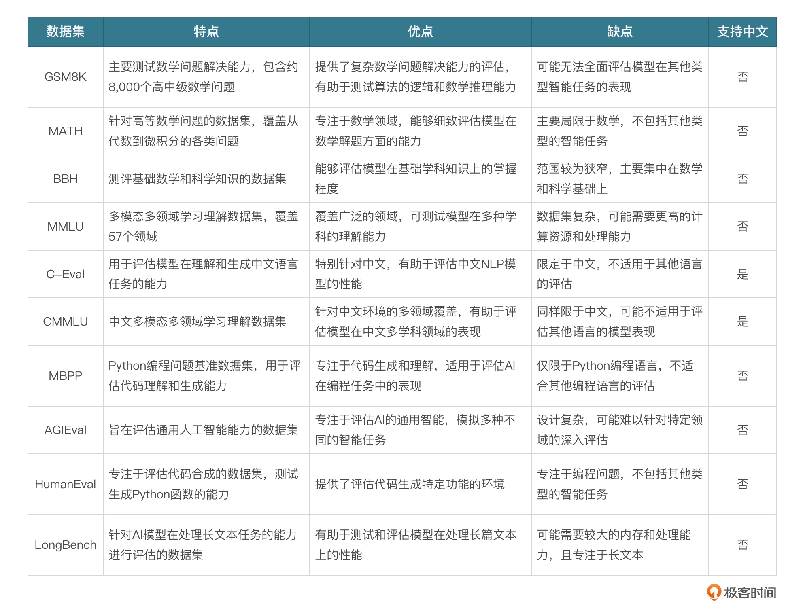

# 21 | 模型测评：如何评估大模型的表现？

你好，我是独行。

这一节课我们来聊聊模型测评，和我们软件测试一样，模型训练完也需要进行测试。软件测试我们一般会关注功能完整性、性能水平、运行稳定性等。大模型也一样，它会关注推理效率、性能等等。我们先来了解下各个厂商为什么要做模型测评。

## 背景

一方面，不论是软件还是大模型，厂商都需要对其功能有效性进行测试，通过业界相对标准的方式去测，可以看清楚自己产品的真正实力以及和其他竞争产品的差距。另一方面，一些大厂希望通过刷新一些著名榜单，来提升自己产品的知名度和竞争力，比如在大模型之前，比较出名的就是各个数据库厂商，像 TiDB、阿里云的 PolarDB 等等，都会在自己的官方网站上介绍其性能指标，比较出名的基准像 TPC-C、TPC-C、Sysbench 等，最后结论就是比 MySQL 性能提升多少多少这种。不可否认，这确实是一种好的方式。

如果你关注各个大模型厂商的网站，一定会经常看到下面这样的评测数据，这是阿里云通义千问介绍页面上放出的一组评测数据。



以下是原文内容：

- Qwen 系列模型相比同规模模型均实现了效果的显著提升。我们评测的数据集包括MMLU、C-Eval、 GSM8K、 MATH、HumanEval、MBPP、BBH 等数据集，考察的能力包括自然语言理解、知识、数学计算和推理、代码生成、逻辑推理等。Qwen-72B 在所有任务上均超越了 LLaMA2-70B 的性能，同时在 10 项任务中的 7 项任务中超越 GPT-3.5*。*



这段描述基本涵盖了大模型评测非常重要的几个方面：数据集、测评维度、测评任务，接下来我们就重点看一下这几个方面。

## 数据集

下面是一些常见的数据集，在各个大模型的测评说明里几乎都有它们的身影。



我挑选其中支持中文的 C-Eval 来详细介绍下。C-Eval 由上海交大、清华、爱丁堡的几名学生和老师共同完成，是为数不多的中文基础模型评估套件，包含了 13948 个多项选择题，涵盖了 52 个不同的学科和四个难度级别，样本数据如下：

```
id: 1
question: 25 °C时，将pH=2的强酸溶液与pH=13的强碱溶液混合，所得混合液的pH=11，则强酸溶液与强碱
A: 11:1
B: 9:1
C: 1:11
D: 1:9
answer: B
explanation:
1. pH=13的强碱溶液中c(OH-)=0.1mol/L, pH=2的强酸溶液中c(H+)=0.01mol/L，酸碱混合后pH=11，即
2. 设强酸和强碱溶液的体积分别为x和y，则：c(OH-)=(0.1y-0.01x)/(x+y)=0.001，解得x:y=9:1。
```

粗略一看，就是一堆选择题，不过真要做的话，还是有一定难度的，最主要的就是要保证数据质量。要知道像 OpenAI、Google、DeepMind 这些大厂，训练大模型的时候，会重点参考一些数据集，比如 MMLU 和 MATH，所以数据质量对于大模型的训练至关重要。

那怎么保证质量呢？手工处理。尤其是一些 Latex 类型的数学公式及推理过程，因为原始题目大多数来源于 PDF 和 Word 文件，光靠 OCR 来识别准确性肯定有问题，所以很多情况都是作者们手敲整理成章，13000 多道题目，所有和符号相关的内容，一一进行人工验证，不得不感慨那句老话：人工智能这行，有多少人工就有多少智能！

## 测评维度

一般来说，通用大语言模型主要关注的就这么几个维度：自然语言理解、知识、数学计算和推理、代码生成、逻辑推理等，当然有的网站分得很细，比如 OpenCompass，评测维度包括基础能力和综合能力两个层级，涵盖了语言、知识、理解、数学、代码、长文本、智能体等 12个一级能力维度，以及 50 余个二级能力维度，并且根据未来的大模型应用场景还在不断更新和迭代。

## 基准测试

基准测试是一种用于评估系统性能的标准化测试方法，不是新概念，前面我讲过，在大模型之前，常见的数据库厂家基本都会对其拳头产品进行基准测试，这是系统比其他竞品厉害的直接证明。说白了就是定义了一套测试方法，当然也配套测试数据集，甚至约定好测试环境、服务器配置，这样能够最大程度地保证公平性，也是这些基准测试最有说服力的地方。

在人工智能领域，有几个基准测试网站非常有名，比如 Glue 及其增强版 SuperGlue，再比如国产的 Clue、SuperClue，还有 OpenCompass。最近发现 OpenCompass 是一个宝藏网站，感兴趣的话你可以研究研究。

## 榜单猫腻

一个很有意思的现象，为什么每个大厂公布的榜单都宣称自己的模型是最强的？你可以去看看，大家都会说某某模型在 XXX 能力方面全面超越 GPT-4，或者参数只有 6～8B 的模型，也敢声称能力已经接近 175B 的 GPT-3.5，这么赤裸裸的碰瓷，原因是什么？

实际使用下来，不论是用户直接体验还是各种第三方榜单，目前还没有哪个大模型已经超越GPT-4，所以足以见得这些榜单的水份有多足。所以榜单这东西看看就好了，不要太当真，尤其是厂商自己出的榜单就更不用看了，第三方评测机构出的榜单还是可以参考下的。

我个人觉得，不论是数据集还是基准测试，不应该把刷榜单作为目标，而是应该关注模型本身的能力，长期以刷榜单为主，定会造成模型能力的跑偏，因为你会为了榜单指标而过度优化模型，很有可能出现过拟合的情况。

当然，大厂嘛，终究还是需要一些商业吹捧的，所以偶尔刷刷榜单没毛病，是能够理解的。

## 少样本和零样本

少样本（few-shot）和零样本（zero-shot）是针对 prompt 提出的两种模式，在测评模型能力的时候我们需要考虑这两种情况，针对少样本和零样本我分别举一个例子说明一下。

少样本：

```
以下是中国关于{subject}考试的单项选择题，请选出其中的正确答案。
[题目 1]
A. [选项 A 具体内容]
B. [选项 B 具体内容]
C. [选项 C 具体内容]
D. [选项 D 具体内容]
答案：A
...                 <- 题目 2 到 4
[题目 5]
A. [选项 A 具体内容]
B. [选项 B 具体内容]
C. [选项 C 具体内容]
D. [选项 D 具体内容]
答案：C
[测试题目]
A. [选项 A 具体内容]
B. [选项 B 具体内容]
C. [选项 C 具体内容]
D. [选项 D 具体内容]
答案：<模型从此处生成>
```

就是让模型在推理前，先学习一下回答的模型，相当于给模型打个样。

零样本：

```
[测试题目]
A. [选项 A 具体内容]
B. [选项 B 具体内容]
C. [选项 C 具体内容]
D. [选项 D 具体内容]
答案：<模型从此处生成>
```

实际就是把示例去掉，直接问答。一般来说，预训练阶段的模型 few-shot 的效果总是会比zero-shot 好一些，但是经过指令微调之后的模型，且指令微调没有 few-shot 数据的话，很可能 zero-shot 会更好。few-shot 面向开发者，可以增强模型上下文学习的能力，zero-shot 面向用户，因为用户很少会去写样本。

## SOTA

最后说一个有意思的词 SOTA，全称「state-of-the-art」，用于描述机器学习中取得某个任务上当前最优效果的模型。例如图像分类任务，某个模型在常用的数据集（如 ImageNet）上取得了当前最先进的性能表现，我们就可以说这个模型达到了 SOTA，所以这是一个很有意思的词，我感觉就像 yyds 一样，可以用在各种场合，不论是技术还是方法，你能形容得出来，并且在某一方面达到业界领先，你就可以说达到了 SOTA。

## 小结

这节课我给你介绍一些常见的大模型测试方法，学完之后，相信你以后看到一些大模型的介绍，对这块内容就不陌生了。大模型的测评需要思考以下几个方面：数据集、测评维度和测评基准。其中测评维度主要关注自然语言理解、知识、数学计算和推理、代码生成、逻辑推理等几个方面。而每个数据集和基准在其官网都有详细的使用方式，需要的时候你可以拿去直接用。

## 思考题

今天我们学了 C-Eval 数据集，你可以想一想它有什么缺点，或者未来还有什么可以改进的地方。可以思考一下，把你的想法打在评论区，我们一起探讨。如果你觉得这节课的内容对你有帮助的话，也欢迎你分享给其他人。我们下节课再见！
