# 26 | 为什么说Mamba是Transformer的最强挑战者？

你好，我是独行。

在过去的几年里，Transformer 模型在自然语言处理领域占据了主导地位。自从 2017 年谷歌提出 Transformer 以来，BERT、GPT-3 等基于 Transformer 的模型取得了巨大的成功。

然而技术的进步从未停止，最近出现了一种新型模型——Mamba，被认为是 Transformer 的最强挑战者。那么，Mamba 凭什么能与 Transformer 一较高下呢？这节课我就来带你看看Mamba 的过人之处。

## Transformer 的局限

Transformer 功能很强，但并不完美，尤其是在处理长序列方面，Transformer 模型中自注意力机制的计算量会随着上下文长度的增加呈平方级增长，比如上下文长度增加 32 倍时，计算量可能会增长 1000 倍，计算效率非常低。为什么会这样？因为 Transformer 模型在计算自注

- 2

## O(n ∗

## d)

意力时，每个输入元素都要与序列中的其他元素进行比较，导致总体计算复杂度为

## n

## d

，其中 是序列长度， 是元素表示的维度。

为了克服这些缺陷，研究者们开发出了很多注意力机制的高效变体，比如线性注意力（LinearAttention）、稀疏注意力（Sparse Attention）、低秩注意力（Low-Rank Attention）等等，但这往往是以牺牲其有效性为代价的。到目前为止，这些变体都还没有被证明能在不同领域发挥有效作用。为什么这些变体会牺牲注意力的有效性？我来解释下。

目前大模型扩展上下文的几个方式：稀疏注意力、滑动窗口、降采样，这几个方式有共同的缺点，我把它们称为“技术捷径”，就是因为无论采用哪种方式，都是想办法丢掉一部分“不重要的数据”，那么如何评判数据重不重要，这是一个很难的问题，所以很多种情况下会产生误杀。这里也一样，所谓稀疏注意力，就是有选择性地计算部分注意力权重，那么必然会有一定的概率，忽略一些重要的信息或者依赖，进而牺牲性能。

同样，线性注意力，将标准的自注意力机制中的矩阵乘法改为线性计算，从而将计算复杂度从

- 2

## O(N )

## O(N)

- 降低到，但是由于省略了 softmax 操作和全局注意力矩阵，线性注意力可能无

法捕捉到所有重要的依赖关系，尤其是长距离依赖，最终导致模型的表达能力不足，可能会导致性能下降。低秩注意力逻辑也类似。

那有没有更好的解法呢？有人提出用 RNN 解决自注意力机制的计算复杂性问题。RNN 之所以计算快，是因为 RNN 只需要考虑先前的隐藏状态和当前输入。它可以避免重新计算所有先前的隐藏状态，正好与 Transformer 相反，可谓是两个极端。但是 RNN 的这种计算方式有非常大的弊端，就是当依赖非常长的时候，RNN 往往会随着时间的推移而忘记之前的信息，因为它们只考虑一个先前的状态，或者说对先前信息的记忆会越来越淡，这样带来的问题就是上下文会失效。

那有没有什么办法可以从两个极端方案之间选择一个折中的办法呢？当然有，那就是Mamba！

## Mamba 的优势

1. 基于 S4 架构

S4 全称是 Structured State Spaces for Sequence Modeling，用于序列建模的结构化状态空间，是一种针对序列建模的高效模型。它结合有选择性的（Selective）状态空间模型（SSM）和深度学习技术，旨在处理长序列的依赖关系，并突破计算瓶颈。S4 使用线性递归方程和频域方法，显著提升计算效率，同时通过结构化参数设计捕捉长距离依赖。该模型在自然语言处理、时间序列预测和语音处理等任务中表现优异。S4 的核心优势在于其计算效率和捕捉远程依赖关系的能力，为长序列建模提供了一种创新且强大的解决方案。

状态空间模型，是一类描述动态系统的数学模型，通过这个模型，我们可以理解和预测一个系统是如何随着时间的变化而变化的。举个简单的例子：你在迷宫里移动，寻找出口，状态空间模型就是用来描述你的位置和移动速度是如何随着时间的变化而变化的。有几个关键的概念如下：

- 状态（State）： 状态是系统内部的情况或条件。在我们的例子中，人的状态可以包括当前位置信息和当前移动速度。

- 观测（Observation）： 观测是我们可以实际测量到的东西。在我们的例子中，观测可能是通过 GPS 测得的人的位置。

- 状态方程： 状态方程告诉我们系统的状态是如何随时间变化的。比如，人当前位置是根据它的上一个位置和移动速度和方向来决定的。

- 观测方程： 观测方程告诉我们如何从状态中获得观测值。比如，通过人的实际位置和出口坐标，得到离出口最近的下一步移动方案等等。

2. 高效性

Mamba 在计算效率上表现突出，特别是在处理大规模数据的时候。与 Transformer 相比，Mamba 采用了一些优化技术，比如 S4 和动态压缩，使计算复杂度更低。Transformer 的自注意力机制计算量比较大，而 Mamba 通过改进这种机制，基于 S4，显著减少了计算量，从而能够更快速地进行训练和推理。

你可以对比一下 Transformer 和 Mamba 计算复杂度的伪代码示例。

```python
# 伪代码示例：对比Transformer和Mamba的计算复杂度
# Transformer自注意力机制的计算复杂度
def transformer_attention(Q, K, V):
   attention_scores = Q @ K.T  # 计算注意力得分
   attention_weights = softmax(attention_scores)  # 计算注意力权重
   output = attention_weights @ V  # 计算输出
   return output
# Mamba优化后的注意力机制计算复杂度
def mamba_attention(Q, K, V):
   attention_scores = efficient_dot_product(Q, K)  # 优化后的点积计算
   attention_weights = softmax(attention_scores)
   output = attention_weights @ V
   return output
```

3. 适应性

Mamba 不仅在 NLP 任务中表现优异，还能处理图像识别等任务。其设计使模型在面对不同类型的数据时，能够自如应对，主要原因包括其高效的架构设计和优化的计算方法。Mamba 通过精心设计的层结构和连接方式，有效地提取和处理图像特征，同时使用加速技术提升计算效率。

此外，Mamba 支持多任务学习，在图像分类、目标检测和图像分割等任务中表现优异。模型通过正则化技术和数据增强方法提高了鲁棒性和泛化能力，能够适应不同数据集。同时，在一些层与层之间的连接过程中，将上一层的输出和下一层的输入进行权重绑定，达到权重共享的目的，这样就相当于减少了一部分参数，通过这样的优化，使 Mamba 在保持高性能的同时，减少了计算和存储成本，进一步增强了其实用性。这种多功能性使 Mamba 在各类应用场景中都有出色表现。

4. 内存利用

Mamba 在内存使用上更加高效，这对于需要在资源有限的设备上运行的模型尤为重要。比如，在嵌入式系统或移动设备上，内存通常是限制因素。Mamba 优化了内存分配和使用，具体来说，就是引入了一种动态序列长度调整（DSLA）的新技术，允许网络根据输入序列的复杂性和长度调整其内存大小，这样就可以更有效地使用内存，减少了内存消耗，使它能在这些设备上高效运行。

5. 训练速度

由于 Mamba 特殊的网络结构以及内存优化技术，所以 Mamba 的训练速度比 Transformer 快得多，这对于需要快速迭代和测试的开发者来说非常重要。快速的训练速度不仅能节省时间，还能加快模型的开发和部署进程。

6. 性能表现

在许多基准测试中，Mamba 展示了与 Transformer 相媲美甚至更优的性能。特别是在处理长序列数据和复杂任务时，Mamba 表现得特别出色。这让它在许多实际应用中成为更具吸引力的选择。我们来看一下 Mamba、Transformer 以及 RNN 在训练和推理性能方面的一些比较。

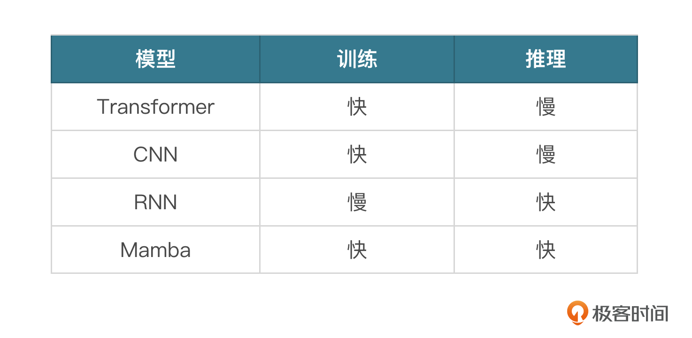

## Mamba 架构之状态空间模型（SSM）

### 模型结构

## t

SSM 用于根据某些输入预测它们的下一个状态，在时间 ，SSM 可以表示为：

## x(t)

- 输入序列，：在迷宫中向左和向下移动；

## h(t)

- 潜在状态表示：出口距离和人的坐标等；

## y(t)

- 预测输出序列：再次向左 / 向右移动以更快到达出口。

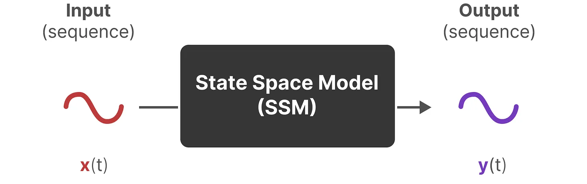

## t

SSM 描述的是动态系统，例如在 3D 空间中移动的物体，可以通过两个方程根据其在时间的状态进行预测，其核心是两个方程：状态方程和输出方程（或者也可以称为：观测方程）。

## h’(t) = Ah(t) + Bx(t)

## y(t) = Ch(t) + Dx(t)

## h(t)

目标是找到这个状态

- ，以便我们可以从输入计算得出输出序列。

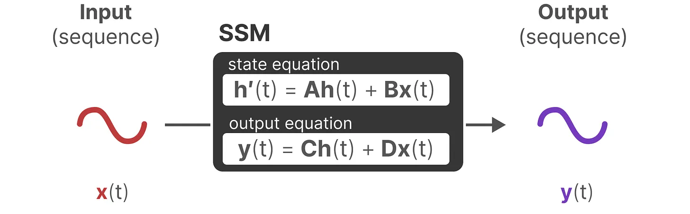

状态方程描述的是，矩阵 A 和 B 如何根据输入值和上一个状态值推导当前状态的值。

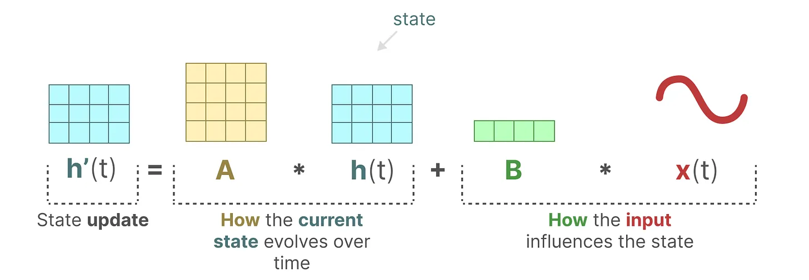

输出方程描述的是，矩阵 C 和 D 如何通过状态值和输入值推导输出值的过程。

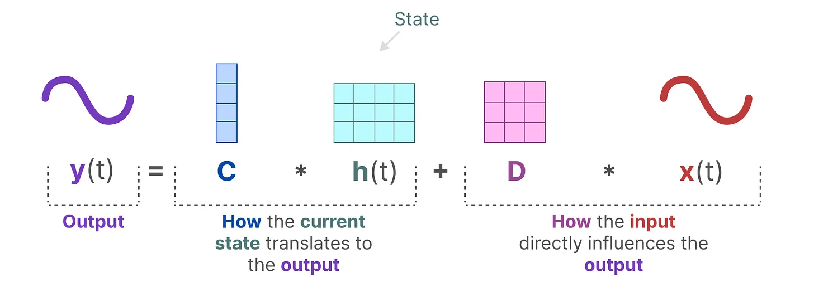

注意：矩阵 A、B、C 和 D 就是我们常说的参数，它们是可学习的。

将这两个方程合并可视化，我们可以得到以下架构：


把这个架构图稍微细化一下就可以得到完整的处理序列图。

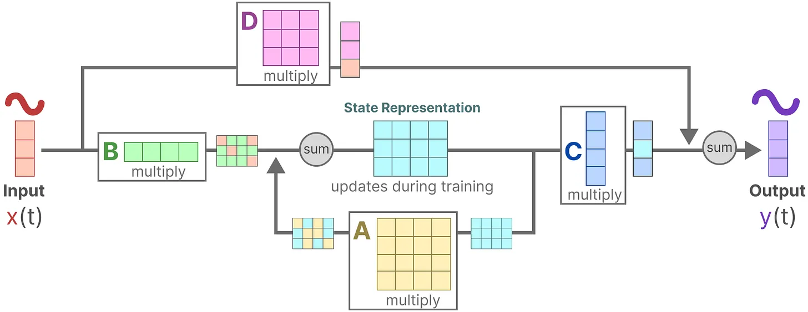

矩阵 D 实际上没有参与 SSM，直接从输入到输出，所以关于矩阵 D 的连接被称为跳跃连接。而矩阵 D 没有参与到 SSM 序列计算，所以我们说 SSM 是没有跳跃连接的，参考下面阴影部分。

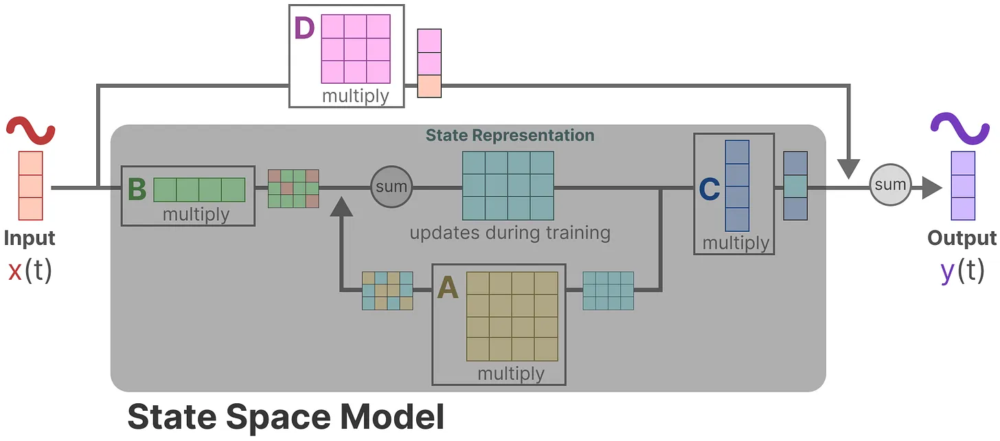

所以，实际上矩阵 ABC 才是 SSM 的核心，因此，最开始的示意图可以用下面的图示来表示：

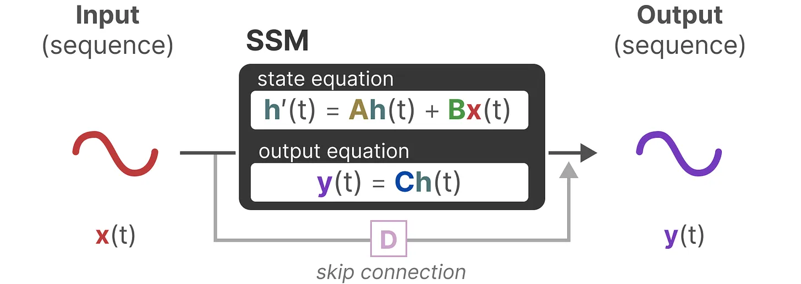

### 连续信号到离散信号

通过连续信号去计算状态是有一定的难度的，而通常我们的输入是离散的，所以我们需要将模型就行离散化。为了实现离散化，使用了一个叫 Zero-order hold 的技术，工作流程大概是这样的：每当接收到离散信号，先保留其值，直到收到新的离散信号，这样的话，使得 SSM 可以使用连续信号，示意图如下：

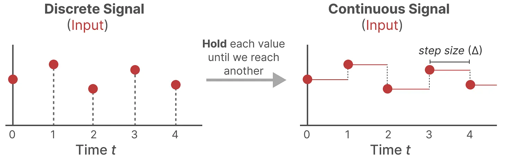

## Δ

具体指保留多长时间，是一个可学习的参数，称为步长，我们用

- 表示。有了连续的输入信

## Δ

号，我们可以生成连续的输出，并且仅根据输入的时间步长

- 对值进行采样，这些采样值就

是我们的离散输出。

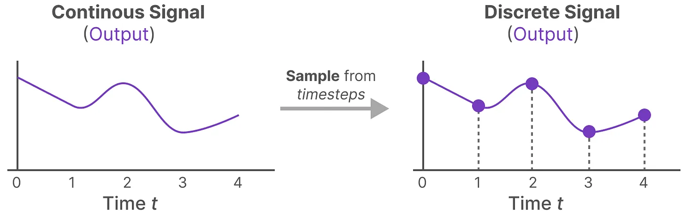

数学上，我们可以通过如下方式应用 Zero-order hold，使连续 SSM 转变为离散 SSM，该SSM 由一个公式表示，该公式不再是函数到函数，x(t) → y(t)，而是序列到序列，x ₖ → y ₖ 。

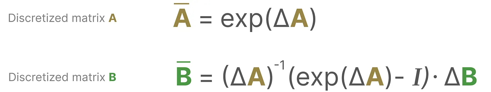

连续 SSM 和离散 SSM 对比：

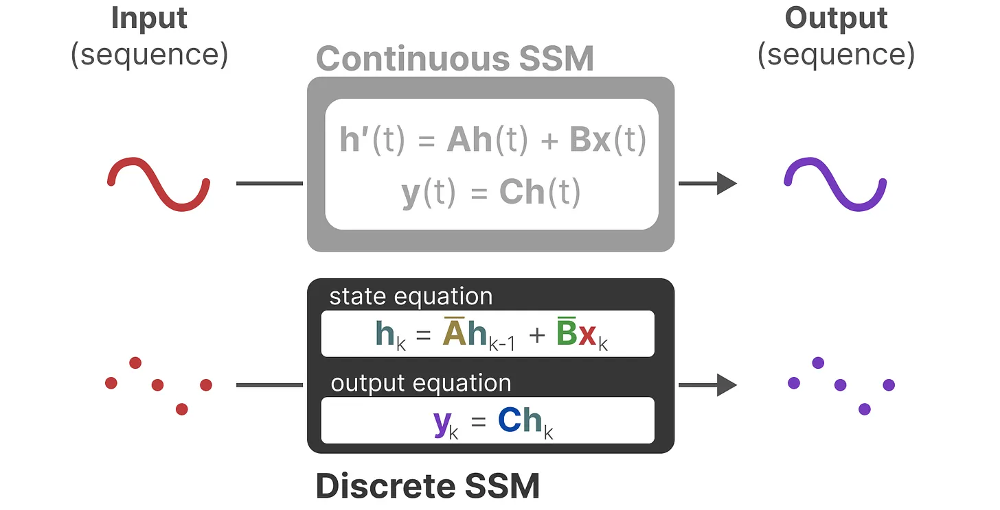

## k

## t

使用 而不是 来表示离散时间步长，以便在我们提到连续与离散 SSM 时更加清晰。

### 循环表示

离散化 SSM 使我们能够以特定的时间步长而不是连续信号来处理问题，这一点类似于我们前面讲过的循环神经网络 RNN，循环方法在这里也适用，在每个时间步，我们计算当前输入

## Bx

## Ah

## Ch

- 如何影响之前的状态，然后计算预测输出，计算过程如下：k−1​k​k​

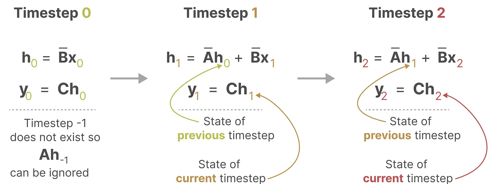

回想一下 RNN 里，输入经过隐藏层进行循环计算的过程，通过示意图可以看出这里原理基本是一样的。

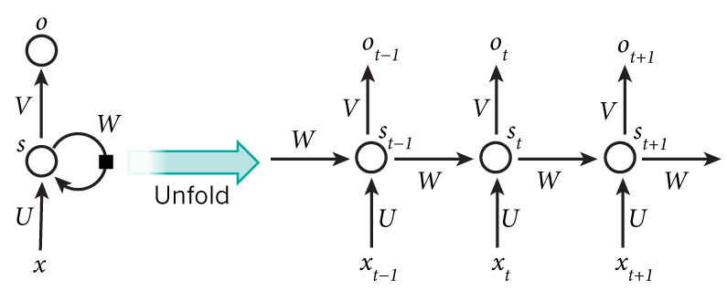

所以我们用处理 RNN 的方式处理离散信号，可以表示为：

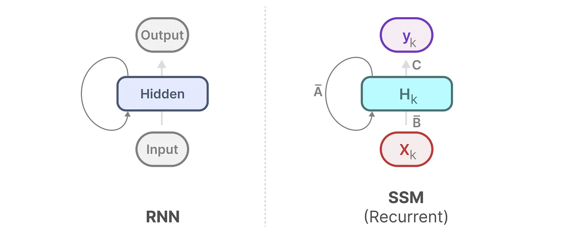

展开隐藏层如下：

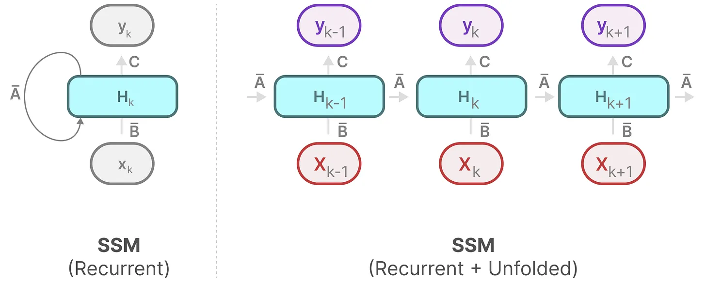

使用这个方式处理，带来了 RNN 的天然优势和劣势，那就是训练慢、推理快！

### 卷积表示

SSM 也可以使用卷积的方式表示，比如：

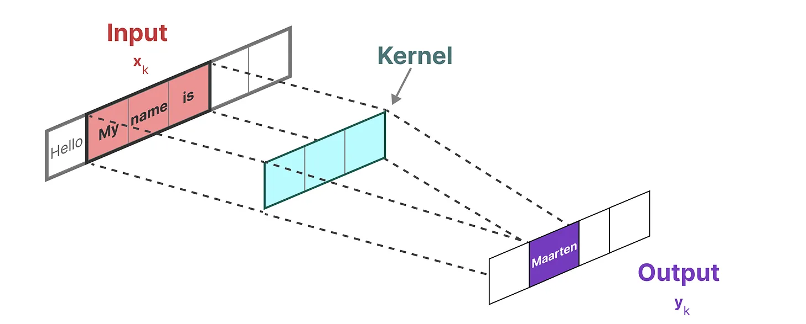

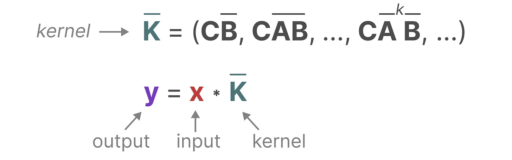

实际在计算输出值的时候，我们看一下 SSM 是怎么工作的。

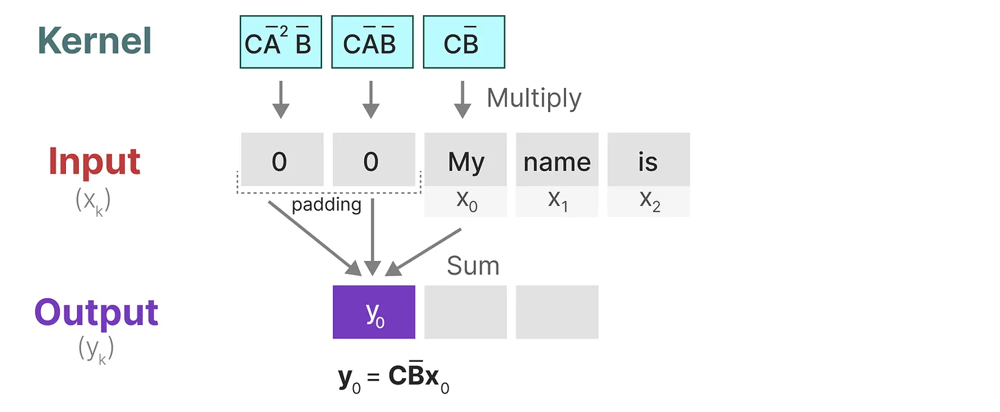

进一步移动：

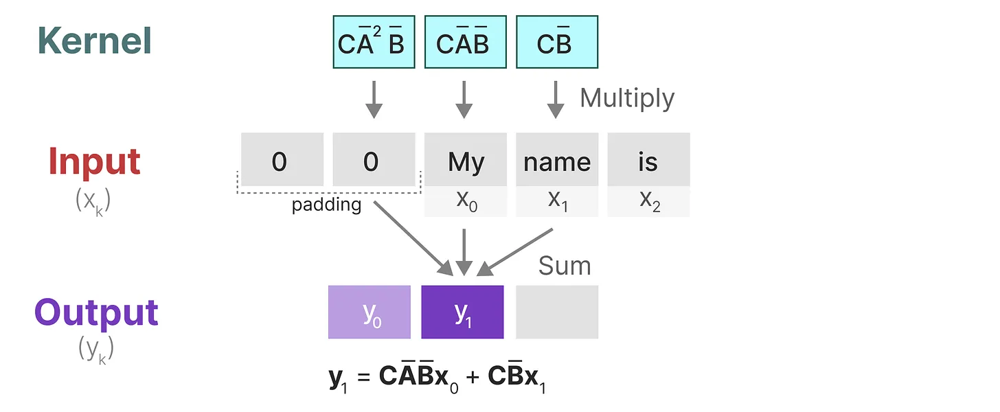

最后一步，得到如下完整计算公式：

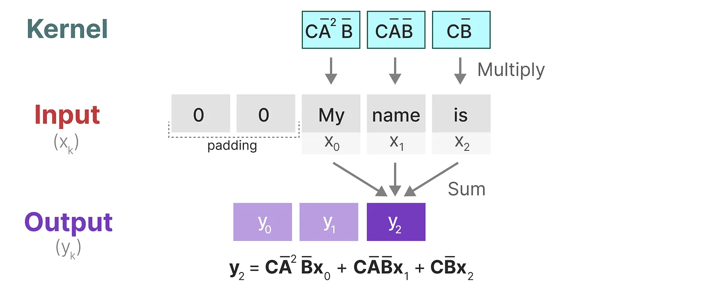

这样，将 SSM 表示为卷积，使它可以像卷积神经网络（CNN）一样进行并行训练。然而，由于内核大小固定，它们的推理速度不如 RNN 那样快。

### 三种方式对比

连续模型、循环模型、卷积模型放在一起如下图所示：

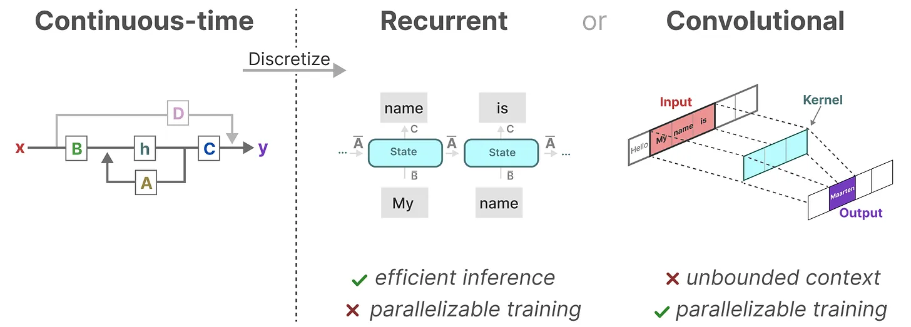

SSM 厉害之处在于，在训练的时候，我们可以使用卷积表示，而在推理的时候，可以选择使用循环表示，这一点使 Mamba 具备了训练和推理都很高效的特性。

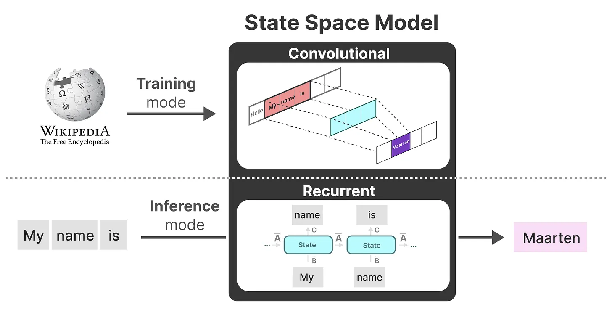

该模型被称为线性状态空间层（LSSL），这些表示具有一个重要特性，即线性时间不变性（LTI）。LTI 指出，SSM 的参数 A、B 和 C 在所有时间步长上都是固定的。这意味着对于SSM 生成的每个 token，矩阵 A、B 和 C 都是相同的。

### 矩阵 A 的重要性

从上面隐藏层的计算过程看得出来，矩阵 A 的值贯穿整个状态计算过程。

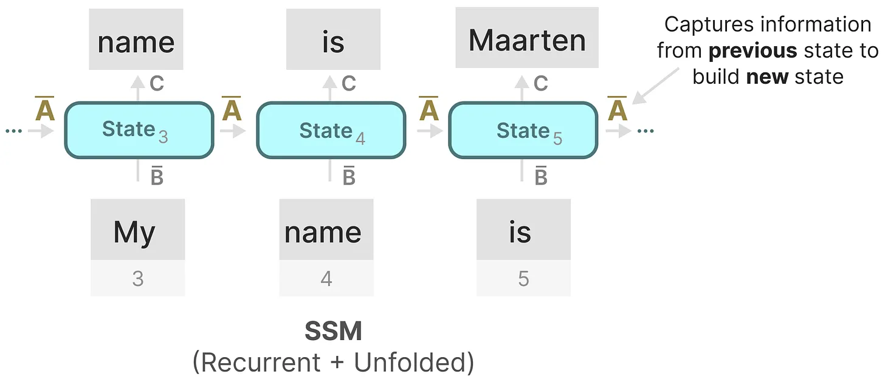

因此矩阵 A 的创建自然不能随机产生，我们希望他能包含历史信息，也就是上下文信息，Mamba 使用 HiPPO 创建矩阵 A，关于 HiPPO 的解释，简单来看，就是一种通过多项式来进行历史信息循环记忆的方法，你可以阅读 HiPPO 论文了解更详细的信息。HiPPO 矩阵计算公式为：

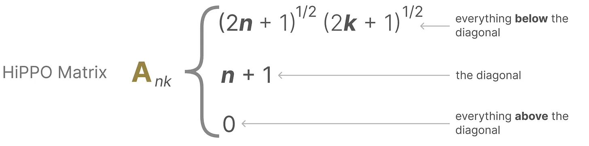

- 1/2

## 1)1/2

## n + 1

## （2n + 1)

## （2k +

对角线以上全是 0，对角线上是

- ，对角线以下计算方法为

，类似于这样：

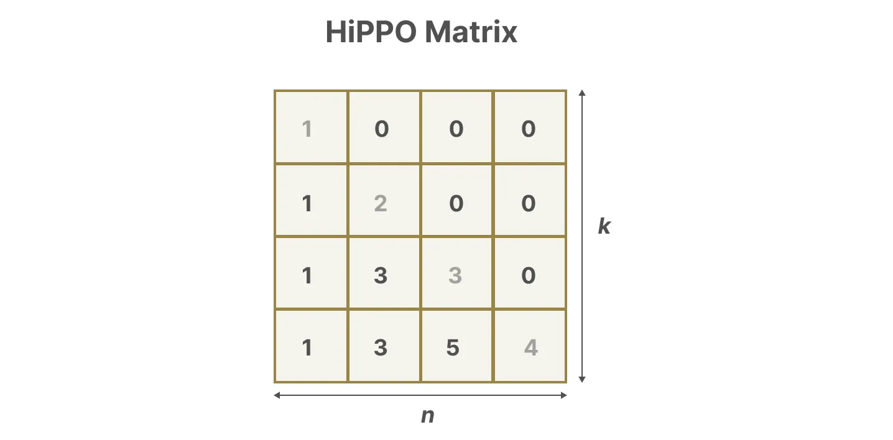

关于 HiPPO 为什么能记住历史状态，这是经过论证过的，感兴趣的话你可以继续阅读相关数学论文。

学习到这里了，基本概念我就向你介绍完了，那我们再来回归正题，SSM 和 S4 有什么关系呢？让我接着向你介绍。

## Mamba 架构之神奇的 S4

S4 全称是 Structured State Spaces for Sequence Modeling，用于序列建模的结构化状态空间，是一种针对序列建模的高效模型。S4 基于有选择性的 SSM（关于有选择性的概念我在下面介绍），也就是说 S4 是 SSM 的一种具体实现。结合刚刚的分析来看，S4 其实就是将HiPPO 应用到上文提的卷积和循环表示，用来处理长距离依赖关系。由三部分组成：

- 状态空间模型 SSM；

- HiPPO；

- 用于创建循环和卷积表示的离散化。

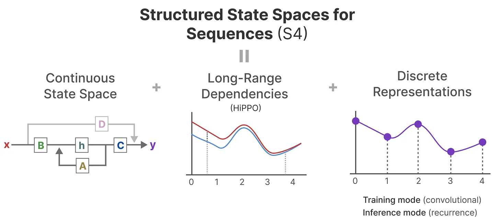

基于这样的架构，Mamba 拥有了多种优势，既有卷积网络的并行训练特性，又有循环网络的快速推理能力，同时还具备 Transformer 的长距离依赖，可谓是集各种技术的优点与一身。接下来我再向你介绍下什么是有选择性 SSM。

注：如果你对 S4 的源码感兴趣，可以阅读这篇文章《带注释的 S4》。

## Mamba 架构之选择性 SSM

选择性其实就是有选择的记录历史信息，SSM 的循环表示会创建一个非常高效的小状态，它会压缩整个历史记录，与不压缩历史记录（通过注意矩阵）的 Transformer 模型相比，它的功能要弱得多，但是 Mamba 的目标是兼具两全其美，小状态和 Transformer 状态一样强大。具体如何进行压缩呢？

在我们刚刚介绍状态空间模型的内容中提到过，矩阵 ABC 与输入无关，而且在不同的时间序列内，ABC 都相同。这样的话，当我们要对输入序列进行选择的时候，无法确认要丢掉哪部分信息，所以我们其实是希望 ABC 矩阵的值和输入产生关联，这样就可以对输入内容进行判断，进而进行取舍。

Mamba 把输入的序列和批量大小进行合并，让矩阵 B 和 C 以及步长依赖输入。

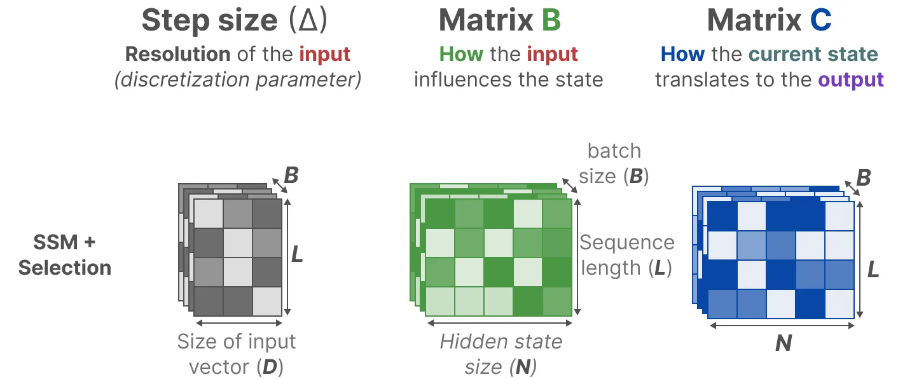

对于每个输入的序列，可以有不同的矩阵 B 和 C 对应，从而也能感知内容的不同，这种情况下，选择保留什么忽略什么就可以做到了。

## Mamba 的劣势

虽然 Mamba 在训练速度等方面表现出色，但也存在一些劣势。

1. 复杂性：Mamba 模型相对于传统的 Transformer 模型来说，可能具有更高的复杂性，包括架构设计和实现上的复杂性。这可能会增加模型的调试和优化难度。

2. 通用性：Mamba 模型可能更适用于特定的任务或数据集，而不是一般性的应用。在某些场景下，可能需要对模型进行定制或调整，才能达到最佳效果。

3. 迁移学习：由于 Mamba 模型可能具有特定的架构和设计，因此在迁移学习或应用到其他领域时，可能需要进行额外的工作来适应新的任务或数据集。

4. 实验验证：由于 Mamba 模型相对较新，可能还需要进一步的实验验证和研究来证明其在各种任务和场景中的有效性和稳定性。

我认为 Mamba 还处于研究试验阶段，个创新思路能否得到学术界以及行业的认可，还需要更多实际应用来证明，毕竟 Transformer 架构已经大规模落地使用，经得住考验。

今年年初，Mamba 被 ICLR 拒稿，其中一位审稿人提问：有没有训练更大的模型，和 10B 参数的 Transformer 比较如何？这就说明它确实还需要一定规模的训练和应用。据我所知，目前生产级的基于 Mamba 架构的模型不多，如果你感兴趣，可以去看下有 52B 参数的jamba。

## 小结

Mamba 在多个方面有出色表现，包括高效性、适应性、内存利用、训练速度和性能表现。这些优势使 Mamba 成为 Transformer 的强有力竞争者。无论是在学术研究还是工业应用中，Mamba 都有潜力带来显著的改进。

但 Mamba 也同样存在一些缺点，比如它复杂性高、资源需求大、迁移学习难度大、实验验证比较困难。一切都还需要时间去证明，而我们要做的就是时时跟进发展动态，以审慎的态度去了解、去尝试。

## 思考题

结合今天学习的内容，你来思考一下，Mamba 在变成熟的道路上，可能会遇到最大的难题是什么？如何解决？欢迎你在评论区留言，我们一起讨论，如果你觉得这节课的内容对你有帮助的话，也欢迎你分享给其他朋友，在这里我们时时交流 AI 的最新动态，争取不让一个人掉队！
