# 03 | 原型系统：开源工具自建AI大模型底座

你好，我是 Tyler。

学习了上节课以后，相信你已经摩拳擦掌，想要尽快实现一个自己的大模型应用了。今天，我们就结合实战例子，带你学习怎么通过开源工具组建一个极简应用，让智能体来替你回答工作问题，并让它作为你的专属助理，对你定期进行专题汇报。

如果你想要直接学习如何使用工具，也可以根据自己的需求，选择目录中感兴趣的内容直接学习。另外需要注意，在这节课的第四部分，我会教你如何搭建一个自主可控的大模型（LLM）底座，所以即使你的工作环境不允许使用 OpenAI API 也没关系。

今天这节课不会绕弯子，会直接告诉你每个工具的核心价值，让你即学即用。话不多说，我们开始吧！

## 链式调用黏合剂（Langchain）

首先，我们来为你的原型系统搭建一个“调度中心”。这个调度中心将帮助大语言模型（LLM）连接到我们之前学到的各种生态组件，如计划组件、记忆组件和工具组件等等。

目前最主流的做法是采用链式调用。链式调用可以让你的编码更高效，只需少量代码，就能让用户、LLM 和组件之间进行复杂的互动。

接下来，我将使用 Langchain，基于 OpenAI 的 LLM 制作一个简易的 ChatGPT。ChatGPT你应该并不陌生，它是一个基于大语言模型的应用程序，可以与人类进行多轮对话。

为了让大语言模型能够实现与人类友好的多轮对话，我们需要额外引入两个组件。

第一个是 ConversationBufferMemory，它将帮助 LLM 记录我们的对话过程。

第二个是 ConversationChain，它会帮我们管理整个会话过程，通过调取 BufferMemory 中的对话信息，让无状态的 LLM 了解我们的对话上下文。

同时，ConversationChain 还会通过补充一些“提示语”，确保 LLM 知道它在与人类进行交流。

```python
from langchain.llms import OpenAI
from langchain.chains import ConversationChain
from langchain.memory import ConversationBufferMemory
import os
os.environ["OPENAI_API_KEY"] = '...'
llm = OpenAI(temperature=0)
mem = ConversationBufferMemory()
# Here it is by default set to "AI"
conversation = ConversationChain(llm=llm, verbose=True, memory=mem)
conversation.predict(input="Hi there!")
```

- Entering new ConversationChain chain…Prompt after formatting:The following is a friendly conversation between a human and an AI. The AI is talkativeand provides lots of specific details from its context. If the AI does not know the answer toa question, it truthfully says it does not know.Current conversation:Human: Hi there!AI:Finished chain.Out[1]:" Hi there! It’s nice to meet you. How can I help you today?"

在这个例子中，我们直接使用了 ConversationChain 的封装。以下是它的核心代码，可以看到整个流程非常简单。ConversationChain 只是对你的对话内容进行了格式化的封装，告诉了LLM 它正在和人类进行对话，并将历史聊天内容提供给 LLM，让 LLM 更好地与用户进行交流。

```
from langchain.prompts.prompt import PromptTemplate
DEFAULT_TEMPLATE = """The following is a friendly conversation between a human an
Current conversation:
{history}
Human: {input}
AI:"""
PROMPT = PromptTemplate(input_variables=["history", "input"], template=DEFAULT_TE
```

你完全也可以根据自己的需求定制自己任务的 Chain。当然，代码示例中可以看出Langchain 对 LLM 生态组件提供了良好的支持，针对常见应用场景也进行了链式封装，这一点做的非常友好。

比如，SQL Database Chain 就能通过对话来与数据库互动，根据你的需求生成数据报告，这里我也留了一道相关的课后作业。我建议，你在面对这类任务时，优先选择官方的实现，快速完成编码。

## 零代码快速搭建（Flowise）

在学习更高级的用法之前，先给你一个学习加速包，让你“无痛”地进行下面的过程。这个加速包叫做 Flowise，用于零代码搭建 LLM 应用平台。通过使用它，你可以在一分钟内搭建起刚才的应用。

首先是 Flowise 的安装，在安装完成后通过下面的指令启动 Flowise 服务（推荐用Linux/Mac）。

```
$ npm install -g flowise
$ npx flowise start --FLOWISE_USERNAME=user --FLOWISE_PASSWORD=1234
```

进入浏览器打开 http://localhost:3000，输入用户名和密码。如果能看到下图中的 Flowise界面，恭喜你已经搭建成功了。现在，我们开始搭建 ChatGPT 的例子。

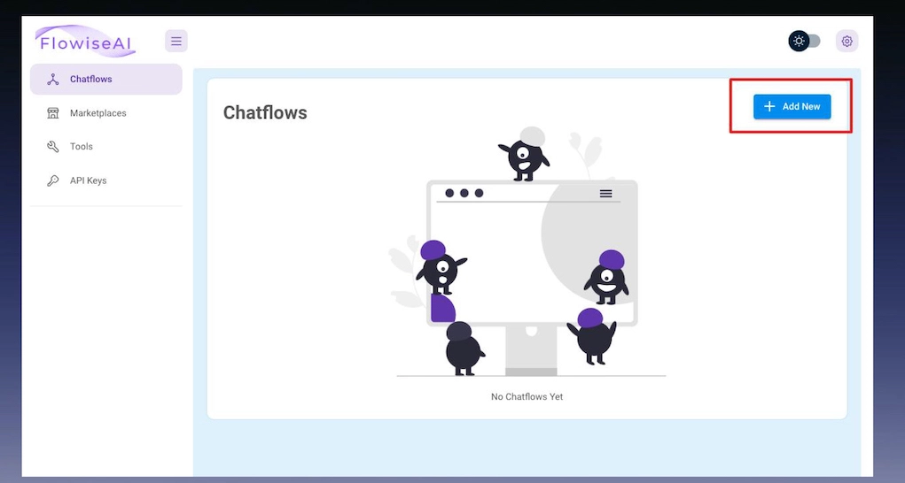

这里如下图，在 Chat Models 中找到 ChatOpenAI 组件，拖入我们的应用中，填入刚刚获得的 OpenAI Api Key，它对应代码是后面这样。

```
llm = OpenAI(temperature=0)
```

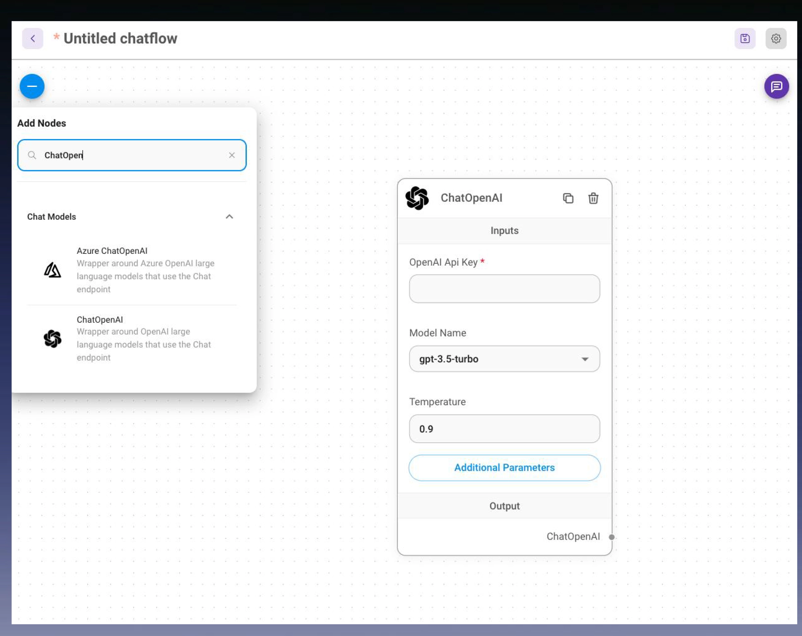

随后，如下图所示，在 Memory 组件中找到 Buffer Memory 组件，拖入到我们的应用中。

它背后对应的代码是后面这样。

```
mem = ConversationBufferMemory()
```

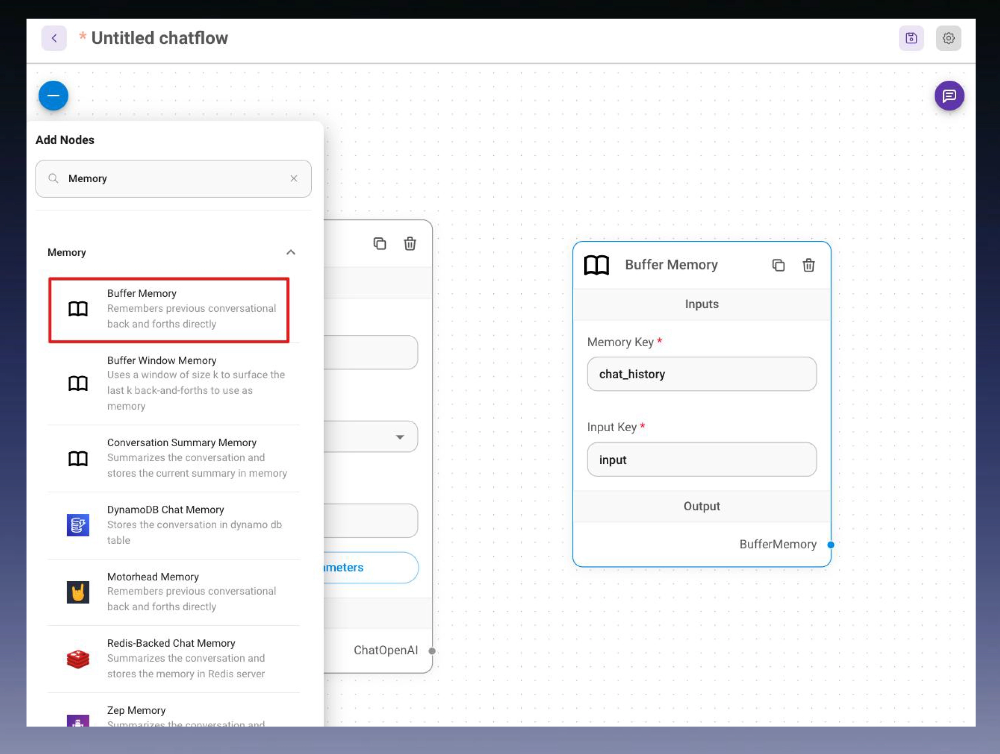

最后，我们拖入 LLM Chain 组件，这个动作对应前面 Langchain 这段对代码。

```
conversation = ConversationChain(llm=llm, verbose=True, memory=mem)
```

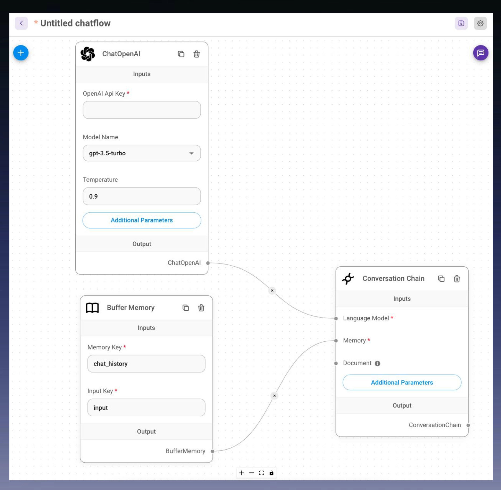

链式调用程序特别适合图形化搭建，接下来，我们点击右上角的会话按钮，就可以和 LLM 对话了。

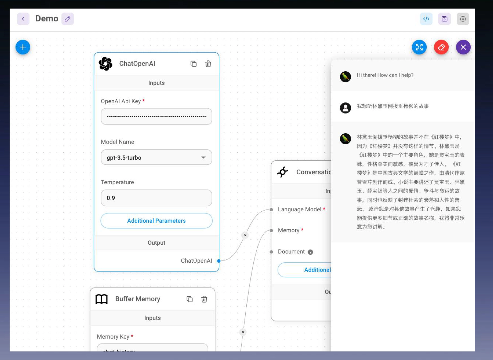

相信你在刚才的搭建过程中，已经看到了 Flowise 提供的丰富的组件库。这些组件可以帮助你快速搭建原型系统，提升开发效率。如果有兴趣，可以课后研究一下每个组件的用途，以便在未来的开发中灵活运用。

对于从第二部分开始看的同学，如果你没有 Langchain 的基础知识，建议还是快速通读一下第一部分“链式调用黏合剂”的内容。当然，你也可以根据你的学习习惯，选择先阅读后面的内容，快速建立整体的认识。

## 领域知识库（Embedding & 向量检索引擎）

在解决了“开发效率”的问题后，我们来谈谈“开发质量”的问题。你有没有观察到一个现象，每隔几天就会看到一个新推出的“领域大模型”。

这是因为各家机构正在围攻 ChatGPT，希望找到可以难倒它的“领域问题”。随后通过在开发“领域增强大模型”来证明自己的“技术先进性”。

这类模型有两个标准动作。第一是让 LLM 做好考前“冲刺训练”也就是领域微调，它的训练成本较高，我们会在第四章中讲解这个方法。第二是为模型增加外部记忆，在提示词中引入一些领域知识，帮助模型提升回答质量。

今天的课程中，我们先使用第二种方法。我将带你制作一个自动问答机器人，它可以帮助你回答其他同事的技术问题，具体制作步骤是这样的。

1. 对团队的技术文档进行切片，生成语义向量（Embedding），存入向量数据库作为外部记忆。

2. 根据同事所提问题中的内容，检索向量数据库，获取技术文档的内容片段。

3. 把文档片段和同事的问题一并交给大语言模型（LLM），让它理解文档内容，并针对问题形成恰当回答，返回给同事。

我还画了一张流程图，看图一目了然。

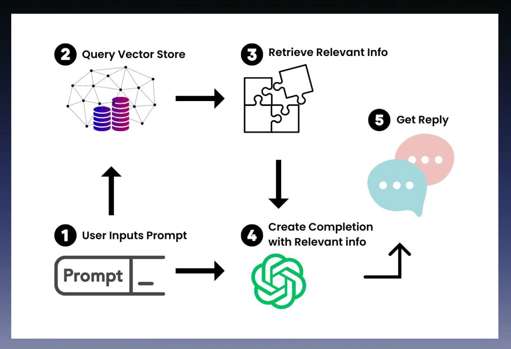

接下来，我们继续使用 Flowise 实现这个项目，你只需要依次加入以下组件。

1. Folder with Files 组件，负责将相关知识文档上传。

2. Recursive Character Text Splitter 组件，用来给上传的文档内容做断句切片。

3. OpenAI Embeddings 组件负责将断句后的内容切片映射成高维 Embedding。

4. In-Memory Vector Store 组件用来将 Embedding 存入数据库中，供给 LLM 作为外部记忆。

5. Conversational Retrieval QA Chain 组件则会根据问题，获得外部知识，在 LLM 思考形成回答后返回给用户问题答案。

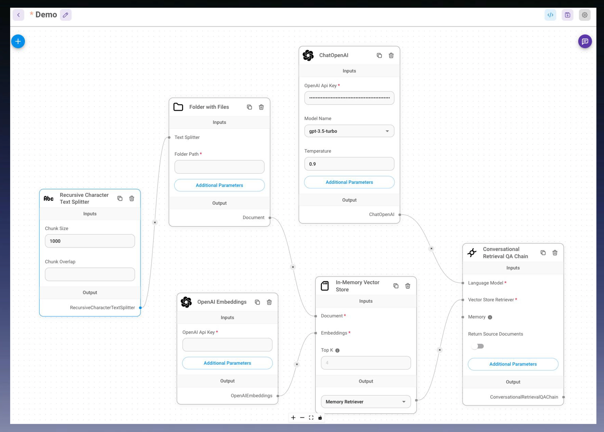

通常，你需要将这个对话应用接入到团队所使用的 IM 系统。这里你只需要点击下图的位置，就可以得到 API。对于各种 IM 的 Hook 调用的实现作为你的课后作业。

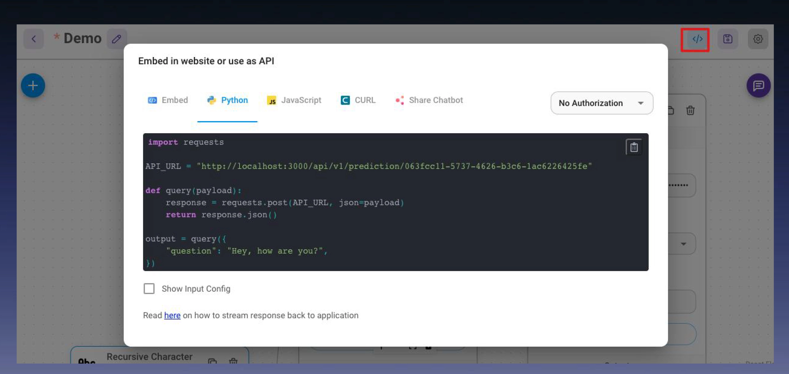

## 自主可控 LLM 底座（LocalAI）

接下来我们来思考一个问题，如果有一天 OpenAI API 不能用了，该怎么办？

别担心，我将给你一个安全可控的“底座”，让你没有后顾之忧。这里使用 OpenAI API 的开源替代方案——LocalAI，它可以将唾手可得的开源 LLM，封装成 OpenAI API 相同的接口形式，为你的应用提供服务。

下面我们开始搭建这个底座，首先执行以下指令，部署 LocalAI 的代码。

```
$ git clone https://github.com/go-skynet/LocalAI
$ cd LocalAI
```

接着，根据以下指令获取 LLM 模型。为了快速验证，这里先下载一个较小的模型。

```
$ wget https://gpt4all.io/models/ggml-gpt4all-j.bin -O models/ggml-gpt4all-j
$ cp -rf prompt-templates/ggml-gpt4all-j.tmpl models/
```

然后，根据以下指令启动 LocalAI 最新镜像，这个过程会自动加载 models 文件夹中的模型，把它封装为 API 服务。

```
$ docker-compose pull
$ docker-compose up -d
```

接下来，我们根据以下指令，验证一下模型是否可使用。

```
$ curl http://localhost:8080/v1/models
{"object":"list","data":[{"id":"ggml-gpt4all-j","object":"model"}]}
```

最后，把所有 OpenAI 的组件都换成 LocalAI。这样即使 OpenAI API 不能用，你的项目也能继续稳定运行。

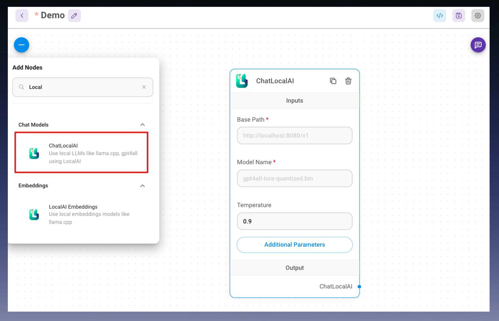

## 更高、更快、更强（Llama）

在使用一段时间后，你会发现机器人的智能水平和 GPT 还有差距。

其实你可以使用“更大”的模型来提升效果，比如 Meta 开源的 Llama 系列模型。Llama 是Meta AI 公司于 2023 年 2 月发布的大型语言模型系列，Llama-2 已经非常接近 GPT-3.5 的水平，而且可以免费商用。

首先，如下面的代码所示，我们去 HuggingFace 下载 Llama-2 最新的 ggml 版本。这里我们使用 7B 通用版本来进行演示。

```
$ wget -c "https://huggingface.co/TheBloke/Llama-2-7B-chat-GGML/resolve/main/llam
```

下载了模型之后，我们根据以下指令，启动 LocalAI 来快速测试一下模型，确保模型文件没有问题。

```
$ docker-compose up -d
$ curl -v  http://localhost:8080/v1/models
{"object":"list","data":[{"id":"llama-2-7b-chat.ggmlv3.q4_0.bin","object":"model"
```

最后，我们回到 Flowise 的界面，将模型名称修改为 llama-2-7b-chat.ggmlv3.q4_0.bin。再次测试聊天机器人，它是不是变得更加聪明了？

如果需要更大的模型，你可以按需下载。Local AI 已经在底层支持了 llama.cpp，所以 ggml 格式的模型基本都可以适配。你还可以尝试常用的量化方法，但要注意你的 GPU 是否支持。

当然，如果你想了解各个大模型的具体区别以及如何选择最适合你的量化算法，在后面的课程中我会详细介绍各种模型小型化的方法和原理，让你对它们有更深入的了解，在选择的时候也能做到游刃有余。

## 组建你的智能体大军（AutoGPT）

接下来，我们用 AutoGPT 建立一个智能体大军。像上节课我们学到的那样，你只要告诉智能体后面这几件事儿，它们就能自己思考、分工、制定计划，完成任务。

- 目标是什么？

- 有哪些工具可用？

- 有哪些外部记忆可用？

为了描述方便，这里我们给它起个名字，就叫它 MOSS，希望这个名字能让它更智能。

如果希望 MOSS 帮我们生成“关于 LLM 的每日新闻简报”，就可以这样操作。首先，我们要为MOSS 提供搜索引擎工具，让它可以获取当天的新闻。

```
search = SerpAPIWrapper()
tools = [
   Tool(
       name="search",
       func=search.run,
       description="useful for when you need to answer questions about current e
   ),
   WriteFileTool(),
   ReadFileTool(),
]
```

接着，我们根据以下代码，将一篇 LLM 综述文章作为外部记忆，辅助它理解相关知识，以便读懂新闻内容。

```
embeddings = OpenAIEmbeddings()
loader = OnlinePDFLoader("https://arxiv.org/pdf/2304.13712.pdf")
documents = loader.load()
text_splitter = CharacterTextSplitter()
docs = text_splitter.split_documents(documents)
vectorstore = FAISS.from_documents(docs, embeddings)
```

由于 AutoGPT 往往需要由多个不同角色的智能体组成一个团队，协同地完成你的任务。因此，在创造这些智能体时，我们需要给每个智能体一个名字，并且告诉它们负责扮演什么角色。我们的任务目前暂时只需要一个智能体，你需要告诉 MOSS 它有哪些记忆和工具可以使用以及具体的任务是什么即可。

整个流程就像人类建立团队的过程一样，非常直观，它的代码如下。

```
agent = AutoGPT.from_llm_and_tools(
   ai_name="MOSS",
   ai_role="Assistant",
   tools=tools,
   llm=ChatOpenAI(temperature=0),
   memory=vectorstore.as_retriever(),
   chat_history_memory=FileChatMessageHistory("chat_history.txt"),
)
agent.run(["write a brief for large language models news today"])
```

你可以对比上节课中 ReAct 那张图解释程序的输出，在课后的留言区说说这两者之间有哪些联系。感兴趣的同学课后还可以使用 AgentGPT来体验一下相关概念的商业产品。

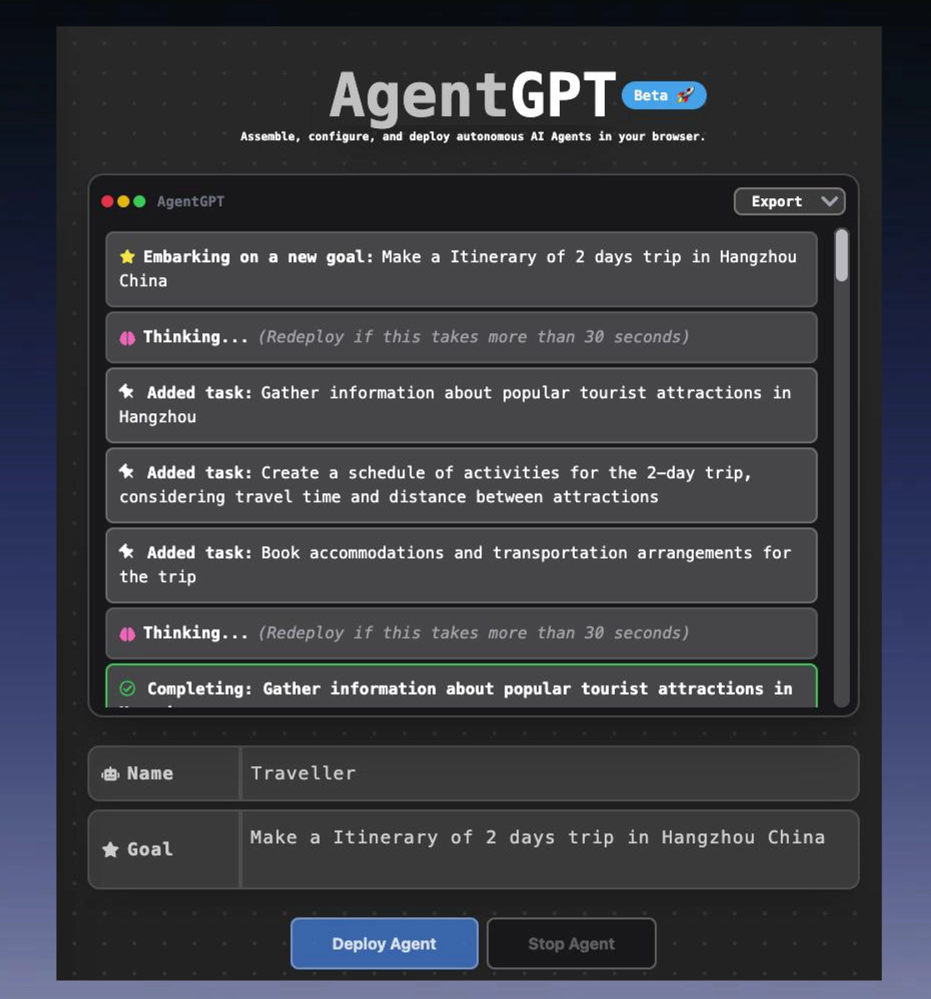

## 小结

今天我们学习了如何搭建大语言模型应用，从最底层的模型部署，到上层的 LLM 应用 API，再到最上层的 LLM 应用。涵盖了使用开源工具搭建自用 LLM 应用底座的方方面面。

这节课的重点是如何使用 Langchain 将你的 LLM 应用组合起来，以及如何快速使用 Flowise零代码平台构建你的应用。另外，我们还学习了如何建立一套自主可控的开源大模型应用底座，使用 LocalAI 基于开源大模型 Llama，来构建你的 LLM API 服务。

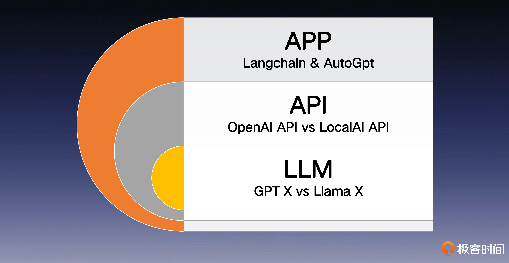

如果你恰好对开源工具更感兴趣，在未来的课程中我给还会给你分享更多好用的开源工具，但是要注意 Langchain 这类开源组件在性能和稳定性以及功能性上都有很大的局限性，不建议直接在工业场景中使用。打个比方吧，将 matlab 用作实验室环境的原型验证那绝对没有问题，但是如果你将它用在生产环境，那结果可想而知。

最后，我想和你说点题外话。这门课主要面向希望深入理解大型模型系统技术原理，而不满足于仅仅学习简单开源工具的同学。因此，这节课所学的内容，主要用来演示快速验证的“原型系统”如何搭建，如果你想理解这一讲用到的技术背后的知识，彻底了解工业级 AI 系统背后的原理，还是需要踏实学习后面的章节。

如果你想在这一行有所建树，就不要沉迷在“一日千里”的幻境中，我虽然可以帮你少走弯路，在最短的时间内掌握大部分的开源工具，但是这只是指向月亮的手。最后学完后面课程的所有知识时，你会发现，这些开源工具在工业级大模型系统面前只是“玩具”，技术的深度和广度几乎没有可比性，你已经可以“碾压”只会用这些开源组件的人了。

## 思考题

通过 Flowise 搭建一个服务并接入你团队的 IM 系统，让它自动按产品经理的需求写临时 SQL查询数据。提示：使用 SQLDatabaseChain。

恭喜你完成我们第 3 次打卡学习，期待你在留言区和我交流互动。也欢迎你把这节课分享给身边朋友，和 TA 一起学习进步。

## 扩展阅读

The Problem With LangChain：https://minimaxir.com/2023/07/langchain-problem/
