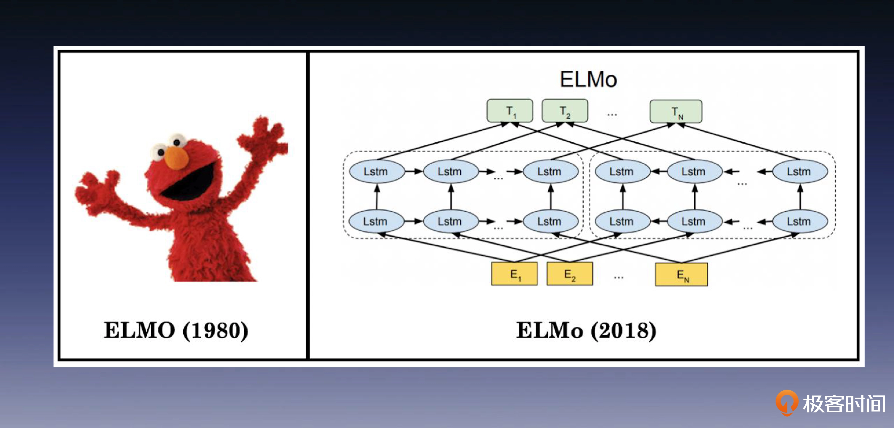
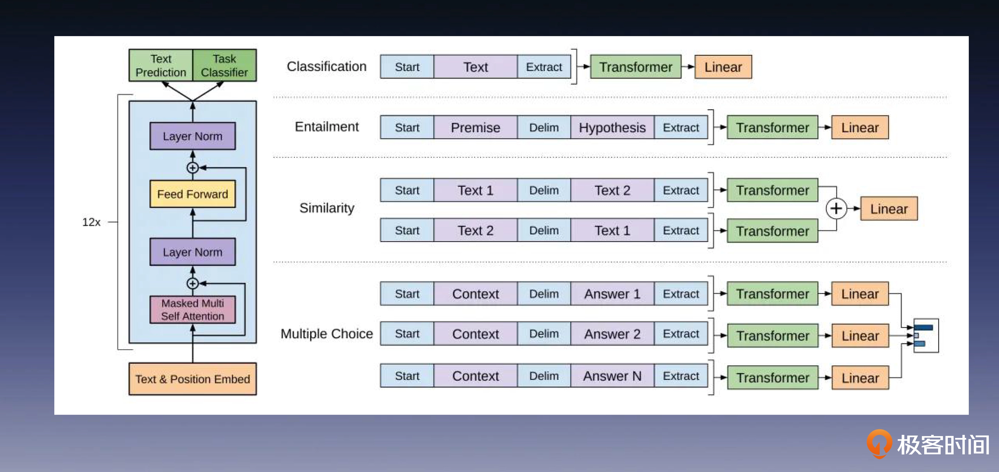
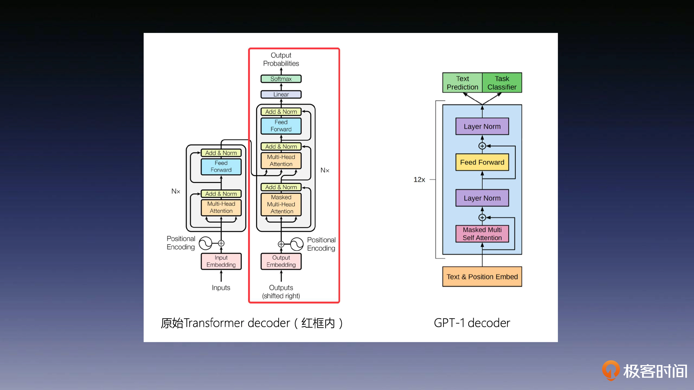
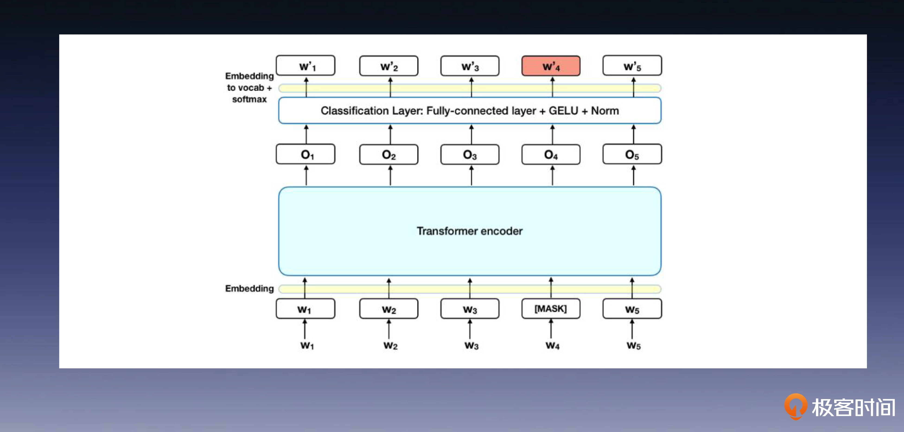
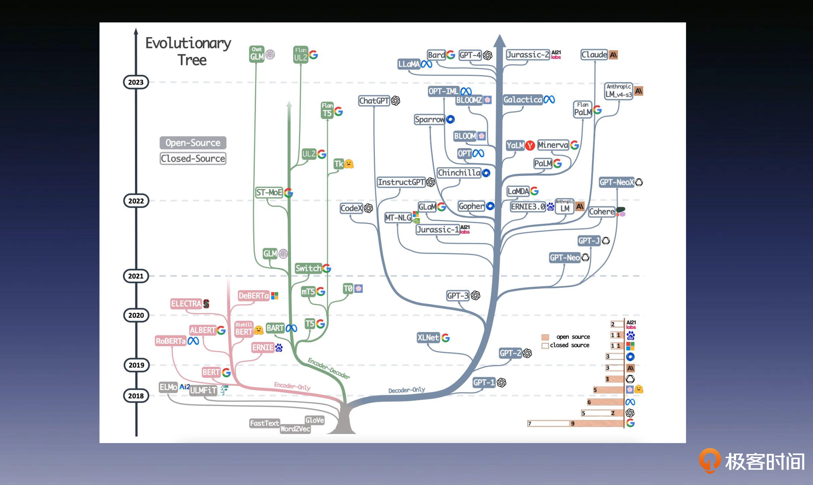

# 13 | 厚积薄发：如何让模型更好地理解人类语言？

你好，我是 Tyler。

在之前的课程中，我们已经了解了语言模型的发展历程，这让我们可以明显看到，NLP 领域的发展速度并不亚于计算机视觉（CV）领域，NLP 研究人员不断推动着相关方法的不断发展。

然而，在 NLP 领域，一直存在一个令人尴尬的问题，这也是我们在第 11 节课时提过的一个问题：既然在计算机视觉领域，预训练模型的表现如此出色，NLP 领域是否从他们的成功经验中学到了一些什么呢？

答案是 NLP 确实汲取了灵感，但在实践中难以完全复制。NLP 的研究人员只是知道了外面世界的美好，却发现自己没有 CV PTM 的命，为什么这么说呢？这节课我就带你一探究竟。

## 重建巴别塔

首先，视觉能力是人类天生就具备的，而语言能力则要后天学习，所以对人类来说语言能力本来就更难。此外，语言存在不同的语种，每种语种都有不同的词汇、词法和语法。这进一步增加了处理语言的复杂性。

语言的多样性分散了人类的注意力，因此构建一个涵盖多种语言的带标签数据集这件事，变得异常困难。这也使得全球范围内的科学家们很难共同构建“巴别塔”，只能在自己的小圈子里打转。所以 NLP 也被我们称为人工智能皇冠上的宝石。

然而，是不是就没办法了呢？当然不是，只是这个过程非常漫长。既然无法构建一个多语种的、带标签的自然语言数据集，NLP 的预训练模型大军只能早早地离开监督学习的母星，探索无监督学习的深邃宇宙，以光年为单位飞往目标星球。

从此，人们进入了漫长的探索时期，这一路充满了坎坷。相比 CV 领域，在 2012 年就已有AlexNet 级别的 PTM “杀器”，NLP 在 2013 年才刚刚在特征表征模型预训练上崭露一些头角，这就是我们接下来要学习的 Word2Vec。

## Word2Vec：对比学习加持特征表征

Word2Vec 这个词是不是有点眼熟？没错，我们在第 6 节课就提过它。Word2Vec 算法由Google 的研究人员于 2013 年提出。这个算法的最大贡献，是找到了一种无监督学习的方法，对大规模的语料库进行预训练，学习其中的语义，这绕开了对大规模有标签数据集的依赖，打破了 NLP 预训练数据上的困境。

让我们回顾一下之前的内容：Word2Vec 有两种训练方法，一种是跳字模型（Skip-gram），另一种是连续词袋模型（CBOW）。

简而言之，跳字模型的目标是通过给定一个中心词来预测其周围的单词，而连续词袋模型的目标是通过周围的单词来预测中心词。其实这里隐含一个假设，即在字面上相近位置经常出现的单词之间，相关性会更强。

在学习词与词之间的语义关系时，模型将每个词映射到高维向量空间中，这些向量可以应用于多种自然语言处理任务。举例来说，在机器翻译任务中，你可以将每个词的嵌入向量作为输入，这样能够显著提升语言模型对每个单词含义的理解能力。

这种方法不但大大提升了之前机器翻译任务的效果，更重要的是给 NLP 预训练模型指明了正确方向，给后续研究提供了信息和希望。

## ELMo：语言模型消除歧义

不过，Word2Vec 也有明显的短板，比如无法处理词在不同语境中的多义性。举例来说，“苹果”可以指水果，也可以指手机。Word2Vec 无法理解这些差异，可能导致产生错误的结果。

怎么帮助模型消除歧义呢？这就不得不说到 ELMo（Embeddings from Language Models）了，它是 Google AI 在 2018 年提出的一项技术。

ELMo 是一种基于上下文生成词向量的方法，能够通过综合考虑“前到后”和“后到前”两个序列单词的含义，动态调整生成的词向量，让词语的表示变得更加准确。

比如，在句子“我掏出苹果手机下单了一袋苹果”中，单词“苹果”可以指代“手机”或“水果”。ELMo 能够根据上下文来动态理解这两种含义。

ELMo 的训练目标是根据单词的上下文来预测单词本身。它的网络结构如下图所示。

可以看到，ELMo 由左侧的前向双层 LSTM 编码器和右侧的逆向双层 LSTM 编码器组成，每个编码器都由两层 LSTM 叠加而成。ELMo 的重要贡献在于将上下文信息融入 NLP 词向量的表示中，提升了词向量的表达能力。

不过我们需要注意，尽管 ELMo 使用双层双向 LSTM 网络结构进行语言模型训练，但这两个双向模型是完全独立训练的，最终只是将它们的输出连接在一起，不是一个端到端的方法，这可能会导致一些信息的丢失（“端到端”是什么，你可以回顾第 7 节课）。

这时候人们已经逐渐意识到可以通过语言模型，基于对比学习的方式来进行 NLP 模型的预训练了，各家公司暗流涌动，直到 OpenAI 发布了历史性的 GPT-1。

## GPT：预训练模型走上舞台

GPT-1（Generative Pre-Training）标志着一个重要的里程碑。我们看名字就知道，OpenAI一开始就将预训练模型（PTM）作为目标，因此也相应地设计了适用于多种 NLP 下游任务的微调方法。这一刻，NLP 领域终于拥有大模型预训练 + 领域微调的策略了。

GPT 系列一直采用了 Decoder Only 的 Transformer 架构，当时 Transformer 刚刚发表，足以看出 OpenAI 的判断非常准确。

GPT 提出了一个两阶段的方法：首先，在第一阶段使用一个庞大的语言模型进行预训练；然后，在第二阶段，使用特定下游任务的数据集做模型微调。后面这张图展示了如何修改 GPT预训练模型，以便其兼容各种下游的 NLP 任务。

为了与下游任务的网络结构相匹配，GPT-1 提出了一种对齐改造的策略。这种改造非常便捷，不同的任务，只需要对输出分进行适应性修改和微调就可以，具体的实现在后面的课程中我会详细展开。

如下图所示，由于 GPT-1 采用的是仅利用上文信息的 Decoder Only 架构，在完形填空等问题上显然存在一定的天然劣势，这就为 BERT 提供了施展才能的机会。

- GPT 算法核心架构

不过我们换个角度看，这种“劣势”在 ChatGPT 这类对话生成型任务上，反而成为了一项优点。这个巧妙的设计为 OpenAI 在生成式 AI 大模型领域的异军突起埋下了伏笔。在后面的课程，我将继续带领你深入学习 GPT-1 到 GPT-3 系列模型的更多内容。这里你先重点把握 NLPPTM 的历史发展规律就可以。

## BERT：预训练模型一鸣惊人

接下来，让我们将目光转向另一个重要的 NLP 预训练模型——BERT。BERT 和 GPT-1 是在同一时期诞生的，当然，它的发表时间比 GPT-1 稍晚一些。

BERT 与 GPT-1 在预训练过程中有明显差异。BERT 采用了类似 ELMo 的双向语言模型，同时利用上文和下文信息进行建模预测。

BERT 在模型和方法方面的创新主要体现在 Masked 语言模型和 Next Sentence Prediction。Masked 语言模型使用掩码标记替换部分单词，并要求模型预测这些被替换的单词。NextSentence Prediction 则要求模型判断两个句子之间的关系。因为在预训练阶段中同时使用这些技巧和各类任务的数据，所以 BERT 具备了多任务学习的能力。

BERT 系列从一开始就采用了 Encoder Only 的 Transformer 架构，这一架构能够同时利用上文和下文信息，为 BERT 带来了显著的性能提升。所以它在各类 NLP 任务上表现出色，赢得了工业界的广泛认同，取得了巨大的成功，将 NLP 预训练模型技术推向了不可或缺的地位。

据传 OpenAI 与 Google 之间存在一段有趣的爱恨纠葛。传闻说，OpenAI 认为 BERT 在方法上只是借鉴了 GPT-1 的设计思想，它的声誉很大一部分都源于训练数据量的提升以及 Google强大的公关宣传。

由于 BERT 在 NLP 预训练模型领域获得几乎所有赞誉，作为开创者的 OpenAI 一直在憋着一口气，准备超越 BERT。

命运的齿轮在这时开始转动，最初一次偶然的选择导致这两家公司发展出了不同的技术路线。几年后，OpenAI 的 Decoder Only 架构成为全世界关注的焦点，风头无人能敌。

## 总结

今天的内容告一段落，我们来做个总结。

相比计算机视觉（CV）领域的 PTM 技术，NLP 面临更多的困难和复杂性。为了让模型更好地理解人类语言，研究人员一直在探索和突破，这也推动了 NLP 技术的发展。

早期的尝试，如 Word2Vec，为 NLP 预训练模型的发展找到了正确的方向，为后来的研究提供了信心和希望。然而，这些方法也存在着一些明显的缺点，如无法处理词在不同语境中的不同含义。

随后，ELMo 和 GPT 等模型的出现为 NLP 预训练模型的发展带来了突破。ELMo 使用双向的语言模型，将上下文信息融入到 NLP 词向量，更准确地表示了词语的含义。而 GPT 则通过大规模预训练，在各类 NLP 下游任务中取得了显著的成果。

BERT 通过引入双向语言模型和更大规模的预训练数据，在各种 NLP 任务中展现了出色的能力，在工业界取得了巨大的成功，成为了各大公司不可或缺的核心技术之一。

最后，我想附上一张我的老东家——亚马逊发表的一篇论文（https://arxiv.org/pdf/2304.13712.pdf）中的一张图。该图清晰地描绘了现在大语言模型发展的几条主要路线的进化过程，我们可以看出，在 WordVec 和 ELMo 之后 BERT 和 GPT 开始分道扬镳。

后面的故事将在后几节课揭晓，我会带你学习 GPT-1 到 GPT-3 的发展历程，让你知道OpenAI 是如何一步步“战胜” Google 的。

## 思考题

既然 BERT 的模型使用了大数据和大参数模型进行训练，那它是否属于大语言模型（LLM）呢？

恭喜完成我们第 13 次打卡学习，期待你在留言区和我交流互动。如果你觉得有收获，也欢迎你分享给你身边的朋友，邀 TA 一起讨论。
