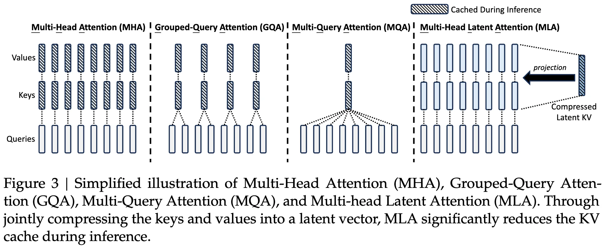
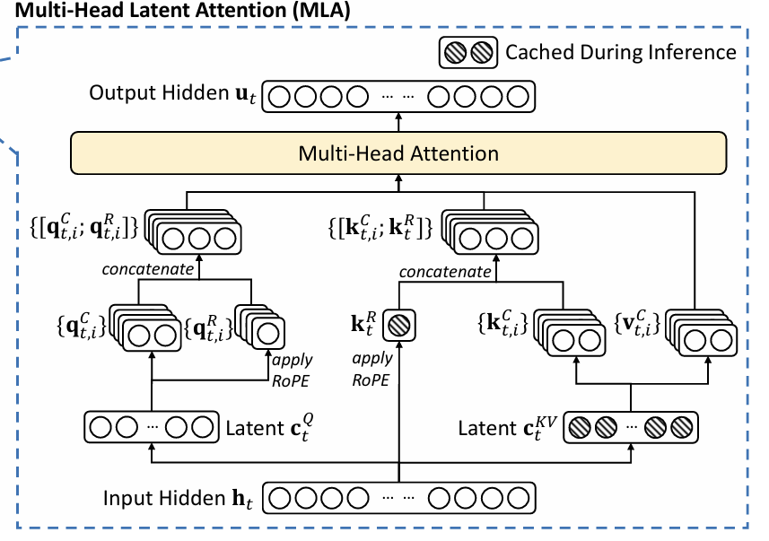
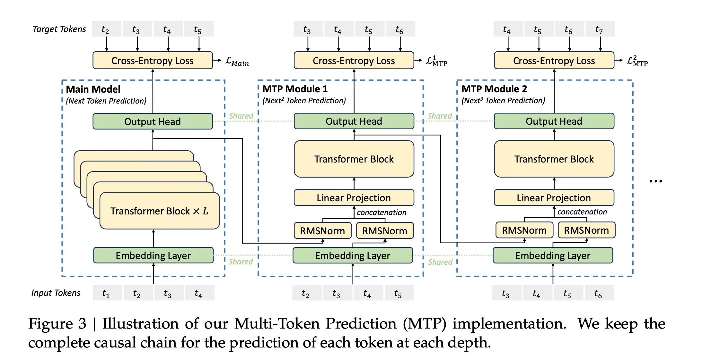

# DeepSeekV3怎样实现“1+1+1-3”的工程优化效果？

你好，我是 Tyler！

在人工智能的发展历程中，工程化实现常常是推动技术突破的关键。早在 2012 年，AlexNet借助 GPU 并行加速、数据增广、Dropout 等“dirty trick”，一举夺得 ImageNet 挑战赛桂冠，极大地改变了当时计算机视觉的研究进程。

与此类似，如今在大模型领域，想要让超大规模模型“又大又快又省”，同样离不开对模型结构和训练推理流程的精心“改造”。

DeepSeek V3 便是这样一个突出的例子。

它所采用的思路非常清晰：在不推翻 Transformer 基本架构的前提下，找出最能影响效率与性能的“瓶颈点”，以相对“小”的改动，换取“大”的收益，从而为大模型落地应用提供了一条更为现实可行的路径。

接下来我们就具体看看 DeepSeek V3 做了哪些工程化优化。

## MLA：多头隐式注意力，降低大模型算力开销

大家对多头注意一定不陌生（前面学习内容，忘了的快回去二刷），自从 Transformer 出现以后，Multi-Head Attention 就成了深度学习圈里的明星机制。不过，随着模型规模越做越大，文本长度也一路从两千多扩展到四千、八千，乃至数万 token，传统多头注意力的计算与存储压力就会以平方级爆发，推理起来常常让人望而生畏。

- 图片来源：DeepSeek V2 Report

面对这个难题，社区早先也想过不少办法，比如让多个 Head 共享查询或者共享 Key/Value。

像 GQA 就是将分组或多查询的概念引入到注意力里，通过少数几个投影来减少重复占用的空间。不过，这些方法序列一旦特别长，注意力的复杂度依然会往 n² 级别飙升。MQA 有太过激进，只留了一组 KV 来作为代表。

DeepSeek V3 的 MLA 思路就相对折中些。它直接给注意力过程加了一道中间环节，也就是让模型先学到一组紧凑的隐式向量。这些隐式向量可以看作是对原始 Key/Value 的可学习压缩。

换句话说，模型并不再为序列中的每个 token 都生成一份完整的 Key/Value，然后再两两交互，而是把那些信息聚合到一块小巧的潜在空间里，再在这里执行多头注意力的计算。

回忆一下我们在《26｜模型工程（二）：算力受限，如何为“无米之炊”？》 中学习的 LoRA的低秩空间表示，这里是同样的道理，我们用一个隐空间配合线性变换还原出完整的 MHA，是不是非常像？

这样一来，在 Prefill 和 Decode 阶段，就不需要面对每个 token 都和所有其他 token 进行全连式的注意力运算，也不用在内存里保存非常庞大的 K/V，对于推理尤其重要的 KV Cache，也能轻装上阵。

虽然在直觉上，这会让人担心会不会丢失一些精细的信息，但事实上，MLA 的核心就是让那部分“压缩”是可学习的，并且依然保留多头机制。这意味着不同 Head 还是可以去关注隐式向量里不同的维度或者特征，从而在保留丰富上下文的同时，大大降低长序列带来的算力和存储负担。

或许你会问，这是不是就能彻底摆脱长文本带来的算力瓶颈呢？

也不能说彻底摆脱。毕竟再好的压缩也会有个“最佳平衡点”，如果隐式向量太少，可能就会损失上下文信息的完整度；如果太多，又会让压缩的优势减弱。因此在实际落地中，还需要根据具体任务的特点，配合调参和结构微调，找到一个既能兼顾性能、又不至于算力负担过大的区间。

不过总的来说，MLA 让我们看到了另一种可能——与其在 n² 上做大量减法，不如在序列表示形成的时候就把 Key/Value 学习得更高效、更紧凑，把注意力范围局限在潜在空间里，不再死板地让每个 token 都要跟所有其他 token 做全交互。

更可喜的是，这种思路还保留了多头的灵活性，保留了深度学习可端到端训练的属性，也就为日后继续迭代改进留下了很大空间。

从 MHA、GQA 到 MQA，再到 MLA，这条演化脉络让我们看到一个趋势：优化多头注意力，最根本的点还是减少重复存储和大规模交互，让模型学会用更紧凑、更聪明的方式表达上下文依赖。

DeepSeek V3 的 MLA 就是把这一理念执行到了极致，配合 RoPE、MTP 等其他部分的改造，形成了一个让大模型兼具性能与效率的整体方案。

## RoPE：让长文本位置编码更灵活、更有效

### 位置编码的困境

Transformer 之所以能够并行处理序列数据，是因为它的自注意力机制无需像 RNN 那样逐步读入。然而，这种并行特性也带来了一个问题：模型需要“显式”知道每个 token 在序列中的位置，否则就无法判断先后顺序。

最早的 Transformer（“Attention Is All You Need”论文）通过正余弦绝对位置编码来解决这个问题。在固定长度的序列里，这种编码表现尚可，但当序列大幅拉长，尤其在超过训练长度时，绝对位置编码经常出现梯度消失和外推性不足等问题。

### RoPE 的原理与优势

为了应对上述困境，DeepSeek V3 采用了 RoPE（Rotary Position Embedding）。

它基于旋转矩阵的思想，将位置信息融入词向量时，不再只关注“词在句子中的绝对位置”，而是更注重“词与词之间的相对位置”。这样一来，模型在处理超长文本时，其内部的注意力计算不容易随着序列变长而出现梯度大幅衰减，还能更好地把握远距离的语义关联。

RoPE 和 MLA 的融合体现在键的生成过程中。如下图所示，RoPE 被应用于键的一部分，而另一部分键则与潜在键值缓存相关联。

通过这种方式，位置信息和缓存机制得以协同工作。RoPE 确保了模型能够理解长文本中的位置关系，而 MLA 则通过缓存减少了计算量，提升了效率。

- 图片来源：DeepSeek-V3 Technical Report

当然，RoPE 并非 DeepSeek V3 独家首创。像 Llama 等其他开源大模型也采用了类似的方法。不过，DeepSeek V3 根据自身架构特点，对 RoPE 进行了多项针对性调优，使其在兼容性上有更出色的表现。

## MTP：一次性多 token 预测，缓解自回归生成的时间“黑洞”

前面课程的学习过，大语言模型（例如 GPT 系列）在推理时，都遵循自回归原则：一次只输出一个 token，再将其拼回到上下文中，继续预测下一个。对于较短文本，这种方法尚能接受，但一旦需要生成几千字甚至上万字，往往要进行数千次甚至上万次推理迭代，效率明显不足。

这一过程的根源在于“逐步预测”，虽然能保证文本连贯与准确度，但会拉长整体生成时间。无论是企业级应用还是用户在线聊天，都迫切希望输出速度能更快、更即时。

- 图片来源：DeepSeek-V3 Technical Report

为了解决上述痛点，DeepSeek V3 引入了多 token 预测（MTP），让模型在一次前向传播中可以同时输出多个后续 token，从而大幅减少了迭代次数。

同样，MTP 并不是 DeepSeek V3 独家原创。此前，业界也有一些并行预测或分块生成的方法，试图让模型一次性输出更多 token。不过，DeepSeek V3 的贡献在于更深入地将并行预测与自回归语言模型的训练目标结合起来，让模型在一次解码循环中就能取得尽可能高的准确度和连贯性。

MTP 想做的就是：不再“一次只拿一个词”，而是在一次前向传播里，直接预测出多个后续token。这样对于相同长度的文本，我们就可以显著减少推理迭代次数，换句话说，少循环几百次乃至上千次，对在线服务而言就是实打实的效率提升。

不过，多 token 预测并不是简单地说“让模型连着输出好几个 token”就行了。想要在可控的范围内一次性输出多步内容，首先需要在训练阶段就告知模型，“我希望你能够具备同时预测下几个词的能力”。这可能会让训练目标更复杂，因为模型要学会在隐藏状态里同时包含更远后续的上下文信息。

DeepSeek V3 的方法通过将多 token 预测融入损失函数，帮助模型在生成多个 token 时，仍能保持语言的一致性与流畅性。同时，如何平衡输出 token 的数量，也是一个至关重要的策略。如果一次性输出太多 token，错误或偏差可能会被放大，影响结果的整体质量；如果输出的 token 太少，又无法有效提高推理效率。因此，模型需要根据任务场景和硬件资源，在速度和生成质量之间找到最佳平衡。

因此，在实际应用中，可以通过结合投机采样算法进行优化：模型先生成多个候选 token 作为草稿，然后通过后续的验证过程，筛选出符合质量标准的前缀。这样不仅能够提升生成效率，还能在确保质量的同时最大化加速推理过程。

DeepSeek V3 通过在初始训练和微调阶段不断地试验和调整，让多 token 预测既能给用户带来明显的速度提升，又不会让文本的连贯度和准确性大打折扣。

## 小结

RoPE、MTP、MLA 这三项改良，实际上对应了大模型在长文本处理、生成速度和注意力计算成本上最核心的痛点。DeepSeek V3 通过对这些关键点的工程化优化，实现了一加一大于三的综合收益，让大模型具备了更好的延展性与实用性。

RoPE 让模型在处理极长序列时不至于出现严重的梯度衰减，并为推理过程中的 KV Cache 提供了更高效的配合。

MTP 有效地缩短了生成文本时的等待周期，提升了应用场景中用户对大模型的交互体验。

MLA 则在不牺牲太多模型性能的情况下，显著降低了多头注意力的计算和内存消耗，为大规模模型落地创造了更友好的环境。

从 RoPE 到 MTP，再到 MLA，这些改进的背后都体现了同一个信念：工程化优化并不是对基础理论的妥协，而是将理论与实践紧密结合，让高深的模型设计能够以更具性价比的方式服务于更广泛的需求。

DeepSeek V3 就是这样一个"拿来主义"的成功案例，在大模型快速演化的当下，再次提醒我们，技术突破常常就源自对“细节处的匠心打造”和“对全局系统的协同把控”。
