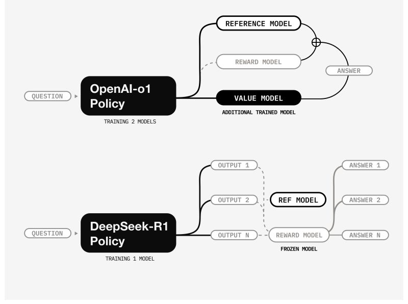

# DeepSeekV3提示语工程和后训练的完美闭环

你好，我是 Tyler！

上一节课中，我们讨论了 Scaling Law 中的第一个重要因素 —— 参数的扩展，了解到大规模参数量如何从根本上影响语言模型的表现。今天，我们将焦点转向“第二阶段：数据的扩展”，也就是在后训练阶段对数据进行的探索，以及这些探索如何影响语言模型的推理能力。

## 预训练：语言模型的基础

在谈数据之前，先回顾一下预训练阶段的关键：在预训练阶段，我们会一次性地向模型提供海量文本数据，让它充分学习语言的词义、语法结构以及基本推理能力。经过这样的过程，模型便具备了初步的语言理解和推理雏形。

有趣的是，研究者在实践中意外发现，某些“提示语”（Prompts）能够让模型产生更好的推理效果。例如“Let’s think step by step”这句话，在处理复杂问题时，能引导模型把问题拆解成更小、更易处理的部分，然后逐步推理得出答案。

但需要注意的是，这些提示语往往带有“偶然性”，是在大量试错中意外发现的。有时对某些特定任务效果立竿见影，却无法应对更精密、更复杂的推理需求。

于是，在预训练阶段获得的所有提示语，更像是一个“彩蛋”，它们虽然为模型提供了思路，但无法完整支持多样且高难度的场景。这就引出了我们今天的重点：后训练阶段的数据探索。

## 后训练：将“灵感”转化为稳定能力

后训练指的是在模型已经拥有基础语言和推理能力后，再通过针对性的数据和任务，强化或微调模型的表现。目标是把预训练阶段意外找到的有效提示语，变成模型在任何场景下都能稳定触发的“技能”。

为此，研究人员会利用多样化的提示语工程方法，构造出针对性的训练数据，让模型不断练习如何在不同任务与上下文中应用这些提示语。例如，输入端可能是用户的指令，输出端则是模型通过若干工具使用步骤组合出来的思维过程，这些真实或模拟的场景有助于模型学会灵活激活相关推理知识。

此外，专家反馈在这个过程中也起到了至关重要的作用。每当模型在较难的推理任务上出现偏差或不稳定，研究团队都会分析其原因并再次进行针对性调整。随着不断迭代和打磨，模型与提示语之间的“默契”便逐渐形成，一句简单的“Let’s think step by step”也能在关键时刻引导模型沿着正确的推理路径前进。

从预训练到后训练的两阶段对比可见：

- 预训练：为模型打下语言和初步推理的基础，并偶然获得一些提示语。

- 后训练：有针对性地放大和固化这些提示语的优势，使其在复杂任务中依旧稳定高效。

只有将这两个阶段紧密结合，才能让提示语从一次“偶然发现”真正成为大幅提升推理表现的“关键武器”。

## DeepSeek V3 的指令微调对齐

在真实应用中，用户的指令形态千差万别，为了让模型能灵活应对，DeepSeek V3 对后训练阶段的重点调整之一是指令微调对齐。

为达成这一目标，需要收集大量真实场景下的指令数据，涵盖问答、任务规划、信息检索等多个领域。每条指令背后都隐藏着用户的真实意图。经过专家的严格标注和校验后，模型在微调时不仅仅停留于“字面匹配”，还能深入到更深层次的语义理解。

在具体的微调过程中，DeepSeek 采用了类似多任务联合训练的方法。

具体而言，每一类“好用”的提示词可以视为一种任务，DeeSeek 针对这些高频的任务生成了大量的微调数据，确保模型能够在面对不同任务时，自动提炼出共同的语义特征和推理路径。实时反馈机制则确保了模型在每次回答出现偏差时，都能被系统记录并在后续训练中得到修正。

通过不断迭代与打磨，DeepSeek V3 在理解和响应各种复杂指令方面已经达到了非常高的水平。

## DeepSeek V3 的强化学习对齐

在完成指令微调对齐后，DeepSeek V3 更进一步，通过强化学习（RL）的方式实现模型在持续交互中的“自我进化”。

我们为模型设计了一套细致的奖励体系，对答案的逻辑性、准确性以及与指令契合度进行打分——输出多步推理、逻辑清晰的答案得高分，偏离用户意图或不连贯的回答则被“扣分”。

在这个过程中，模型被放置在一个模拟的真实场景环境中，与虚拟用户进行多轮交互。每一次交互结束后，系统都会根据任务完成情况和用户反馈，对模型进行即时评估。这样一来，模型就可以通过不断的试错，逐渐优化自己的推理路径和响应策略。

强化学习的优势在于它可以使模型不再依赖于预先设定好的固定规则，而是能在不断变化的场景中，自动寻找最优的应对方案。此外，我们还引入了真实用户参与在线实验，这部分数据进一步丰富了模型的训练样本，确保了 DeepSeek V3 在面对各种复杂任务时，都能保持极高的稳定性和适应性。

## 引入 GRPO 的目的和价值

具体而言，DeepSeek V3 使用了一项关键技术 GRPO 来进一步强化模型的自我进化能力。

GRPO，其实可以看作是对传统强化学习对齐方法 RLHF 的一次重大升级。它不仅在策略更新过程中加入了奖励平滑与调控机制，更注重从长远反馈中提取信息，让模型在不断试错的过程中保持稳定性和高效性。

- 图片来源：Databiomes Con-Fonder

先说传统的 RLHF 方法，也就是 OpenAI-o1 Policy 采用的方案。

在这个方法里，模型要经过多个环节优化。用户输入一个问题后，策略模型（Policy） 会先给出一个回答，这个回答会被参考模型（Reference Model） 和奖励模型（Reward Model） 评估，然后再通过额外训练的价值模型（Value Model） 进一步优化答案。

虽然这种方式能提升回答质量，但问题在于，价值模型本身需要单独训练，这不仅增加了计算成本，而且优化流程变得更复杂。

而 DeepSeek V3 采用的是 GRPO 方法，它的做法就简洁多了！对比一下两张架构图就能看出，DeepSeek-R1 Policy 只需要训练一个策略模型。

它的策略是：让模型一次性生成多个候选答案（比如 Output 1、Output 2……Output N），然后让冻结的参考模型（REF Model） 和奖励模型（Reward Model） 直接对这些答案进行评估，最终选出最优答案。这样一来，不需要额外训练价值模型，整个优化流程轻量化了，计算开销也减少了不少！

通过 GRPO，DeepSeek V3 不用训练额外的价值模型，但却能让模型更稳定、更聪明，在动态交互过程中不断提升推理能力。

## 小结

学到这里，总结一下今天的内容。

我们首先聊了预训练阶段，这个阶段就像是给模型上一堂语言的基础课，让它从海量文本中吸收语言、语法和基本推理的知识。

在这个过程中，模型顺便“捡”到了一些有效的提示语，不过仅靠这种偶然发现的提示语，往往难以应对特别复杂或者需要细致推理的任务。

于是，我们又进入了后训练阶段。后训练的目的，就是让预训练阶段学到的那些“灵感”得以放大和固化。通过不断微调和构造多样化的训练数据，利用提示语工程的方法，让模型在各种场景下都能稳定地应用这些提示语。

接下来，我们详细讨论了 DeepSeek V3 的两个重要对齐机制。

首先是指令微调对齐，通过收集海量真实场景的指令数据，再经过专家的严格标注，让模型不仅能够捕捉到指令的表层含义，更能深刻理解用户真实意图。然后，我们讲到了强化学习对齐，这里核心在于通过设计精细的奖励体系，鼓励模型输出逻辑严谨、推理完整的答案。

最终，DeepSeek V3 在这套多重对齐机制的加持下，不仅在静态数据层面实现了对指令的深层理解，也在动态交互中不断优化自身表现。那些看似简单的提示语，也从一次“偶然发现”蜕变成了模型推理的强大武器，让语言模型的能力得到进一步解放。

通过这一系列讨论，希望大家能更清楚地了解到：参数扩展与数据扩展同样重要，两者相辅相成，才能让语言模型从“会用语言”进化到“深度理解与推理”。下一次，我们将一起进入第三阶段，继续探索当下最热门的推理机制。
