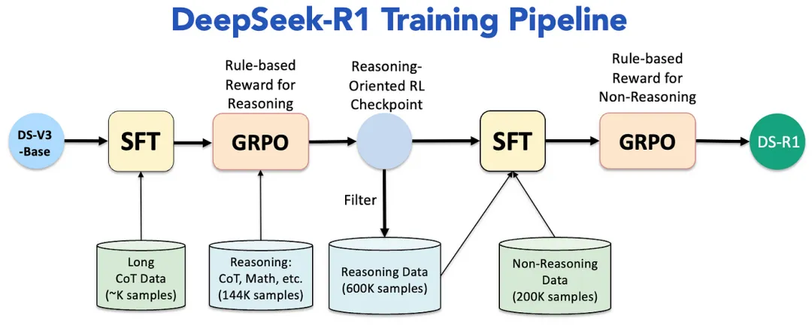

# ScalingLaw从训练时到推理时的转移

你好，我是 Tyler！

今天我们来到了一个非常关键的话题：如何让模型在推理时变得更“聪明”、更“灵活”，而不是一味地用“蛮力”。

前面几节课，我们一步步揭开了 LLM Scaling Law 的面纱。

我们首先理解了模型如何通过惊人的参数量扩展，从根本上拓宽了其学习和记忆的“边界”，拥有了更广阔的知识基础。

接着，我们看到了模型能力从“知道”到“会用”的转变。这得益于高质量数据的投喂，以及通过后训练（Post-training），特别是精巧的提示词工程（Prompting）和对齐技术（Alignment），将预训练阶段获得的原始能力，转化为模型在面对多样化指令时稳定、可靠的推理技能。

然后，我们探讨了将这些庞大而强大的模型投入实际使用的工程化智慧。以 DeepSeek V3 为例，了解了 MLA，RoPE，MTP 等一系列创新技术，它们如何在不牺牲性能的前提下，大幅提升模型的计算效率和处理超长文本的能力，为大模型的实际部署铺平了道路。

通过以上这些努力，我们确实构建了规模庞大、能力扎实，并且运行效率显著提升的模型。这些模型在许多标准的评测基准（Benchmarks）上表现出色，看起来无所不能。

但现实世界的推理，远比基准测试复杂！

想象一下，真实世界用户的提问是多么千变万化：输入可能模糊不清，任务需求可能层层递进，问题的难度更是天壤之别——从简单的“某某是什么？”到需要严谨逻辑推理、复杂计算甚至多步骤规划的难题。

如果模型仅仅依赖训练阶段学到的、相对固定的计算路径和模式匹配能力来处理所有输入，就会遇到两个问题：

1. “杀鸡用牛刀”：对于简单的任务，模型可能过度启动复杂的内部机制，白白浪费计算资源和时间。

2. “有力使不出”：对于复杂的任务，即使模型参数中蕴含着解决问题的“智慧”，但也可能因为无法触发恰当的、更深入的思考过程，而无法充分发挥潜力，给出平庸甚至错误的答案。

这就揭示了 Scaling Law 在训练阶段赋予模型的“潜在能力”（Potential Capability）与 模型在推理阶段实际展现出的“应用表现”（Applied Performance） 之间存在一个关键的“鸿沟”。我们需要一种机制来智能地桥接这个鸿沟。

## 从“潜力库”到“按需智能”：动态推理的必要性

通过 Scaling Law 训练出的模型，就像一位学富五车的学者，脑子里储存了海量知识和各种解决问题的思路。但当被问到一个具体问题时，这位学者不会把脑子里所有相关知识一股脑倒出来。他会根据问题的类型和难度，快速判断需要思考多久、思考多深、需要哪些步骤，然后有针对性地提取、组合信息，甚至进行多步的逻辑推演。

对于 LLM 来说，这种 “根据任务的需要，动态地调整计算资源和策略” 的能力，正是实现从“无所不能的潜力库”到“按需提供智能服务”的关键。

传统的推理方式，我们称之为“静态推理”，意味着无论问题简单还是复杂，模型都大致遵循相同的计算流程和资源消耗。

这显然不够灵活。因此，我们需要引入动态推理机制（Dynamic Inference Mechanisms），有时也被称为测试时适应（Test-Time Adaptation, TTA）或条件计算（ConditionalComputing）。它的核心目标是让模型在推理时具备感知任务需求，并据此智能地调整其“思考方式”的能力。

我们可以借用诺贝尔奖得主丹尼尔·卡尼曼提出的“快思慢想”（Thinking, Fast and Slow）双系统理论，来理解动态推理的技术框架：

系统 1（快思考 / 默认路径）：想象这是模型处理常见、直接任务时的“直觉”模式。

- 特点：快速、低计算量。

- 依赖：模型在海量数据中学习到的强大统计模式和关联性。

- 适用场景：回答简单的常识问题、基础文本补全、快速情感判断等。可以看作是静态推理模式下的主要运行方式。响应速度快，成本低。

系统 2（慢思考 / 动态路径）：想象这是模型处理复杂任务时的“理性分析”模式。

- 特点：需要更高计算量、更具反思性或逐步执行。

- 触发：当输入任务被判定为复杂（例如，需要精确计算、多步逻辑推理、遵循复杂指令）或初步判断结果不确定时。

- 目的：激活模型更深层的推理能力，进行更细致、更严谨的分析。

- 适用场景：解决复杂的数学应用题、多步规划、生成结构化代码、深度摘要、批判性分析与自我纠错等。计算成本较高，延迟可能增加，但能处理更难的任务。

一个广为人知的例子是早期 GPT 模型在计算单词“strawberry”中字母“r”数量时出现的错误（误算为 2 而非 3）。这个问题很有启发性，因为它类似我们人类数汉字笔画——我们的“系统 1”无法一眼给出答案，需要启动“系统 2”，有意识地、按步骤地去数。

这个例子表明，即使参数巨大的模型，在需要精确的符号操作（如计数、精确匹配、严格规则遵循）而非仅仅依赖统计关联的任务上，也可能“想当然”地出错。

## 实现动态推理的技术路径

要赋予模型这种“快慢结合”的动态能力，本质上是增强模型在推理阶段的“思考流程”。目前主要探索的技术路径包括：

生成并执行内部计划 / 步骤（Generating & Executing Internal Plans/Steps）：对于需要多步解决的任务，模型不是试图一步给出最终答案，而是在内部先规划一个解决问题的步骤序列（这就是我们常说的“思维链”，Chain-of-Thought, CoT）。

然后，模型按照这个内部计划，逐步进行计算和推理，最终得出结论。这就像在模型内部实现了一个简单的“规划师 + 执行者”。

不确定性驱动的计算分配（Uncertainty-Driven Computation Allocation）：训练模型自身或一个辅助模块来估计它对自己当前输出或最终答案的置信度。当模型觉得“有点不确定”时，系统就会触发额外的计算资源——比如，要求模型生成更长的推理过程、尝试从不同角度思考（多次采样），或者激活专门的模块来进行结果验证或自我反思。这个过程会持续到模型达到足够的置信度或用尽分配的资源。

这两种技术路径，特别是对逐步计算（思维链）和可能需要更详尽输出（长输出）的需求，共同指向了今天讨论的核心——长思维链（Long Chain-of-Thought）技术及其背后的动态计算思想。

OpenAI 的 GPT-o1 模型，被认为是展示了这种“系统 2”计算能力的先驱。它似乎能够在识别出需要精确度的任务时（比如上面那个数“r”的例子），触发模型内部一个更严谨、更接近算法流程的计算过程，比如模拟逐字符检查或进行多次验证。不过，OpenAI 并未公开其实现这些动态优化细节。

正是在这个背景下，DeepSeek-R1 为社区提供了一个宝贵的开源范例。它具体展示了如何通过精心构造数据和训练方法，让模型学会在输出时产生尽可能长的、有条理的思考步骤。

## DeepSeek-R1：开源的长思维链构造范例

DeepSeek-R1 模型的出现，为我们理解和构建具备“慢思考”能力的 LLM 提供了一个具体的路线图。它并没有像 OpenAI 那样神秘，而是通过一套可复现的方法，让模型学会生成详细的思考过程。

- 图片来源：网络

DeepSeek-R1 为构建具备“慢思考”能力的 LLM 提供了一个具体的开源路径。它通过一套多阶段的训练流程，让模型学会生成详细的思考过程。参照 DeepSeek-R1 训练流程图，这个流程可以概括为以下关键步骤。

训练始于基础模型 Deepseek-V3。首先，模型通过监督微调（SFT）学习一份包含高质量长思维链示例的“种子数据集”（Long CoT Data），初步掌握生成结构化思考过程的能力。

接着，进入第一个 GRPO 强化学习阶段，主要针对推理任务（如 CoT, Math），利用基于规则的推理奖励（Rule-based Reward for Reasoning），激励模型生成更长、更详细、更准确的推理步骤。

经过推理导向的强化学习后，模型生成一个检查点。图中的 Filter 环节模型被用于生成或处理新的推理数据（Reasoning Data），用于后续更大规模的训练。随后模型再次进行 SFT，这次的数据更加多样化，包含生成的推理数据以及非推理数据（Non-Reasoning Data），旨在巩固推理能力的同时，提升模型的全面性。

最后，整个流程在第二个 GRPO 阶段完成精调，通过基于其他奖励规则，优化模型在各类任务上的综合表现。

这个多阶段的训练管线，结合了 SFT 的模仿学习和 GRPO 强化学习的奖励塑形，是DeepSeek-R1 系统性培养模型生成详细、正确思维过程的关键。

DeepSeek-R1 的最大价值在于其开源性。它不像专有模型那样不透明，为社区提供了一个高性能、可供研究和改进的长思维链构建实践范例，极大地降低了相关技术的探索门槛，有助于加速整个领域在复杂推理能力上的进步。

## 小结

学到这我们做个总结吧。今天，我们探讨了 Scaling Law 赋予模型的潜力，如何通过动态推理转化为在复杂真实世界任务中的实际智能。我们认识到静态推理的局限性，并将动态推理映射到类似人类“快思慢想”的双系统框架。

我们了解了实现这种动态性的技术路径（CoT、不确定性驱动计算），并通过 GPT-o1 的概念和 DeepSeek-R1 这个开源案例，看到了业界和社区在这一方向上的具体实践。

动态推理是大语言模型迈向真正实用的关键一步。它标志着我们从仅仅追求“模型大”向追求“模型巧”和“模型活”转变。

尽管潜力巨大，动态推理的实现和推广仍面临挑战。现在的 Deepseek 还是会出现一些过渡推理的问题，虽然这在结果上往往不会带来负向收益，但是在成本上仍然是一个挑战。未来的研究将继续在如何设计更智能的“判断模块”、更高效的动态计算路径以及更适配的训练方法上深入探索。

下一节，我们将继续拓展视野，探讨 DeepSeek 开源对整个行业格局的影响。敬请期待！
